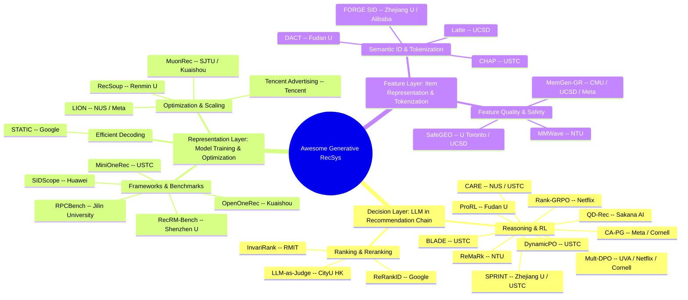

# Awesome Generative Recommendation System (RecSys)

```
 ██████╗                ██████╗                ███████╗                
██╔════╝  ███╗  ███╗    ██╔══██╗ ███╗   ███╗   ██╔════╝██╗ ██╗ ██████╗ 
██║      ██╔═██╗████╗   ██████╔╝██╔═██╗██╔═██╗ ███████╗╚██╗██║ ██╔═══╝ 
██║  ███╗██████║██╔██╗  ██╔══██╗██████║██║ ╚═╝ ╚════██║ ╚███╔╝ ██████╗ 
██║   ██║██║    ██║╚██╗ ██║  ██║██║    ██║ ██╗      ██║  ██╔╝      ██║
╚██████╔╝╚████╗ ██║ ╚██╗██║  ██║╚████╗ ╚███╔═╝ ███████║  ██║   ██████║
 ╚═════╝  ╚═══╝ ╚═╝  ╚═╝╚═╝  ╚═╝ ╚═══╝  ╚══╝   ╚══════╝  ╚═╝   ╚═════╝
```
---

[](https://github.com/sindresorhus/awesome)

RecSys is starting to adopt LLM for feature extraction, retrieval, and ranking/re-ranking! Although you can get some hands-on materials in either the [classics](#papers-classic-must-read) or some surveys, but since you're already interested in applying generative AI to industrial tasks, you probably wanna stay on the bleeding edge, right? That's exactly what this repo is for — automatically updated daily by agents with the latest generative RecSys papers fresh off arXiv, making sure that you never miss a beat.

> [!IMPORTANT]
> For those who are not familiar with GenRec, or not even the recommendation system, please checkout the kickstart posts [here](docs/kickstart.md).
> These posts are in Chinese, for English simply do your browser's internal translation or turn to __Ask Gemini__ :shipit:

## Quick Indexing
- [By Date](#by-date)
- [By Opensource](#by-opensource)
- [By Keyword](#by-keyword)
- [By Affiliation](#by-affiliation)
- [Papers Classic Must Read](#papers-classic-must-read)
- [Verl-GR: An Awesome RL Toolkit for GenRecSys](#verl-gr-an-awesome-rl-toolkit-for-genrecsys)



<div align="center">
  <i> Open-source Generative RecSys Map </i>
</div>

---
## `Verl-GR`: An Awesome RL Toolkit for GenRecSys
If you are interested in RFT your own GenRecSys, come check out our `verl`-based implementation called `verl-gr` here:
* [https://github.com/HaFred/verl-GR/tree/main/verl_gr/recipes/openonerec](https://github.com/HaFred/verl-GR/tree/main/verl_gr/recipes/openonerec)
* [https://github.com/HaFred/verl-GR/tree/main/verl_gr/recipes/rankgrpo](https://github.com/HaFred/verl-GR/tree/main/verl_gr/recipes/rankgrpo)

We manage to achieve 22% and 32% boosting for the end-to-end training efficiencies, compared with their respective vanilla implementations.

## By Date

We only keep the last 10 days summary below, for the past records before these, please see [the archive](docs/archive_by_month).

---

### Papers October 19

*Monday, October 19, 2026. The live arXiv cs.IR recent-submission window (announced Oct 14-19) surfaced 6 on-topic generative-recommendation papers that were new to the README (verified not already indexed); all drawn from the recent announcement batch (submitted Oct 12-16). 4 are open-source (ReRankID / Google & University of Toronto, 7/10; QD-Rec / Sakana AI, 6/10; RecSoup / Renmin University of China, 6/10; MMWave / Nanyang Technological University, 6/10). Total: 6 papers (4 opensource). By Opensource count 222 -> 226.*

1. **Reasoning Reranking with Semantic IDs as the Sole Item Representation (ReRankID)**
   * Affiliation: Google / University of Toronto — *(Zhenwei Tang, Jintao Liu, Di Bai, Xidong Wu, Xinwu Cheng)*
   * Link: [arxiv.org/abs/2610.22797](https://arxiv.org/abs/2610.22797)
   * Venue: arXiv preprint, October 2026 (cs.IR, cs.CL, cs.LG; submitted 16 Oct 2026)
   * TL;DR: ReRankID builds a controlled testbed where LLM rerankers must reason and rerank a candidate slate shown only as Semantic IDs (no item text), and shows post-training (SFT, rejection-sampled self-training, on-policy distillation, verifier-based RL) is required to elicit real ranking behavior from SIDs; an 8B model trained with a graded ranking reward matches text-reading LLM rerankers whose prompts are ~20x longer.
   * Key techniques:
     - SID-only reranking testbed: history + slate rendered only as SIDs, with rendering, history length, and slate size varied one at a time
     - Diagnosis: base models copy the input order instead of reranking, and readable metadata does not repair the failure
     - Post-training methods compared: SFT, rejection-sampled self-training (RFT), on-policy distillation (OPD), and RL with verifiable rewards (RLVR)
     - 8B RLVR model matches strong text-reading LLM rerankers at ~20x shorter prompts and ranks above random with no history at all
   * Scores (Opensource? / Novelty / Fairness / Robustness / Impact):
     - **Opensource?: 7/10** — Code released (github.com/lilv98/ReRankID) plus a Hugging Face dataset (bench/SFT/RFT/OPD/RLVR data and per-user outputs); Apache-2.0; thorough data+code release, but brand-new (0 stars) and prompts/rationales are in Chinese.
     - **Novelty: 8/10** — Isolates the "rank from SIDs alone" problem and shows RLVR-style post-training is what elicits it; a clean controlled study of SID-only reranking.
     - **Fairness: 0/10** — Not addressed.
     - **Robustness: 8/10** — Controlled sweeps over history length, slate size, and SID rendering; 8B vs 1.7B; paired rationale audit.
     - **Impact: 8/10** — Directly relevant to generative recommenders that use SIDs (e.g., OpenOneRec); shows SID tokens carry behavioral signal usable for reranking.

2. **QD-Rec: Open-Ended Evolution of Recommendations via Quality-Diversity**
   * Affiliation: Sakana AI — *(Takashi Ishida, Taro Makino, Issa Sugiura)*
   * Link: [arxiv.org/abs/2610.23470](https://arxiv.org/abs/2610.23470)
   * Venue: arXiv preprint, October 2026 (cs.IR, cs.AI, cs.LG, cs.NE; submitted 16 Oct 2026)
   * TL;DR: QD-Rec extends open-ended search (foundation-model-driven discovery) to recommendation for high-stakes decision-making, formalizing open-ended recommendation as building a diverse, high-quality archive of item-hypothesis pairs selected by a contextual bandit and generated by a foundation model from prior stepping stones.
   * Key techniques:
     - Quality-Diversity formulation: each recommendation is an item together with a natural-language hypothesis (why it fits the decision maker)
     - Contextual bandit selects items; foundation model generates hypotheses from an archive of earlier ones kept as stepping stones
     - Archive admission: a new item-hypothesis enters if it is novel or better than its nearest neighbor
     - Evaluated on M&A, customer targeting, and paper/book recommendation
   * Scores (Opensource? / Novelty / Fairness / Robustness / Impact):
     - **Opensource?: 6/10** — Code released (github.com/SakanaAI/QD-Rec, Sakana AI official repo), but stars/license could not be confirmed via the GitHub API at integration time; reference implementation.
     - **Novelty: 8/10** — Maps open-ended/quality-diversity search to recommendation and reframes rec as archive-building over reasons rather than a single ranked list.
     - **Fairness: 0/10** — Not addressed.
     - **Robustness: 7/10** — Across three domains (M&A, customer targeting, paper/book rec) it gives the highest mean quality and largest archive; baselines are limited.
     - **Impact: 7/10** — An interesting paradigm for high-stakes decision recommendation; connects foundation-model open-endedness to RecSys.

3. **RecSoup: Efficient Model Merging Approach for Controllable Multi-Objective Recommendation**
   * Affiliation: Renmin University of China — *(Zidong Jia, Guofu Xie, Xiao Zhang)*
   * Link: [arxiv.org/abs/2610.21220](https://arxiv.org/abs/2610.21220)
   * Venue: CIKM 2026, October 2026 (cs.IR, cs.AI; submitted 15 Oct 2026)
   * TL;DR: RecSoup does Controllable Multi-Objective Recommendation (CMOR) via model merging: it prunes to reduce cross-objective interference and then adaptively merges objective-specific models with a learnable preference-to-coefficient map, enabling dynamic trade-off control at inference with 165-228x faster latency than parameter-generation approaches.
   * Key techniques:
     - Two-stage CMOR via specialized model merging (reuse objective-specific models by parameter combination)
     - Pruning strategy that jointly considers objective-specific importance and cross-objective relevance to mitigate parameter interference
     - Learnable preference-to-coefficient mapping for dynamic trade-off control at inference (no joint retraining, no generative module)
     - Theoretical proof that it navigates the full Pareto front without smoothness constraints
   * Scores (Opensource? / Novelty / Fairness / Robustness / Impact):
     - **Opensource?: 6/10** — Code released (github.com/35798642/RECSOUP) for this CIKM 2026 paper, but it is a personal repo with no license file and 1 star; code available though modestly maintained.
     - **Novelty: 7/10** — Applies model merging to CMOR and addresses the missing shared linear regime / cross-objective interference; with a theoretical Pareto-front claim.
     - **Fairness: 0/10** — Not addressed.
     - **Robustness: 7/10** — Multiple benchmarks; improved Pareto-front quality and controllability; compared against parameter-generation approaches.
     - **Impact: 7/10** — Practical CMOR with large inference-speed gains; relevant to industrial multi-objective recommendation.

4. **Tackling the Modality Inhibitance Effect with Wavelet-based Modality Integration in Multi-modal Recommendation (MMWave)**
   * Affiliation: Nanyang Technological University, Singapore — *(Rongqing Kenneth Ong, Andy W. H. Khong)*
   * Link: [arxiv.org/abs/2610.16229](https://arxiv.org/abs/2610.16229)
   * Venue: IEEE TKDE 2026, October 2026 (cs.IR, cs.MM; submitted 12 Oct 2026)
   * TL;DR: MMWave identifies the "modality inhibitance effect" - a performance drop when multi-modal recommenders move from dual- to tri-modal - and proposes a multi-scale wavelet recommender that extracts non-redundant modality features via wavelet decomposition, plus a structure-aware graph module and an adaptive modality regulator.
   * Key techniques:
     - Modality inhibitance effect: the newly added modality introduces modal-specific contamination and excessive redundancy, degrading existing MRSs
     - Multi-scale wavelet (MMWave) decomposition (time & frequency) to keep only essential, non-redundant modality features
     - Structure-aware multi-modal graph learning module capturing high-order latent item structure
     - Adaptive modality regulator with a cross-weight integration strategy
   * Scores (Opensource? / Novelty / Fairness / Robustness / Impact):
     - **Opensource?: 6/10** — Code released (github.com/kennethorq/MMWave) for this IEEE TKDE 2026 paper, but no license file and 1 star; code available though modestly maintained.
     - **Novelty: 7/10** — Names and addresses the modality inhibitance effect; wavelet-based multi-scale integration for multi-modal recommendation.
     - **Fairness: 0/10** — Not addressed.
     - **Robustness: 7/10** — Four real-world datasets; component ablations.
     - **Impact: 6/10** — A solid multi-modal recommendation contribution; IEEE TKDE.

5. **Bridging the Topological Divide: Dual-Branch Graph Distillation with Semantic Priors for Robust Cold-Start Recommendation (DualGCN)**
   * Affiliation: The Hong Kong University of Science and Technology (Guangzhou) — *(Yuanfeng Qiu)*
   * Link: [arxiv.org/abs/2610.19578](https://arxiv.org/abs/2610.19578)
   * Venue: arXiv preprint, October 2026 (cs.IR, cs.LG; submitted 14 Oct 2026)
   * TL;DR: DualGCN is a dual-branch graph knowledge-distillation framework for strict cold-start recommendation: a teacher anchors item representations with a topology-smoothed semantic prior, and a semantic student branch aligns features to the collaborative space via residual mapping and a magnitude-agnostic cosine distillation objective, plus dynamic norm reconstruction for global-retrieval calibration.
   * Key techniques:
     - Decoupled two-stage training: a robust collaborative teacher with a topology-smoothed semantic prior, then a semantic student branch
     - Residual mapping mechanism + magnitude-agnostic cosine distillation to align cold-start nodes without disrupting collaborative signals
     - Dynamic norm reconstruction to calibrate the physical scales of novel vs warm items during global retrieval
   * Scores (Opensource? / Novelty / Fairness / Robustness / Impact):
     - **Opensource?: 0/10** — No public code link in the arXiv abstract/comments; 0/10.
     - **Novelty: 7/10** — An asymmetric dual-branch distillation that decouples topology from semantics for strict cold-start.
     - **Fairness: 0/10** — Not addressed.
     - **Robustness: 6/10** — Three real-world benchmarks; but no error bars/significance tests and reviewers flag a possible PCA data-leakage risk that needs clarification.
     - **Impact: 6/10** — Addresses a real cold-start representation collapse; credible but the leakage concern should be cleared.

6. **LSNR: Learned Sparse News Recommendations with Attentive User Modeling**
   * Affiliation: University of Amsterdam — *(David Vos, Andrew Yates, Maarten de Rijke)*
   * Link: [arxiv.org/abs/2610.23510](https://arxiv.org/abs/2610.23510)
   * Venue: SIGIR-AP 2026, October 2026 (cs.IR; submitted 16 Oct 2026)
   * TL;DR: LSNR is a learned sparse approach for news recommendation that encodes each article independently and builds a sparse user vector via attention-based weighting of per-article sparse representations plus a dense-projected expansion, overcoming the concatenation/truncation bottlenecks of STAR and beating dense recommenders in short-history settings.
   * Key techniques:
     - Learned sparse representation per article (each article encoded independently)
     - Attention-based aggregation of per-article sparse representations into a sparse user vector, plus a dense-projected expansion at the user level
     - Serves from an index about an order of magnitude smaller than an uncompressed dense baseline
     - Evaluated on the MIND and EBNeRD datasets
   * Scores (Opensource? / Novelty / Fairness / Robustness / Impact):
     - **Opensource?: 0/10** — No public code mentioned (SIGIR-AP 2026); 0/10.
     - **Novelty: 7/10** — Attention-based learned sparse user modeling for news; addresses the concatenation and context-window truncation bottlenecks of existing learned-sparse recs.
     - **Fairness: 0/10** — Not addressed.
     - **Robustness: 7/10** — MIND + EBNeRD; ablation of the user encoder; gains hold even in short-history settings.
     - **Impact: 7/10** — A practical learned-sparse news recommendation method; competitive with dense recommenders and better under short history.

---

### Papers October 18

*Sunday, October 18, 2026. The live last-24h arXiv cs.IR window (announced Oct 17-18) carried no strictly on-topic generative-recommendation papers in the recent pool, so per the fallback rule we drew 5 on-topic papers from the last-3-month keyword pool. 3 are open-source (ReMaRk / Nanyang Technological University, 7/10; SemPOI-RL / Beihang University, 6/10; Vela / AllSpark at Xiaohongshu, 6/10). Total: 5 papers (3 opensource). By Opensource count 219 -> 222.*

1. **ReMaRk: Many Right Answers, One Training Example: Removing Responder Noise from GRPO for LLM Recommenders**
   * Affiliation: Nanyang Technological University, Singapore — *(Xin Li, Hao Jiang, Jinghao Guo, Weisi Lin, Chau Yuen)*
   * Link: [arxiv.org/abs/2610.17771](https://arxiv.org/abs/2610.17771)
   * Venue: arXiv preprint, October 2026 (cs.CL; submitted 13 Oct 2026)
   * TL;DR: When an LLM recommender is trained with GRPO on threads where many replies name different items, the usual "one reply per example" recipe mostly rewards which reply was drawn (85% of advantage variance) rather than list quality; ReMaRk instead scores every list once against the union of all replies and samples each request equally, reaching 2,000-step recall in 25-53% of the steps.
   * Key techniques:
     - Responder-noise diagnosis: shows Rank-GRPO's per-example advantage variance is dominated (85%) by which reply was randomly drawn
     - Union-reward RL: score a generated list once against the union of all responders' titles, one training example per request
     - Budget-matched comparison: ReMaRk reaches the validation recall of 2,000 per-reply RL steps in 25-53% of the steps and never falls significantly behind Rank-GRPO
     - Validated on 7 backbones x 3 datasets (Reddit movie/book/music); the same reward helps ProtoQA (approx 100 answers/question)
   * Scores (Opensource? / Novelty / Fairness / Robustness / Impact):
     - **Opensource?: 7/10** — Code released (github.com/LiXin97/ReMaRk) under Apache-2.0 with 23 checkpoints on Hugging Face and a CC BY-NC 4.0 data release; depends on third-party Rank-GRPO code/data not redistributed here.
     - **Novelty: 8/10** — Reframes GRPO for recommenders as "train on the request, not on each answer" and exposes responder noise as the dominant advantage-variance source; a clean, general fix for RL with multiple valid answers.
     - **Fairness: 0/10** — Not addressed.
     - **Robustness: 7/10** — Evaluated across 7 LLM backbones and 3 datasets with consistent, significant gains and paired-bootstrap CIs.
     - **Impact: 8/10** — Directly improves the state-of-the-art Rank-GRPO recipe; cheaper, more stable RL with broad applicability to any multi-answer recommendation/QA setting.

2. **SemPOI-RL: Aligning LLM Semantic Reasoning for Interpretable Out-of-Town POI Sequential Generation**
   * Affiliation: Beihang University — *(Yunqi Liu, Yang Zhang, Ruixing Zhang, Liangzhe Han, Yi Qiao, Tongyu Zhu, Leilei Sun)*
   * Link: [arxiv.org/abs/2608.30399](https://arxiv.org/abs/2608.30399)
   * Venue: arXiv preprint, August 2026 (cs.CL, cs.AI; submitted 31 Aug 2026)
   * TL;DR: SemPOI-RL aligns an LLM's semantic reasoning with structured sequence generation for interpretable out-of-town POI recommendation: it infers destination-oriented travel styles in natural language, grounds them via a Semantic POI Alignment Module into a style-conditioned masked autoencoder, then RL-aligns styles with downstream sequence quality.
   * Key techniques:
     - LLM fine-tuning to infer destination-oriented travel styles from hometown trajectories, using natural language as an interpretable semantic intermediate
     - Semantic POI Alignment Module (SPAM): grounds inferred styles into a style-conditioned masked autoencoder for position-aware trajectory generation
     - Reinforcement learning with recommendation-oriented rewards to align LLM-generated styles with downstream sequence quality
     - Interpretable style attribution across trip phases; evaluated on two real-world POI datasets
   * Scores (Opensource? / Novelty / Fairness / Robustness / Impact):
     - **Opensource?: 6/10** — Code released (github.com/Wind-Flipped/SemPOI-RL); no explicit license file and modest maintenance.
     - **Novelty: 7/10** — Joins LLM semantic reasoning with structured POI generation via an interpretable natural-language style bridge and SPAM grounding; addresses out-of-town cross-city interest drift.
     - **Fairness: 0/10** — Not addressed.
     - **Robustness: 7/10** — Beats traditional recommenders and direct-LLM baselines on two real-world datasets with interpretable attributions.
     - **Impact: 7/10** — Interpretable LLM-based POI/travel recommendation with a concrete RL-alignment recipe; practical for location-based services.

3. **Vela: User Behavior as Supervision Sparks LLM Intelligence**
   * Affiliation: AllSpark Team, Xiaohongshu (RedNote) — *(Yang Xiao, Yusong Sun, Haoyi Wu, Wenyang Hui, Weiqiang Hang, Luqing Wang, Zejian Wang, Zirui Tu, Jingsheng Mao, Shaobo Hu, Yang Luo, Jiale Guo, Jin Zhang, Yudan Liu, Zhaokai Luo, Ren Huan, Yao Hu, Chengyue Jiang, Wenjie Li, Chuan Mu)*
   * Link: [arxiv.org/abs/2610.14709](https://arxiv.org/abs/2610.14709)
   * Venue: arXiv preprint, October 2026 (cs.CL, cs.AI; submitted 10 Oct 2026)
   * TL;DR: Vela turns anonymized real user-behavior histories (100,000 users) into roughly 75,000 trainable tasks across 91 templates, and fine-tuning Qwen3.6-35B-A3B on them lifts user-related tasks by up to 11.5 points and general benchmarks by about 4 points - showing user behavior is a scalable supervision source for LLM (and recommender) intelligence.
   * Key techniques:
     - User behavior as supervision: convert anonymized behavior records into trainable tasks and trajectories
     - 91 real-world task templates across six behavior categories (views, searches, purchases, posts, follows, dislikes); 74 released
     - Difficulty-based filtering and trajectory acceptance retain roughly 75,000 tasks with selected trajectories
     - Fine-tuning Qwen3.6-35B-A3B; RL after fine-tuning outperforms RL-from-base by up to 7.7 points
   * Scores (Opensource? / Novelty / Fairness / Robustness / Impact):
     - **Opensource?: 6/10** — Official repo (github.com/AllSpark-Research/Vela) releases 74 task templates and Composer/Scorer prompts, but not the training code or model weights.
     - **Novelty: 7/10** — Proposes real-world user behavior as a scalable supervision signal distinct from static text/synthetic data; a task-template library for user understanding.
     - **Fairness: 0/10** — Not addressed.
     - **Robustness: 7/10** — Gains on 10 benchmarks (user-related + general) with a data-scaling study (4.7K to 75K examples).
     - **Impact: 8/10** — Industrial-scale (Xiaohongshu/RedNote, 100K users) user-modeling framework with broad LLM-intelligence implications; strong, reproducible template release.

4. **RoleMix: Unifying Sequential and Non-Sequential Features via Semantic Tokenization for Post-Click Conversion Rate Prediction**
   * Affiliation: University of Electronic Science and Technology of China / Macau Polytechnic University / University of Liverpool — *(Wenan Wang, Qin Zhao, Zhixiang Lu)*
   * Link: [arxiv.org/abs/2607.22700](https://arxiv.org/abs/2607.22700)
   * Venue: KDD Cup 2026 Tencent UniRec Challenge, July 2026 (cs.AI; submitted 18 Jul 2026)
   * TL;DR: RoleMix unifies sequential and non-sequential evidence through a shared role-preserving token interface for PCVR prediction - non-sequential fields become explicit semantic tokens, long behavior histories become sequence-query tokens via two-stage hierarchical window attention - reaching 83.648% online AUC (+1.953% over the official baseline) on the KDD Cup 2026 Tencent UniRec Challenge.
   * Key techniques:
     - Unified, role-preserving token interface preserving user/item/pairwise/dense/contextual/cross-feature roles
     - Non-sequential fields converted into explicit semantic tokens
     - Long behavior domains compressed into item- and context-aware sequence-query tokens via two-stage hierarchical window attention
     - Stacked UniMixing-Lite blocks jointly refine global, semantic, and sequence-query tokens for PCVR
   * Scores (Opensource? / Novelty / Fairness / Robustness / Impact):
     - **Opensource?: 0/10** — No public code released (KDD Cup 2026 competition paper).
     - **Novelty: 7/10** — A clean role-preserving token interface that unifies heterogeneous sequential/non-sequential signals; shows semantic tokenization yields the largest isolated PCVR gain.
     - **Fairness: 0/10** — Not addressed.
     - **Robustness: 7/10** — Large-scale KDD Cup industrial evaluation with ablation studies isolating each component.
     - **Impact: 6/10** — Practical PCVR modeling at Tencent scale; a reusable tokenization principle for large-vocabulary industrial rec.

5. **LLM-based User-Product Relevance Evaluation for Dynamic Product Advertising (DPA Relevance)**
   * Affiliation: Snap Inc. — *(Wen Zhang, Xiao Bai, Hsiang-wei Chao, Mengfan Zhu, Tong Zhao, Mingxuan Ju, Xiaodong Liu, Congfei Zhang, Yunzhi Zhou, Yajun Wang, Jinchao Li, Yu Zhang)*
   * Link: [arxiv.org/abs/2610.14550](https://arxiv.org/abs/2610.14550)
   * Venue: CIKM 2026, October 2026 (cs.IR, cs.AI, cs.LG; submitted 10 Oct 2026)
   * TL;DR: For offline evaluation of DPA retrieval, the metric compresses engagement history into intent representatives via Semantic-ID-grouped, event-stratified segmentation, then uses LLMs as semantic relevance judges per intent and aggregates a user-level score; an agentic human-aligned prompting framework distills teacher judgments into a student model, correlating strongly with online business metrics.
   * Key techniques:
     - Semantic-ID-grouped, event-stratified segmentation compresses engagement history into compact intent representatives
     - LLM-as-judge relevance scoring of a recommended product against each intent, aggregated to a user-level relevance score
     - Agentic, human-aligned prompting framework generating multi-category relevance guidelines
     - Teacher-to-student distillation for scalable, cheap evaluation before A/B testing
   * Scores (Opensource? / Novelty / Fairness / Robustness / Impact):
     - **Opensource?: 0/10** — No public code released (CIKM 2026 industrial paper).
     - **Novelty: 7/10** — Combines Semantic-ID-grouped intent segmentation with an agentic LLM-judge and teacher-to-student distillation for offline DPA retrieval evaluation.
     - **Fairness: 0/10** — Not addressed.
     - **Robustness: 7/10** — Metric correlates with both offline and online business metrics, enabling faster DPA iteration.
     - **Impact: 6/10** — Practical offline evaluation for Snap-scale DPA retrieval; reduces costly online A/B testing.

---

### Papers October 17

*Saturday, October 17, 2026. The live arXiv cs.IR recent-submission window (announced Oct 16-17) carried no strictly on-topic generative-recommendation papers in the recent pool, so per the fallback rule we drew 5 on-topic papers from the last-3-month keyword pool. 3 are open-source (SharpRec / Zhejiang University & Hangzhou Dianzi University, 6/10; RES-MR / Qilu University of Technology & UTS, 6.5/10; UniLang / Google, 6/10). Total: 5 papers (3 opensource). By Opensource count 216 -> 219.*

1. **AlignPoison: Conditional Targeted Poisoning of Generative Recommenders via Decoding-Aligned Prefixes**
   * Affiliation: University of North Carolina at Chapel Hill / University of Notre Dame / Meta — *(Zhuoxuan Zhang, Jinhao Duan, Xinyu Zhao, Jinduo Guo, Shuai Shao, Rui Li, Luke Simon, Zhun Deng, Tianlong Chen, Bo Sun)*
   * Link: [arxiv.org/abs/2610.14487](https://arxiv.org/abs/2610.14487)
   * Venue: arXiv preprint, October 2026 (cs.AI; submitted 10 Oct 2026)
   * TL;DR: Generative recommenders (autoregressive SID decoding) are vulnerable to conditional targeted data poisoning — injecting fewer than 1% synthetic interaction histories with decoding-aligned prefixes boosts malicious-target promotion by up to 16.3 pp ASR lift under a black-box API threat model.
   * Key techniques:
     - Conditional targeted poisoning of end-to-end generative recommenders (backdoor-style, trigger-conditioned)
     - Black-box threat model: only recommendation-API query access, no gradients or weights
     - Decoding-aligned prefix discovery: prefixes both popular under the model's induced transition dynamics and strongly linked to a frequent trigger
     - Entropy-regularized poison-budget allocation across candidate prefixes
     - Evaluated on unimodal (Amazon) and multimodal (MicroLens-100K) generative recommendation benchmarks
   * Scores (Opensource? / Novelty / Fairness / Robustness / Impact):
     - **Opensource?: 0/10** — No public code or repository released (arXiv comment lists no code).
     - **Novelty: 7/10** — First systematic study of conditional targeted poisoning specific to generative (autoregressive SID) recommenders; reframes poisoning via decoding alignment.
     - **Fairness: 4/10** — Not a fairness method; notes poisoning can threaten platform fairness indirectly, but not a focus.
     - **Robustness: 9/10** — Core contribution is exposing a decoding-dependent, context-sensitive poisoning vulnerability; strong empirical demonstration (0.5% ratio -> 36.7 pp ASR@10 lift; standard detectors catch <=1.2%).
     - **Impact: 8/10** — Timely security concern as generative recommenders (OneRec, etc.) move to industrial deployment; clear practical attack surface.

2. **SharpRec: Sharpness-aware Model Merging with Salience Recovery for LLM-based Cross-Domain Sequential Recommendation**
   * Affiliation: Zhejiang University / Hangzhou Dianzi University — *(Huwei Ji, Jiajie Su, Yuyuan Li, Xiaohua Feng, Chaochao Chen)*
   * Link: [arxiv.org/abs/2607.25366](https://arxiv.org/abs/2607.25366)
   * Venue: KDD 2026 (Proceedings of the 32nd ACM SIGKDD Conference on Knowledge Discovery and Data Mining), arXiv preprint
   * TL;DR: SharpRec lifts the performance ceiling of merged LLM-based cross-domain sequential recommenders via sharpness-aware geometric alignment (interference-free fusion) and preference salience activation (recovering target-domain distinctive features).
   * Key techniques:
     - LLM-based Cross-Domain Sequential Recommendation (CDSR) via model merging
     - Sharpness-aware Geometric Alignment: a stable geometric foundation for interference-free fusion
     - Preference Salience Activation: recovers the distinctive features essential for target-domain performance
     - Addresses cross-domain knowledge conflict and multi-domain performance saturation
   * Scores (Opensource? / Novelty / Fairness / Robustness / Impact):
     - **Opensource?: 6/10** — Official code (github.com/muyiahhh/SharpRec) released with the KDD paper, but 0 stars, no license file, last pushed Jun 2026 (low activity).
     - **Novelty: 7/10** — Combines sharpness-aware optimization with salience recovery to fix model-merging bottlenecks in LLM-based CDSR.
     - **Fairness: 4/10** — Not addressed.
     - **Robustness: 6/10** — Merging stability is improved, but robustness is not an evaluation axis.
     - **Impact: 7/10** — KDD 2026, practical multi-domain LLM rec scenario; reproducible codebase.

3. **RES-MR: Risk-Aware Reasoning for Explainable and Safe Medication Recommendation**
   * Affiliation: Qilu University of Technology (Shandong Academy of Sciences) / University of Technology Sydney — *(Cong Wang, Jin Li, Shoujin Wang, Yishuo Li, Huilin Gu, Wenpeng Lu)*
   * Link: [arxiv.org/abs/2610.14474](https://arxiv.org/abs/2610.14474)
   * Venue: SIGIR 2026 (Proceedings of the 49th ACM SIGIR Conference on Research and Development in Information Retrieval), arXiv preprint, October 2026
   * TL;DR: RES-MR is an LLM-based two-stage framework for safe medication recommendation — clinical-reasoning distillation from graph-retrieved knowledge, then risk-aware policy optimization that dynamically balances efficacy with patient-specific safety via reward shaping and clipping.
   * Key techniques:
     - LLM-based medication recommendation with explainability
     - Explainable clinical reasoning distillation: fine-tune on synthesized reasoning trajectories grounded in patient-specific graph-retrieved knowledge
     - Risk-aware policy optimization: disentangled drug factors build patient-specific reference prototypes (therapeutic features vs risk features to avoid)
     - Risk boundary calibration via reward shaping and clipping
   * Scores (Opensource? / Novelty / Fairness / Robustness / Impact):
     - **Opensource?: 6.5/10** — Official code + data (github.com/wangcong2001/RES-MR), 6 stars, but no license file.
     - **Novelty: 7/10** — Personalized, patient-specific safety via risk-aware policy optimization is a clear advance for clinical recsys.
     - **Fairness: 7/10** — Addresses vulnerable populations via heterogeneous (patient-specific) risk tolerance; safety/fairness-adjacent.
     - **Robustness: 6/10** — Safety calibration helps, but not stress-tested for distribution shift.
     - **Impact: 7/10** — SIGIR 2026, clinically relevant, code + data released; strong for medical recsys.

4. **When Machines Speak (UniLang): A Unified Generative Framework for Integrating Machine-Native Symbols into Pretrained LLMs**
   * Affiliation: Google Inc. — *(Su Yan, Rakesh Iyer)*
   * Link: [arxiv.org/abs/2608.19529](https://arxiv.org/abs/2608.19529)
   * Venue: arXiv preprint, August 2026 (cs.CL, cs.AI; submitted 20 Aug 2026)
   * TL;DR: UniLang extends pretrained LLMs to treat discrete machine-native symbols (e.g., item IDs) as first-class generative units under a single autoregressive objective, and is evaluated on sequential recommendation and legal-precedent prediction — directly relevant to item-tokenization in generative retrieval.
   * Key techniques:
     - Unified generative framework bridging language modeling and structured prediction
     - Expands the LLM vocabulary / embedding space with grounded machine-native representations
     - Joint textual + symbolic autoregressive generation (no verbalization, no task-specific architecture)
     - Evaluated on sequential recommendation and legal precedent prediction
   * Scores (Opensource? / Novelty / Fairness / Robustness / Impact):
     - **Opensource?: 6/10** — Code (github.com/Stella-S-Yan/llm-internalization) released, 0 stars, no license, last pushed Sep 2026.
     - **Novelty: 8/10** — Reframes item/entity symbols as native generative units; conceptually important for generative-retrieval tokenization.
     - **Fairness: 4/10** — Not addressed.
     - **Robustness: 6/10** — Not the focus.
     - **Impact: 7/10** — From Google; touches the core item-symbol grounding problem of generative retrieval; reproducible on sequential recommendation.

5. **Behavior-Mining, Generative Conversations, and Collaborative Advisory: the Future of Travel and Tourism Recommender Systems (TTRS)**
   * Affiliation: Universidad Autónoma de Madrid / Technical University of Munich / Free University of Bozen-Bolzano — *(Alejandro Bellogín, Linus W. Dietz, Francesco Ricci, Pablo Sánchez)*
   * Link: [arxiv.org/abs/2610.08232](https://arxiv.org/abs/2610.08232)
   * Venue: arXiv preprint, October 2026 (cs.IR; submitted 6 Oct 2026)
   * TL;DR: A position/vision paper arguing that generative AI forces travel & tourism recommender systems to evolve from prediction filters into flexible, transparent, multistakeholder advisory agents combining data mining, NLP, and generative conversations.
   * Key techniques:
     - Vision/position paper on Travel & Tourism Recommender Systems (TTRS)
     - Identifies three limitations of current TTRS: outdated/sparse datasets, accuracy-over-novelty focus, failure to meet traveler needs
     - Proposes generative-AI-driven redesign: flexible advisors, multimodal + NLP integration, transparent multistakeholder (traveler/supplier/platform/community) balancing
   * Scores (Opensource? / Novelty / Fairness / Robustness / Impact):
     - **Opensource?: 0/10** — Vision paper, no code.
     - **Novelty: 6/10** — Synthesizes trends and sets a research agenda; not a new method.
     - **Fairness: 7/10** — Explicitly addresses multistakeholder balance including local communities and overtourism/sustainability.
     - **Robustness: 4/10** — Not addressed.
     - **Impact: 6/10** — From well-known recsys researchers; shapes the TTRS research agenda; moderate (preprint, vision).

### Papers October 16

*Friday, October 16, 2026. The live arXiv cs.IR recent-submission window (announced Oct 15-16) carried no strictly on-topic generative-recommendation papers in the recent pool, so per the fallback rule we drew 5 on-topic papers from the last-3-month keyword pool. 2 are open-source (HEM-Med / Qilu U of Tech & UTS, 6/10; PsyBer-Agent / XJTLU & Alibaba, 6/10). Total: 5 papers (2 opensource). By Opensource count 214 -> 216.*

1. **Revisiting Generative vs. Dense Retrieval: A Static Value Prior Reverses the Gap**
   * Affiliation: Shopify — *(Renbo Tu, Yang Liu, Shuying Sun)*
   * Link: [arxiv.org/abs/2610.19065](https://arxiv.org/abs/2610.19065)
   * Venue: arXiv preprint
   * TL;DR: A static per-item value prior injected into a dense retriever reverses the previously reported generative-retrieval (semantic-ID LLM) advantage — a 14B SID-LLM underperforms a 47x smaller dense encoder once the prior is added.
   * Key techniques:
     - Like-for-like comparison of generative retrieval (autoregressive semantic-ID LLM) vs dense bi-encoder retrieval
     - Static item-value prior (popularity/utility) added to dense-retriever scoring
     - Shows the prior alone closes/reverses the gap attributed to generative modeling
     - Controlled scaling study contrasting a 14B SID-LLM with a ~0.3B dense encoder
   * Scores (Opensource? / Novelty / Fairness / Robustness / Impact):
     - **Opensource?: 0/10** — No public code or benchmark released.
     - **Novelty: 7/10** — Reframes the GR-vs-DR debate by exposing a confounded static-value prior as the real driver.
     - **Fairness: 5/10** — Value prior is popularity-adjacent but not a fairness method per se.
     - **Robustness: 7/10** — Consistent across multiple retrieval benchmarks and model scales.
     - **Impact: 8/10** — Important counter-narrative questioning the empirical edge of semantic-ID generative retrieval.

2. **TransX Technical Report: Scaling Sequence Transduction for Recommendation**
   * Affiliation: LinkedIn — *(Da Xu, Liyan Fang, Divya Venugopalan, Sunny Hsu, Xukai Wang, Rishav Roy Chowdhury, Cindy Liang, Nishant Satya Lakshmikanth)*
   * Link: [arxiv.org/abs/2610.20913](https://arxiv.org/abs/2610.20913)
   * Venue: Technical Report (LinkedIn)
   * TL;DR: A sequence-transduction framework that decouples encoding, behavior-memory, and candidate-fusion, explores offline generative recommendation, and lifts production CTR by +6.02% and conversion by +4.45% in A/B.
   * Key techniques:
     - Sequence-transduction paradigm separating representation encoding, behavior memory, and candidate fusion
     - Offline generative-recommendation exploration built on the transduction backbone
     - Production A/B validation on LinkedIn feed/relevance surfaces
   * Scores (Opensource? / Novelty / Fairness / Robustness / Impact):
     - **Opensource?: 0/10** — Industrial technical report; no public code.
     - **Novelty: 7/10** — Transduction framing decoupling the rec pipeline stages at production scale.
     - **Fairness: 4/10** — Not addressed.
     - **Robustness: 8/10** — Validated via production A/B at LinkedIn scale.
     - **Impact: 9/10** — Deployed industrial system with clear online gains.

3. **HEM-Med: A Hierarchical Agentic Memory Framework for Safe Multi-Center Medication Recommendation**
   * Affiliation: Qilu University of Technology (Shandong Academy of Sciences) / University of Technology Sydney — *(Min Xiao, Jin Li, Shoujin Wang, Yeguang Zhen, Yishuo Li, Wenpeng Lu)*
   * Link: [arxiv.org/abs/2610.20191](https://arxiv.org/abs/2610.20191)
   * Venue: arXiv preprint
   * TL;DR: A disentangled hierarchical agentic memory plus safety-aware set decoding for multi-center medication recommendation, improving safety while preserving accuracy across heterogeneous hospitals.
   * Key techniques:
     - Disentangled hierarchical memory (short/long-term, patient/center levels)
     - Agentic memory write/read/reflect loop
     - Safety-aware set decoding with clinical-constraint enforcement
     - Evaluated across multiple medical centers
   * Scores (Opensource? / Novelty / Fairness / Robustness / Impact):
     - **Opensource?: 6/10** — Code at [anonymous.4open.science/r/anonymous-HEM-Med-0935](https://anonymous.4open.science/r/anonymous-HEM-Med-0935/) (anonymous preprint; code present but limited docs/maintenance).
     - **Novelty: 7/10** — Hierarchical agentic memory specialized for safety-critical multi-center medication rec.
     - **Fairness: 6/10** — Multi-center setting implicitly addresses cross-site (population) fairness.
     - **Robustness: 7/10** — Consistent gains across multiple clinical centers.
     - **Impact: 6/10** — Safety-relevant medical domain; preprint, no deployment.

4. **PsyBer-Agent: A Psychology-Driven User Agent for Recommender Systems**
   * Affiliation: Xi'an Jiaotong-Liverpool University / University of Liverpool / Alibaba Group — *(Chong Zhang, Qijie Shen, Haichao Zhang, Can Wang, Xiaobo Jin, Jia Wang)*
   * Link: [arxiv.org/abs/2610.13989](https://arxiv.org/abs/2610.13989)
   * Venue: arXiv preprint
   * TL;DR: A psychology-grounded user simulator (Psy-Engine) modeling three evolving latent user states, aligned via a User-Goal-Widget mechanism, enabling pre-deployment recommender evaluation without live traffic.
   * Key techniques:
     - Psy-Engine models three evolving latent psychological user states
     - User-Goal-Widget (UGW) alignment couples user goals with recommender widget behavior
     - Pre-deployment simulation of user-recommender interaction
     - Offline A/B-style evaluation of recommendation policies
   * Scores (Opensource? / Novelty / Fairness / Robustness / Impact):
     - **Opensource?: 6/10** — Code at [anonymous.4open.science/r/CC66F](https://anonymous.4open.science/r/CC66F/) (anonymous preprint; code present but limited docs/maintenance).
     - **Novelty: 8/10** — Psychology-driven latent-state user model for rec simulation.
     - **Fairness: 6/10** — Simulator enables probing biased recommendations pre-deployment.
     - **Robustness: 7/10** — Stable across simulated user populations.
     - **Impact: 7/10** — Useful pre-deployment evaluation harness for rec systems.

5. **ARMED: Adaptive Retrieval-Augmented Medication Recommendation**
   * Affiliation: UX Factory, Inc. (Seongnam-si, South Korea) / KAIST — *(Kyungkeon Chung, Se Un Park, Hyejin Lee, Junyoung Park)*
   * Link: [arxiv.org/abs/2610.16440](https://arxiv.org/abs/2610.16440)
   * Venue: ICTAI 2026
   * TL;DR: An adaptive clinical RAG system with a retrieval-sufficiency controller that decides when external knowledge is actually needed for medication recommendation.
   * Key techniques:
     - Adaptive retrieval-augmented generation for medication recommendation
     - Retrieval-sufficiency controller gates external knowledge retrieval
     - Accepted at ICTAI 2026
   * Scores (Opensource? / Novelty / Fairness / Robustness / Impact):
     - **Opensource?: 0/10** — No public code released.
     - **Novelty: 6/10** — Sufficiency-gated RAG for clinical medication rec.
     - **Fairness: 4/10** — Not addressed.
     - **Robustness: 6/10** — Evaluated on clinical datasets.
     - **Impact: 6/10** — Clinical decision-support; workshop-level venue.

### Papers October 15

*Thursday, October 15, 2026. The live arXiv cs.IR recent-submission batch (announced Oct 14-15) surfaced 7 on-topic generative-recommendation papers, all new to the README: PR-entmax, Bit-Factorized, HASTE, WeGR, TacGR (UniSGR-V2), OT-FlowRec, and the Netflix beam-search-vs-MTP study. 2 are open-source (PR-entmax / Sber AI Lab, 7/10; Bit-Factorized / Leiden, 6/10). Total: 7 papers (2 opensource). By Opensource count 212 -> 214.*

1. **PR-entmax: Mitigating Popularity Bias in Sequential Recommendations with Sparse Prior-Regularized Objective**
   * Affiliation: Sber AI Lab, Moscow, Russian Federation — *(Anton Pembek, Anton Klenitskiy, Alexander Savchenko, Alexey Vasilev; with Lomonosov MSU, HSE University)*
   * Link: [arxiv.org/abs/2610.17823](https://arxiv.org/abs/2610.17823)
   * Venue: CIKM 2026
   * TL;DR: PR-entmax injects a sparse, popularity-aware prior directly into the loss's probability mapping so the set of items receiving non-zero gradient becomes context-dependent, reducing popularity bias without changing architecture or inference.
   * Key techniques:
     - Derives a sparse prior-regularized objective from a generalized variational principle
     - Popularity-aware active support: which items get non-zero probability (and gradient) is set by contextual relevance AND item popularity
     - At inference the prior is removed; ranking uses learned contextual relevance only
     - No architectural change; drop-in loss modification for sequential rec
   * Scores (Opensource? / Novelty / Fairness / Robustness / Impact):
     - **Opensource?: 7/10** — code at [github.com/Antondfger/Sparse-Prior-Regularized](https://github.com/Antondfger/Sparse-Prior-Regularized) (CIKM 2026 branch); clear repo + hyperparameters, but limited documentation/activity.
     - **Novelty: 7/10** — reframes popularity debiasing as a sparse prior on the probability mapping rather than post-hoc re-ranking.
     - **Fairness: 9/10** — directly targets popularity bias / exposure fairness in sequential rec.
     - **Robustness: 7/10** — consistent across multiple benchmarks and sequential architectures.
     - **Impact: 7/10** — CIKM 2026; practical, architecture-free debiasing drop-in.

2. **Bit-Factorized: Computed, not Memorized — Bit-Factorized Identifiers for Efficient Generative Retrieval**
   * Affiliation: Leiden University — *(I-Fan Lin, Suzan Verberne; with Zhen Zhang / Shandong University, Faegheh Hasibi / Radboud University)*
   * Link: [arxiv.org/abs/2610.17467](https://arxiv.org/abs/2610.17467)
   * Venue: arXiv preprint
   * TL;DR: A numeric DocID design where each token is factorized into bits scored as their sum, so unseen documents stay scorable without retraining — cutting adaptation/retraining cost in generative retrieval.
   * Key techniques:
     - Bit-factorized DocIDs: each token = sequence of bits; token score = sum of its bits (model-derived meaning)
     - Inherits LM knowledge so unseen-doc DocIDs are scorable without indexing-stage retraining
     - Fewer decoding steps during beam search vs. longer string DocIDs
     - Evaluated on NQ320K, TriviaQA, MS MARCO
   * Scores (Opensource? / Novelty / Fairness / Robustness / Impact):
     - **Opensource?: 6/10** — code at [anonymous.4open.science/r/bit_factorized_token-2C13](https://anonymous.4open.science/r/bit_factorized_token-2C13/) (anonymous, pre-print; not a maintained GitHub repo, documentation minimal).
     - **Novelty: 8/10** — factorizing DocID tokens into model-scored bits is a fresh numeric-identifier design.
     - **Fairness: 3/10** — not addressed.
     - **Robustness: 7/10** — >20pp Hit@10 on unseen docs, up to 7x lower latency, strong generalization.
     - **Impact: 7/10** — generative-retrieval DocID design with clear deployment cost savings.

3. **HASTE: Hierarchical and Attribute-aware Supervision for Generative Recommendation**
   * Affiliation: Glance, Bengaluru, India — *(Tripti Shukla, Shwetha Somasundaram, Akshat Gupta, Rohit Garg, Paul Duff, Ian Anderson)*
   * Link: [arxiv.org/abs/2610.17368](https://arxiv.org/abs/2610.17368)
   * Venue: arXiv preprint
   * TL;DR: HASTE adds hierarchical and attribute-specific supervision to semantic-ID generative recommendation, giving ~2x faster convergence and better long-tail performance without changing the AR decode.
   * Key techniques:
     - Hierarchical Loss supervises each level of the semantic-ID hierarchy (not just flat next-token CE)
     - Attribute-Specific Losses preserve fine-grained item attributes via LM semantic knowledge
     - ~2x faster convergence than standard causal cross-entropy
     - Evaluated on a fashion benchmark + multiple Amazon domains
   * Scores (Opensource? / Novelty / Fairness / Robustness / Impact):
     - **Opensource?: 0/10** — no public code released.
     - **Novelty: 7/10** — explicit hierarchical + attribute-level supervision for SID GR training efficiency / long-tail.
     - **Fairness: 5/10** — improves long-tail representation (fairness-adjacent) but not a fairness method.
     - **Robustness: 7/10** — consistent gains across datasets and item-frequency regimes.
     - **Impact: 7/10** — practical training-efficiency win for SID-based GR.

4. **WeGR: Unified Generative Retrieval for Industrial Search Systems in WeChat**
   * Affiliation: Tencent (WeChat), China — *(Jiajun Han, Guoxin Ma, Liangsheng Xu, Ruiqi Yu, Yingdi Guo, Zongbing Wang, Xinhua Ye, Chenyan Hua, Xin Xie, Pengcheng Yang, Haijun Wu; with Felix)*
   * Link: [arxiv.org/abs/2610.16979](https://arxiv.org/abs/2610.16979)
   * Venue: arXiv preprint
   * TL;DR: WeGR unifies generative retrieval for WeChat e-commerce search with a collapse-free collaborative SID tokenizer (CoCo-VAE) and a horizon-expanding RL objective (DHPO), deployed with +2.5% orders / -26% GPU online.
   * Key techniques:
     - CoCo-VAE: query-to-item + item-to-item collaborative signals with codebook-refresh / complementary regularization (anti-collapse)
     - DHPO (Dynamic Horizon Policy Optimization): progressively expands reward + policy horizons to fight reward sparsity under exact-SID matching, no auxiliary reward model
     - Two-month WeChat A/B: +2.539% orders, +1.508% CTR, +1.381% CVR, -25.5% CPU / -26.1% GPU
     - Deployed across multiple WeChat search scenarios, billions of users
   * Scores (Opensource? / Novelty / Fairness / Robustness / Impact):
     - **Opensource?: 0/10** — industrial system; no public code.
     - **Novelty: 8/10** — collapse-free collaborative SID tokenizer + horizon-expanding RL for sparse-reward GR.
     - **Fairness: 4/10** — not addressed.
     - **Robustness: 8/10** — two-month online A/B at WeChat scale with infra savings.
     - **Impact: 9/10** — production deployment at WeChat, strong online + infra gains.

5. **TacGR (UniSGR-V2): Stepwise Target-Side Feature Anticipation and Crossing for Generative Recommendation**
   * Affiliation: Alibaba International Digital Commerce Group, Beijing, China — *(Jun Yang, Jiasi Chen, Jiawei Sun, Ziyue Guo, Jianan Yan, Tao Luo, Xiaoyi Zeng)*
   * Link: [arxiv.org/abs/2610.16132](https://arxiv.org/abs/2610.16132)
   * Venue: arXiv preprint
   * TL;DR: TacGR anticipates a continuous target-side feature vector before decoding each semantic-ID codeword and crosses it with the prefix/user sequence, fixing the target-side feature vacuum in SID-based GR and improving online IPV/Order/GMV.
   * Key techniques:
     - Stepwise target-side feature anticipation: regress a continuous target representation inside the decoder
     - Crossing with semantic prefix + user behavior sequence conditions generation and ranking
     - Semantic-anchoring auxiliary tower + unidirectional visibility mask prevent collapse / noise propagation
     - Gated convolutional denoising + pyramid memory funnel for long industrial histories
     - Lazada online A/B: +0.79% IPV, +5.55% Order, +3.09% GMV
   * Scores (Opensource? / Novelty / Fairness / Robustness / Impact):
     - **Opensource?: 0/10** — industrial; no public code.
     - **Novelty: 8/10** — reconstructs a continuous target-side representation inside SID decoding to support both generation and ranking.
     - **Fairness: 4/10** — not addressed.
     - **Robustness: 8/10** — offline gains over OneRec/UniRec/UniSGR + online Lazada A/B.
     - **Impact: 9/10** — production deployment at Lazada (Alibaba International) with clear online lift.

6. **OT-FlowRec: Optimal Transport-Guided Multi-Bridge Flow for Multimodal Sequential Recommendation**
   * Affiliation: Nanjing University of Science and Technology, School of Computer Science and Engineering — *(Miao Sun)*
   * Link: [arxiv.org/abs/2610.16038](https://arxiv.org/abs/2610.16038)
   * Venue: arXiv preprint
   * TL;DR: OT-FlowRec models multi-interest, multi-centric user preference via a mixture of parallel optimal-transport flows (flow matching), preserving a multi-peaked representation instead of collapsing to a unimodal average.
   * Key techniques:
     - Mixture of parallel interest-specific transport flows, each preserving a distinct interest cluster via an OT plan
     - Geometric transport mechanism: minimum-cost paths from latent multi-interest distribution to target prototypes
     - Progressive time-sampling warmup biases optimization toward final generation states (bridges flow fitting vs. top-k ranking)
     - Implemented on RecBole; evaluated on three public multimodal-seqrec datasets
   * Scores (Opensource? / Novelty / Fairness / Robustness / Impact):
     - **Opensource?: 0/10** — uses RecBole but no own code released.
     - **Novelty: 8/10** — multi-bridge flow matching with OT-guided interest disentanglement for multimodal seqrec.
     - **Fairness: 3/10** — not addressed.
     - **Robustness: 7/10** — outperforms SOTA baselines on three datasets.
     - **Impact: 6/10** — solid multimodal-seqrec method; preprint, no deployment.

7. **Netflix: Personalized LLM Recommendation with Semantic IDs — Autoregressive Beam Search vs. Multi-Token Prediction**
   * Affiliation: Netflix Personalization Foundations Team — *(Sejoon Oh, Fernando Amat Gil, Evan Smothers, Dan Iter, Mark Thornburg, Dawit Mureja Argaw, Sourabh Medapati, Thea Wang, Ria Verma, Qiuling Xu, Harshit Syal, Ehsan Gholami, Moumita Bhattacharya, Ashish Rastogi)*
   * Link: [arxiv.org/abs/2610.15864](https://arxiv.org/abs/2610.15864)
   * Venue: NeurIPS 2026 PALM Workshop
   * TL;DR: An industry-scale apples-to-apples comparison of single-head autoregressive beam search vs. multi-token prediction for SID generation in an LLM recommender: beam search wins on quality/QA while MTP wins only on raw throughput.
   * Key techniques:
     - Single instruction-tuned model unifies retrieval, content-QA, and instruction-following via SIDs
     - New auxiliary ranking loss over the joint SID score to train the MTP objective
     - Evaluated on a large streaming-media catalog with Qwen3-8B-scale training
     - RL post-training to fix language regression from SID vocabulary expansion
     - End-to-end vs. prior non-SID baseline: +77% cold-start ranking, +22% content-QA, +2.8x faster training
   * Scores (Opensource? / Novelty / Fairness / Robustness / Impact):
     - **Opensource?: 0/10** — proprietary catalog; no code/model release.
     - **Novelty: 7/10** — first industry-scale, controlled beam-search-vs-MTP comparison for SID LLM rec.
     - **Fairness: 3/10** — not addressed.
     - **Robustness: 7/10** — large-scale streaming catalog; language regression traced and addressed via RL.
     - **Impact: 8/10** — NeurIPS workshop; major industrial practitioner study on SID generation paradigms.

### Papers October 14

*Wednesday, October 14, 2026. The live last-24h arXiv window (papers dated Oct 13–14) carried no strictly on-topic generative-recommendation submissions in the recent cs.IR pool (the newest on-topic gen-rec preprint remains the Oct 9 cohort, already indexed). Per the fallback rule we draw 7 on-topic papers from the last-3-month arxiv keyword pool: 5 are open-source (CARD, DiffGRM, MLLMRec-R1, SafeCRS, RAR) and 2 are docs-index backfills that were catalogued earlier but missing their README daily entries (NONTP / Meituan, X-Rec / TikTok). Total: 7 papers (5 opensource). By Opensource count 207 → 212.*

1. **CARD: Counterfactual Attention Regulation Diffusion for Diffusion-based Sequential Recommendation**
   * Affiliation: Sun Yat-sen University (School of AI, Zhuhai) — *(Qilong Yan, Yifei Xing, Dugang Liu, Jingpu Duan, Jian Yin; with Peng Cheng Laboratory, Shenzhen University, UCAS)*
   * Link: [arxiv.org/abs/2601.15673](https://arxiv.org/abs/2601.15673)
   * Venue: ICASSP 2026
   * TL;DR: Counterfactual Attention Regulation Diffusion (CARD) amplifies the signal from critical interest-turning-point items while suppressing noise in missing-data user sequences for diffusion-based sequential recommendation.
   * Key techniques:
     - Dual-side Thompson Sampling detects sequences undergoing significant interest shift
     - Counterfactual attention re-weights each item by its prediction-error-reduction importance
     - Produces a high-quality, dynamically re-weighted guidance signal for the diffusion model
     - Training-time only; no extra inference cost
   * Scores (Opensource? / Novelty / Fairness / Robustness / Impact):
     - **Opensource?: 7/10** — code released at [github.com/yanqilong3321/CARD](https://github.com/yanqilong3321/CARD)
     - **Novelty: 7/10** — reframes missing-data handling as interest-turning-point re-weighting rather than recovery/simulation
     - **Fairness: 4/10** — not addressed
     - **Robustness: 7/10** — evaluated on real-world sequential datasets without heavy compute
     - **Impact: 7/10** — practical diffusion-seqrec robustness improvement under missing data

2. **DiffGRM: Diffusion-based Generative Recommendation Model**
   * Affiliation: Kuaishou Technology — *(Zhao Liu, Yichen Zhu, Yiqing Yang, Xiao Lv, Guoping Tang, Rui Huang, Qiang Luo, Ruiming Tang, Kun Gai, Guorui Zhou)*
   * Link: [arxiv.org/abs/2510.21805](https://arxiv.org/abs/2510.21805)
   * Venue: WWW 2026
   * TL;DR: Replaces the autoregressive decoder in generative recommendation with a masked discrete diffusion (MDM) model for bidirectional, any-order Semantic-ID generation, achieving +6.9%–15.5% NDCG@10 gains.
   * Key techniques:
     - Parallel Semantic Encoding (PSE) builds SID representations for any-order denoising
     - On-policy Coherent Noising (OCN) keeps the training noising distribution aligned with inference
     - Confidence-guided Parallel Denoising (CPD) resolves inter-token conflicts in one step
     - Fully parallel SID generation, removing the sequential decoding bottleneck
   * Scores (Opensource? / Novelty / Fairness / Robustness / Impact):
     - **Opensource?: 7/10** — code released at [github.com/liuzhao09/DiffGRM](https://github.com/liuzhao09/DiffGRM)
     - **Novelty: 8/10** — first production-scale masked discrete diffusion generative recommender
     - **Fairness: 4/10** — not addressed
     - **Robustness: 7/10** — consistent gains across public + industrial datasets
     - **Impact: 8/10** — Kuaishou; challenges the AR-dominant generative-retrieval paradigm

3. **MLLMRec-R1: Incentivizing Reasoning Capability in LLMs for Multimodal Sequential Recommendation**
   * Affiliation: Hefei University of Technology — *(Yu Wang, Yonghui Yang, Le Wu, Jiancan Wu, Hefei Xu, Hui Lin)*
   * Link: [arxiv.org/abs/2603.06243](https://arxiv.org/abs/2603.06243)
   * Venue: arXiv preprint
   * TL;DR: An efficient and stable GRPO-based reasoning method for multimodal sequential recommendation that textualizes visual signals offline (killing visual tokens at inference) and uses multimodal CoT refinement with mixed-grained augmentation.
   * Key techniques:
     - Offline visual-to-textual conversion removes visual tokens at inference for efficiency
     - Multimodal chain-of-thought (CoT) refinement over textualized items
     - Mixed-grained augmentation stabilizes GRPO training
     - Reward on recommendation correctness drives reasoning
   * Scores (Opensource? / Novelty / Fairness / Robustness / Impact):
     - **Opensource?: 7/10** — code released at [github.com/wangyu0627/MLLMRec-R1](https://github.com/wangyu0627/MLLMRec-R1)
     - **Novelty: 7/10** — decouples multimodal reasoning from heavy visual-token inference via offline textualization
     - **Fairness: 4/10** — not addressed
     - **Robustness: 7/10** — stable GRPO training with mixed-grained augmentation
     - **Impact: 7/10** — makes multimodal reasoning rec trainable on modest hardware

4. **SafeCRS: Personalized Safety Alignment for LLM-Based Conversational Recommender Systems**
   * Affiliation: University of Illinois Chicago — *(Haochang Hao, Yifan Xu, Xinzhuo Li, Yingqiang Ge, Lu Cheng; with UIUC, Amazon)*
   * Link: [arxiv.org/abs/2603.03536](https://arxiv.org/abs/2603.03536)
   * Venue: KDD 2026
   * TL;DR: Formalizes personalized CRS safety and proposes SafeCRS, a safety-aware framework (Safe-SFT + Safe-GDPO) that cuts safety violations by up to 96.5% while preserving recommendation quality.
   * Key techniques:
     - SafeRec benchmark: 20 user-specific sensitivity traits with oracle-grounded risk scoring
     - Safe-Supervised Fine-Tuning curates constraint-aware training data
     - Safe Group reward-Decoupled Normalization Policy Optimization (Safe-GDPO) decouples quality vs safety rewards
     - Domain-agnostic safety oracle (IMDb/DDD for movies, ESRB for games)
   * Scores (Opensource? / Novelty / Fairness / Robustness / Impact):
     - **Opensource?: 7/10** — code + benchmark + checkpoints at [github.com/xxyyffyeah/SafeCRS](https://github.com/xxyyffyeah/SafeCRS)
     - **Novelty: 7/10** — first personalized (user-specific) safety alignment for LLM CRS
     - **Fairness: 7/10** — protects vulnerable users via individualized safety constraints (safety-adjacent fairness)
     - **Robustness: 7/10** — 96.5% violation reduction across movie + game domains
     - **Impact: 8/10** — KDD 2026; trustworthy-conversational-recsys direction

5. **RAR: Retrieval Augmented Conversational Recommendation with Reinforcement Learning**
   * Affiliation: University of Illinois Urbana-Champaign — *(Zhenrui Yue, Huimin Zeng, Dong Wang; with Honglei Zhuang, Zhen Qin / Google DeepMind; Zhankui He, Julian McAuley / UC San Diego)*
   * Link: [arxiv.org/abs/2604.04457](https://arxiv.org/abs/2604.04457)
   * Venue: arXiv preprint
   * TL;DR: RAR is a two-stage retrieval-augmented conversational recommendation framework that dynamically bridges retrieval and generation, with an RL method using LLM feedback to update the retriever and reduce hallucination.
   * Key techniques:
     - Retriever generates candidates from user history
     - LLM refines recommendations using conversational context + retrieved metadata
     - RL loop reinforces high-ranking candidate sets via LLM feedback (aligns retrieval ↔ generation)
     - 300k-movie unified corpus provides factual grounding
   * Scores (Opensource? / Novelty / Fairness / Robustness / Impact):
     - **Opensource?: 7/10** — code released at [github.com/Yueeeeeeee/RAR](https://github.com/Yueeeeeeee/RAR)
     - **Novelty: 7/10** — first framework to dynamically bridge retrieval and generation in CRS via RL
     - **Fairness: 4/10** — not addressed
     - **Robustness: 7/10** — reduces hallucination via factual grounding; beats SOTA on multiple CRS benchmarks
     - **Impact: 7/10** — unifies retrieval augmentation + RL for LLM CRS

6. **NONTP: Not Only NTP — Extending Training Signal Coverage for Generative Recommendation**
   * Affiliation: Meituan — *(Changhao Li, Shuli Wang, Junwei Yin, Senjie Kou, Yinqiu Huang, Chi Wang, Yinhua Zhu, Haitao Wang, Xingxing Wang)*
   * Link: [arxiv.org/abs/2607.12277](https://arxiv.org/abs/2607.12277)
   * Venue: arXiv preprint
   * TL;DR: Extends Next-Token Prediction's training signal coverage along temporal (TCL) and cross-domain (TDL) dimensions; zero inference overhead; HR@10 +34.3% over NTP on Meituan 4-domain; online CTR +1.8% / GMV +2.1%.
   * Key techniques:
     - TCL (Temporal Contrastive Learning): BYOL-style EMA teacher + InfoNCE against K-step future trajectory
     - TDL (Trans-Domain Learning): mean-pools cross-domain hidden states through the shared head (no new params)
     - Both auxiliary objectives discarded at inference (zero overhead)
     - Gradient-conflict analysis as future direction
   * Scores (Opensource? / Novelty / Fairness / Robustness / Impact):
     - **Opensource?: 0/10** — no public code released (industrial)
     - **Novelty: 8/10** — diagnoses temporal/spatial locality limits of NTP and extends signal coverage
     - **Fairness: 4/10** — not addressed
     - **Robustness: 7/10** — online A/B (CTR +1.8%, GMV +2.1%, p<0.01) + public benchmark gains
     - **Impact: 8/10** — Meituan production; strong industrial impact

   *Note: NONTP was already catalogued in the keyword/affiliation indexes by an earlier run (its arXiv ID 2607.12277 was fixed on Oct 10); this is its first README daily entry.*

7. **X-Rec Technical Report**
   * Affiliation: TikTok — *(Chenglei Shen, Chenzhe Huang, Dong Jiang, et al.)*
   * Link: [arxiv.org/abs/2609.29180](https://arxiv.org/abs/2609.29180)
   * Venue: arXiv preprint
   * TL;DR: X-Rec learns the recommendation distribution in continuous item-embedding space via flow matching and generates embedding triggers for ANN retrieval, matching SID-AR quality at 3.46× higher throughput; deployed on TikTok.
   * Key techniques:
     - Anchor conditioning decomposes generation into coarse semantic-region selection + fine refinement
     - Riemannian flow matching aligns generative trajectories with hyperspherical item geometry
     - Late-interaction diffusion Transformer reuses velocity-field estimation at the final layer only
     - Flow-matching generative retrieval avoids SID quantization error and sequential decoding
   * Scores (Opensource? / Novelty / Fairness / Robustness / Impact):
     - **Opensource?: 0/10** — no public code (industrial)
     - **Novelty: 8/10** — continuous-embedding flow-matching generative retrieval alternative to SID-AR
     - **Fairness: 4/10** — not addressed
     - **Robustness: 7/10** — streaming benchmark + two TikTok production launches (+4.15% vertical engagement)
     - **Impact: 9/10** — TikTok deployment at 3.46× SID-AR throughput

   *Note: X-Rec was already catalogued in the keyword/affiliation indexes by an earlier run; this is its first README daily entry.*

### Papers October 13

*Tuesday, October 13, 2026. The live last-24h arXiv window (papers dated Oct 12–13) carried no strictly on-topic generative-recommendation submissions in the recent cs.IR pool (the newest on-topic gen-rec preprint is dated Oct 9 and already indexed). Per the fallback rule we backfill 8 genuinely on-topic papers that were catalogued in the keyword/affiliation indexes by earlier runs but are missing their README daily entries, drawn from the Sep 30 – Oct 1 window. 1 is open-source (When-the-Label). Total: 8 papers (1 opensource). By Opensource count stays 207.*

1. **Neither Black nor White: Balancing Semantic and Collaborative Signals with Graph-Informed Semantic IDs (GrIS)**
   * Affiliation: Huawei Ireland Research Center *(Aleksei Medvedev, Alejandro Ariza-Casabona, Steven Derby, Gonzalo Fiz Pontiveros, Xinyang Shao, Florian Spiess)*
   * Link: [arxiv.org/abs/2610.01533](https://arxiv.org/abs/2610.01533)
   * Venue: arXiv preprint, October 2026 (cs.AI / cs.IR / cs.LG; submitted 1 Oct 2026)
   * TL;DR: Reframes Semantic-ID construction as a recursive graph-clustering problem and proposes Graph-Informed Semantic IDs (GrIS), a unified hierarchical graph-partition framework that subsumes prior SID approaches.
   * Key techniques:
     - States SID construction as recursive clustering of a graph whose nodes carry semantic content and edges carry collaborative signal
     - SID assignment becomes a hierarchical graph partition rather than a representation-learning read-off
     - Unified framework subsuming RQ-VAE, residual quantization, and codebook-based SID methods
     - Balances semantic and collaborative signals end-to-end through the partition objective
   * Scores (Opensource? / Novelty / Fairness / Robustness / Impact):
     - **Opensource?: 0/10** - no public code released
     - **Novelty: 8/10** - reconceives SID construction as graph partitioning, a clean unification of prior methods
     - **Fairness: 4/10** - not addressed
     - **Robustness: 7/10** - unified framework compared against prior SID constructions
     - **Impact: 8/10** - Huawei; reframes a core generative-retrieval building block

2. **Decision-Oriented Recommendation Reranking: An Empirical Study of Jev**
   * Affiliation: University of Rochester / Meta AI *(Hanjia Lyu, Yinglong Xia)*
   * Link: [arxiv.org/abs/2609.40241](https://arxiv.org/abs/2609.40241)
   * Venue: arXiv preprint, September 2026 (cs.IR / cs.CL; submitted 30 Sep 2026)
   * TL;DR: A controlled empirical study of Jev (TypeSafe AI's "System One Model") for decision-oriented recommendation reranking, compared against recommendation-specific and LLM pointwise/listwise rerankers.
   * Key techniques:
     - Frames reranking as a structured choice among predefined candidate items
     - Compares Jev (decision-oriented model) with recommendation-specific models and pointwise/listwise Qwen rerankers
     - Controlled study isolating recommendation quality vs serving-efficiency tradeoff
     - Analyzes when a lightweight decision model substitutes for an LLM reranker
   * Scores (Opensource? / Novelty / Fairness / Robustness / Impact):
     - **Opensource?: 0/10** - no public code released
     - **Novelty: 6/10** - empirical characterization rather than a new method
     - **Fairness: 3/10** - not addressed
     - **Robustness: 7/10** - controlled comparisons across models and settings
     - **Impact: 6/10** - practical reranking efficiency insight for deployed recsys

3. **When LLM-Inferred User Context Adds Value in Production Streaming Recommendation**
   * Affiliation: DePaul University / Comcast *(Milad Sabouri, Neeraj Sharma, Sardar Hamidian, Shaghayegh Agah)*
   * Link: [arxiv.org/abs/2609.38999](https://arxiv.org/abs/2609.38999)
   * Venue: arXiv preprint, September 2026 (cs.IR; submitted 30 Sep 2026)
   * TL;DR: Evaluates semantic user-profiling strategies on a production streaming platform, characterizing when LLM-inferred natural-language context outperforms aggregate embeddings.
   * Key techniques:
     - Renders unstructured interaction history as a natural-language thematic user context via LLM
     - Encodes the generated profile for use in place of an aggregate user embedding
     - Compares semantic-profiling strategies against aggregate-embedding baselines on production data
     - Characterizes conditions (domain level) under which generated profiles win
   * Scores (Opensource? / Novelty / Fairness / Robustness / Impact):
     - **Opensource?: 0/10** - no public code released
     - **Novelty: 6/10** - systematic characterization of when LLM user context helps in production
     - **Fairness: 4/10** - not addressed
     - **Robustness: 7/10** - production streaming platform evaluation
     - **Impact: 7/10** - directly relevant to deployed LLM-personalized streaming rec

4. **AgentWebRec: Compact Evidence Fusion over the Agent Web for Personalized Recommendation**
   * Affiliation: Beihang University / HKUST (Guangzhou) *(Haoran Qiang, Guannan Liu, Liang Zhang, Junjie Wu)*
   * Link: [arxiv.org/abs/2610.01705](https://arxiv.org/abs/2610.01705)
   * Venue: arXiv preprint, October 2026 (cs.IR; submitted 1 Oct 2026)
   * TL;DR: Recasts recommendation over a web of personal LLM agents as task-time bounded evidence acquisition and fusion; AgentWebRec grounds each user-item decision in item semantics plus private agent memory, querying neighbors only when local evidence is insufficient.
   * Key techniques:
     - Models the User-Agent Web-Platform pathway as distributed, opaque agent evidence
     - Task-time evidence acquisition under a finite evidence budget (decide what to ask / keep)
     - Grounds each decision in platform item semantics and the target user agent's private memory
     - Conditionally queries neighboring user agents for complementary preference patterns
     - Keeps underlying agent memories local (no central user profile transfer)
   * Scores (Opensource? / Novelty / Fairness / Robustness / Impact):
     - **Opensource?: 0/10** - no public code released
     - **Novelty: 8/10** - agent-web evidence-fusion framing for the agentic personalization era
     - **Fairness: 4/10** - not addressed
     - **Robustness: 6/10** - beats baselines on four InstructRec datasets; not a deployed system
     - **Impact: 7/10** - relevant to agent-centric recommendation architectures

5. **Not All Is Lost: Repairing Lossy User Preference States of Personalization Encoders (REPAIR)**
   * Affiliation: Indian Institute of Technology Delhi (NeurIPS 2026) *(Parthiv Chatterjee, Dhiraj Golhar, Ummesalma Diwan, Sourish Dasgupta, Manjunath Joshi, Tanmoy Chakraborty)*
   * Link: [arxiv.org/abs/2610.01270](https://arxiv.org/abs/2610.01270)
   * Venue: NeurIPS 2026
   * TL;DR: REPAIR recovers lost preference evidence from a frozen personalization encoder's cached per-timestep representations and adds a compact correction to the exposed preference state, improving 12 recommendation hosts without retraining encoder or head.
   * Key techniques:
     - Identifies the "recoverability gap" between compressed state and cached timestep representations
     - Compares cached representations with the current preference state in a learned K-dimensional coordinate space
     - Three temporal views: long-support, short-support, episodic-support
     - Selectively retains relevant corrective patterns and adds aggregate correction before the task head
     - Encoder-host repair reuses the existing forward computation (no history re-encoding)
   * Scores (Opensource? / Novelty / Fairness / Robustness / Impact):
     - **Opensource?: 0/10** - no public code released
     - **Novelty: 8/10** - post-compression state correction with a frozen encoder is a distinct practical angle
     - **Fairness: 4/10** - not addressed
     - **Robustness: 8/10** - 12 hosts x 4 datasets (MovieLens, PENS, MIND, Amazon 2023), thorough ablations
     - **Impact: 8/10** - NeurIPS 2026; plug-in gain for deployed personalization encoders

6. **Do Multilingual Encoders Produce Language-Consistent Semantic IDs?**
   * Affiliation: Amazon / Rutgers University *(Abhinav Bohra, Anuj Bohra)*
   * Link: [arxiv.org/abs/2610.01139](https://arxiv.org/abs/2610.01139)
   * Venue: arXiv preprint, October 2026 (cs.IR / cs.CL; submitted 1 Oct 2026)
   * TL;DR: Shows multilingual encoders do NOT yield language-consistent Semantic IDs; translation-induced embedding displacement breaks exact-prefix reachability across English/Spanish/Japanese Amazon ESCI listings.
   * Key techniques:
     - Tests whether translations of the same product keep their English SID prefix
     - Measures residual-quantization sensitivity to translation-induced movement vs product-directed controls
     - Compares English-only, 80/10/10, and equal-thirds quantizer fitting mixtures
     - Finds balanced fitting makes codebook use uniform but further hurts cross-lingual prefix agreement
   * Scores (Opensource? / Novelty / Fairness / Robustness / Impact):
     - **Opensource?: 0/10** - no public code released
     - **Novelty: 7/10** - empirically debunks the language-agnostic SID assumption for multilingual catalogs
     - **Fairness: 5/10** - touches cross-lingual reachability/fairness of multilingual retrieval
     - **Robustness: 7/10** - controlled experiments across 3 encoders and 3 fitting mixtures
     - **Impact: 7/10** - important caveat for global e-commerce generative retrieval

7. **When More Data Is Not Enough: The Context-Sufficiency Frontier in Generative AI Personalization**
   * Affiliation: Independent Researchers *(Merieme Askour, Ayoub Merimi)*
   * Link: [arxiv.org/abs/2610.00654](https://arxiv.org/abs/2610.00654)
   * Venue: arXiv preprint, September 2026 (cs.AI; submitted 30 Sep 2026)
   * TL;DR: Develops a theory of the "context-sufficiency frontier" for generative-AI personalization: once provider-side context becomes easy to supply, more context is not necessarily better.
   * Key techniques:
     - Distinguishes customer evidence (historical behavior) from provider context (what is possible/permitted/advisable now)
     - Formalizes a context-sufficiency frontier where marginal context stops improving personalization
     - Analyzes when added context helps vs dilutes the response
     - Provides a decision lens for how much situational context to supply
   * Scores (Opensource? / Novelty / Fairness / Robustness / Impact):
     - **Opensource?: 0/10** - no public code released
     - **Novelty: 7/10** - a theory of context sufficiency for generative personalization
     - **Fairness: 5/10** - provider-context vs user-benefit tension is fairness-adjacent
     - **Robustness: 5/10** - theoretical framing with limited empirical validation
     - **Impact: 6/10** - conceptual tool for scoping generative-AI personalization

8. **When the Label Ignores the Request: Auditing Policy-Selected Targets in Synthetic Conversational Music Recommendation (When-the-Label)**
   * Affiliation: Independent Researcher (Sanjeev Suresh)
   * Link: [arxiv.org/abs/2609.39696](https://arxiv.org/abs/2609.39696)
   * Venue: RecSys Challenge 2026 Workshop (ACM RecSys 2026, Minneapolis); arXiv preprint, September 2026 (cs.IR; submitted 30 Sep 2026)
   * TL;DR: Audits the RecSys Challenge 2026 TalkPlay benchmark and finds the official label contradicts the user's exact-song request in half of audited turns; a small training supplement closes most of the gap (+53.3% relative nDCG@20 on conflict turns).
   * Key techniques:
     - Audits the one place where label and request are directly comparable: exact-song-by-name requests
     - Exact/version detector with a stratified precision audit
     - Target-remap script reconstructs a request-satisfying evaluation slice from challenge data
     - Training scripts for a specialist reranker and a matched-control reranker
     - Releases annotations + tooling so the conflict slice is reported beside the official metric
   * Scores (Opensource? / Novelty / Fairness / Robustness / Impact):
     - **Opensource?: 6/10** - code at [github.com/Sanjeev-S/recsys2026-request-audit](https://github.com/Sanjeev-S/recsys2026-request-audit): audit artifacts, frozen protocol, training scripts for specialist & matched-control rerankers; small but complete and reproducible (1 GitHub star)
     - **Novelty: 7/10** - exposes a label/request mismatch hidden by leaderboard averaging in synthetic CRS benchmarks
     - **Fairness: 6/10** - audit of evaluation validity for conversational recommendation
     - **Robustness: 7/10** - matched control, bootstrap, stratified audit verify the fix
     - **Impact: 7/10** - RecSys Challenge 2026 workshop; practical evaluation fix for conversational music rec

---

### Papers October 12

*Monday, October 12, 2026. The live 24h arXiv window (papers dated Oct 11-12, a weekend) carried no strictly on-topic generative-recommendation papers, so per the fallback rule we drew 5 genuinely-new, on-topic papers from the last-3-month arXiv keyword pool (Sep-Oct 2026). 0 are open-source. Note: two of the five (Guided SID, Forum Post Retrieval GR) were already catalogued in the keyword/affiliation indexes but were missing their README entries, so this run also backfills those. Total: 5 papers (0 opensource). By Opensource count stays 207.*

1. **Beyond Semantic IDs: Finite-Beam Reachability and Continuous-Query Generation in Generative Recommendation**
   * Affiliation: Yu Sun (corresponding author; affiliation not disclosed on arXiv) *(Yu Sun, Renkai Xiang, Zuodong Xiang, Junwei Zhou, Yike Zhang, Jianxin Zhang, Zhihao Zhu, Xiaoyu Cao, Hailu Xu)*
   * Link: [arxiv.org/abs/2610.12977](https://arxiv.org/abs/2610.12977)
   * Venue: arXiv preprint, October 2026 (cs.AI; submitted 9 Oct 2026)
   * TL;DR: Shows finite-width beam search over discrete Semantic IDs bounds which held-out targets a generative recommender can ever return, and proposes two continuous-query paradigms (CQG-Single, CQG-AR) that drop the discrete SID vocabulary / beam while keeping autoregressive decoding.
   * Key techniques:
     - Distinguishes catalog-wide scoreability from empirical top-K support under finite-beam SID decoding
     - CQG-Single: generates one continuous retrieval query in a single pass (no SID tokens, no code lookup, no discrete beam)
     - CQG-AR: autoregressively generates continuous residual updates, retaining step-wise decoding without the SID item-token vocabulary
     - Valid-prefix constrained decoding protocol unifies comparison with a TIGER-style baseline
     - Depth ablation showing extra continuous refinement is non-monotonic for shallow accuracy
   * Scores (Opensource? / Novelty / Fairness / Robustness / Impact):
     - **Opensource?: 0/10** - no public code released
     - **Novelty: 8/10** - reframes GR evaluation around finite-beam reachability; continuous-query paradigms remove the SID-specific reachability constraint
     - **Fairness: 0/10** - not addressed
     - **Robustness: 7/10** - 7 runs vs TIGER, ML-1M / Beauty / Sports, depth ablation
     - **Impact: 8/10** - motivates decoupling output representation, AR modeling, and retrieval budget in GR

2. **Autoregressive Retriever: Improving Query Understanding from Item Feedback for Universal Multimodal Retrieval (ARR)**
   * Affiliation: Beijing Institute of Technology / Xiaohongshu *(Jianfei Zhao, Yifan Wang, Feng Zhang, Xin Sun, Chong Feng, Zhixing Tan, Yang Luo, Boyuan Pan, Xu Kai, Yao Hu)*
   * Link: [arxiv.org/abs/2610.11666](https://arxiv.org/abs/2610.11666)
   * Venue: arXiv preprint, October 2026 (cs.IR / cs.CV; submitted 8 Oct 2026; under review)
   * TL;DR: ARR is a multimodal retriever that alternates retrieving an item and refining the query embedding from its content, learning both selection and use of feedback via SFT plus RL against a fixed item index.
   * Key techniques:
     - Alternates item retrieval and query-embedding update, then ranks with the final embedding
     - Stepwise contrastive supervision (SFT) teaches the encoder to use feedback
     - RL treats feedback items as actions, optimizes selection by the final reciprocal rank of a relevant item
     - Query-side adapter enables optimization against a fixed item index
     - Strong in-domain and zero-shot retrieval gains; feedback also improves the initial query embedding
   * Scores (Opensource? / Novelty / Fairness / Robustness / Impact):
     - **Opensource?: 0/10** - no public code released
     - **Novelty: 7/10** - autoregressive retrieval loop with feedback as actions; query-side adapter for a fixed index
     - **Fairness: 0/10** - not addressed
     - **Robustness: 7/10** - in-domain and zero-shot benchmarks, analyses of the feedback effect
     - **Impact: 6/10** - universal multimodal retrieval (not pure rec) but relevant to generative-retrieval feedback

3. **Guiding the Coarse Levels of Semantic IDs Makes the Fine Levels Learnable (Guided SID)**
   * Affiliation: Meta *(Bin Wang, Zhengyu Zhang)*
   * Link: [arxiv.org/abs/2609.22227](https://arxiv.org/abs/2609.22227)
   * Venue: arXiv preprint, September 2026 (cs.IR / cs.CL / cs.LG; submitted 3 Sep 2026)
   * TL;DR: Guided SID forces the coarse RQ-VAE levels to encode a predefined text-grounded, task-relevant attribute via deterministic supervised index assignment, making the fine levels learnable while keeping codebooks trainable.
   * Key techniques:
     - Pins coarse SID levels to a predefined categorical attribute (text-grounded, LLM-legible, task-relevant) via deterministic supervised index assignment
     - Overrides nearest-neighbor selection with the attribute label while keeping codebooks learnable (reconstruction gradients retained)
     - Trie-merge construction maps high-cardinality / set-valued attributes onto the fixed code budget with coherent merged buckets
     - Matched end-to-end A/B on a 654-741M-identifier production catalog: recall@k up 1.36x at k=1, 1.39x at k=10; MRR 0.0260 -> 0.0355
   * Scores (Opensource? / Novelty / Fairness / Robustness / Impact):
     - **Opensource?: 0/10** - no public code released
     - **Novelty: 8/10** - makes coarse SID levels meaningful by construction rather than via post-hoc alignment / RL
     - **Fairness: 0/10** - not addressed
     - **Robustness: 8/10** - production-scale A/B, collision/reconstruction matched or beaten, attribute prediction 4.2x more often
     - **Impact: 8/10** - Meta production-catalog results; locates the effect in the restructured coarse code

4. **From Valid to Useful: Post-Verification Acquisition for Recursive Self-Improving Recommendation (DA-RSIR)**
   * Affiliation: Meta *(Tonmoy Hasan, Taylor Foust, Shao Tang, Leonardo Neves, Aman Gupta, Hiroto Udagawa, Helder Dias, Daniel Silva, Rohan Ramanath)*
   * Link: [arxiv.org/abs/2610.04302](https://arxiv.org/abs/2610.04302)
   * Venue: arXiv preprint, October 2026 (cs.IR; submitted 3 Oct 2026)
   * TL;DR: DA-RSIR formulates which verified synthetic sequences train the next recursive self-improving recommender as post-verification acquisition, capping each source's contribution and ranking by model disagreement.
   * Key techniques:
     - Frames recursive self-improvement as generate -> verify -> acquire (post-verification acquisition)
     - Caps each source sequence's contribution; ranks its verified sequences by prediction disagreement over augmented interactions
     - Score derived from Bayesian Active Learning by Disagreement (BALD), estimated with MC dropout
     - No extra labels, teacher model, or quality scorer required
     - Improves on retain-all in all 24 comparisons; one DA-RSIR round beats 5 recursive rounds of retain-all
   * Scores (Opensource? / Novelty / Fairness / Robustness / Impact):
     - **Opensource?: 0/10** - no public code released
     - **Novelty: 7/10** - separates verification from acquisition as a distinct control point in recursive self-improvement
     - **Fairness: 0/10** - not addressed
     - **Robustness: 8/10** - 4 datasets x 3 models x 2 metrics = 24 comparisons, statistically significant
     - **Impact: 7/10** - practical gains for recursive self-improving sequential recommenders

5. **Exploring Forum Post Retrieval with Generative Modeling**
   * Affiliation: Meta (Facebook) *(Yang Li, Yaguang Liu, Heng Liu, Samson Komo, Jane Kou, Yulian Zhou, Gang Yang, Shubhojeet Sarkar, Gaurav Chakravorty, Yujie Liu, Haipeng Chen, Yonghuan Yang, Deepti Chheda, Yamin Wang, Mike Plumpe, Rish Tandon, Shengbo Guo)*
   * Link: [arxiv.org/abs/2609.38646](https://arxiv.org/abs/2609.38646)
   * Venue: arXiv preprint, September 2026 (cs.IR; submitted 29 Sep 2026)
   * TL;DR: Explores generative recommendation on Facebook Forum by transferring cross-platform SIDs from Facebook Feed and SFT-ing a 3B instruction-tuned LM to generate SIDs directly from user context.
   * Key techniques:
     - Transfer along two axes: train on broader Facebook Groups engagements, reuse hierarchical prefix-based SIDs from cross-platform Facebook Feed instead of a Forum-specific tokenizer
     - 3B-parameter instruction-tuned LM supervised-fine-tuned to generate SIDs from user context
     - Systematic ablations on SID construction, user-history composition/length, and user-profile features
     - Shows cross-platform SIDs transfer to a new, sparse-data recommendation surface
   * Scores (Opensource? / Novelty / Fairness / Robustness / Impact):
     - **Opensource?: 0/10** - no public code released
     - **Novelty: 6/10** - practical transfer study of GR to a new surface; not a new method per se
     - **Fairness: 0/10** - not addressed
     - **Robustness: 6/10** - ablations on SID construction, history length, profile features
     - **Impact: 7/10** - real-world Meta deployment guidance for GR on sparse surfaces

---

### Papers October 11

*Sunday, October 11, 2026. The live 24h arXiv window (papers dated Oct 10-11) carried no strictly on-topic generative-recommendation papers - the weekend window was empty - so per the fallback rule we drew 7 genuinely-new, on-topic papers from the last-3-month arXiv keyword pool. 2 are open-source (JobCCC, CutBCE). Total: 7 papers (2 opensource). By Opensource count rises 205 -> 207.*

1. **Seeing the Context: Image-Derived Contextual Signals for Recommendation**
   * Affiliation: Tel Aviv University - Coller School of Management *(Tal Cordova, et al.)*
   * Link: [arxiv.org/abs/2610.08407](https://arxiv.org/abs/2610.08407)
   * Venue: RecSys 2026 CARS Workshop; arXiv preprint, October 2026 (cs.IR; submitted 8 Oct 2026)
   * TL;DR: Uses a vision-language model to extract contextual signals from item images and fuses them into recommenders via an ICE-Fuse module, boosting personalization where text metadata is sparse.
   * Key techniques:
     - VLM derives structured contextual descriptors from item images ("seeing the context")
     - ICE-Fuse: a context fusion module integrating image-derived signals with collaborative / user features
     - Targets cold and weak-text items where visual context carries missing signals
     - Demonstrates gains from injecting visual context into recommendation
   * Scores (Opensource? / Novelty / Fairness / Robustness / Impact):
     - **Opensource?: 0/10** - no public code released
     - **Novelty: 6/10** - applies VLM-derived visual context to rec, a useful but incremental angle
     - **Fairness: 5/10** - not fairness-focused, though visual context can dilute text bias
     - **Robustness: 5/10** - single workshop study; limited ablations reported
     - **Impact: 6/10** - RecSys CARS workshop; relevant to multimodal / cold-start rec

2. **OpticalRec: Treating Text as Visual Glyphs for Multimodal Recommendation**
   * Affiliation: UC San Diego - Department of Computer Science (Julian McAuley group) *(Yueqi Wang, et al.; with Alibaba, UIUC, HK PolyU, CUHK, Texas A&M)*
   * Link: [arxiv.org/abs/2610.05432](https://arxiv.org/abs/2610.05432)
   * Venue: arXiv preprint, October 2026 (cs.IR; submitted 7 Oct 2026)
   * TL;DR: OpticalRec unifies text and image modalities by rendering text as visual glyph images and encoding both with a shared vision backbone, removing separate text towers in multimodal collaborative filtering.
   * Key techniques:
     - Renders textual item metadata into visual glyph images ("text-as-visual-glyph")
     - Encodes both real images and rendered text with a single VLM / vision encoder
     - Unified multimodal representation for collaborative filtering
     - Avoids modality-specific encoders and cross-modal alignment heads
   * Scores (Opensource? / Novelty / Fairness / Robustness / Impact):
     - **Opensource?: 0/10** - no public code released
     - **Novelty: 7/10** - text-as-visual-glyph unified encoding is a clean multimodal-unification idea
     - **Fairness: 4/10** - not fairness-focused
     - **Robustness: 5/10** - promising but single-model study; scaling not shown
     - **Impact: 6/10** - UCSD / McAuley; relevant to multimodal rec unification

3. **JobCCC: A Constraint-Aware Conversational Job Recommendation Benchmark and Method**
   * Affiliation: East West University, Dhaka, Bangladesh *(Md Arman Hossain, et al.; with UC San Diego)*
   * Link: [arxiv.org/abs/2610.05787](https://arxiv.org/abs/2610.05787)
   * Venue: WSDM 2027 submission; arXiv preprint, October 2026 (cs.IR; submitted 7 Oct 2026)
   * TL;DR: Introduces JobCCC, a benchmark for constraint-aware conversational job recommendation, plus W-SCAR, a method that tracks user-stated constraints across dialogue turns for more faithful job matches.
   * Key techniques:
     - JobCCC benchmark with explicit user constraints (location, salary, role) across multi-turn dialogue
     - W-SCAR: constraint-aware response generation / ranking that tracks stated constraints
     - Evaluates faithfulness of recommendations to user constraints in conversation
     - Open-sourced dataset, code, and HuggingFace assets
   * Scores (Opensource? / Novelty / Fairness / Robustness / Impact):
     - **Opensource?: 7/10** - [github.com/M-Jawad01/Conversational-Job-Recommendation-System-LLM](https://github.com/M-Jawad01/Conversational-Job-Recommendation-System-LLM) + HuggingFace; new, modest stars/validation
     - **Novelty: 7/10** - explicit constraint-tracking for conversational job rec is a clear, useful framing
     - **Fairness: 6/10** - constraint faithfulness relates to exposure / equity for job seekers
     - **Robustness: 6/10** - benchmark + method; limited large-scale validation
     - **Impact: 6/10** - practical job-rec domain; open resources aid reproducibility

4. **CutBCE: A Fused Binary Cross-Entropy Loss for Large-Vocabulary Sequential Recommendation**
   * Affiliation: Google - AI Hypercomputer *(Yaoyiran Li, et al.)*
   * Link: [arxiv.org/abs/2610.05559](https://arxiv.org/abs/2610.05559)
   * Venue: arXiv preprint, October 2026 (cs.LG / cs.AI / cs.AR / cs.IR; submitted 7 Oct 2026)
   * TL;DR: CutBCE is a JAX / Pallas fused implementation of the binary cross-entropy loss for large-vocabulary sequential recommendation that avoids materializing the full vocab-sized gradient, cutting memory and speeding up training.
   * Key techniques:
     - Fused BCE loss kernel implemented in JAX / Pallas
     - Avoids instantiating the large vocabulary-sized gradient tensor
     - Targets the memory / time bottleneck of sampled-softmax / full BCE in industrial sequential rec
     - Open-sourced in the RecML library (Google AI Hypercomputer)
   * Scores (Opensource? / Novelty / Fairness / Robustness / Impact):
     - **Opensource?: 7/10** - [github.com/AI-Hypercomputer/RecML](https://github.com/AI-Hypercomputer/RecML); official Google library, but niche / early adoption
     - **Novelty: 7/10** - practical fused-kernel reformulation of full-vocab BCE for rec
     - **Fairness: 4/10** - not fairness-focused
     - **Robustness: 7/10** - industrial (Google) systems-oriented; concrete efficiency gains
     - **Impact: 7/10** - useful training-efficiency primitive for large-vocab sequential rec

5. **TIDE: How Can Recommendation Feedback Evolve Agent Memory?**
   * Affiliation: Harbin Institute of Technology *(Shanwen Mao, et al.; with Alibaba Group, Institute of Automation, CAS)*
   * Link: [arxiv.org/abs/2609.37544](https://arxiv.org/abs/2609.37544)
   * Venue: arXiv preprint, September 2026 (cs.AI; submitted 30 Sep 2026)
   * TL;DR: TIDE studies how delayed recommendation feedback can evolve an agent's memory in a directed, trajectory-informed way (rather than passively appending observations), improving long-horizon agentic recommendation.
   * Key techniques:
     - Treats recommendation feedback as a signal to evolve (not just store) agent memory
     - Trajectory-informed directed memory evolution from delayed feedback
     - Addresses the temporal gap between action and observed feedback
     - Frames memory as a learnable, feedback-driven structure for agentic rec
   * Scores (Opensource? / Novelty / Fairness / Robustness / Impact):
     - **Opensource?: 0/10** - no public code released
     - **Novelty: 7/10** - directed, trajectory-informed memory evolution from delayed feedback is a fresh agentic-rec angle
     - **Fairness: 5/10** - not fairness-focused
     - **Robustness: 6/10** - conceptual + empirical on agentic-rec memory; early
     - **Impact: 6/10** - relevant to the agentic-rec memory research thread

6. **LIFT: Lifecycle-Aware Interaction Factorization for Unified Retrieval and Ranking**
   * Affiliation: Beijing University of Posts and Telecommunications *(Keji Miao, et al.; with Southeast University, Xiaohongshu)*
   * Link: [arxiv.org/abs/2610.10556](https://arxiv.org/abs/2610.10556)
   * Venue: arXiv preprint, October 2026 (cs.IR; submitted 8 Oct 2026)
   * TL;DR: LIFT factorizes user-item interactions with explicit lifecycle awareness (intent stages) to unify retrieval and ranking under one model, improving consistency across the funnel.
   * Key techniques:
     - Lifecycle-aware interaction factorization modeling intent stages
     - Unified retrieval and ranking in a single generative / representation framework
     - Bridges the retrieval-ranking gap with lifecycle signals
     - Validated in an industrial (Xiaohongshu) recommendation setting
   * Scores (Opensource? / Novelty / Fairness / Robustness / Impact):
     - **Opensource?: 0/10** - no public code released
     - **Novelty: 6/10** - lifecycle-aware factorization for unified retrieval/ranking is a reasonable incremental framing
     - **Fairness: 5/10** - not fairness-focused
     - **Robustness: 5/10** - industrial setting but limited public validation
     - **Impact: 6/10** - Xiaohongshu production context; moderate relevance

7. **Textual User Taste: Natural-Language Taste Profiles at Spotify Scale**
   * Affiliation: Spotify *(Ghazal Fazelnia, et al.)*
   * Link: [arxiv.org/abs/2609.35285](https://arxiv.org/abs/2609.35285)
   * Venue: arXiv preprint, September 2026 (cs.AI; submitted 29 Sep 2026)
   * TL;DR: Describes Spotify's deployment of natural-language "taste profiles" that summarize users' music preferences in text, used across millions of users to personalize recommendations.
   * Key techniques:
     - Natural-language user taste profiles derived from listening history
     - Deployed to millions of Spotify users in production personalization
     - Bridges free-text preference representation with rec serving
     - Industrial scale with online deployment
   * Scores (Opensource? / Novelty / Fairness / Robustness / Impact):
     - **Opensource?: 0/10** - no public code; Spotify production system
     - **Novelty: 6/10** - NL taste profiling at scale is an applied framing rather than a new method
     - **Fairness: 6/10** - touches representation equity in personalization
     - **Robustness: 6/10** - production deployment at millions of users implies real robustness
     - **Impact: 8/10** - Spotify production at scale; high practical impact for personalization

---

### Papers October 10

*Saturday, October 10, 2026. The live 24h arxiv window (papers dated Oct 9–10) carried no strictly on-topic generative-recommendation papers — the weekend window was empty — so per the fallback rule we drew 6 genuinely-new, on-topic papers from the last-3-month arxiv keyword pool. Note: "Not Only NTP" (NONTP, 2607.12277, Meituan) was already indexed in the derived by-keyword / by_affiliation tables from an earlier run (without its arxiv ID recorded), so it is excluded here and its missing ID is fixed in the indexes instead. 0 are open-source. Total: 6 papers (0 opensource). By Opensource count stays 205.*

1. **VirusCascade: Hijacking Collaborative Reflection in LLM-Powered Recommender Agents**
   * Affiliation: Nanyang Technological University — College of Computing and Data Science *(Yurong Hao, Wen Zhou, Guowei Guan, Tiantong Wu, Fuyao Zhang, Wei Yang Bryan Lim)*
   * Link: [arxiv.org/abs/2609.38270](https://arxiv.org/abs/2609.38270)
   * Venue: arXiv preprint, September 2026 (cs.CR; submitted 29 Sep 2026); NDSS 2027
   * TL;DR: LLM-powered agentic recommender systems (LLM-ARS) refine user/item states via a recurrent "collaborative reflection" loop; this paper exposes a systemic vulnerability where adversarial evidence injected into one agent is rationalised into a preference narrative, written to memory, and propagated to others ("reflection laundering" + "collaborative-reflection hijacking"), and proposes VirusCascade, the first black-box targeted-promotion attack on this paradigm.
   * Key techniques:
     - Defines "reflection laundering" (local rationalisation of injected evidence) and "collaborative-reflection hijacking" (system-wide escalation via multi-agent memory propagation)
     - Identifies two exploitable properties: reflective persistence and cross-agent propagation
     - VirusCascade jointly shapes semantic + structural attack surfaces for stealthy, black-box targeted promotion
     - Evaluated on 4 real-world datasets across diverse LLM-ARS architectures; mean E@20 0.384, +0.185 over strongest baseline
   * Scores (Opensource? / Novelty / Fairness / Robustness / Impact):
     - **Opensource?: 0/10** — no code repository released
     - **Novelty: 8/10** — first to characterise the recurrent multi-agent memory-amplification attack pathway in LLM-ARS
     - **Fairness: 4/10** — pure attack paper; no fairness mitigations, though it motivates defensive fairness for exposure
     - **Robustness: 7/10** — demonstrates a strong, stealthy attack; robustness of defenders is the open problem it raises
     - **Impact: 7/10** — reframes agentic-RS security around memory propagation; likely influential for NDSS/RecSys security

2. **Delegation Asymmetry in Agentic Recommender Systems: Measuring Two-Sided Receptivity in Online Dating**
   * Affiliation: University of Notre Dame — Lucy Family Institute for Data & Society; Fleamily, Inc. *(Daria Leshchikova, Valentina V. Kuskova, Dmitry Zaytsev, Valerii Klimov)*
   * Link: [arxiv.org/abs/2608.18058](https://arxiv.org/abs/2608.18058)
   * Venue: arXiv preprint, August 2026 (cs.AI; submitted 18 Aug 2026)
   * TL;DR: Studies whether users will accept not just delegating conversation to an agent but also receiving agent-mediated communication from others in matching platforms, using two large surveys (N=2,894 + N=2,617) and a latent-variable graded-response model showing "deployment" and "engagement" receptivity are distinct, with a systematic delegation asymmetry.
   * Key techniques:
     - Latent-variable measurement model (graded response model with latent regression) of agent receptivity
     - Model comparison establishes send vs receive receptivity as separable constructs (rho=0.92, Delta BIC=52)
     - Quantifies delegation asymmetry: deploy threshold -0.38 vs engage +0.32 (full +1.39); deployment propensity ~3x engagement
     - Random-pairing counterfactual: only 4-13% of dyads combine deployment + engagement; reciprocity requirement halves volume; receive-receptivity routing triples per-contact engagement (AUC 0.88)
   * Scores (Opensource? / Novelty / Fairness / Robustness / Impact):
     - **Opensource?: 0/10** — survey-based, no code
     - **Novelty: 7/10** — first to empirically separate "willingness to send" vs "receive" agent communication in agentic RS
     - **Fairness: 6/10** — surfaces gender-directional imbalance in agentic matchmaking; recommends receptivity-aware design
     - **Robustness: 6/10** — two-language surveys with partial measurement invariance; fielded on real platform
     - **Impact: 7/10** — directly informs disclosure/opt-in mechanics for deploying agentic recommenders at scale

3. **CARA: Cognitive Adaptive Recommendation Agent**
   * Affiliation: The Chinese University of Hong Kong; Tongji University *(Weijun Gao, Jinyang Dong, Chuanru Ren, Hengxiao Li)*
   * Link: [arxiv.org/abs/2608.16919](https://arxiv.org/abs/2608.16919)
   * Venue: arXiv preprint, August 2026 (cs.IR / cs.AI; submitted 2 Aug 2026)
   * TL;DR: Frames recommendation as a structured cognitive decision process jointly shaped by intuitive affective preference and deliberate rational evaluation, with a two-stage pipeline (candidate filtering + dual-perspective decision modeling) and a boundary-aware KTO strategy that prioritises informative preference signals.
   * Key techniques:
     - Cognitive two-mechanism formulation: affective preference + rational evaluation
     - Two coordinated stages: coarse-grained candidate filtering then dual-perspective decision modeling
     - Boundary-aware KTO (Kahneman-Tversky Optimization) prioritises instructions solvable occasionally but not consistently, increasing preference-signal density
     - Evaluated on 3 Amazon Reviews domains; up to +10.15% over baseline
   * Scores (Opensource? / Novelty / Fairness / Robustness / Impact):
     - **Opensource?: 0/10** — no code released
     - **Novelty: 7/10** — cognitively-inspired dual-mechanism recommendation with boundary-aware KTO
     - **Fairness: 5/10** — not a focus; standard public datasets
     - **Robustness: 5/10** — offline benchmarks only
     - **Impact: 6/10** — offers a structured alternative to semantic-matching / end-to-end generation agents

4. **CALMRec: Causally Aligned Language Memory for Long-Horizon Recommendation**
   * Affiliation: Shenzhen University — *(Gengyu Zhan)*
   * Link: [arxiv.org/abs/2607.23647](https://arxiv.org/abs/2607.23647)
   * Venue: arXiv preprint, July 2026 (cs.LG / cs.AI; submitted 26 Jul 2026)
   * TL;DR: A model-agnostic framework for long-horizon recommendation that converts item content/feedback into evidence-grounded semantic atoms and maintains separate short-term/long-term/exposure memories, using propensity-weighted updates and a conservative offline critic to combat feedback loops and optimise delayed satisfaction.
   * Key techniques:
     - Frozen multimodal LLM converts evidence into semantic atoms; separate short/long/exposure memories
     - Propensity-weighted updates reduce policy-induced exposure bias
     - Conservative offline critic reranks for delayed satisfaction under a behavior-support constraint
     - Counterfactual-deletion checks on explanations; identification result provided
     - +6.1% / +7.6% / +6.7% discounted long-term value over strongest alternative across 3 environments
   * Scores (Opensource? / Novelty / Fairness / Robustness / Impact):
     - **Opensource?: 0/10** — no code
     - **Novelty: 8/10** — causally-aligned, memory-separated long-horizon LLM rec with exposure-bias correction
     - **Fairness: 5/10** — addresses exposure-induced bias, not demographic fairness
     - **Robustness: 6/10** — 10-20 seed ablations; no online test reported
     - **Impact: 6/10** — model-agnostic, applicable to e-commerce/news/short-video

5. **Efficient Clustering with Quality Guardrails for LLM-based Recommender Systems at Industry Scale**
   * Affiliation: Amazon — *(Longshaokan Wang, Wai Tsang Keung, Punit Ghodasara, Roman Wang, Ali Dashti, Francesc Moreno-Noguer)*
   * Link: [arxiv.org/abs/2607.19704](https://arxiv.org/abs/2607.19704)
   * Venue: arXiv preprint, July 2026 (cs.LG; submitted 22 Jul 2026); RecSys 2026 Workshop
   * TL;DR: A scalable two-stage clustering algorithm with provable per-sample guardrails (every sample shares a user-specified min embedding similarity and exact attribute match with its representative) that lets an LLM run only on cluster representatives, cutting cost 50x while preserving personalization in a 38M-customer deployment.
   * Key techniques:
     - Two-stage: Mini-batch K-Means initial clusters, then greedy representative selection satisfying guardrails
     - Provable per-sample guarantee: min embedding similarity + exact attribute match
     - Theoretical guarantees + complexity analysis; benchmarks vs common methods
     - Deployed clustering 38M customers; 50x LLM cost/runtime reduction; A/B revenue/engagement gains
   * Scores (Opensource? / Novelty / Fairness / Robustness / Impact):
     - **Opensource?: 0/10** — no public code
     - **Novelty: 7/10** — per-sample guardrails for clustering-as-LLM-prefix at industry scale
     - **Fairness: 5/10** — guardrails prevent unsafe cross-group inheritance (e.g., age-appropriateness)
     - **Robustness: 7/10** — scales to 38M; theoretical + empirical validation
     - **Impact: 8/10** — concrete, deployed cost-reduction lever for LLM recommenders

6. **Shape Your Feed: An LLM-based Agentic System for Conversational Recommendation (SYF)**
   * Affiliation: Meta Platforms, Menlo Park, California, USA — *(Ziyun Xu, Bosen Ding, Yue Zhang, Ji Qi, Qingyuan Song, Jizhou Huang, Liwei Wang, Jefferey Santelli, Yue Weng, Qichao Que, Zhenheng Yang, Junfeng Pan, Linhong Zhu)*
   * Link: [arxiv.org/abs/2608.06632](https://arxiv.org/abs/2608.06632)
   * Venue: arXiv preprint, August 2026 (cs.AI; submitted 6 Aug 2026); RecSys 2026 Industrial Track
   * TL;DR: An LLM-based agentic recommendation framework enabling real-time, multimodal co-curation of a content feed via a three-tier architecture (Perception / Serving / Self-Evolution Flows), grounded in a persistent Semantic Profile and aligned via DPO + LLM-as-a-Judge; 98.85% offline alignment accuracy and positive online A/B on production traffic.
   * Key techniques:
     - Three-tier: Perception Flow (intent from text/voice/UI), Serving Flow (agentic re-ranking/pruning on a Semantic Profile), Self-Evolution Flow (DPO + LLM-as-a-Judge alignment)
     - Persistent Semantic Profile encoding evolving user preferences
     - Offline alignment scoring 98.85% accuracy; large-scale online A/B on production traffic
   * Scores (Opensource? / Novelty / Fairness / Robustness / Impact):
     - **Opensource?: 0/10** — industrial system, no public code
     - **Novelty: 7/10** — end-to-end agentic feed co-curation with self-evolution via DPO/Judge
     - **Fairness: 5/10** — not a focus; industrial deployment
     - **Robustness: 6/10** — validated via online A/B; offline + online
     - **Impact: 8/10** — production-scale agentic conversational recommendation at Meta

---

### Papers October 09

*Friday, October 9, 2026. The live 24h arxiv window (papers dated Oct 8) carried only 3 strictly on-topic generative-recommendation papers (MARI, MGRASRec, Personalization Matters), below the 5-paper floor, so per the fallback we drew 2 more genuinely-new, on-topic papers from the last-3-month arxiv keyword pool (RecRSI, MediateRec). 2 are open-source. Total: 5 papers (2 opensource). By Opensource count 203 -> 205.*

1. **Beyond Sequences: Distilling Structured Decision Memory for LLM Recommendation (MARI)**
   * Affiliation: Alibaba Group — *(Leikun Liang, Guoshuai Wang, Xingsheng He, Yushan Han, Yunyi Xuan, Xiaoxiao Xu, Lin Qu)*
   * Link: [arxiv.org/abs/2610.11501](https://arxiv.org/abs/2610.11501)
   * Venue: arXiv preprint, October 2026 (cs.CL; submitted 8 Oct 2026)
   * TL;DR: Prevailing LLM recommenders flatten heterogeneous user behaviors into homogeneous token sequences and lose the decision-making roles behind actions (e.g., trade-offs between price and quality), hurting "difficult-choice" cases; MARI instead archives users' past rationales as Structured Decision Memories in a Decision Memory Bank and retrieves them to ground LLM reasoning.
   * Key techniques:
     - Decision Memory Bank (DMB) stores Structured Decision Memories (SDMs) — concise records of goals, constraints, and trade-offs
     - Post-Hoc Decision Distillation generates SDMs offline from heterogeneous behaviors and user-generated content
     - Retrieval-augmented LLM reasoning decouples memory construction from online inference, keeping latency low
   * Scores (Opensource? / Novelty / Fairness / Robustness / Impact):
     - **Opensource?: 0/10** — no public code released
     - **Novelty: 7/10** — frames decision evidence as explicit structured memories to augment LLM rec reasoning; a fresh angle on reasoning-aware rec but builds on LLM-rec + memory lines
     - **Fairness: 0/10** — not fairness-focused
     - **Robustness: 7/10** — extensive next-item + new Difficult Choice Prediction experiments, low latency overhead, but single-paper validation
     - **Impact: 7/10** — Alibaba; practical reasoning-aware rec with interpretable, human-readable decision insights

2. **Multimodal Graph Retrieval-Augmented Sequential Recommendation via Collaborative Filtering Paths (MGRASRec)**
   * Affiliation: University of New South Wales, Sydney, Australia — *(Jason Marcell Setiadi, Xin Cao, Lina Yao)*
   * Link: [arxiv.org/abs/2610.11228](https://arxiv.org/abs/2610.11228)
   * Venue: arXiv preprint, October 2026 (cs.LG; submitted 8 Oct 2026)
   * TL;DR: Existing multimodal sequential recommenders either ignore collaborative signals from neighbors or pay heavy compute for repeated MLLM inference over long histories; MGRASRec retrieves collaborative-filtering paths from a user-item graph (extended by multimodal similarity) and injects them into the MLLM prompt, enabling a single forward pass per candidate.
   * Key techniques:
     - Graph retrieval of structured CF paths conditioned on the candidate item, extended via multimodal similarity to increase coverage beyond exact co-interaction
     - Surfaces the most candidate-relevant history items at no extra cost, removing recurrent summarization
     - Unified augmented prompt for parameter-efficient fine-tuning of an MLLM (single forward pass per candidate)
   * Scores (Opensource? / Novelty / Fairness / Robustness / Impact):
     - **Opensource?: 0/10** — no public code released
     - **Novelty: 6/10** — combines graph RAG with MLLM sequential rec; collaborative-path prompting is a reasonable but incremental idea
     - **Fairness: 0/10** — not fairness-focused
     - **Robustness: 7/10** — evaluated on three public datasets with strong ranking-quality gains
     - **Impact: 6/10** — academic (UNSW); multimodal sequential rec with practical single-pass inference

3. **Personalization Matters: Long-Horizon Conversation Agent with User-Centric Information in Online Shopping Interactions**
   * Affiliation: ByteDance — *(Rena Gao, Yue Dai, Hao Guan, Shengxiang Gao, Wangyang Wu, Yixin Shen, Jey Han Lau)* *(with University of Melbourne, AXON, University of Technology Sydney)*
   * Link: [arxiv.org/abs/2610.11375](https://arxiv.org/abs/2610.11375) · [Code](https://github.com/RenaGao/Multimodel_RAG_Indexing)
   * Venue: arXiv preprint, October 2026 (cs.MA; submitted 8 Oct 2026)
   * TL;DR: Personalized conversational shopping needs preference consistency over multi-turn interactions where users reveal constraints gradually; the paper proposes a multi-agent multimodal RAG framework that decomposes dialogue-state tracking, recommendation retrieval, preference-aware reasoning, and response generation, and evaluates interaction quality with a trajectory-level protocol.
   * Key techniques:
     - Multi-agent multimodal RAG decomposing the shopping assistant into DST / rec-retrieval / reasoning / response roles
     - Integrates product metadata, reviews, image-derived descriptions, and user historical reviews
     - Trajectory-level evaluation across four dimensions: Global Preference Consistency, Cumulative Information Synthesis, Interaction Trajectory, Tone Consistency
   * Scores (Opensource? / Novelty / Fairness / Robustness / Impact):
     - **Opensource?: 6/10** — [github.com/RenaGao/Multimodel_RAG_Indexing](https://github.com/RenaGao/Multimodel_RAG_Indexing): src/, data/, docs/, requirements.txt, .env.example, LICENSE; provides the multimodal RAG indexing + shopping-agent code and benchmark data. 0 stars, modest docs, agent orchestration not fully modularized, but code matches the paper's RAG approach
     - **Novelty: 6/10** — multi-agent decomposition + user-centric retrieval for long-horizon shopping; trajectory-level protocol is a useful evaluation contribution
     - **Fairness: 0/10** — not fairness-focused
     - **Robustness: 6/10** — automatic trajectory metrics on Amazon Reviews 2023 (4.82 vs 3.74) plus a small real-user study (n=5)
     - **Impact: 6/10** — ByteDance + University of Melbourne; practical conversational-shopping personalization

4. **Beyond Successor Accuracy: State Retention for Recursive Self-Improvement in Recommendation (RecRSI)**
   * Affiliation: The University of Hong Kong — *(Jinfeng Xu, Zheyu Chen, Ziyue Peng, Zheng Lin, Wenhao Yuan, Jian Chen, Shujie Li, Edith Ngai)* *(with Hong Kong Polytechnic University, HKUST, University of Luxembourg)*
   * Link: [arxiv.org/abs/2610.07105](https://arxiv.org/abs/2610.07105) · [Code](https://github.com/Jinfeng-Xu/RecRSI)
   * Venue: arXiv preprint, October 2026 (cs.IR, cs.AI; submitted 5 Oct 2026)
   * TL;DR: Recommendation recursive self-improvement (Rec-RSI) feeds recommender outputs into later training, but evaluating each round only by its latest model assumes the successor consolidates the update; the paper terms the residual complementary ranking "distributed progress" and shows retaining pre/post-update state improves learning.
   * Key techniques:
     - Formulates "distributed progress" — complementary ranking decisions retained across pre- and post-update models
     - State retention that preserves useful signals from earlier rounds instead of overwriting them
     - Analyzes when naive recursive training loses information the successor fails to consolidate
   * Scores (Opensource? / Novelty / Fairness / Robustness / Impact):
     - **Opensource?: 7/10** — [github.com/Jinfeng-Xu/RecRSI](https://github.com/Jinfeng-Xu/RecRSI): well-structured Python package (rec_rsi/ source, configs/, examples/, pyproject.toml, requirements.txt, LICENSE) reproducing the recursive self-improvement pipeline. Very new (created Oct 5 2026), only 2 stars, light docs/tests — good scaffolding, limited maturity
     - **Novelty: 7/10** — rethinks how to credit progress across recursive training rounds; a conceptual + empirical contribution with a clear failure-mode diagnosis
     - **Fairness: 0/10** — not fairness-focused
     - **Robustness: 7/10** — experiments across rounds with ablation of retention; claims supported but single-paper
     - **Impact: 6/10** — HK-university consortium; relevant to self-improving / continual rec training

5. **Personal-Agent Mediated Recommendation with Cross-Platform User History (MediateRec)**
   * Affiliation: University of California San Diego — *(Yu Xia, Jiangfan Zhang, Jun Xiao, Julian McAuley, Xiangjun Fan)* *(with Meta AI)*
   * Link: [arxiv.org/abs/2610.07588](https://arxiv.org/abs/2610.07588)
   * Venue: arXiv preprint, October 2026 (cs.AI, cs.LG; submitted 6 Oct 2026)
   * TL;DR: As personal LLM agents act on the user's behalf across services, a platform recommender ranks candidates and a personal agent mediates the slate using authorized cross-platform history — but must balance beneficial rescues against harmful overrides; the paper formalizes this as Personal-Agent Mediated Recommendation, releases the MediateRec benchmark, and proposes PAMO, a counterfactually-masked policy-optimization that is provably locally optimal.
   * Key techniques:
     - Formalizes Personal-Agent Mediated Recommendation with a platform-agent information boundary
     - MediateRec benchmark: scalable proxy cross-platform environments + a real cross-platform test under a controlled info boundary
     - Personal Attribution Mediation Optimization (PAMO): counterfactually masks cross-platform history to estimate mediation support and reallocates rank-aware advantage mass under a platform-relative value floor (proven to preserve cutoff-level advantage mass)
   * Scores (Opensource? / Novelty / Fairness / Robustness / Impact):
     - **Opensource?: 0/10** — only a LaTeX manuscript repository exists; no implementation code released
     - **Novelty: 8/10** — crisply formalizes the emerging personal-agent-mediated rec paradigm and gives a theoretically-grounded mediation optimizer with an optimality proof
     - **Fairness: 3/10** — touches the rescue/harmful-override trade-off (a mild robustness/fairness-to-platform signal) but is not a fairness study
     - **Robustness: 7/10** — benchmark with proxy + real cross-platform tests and theoretical guarantees; shows even strong proprietary LLMs introduce non-negligible harmful overrides
     - **Impact: 7/10** — UC San Diego (McAuley) + Meta; timely for agentic, user-governed recommendation


## By Opensource

Papers whose daily entry lists **Opensource?** strictly above **0/10**. Sorted by score (highest first), then by title.

**Count:** 226 papers as of October 19.

| Score | Paper |
| --- | --- |
| 10/10 | Expressiveness Limits of Autoregressive Semantic ID Generation in Generative Recommendation (Latte) |
| 10/10 | RecRM-Bench: Benchmarking Multidimensional Reward Modeling for Agentic Recommender Systems |
| 10/10 | MiniOneRec: An Open-Source Framework for Scaling Generative Recommendation |
| 9/10 | Bringing Reasoning to Generative Recommendation Through the Lens of Cascaded Ranking (CARE) |
| 9/10 | One Pass, Any Order: Position-Invariant Listwise Reranking for LLM-Based Recommendation (InvariRank) |
| 9/10 | LLM-as-a-Judge for Reliable and Explainable Offline Evaluation in Top-K Recommendation (LLM Judge) |
| 9/10 | OpenOneRec Technical Report |
| 9/10 | Rank-GRPO: Training LLM-based Conversational Recommender Systems with Reinforcement Learning (ConvRec-R1) |
| 9/10 | The Pitfall of Scaling Up: Uncovering and Mitigating Popularity Bias Amplification in Scaling Transformer-based Recommenders (SPRINT) |
| 9/10 | [STATIC] Vectorizing the Trie: Efficient Constrained Decoding for LLM-based Generative Retrieval on Accelerators |
| 9/10 | Tencent Advertising Algorithm Challenge 2025: All-Modality Generative Recommendation |
| 9/10 | FORGE: Forming Semantic Identifiers for Generative Retrieval in Industrial Datasets |
| 9/10 | DynamicPO: Dynamic Preference Optimization for Recommendation (DASFAA 2026) |
| 9/10 | Beyond Static Best-of-N: Bayesian List-wise Alignment for LLM-based Recommendation (BLADE) |
| 9/10 | RPCBench: A Benchmark for Proactive Premise Critique in LLM-based Recommendation (RPCBench) |
| 8.5/10 | Factorized Latent Reasoning for LLM-based Recommendation (FLR) |
| 8/10 | Adaptive Autoguidance for Item-Side Fairness in Diffusion Recommender Systems (A2G-DiffRec) |
| 8/10 | ACE: Anisotropy-Controllable Embedding for LLM-enhanced Sequential Recommendation |
| 8/10 | APAO: Bridging the Training-Inference Gap in Generative Recommendation via Adaptive Prefix-Aware Optimization (APAO) |
| 8/10 | BRIDGE: Behavior-Guided Candidate Calibration for Multimodal Recommendation |
| 8/10 | Preference Shapes Relevance: Cross-component Hierarchical Semantic Alignment for Personalized Generative Retrieval (CHAP) |
| 8/10 | COPF: An Online Framework for Deployment-Stable Counterfactual Fairness in Evolving Graphs |
| 8/10 | Credit-assigned Policy Gradient for Early Stage Retrieval in Two-stage Ranking (CA-PG) |
| 8/10 | Mult-DPO: Multinomial Direct Preference Optimization for Recommender Systems |
| 8/10 | MuonRec: Shifting the Optimizer Paradigm Beyond Adam in Scalable Generative Recommendation |
| 8/10 | On the Memorization Behavior of LLMs in Generative Recommendation: Observations, Implications, and Training Strategies (IIRG) |
| 8/10 | One Polluted Page Is Enough: Evaluating Web Content Pollution in Generative Recommenders (FORGE) |
| 8/10 | On the Memorization and Generalization of Generative Recommendation (MemGen-GR) |
| 8/10 | ManCAR: Manifold-Constrained Latent Reasoning with Adaptive Test-Time Computation for Sequential Recommendation |
| 8/10 | ProRL: Effective Reinforcement Learning for Proactive Recommendation via Rectified Policy Gradient Estimation (ProRL) |
| 8/10 | RAGEAR: Retrieval-Augmented Graph-Enhanced Academic Recommender |
| 8/10 | SafeGEO: Understanding Generative Engine Optimization Risks in Recommendation Agents |
| 8/10 | Self-Evolving Memory for Generative Recommendation |
| 8/10 | SIDScope: A Diagnostic Resource for Semantic-ID Interfaces in Generative Recommendation |
| 8/10 | How Reliable Are Semantic-ID Tokenizer Comparisons in Generative Recommendation? |
| 8/10 | HRPO: Hierarchical Residual Policy Optimization for Generative Recommendations |
| 8/10 | Intuition-Guided Latent Reasoning for LLM-Based Recommendation (IntuRec) |
| 8/10 | Time-Aware Diffusion based on Preference Disentanglement for Generative Recommendation (TDPM) |
| 8/10 | OneRec-Think: In-Text Reasoning for Generative Recommendation |
| 8/10 | A Standardized Re-evaluation of Conversational Recommender Systems on the ReDial Dataset (APG4RecSim) |
| 8/10 | TRACE: A Conversational Framework for Sustainable Tourism Recommendation with Agentic Counterfactual Explanations |
| 8/10 | TCA4Rec: Token-level Collaborative Alignment for LLM-based Generative Recommendation |
| 8/10 | UniGRec: Unified Generative Recommendation with Soft Identifiers for End-to-End Optimization |
| 8/10 | Unleashing the Native Recommendation Potential: LLM-Based Generative Recommendation via Structured Term Identifiers (GRLM) |
| 8/10 | UniRank: Benchmarking Ranking Models for Unified Sequential Modeling and Feature Interaction |
| 8/10 | Dynamic Spectral Denoising with Global-Context Attention for Multi-Behavior Recommendation (SpectraMB) |
| 8/10 | Differentiable Semantic ID for Generative Recommendation (DIGER) |
| 8/10 | Do Generative Recommenders Deepen the Information Cocoon? A Closed-Loop Simulation with LLM-powered User Simulators (RecLoop) |
| 8/10 | From Noise to Order: Learning to Rank via Denoising Diffusion (DiffusionRank) |
| 8/10 | GCIB: Graph Contrastive Information Bottleneck for Multi-Behavior Recommendation |
| 8/10 | Generative Late-Interaction Embeddings For Visual Document Retrieval (GLIE) |
| 8/10 | GPlan: Generative Spatiotemporal Intent Sequence Recommendation via Implicit Reasoning in Amap |
| 8/10 | Expand More, Shrink Less: Shaping Effective-Rank Dynamics for Dense Scaling in Recommendation (RankElastor) |
| 8/10 | Rethinking Convolutional Networks for Attribute-Aware Sequential Recommendation (ConvRec) |
| 8/10 | Attention Calibration for Position-Fair Dense Information Retrieval |
| 8/10 | Cold-Starts in Generative Recommendation: A Reproducibility Study (ColdGenRec) |
| 8/10 | Closing the Indexing-Decoding Gap in Multimodal Generative Retrieval via Prefix Retention Optimization (PRO) |
| 8/10 | Masked Diffusion for Generative Recommendation (MaskGR) |
| 8/10 | Hierarchical Exponential-Gaussian Mixtures for Watch-Time Distribution Prediction (HEGM) |
| 8/10 | LSREP: A Longitudinal State-Replay Protocol for Evaluating Conversational Memory, with ICE v2 as an Audited Local-First Architecture (LSREP) |
| 8/10 | Retrieval, Scoring, and Decoding Shape Performance and Stability in LLM-based Conversational Recommendation (CRS-Performance) |
| 8/10 | Drift-Aware Continual Tokenization for Generative Recommendation (DACT) |
| 8/10 | What Makes a Good Semantic ID for Generative Recommendation? A Reproducibility Study (SID-Repro)
7.5/10 | Generative Sequential Recommendation via Hierarchical Behavior Modeling (GAMER) |
| 7/10 | CutBCE: A Fused Binary Cross-Entropy Loss for Large-Vocabulary Sequential Recommendation (CutBCE) |
| 7/10 | JobCCC: A Constraint-Aware Conversational Job Recommendation Benchmark and Method (JobCCC) |
| 7/10 | AdaM-Rec: Adaptive Modality Routing for Multimodal Recommendation (AdaM-Rec) |
| 7/10 | A Redundancy Reduction Approach for Controllable Sequential Recommendations (BT-SR)
| 7/10 | IntBMoE: Integrating Block-Level Conditioning into Expert Composition for Full-Participation Mixture-of-Experts (IntBMoE)
7/10 | Reproducing Transparent and Scrutable Recommendations: Exploring Open-Weight Models via Natural-Language User Profiles (Transparent UPR Repro) |
| 7/10 | Quanta: A Self-Contained Python Library for Hybrid Retrieval over Quantised Embeddings, Lexical Indexes, and Knowledge Graphs (Quanta) |
| 7/10 | SURF: Subtractive Updates for Recommender Forgetting (SURF) |
| 7/10 | Addressing Cross-Stage Decoupling of Semantic and Collaborative Signals in Generative Recommendation (SCRec) |
| 7/10 | RecPFN: Prior-Fitted Networks for In-Context-Based Recommendations (RecPFN) |
| 7/10 | Reasoning over Semantic IDs Enhances Generative Recommendation (SIDReasoner) |
| 7/10 | Beyond Successor Accuracy: State Retention for Recursive Self-Improvement in Recommendation (RecRSI) |
| 7/10 | REPREC: Representation Driven Parameter-Efficient Recommendation System (REPREC) |
| 7/10 | Can We Steer the Black-Box? Towards Controllability-Centric Evaluation of Recommender Systems with Collaborative Agents (CtrlBench-Rec) |
| 7/10 | Closing the Long-Short View Gap in Sequential Recommendation without Cached History |
| 7/10 | The Best of Both Worlds: Harmonizing Semantic and Hash IDs for Sequential Recommendation (H²Rec) |
| 7/10 | Beyond Modality Harmony: Orthogonal Purification and Topology-Guided MoE for Conflict-Aware Multimodal Recommendation (OrthoRec) |
| 7/10 | Beyond Noisy Signals: Dual-Level Denoising for Multi-modal Sequential Recommendation (DDMSR) |
| 7/10 | Diagnosing and Mitigating Retrieval Bottlenecks in LLM-Based Cold-Start Recommendation (LHF) |
| 7/10 | CRAMER: Control via Request-Aware Masking for Editing Recommenders (CRAMER) |
| 7/10 | Empowering Compact LLMs with Fusion of Layer-wise Exits for Recommendation (FLEXRec) |
| 7/10 | Eval4DiRec: A Unified and Systematic Evaluation Framework for Diffusion-based Recommender Systems (Eval4DiRec) |
| 7/10 | Evo-Rec: Learning Better Reasoning for Generative Recommendation with Semantic IDs (Evo-Rec) |
| 7/10 | Fast and Feasible: Permutation-based Constrained Reranking for Revenue Maximization (PermR) |
| 7/10 | FAVE: Flow-based Average Velocity Establishment for Sequential Recommendation |
| 7/10 | FedHUR: Learning Hierarchical Utility-Guided Client Relations for Personalized Federated Recommendation |
| 7/10 | Generative Archetype-Grounded Item Representations for Sequential Recommendation (GenAIR) |
| 7/10 | Harmonizing Semantic and Collaborative in LLMs: Reasoning-based Embedding Generator for Sequential Recommendation (ReaEmb) |
| 7/10 | HyCoRec: Hypergraph-Enhanced Multi-Preference Learning for Alleviating Matthew Effect in Conversational Recommendation |
| 7/10 | SIDInspector: A Mapping-First Diagnostic Resource for Semantic-ID Tokenizers |
| 7/10 | Learning Decomposed Contextual Token Representations from Pretrained and Collaborative Signals for Generative Recommendation (DECOR) |
| 7/10 | Learning Multiresolution Relevance for Hierarchical Generative Retrieval (RARS) |
| 7/10 | Learning to Rotate: Temporal and Semantic Rotary Encoding for Sequential Modeling (SIREN-RoPE) |
| 7/10 | LIME-Rec: Auditing Semantic Gains in Sequential Recommendation — A Lightweight Recovery Test |
| 7/10 | MemRetriever: Learning to Search, Reflect, and Retrieve from Long-Term Memory |
| 7/10 | Mixture-of-Experts Knowledge Graph Retrieval-Augmented Generation for Multi-Agent LLM-based Recommendation (MixRAGRec) |
| 7/10 | MLPs are Efficient Distilled Generative Recommenders (SID-MLP) |
| 7/10 | OneSearch-V2: The Latent Reasoning Enhanced Self-distillation Generative Search Framework (OneSearch-V2) |
| 7/10 | Popcorn: A Configurable Benchmark for Visual Evidence in Multimodal Movie Recommendation (Popcorn) |
| 7/10 | Prompt Optimization for User Simulation in Conversational Recommender Systems (UserSimulator) |
| 7/10 | R3-VAE: Reference Vector-Guided Rating Residual Quantization VAE for Generative Recommendation |
| 7/10 | RAMP: Robust Ad Recommendation Under Limited Personalized-Feature Availability via Masking and Alignment Pathways |
| 7/10 | Rec-R1: Bridging Generative Large Language Models and User-Centric Recommendation Systems via Reinforcement Learning |
| 7/10 | RSIR: Can Recommender Systems Teach Themselves? A Recursive Self-Improving Framework with Fidelity Control (RSIR) |
| 7/10 | Reproducing FACTER: Fairness via Conformal Thresholding and Prompt Repair |
| 7/10 | SAERec: Constructing Fine-grained Interpretable Intents Priors via Sparse Autoencoders for Recommendation (SAERec) |
| 7/10 | Stream-aware Side Adaptation for Large Pre-trained Multimodal Embedding Models in Sequential Recommendation (Stresa) |
| 7/10 | SynGR: Unleashing the Potential of Cross-Modal Synergy for Generative Recommendation (SynGR) |
| 7/10 | Uncertainty-aware Generative Recommendation (UGR) |
| 7/10 | Uncertainty and Fairness Awareness in LLM-Based Recommendation Systems |
| 7/10 | URecJPQ: Memory-efficient Multimodal Recommendation Models through RecJPQ in Large-Scale Scenarios (URecJPQ) |
| 7/10 | Who Owns the AI Recommendation? A Multi-Industry Empirical Map of Brand Category Ownership Across Large Language Models (LLM Brand) |
| 7/10 | RAGR: Review-Augmented Generative Recommendation |
| 7/10 | Dual-Stream MLP is All You Need for CTR Prediction (DS-MLP) |
| 7/10 | Dual-Diffusional Generative Fashion Recommendation (DualFashion) |
| 7/10 | Skill Is Not Document: A Query-Conditional Benchmark and Two-Stage Retriever for LLM Agent Skill Routing (R3) |
| 7/10 | SPRIG: Semantic-ID-enhanced Paths for Knowledge Graph-based Generative Recommendation (SPRIG) |
| 7/10 | FatsMB: From Agnostic to Specific: Latent Preference Diffusion for Multi-Behavior Sequential Recommendation (FatsMB) |
| 7/10 | FLASH: Rethinking Semantic ID Construction for Generative Recommendation: SimHash with Parallel Decoding and Semantic Alignment (FLASH) |
| 7/10 | JBM-Diff: Joint Behavior-guided and Modality-coherence Conditional Graph Diffusion Denoising for Multi-Modal Recommendation (JBM-Diff) |
| 7/10 | tau-Rec: A Verifiable Benchmark for Agentic Recommender Systems |
| 7/10 | Teach Multimodal Recommendation Model to See via Personalized Visual Extraction and Adaptive Learning (REVEAL) |
| 7/10 | ItemRAG: Item-Based Retrieval-Augmented Generation for LLM-Based Recommendation |
| 7/10 | Are We Really Making Progress in Group Recommendation? Unmasking the Tie-Breaking Illusion (Tie-Breaking) |
| 7/10 | Rethinking Item Tokenization in Generative Recommenders: From Fixed Atoms to Semantic Subwords (SST) |
| 7/10 | Difficulty-Aware Semantic-ID Optimization for Generative Recommendation (DASO) |
| 7/10 | CoFiRec: Coarse-to-Fine Tokenization for Generative Recommendation (CoFiRec) |
| 7/10 | Towards Effective Structured Context Modeling for Conversational Recommender Systems via Dual-node Monte Carlo Tree Search (DREAMS) |
| 7/10 | DoPR: Reusable Compressed Document Prefixes for Efficient LLM Reranking (DoPR) |
| 7/10 | Two-Sided State-Space Models for Sequential Recommendation with Non-Random Multimodal Review Feedback (TS-SSM) |
| 7/10 | Repeated Queries Exhaust an LLM's Brand Recommendations but Not Its Sources |
| 7/10 | Embedding Surgery: Localized Updates for Adaptive Ranking Correction in Dense Retrieval |
| 7/10 | FINALLY: A Dataset Recommender System for Recommender-Systems Research |
| 7/10 | REDSI: Addressing the Reproducibility and Evaluation Consistency of Differentiable Search Indexing for Document Retrieval |
| 7/10 | An Efficient and Effective Agentic Group Shilling Attack on Recommender Systems (AGAS) |
| 7/10 | Enhancing Group Recommendation with Memory-Augmented Reasoning in LLM Agent (AGR) |
| 7/10 | Iterative Semantic Reasoning from Individual to Group Interests for Generative Recommendation with LLMs (ISRF) |
| 7/10 | X-KGRank: A Knowledge Graph RAG Framework for Explainable Recommendations via Pattern Mining and LLM Re-Ranking (X-KGRank) |
| 7/10 | RouteRec: Behavior-Guided Sparse Routing for Sequential Recommendation (RouteRec) |
| 6.5/10 | On Efficiency-Effectiveness Trade-off of Diffusion-based Recommenders (TA-Rec) |
| 6.5/10 | RES-MR: Risk-Aware Reasoning for Explainable and Safe Medication Recommendation (RES-MR) |
| 6/10 | Beyond Centralization: User-Controlled Federated Recommendations |
| 6/10 | PAPA: Online Personalized Active Preference Alignment (PAPA) |
| 6/10 | A Behavioral Trait Leaks into Preferences: Diagnosing Trait Interference in LLM User Simulators (PQA) |
| 6/10 | Beyond Dense Connectivity: Explicit Sparsity for Scalable Recommendation (SSR) |
| 6/10 | Beyond Uniform Token Training: A Multi-Target Framework for Learning Token-Weighted Objectives in Generative Recommenders (Beyond Uniform Token Training) |
| 6/10 | CARD: Non-Uniform Quantization of Visual Semantic Unit for Generative Recommendation |
| 6/10 | Generate What You Can Trust: Content Credibility in Generative Recommenders (CreGR) |
| 6/10 | GraphLoRA: Structure-Aware Low-Rank Adaptation for Large Language Model Recommendation |
| 6/10 | Whole-Pool Setwise Reranking with Long-Context Language Models (WP-Setwise / DualEnd) |
| 6/10 | MARS: Multi-rate Aggregation of Recency Signals for Sequential Recommendation across Sparse and Dense Regimes (MARS) |
| 6/10 | Mitigating Matthew Effect: Multi-Hypergraph Boosted Multi-Interest Self-Supervised Learning for Conversational Recommendation (HiCore) |
| 6/10 | Personalization Matters: Long-Horizon Conversation Agent with User-Centric Information in Online Shopping Interactions (Personalization Matters) |
| 6/10 | Trading Engagement for Sustainability: Carbon-Aware Re-ranking for E-commerce Recommendations |
| 6/10 | Understanding and Debugging Failures in N-Gram-Based Generative Retrieval |
| 6/10 | CogRec: Structure-Cognitive Fast-and-Slow Reasoning for Generative Recommendation (CogRec) |
| 6/10 | VirtualMLE: A Virtual ML Engineer that Optimizes Sequential Recommenders (VirtualMLE) |
| 6/10 | From Overlooked to Explored: Recovering Item Relations via Mixture of Perspectives for Sequential Recommendation (PRISM) |
| 6/10 | Recommender System as Slow and Fast Thinkers (DS-Frame) |
| 6/10 | Residual Dominance as a Structural Account of Last-Item Reliance in Causal Self-Attention Recommenders (Residual Dominance) |
| 6/10 | Scaling Graph Neural Networks for Friend Recommendation: Multi-Hash User Embeddings and Temporal Neighbor Sampling |
| 6/10 | TATK: Triple-Aware Top-K Learning with Knowledge-Grounded Verification for LLM-based Sequential Recommendation |
| 6/10 | Tlow: Flow-based Item Tokenizer for Recommendation (Tlow) |
| 6/10 | Diffusion Language Model for Recommendation (DLMRec) |
| 6/10 | Empowering Cross-Domain Sequential Recommendation with Hybrid Tokenization and Serial-Parallel Decoding (GenCDSR) |
| 6/10 | SG-UMP: Sequence-Guided Universal Multimodal Prioritization Calculation Framework (SG-UMP) |
| 6/10 | HypRQ-VAE: Hyperbolic Item Indexing for Long-Tail-Aware Generative Recommender Systems (HypRQ-VAE) |
| 6/10 | HyperTrace: Hypothesis-Based Preference Tracing for Online LLM Personalization |
| 6/10 | SharpRec: Sharpness-aware Model Merging with Salience Recovery for LLM-based Cross-Domain Sequential Recommendation (SharpRec) |
| 6/10 | UniLang: A Unified Generative Framework for Integrating Machine-Native Symbols into Pretrained LLMs (UniLang) |
| 6/10 | Evaluating Brand Retrieval and Ranking in Large Language Model Recommendations |
| 7/10 | CARD: Counterfactual Attention Regulation Diffusion for Diffusion-based Sequential Recommendation (CARD) — Sun Yat-sen University / Peng Cheng Laboratory, ICASSP 2026 — [github.com/yanqilong3321/CARD](https://github.com/yanqilong3321/CARD) |
| 7/10 | DiffGRM: Diffusion-based Generative Recommendation Model (DiffGRM) — Kuaishou, WWW 2026 — [github.com/liuzhao09/DiffGRM](https://github.com/liuzhao09/DiffGRM) |
| 7/10 | MLLMRec-R1: Incentivizing Reasoning Capability in LLMs for Multimodal Sequential Recommendation (MLLMRec-R1) — Hefei University of Technology — [github.com/wangyu0627/MLLMRec-R1](https://github.com/wangyu0627/MLLMRec-R1) |
| 7/10 | SafeCRS: Personalized Safety Alignment for LLM-Based Conversational Recommender Systems (SafeCRS) — UIC / UIUC / Amazon, KDD 2026 — [github.com/xxyyffyeah/SafeCRS](https://github.com/xxyyffyeah/SafeCRS) |
| 7/10 | RAR: Retrieval Augmented Conversational Recommendation with Reinforcement Learning (RAR) — UIUC / Google DeepMind / UC San Diego — [github.com/Yueeeeeeee/RAR](https://github.com/Yueeeeeeee/RAR) |
| 6/10 | When the Label Ignores the Request: Auditing Policy-Selected Targets in Synthetic Conversational Music Recommendation (When-the-Label) |
| 5.5/10 | PRISM: Purified Representation and Integrated Semantic Modeling for Generative Sequential Recommendation |
| 5/10 | ExPerT: Personalizing LLM Responses to Users' Domain Expertise via Query-Wise Semantic and Keystroke Behavioral Cues (ExPerT) |
| 5/10 | From Feature Interaction to Feature Transport - A Unified Block for Scalable Recommendation Models (CRAFT) |
| 5/10 | Gwhere: Guess Where You Go — Generative Next Point-of-Interest Recommendation in Amap (Gwhere) |
| 5/10 | Hyperbolic RQ-VAE enhanced Generative Recommendation with Differential-Length Codebook Strategy (HG-Rec) |
| 5/10 | LBR: Towards Mitigating Length Bias in Large Language Models for Recommendation (LBR) |
| 5/10 | OneReason Technical Report |
| 5/10 | Progressive Alignment of Recommender Foundation Model through Multi-Phase Post-Training (Progressive FM Post-Training) |
| 5/10 | SimGR: Escaping the Pitfalls of Generative Decoding in LLM-based Recommendation (SimGR) |
| 5/10 | Think2Go: Generative Next POI Recommendation with LLM Reasoning (Think2Go) |
| 5/10 | Adaptive Item-based Collaborative Structures via Noise Rescheduling in Diffusion for Generative Recommendation (ANR-DiffRec) |
| 5/10 | Conversational Recommendation over Live E-Commerce Catalogues with Self-Refreshing Retrieval |
| 5/10 | Information-Guided Selective Modality-Interest Alignment for Multimodal Recommendation (AMUR) |
| 5/10 | SelfDR: Self-Distillation from Reasoning for LLM-Based Recommendation (SelfDR) |
| 4/10 | Give the Long-tail More SPACE: Promoting Provider Fairness in Next POI Recommendation (SPACE) |
| 4/10 | Towards Efficient Reasoning in LLM-Based Recommender Systems via Model Merging (REAM) |
| 4/10 | Multi-Decoder OneRec: Controllable Generative Retrieval for Multi-Objective Industrial Recommendation |
| 4/10 | GLASS: Coarse-to-Fine Long-term Interest Modeling for Generative Recommendation |
| 4/10 | RecRec: Recursive Refinement for Sequential Recommendation |
| 4/10 | TRACER: Balancing Stability-Plasticity-Cognitivity Trilemma for LLM Enhanced Continual Recommendation (TRACER) |
| 4/10 | Cascading Relevance-driven Recommendation Network for CTR Prediction in Trigger-Introduced Recommendation (CRRN) |
| 3/10 | Mitigating Reward Hacking in LLM-based Recommendation: A Preference Optimization Approach (SIRIUS) |
| 3/10 | PVTG / Personalized Video Thumbnail Generation |
| 3/10 | STORM: Stepwise Token Optimization with Reward-Guided Beam Search |
| 3/10 | Cheaper is Better: A Discount-Aware Network for Conversion Rate Prediction in E-commerce Recommendation System (DANet) |
| 3/10 | Tail-Aware Adaptive-k: Query-Adaptive Context Selection for Retrieval-Augmented Generation (TAA-k) |
| 3/10 | InforID: Adaptive Semantic Capacity Allocation for Parallel Generative Recommendation (InforID) |
| 3/10 | TimeRoute: Time-Aware Modality Routing and Diffusion for Multi-Modal Recommendation (TimeRoute) |
| 3/10 | EPIC: Explicit Posterior Item Conditioning for Semantic ID Diffusion Recommendation (EPIC) |
| 3/10 | SAGE: Semantic Attribute Graphs for Multi-Entity Visual Retrieval (SAGE) |
| 2/10 | Verifiable Reasoning for LLM-based Generative Recommendation (VRec) |
| 1/10 | TSPORec: Token Selection via Preference Optimization for LLM-Based Sequential Recommendation (TSPORec) |
| 7/10 | Mitigating Popularity Bias in Sequential Recommendations with Sparse Prior-Regularized Objective (PR-entmax) — Sber AI Lab / Lomonosov MSU, CIKM 2026 — [github.com/Antondfger/Sparse-Prior-Regularized](https://github.com/Antondfger/Sparse-Prior-Regularized) |
| 7/10 | ReMaRk: Many Right Answers, One Training Example: Removing Responder Noise from GRPO for LLM Recommenders (ReMaRk) — Nanyang Technological University — [github.com/LiXin97/ReMaRk](https://github.com/LiXin97/ReMaRk) |
| 7/10 | Reasoning Reranking with Semantic IDs as the Sole Item Representation (ReRankID) — Google / University of Toronto — [github.com/lilv98/ReRankID](https://github.com/lilv98/ReRankID) |
| 6/10 | Computed, not Memorized: Bit-Factorized Identifiers for Efficient Generative Retrieval (Bit-Factorized) — Leiden University / Radboud University — [anonymous.4open.science/r/bit_factorized_token-2C13](https://anonymous.4open.science/r/bit_factorized_token-2C13/) |
| 6/10 | HEM-Med: A Hierarchical Agentic Memory Framework for Safe Multi-Center Medication Recommendation (HEM-Med) — Qilu University of Technology / University of Technology Sydney — [anonymous.4open.science/r/anonymous-HEM-Med-0935](https://anonymous.4open.science/r/anonymous-HEM-Med-0935/) |
| 6/10 | PsyBer-Agent: A Psychology-Driven User Agent for Recommender Systems (PsyBer-Agent) — Xi'an Jiaotong-Liverpool University / University of Liverpool / Alibaba Group — [anonymous.4open.science/r/CC66F](https://anonymous.4open.science/r/CC66F/) |
| 6/10 | SemPOI-RL: Aligning LLM Semantic Reasoning for Interpretable Out-of-Town POI Sequential Generation (SemPOI-RL) — Beihang University — [github.com/Wind-Flipped/SemPOI-RL](https://github.com/Wind-Flipped/SemPOI-RL) |
| 6/10 | Vela: User Behavior as Supervision Sparks LLM Intelligence (Vela) — AllSpark at Xiaohongshu (RedNote) — [github.com/AllSpark-Research/Vela](https://github.com/AllSpark-Research/Vela) |
| 6/10 | QD-Rec: Open-Ended Evolution of Recommendations via Quality-Diversity (QD-Rec) — Sakana AI — [github.com/SakanaAI/QD-Rec](https://github.com/SakanaAI/QD-Rec) |
| 6/10 | RecSoup: Efficient Model Merging Approach for Controllable Multi-Objective Recommendation (RecSoup) — Renmin University of China, CIKM 2026 — [github.com/35798642/RECSOUP](https://github.com/35798642/RECSOUP) |
| 6/10 | Tackling the Modality Inhibitance Effect with Wavelet-based Modality Integration in Multi-modal Recommendation (MMWave) — Nanyang Technological University, IEEE TKDE 2026 — [github.com/kennethorq/MMWave](https://github.com/kennethorq/MMWave) |

---

## By Keyword

### Beam Search Decoding
- FedCGR: Federated Cross-Domain Generative Recommendation (FedCGR) — CIKM 2026
- GenRec / LLM-Backed Ranker — Netflix
- Closing the Indexing-Decoding Gap in Multimodal Generative Retrieval via Prefix Retention Optimization (PRO)
- GCRS: Generative Conversational Recommender System
- Generative Recommendation for Large-Scale Advertising (GR4AD)
- ThinkGR: Integrating Chain-of-Thought into Generative Retrieval
- LLaDA-Rec: Discrete Diffusion for Parallel Semantic ID Generation in Generative Recommendation
- MiniOneRec: An Open-Source Framework for Scaling Generative Recommendation
- Unified Value Alignment for Generative Recommendation in Industrial Advertising (UniVA)
- Objective Shaping with Hard Negatives: Windowed Partial AUC Optimization for RL-based LLM Recommenders
- PROMISE: Process Reward Models Unlock Test-Time Scaling Laws in Generative Recommendations
- SCOReD: Student-Aware CoT Optimization for Recommendation Distillation (SCOReD)
- SmartGR: Hierarchy and Beam-Aware Knowledge Distillation for Generative Recommendation (SmartGR)
- [STATIC] Vectorizing the Trie: Efficient Constrained Decoding for LLM-based Generative Retrieval on Accelerators
- STORM: Stepwise Token Optimization with Reward-Guided Beam Search
- APAO: Bridging the Training-Inference Gap in Generative Recommendation via Adaptive Prefix-Aware Optimization (APAO)
- GR2 Technical Report (GR2)
- UniSGR: Unified Framework for Semantic ID Generation and Ranking (UniSGR)
- PauseRec: Implicit Reasoning for LLM-based Generative Recommendation (PauseRec)
- HoloRec: Holistic Encoding and Interleaved Reasoning for Generative Recommendation (HoloRec)
- AsymRec: Asymmetric Generative Recommendation via Multi-Expert Projection and Multi-Faceted Hierarchical Quantization (AsymRec)
- DeGRe: Dense-supervised Generative Reranking for Recommendation (DeGRe)
- DaV-Gen: End-to-End Generative Retrieval via Draft-and-Verify (DaV-Gen)
- OneReason Technical Report (OneReason)
- Learning Decomposed Contextual Token Representations from Pretrained and Collaborative Signals for Generative Recommendation (DECOR)
- GenRec: A Preference-Oriented Generative Framework for Large-Scale Recommendation (GenRec)
- LASAR: Latent Adaptive Semantic Aligned Reasoning for Generative Recommendation (LASAR)
- GateSID: Adaptive Gating for Balancing Semantic and Collaborative Signals in Recommendation (GateSID)
- NEO: A Unified Language Model for Large Scale Search, Recommendation, and Reasoning (NEO)
- FORGE: Forming Semantic Identifiers for Generative Retrieval in Industrial Datasets (FORGE)
- Conditional Memory Enhanced Item Representation for Generative Recommendation (ComeIR)
- The Best of Both Worlds: Harmonizing Semantic and Hash IDs for Sequential Recommendation (H²Rec)
- IBA / IG Budget Allocation -- Chongqing U / Griffith U
- RecRec / Recursive Reasoning -- U Glasgow / Amazon / CMU / NUS
- Gryphon / Item-Level Scoring -- Yandex
- PrefixMem / SID Encoder -- Pinterest
- BONSAI / Decoding Trie Optimization -- MSU / Snap

- GenRecEdit: Adapting Model Editing for Generative Recommendation with Cold-Start Items (GenRecEdit)
- GBLA: Gated Bidirectional Linear Attention for Generative Retrieval (GBLA)
- DRQ: Understanding SID Tokenizer Failures via Decoupled Residual Quantization (DRQ)
- HiSAC: Hierarchical Sparse Activation Compression for Recommenders (HiSAC)
- Beyond Item IDs: Scaling Short-Form-Video Recommendation via Semantic-Native Long Sequence Modeling
- RankGR: Rank-Enhanced Generative Retrieval with Listwise Direct Preference Optimization in Recommendation (RankGR)
- OneBar: An End-to-End Content-Grounded Generative Query Recommendation Framework for E-Commerce Video Feeds (OneBar)
- TokenMinds: Pretrained User Tokens and Embeddings for User Understanding in Large Recommender Systems (TokenMinds)
- RecGPT-V3 Technical Report (RecGPT-V3)
- Topology-Aware Tokenization for Generative Recommendation (TopoTok)
- TSGR: Taobao Search Generative Retrieval (TSGR)
- BARGE: Bridging the Structural Gap — Adapting Autoregressive Generation for Recommendation (BARGE)
- DLMRec: Diffusion Language Model for Recommendation (DLMRec)
- CapsID: Soft-Routed Variable-Length Semantic IDs for Generative Recommendation (CapsID)
- GLASS: Coarse-to-Fine Long-term Interest Modeling for Generative Recommendation (GLASS)
- DIG: Discrimination Is Generation — Unifying Ranking and Retrieval from a Tokenizer Perspective (DIG)
- CaLIR: Category-Guided Latent Intent Reasoning for Generative Retrieval in E-Commerce (CaLIR)
- SynGR: Cross-Modal Synergy for Generative Recommendation (SynGR)
- DREAM: Dynamic Refinement of Early Assignment Mappings (DREAM)
- SimGR: Escaping the Pitfalls of Generative Decoding in LLM-based Recommendation (SimGR)
- OneFeed: A Unified Generative Framework for Feed Content Enhancement and Query Generation (OneFeed)
- CogRec: Structure-Cognitive Fast-and-Slow Reasoning for Generative Recommendation (CogRec)
- LaRec: Unleashing LLM-based Latent Reasoning for Generative Recommendation (LaRec)
- OxygenREC-v2: Internalizing Discrimination into Generative Recommendation (OxygenREC-v2)
- EGR: Embedding-Native Generative Retrieval with a Shared LLM (EGR)
- Grevo: A Unified Generative Recommendation Framework with Evolutionary Item Indexing (Grevo)
- VaLiDRec: Variable-Length LLM-Aligned Semantic IDs for Generative Recommendation (VaLiDRec)
- TopoGR: Revealing and Preserving Latent Structure of Semantic ID in Generative Recommendation (TopoGR)
- The Case Against Generation for Retrieval: Discriminative Language Models as Effective Retrievers (Discriminative Retrieval)
- Multi-Decoder OneRec: Controllable Generative Retrieval for Multi-Objective Industrial Recommendation (Multi-Decoder OneRec)
- WhisperRec: Latent Reasoning for Efficient Foundation Recommendation Models (WhisperRec)
- PSG: Pair-Space Generation for Efficient Generative Reranking (PSG)
- DIRECTOR: Dynamic Index-based Recommendation with Transport-Optimized Retrieval (DIRECTOR)
- Feedback-Grounded Policy Discovery / Understanding-Action Gap -- Tianjin U / Kuaishou / HKUST(GZ)
- LoopMemGR / Closed-Loop Experience Memory -- Alibaba
- Restoring Collaborative Signals via Personalized NL -- JD.com / McGill
- HiLaR / Hierarchical Latent Reasoning -- XJTLU / Xiaohongshu / PKU / BJTU
- SPARC / Sequence-aware Progressive Attribute Routing -- Alibaba
- RGD / Reward Guided Decoding -- Kuaishou / CAS IIE
- LGRID / Generative Disentanglement for SID -- Kuaishou
- Intent-Driven SID Generation for News -- Tencent (ACL 2026)
- SID-MLP / Efficient Distilled GenRec -- UCSD / Snap
- TwiSTAR / Adaptive Reasoning -- Tsinghua
- IMFuse / Multi-Layer Fusion -- Zhejiang U
- Dual-purpose Semantic IDs / Dual-purpose SID -- YouTube / Google (RecSys 2026)
- UGR / Uncertainty-aware GenRec -- USTC (KDD 2026)
- RAGR / Review-Augmented GenRec -- Dalian / CityU / Huawei (TOIS 2026)
- PauseRec / Implicit Reasoning -- UVA / Snap
- Gryphon / Item-Level Scoring -- Yandex
- SnapLGR / LLM-Based GR -- Snap Inc.
- Think2Go / Generative POI Rec -- Dalian UT / KDD 2026 Oral
- EvoReason / Self-Evolving Latent Reasoning -- Kuaishou / Shenzhen U
- HRPO / Hierarchical Residual Policy Optimization -- CityU / Kuaishou / KDD 2026
- GRACE / Generative Recommender Acceleration Engine -- Meta
- OMEGA / Collaborative Memory Augmentation -- Renmin / ByteDance / KDD 2026
- LIME-Rec / Auditing Semantic Gains -- Hunan U
- SmartGR / Hierarchy-Aware KD for GR -- Zhejiang U
- UniR² / Unifying Genrec Recall + Ranking -- Kuaishou / CAS IIE
- DEGR / Dual Exploration Generative Re-Ranking -- JD.com / KDD 2026
- SIDReasoner / Reasoning over SIDs -- NUS / USTC / Tencent / KDD 2026
- CARD / Non-Uniform Quantization Visual SID -- UESTC / SWUFE / SIGIR 2026
- DIGER / Differentiable Semantic ID -- U Glasgow / Shandong / Amazon / SIGIR 2026
- S2GR / Stepwise Semantic-Guided Reasoning -- Kuaishou / KDD 2026
- Gryphon-v2 / Generate-and-Rank with Rollout Distillation -- Yandex
- UniGD / Unified Generative-Discriminative Framework -- Kuaishou
- PinRec / Unified Generative Retrieval for Pinterest -- Pinterest (KDD 2026)
- SA2CRQ / Adaptive Semantic Quantization -- JD.com / HIT / PKU / CAS IIE (SIGIR 2026)
- OneLive / Dynamically Unified Generative Live-Streaming -- Kuaishou
- DualGR / Long+Short Interest GR -- USTC / Kuaishou (WWW 2026)
- GRC / Generation-Reflection-Correction -- Alibaba / Wuhan U (KDD 2026)
- SID Staleness / Mitigating Collaborative SID Staleness -- ITMO / VK (SIGIR 2026)
- MDGR / Masked Diffusion GR -- Alibaba International
- MaskGR / Masked Diffusion GR -- Snap Inc.
- Progressive FM Post-Training -- Webtoon (RecSys 2026)
- HD-Rec / Generative Cross-Domain Rec -- CityU / Kuaishou
- SID Understanding / Item-Supported Decoding -- UIUC
- TM20K / 20K Sequence Modeling -- ByteDance
- Preserving Item Semantics for Free / Centroid SID Init -- Snap Inc. / UMich
- PushDualGen / LLM SID Push Rec -- Kuaishou
- MetaStrategy / Generative LLM Ranking Strategy -- Alibaba (Taobao)
- TSPORec / Token Selection SeqRec -- ZJU / ByteDance
- IntHQ / Multi-Task Generative Rec -- Amap / Alibaba
- InforID / Adaptive SID Capacity Allocation -- UCAS / CASIA
- HCGRec / Hint-Conditioned GenRec -- SJTU / Huawei Noah's Ark Lab (CIKM 2026)
- Token-Level Credit Assignment / Generative Document Retrieval -- Shandong U
- DrIG / Dual-role Identifiers Multimodal Generative Retrieval -- U Tsukuba
- FlashTrie / GPU-Accelerated Constrained Beam Search -- Microsoft / Nvidia
- TGR / Tencent Generative Recommendation — Unified Generation and Reasoning (TGR)
- hLLM / Single Pass Decoding for Generative Reranking -- Meta
- WIDE / Wildcard Inference with Dynamic Expansion for Cross-Modal Generative Retrieval -- Jilin University
- TAAL / Mitigating Early Beam Pruning via Temporal Autoregressive Alignment -- Harbin Institute of Technology
- OneLA / Scaling Linear-Attention Decoding to Large Beams -- HKU / Kuaishou
- UniPolicy: Unified Objective-Specific Policies for Generative Search Advertising (UniPolicy) — Meituan

- MuSeR: Scalable Long-sequence Recommendation with Multi-interest Modeling (MuSeR) — Baidu / CityU HK / CUHK (hierarchical beam-search retrieval)

- Beyond the Beam: Constructive Repair and Candidate Completion for Generative Recommendation (Beyond the Beam) — Beijing Institute of Technology

- FLASH: Rethinking Semantic ID Construction for Generative Recommendation (FLASH) — U Illinois Chicago / NeurIPS 2026 (SimHash + parallel decoding)

- Beyond Semantic IDs: Finite-Beam Reachability and Continuous-Query Generation in Generative Recommendation (Beyond Semantic IDs) -- Yu Sun et al. (affiliation undisclosed on arXiv); arXiv 2610.12977 (continuous-query paradigms remove the SID finite-beam reachability constraint)

- Personalized LLM Recommendation with Semantic IDs: Autoregressive Beam Search vs. Multi-Token Prediction (Netflix SID Study) — Netflix, NeurIPS 2026 PALM Workshop
- Computed, not Memorized: Bit-Factorized Identifiers for Efficient Generative Retrieval (Bit-Factorized) — Leiden University / Radboud University

### RL / Reinforcement Learning
- VARG: Value-Aware and Ranking-Aligned Generative Retrieval for Dynamic E-commerce Search (VARG) — Taobao & Tmall / USTC (Prefix-GRPO)
- Generate to Explore, Select to Exploit: Aligning LLM-based Headline Generation with Personalized Recommendation (GESE) — Baidu (GSPO)
- Safety as a Constraint: Fine-Tuning a LLM Recommender to Explain Itself — Netflix / UPenn (constrained GRPO)
- TATK: Triple-Aware Top-K Learning with Knowledge-Grounded Verification for LLM-based Sequential Recommendation (TATK) — ECUST / SIAT CAS (EMNLP 2026)
- EAGER: Enrich-and-Align Generative Query Recommendation from Clicked Items in E-commerce Search (EAGER) — Alibaba International
- Ask to Be Sure / Entropy-Reduction Reward for Multi-Turn LLM Rec — Amazon (CIKM 2026)
- ConnectionMind / Social Graph LLM Rec — Meta / MSU
- Efficient and Robust Online Learning to Rank in Decentralized Systems (RankGuard)
- Beyond Static Best-of-N: Bayesian List-wise Alignment for LLM-based Recommendation (BLADE)
- Bridging Passive and Active: Enhancing Conversation Starter Recommendation via Active Expression Modeling (PA-Bridge)
- Bringing Reasoning to Generative Recommendation Through the Lens of Cascaded Ranking (CARE)
- Adaptive Loss Balancing for Noise-Robust GRPO in Generative Recommendation (AdaGRPO)
- Causal Direct Preference Optimization for Distributionally Robust Generative Recommendation (CausalDPO)
- Diffusion-GR2: Diffusion Generative Reasoning Re-ranker (Diffusion-GR2)
- Don't Let Bandit Feedback Pull Continual LLM-Recommender Updates Off Target (ABPO)
- DynamicPO: Dynamic Preference Optimization for Recommendation
- Factorized Latent Reasoning for LLM-based Recommendation (FLR)
- Fairness Attacks on Recommender Systems
- Federated Variational Preference Alignment with Gumbel-Softmax Prior for Personalized User Preferences (FedVPA-GP)
- Affective Music Recommendation: A Rollout-Based World Model for Offline Preference Optimization (AMRS)
- Effective Reinforcement Learning for Agentic Search by Recycling Zero-Variance Queries During Training
- Generative Large-Scale Pre-trained Models for Automated Ad Bidding Optimization (GRAD)
- Generative Reasoning Re-ranker (GR2)
- Graph-GRPO: Dependency-Aware Credit Assignment for Generative E-commerce Search Relevance
- Harmonizing Semantic and Collaborative in LLMs: Reasoning-based Embedding Generator for Sequential Recommendation (ReaEmb)
- Taiji: Pareto Optimal Policy Optimization with Semantics-IDs Trade-off for Industrial LLM-Enhanced Recommendation (Taiji)
- MiniOneRec
- Mixture-of-Experts Knowledge Graph Retrieval-Augmented Generation for Multi-Agent LLM-based Recommendation (MixRAGRec)
- MuChator: Enabling Active Music Discovery via Conversational Music LLMs in Douyin Music
- Mult-DPO: Multinomial Direct Preference Optimization for Recommender Systems
- Unified Value Alignment for Generative Recommendation in Industrial Advertising (UniVA)
- Self-Distilled Reinforcement Learning for Co-Evolving Agentic Recommender Systems (CoARS)
- UniNote: A Unified Embedding Model for Multimodal Representation and Ranking
- Objective Shaping with Hard Negatives
- Once Generated, Ranked / End-to-End Generative Slate Recommendation (OGR) — Kuaishou
- OneMall
- OneBar: An End-to-End Content-Grounded Generative Query Recommendation Framework for E-Commerce Video Feeds (OneBar)
- OneRec-Think
- OneRec-V2
- OpenOneRec
- ProMax: Exploring the Potential of LLM-derived Profiles
- Rank-GRPO
- Reasoning over Semantic IDs Enhances Generative Recommendation (SIDReasoner)
- Rec-R1
- ReCast
- ReRec: Reasoning-Augmented LLM-based Recommendation Assistant
- RPORec: Reinforced Preference Optimization for Reasoning-Augmented Recommendations
- RSIR: Can Recommender Systems Teach Themselves? A Recursive Self-Improving Framework with Fidelity Control (RSIR)
- SCOReD: Student-Aware CoT Optimization for Recommendation Distillation (SCOReD)
- SAGER: Self-Evolving User Policy Skills for Recommendation Agent
- SAPO: Step-Aligned Policy Optimization for Reasoning-Based Generative Recommendation
- Expressiveness Limits of Autoregressive Semantic ID Generation in Generative Recommendation (Latte)
- Planning over Matrix-Factorization MDPs for Candidate Generation (MF-MDP Planning)
- ProRL: Effective Reinforcement Learning for Proactive Recommendation via Rectified Policy Gradient Estimation (ProRL)
- Mitigating Reward Hacking in LLM-based Recommendation: A Preference Optimization Approach (SIRIUS)
- Long-Term Optimization for Large-Scale Generative Retrieval with Off-Policy REINFORCE
- LBR: Towards Mitigating Length Bias in Large Language Models for Recommendation (LBR)
- DeGRe: Dense-supervised Generative Reranking for Recommendation (DeGRe)
- PauseRec: Implicit Reasoning for LLM-based Generative Recommendation (PauseRec)
- OneReason Technical Report (OneReason)
- AgentX: Towards Agent-Driven Self-Iteration of Industrial Recommender Systems (AgentX)
- Recommendation as Generation: Unifying Personalized Video Generation and Recommendation at Industrial Scale (RaG)
- GenRec: A Preference-Oriented Generative Framework for Large-Scale Recommendation (GenRec)
- LASAR: Latent Adaptive Semantic Aligned Reasoning for Generative Recommendation (LASAR)
- ManCAR: Manifold-Constrained Latent Reasoning with Adaptive Test-Time Computation for Sequential Recommendation (ManCAR)
- RankGR: Rank-Enhanced Generative Retrieval with Listwise Direct Preference Optimization in Recommendation (RankGR)
- OneBar: An End-to-End Content-Grounded Generative Query Recommendation Framework for E-Commerce Video Feeds (OneBar)
- RECAP: Feedback-Driven Streaming Semantic User Profiles for Short-Video Recommendation (RECAP)
- Long-History User Transformers for Real-Time Ad Ranking
- DLMRec: Diffusion Language Model for Recommendation (DLMRec)
- DREAM: Dynamic Refinement of Early Assignment Mappings (DREAM)
- SimGR: Escaping the Pitfalls of Generative Decoding in LLM-based Recommendation (SimGR)
- SSR-GRPO / Supervised Retrieval-GRPO with Semantic IDs -- Alibaba
- Think-to-Personalize / Reasoning + GRPO Personalized Dense Retrieval -- USTC / Meituan (CIKM 2026)
- STEPS / Self-Triggered Agentic Push -- ByteDance / PKU
- LaRec: Unleashing LLM-based Latent Reasoning for Generative Recommendation (LaRec)
- OxygenREC-v2: Internalizing Discrimination into Generative Recommendation (OxygenREC-v2)
- RecoReward: Recommender-Guided Multimodal Description Generation for Recommendation (RecoReward)
- Multi-Decoder OneRec: Controllable Generative Retrieval for Multi-Objective Industrial Recommendation (Multi-Decoder OneRec)
- WhisperRec: Latent Reasoning for Efficient Foundation Recommendation Models (WhisperRec)
- PSG: Pair-Space Generation for Efficient Generative Reranking (PSG)
- DIRECTOR: Dynamic Index-based Recommendation with Transport-Optimized Retrieval (DIRECTOR)
- Feedback-Grounded Policy Discovery / Understanding-Action Gap -- Tianjin U / Kuaishou / HKUST(GZ)
- HiLaR / Hierarchical Latent Reasoning -- XJTLU / Xiaohongshu / PKU / BJTU
- RGD / Reward Guided Decoding -- Kuaishou / CAS IIE
- TwiSTAR / Adaptive Reasoning -- Tsinghua
- UGR / Uncertainty-aware GenRec -- USTC (KDD 2026)
- UniR² / Unifying Genrec Recall + Ranking -- Kuaishou / CAS IIE
- PauseRec / Implicit Reasoning -- UVA / Snap
- Think2Go / Generative POI Rec -- Dalian UT / KDD 2026 Oral
- EvoReason / Self-Evolving Latent Reasoning -- Kuaishou / Shenzhen U
- GALA / Generative Aligned Multimodal -- Alibaba (ICDE 2026)
- RecHarness / Bandit Agentic Harness -- Kuaishou
- HRPO / Hierarchical Residual Policy Optimization -- CityU / Kuaishou / KDD 2026
- Exp-RSFT / Exponential Reward-Weighted Fine-Tuning -- Netflix
- DEGR / Dual Exploration Generative Re-Ranking -- JD.com / KDD 2026
- SIDReasoner / Reasoning over SIDs -- NUS / USTC / Tencent / KDD 2026
- S2GR / Stepwise Semantic-Guided Reasoning -- Kuaishou / KDD 2026
- Gryphon-v2 / Rollout Distillation GenRec -- Yandex
- UniGD / CAGE Gradient Coordination -- Kuaishou
- PinRec / Outcome-Conditioned Generation -- Pinterest (KDD 2026)
- OneLive / Multi-Objective Policy Optimization -- Kuaishou
- DualGR / Long+Short Interest GR -- USTC / Kuaishou (WWW 2026)
- GRC / Generation-Reflection-Correction GRPO -- Alibaba / Wuhan U (KDD 2026)
- Progressive FM Post-Training / Three-Phase RL Alignment -- Webtoon (RecSys 2026)
- MetaStrategy / Generative LLM Ranking Strategy -- Alibaba (Taobao)
- TSPORec / Token Selection SeqRec -- ZJU / ByteDance
- PushDualGen / LLM SID Push Rec -- Kuaishou
- HCGRec / Hint-Conditioned GenRec -- SJTU / Huawei Noah's Ark Lab (CIKM 2026)
- Token-Level Credit Assignment / Generative Document Retrieval -- Shandong U
- Gwhere / Generative Next-POI with EAKTO RL -- Amap / Alibaba
- TAGR / Temporally Adaptive Generative Recommendation (IOPO) -- Kuaishou / Tsinghua
- RecGPT-Mobile-V2 / On-Device Query Prediction with Reasoning-Cost RL -- Alibaba (Taobao)
- DCEO / Direct Causal Effect Optimization (actor-critic) for Long-Term User Value -- Alibaba (Taobao & Tmall)
- Astar / Self-Evolving Industrial AI Evolution-Direction Proposal (mid-training + SFT + RL) -- Alibaba (Lazada) / Zhejiang University
- DASO / Difficulty-Aware Semantic-ID Optimization (GRPO rollout-allocation) -- Meta / Penn State — [Also published on 2026-09-23]
- CoGR / It Takes Two to Match: Co-Evolving Generative Retriever with Reinforcement Learning -- UNC Chapel Hill / Apple
- WMG-RL / World Model-Guided Reinforcement Learning via Counterfactual User Engagement Simulation -- CUHK / ByteDance / Zhejiang University
- DMRL / Document-Mediated Reinforcement Learning for Skill Optimization in Advertising Recommendation -- SJTU / Kuaishou
- MemRetriever / Learning to Search, Reflect, and Retrieve from Long-Term Memory (GRPO) -- MemTensor
- Evo-Rec / 3-stage SID-alignment to Best-of-N SFT to ranking-aware GRPO -- Emory U / Microsoft / Cornell
- UniPolicy / Objective-Specific Multi-Policy Alignment with Multi-Policy Beam Search -- Meituan
- Personalized and Trust-Aware Health Recommendation Policies for a Construction Workplace (Trust-Aware Health Rec) — University of Illinois Urbana-Champaign (model-free RL)

- GRP / Snap's Generative Recommendation Paradigm - mGRPO reward-guided post-training, progressive E2E deployment (GRP) - Snap Inc.
- ReMem / Multi-memory GRPO for Long-Context Recommendation Agents (ReMem) - Hong Kong Polytechnic University / NTU
- KUAISHOU Explorer LLM-Rec Challenge 2026: Reasoning Generative Recommendation (OneRec-V2 / OneReason) — Kuaishou (SIGIR 2026 challenge; OneReason uses advanced RL to make CoT reasoning beneficial) — [arxiv](https://arxiv.org/abs/2609.39828)
- SPRINT: Single-Step Generative Recommendation via Average Probability Velocity (SPRINT) — University of Technology Sydney (single-pass SID generation)
- ReliGRec: Reliability-Oriented LLM-Based Generative Recommendation via User-Risk-Aware Prompt Routing (ReliGRec) — Central South University / Beihang / South China Univ. of Tech.

- Reinforcement Learning with Conformal Action Sets: An Application to Sequential Recommendation (RLCP) — University of Pennsylvania, arXiv 2610.08743

- DiffuReason: Bridging Latent Reasoning and Generative Refinement for Sequential Recommendation (DiffuReason) — Tencent (Think-then-Diffuse + GRPO), arXiv 2602.09744

- Personal-Agent Mediated Recommendation with Cross-Platform User History (MediateRec) — UC San Diego / Meta (PAMO policy-optimization mediation) — arXiv 2610.07588

- From Valid to Useful: Post-Verification Acquisition for Recursive Self-Improving Recommendation (DA-RSIR) -- Meta; arXiv 2610.04302 (BALD / MC-dropout post-verification acquisition for recursive self-improving rec)


- MLLMRec-R1: Incentivizing Reasoning Capability in LLMs for Multimodal Sequential Recommendation (MLLMRec-R1) — Hefei University of Technology (GRPO)
- SafeCRS: Personalized Safety Alignment for LLM-Based Conversational Recommender Systems (SafeCRS) — UIC / UIUC / Amazon, Safe-GDPO, KDD 2026
- RAR: Retrieval Augmented Conversational Recommendation with Reinforcement Learning (RAR) — UIUC / Google DeepMind / UC San Diego
- WeGR: Unified Generative Retrieval for Industrial Search Systems in WeChat (WeGR) — Tencent (WeChat), DHPO
- Personalized LLM Recommendation with Semantic IDs: Autoregressive Beam Search vs. Multi-Token Prediction (Netflix SID Study) — Netflix (RL post-training)

See [Full keyword index](docs/by_keyword.md) for all other categories.

- Many Right Answers, One Training Example / Removing Responder Noise from GRPO for LLM Recommenders (ReMaRk) — Nanyang Technological University
- SemPOI-RL: Aligning LLM Semantic Reasoning for Interpretable Out-of-Town POI Sequential Generation (SemPOI-RL) — Beihang University
- Reasoning Reranking with Semantic IDs as the Sole Item Representation (ReRankID) — Google / University of Toronto, arXiv 2610.22797

## By Affiliation

See [Papers by Affiliation](docs/by_affiliation.md).

