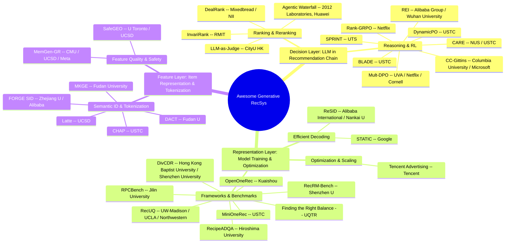

# Awesome Generative Recommendation System (RecSys)

```
 ██████╗                ██████╗                ███████╗                
██╔════╝  ███╗  ███╗    ██╔══██╗ ███╗   ███╗   ██╔════╝██╗ ██╗ ██████╗ 
██║      ██╔═██╗████╗   ██████╔╝██╔═██╗██╔═██╗ ███████╗╚██╗██║ ██╔═══╝ 
██║  ███╗██████║██╔██╗  ██╔══██╗██████║██║ ╚═╝ ╚════██║ ╚███╔╝ ██████╗ 
██║   ██║██║    ██║╚██╗ ██║  ██║██║    ██║ ██╗      ██║  ██╔╝      ██║
╚██████╔╝╚████╗ ██║ ╚██╗██║  ██║╚████╗ ╚███╔═╝ ███████║  ██║   ██████║
 ╚═════╝  ╚═══╝ ╚═╝  ╚═╝╚═╝  ╚═╝ ╚═══╝  ╚══╝   ╚══════╝  ╚═╝   ╚═════╝
```
---

[](https://github.com/sindresorhus/awesome)

RecSys is starting to adopt LLM for feature extraction, retrieval, and ranking/re-ranking! Although you can get some hands-on materials in either the [classics](#papers-classic-must-read) or some surveys, but since you're already interested in applying generative AI to industrial tasks, you probably wanna stay on the bleeding edge, right? That's exactly what this repo is for — automatically updated daily by agents with the latest generative RecSys papers fresh off arXiv, making sure that you never miss a beat.

> [!IMPORTANT]
> For those who are not familiar with GenRec, or not even the recommendation system, please checkout the kickstart posts [here](docs/kickstart.md).
> These posts are in Chinese, for English simply do your browser's internal translation or turn to __Ask Gemini__ :shipit:

## Quick Indexing
- [By Date](#by-date)
- [By Opensource](#by-opensource)
- [By Keyword](#by-keyword)
- [By Affiliation](#by-affiliation)
- [Papers Classic Must Read](#papers-classic-must-read)
- [Verl-GR: An Awesome RL Toolkit for GenRecSys](#verl-gr-an-awesome-rl-toolkit-for-genrecsys)



<div align="center">
  <i> Open-source Generative RecSys Map </i>
</div>

---
## `Verl-GR`: An Awesome RL Toolkit for GenRecSys
If you are interested in RFT your own GenRecSys, come check out our `verl`-based implementation called `verl-gr` here:
* [https://github.com/HaFred/verl-GR/tree/main/verl_gr/recipes/openonerec](https://github.com/HaFred/verl-GR/tree/main/verl_gr/recipes/openonerec)
* [https://github.com/HaFred/verl-GR/tree/main/verl_gr/recipes/rankgrpo](https://github.com/HaFred/verl-GR/tree/main/verl_gr/recipes/rankgrpo)

We manage to achieve 22% and 32% boosting for the end-to-end training efficiencies, compared with their respective vanilla implementations.

## By Date

We only keep the last 10 days summary below, for the past records before these, please see [the archive](docs/archive_by_month).

---

### Papers November 27

*Friday, November 27, 2026. At 23:05 HKT all five `/list/<cat>/new` pages still read Thursday, 26 November 2026 (cs.IR 9 new / 5 cross / 6 replacement; 767 unique IDs across cs.IR/AI/LG/CL/MM), so the strict 24-hour window was already indexed by the Nov 26 run and yielded zero genuinely new on-topic papers. The authoritative fallback chain was applied and is disclosed here: (1) `date_list = [2026-11-19]` (the only missing date section in the current README; that announcement is already represented in the docs indexes), (2) second date-section title (Nov 25) through today (nothing new beyond the Nov 26 batch), (3) last-3-month arXiv Atom / UI search plus WebSearch and curated CTR-scaling pools. Eight strictly on-topic, genuinely new generative-recommendation / LLM-ranking / LLM-agentic-rec / industrial-ranking papers were found, all verified absent from the 1,189-ID master dedup set (README + both docs indexes + all monthly archives). **3 are open-source**: relevance-diversity retrieval / 2610.09412 (9/10), CC-Gittins / 2610.26676 (9/10) and REI / 2611.33183 (6/10, partial SPOD-only release), so By Opensource goes 271 -> 274; the 30-leaf mindmap drops UF2O (7/10), INTENT and Beat the Syllabus (both 8/10), with all three layers surviving (Decision 12 / Representation 11 / Feature 7). Excluded as off-topic: RAG / dense-retrieval / GEO pipelines, generic LLM-agent memory, clinical and voting recommenders, diffusion/quantization fundamentals and legacy archive-only cross-listings.*

1. **REI: Learning Ideation from Repository Evolution**
   * Affiliation: Alibaba Group / Wuhan University / Mohamed bin Zayed University of Artificial Intelligence — *(Muyu Zou, Xiang Feng, Yufei Xu, Shanshan Ye, Zulong Chen, Lingyu Mu, Jinxin Hu, Jing Zhang)*
   * Link: [arxiv.org/abs/2611.33183](https://arxiv.org/abs/2611.33183)
   * Venue: arXiv preprint, cs.LG (submitted 28 Oct 2026; primary new cs.IR listing announced 26 Nov 2026)
   * TL;DR: REI turns repository evolution into supervision for recommender-engineering ideation, then uses SPOD to stop RL-driven proposals from collapsing into a handful of dominant method families.
   * Key techniques:
     - Ideation policy learned from code changes, subsequent revisions, adoption and reuse as implicit utility labels
     - Industrial corpus of 60,000+ recommender-system evolution samples drawn from 24 repositories, with normalized AST-level code diffs
     - Semantic Prior Optimization and Debiasing (SPOD): explicit method identity, category-level reward debiasing and top-1 retention per method family
     - GRPO-style RLVR training with semantic-diversity preservation for cross-task generalization and long-tail method exploration
   * Scores (Opensource? / Novelty / Fairness / Robustness / Impact):
     - **Opensource?: 6/10** — [github.com/Gabriel-reina/spod](https://github.com/Gabriel-reina/spod): Apache-2.0, 121 files / 41 Python files, configs, public prompts and datasets, pinned ROLL revision, pushed 28 Oct 2026; this is the SPOD debiasing operator only, not the full repository-evolution ideation pipeline, so reproduction of REI itself is partial
     - **Novelty: 7/10** — mining repository evolution for reusable engineering ideation priors is fresh; SPOD adds a useful method-level alternative to token-level entropy controls
     - **Fairness: 6/10** — explicitly counters popularity skew over method families and protects long-tail ideas, though no user-side exposure or demographic audit is reported
     - **Robustness: 7/10** — public benchmarks plus a large industrial corpus with success/failure annotations and cross-task evaluation; full reproducibility is limited by the partial code release
     - **Impact: 9/10** — Alibaba recommender-engineering work targeting the real ideation bottleneck of automated experiment loops, with reported gains in method diversity and industrial deployment relevance

2. **Towards Efficient Whole Page Ranking with One-Pass Inference (MIS)**
   * Affiliation: Meta Platforms, Inc. — *(Qi Xu, Zhigang Hua, Zijie Lei, Yan Xie, Jizhe Zhang, Lynn Lu, Delun Du, Sha Hua, Ren Mao, Ke Pan, Haomin Yu, Sandeep Pandey, Luke Simon)*
   * Link: [arxiv.org/abs/2611.05542](https://arxiv.org/abs/2611.05542)
   * Venue: arXiv preprint, cs.AI (submitted 3 Nov 2026)
   * TL;DR: MIS gives non-autoregressive whole-page generation prefix awareness, matching autoregressive slate quality with 4.07x/3.54x faster CPU decoding and 9.73% lower ranking-service CPU use.
   * Key techniques:
     - Multi-Item Scoring with global candidate interactions, localized prefix conditioning and position-aware scoring in one shared representation
     - Reusable per-request representations plus lightweight prefix-conditioned scoring inside constrained beam search
     - Joint optimization of ads and organic content under layout and business constraints
     - KuaiRand-1K / RL4RS offline tests and a randomized large-scale social-video platform evaluation
   * Scores (Opensource? / Novelty / Fairness / Robustness / Impact):
     - **Opensource?: 0/10** — no public code available; neither the paper, PDF first page nor HTML links a repository
     - **Novelty: 7/10** - a clean middle path between independent NAR scoring and expensive AR page decoding via compact prefix-conditioned rescoring
     - **Fairness: 2/10** — no user-group, provider-side or ad-versus-organic exposure fairness analysis beyond business-metric balancing
     - **Robustness: 8/10** — two public benchmarks, an AR baseline comparison and a randomized online evaluation with latency and CPU measurements
     - **Impact: 8/10** — Meta-scale whole-page ranking with concrete production metrics (0.104% realization, 0.058% watch time, -9.73% CPU)

3. **GistRank: Gist-Compressed Listwise Ranking with Large Language Models**
   * Affiliation: Southwest University / Tencent Yuanbao Team / Renmin University of China / Institute of Computing Technology, Chinese Academy of Sciences — *(Guo Chen, Wenhan Liu, Reed Li, Qianwen Ma, Yu Lu, Haibo Shi, Bingbing Xu, Junjie Huang)*
   * Link: [arxiv.org/abs/2610.39610](https://arxiv.org/abs/2610.39610)
   * Venue: arXiv preprint, cs.IR (submitted 29 Oct 2026)
   * TL;DR: GistRank compresses each listwise-ranking candidate to four gist tokens, delivering a 14x speedup with 59.17 average nDCG@10 within 0.89 of the full-context baseline.
   * Key techniques:
     - Semi-bidirectional gist encoding so each gist token absorbs its passage more faithfully than strictly causal compression
     - Pairwise discriminative training that teaches gist representations to expose relative-preference structure
     - Three-stage training ending in listwise objective adaptation for permutation generation
     - Evaluation on TREC DL19/20 and five BEIR subsets against one-shot full-text and sliding-window ranking
   * Scores (Opensource? / Novelty / Fairness / Robustness / Impact):
     - **Opensource?: 0/10** — no public code available; the paper and PDF carry no repository link
     - **Novelty: 7/10** — soft compression tailored to discrimination rather than generic summarization is a well-targeted fix for costly LLM listwise rankers
     - **Fairness: 3/10** — no demographic or source-level ranking-bias audit; the study focuses on fidelity and speed
     - **Robustness: 8/10** — seven TREC/BEIR datasets, explicit comparison with full-context and sliding-window baselines, and a small quality gap under 4-token compression
     - **Impact: 7/10** — Tencent Yuanbao AI Search setting with a directly deployable inference-cost reduction

4. **Finding the Right Balance: Relevance and Diversity in LLM Retrieval**
   * Affiliation: Université du Québec à Trois-Rivières, LI2A / INSTINT, Canada — *(Guillaume Brouillette, Faustin Kagabo, Usef Faghihi, Nadia Ghazzali)*
   * Link: [arxiv.org/abs/2610.09412](https://arxiv.org/abs/2610.09412)
   * Venue: arXiv preprint, cs.IR (submitted 7 Oct 2026; 36 pages, 8 figures, 13 tables)
   * TL;DR: Diversification only pays off when the nearest-neighbor pool is redundant, so a query-adaptive rule and a geometric RNG-Score reranker diversify selectively instead of always.
   * Key techniques:
     - Controlled near-duplicate injection and production-style overlapping chunking to isolate the redundancy regime
     - Query-adaptive decision rule comparing effective distinct documents in top-k against the query evidence requirement
     - RNG-Score geometric reranker with an exact nearest-neighbor fallback whose margin signals duplicate structure
     - Retrieval, cross-encoder and generation evaluations with cross-dataset and cross-encoder transfer checks
   * Scores (Opensource? / Novelty / Fairness / Robustness / Impact):
     - **Opensource?: 9/10** — [github.com/GuillaumeBrouillette/finding-the-right-balance](https://github.com/GuillaumeBrouillette/finding-the-right-balance): Apache-2.0, 573 files / 93 Python files / 350 result-data artifacts, full paper PDF, CPU smoke test and retained-results replay workflow, pushed 22 Sep 2026; strong documentation and reproducibility
     - **Novelty: 7/10** — reframes a contested MMR-style choice as an observable redundancy/evidence-requirement decision rather than a fixed diversification setting
     - **Fairness: 5/10** — diversity is over evidence passages, not demographic groups, but the paper directly audits a known exposure-quality trade-off
     - **Robustness: 9/10** — controlled injections, production-style chunking, multiple encoders and datasets, 13 tables of statistical analysis and an exact-fallback reranker
     - **Impact: 7/10** — actionable guidance for retrieval and RAG serving where blind diversification can hurt relevance

5. **Who Chooses How Preferences Are Aggregated? Auditing Aggregation-Rule Authority in LLM-Based Group Recommendation**
   * Affiliation: Independent Researcher — *(Yuxuan Du)*
   * Link: [arxiv.org/abs/2608.23966](https://arxiv.org/abs/2608.23966)
   * Venue: arXiv preprint, cs.HC (submitted 25 Aug 2026)
   * TL;DR: LLMs execute social-choice rules faithfully when told which one to use, but delegation silently gives them discretion over rule choice and produces model-specific collective recommendations.
   * Key techniques:
     - Behavioral audit of three LLMs under unspecified, user-retained and model-delegated authority conditions
     - Synthetic and empirical-rating preference profiles with witness rules that prescribe different actions
     - Separation of rule-execution capability from aggregation-rule authority at the interaction level
     - Outcome-distribution analysis across models and preference settings
   * Scores (Opensource? / Novelty / Fairness / Robustness / Impact):
     - **Opensource?: 0/10** — no public code available; no repository is linked in the paper or PDF
     - **Novelty: 8/10** — aggregation-rule authority is an underexamined control dimension distinct from executing a given fairness rule
     - **Fairness: 9/10** — the paper is centered on who controls preference aggregation when users disagree, a core group-recommender fairness question
     - **Robustness: 6/10** — controlled audit across three LLMs and two profile sources, but no deployed group-recommendation system or large-scale user study
     - **Impact: 6/10** — cs.HC preprint with clear implications for pluralistic alignment and user control in LLM group recommenders

6. **Which Model for Which Role? Cost-Efficient Pareto Recommendation for LLM Agentic Workflows (CC-Gittins)**
   * Affiliation: Columbia University / Cornell University / Microsoft / New York University / Shanghai University of Finance and Economics — *(Qian Xie, Yueli He, Wenyue Hua, Sripad Karne, Armaan Agrawal, Nikos Pagonas, Eugene Wu, Kostis Kaffes, Tianyi Peng, Nairen Cao)*
   * Link: [arxiv.org/abs/2610.26676](https://arxiv.org/abs/2610.26676)
   * Venue: NeurIPS 2026 Workshop on Resource-Aware Agentic AI (RAAAI); arXiv preprint, cs.LG (submitted 19 Oct 2026)
   * TL;DR: CC-Gittins recommends Pareto-optimal model-role assignments for LLM agent workflows while recovering much of the frontier at roughly 10% of exhaustive evaluation cost.
   * Key techniques:
     - Multi-objective extension of cost-aware Gittins search exploiting the coupling between evaluation and deployment cost
     - Alternating search for higher quality and lower cost with each evaluation reused by both directions
     - Uncertainty-adjusted quality-LCB / cost-UCB recommendations of nondominated assignments
     - Eight frozen quality-cost matrices from 2-5 role workflows up to 1,681 assignments, plus a latency third objective
   * Scores (Opensource? / Novelty / Fairness / Robustness / Impact):
     - **Opensource?: 9/10** — [github.com/AgentOptimizer/agentopt-research](https://github.com/AgentOptimizer/agentopt-research): MIT, 290 files / 120 Python files / 105 data artifacts, installable package, pytest suite, Slurm experiment guide and frozen benchmark matrices with replay commands, pushed 15 Nov 2026
     - **Novelty: 8/10** — the evaluation-deployment cost coupling gives a fresh bandit formulation of a practical model-selection recommendation problem
     - **Fairness: 3/10** — no user or provider fairness analysis; the objectives are quality, cost and latency
     - **Robustness: 8/10** — eight benchmarks, up to 1,681 assignments, 20-seed frontier recovery curves and an explicit latency extension
     - **Impact: 7/10** — NeurIPS 2026 workshop paper with immediately reusable tooling for cost-aware agentic serving

7. **ECHO: Efficient Cascade with Homogeneous Operators for Distillation-Guided 100K-Sequence Modeling**
   * Affiliation: Kuaishou Technology — *(Wenhao Li, Qinglin Jia, Chenghou Jin, Zihong Xian, Jiezhou Ji, Yanzhi Liu, Zezheng Wang, Bo Chen, Ruiming Tang, Chaoyi Ma, Zhaojie Liu, Wenwu Ou)*
   * Link: [arxiv.org/abs/2610.28569](https://arxiv.org/abs/2610.28569)
   * Venue: arXiv preprint, cs.IR (submitted 20 Oct 2026)
   * TL;DR: ECHO keeps a distilled subset of raw 100K-length user events and retrieves target-relevant records per candidate, cutting online sequence-branch FLOPs about 160x with live usage-time gains.
   * Key techniques:
     - Distilled Selector supervised by a candidate-aware full-history teacher via per-target distillation
     - Target-aware Fine-grained Retriever that preserves item-level addressability lost in pure latent compression
     - Shared relevance parameters between retriever and target-attention scorer
     - Deployment optimizations: common user inputs, compact record encoding and key-side projection absorption
     - KuaiRand-1K plus Kuaishou / Kuaishou Lite online A/B tests
   * Scores (Opensource? / Novelty / Fairness / Robustness / Impact):
     - **Opensource?: 0/10** — no public code available; no repository link appears in the paper, HTML or PDF
     - **Novelty: 7/10** — combining user-level distillation with per-candidate raw-record retrieval is a pragmatic alternative to the compression/addressability trade-off
     - **Fairness: 3/10** — no demographic or exposure fairness study; the long-history gains are not broken down by user activity group
     - **Robustness: 9/10** — public and industrial datasets, multiple tasks with 0.113%-1.520% relative GAUC gains and two production A/B tests
     - **Impact: 8/10** — deployed at Kuaishou scale with 0.240% / 0.373% app usage-time gains and a large serving-cost reduction

8. **Unified Heterogeneous Feature Interaction via Effective-Rank Scaling for Recommender Systems (HiRank)**
   * Affiliation: Alibaba Group / Renmin University of China / Institute of Automation, Chinese Academy of Sciences — *(Ao Zhang, Haochuan Li, Boya Du, Jian Yang, Qihang Fang, Yulin Xu)*
   * Link: [arxiv.org/abs/2610.35318](https://arxiv.org/abs/2610.35318)
   * Venue: arXiv preprint, cs.IR (submitted 26 Oct 2026; 10 pages, 4 figures)
   * TL;DR: HiRank unifies sequential and non-sequential tokens in one backbone via effective-rank scaling and scenario-aware composite tokens, lifting orders per user by 2.27% online.
   * Key techniques:
     - Gated sequential attention coupled with heterogeneous feature interaction for bidirectional fusion
     - Scenario-aware aggregation compressing low-order heterogeneous tokens into a compact representation
     - Distinct learned projections producing composite tokens with complementary global views and uniform information density
     - Effective-rank-guided high-order self-attention and a parameter-scaling study
   * Scores (Opensource? / Novelty / Fairness / Robustness / Impact):
     - **Opensource?: 0/10** — no public code available; neither paper nor PDF links a repository
     - **Novelty: 7/10** — using effective rank to allocate attention across heterogeneous semantic tokens is a principled scaling knob
     - **Fairness: 3/10** — no user-group or provider-side fairness audit; scenario negative transfer is the only equity-adjacent concern
     - **Robustness: 8/10** — industrial-scale datasets, favorable parameter-scaling behavior, competitive baselines and online A/B validation
     - **Impact: 8/10** — Alibaba production ranking with a 2.27% orders-per-user lift

---

### Papers November 26

*Thursday, November 26, 2026. The live 24-hour window is Thursday's cs.IR announcement (9 new, 5 cross and 6 replacement cs.IR entries; 767 unique IDs across all five categories). Five strictly on-topic, genuinely new multi-domain sequential-recommendation / multimodal-recommendation / LLM-driven personalized-discovery / generative-query-understanding / offline-evaluation papers surfaced — at the 5-paper floor, so no fallback chain and no `date_list` were needed. All five were verified absent from the 1,179-ID master dedup set (README + both docs indexes + all monthly archives). **3 are open-source**: Agentic Waterfall / 2611.34407 ships an MIT-licensed 965-file controller plus a 160-file versioned dataset with checksums (9/10); MKGE / 2611.34436 and beat-the-syllabus / 2611.33240 have compact but complete MIT releases with KGs / configs / prompts and a PyPI package plus Zenodo DOI (both 8/10). By Opensource goes 268 -> 271, and the 30-leaf mindmap drops SimRec, MuonRec and PGPO (all 8/10, tied-lowest leaves) to make room; all three layers survive (Decision 11 / Representation 12 / Feature 7). One re-hit: C3H / 2611.32780 resurfaced as a replacement submission, so its existing Nov 25 entry got a `[Also published on 2026-11-26] — re-hit: 1` side note instead of a duplicate. Excluded as off-topic: RecField / 2611.34330 (HCI study of spatial movie organization), ConTra / 2611.34366 and when-rerankers-work-together / 2611.33844 (RAG / contextual-retrieval pipelines), Figure retrieval / 2611.33649, candidate-selection scoring / 2611.33161, and the broader RAG / dense-retrieval cluster.*

1. **MKGE: Grounding User Preferences in Shared Multimodal Concepts for Recommendation**
   * Affiliation: School of Data Science, Fudan University, Shanghai, China — *(Ao Xu, Jinhui Huang, Wenqiang Tang, Tiehua Mei, Hongru Hou, Hengrui Chen, Jiaqing Liang, Deqing Yang)*
   * Link: [arxiv.org/abs/2611.34436](https://arxiv.org/abs/2611.34436)
   * Venue: WSDM 2027 (Main Conference); arXiv preprint, cs.IR (submitted 25 Nov 2026)
   * TL;DR: MKGE turns recurring visual-textual semantics into canonical, addressable concepts so preference evidence from different items accumulates on shared coordinates instead of staying tied to individual items.
   * Key techniques:
     - Domain-adaptive multimodal concept vocabulary induced from item images and titles
     - Temporal preference grounding that links each user interaction history to supported concepts
     - Dual-path recommendation jointly modelling direct user-item evidence and concept-mediated preference signals
     - Preference sharing through the grounded user-concept graph, with pronounced low-activity-user gains
   * Scores (Opensource? / Novelty / Fairness / Robustness / Impact):
     - **Opensource?: 8/10** — [github.com/Garden1a-X/MKGE](https://github.com/Garden1a-X/MKGE): 38 files / 13 Python files, MIT licensed, packaged `src/model` + `scripts/train_model.py`, per-dataset YAML configs and released interactions / constructed KGs / prompts; small but complete and reproducible, pushed 24 Nov 2026
     - **Novelty: 7/10** — treating concepts as first-class shared addresses rather than latent item-side factors is a clean reframing of multimodal preference modelling
     - **Fairness: 4/10** — no demographic or exposure bias audit, though low-activity users gain most from concept-mediated sharing
     - **Robustness: 7/10** — three public benchmarks across six metrics, controlled rewiring / ablation studies and an explicit robustness-efficiency section
     - **Impact: 8/10** — WSDM 2027 main-conference paper with a released knowledge graph and an immediately runnable training stack

2. **Agentic Waterfall: An Intent-Driven Information Discovery Framework for Reclaiming User Control in the Attention Economy**
   * Affiliation: 2012 Laboratories, Huawei — *(Yige Luo, Shining Zhang, Jikun Liu, Hongjiao Qiang, Ran Guan)*
   * Link: [arxiv.org/abs/2611.34407](https://arxiv.org/abs/2611.34407)
   * Venue: arXiv preprint, cs.IR (submitted 25 Nov 2026)
   * TL;DR: Agentic Waterfall formalizes a feed in which users actively steer recommendations and an LLM controller keeps persistent user state while coordinating retrieval, ranking and state updates as the browsing context evolves.
   * Key techniques:
     - Language-model controller with persistent user state updated from explicit requests and browsing behaviour
     - Joint action selection / execution across content retrieval, ranking and feed-state rewrites
     - Agentic Waterfall Dataset: 50 simulated trajectories, 300 evaluation checkpoints, 60,674 content cards and 80 user instructions built on real content metadata
     - Shared-history replay protocol with relevance scoring plus blind human judgments of goal/constraint satisfaction
   * Scores (Opensource? / Novelty / Fairness / Robustness / Impact):
     - **Opensource?: 9/10** — [github.com/XiaoLuoLYG/Agentic-Waterfall](https://github.com/XiaoLuoLYG/Agentic-Waterfall) (965 files, 249 Python files, MIT, runnable feed demo, pushed 26 Nov 2026) plus [agentic-waterfall-dataset](https://github.com/XiaoLuoLYG/agentic-waterfall-dataset) (160 files, versioned v1 ZIP with checksums, leaderboard and data card); the third linked `waterfall-anything` URL is a 404, but the two live artifacts cover code and data
     - **Novelty: 8/10** — a new problem formulation that makes user intent and state updates first-class rather than optimizing a fixed feed objective
     - **Fairness: 3/10** — user agency and control are central, but no exposure, demographic or provider-side bias analysis is provided
     - **Robustness: 7/10** — competitive on five public benchmarks and evaluated two ways on the new dataset with ablations; the new dataset itself relies on simulated interaction histories
     - **Impact: 8/10** — Huawei work with a reusable dataset and replay evaluation protocol for an underexplored, production-relevant feed setting

3. **OneQuery: Unified Sequence-to-Structure Generation for Multilingual E-commerce Query Understanding**
   * Affiliation: Xiamen University / Alibaba Group / Harbin Institute of Technology, Shenzhen — *(Mingyu Zhang, Jiejie Qin, Jianhui Ji, Rong Xiao, Meishan Zhang, Xiaoyi Zeng)*
   * Link: [arxiv.org/abs/2611.33653](https://arxiv.org/abs/2611.33653)
   * Venue: WSDM 2027 (Findings); arXiv preprint, cs.IR (submitted 25 Nov 2026)
   * TL;DR: OneQuery collapses four separately trained query-understanding subtasks into one schema-constrained autoregressive sequence-to-structure generator, aligned with multi-task RL and deployed in AliExpress search.
   * Key techniques:
     - Schema-constrained generative reformulation of language recognition, spelling correction, translation and query tagging
     - Three-stage progressive training: joint single-task SFT, synthetic-data augmented joint OneQuery SFT, then RL alignment
     - Inter-task synergy that removes cascade error accumulation and cuts maintenance cost of four independent models
     - Online A/B validation in the AliExpress multilingual e-commerce search scenario
   * Scores (Opensource? / Novelty / Fairness / Robustness / Impact):
     - **Opensource?: 0/10** — no public code available; neither the paper, PDF first page nor HTML links a repository
     - **Novelty: 7/10** — unifying heterogeneous QU subtasks under one schema-constrained generative process is a practical step beyond pipeline stacking
     - **Fairness: 3/10** — multilingual scope is broad, but no language-group or region-level quality-parity audit is reported
     - **Robustness: 7/10** — gains hold across backbone sizes with synthesis and RL ablations, a case study on error tolerance and an online experiment
     - **Impact: 8/10** — WSDM 2027 Findings plus live deployment in AliExpress search, a high-traffic industrial retrieval/ranking front end

4. **CAMAR: Multi-Modal Causal Disentanglement for Multi-Domain Sequential Audio Recommendation**
   * Affiliation: Hangzhou Dianzi University / NetEase Cloud Music, Hangzhou, China — *(Yu Ren, Pengcheng Li, Weijun Xu, Hengzhong Zhou, Shufeng Ye, Qiang Xiao, Dongjing Wang, Chuanjiang Luo, Yong Li)*
   * Link: [arxiv.org/abs/2611.33628](https://arxiv.org/abs/2611.33628)
   * Venue: arXiv preprint, cs.IR (submitted 25 Nov 2026)
   * TL;DR: CAMAR models multi-domain audio preferences as domain-invariant plus domain-specific causes, confines cross-domain transfer to the invariant subspace and bridges weakly overlapping domains with residual-quantized multimodal semantic IDs.
   * Key techniques:
     - Causal factorisation of user behaviour into domain-invariant and domain-specific preference components
     - Domain-adversarial invariance plus orthogonality constraints that suppress negative transfer from high-traffic domains
     - Trainable semantic-ID embeddings residual-quantized from pretrained text, vision and audio features
     - Transfer network imputing user representations for inactive domains to mitigate cross-domain cold start
     - Online A/B tests on NetEase Cloud Music across songs, playlists and podcasts
   * Scores (Opensource? / Novelty / Fairness / Robustness / Impact):
     - **Opensource?: 0/10** — no public code available; the PDF and HTML contain no repository link
     - **Novelty: 8/10** — coupling causal disentanglement with multimodal residual-quantized semantic IDs for multi-domain sequential rec is a fresh combination
     - **Fairness: 2/10** — no demographic bias or exposure-fairness analysis; cold-start handling is the only equity-adjacent component
     - **Robustness: 8/10** — public and industrial datasets, ablations, a dedicated cold-start study and three-domain online A/B tests
     - **Impact: 8/10** — validated at scale on one of China's largest music streaming platforms with gains in all three domains' main traffic scenarios

5. **Learning the Platform, Not the Learner: Sequencing Shortcuts in the Offline Evaluation of Educational Recommender Systems and LLM Rankers**
   * Affiliation: Ecole Nationale Superieure d'Art et de Design (ENSAD) / Hassan II University of Casablanca, Morocco — *(Youssef Jdidou)*
   * Link: [arxiv.org/abs/2611.33240](https://arxiv.org/abs/2611.33240)
   * Venue: arXiv preprint, cs.IR (submitted 24 Nov 2026; 27 pages, 6 figures, 17 tables)
   * TL;DR: On eight educational datasets, structure-only predictors recover a median 95% of the best recommender's accuracy and LLM rankers barely beat word matching under plausible negatives, so the paper proposes a syllabus-aware evaluation protocol and a lift-over-structure package.
   * Key techniques:
     - Four structure-only predictors (POP, ORDER, CONT, MC) that use nothing beyond the last activity
     - Comparison of ten personalised recommenders and 0.5B-7B open-weight LLM rankers under random versus structure-plausible negatives
     - Simulation with known learner needs showing offline accuracy can rank an oracle of learner needs below platform imitators
     - Structure-unlikelihood reweighting of test steps that restores the personalisation signal on seven of eight datasets
     - Released Python package reporting any recommender's lift over the structural baseline
   * Scores (Opensource? / Novelty / Fairness / Robustness / Impact):
     - **Opensource?: 8/10** — [github.com/jdidou/beat-the-syllabus](https://github.com/jdidou/beat-the-syllabus) (33 files / 24 Python files, MIT, PyPI package v1.0.0, `reproduce/` scripts, Zenodo DOI 10.5281/zenodo.24443552 resolving HTTP 200); the audit package is complete, though the full LLM-ranker experiment suite is not packaged
     - **Novelty: 8/10** — reframes offline recommender accuracy as imitation of a platform sequencing policy and quantifies how misleading it can be
     - **Fairness: 5/10** — no demographic fairness audit, but it directly diagnoses evaluation bias against personalisation and gives a corrective weighting scheme
     - **Robustness: 9/10** — eight datasets from five platforms, two protocols, multiple training runs, a controlled simulation and per-case result artifacts
     - **Impact: 8/10** — a 27-page evaluation study with a concrete checklist and installable package that can change how educational recommenders are benchmarked

---

### Papers November 25

*Wednesday, November 25, 2026. The live 24-hour window is Wednesday's cs.IR announcement (9 new, 12 cross and 7 replacement cs.IR entries; 802 unique IDs over all five categories). Seven strictly on-topic, genuinely new generative-recommendation / LLM-recommendation / candidate-ranking papers surfaced — above the 5-paper floor, so no fallback chain and no `date_list` were needed. Five are primary cs.IR submissions (SIDECAR, LazUnirec, UF2O, RecUQ, MELODI); C3H and RecipeADQA are new-to-repo cross-listings from cs.CR and cs.CL respectively. All seven were verified absent from the 1,168-ID master dedup set (README + both docs indexes + all monthly archives). **3 are open-source**: RecUQ / 2611.33036 (9/10), RecipeADQA / 2611.31259 (8/10) and UF2O / 2611.31951 (7/10), so By Opensource goes 265 -> 268 and the 30-leaf mindmap drops FLADRec and Neg-Cand-ID (both 7/10) plus SIDScope (8/10) to make room; all three layers survive (Decision 11 / Representation 12 / Feature 7). C3H's advertised `github.com/GuoweiGuan666/C3H` is a README-only project page whose own status says the source code is not yet available, so it scores 0/10. Two re-hits: CACO / 2611.25738 and TravelPlanner-Agent / 2611.25531 resurfaced as replacement/cross-list submissions and got side notes on their existing entries instead of duplicates. Excluded as off-topic: agentic search reranking / 2611.32917, agentic-retrieval query obfuscation / 2611.31344, multimodal evidence embeddings / 2611.32203, conversational memory / 2611.33124 and the broader RAG / dense-retrieval cluster.*
1. **Speculative Decoding for Semantic-ID-Based Generative Recommendations (SIDECAR)**
   * Affiliation: Etsy Inc., Brooklyn, NY, USA — *(Harshal A. Chaudhari)*
   * Link: [arxiv.org/abs/2611.32855](https://arxiv.org/abs/2611.32855)
   * Venue: arXiv preprint, cs.IR (submitted 24 Nov 2026; 33 pages, 19 figures)
   * TL;DR: SIDECAR scores a whole draft tree of semantic-ID candidates in one tree-attention pass and certifies the exact top-K, falling back to branch-and-bound only on trie branches that can still change the result.
   * Key techniques:
     - Approximate draft candidates scored jointly with a single tree-attention model call, memory permitting
     - Probability upper bounds for every unexplored SID prefix, enabling exact-top-K certification when the draft contains the winners
     - Branch-and-bound fallback that expands only result-changing trie parts, certifying within at most L calls for any draft
     - A announced (1 + delta) per-rank approximation factor under a budget of M tokens per call and Y calls
     - Serving-side early stop once the announced quality factor or a latency limit is reached, unlike fixed-width beam search
   * Scores (Opensource? / Novelty / Fairness / Robustness / Impact):
     - **Opensource?: 0/10** — no public code available; no repository or artifact is linked from the paper
     - **Novelty: 9/10** — couples speculative drafting with an exact top-K certificate and an explicit approximation factor for SID generative retrieval
     - **Fairness: 3/10** — no bias, exposure or provider-side fairness analysis; the guarantee is purely decoding-accuracy and latency based
     - **Robustness: 9/10** — formal bounds hold for arbitrary drafts and model sharpness, with worst-case cost bounded by standard beam search
     - **Impact: 9/10** — directly targets the production wide-beam serving bottleneck in industrial semantic-ID recommenders, with a 33-page technical treatment

2. **LazUnirec: Unifying Retrieval and Ranking in Multi-scenario Industrial Recommendation**
   * Affiliation: Alibaba International Digital Commerce Group, Beijing, China — *(Xiaodong Li, Junfeng Zhang, Shichao Nie, Ziyue Guo, Yiming Liu, Xinxin Xu, Xurong Li, Jinyuan Dang, Zhanming Ou, Jianan Yan, Tao Luo, Xiaoyi Zeng)*
   * Link: [arxiv.org/abs/2611.32590](https://arxiv.org/abs/2611.32590)
   * Venue: arXiv preprint, cs.IR (submitted 24 Nov 2026)
   * TL;DR: A single Transformer serves both retrieval and ranking with task-shared and task-private parameters, resolving gradient conflict through LoRA-modulated attention, sparse task-aware MoE and uncertainty-guided updates.
   * Key techniques:
     - LoRA-modulated attention sharing attention parameters across retrieval and ranking while preserving task-private adapters
     - Task-adaptive sparse mixture-of-experts in the FFN with shared and private experts to reduce gradient interference
     - Uncertainty estimation of each task's gradient reliability to choose a more trustworthy update direction under conflict
     - Knowledge distillation from the ranking task to the retrieval task for cross-task transfer
     - Offline experiments plus online A/B testing on a deployed multi-scenario industrial recommender
   * Scores (Opensource? / Novelty / Fairness / Robustness / Impact):
     - **Opensource?: 0/10** — no public code available; no repository is linked from the paper
     - **Novelty: 7/10** — the unified retrieval-and-ranking idea is established, but the combination of private LoRA attention, task-adaptive MoE and gradient-reliability guidance is new
     - **Fairness: 4/10** — multi-scenario coverage is considered, but no exposure-parity, demographic or provider fairness audit is reported
     - **Robustness: 7/10** — offline results are backed by online A/B and deployment, though no cross-platform or distribution-shift study is given
     - **Impact: 8/10** — deployed in Alibaba International's multi-scenario recommendation system with reported platform gains

3. **User-Adaptive Fusion of Multiple Foundation Models for Recommender Systems (UF2O)**
   * Affiliation: KAIST, Seoul, Republic of Korea — *(Sunwoo Kim, Hyunjin Hwang, Geon Lee, Kyungho Kim, Kijung Shin)*
   * Link: [arxiv.org/abs/2611.31951](https://arxiv.org/abs/2611.31951)
   * Venue: WSDM 2027 (Main Track); arXiv preprint, cs.IR (submitted 24 Nov 2026)
   * TL;DR: UF2O gives every foundation model its own recommendation view and learns user-specific fusion weights at the score level, so heterogeneous models can be combined without aligning their embedding spaces.
   * Key techniques:
     - Separate recommendation view per foundation model, with user-specific contribution weights
     - Score-level fusion that mixes heterogeneous foundation models without representation alignment
     - Temperature-controlled user attention over foundation-model scores
     - Joint evaluation over four foundation models on four Amazon 2023 review datasets
     - Static and sequential recommendation settings, up to 7% over the strongest fusion baseline
   * Scores (Opensource? / Novelty / Fairness / Robustness / Impact):
     - **Opensource?: 7/10** — [github.com/kswoo97/UFFO](https://github.com/kswoo97/UFFO) contains both static and sequential model files, a README with exact run commands, a supplementary PDF and a dataset link; deductions: only 6 files, no LICENSE, no tests or packaging, datasets hosted externally on Dropbox
     - **Novelty: 7/10** — per-user, score-level fusion across heterogeneous foundation models is a clean alternative to representation-level alignment
     - **Fairness: 5/10** — adapting fusion to each user is personalization rather than a fairness intervention; no protected-group or exposure analysis
     - **Robustness: 7/10** — four datasets, four foundation models and both static and sequential protocols, though all are public Amazon reviews
     - **Impact: 7/10** — WSDM 2027 main-track paper with released code and a practical recipe for multi-foundation-model recommenders

4. **Towards Realistic Evaluation of Uncertainty Quantification for LLM-Based Recommender Systems (RecUQ)**
   * Affiliation: University of Wisconsin–Madison — *(Hao Wu, Tianyi Chen, Qiancheng Yang, Xiao Luo)* — with Northwestern University, University of California, Los Angeles and The University of North Carolina at Chapel Hill *(Sipeng Chen, Weikai Li, Hang Zhou, Yizhou Sun, Wei Wang)*
   * Link: [arxiv.org/abs/2611.33036](https://arxiv.org/abs/2611.33036)
   * Venue: Transactions on Machine Learning Research (TMLR), 11/2026; arXiv preprint, cs.IR (submitted 24 Nov 2026)
   * TL;DR: RecUQ fixes the issued ranking so eight heterogeneous uncertainty monitors can be compared as record-level detectors under one output contract, exposing monitor-ordering changes across LLM backbones.
   * Key techniques:
     - Fixed-ranking protocol over frozen 20-candidate LLM rankings, separating monitor evaluation from the ranking itself
     - Shared output contract for eight heterogeneous uncertainty signals, including ranking-aligned Top10Mass and perturbation-based measures
     - Two evaluation tasks: top-10 error detection and identifying which control yields the larger clipped NDCG@10 drop
     - Four recommendation datasets crossed with two LLM backbones, with popularity-tail condition analysis
     - Released frozen rankings, scores, manifests and CPU-only reproduction pipeline
   * Scores (Opensource? / Novelty / Fairness / Robustness / Impact):
     - **Opensource?: 9/10** — [github.com/haowu0916edisonwu/recuq-benchmark](https://github.com/haowu0916edisonwu/recuq-benchmark) has 335 files, 73 Python modules, CITATION.cff, data licenses, reproducibility guides, a hash-validated `make validate` / `make reproduce` pipeline and frozen artifacts; deductions: custom license marker, no GPU regeneration out of the box, 2 stars
     - **Novelty: 8/10** — fixing the ranking to make incomparable UQ signals directly comparable is a well-targeted benchmark design
     - **Fairness: 6/10** — popularity-tail targets are analyzed explicitly, but no demographic or provider fairness notion is evaluated
     - **Robustness: 9/10** — four datasets, two backbones, paired controls and hash-checked frozen artifacts make the comparison repeatable
     - **Impact: 8/10** — TMLR publication plus a reproducible benchmark for uncertainty monitoring of LLM rankers

5. **MELODI: Similarity-Identity Decoupling for Lightweight Ranking**
   * Affiliation: Amazon International Machine Learning, Melbourne, Australia — *(Quoc Phong Nguyen, Vuong Le, Volodymyr Vaskovych, Julien Monteil)*
   * Link: [arxiv.org/abs/2611.31940](https://arxiv.org/abs/2611.31940)
   * Venue: arXiv preprint, cs.IR (submitted 24 Nov 2026)
   * TL;DR: MELODI splits candidate scoring into a target-history similarity branch and a target-only identity branch, proving an equivalence that permits a cheaper pooled-similarity computation at large candidate counts.
   * Key techniques:
     - Similarity-identity decoupling for latency-constrained candidate ranking
     - Proof that linearity of the similarity operator in its history argument makes similarity-then-pool and pool-then-similarity equivalent
     - Target-conditioned multi-head history pooling with a single residual-free cross layer linear in the pooled-history input
     - Problem-dependent identity branch carrying target-only information
     - Request-local history reuse lowering measured processor latency at large candidate counts
   * Scores (Opensource? / Novelty / Fairness / Robustness / Impact):
     - **Opensource?: 0/10** — no public code available; no repository is linked from the paper
     - **Novelty: 7/10** — the linearity condition justifying pooled similarity is a useful theoretical handle on target-aware ranking efficiency
     - **Fairness: 3/10** — no bias, exposure or demographic fairness analysis
     - **Robustness: 7/10** — public benchmarks plus two large-scale industrial datasets with AUPRC, NDCG, recall and processor-latency measurements
     - **Impact: 7/10** — Amazon work with measured latency wins in a deployment-relevant candidate-ranking setting

6. **C3H: Compression-to-Consensus Criteria Hijacking in Multimodal LLM Recommender Systems (C3H)**
   * Affiliation: Nanyang Technological University, College of Computing and Data Science, Singapore — *(Guowei Guan, Yurong Hao, Jiaming Zhang, Fuyao Zhang, Wei Yang Bryan Lim)*
   * [Also published on 2026-11-26] — re-hit: 1
   * Link: [arxiv.org/abs/2611.32780](https://arxiv.org/abs/2611.32780)
   * Venue: NeurIPS 2026 (Main Track, Poster); arXiv preprint, cs.CR with cs.AI cross-list announced 25 Nov 2026
   * TL;DR: C3H shows that multimodal compression and cross-modal consensus, often assumed to be robustness mechanisms, create a decision bias that a seller can exploit with content edits to a single target item.
   * Key techniques:
     - Compression-to-consensus (C2C) bias characterization in MLLM recommender ranking decisions
     - Inference-time, zero-query attack requiring no victim parameters, gradients, training data or feedback
     - Cross-modal cue selection with public pretrained encoders
     - Constrained text and image edits with a stealthiness gate for fidelity and image-text coherence
     - Evaluation on VIP5 and Qwen2-VL-2B-Instruct over MicroLens-100K, Amazon Beauty and Amazon Sports
   * Scores (Opensource? / Novelty / Fairness / Robustness / Impact):
     - **Opensource?: 0/10** — `github.com/GuoweiGuan666/C3H` contains only a README whose own status says "code is not yet publicly available"; a project page is not a reproduction package
     - **Novelty: 8/10** — reframes compression and cross-modal agreement as the attack surface rather than the defense, and needs no model queries
     - **Fairness: 3/10** — the attack distorts exposure toward an edited item; no mitigation or fairness audit is offered
     - **Robustness: 7/10** — transfer across two MLLM architectures and three datasets with a stealthiness constraint, but no adaptive defender evaluation
     - **Impact: 8/10** — NeurIPS 2026 main-track result directly relevant to content-manipulation risk in multimodal recommenders

7. **RecipeADQA: A User-aware Question-Answering Dataset for Multi-Constraint Recipe Recommendation**
   * Affiliation: Hiroshima University, Graduate School of Advanced Science and Engineering — *(Haotian Li, Shuai Jiang, Sayaka Kamei, Yasuhiko Morimoto)*
   * Link: [arxiv.org/abs/2611.31259](https://arxiv.org/abs/2611.31259)
   * Venue: ADMA 2026 (Full Paper); arXiv preprint, cs.CL with cs.AI cross-list announced 25 Nov 2026 (submitted 19 Oct 2026)
   * TL;DR: RecipeADQA turns real user queries and reviews into 128,465 natural-language multi-constraint recipe recommendation questions grounded in a knowledge-graph tag schema, with code and model checkpoints released.
   * Key techniques:
     - LLM extraction of fine-grained preference signals from real user queries and review data
     - Mapping extracted preferences onto a knowledge-graph-based recipe tag schema
     - Greedy constraint selection to control answer-set size
     - Tag-based reranking to improve question and answer quality
     - Noise-augmented retrieve-and-rerank baseline with a lightweight parser and a small language model
   * Scores (Opensource? / Novelty / Fairness / Robustness / Impact):
     - **Opensource?: 8/10** — [github.com/MorimoLab/RecipeADQA](https://github.com/MorimoLab/RecipeADQA) has 277 files, 130 Python sources, Apache-2.0 / CC-BY-4.0 license texts, released prompts, code and checkpoints plus a release-audit note; deductions: raw Recipe1M and record-level derivatives are intentionally withheld, and the last push predates the paper
     - **Novelty: 7/10** — behavior-grounded constraint generation is a clear step beyond template-combination recipe benchmarks
     - **Fairness: 4/10** — user-derived preferences are used, but no bias or exposure-parity analysis is performed
     - **Robustness: 7/10** — evaluated on data quality, question quality and retrieval-recommendation performance, though the full record-level dataset is not redistributable
     - **Impact: 6/10** — ADMA 2026 full paper with a usable benchmark, but a narrow recipe domain

---

### Papers November 24

*Tuesday, November 24, 2026. The live 24-hour window is Tuesday's cs.IR announcement (17 new, 19 cross and 21 replacement cs.IR entries; 910 unique IDs over all five categories). Nine strictly on-topic, genuinely new generative-recommendation / LLM-recommendation / generative-retrieval / sequential-recommendation papers surfaced — above the 5-paper floor, so no fallback chain and no `date_list` were needed. All nine were verified absent from the 1,152-ID master dedup set (README + both docs indexes + all monthly archives). **1 is open-source**: DivCDR / 2611.30156 ships an MIT-licensed 94-file RecBole-CDR release with datasets, models and packaging (9/10), so By Opensource goes 264 -> 265 and the 30-leaf mindmap drops TravelPlanner-Agent (6/10, the lowest-scored leaf) to make room; all three layers survive (Decision 10 / Representation 13 / Feature 7). One re-hit: CACO / 2611.25738 resurfaced as a replacement submission, so its existing Nov 21 entry got `[Also published on 2026-11-24] — re-hit: 1` instead of a duplicate; AutoRSE / 2610.37228 and MMIntentFlow / 2611.20448 also resurfaced but exist only in the README index / exclusion note rather than as daily entries, so no side notes were added for them. Excluded as off-topic: the buyer-advice corpus study / 2611.28946, clinical risk-model reranking / 2611.28968, search-agent RL attribution / 2611.31185, latent-feedback decoding fundamentals / 2611.28227 and 2611.31154, delayed-feedback CVR prediction / 2611.30648, and the RAG / vector-search / dense-retrieval cluster.*
1. **Beyond Relevance: An Empirical Study of Multimodal LLMs for Diversity-Aware Recommendation Reranking**
   * Affiliation: Amazon — *(Chengkai Liu, Yan Fu, Huiyuan Chen, Sheikh Sarwar, Qilin Qi; Seattle and Sunnyvale)*
   * Link: [arxiv.org/abs/2611.28379](https://arxiv.org/abs/2611.28379)
   * Venue: arXiv preprint, cs.IR (submitted 20 Nov 2026)
   * TL;DR: A training-free reranker that reads item images, textual metadata and interaction history together shows visual signals help video recommendation far more than product recommendation, while MLLMs can lift relevance and category diversity at once.
   * Key techniques:
     - Training-free diversity-aware multimodal reranking over item images, text metadata and user history
     - Empirical comparison of open-source and proprietary MLLMs on three public Amazon Review datasets and industrial Amazon Prime Video
     - Domain-dependent effect: images add up to +121.9% relative NDCG@5 on Prime Video but only limited or inconsistent gains on product datasets
     - Joint relevance and category-diversity gains on Prime Video: up to +71.0% NDCG@5 and +14.1% alpha-NDCG@5 over a sequential baseline
     - Analysis of when visual information complements text for reranking rather than merely adding noise
   * Scores (Opensource? / Novelty / Fairness / Robustness / Impact):
     - **Opensource?: 0/10** — no public code available; no repository, artifact or project page is linked from the paper
     - **Novelty: 6/10** — the reranking pipeline is a straightforward training-free MLLM application; the value lies in isolating the conditional value of visual input
     - **Fairness: 5/10** — category diversity and alpha-NDCG@5 explicitly measure exposure breadth, but there is no demographic or provider fairness audit
     - **Robustness: 7/10** — three public datasets plus an industrial Prime Video set, with both open and proprietary MLLMs; the negative product-domain results are reported honestly
     - **Impact: 7/10** — Amazon work with large Prime Video gains and a clear practical rule for when multimodal reranking pays off; no venue acceptance stated

2. **MADRec: Reliable Multi-Agent Reasoning with Evidence-Grounded Debate for Recommendation**
   * Affiliation: Hefei University of Technology — *(Zunlong Liu, Weijie Feng, Jingzhi Li, Lei Zhu, Meng Wang)* — with Tongji University (Zhiyong Cheng)
   * Link: [arxiv.org/abs/2611.28604](https://arxiv.org/abs/2611.28604)
   * Venue: ACM Transactions on Information Systems (TOIS); arXiv preprint, cs.IR (submitted 21 Nov 2026)
   * TL;DR: MADRec makes multi-agent recommendation reliable by letting interaction- and content-focused agents debate, grounding semantic claims in item-level evidence, and calibrating the final ranking with reliability cues from the debate.
   * Key techniques:
     - Multi-Agent Debate module: an Interaction Agent and a Semantic Agent analyze behavioural and content signals from complementary perspectives
     - Evidence-Grounded Retrieval-Augmented Reasoning scores each candidate by how well retrieved item-level evidence supports the semantic agent claims
     - Judge-based Ranking Calibration adaptively mixes interaction-based and semantic ranking using debate-derived reliability cues
     - Explicit focus on stopping erroneous intermediate judgments from propagating across agents
     - Consistent gains over competitive baselines on three real-world datasets
   * Scores (Opensource? / Novelty / Fairness / Robustness / Impact):
     - **Opensource?: 0/10** — no public code available; no repository or artifact linked from the paper
     - **Novelty: 7/10** — reliability-aware debate plus evidence-support scoring and debate-conditioned calibration is a substantive step beyond single-pass LLM recommenders
     - **Fairness: 1/10** — no bias, exposure or demographic analysis; reliability here means reasoning correctness, not distributional equity
     - **Robustness: 6/10** — three real-world datasets and a dedicated reliability framing, but no online test or cross-domain transfer evidence
     - **Impact: 6/10** — TOIS acceptance and a timely reliability critique of agentic recommendation, with no production deployment claimed

3. **MoR4Rec: Mixture-of-Recursion for Sequential Recommendation**
   * Affiliation: University of Delhi — *(Tiwari Ankit Satyaprakash, Vikas Kumar, Bharti Rana)* — with K.R. Mangalam University and the National Institute of Technology Warangal
   * Link: [arxiv.org/abs/2611.29462](https://arxiv.org/abs/2611.29462)
   * Venue: arXiv preprint, cs.IR (submitted 22 Nov 2026)
   * TL;DR: MoR4Rec gives each interaction in a user history its own recursion depth through a learned router, so repetitive events are cheap and genuinely complex ones get deeper transformer computation.
   * Key techniques:
     - Mixture-of-Recursion paradigm applied item-wise inside a shared transformer backbone for next-item prediction
     - Learned routing assigns each interaction an appropriate recursion depth based on behavioural complexity
     - Cascade strategy with key-value sharing across recursion steps to avoid recomputing attention state
     - Gated attention adaptively regulates contextual information during recursive sequence modeling
     - +2.28% Recall@5, +2.50% NDCG@5 and +2.0% MRR@5 over the strongest baseline, consistent at top-10 and top-20 with lower compute
   * Scores (Opensource? / Novelty / Fairness / Robustness / Impact):
     - **Opensource?: 0/10** — no public code available; no repository, artifact or checkpoint link in the paper
     - **Novelty: 7/10** — adaptive per-item recursion depth with KV sharing is a fresh efficiency angle for sequential recommenders, though the core idea is imported from LLM literature
     - **Fairness: 1/10** — no exposure, popularity or group fairness analysis; the routing objective is compute allocation, not equity
     - **Robustness: 6/10** — three benchmarks, significance analysis and per-token depth diagnostics, but no industrial or long-tail stress test
     - **Impact: 6/10** — a clean accuracy-efficiency result for transformer recommenders, without venue acceptance or deployment

4. **Weight Coding: Evolving Web-Scale Recommenders through Direct Weight Edits with LLM Agents**
   * Affiliation: Pinterest, Inc. — *(Junpeng Hou, Jiaxing Qu, Derek Cheng, Jaewon Yang, Abhinav Naikawadi, Karthik Subbian)*
   * Link: [arxiv.org/abs/2611.29613](https://arxiv.org/abs/2611.29613)
   * Venue: arXiv preprint, cs.IR (submitted 22 Nov 2026)
   * TL;DR: An LLM agent inspects a production recommender and writes executable edits to its weights instead of retraining it, delivering large recall gains at a fraction of post-training cost with no serving change.
   * Key techniques:
     - Sandboxed LLM agent inspects model structure and parameters, forms hypotheses and implements weight edits from evaluation feedback
     - Search loop progresses from localized edits to targeted search and composition so edited components co-adapt
     - Cached engine gives rapid forward evaluation without backpropagation
     - On Pinterest's 147M-parameter Image Search two-tower retriever: held-out recall@10 up +15.0 points, about one quarter of a full post-training finetune in GPU hours; gains span dense retrieval, generative retrieval and ranking up to 1.37B parameters
     - Steering edits give explicit performance control over freshness and product segments; online A/B raises saves per user from the edited retrieval source by 8.4% to 10.7%
   * Scores (Opensource? / Novelty / Fairness / Robustness / Impact):
     - **Opensource?: 0/10** — no public code available; the agent operates on a private production repository and no artifact is released
     - **Novelty: 8/10** — direct, executable weight editing by an LLM agent is a distinct alternative to retraining or standard fine-tuning at web scale
     - **Fairness: 3/10** — segment-level steering over freshness and product is explicit behavioural control, but no demographic or provider fairness metric is reported
     - **Robustness: 8/10** — 147M-parameter production retriever, a randomly reinitialized 13.6M interaction module, multiple architecture families up to 1.37B parameters and online A/B validation
     - **Impact: 9/10** — Pinterest production system with double-digit recall gains and verified online saves lift, directly relevant to how industrial recommenders will be evolved

5. **Beyond Knowledge Transfer: How User Overlap Shapes Diversity in Cross-Domain Recommendation (DivCDR)**
   * Affiliation: Hong Kong Baptist University — *(Yuhan Zhao, Weixin Chen)* — with Shenzhen University (Shu Chen, Li Chen)
   * Link: [arxiv.org/abs/2611.30156](https://arxiv.org/abs/2611.30156)
   * Venue: WSDM 2027 (DOI in paper); arXiv preprint, cs.IR (submitted 23 Nov 2026)
   * TL;DR: DivCDR widens the user-overlap bridge for cross-domain recommendation and pushes non-overlapping users away from overlap-dense regions, improving diversity without sacrificing accuracy.
   * Key techniques:
     - Diagnoses two diversity bottlenecks: a bridge that is too narrow for overlapping users and too loud for non-overlapping users
     - Pull: confidence-gated virtual positives for overlapping users optimized for exposure-entropy gain
     - Push: overlap-density-guided negative sampling that moves non-overlapping users out of overlap-dense regions
     - Model-agnostic framework evaluated on three datasets with five representative cross-domain backbones
     - Official code: github.com/WeixinChen98/DivCDR (MIT, 94 files, RecBole-CDR package with datasets, models and conda packaging)
   * Scores (Opensource? / Novelty / Fairness / Robustness / Impact):
     - **Opensource?: 9/10** — github.com/WeixinChen98/DivCDR is the official WSDM 2027 release: MIT LICENSE, 94 files, a packaged `recbole_cdr` library with config / data / evaluator / model modules, all six experiment datasets, conda build scripts and a README; pushed 24 Nov 2026, though it has no stars, CI or release tags yet
     - **Novelty: 7/10** — recasting overlap as a push-pull diversity problem with exposure-entropy optimization for virtual positives is a clear new framing for CDR
     - **Fairness: 5/10** — exposure entropy and dedicated treatment of non-overlapping users approximate an equity check across user cohorts, but no demographic fairness metric is evaluated
     - **Robustness: 7/10** — three datasets and five backbones with diversity and accuracy reported together; no online deployment
     - **Impact: 7/10** — WSDM 2027 acceptance plus a complete runnable implementation makes this directly reusable by the CDR community

6. **From Head to Tail: LLM-Augmented Sequential Recommendation and Trade-off Optimization**
   * Affiliation: Applied AI Research, Comcast — *(Adeep Hande, Shaghayegh Agah, Neeraj Sharma, Sardar Hamidian)* — with Carnegie Mellon University (Karina Halevy)
   * Link: [arxiv.org/abs/2611.31052](https://arxiv.org/abs/2611.31052)
   * Venue: GRAIL 2026 workshop (held at CIKM 2026), Rome, 8 Nov 2026; arXiv preprint, cs.IR (submitted 23 Nov 2026)
   * TL;DR: LLM-generated synthetic interactions are allocated per popularity group under an explicit accuracy budget, giving large long-tail NDCG and coverage gains while bounding damage to head-item performance.
   * Key techniques:
     - Group-specific data augmentation that partitions items by interaction frequency and learns a separate strategy per group
     - Constrained optimization maximizes group NDCG@20 and coverage while bounding overall NDCG@20 degradation
     - Joint multi-group augmentation studied explicitly; per-group optima are not simply additive
     - Ablations over LLM scale, token-constrained augmentation configuration and contextual richness of item descriptions
     - SASRec gains over 100% and 60% group NDCG@20 for extreme and regular long-tail items on an industrial dataset, 40% and 25% on MovieLens-32M, without significant overall loss
   * Scores (Opensource? / Novelty / Fairness / Robustness / Impact):
     - **Opensource?: 0/10** — no public code available; no repository or artifact linked from the paper
     - **Novelty: 6/10** — constrained, group-specific LLM augmentation is a pragmatic optimization wrapper around synthetic data rather than a new recommender architecture
     - **Fairness: 6/10** — popularity bias, long-tail exposure and cold-start coverage are the explicit targets, with a hard guard on aggregate accuracy
     - **Robustness: 6/10** — industrial and public datasets plus LLM-scale and token-budget ablations, but limited to SASRec as the downstream model
     - **Impact: 6/10** — workshop paper from Comcast Applied AI Research with a practical recipe for tail-item promotion under a serving-quality constraint

7. **Needwise: Generation-Free Conversational Recommendation from Need-Level Typed Decisions**
   * Affiliation: Adobe Research — *(Sungchul Kim)* — with Adobe Inc. (Weixiao Huang, Mekala Raja Sekhar Reddy, Amrutha Srinivasan)
   * Link: [arxiv.org/abs/2611.31175](https://arxiv.org/abs/2611.31175)
   * Venue: arXiv preprint, cs.AI (submitted 23 Nov 2026)
   * TL;DR: Needwise replaces free-form LLM reranking with typed need questions and calibrated option probabilities, producing need-level verdicts at a fraction of the API cost and latency.
   * Key techniques:
     - Typed decisions: named questions over fixed options answered with option probabilities instead of generated text
     - Per-turn typed request maps the message to catalog fields, retains unexpressible needs in user words and updates earlier needs
     - Must-first ranking tiers over item kind, place and price, with equal-weight holistic and need-level verdicts of supported / contradicted / unknown
     - Google Local nDCG@10 0.383 vs 0.343 for GPT-6 Sol, statistically indistinguishable from the strongest LLM ranker on Google Local and Yelp
     - Median latency 2.5 s versus 5.6 s and a fraction of the API price; typed state preserves rankings across topic switches but recognizes only 19-27% of withdrawn needs
   * Scores (Opensource? / Novelty / Fairness / Robustness / Impact):
     - **Opensource?: 0/10** — no public code available; the `Mapika/decider` and `nokia-applied-research/AnyJev` URLs are cited baselines, not a Needwise release
     - **Novelty: 7/10** — replacing generative ranking with calibrated typed decisions plus explicit need-level verdicts is a sharp alternative design for conversational recommenders
     - **Fairness: 2/10** — need-level verdicts make decisions auditable, but no demographic or exposure fairness evaluation is reported
     - **Robustness: 6/10** — two datasets with graded-attribute withholding tests across multiple treatments; the 19-27% withdrawn-need recognition rate is a clear failure mode
     - **Impact: 6/10** — Adobe Research work with concrete cost and latency wins over a frontier LLM ranker, but no venue acceptance or deployment claim

8. **PROSPER: LLMs as Sparse Retrievers for First-Stage Product Search**
   * Affiliation: State Key Laboratory of AI Safety, Institute of Computing Technology, Chinese Academy of Sciences / University of Chinese Academy of Sciences — *(Hongru Song, Yu-An Liu, Ruqing Zhang, Jiafeng Guo)* — with the University of Amsterdam and Taobao & Tmall Group (Alibaba)
   * Link: [arxiv.org/abs/2611.28645](https://arxiv.org/abs/2611.28645)
   * Venue: WSDM 2027, 15-19 Feb 2027, Hong Kong (DOI 10.1145/3862322.3863468)
   * TL;DR: PROSPER uses LLMs to expand sparse product-search representations while protecting literal tokens such as brands and model numbers, improving first-stage recall and revenue in a deployed hybrid retrieval system.
   * Key techniques:
     - Literal residual network reinforces underweighted literal terms through residual compensation, reducing lexical expansion hallucination
     - Lexical focusing window with top-k selection for rapid early sparsification and stable training initialization in the high-dimensional vocabulary space
     - Explicit preservation of brands, model identifiers and other exact signals while adding LLM semantic expansion
     - Offline evaluations against existing sparse retrievers plus large-scale online A/B tests at Alibaba
     - Revenue gains for the industrial hybrid retrieval stack
   * Scores (Opensource? / Novelty / Fairness / Robustness / Impact):
     - **Opensource?: 0/10** — no public code available; no repository, model or artifact linked from the paper
     - **Novelty: 7/10** — literal-residual compensation and a lexical focusing window are well-targeted fixes for the specific failure mode of LLM-derived sparse product representations
     - **Fairness: 1/10** — no exposure, seller-side or demographic fairness analysis
     - **Robustness: 8/10** — multiple offline benchmarks combined with large-scale online A/B testing in a production retrieval stack
     - **Impact: 8/10** — WSDM 2027 with measured revenue gains in e-commerce product search, a core first-stage retrieval application

9. **WASP: Continual Weight Adaptation for Streaming LLM Personalization**
   * Affiliation: The University of Texas at Austin — *(Linxi Xie, Guandao Yang, Zhangyang Wang)* — with Tsinghua University and the National University of Singapore
   * Link: [arxiv.org/abs/2611.30134](https://arxiv.org/abs/2611.30134)
   * Venue: arXiv preprint, cs.AI (submitted 23 Nov 2026)
   * TL;DR: WASP trains one shared hypernetwork that reads a compact user state and emits a personalized LoRA adapter in a single forward pass, so streaming preference changes cost the same regardless of history length.
   * Key techniques:
     - Shared recurrent hypernetwork maintains a compact user representation and generates personalized LoRA weights in one pass
     - Fine-grained preferences extracted directly from raw interaction chunks instead of per-user optimization
     - Per-update cost independent of history length; no reprocessing of full user histories
     - Sustained personalization quality on benchmarks and chronological interaction streams under fixed compute and storage budgets
     - Designed for privacy-preserving on-device deployment with no raw history upload
   * Scores (Opensource? / Novelty / Fairness / Robustness / Impact):
     - **Opensource?: 0/10** — no public code available; no repository, artifact or model release linked from the paper
     - **Novelty: 8/10** — a hypernetwork that emits personalized adapters from a recurrent user state is a genuine departure from per-user fine-tuning and static prompt/profile methods
     - **Fairness: 3/10** — on-device operation and no history upload give a privacy benefit, but no group-fairness or bias metrics are reported
     - **Robustness: 7/10** — chronological streams and fixed compute/storage budgets are tested on multiple personalization benchmarks; no deployed product claimed
     - **Impact: 7/10** — directly attacks the serving cost of continuously personalized LLMs and is compatible with on-device, privacy-preserving deployment

---

### Papers November 23

*Monday, November 23, 2026. The live 24-hour window is Monday’s cs.IR announcement (17 cs.IR entries across new / cross / replacement submissions; 824 unique IDs over all five categories), but it yielded no strictly on-topic genuinely-new gen-rec preprint: the four new submissions are cold-start cross-model latent retrieval (2611.26919), expert finding (2611.26921), industrial product/ratio feature interactions (2611.27514) and entity-matching embeddings (2611.27910), all outside the generative-rec/LLM-rec remit. The full fallback chain was therefore applied and is disclosed here. (1) Missing dates in the current README gave `date_list = [2026-11-15, 2026-11-19]`: 15 Nov is a Sunday with no announcement and the 19 Nov announcement was already covered by the Nov 20 run. (2) Searching from the second date-section title (`### Papers November 21`) to today surfaced nothing new on-topic. (3) The last-3-month arXiv UI + WebSearch keyword pool yielded 8 strictly on-topic, genuinely new generative-recommendation / LLM-recommendation / personalized-retrieval / agentic-rec preprints, all verified absent from the 1140-ID master dedup set (README + both docs indexes + all monthly archives). **2 are open-source**: TravelPlanner-Agent / 2611.25531 (6/10) and Neg-Cand-ID / 2610.07708 (7/10), so By Opensource goes 262 -> 264 and the mindmap’s 30-leaf cap is held by dropping WAR-CRAFT and RELAY (both 7/10) to make room; all three layers survive (Decision 11 / Representation 12 / Feature 7). No re-hits: the already-indexed replacement submissions in today’s cs.IR listing (CogRec 2607.24402, Tokens-are-All-You-Need 2607.24865, TS-GEAR 2611.12180, STARK 2611.25705) live only in the monthly archives, not as README entries. Excluded as off-topic: the RAG / dense-retrieval / agent-harness cluster, diffusion / quantization fundamentals, medical-AI evaluation surveys and the vector-search systems cluster.*

1. **LM-based Personalized Travel Planner**
   * Affiliation: University of Moratuwa, Sri Lanka — *(Amandi Nimasha)* — with WSO2, Sri Lanka
   * [Also published on 2026-11-25] — re-hit: 1
   * Link: [arxiv.org/abs/2611.25531](https://arxiv.org/abs/2611.25531)
   * Venue: arXiv preprint, cs.AI, submitted 19 Nov 2026
   * TL;DR: A supervising chatbot orchestrates specialised agents for query formulation, real-time data retrieval, schedule validation and constraint-aware itinerary generation, with a deterministic multi-dimensional score driving iterative refinement instead of free-form LLM self-critique.
   * Key techniques:
     - Supervising chatbot agent coordinates four specialised sub-agents for modular execution
     - Deterministic multi-dimensional scoring framework supplies objective refinement signals on top of LLM reasoning
     - External API calls provide real-time data while iterative refinement enforces hard budget and constraint satisfaction
     - On TravelPlanner: +10% Budget Constraint, +25% wider constraint-set and +45% personalised planning over the ReAct baseline
     - Official code: github.com/nimashaklaa/TravelPlanner_Research on the feedback-agent branch
   * Scores (Opensource? / Novelty / Fairness / Robustness / Impact):
     - **Opensource?: 6/10** — github.com/nimashaklaa/TravelPlanner_Research holds 33 files on its `feedback-agent` branch (agents/{calendar,data_retrieval,feedback,itinerary,query_builder,query_checker}.py, main.py, config.py, requirements.txt, a 20-row dataset sample and 11 appendix PDFs); the code matches the multi-agent framework and is runnable, but the README is a single line, there is no LICENSE and the last push predates the paper (Apr 2026).
     - **Novelty: 6/10** — hierarchical multi-agent decomposition plus deterministic scoring is a competent orchestration recipe rather than a new recommendation model.
     - **Fairness: 1/10** — no bias, exposure or demographic analysis; personalisation is measured only through constrained-planning accuracy.
     - **Robustness: 5/10** — one TravelPlanner benchmark and three constraint categories with no online A/B or cross-domain transfer test.
     - **Impact: 5/10** — substantial gains over ReAct on a public benchmark, with no venue acceptance or deployed system claimed.

2. **SEMPA: Self-Evolving Dual-Role Deliberation for Medication Recommendation from Clinical Records**
   * Affiliation: The Chinese University of Hong Kong — *(Jiyue Jiang, co-first with Yu Lei)* — with Carnegie Mellon University, The Hong Kong Polytechnic University and Peking University Third Hospital
   * Link: [arxiv.org/abs/2611.18615](https://arxiv.org/abs/2611.18615)
   * Venue: arXiv preprint, cs.IR, arXiv ID 2611.18615
   * TL;DR: A training-free Proposer-Critic agent pair argues over medication candidates in multiple rounds, grounds each candidate with molecular retrieval and evolves both natural-language policies contrastively under a semantic-anchor constraint, while rule-based checks enforce DDI and contraindication safety.
   * Key techniques:
     - Multi-round adversarial Proposer/Critic deliberation replaces single-pass LLM recommendation
     - Molecular-aware retrieval grounds every proposed medication in drug evidence
     - Contrastive policy evolution under a semantic-anchor constraint improves both agents across cases without gradient updates
     - Rule-based DDI and contraindication checkers enforce hard safety constraints
     - On 100 MIMIC-IV encounters: Jaccard 0.3116, F1 0.7295, DDI rate 0.0172 (+57.7% F1 and -77.5% DDI vs the strongest supervised baseline); six-backbone study
   * Scores (Opensource? / Novelty / Fairness / Robustness / Impact):
     - **Opensource?: 0/10** — no public code available; no repository or artifact linked from the paper.
     - **Novelty: 8/10** — training-free, self-evolving dual-role deliberation with contrastive anchored policy evolution is a substantive shift from both frozen supervised models and single-pass LLM pipelines.
     - **Fairness: 2/10** — safety (DDI, contraindications) is enforced explicitly, but there is no group-fairness or demographic-bias audit.
     - **Robustness: 6/10** — two LLM judges and a six-backbone study isolate framework effects from a specific model, but evidence rests on 100 MIMIC-IV encounters from a single centre.
     - **Impact: 6/10** — safety-critical recommendation setting with large F1 and DDI gains, though no clinical deployment or venue acceptance is stated.

3. **Yuanbao-Reranker: Document-Grounded Synthesis and Preference Distillation for Text Reranking**
   * Affiliation: Yuanbao Search, Tencent Inc. — *(Hongyuan Xu)*
   * Link: [arxiv.org/abs/2611.10405](https://arxiv.org/abs/2611.10405)
   * Venue: arXiv preprint, cs.IR, submitted 7 Nov 2026
   * TL;DR: A family of 0.6B/4B/8B dense rerankers on the Qwen3 backbone is trained from 2.75M synthetic ranking groups built by document-grounded, query-type-guided synthesis plus a three-stage curation funnel, then lifted to state of the art by bounded hinge losses and layerwise adaptive merging.
   * Key techniques:
     - Answer-first and query-type-guided document-grounded synthesis generates diverse, verifiable supervision
     - Three-stage curation verifies positive support, removes semantic redundancy and balances source-by-length quotas
     - Teacher-score margin screening over real retrieval pools yields Hard / Medium / Moderate negative tiers and 2.75M 1:3 ranking groups
     - Joint pointwise relevance cross-entropy and bounded minimum-gap hinge over positive-negative and negative-negative pairs
     - Cross-scale and same-scale distillation with layerwise adaptive model merging; SOTA averages of 70.96 (0.6B), 73.63 (4B, beating its 8B teacher) and 74.21 (8B) across CMTEB-R, MMTEB-R, BEIR, MLDR and MTEB-Code
   * Scores (Opensource? / Novelty / Fairness / Robustness / Impact):
     - **Opensource?: 0/10** — no public code; the two GitHub URLs in the paper (Alibaba-NLP/Multi-CPR and apple/ml-qrecc) are third-party baselines, not a release of Yuanbao-Reranker.
     - **Novelty: 7/10** — bounded min-gap hinge over both positive-negative and negative-negative pairs, combined with tiered hard negatives and adaptive merging, is a well-constructed training recipe.
     - **Fairness: 1/10** — no bias or fairness analysis; quotas balance source and length, not demographic or exposure groups.
     - **Robustness: 8/10** — five heterogeneous benchmarks, multiple first-stage retrievers and three model scales with consistent cross-tier wins.
     - **Impact: 8/10** — deployed in Tencent Yuanbao Search with SOTA results that generalise across languages, domains and document lengths.

4. **PEARL: Prediction Error-Adaptive Regularized Learning for Selective Forgetting under Partial Preference Drift**
   * Affiliation: AWS — *(Rashmi Gangadharaiah, Balakrishnan Narayanaswamy)*
   * Link: [arxiv.org/abs/2611.05842](https://arxiv.org/abs/2611.05842)
   * Venue: arXiv preprint, cs.LG, submitted 4 Nov 2026
   * TL;DR: PEARL reverses neural-bandit confidence only along feature directions where predictions are surprisingly wrong, so personalised recommendation and LLM response selection forget stale preferences without discarding still-valid ones; regret scales with the number of shifted users rather than the whole population.
   * Key techniques:
     - Prediction-error-adaptive Gram update reverses confidence along surprising-error feature directions and leaves other directions intact
     - Three theorems: non-adaptive policies suffer linear regret after a shift, no fixed exploration rate works in both regimes, and PEARL regret scales with shifted users N_s
     - Evaluated on PRISM, a 1,500-user / 21-LLM personalised response-selection benchmark
     - +4.0 points over greedy and +2.5 points over the best neural-bandit baseline (p<0.001), with parity to greedy under stable preferences
     - Frozen LLM weights; a ~100K-parameter MLP selector runs in milliseconds on CPU and works with any API model
   * Scores (Opensource? / Novelty / Fairness / Robustness / Impact):
     - **Opensource?: 0/10** — no public code available; no repository or artifact linked from the paper.
     - **Novelty: 8/10** — directional Gram-matrix reversal for partial drift is a clean, theoretically grounded departure from uniform sliding-window or discounted forgetting.
     - **Fairness: 2/10** — drift is tracked per user but there is no group-fairness or exposure metric.
     - **Robustness: 8/10** — three regret theorems plus strong and significant empirical gains, with an explicit stable-preference control showing no regression.
     - **Impact: 7/10** — AWS work on a practical, model-agnostic selector that keeps LLM weights frozen and runs at millisecond CPU cost.

5. **RecGroupMemory: Feedback-Aware Cohort Memory for E-Commerce Recommendation**
   * Affiliation: Taobao & Tmall Group (Alibaba) — *(Wendong Zhang)*
   * Link: [arxiv.org/abs/2611.02453](https://arxiv.org/abs/2611.02453)
   * Venue: arXiv preprint, cs.IR, submitted 2 Nov 2026
   * TL;DR: RecGroupMemory supplies group-level user profiles and advice to an orchestration LLM for recommendation planning, and revises decision guidance from the previous day’s feedback while validation checks keep the underlying source values untouched.
   * Key techniques:
     - Cohort-level memory supplies group profiles and advice to an orchestration LLM for recommendation planning
     - Memory construction is separated from feedback-based revision so yesterday’s outcomes update guidance without corrupting observations
     - Validation checks hold selected source values fixed across revisions
     - Online comparison on low-purchasing-power Taobao users: guided-transaction user counts rise 1.58% with memory and 1.78% with memory plus feedback versus no memory
   * Scores (Opensource? / Novelty / Fairness / Robustness / Impact):
     - **Opensource?: 0/10** — no public code available; no repository or artifact linked from the paper.
     - **Novelty: 6/10** — the memory-construction/feedback-revision split with source-value validation is a pragmatic workflow design rather than a new ranking model.
     - **Fairness: 2/10** — the cohort is chosen by the business team, but no fairness metric is reported; low-purchasing-power users are the study population, not an equity analysis.
     - **Robustness: 5/10** — an online comparison is valuable, but scope is one business-selected user segment with no offline ablations reported in the abstract.
     - **Impact: 7/10** — deployed online at Taobao with a concrete guided-transaction uplift in a hard-to-serve segment.

6. **User Embeddings are Superpositions of Interpretable Behavioral Modes**
   * Affiliation: Amazon — *(Jonathan Kozaczuk)*
   * Link: [arxiv.org/abs/2611.08487](https://arxiv.org/abs/2611.08487)
   * Venue: arXiv preprint, cs.LG, submitted 5 Nov 2026 (v2 7 Nov 2026)
   * TL;DR: User embeddings are reframed as sparse superpositions of behavioural modes; a sparse autoencoder recovers modes from classical and transformer-based embeddings and auto-names them in natural language, enabling zero-shot audience retrieval on embeddings never trained on text.
   * Key techniques:
     - Superposition hypothesis predicts linear user embeddings decompose into sparse interpretable behavioural modes and extends approximately to deep representations
     - Sparse autoencoders (and classical sparse baselines) recover modes; recovered modes are auto-named and queried in natural language
     - Validation against synthetic ground truth shows SAEs recover modes better than classical sparse methods
     - Applied to classical and transformer-based user embeddings from two real-world datasets with zero-shot audience retrieval and characterisation
     - Post-hoc and model-agnostic: no change to the upstream embedding system
   * Scores (Opensource? / Novelty / Fairness / Robustness / Impact):
     - **Opensource?: 0/10** — no public code available; no repository or artifact linked from the paper.
     - **Novelty: 8/10** — importing sparse-dictionary / superposition analysis into user-embedding interpretability and pairing it with natural-language audience retrieval is a fresh angle.
     - **Fairness: 3/10** — interpretable modes can support auditing, but the paper reports no formal bias or fairness evaluation.
     - **Robustness: 6/10** — synthetic ground-truth validation plus two real-world datasets and two embedding families, with an explicitly post-hoc model-agnostic design.
     - **Impact: 6/10** — Amazon research addressing a core opacity problem in rec/personalisation embeddings, with no production rollout claimed.

7. **Evidence Before Sampling: Interpretable Implicit Negative Candidate Discovery for Recommendation**
   * Affiliation: Michigan State University — *(Shreya Rajpal)* — with Intuit
   * Link: [arxiv.org/abs/2610.07708](https://arxiv.org/abs/2610.07708)
   * Venue: WSDM 2027, arXiv preprint, cs.IR, submitted 6 Oct 2026
   * TL;DR: Implicit negative candidates are discovered only where observed customer behaviour supports them: symbolic rules are scored by support, informativeness and product relevance, then interpreted by an LLM under business objectives so negative sampling is evidence-based rather than arbitrary.
   * Key techniques:
     - Symbolic rules encode behavioural patterns that justify treating unobserved interactions as negatives
     - Rules scored on support, informativeness and product relevance and ranked by evidence strength
     - An LLM interprets retained rules using business objectives and domain knowledge for an auditable final report
     - Industrial B2B setting plus five public recommendation datasets; higher negative precision than evaluated baselines
     - Symbolic selection lifts downstream test PR-AUC 12.5% over random selection at four negatives per positive
   * Scores (Opensource? / Novelty / Fairness / Robustness / Impact):
     - **Opensource?: 7/10** — github.com/Shreyarajpal12/Neg-Cand-ID is the official WSDM 2027 release: 42 files with README, conditions/, experiments/, models/, prep/ and analysis/ modules plus reproducible scripts; no LICENSE, 0 stars, last pushed 5 Oct 2026.
     - **Novelty: 7/10** — separating candidate validity from downstream recommendation quality and enforcing evidence-backed symbolic rules is a distinct take on negative sampling.
     - **Fairness: 4/10** — business-aligned, interpretable evidence improves auditability of training labels, but no demographic or exposure fairness metric is evaluated.
     - **Robustness: 7/10** — industrial B2B case plus five public datasets, with candidate-quality evaluation decoupled from downstream PR-AUC.
     - **Impact: 7/10** — WSDM 2027 paper with a concrete +12.5% PR-AUC gain in sparse, skewed real-world recommendation settings.

8. **Action-On-Item Preference Flow: A Shared Event Schema for Predictive and Generative Personalization (PerTIDE)**
   * Affiliation: Dhirubhai Ambani University — *(Parthiv Chatterjee)* — with the Indian Institute of Technology Delhi
   * Link: [arxiv.org/abs/2610.01375](https://arxiv.org/abs/2610.01375)
   * Venue: NeurIPS 2026, arXiv preprint, cs.LG, submitted 1 Oct 2026
   * TL;DR: An action-on-item schema pairs a mapped interaction role with a content embedding so one memory-update mechanism can serve both next-item prediction and personalised generation across movie, news and dialogue histories, with theoretical invariance and bounded-state guarantees.
   * Key techniques:
     - Action-on-item schema maps native interaction roles to a shared event format carrying a content embedding
     - Invariance to native relabelling, bounded state changes under item-embedding perturbations and a pooled-training bound under compatibility conditions
     - Multi-Timescale State Hypothesis (MTSH) governs how evidence enters, persists and is consumed
     - PerTIDE implements MTSH with action gating, three state-space traces, fusion and command-conditioned readout
     - On PENS the same encoder serves next-news prediction and personalised headline generation; frozen source-trained core beats a random core by 15.23 MRR after target fitting, and PerTIDE holds a 4.12 MRR edge on MIND
   * Scores (Opensource? / Novelty / Fairness / Robustness / Impact):
     - **Opensource?: 0/10** — no public code available; author-prepared NeurIPS 2026 archival manuscript with no repository linked.
     - **Novelty: 8/10** — a shared action-on-item event schema that provably transfers memory updates between predictive and generative consumers is a genuinely new formulation.
     - **Fairness: 2/10** — no group-fairness analysis; robustness is studied as representational invariance, not distributional equity.
     - **Robustness: 8/10** — formal invariance and bounded-update results plus cross-source PENS-to-MovieLens transfer and targeted readout/trace interventions.
     - **Impact: 7/10** — NeurIPS 2026 acceptance and a unifying memory layer for predictive and generative personalisation.

---

### Papers November 22

*Sunday, November 22, 2026. The strict 24-hour window is empty: at 23:05 HKT all five `/list/<cat>/new` pages still read "Showing new listings for Friday, 20 November 2026" (already indexed by the two Nov 21 runs), so the full fallback chain was applied and is disclosed here. (1) Missing dates in the current README gave `date_list = [2026-11-15, 2026-11-19]`: 15 Nov is a Sunday with no arXiv announcement, and the 19 Nov announcement was already covered by the Nov 20 run. (2) Searching from the second date-section title (`### Papers November 20`) to today surfaced nothing new. (3) The last-3-month Atom + WebSearch pool yielded 8 strictly on-topic, genuinely new generative-recommendation / generative-retrieval / LLM-recommendation / sequential-recommendation / industrial-rec-systems preprints, all verified absent from the 1122-ID master dedup set (README + both docs indexes + all monthly archives). **1 is open-source**: FLADRec / 2610.35550 ships an official 92-file implementation with data and configs (7/10, no LICENSE), so By Opensource goes 261 -> 262 and the mindmap's 30-leaf cap is held by dropping DualClusterNet (6/10) from Representation / Frameworks & Benchmarks to make room; all three layers survive (Decision 11 / Representation 12 / Feature 7). No re-hits. Excluded as off-topic: the RAG / dense-retrieval / agent-memory cluster (2611.25705, 2611.21155, 2611.17788, 2609.08599), 2610.32910 (bandit regret theory only), 2610.25748 / 2610.26902 / 2610.07810 (advertising, monitoring and filter-ranking production work without generative decoding), and diffusion / quantization fundamentals.*

1. **Generative Learning on Dynamic Text-Attributed Graphs**
   * Affiliation: Xiamen University — *(Zhenyu Yang)* — with Central South University
   * Link: [arxiv.org/abs/2611.06458](https://arxiv.org/abs/2611.06458)
   * Venue: arXiv preprint, cs.SI, submitted 4 Nov 2026
   * TL;DR: Representing nodes of a dynamic text-attributed graph with text-derived semantic IDs and autoregressively predicting a target SID matches or beats link-prediction baselines while keeping inference to one context encode plus reusable SID likelihoods.
   * Key techniques:
     - Compact semantic IDs learned from node text; target SID decoded autoregressively from the source SID, recent interaction events and relative time gaps
     - Lightweight structural calibration over repetition, co-occurrence and popularity scores
     - One-pass query-context encoding with cached SID likelihoods for ranking prescribed candidates
     - Nine datasets across domains and graph densities, plus source-side inductive tests, controlled new-user adaptation and first-arrival ranking for new items
     - Analyses of SID uniqueness, codebook capacity and temporal stability
   * Scores (Opensource? / Novelty / Fairness / Robustness / Impact):
     - **Opensource?: 0/10** — no public code available; no repository or artifact linked from the paper
     - **Novelty: 7/10** - importing the semantic-ID generative-recipe into dynamic text-attributed graph link prediction with time-gap-conditioned decoding is a useful transfer, though the tokenizer/decoder pieces are familiar
     - **Fairness: 2/10** — no bias, exposure or demographic analysis; inductive new-source/new-item splits are generalization tests, not fairness audits
     - **Robustness: 7/10** — nine datasets, multiple graph densities, source-side inductive evaluation and explicit SID stability/collision analysis; no production deployment
     - **Impact: 6/10** — solid generative-recsys bridge into dynamic graphs (cs.SI) with two recommendation case studies, but no venue acceptance or industry rollout stated

2. **Candidate-dependent residual routing trades top-of-list accuracy for recall in sequential recommendation**
   * Affiliation: The University of Texas at Austin — *(Han Chen)* — with an unaffiliated co-author (Yingrui Li)
   * Link: [arxiv.org/abs/2610.24200](https://arxiv.org/abs/2610.24200)
   * Venue: arXiv preprint, cs.IR, submitted 16 Oct 2026
   * TL;DR: A controlled ablation shows candidate-conditioned residual routing barely moves NDCG@10 but shifts relevant items into ranks 6-10 at the cost of the top result - the same accuracy-versus-recall tension seen in generative recommenders.
   * Key techniques:
     - Small residual routing module added to a self-attentive sequential baseline, in two variants whose routing weights come either from the user-history representation or from the candidate embedding
     - Five paired seeds with matched training for all three models on the REES46 cosmetics-shop dataset
     - Position-, query- and recall-at-cutoff decompositions; NDCG@10 relative change +0.003%, Recall@10 +1.81%, MRR -1.09%
     - Gains concentrate on queries with a target in the last 50 events; queries whose targets lie outside that window get worse
     - 18 pages of supplementary tables plus replay commands and evidence-boundary documentation
   * Scores (Opensource? / Novelty / Fairness / Robustness / Impact):
     - **Opensource?: 0/10** — no public code available despite the paper's file/replay-command appendix
     - **Novelty: 6/10** — the routing module is a modest architectural tweak; the value is in the controlled two-variant experimental design
     - **Fairness: 1/10** — no bias or fairness analysis
     - **Robustness: 6/10** — paired seeds and extensive diagnostics, but a single dataset and a negative/flat primary result limit generality
     - **Impact: 5/10** — a useful cautionary result for candidate-conditioned routing and top-K recall, without venue acceptance or deployment

3. **Cross-Domain Sequential Recommendation with Representation-Level User Transfer (FLADRec)**
   * Affiliation: Skolkovo Institute of Science and Technology — *(Abdulaziz Samra)* — with Higher School of Economics and Sber AI Lab
   * Link: [arxiv.org/abs/2610.35550](https://arxiv.org/abs/2610.35550)
   * Venue: CIKM 2026, full paper track (DOI 10.1145/3799682.3841135)
   * TL;DR: FLADRec transfers only learned user representations across domains through a lightweight adapter, so business-isolated data stays local and users without cross-domain activity automatically fall back to target-only sequential recommendation.
   * Key techniques:
     - Representation-level transfer: no raw interaction data or item embeddings cross domain boundaries
     - Lightweight adapter projects the source-domain user representation into the target-domain embedding space and fuses it with the target interaction sequence
     - Seamless target-only fallback for users with no source-domain activity, while retaining joint-training benefits
     - Two experimental setups: baseline benchmarking plus a realistic scalable condition, reporting gains for both shared and unshared users
     - Official implementation: github.com/aa-samra/fladrec (92 files, parquet data, per-domain/transfer configs, pip-installable package, reproducible CLI)
   * Scores (Opensource? / Novelty / Fairness / Robustness / Impact):
     - **Opensource?: 7/10** — github.com/aa-samra/fladrec is the official implementation named in the paper: 92 files with configs, datasets and a clean README/install/rerun path; no LICENSE, no releases and only 1 star, last pushed 19 Aug 2026
     - **Novelty: 6/10** — adapter-based representation transfer is pragmatic rather than new, but the privacy-preserving no-raw-data constraint and graceful fallback are well chosen
     - **Fairness: 3/10** — explicit evaluation for unshared (cross-domain-inactive) users approximates a coverage equity check, but no formal bias/fairness metric
     - **Robustness: 7/10** — shared and unshared users, two evaluation protocols and a no-source-data fallback path; benchmark scale is modest
     - **Impact: 7/10** — CIKM 2026 full paper from Skoltech / HSE / Sber AI Lab with a directly runnable open implementation

4. **DP-Rec: Towards Dynamic Patching for Efficient Long-Sequence Recommendation**
   * Affiliation: Capital One, AI Foundations — *(Dwipam Katariya)*
   * Link: [arxiv.org/abs/2609.32215](https://arxiv.org/abs/2609.32215)
   * Venue: RecSys 2026 (DOI 10.1145/3773078.3831823), arXiv preprint 26 Sep 2026
   * TL;DR: DP-Rec replaces item-level processing with entropy-surprise-defined latent patches, letting a transformer attend to full long histories at a fraction of the compute without lossy truncation.
   * Key techniques:
     - Dynamic latent patching inspired by the Byte Latent Transformer: contrastive entropy surprise marks informative behavioral boundaries in the interaction sequence
     - Lightweight patch encoder compresses temporally contextualized segments into a reduced set of latent behavior vectors
     - Larger latent transformer processes the patch stream, then decodes to next-item prediction
     - Superior efficiency-accuracy trade-off under constrained compute budgets versus both uncompressed and fixed-size compression baselines
     - Keeps the full history available at inference instead of truncating or staging it
   * Scores (Opensource? / Novelty / Fairness / Robustness / Impact):
     - **Opensource?: 0/10** — no public code available; the only linked GitHub project (MobileTeleSystems/RecTools) is a third-party recommendation library, not this paper's implementation
     - **Novelty: 7/10** - entropy-surprise patch boundaries for recommendation histories are a meaningful adaptation of byte-latent modeling
     - **Fairness: 1/10** — no bias or fairness analysis
     - **Robustness: 7/10** — multiple compute budgets and comparison against compressed and uncompressed baselines; no online A/B reported
     - **Impact: 7/10** — RecSys 2026 paper from Capital One AI Foundations addressing a central long-history serving bottleneck

5. **Inherit4Rec: Parameter Inheritance for Efficient Scaling of Recommendation Models**
   * Affiliation: Kuaishou Technology — *(Ruihao Zhang)* — with Shenzhen Technology University and City University of Hong Kong
   * Link: [arxiv.org/abs/2609.23111](https://arxiv.org/abs/2609.23111)
   * Venue: arXiv preprint, cs.IR, submitted 19 Sep 2026 (v2 27 Oct 2026)
   * TL;DR: Inherit4Rec grows industrial recommenders without retraining from scratch by preserving the forward function during dense expansion and converting dense models into load-balanced sparse MoEs.
   * Key techniques:
     - Inherit4Rec-D2D: hybrid growth plus asymmetric training to preserve the forward function at expansion and maintain update continuity
     - Inherit4Rec-D2S: co-activation-aware partitioning into SMoE networks with a load-balancing loss for balanced expert activation
     - Handles dynamically evolving recommendation data, unlike LLM-oriented inheritance tuned for static corpora
     - Experiments on KuaiRand-1K and an industrial short-video dataset across all prediction objectives, including growth to 1B parameters
   * Scores (Opensource? / Novelty / Fairness / Robustness / Impact):
     - **Opensource?: 0/10** — no public code available; no repository in the abstract, HTML or PDF
     - **Novelty: 7/10** — unifying dense growth and dense-to-sparse MoE conversion under one inheritance framework is a substantive industrial scaling contribution
     - **Fairness: 2/10** — no exposure or group-fairness analysis; load balancing is a systems objective, not a fairness objective
     - **Robustness: 7/10** — public plus industrial datasets, multiple objectives and a 1B-parameter growth study; no online deployment metric reported
     - **Impact: 8/10** — Kuaishou-led work directly targeting the cost of continuously refreshing very large production recommenders

6. **PAIR: Preference-Aligned Intent Retrieval for Premium People Recommendation at LinkedIn**
   * Affiliation: LinkedIn — *(Zhongkai Shangguan)*
   * Link: [arxiv.org/abs/2610.30941](https://arxiv.org/abs/2610.30941)
   * Venue: arXiv preprint, cs.IR, submitted 22 Oct 2026
   * TL;DR: LinkedIn replaces profile-similarity matching with DPO-inspired multi-negative intent-preference retrieval, updating personalized embeddings on the CPU without re-running an LLM at serving time.
   * Key techniques:
     - Exposure-conditioned multi-negative contrastive objective over embeddings, inspired by Direct Preference Optimization but needing no explicit reference model
     - Models complementary cross-role intent (job seeker to recruiter) instead of symmetric profile similarity
     - Click-history aggregation with positional encoding over a fixed window gives constant-cost, lightweight CPU updates of user representations
     - 0.6B-parameter model reaches MAR@100 of 0.45 on LinkedIn Premium retrieval; offline results paired with an online A/B test
   * Scores (Opensource? / Novelty / Fairness / Robustness / Impact):
     - **Opensource?: 0/10** — no public code available; proprietary LinkedIn system
     - **Novelty: 7/10** — recasting DPO-style preference learning as exposure-conditioned retrieval with constant-cost history updates is a clean production-oriented adaptation
     - **Fairness: 1/10** — no bias or fairness evaluation; cross-role matching is a relevance objective
     - **Robustness: 7/10** — offline metrics, history-augmentation and dimension/serving trade-off studies plus an online A/B test at LinkedIn scale
     - **Impact: 8/10** — deployed professional-network retrieval with a concrete serving-cost win; strong relevance to generative-retrieval infrastructure

7. **Recall Begets Recall: Recurrent Memory Ranking for Personalized LLMs (ReMind)**
   * Affiliation: City University of Hong Kong — *(Pengyue Jia)* — with Nanyang Technological University, AGH University of Science and Technology and Alibaba Group
   * Link: [arxiv.org/abs/2610.16137](https://arxiv.org/abs/2610.16137)
   * Venue: arXiv preprint, cs.IR, submitted 12 Oct 2026
   * TL;DR: ReMind turns one-shot memory ranking into a recurrent, self-terminating recall loop, so each recalled memory sharpens the cue for the next and the number of selected memories adapts to the query.
   * Key techniques:
     - Compound cueing: the top-ranked memory is appended to the query context at each step and remaining candidates are reranked under the expanded cue
     - Metamemory monitoring: a sufficiency predictor decides when enough memories have been collected, replacing a fixed top-K cut
     - Cognitive-theory-inspired recurrent and self-terminating loop over the retriever's candidate pool
     - State-of-the-art results against existing memory rankers on public personalized-LLM benchmarks
   * Scores (Opensource? / Novelty / Fairness / Robustness / Impact):
     - **Opensource?: 0/10** — no public code available; no repository in the paper
     - **Novelty: 8/10** - self-terminating compound-cue memory ranking is a genuinely new control loop for personalized LLM context assembly
     - **Fairness: 1/10** — no bias or fairness analysis
     - **Robustness: 6/10** — public benchmarks plus sufficiency-predictor and hyperparameter analyses, but no production or cross-domain test
     - **Impact: 7/10** — addresses a bottleneck shared by all personalized LLM recommenders: which memories enter a limited context

8. **USDB: Scaling Storage for Next-Generation Recommender Systems at ByteDance**
   * Affiliation: ByteDance Inc. — *(Xiaoran Zhu)* — with Nanyang Technological University
   * Link: [arxiv.org/abs/2611.02618](https://arxiv.org/abs/2611.02618)
   * Venue: arXiv preprint, cs.DB, submitted 2 Nov 2026
   * TL;DR: ByteDance's unified sequence store makes long, attribute-rich user histories cheap to update and repeatedly read, cutting production write latency 85.8% and infrastructure cost 42.1%.
   * Key techniques:
     - CascadeLSM time-based compaction stages materialize application-specific histories from one shared maintenance path
     - Differentiated replicas share persistent files; partial dumps reconstruct inference inputs from recent state plus versioned history
     - Hybrid columnar format accelerates projected long-history reads; aggregation pushdown sustains 8.5x the throughput of ordinary reads
     - Controlled comparisons against an optimized RocksDB sequence baseline and production direct-file training evidence
   * Scores (Opensource? / Novelty / Fairness / Robustness / Impact):
     - **Opensource?: 0/10** — no public code available; the paper cites vortex-data/vortex as a related columnar-format project, not as a release of USDB
     - **Novelty: 7/10** — system-level co-design of ingestion, serving and training over one sequence store is a substantial engineering contribution, though each storage trick is individually known
     - **Fairness: 1/10** — no bias or fairness analysis
     - **Robustness: 8/10** — production migration records, normalized deployment accounting and controlled RocksDB comparisons across projections and client loads
     - **Impact: 8/10** — production infrastructure at ByteDance for the exact long-history asymmetry that generative recommenders amplify

---

### Papers November 21

*Saturday, November 21, 2026. This run fired at 01:13 HKT, before arXiv's 09:00 HKT announcement, so the live `/list/<cat>/new` window across all five categories is the still-current "Showing new listings for Friday, 20 November 2026" (30 cs.IR entries plus cs.AI / cs.LG / cs.CL / cs.MM cross-lists, 742 unique IDs) — the unindexed November 20 announcement covering submissions dated 18-19 Nov. 7 strictly on-topic, genuinely new generative-recommendation / generative-retrieval / LLM-recommendation / industrial rec-systems preprints surfaced, **above the 5-paper floor, so no fallback chain and no `date_list` were needed**. All 7 were verified absent from README.md, both docs indexes and every monthly archive (1088-ID master dedup set). **0 are open-source**: LQ-Rec's only `github.com` URL is the third-party P5 baseline, and no repository, Hugging Face artifact or anonymous release exists for the other six — so By Opensource stays at 258 (date advanced to November 21) and the 30-leaf mindmap is unchanged with all three layers retained. One re-hit: KiS / 2611.19320 resurfaced as a cs.IR cross-list in today's listing, so its existing Nov 17 entry got `[Also published on 2026-11-21] — re-hit: 1` instead of a duplicate. The batch is retrieval- and systems-heavy: two semantic-ID / continuous generative-retrieval papers (LQ-Rec, CACO), one whole-page generative re-ranker, one text-based gen-rec popularity-bias audit, one production LLM-embedding retrieval stack, and two industrial long-sequence / agentic ranking systems. Excluded as off-topic: MMIntentFlow / 2611.20448 (v2-renamed multimodal search with no generative decoding), the RAG / dense-retrieval / agent-harness cluster (2611.25071, 2611.25229, 2611.25247, 2611.25582, 2611.25691, 2611.25845, 2611.26019), 2611.26609 (Variants of Beam Search for DiskANN — ANN graph theory, not recommendation decoding), and the diffusion-LM / generative-fundamentals cluster (2611.25763, 2611.25895, 2611.26055, 2611.26627).*

1. **LQ-Rec: Late Quantization for Sequential Recommendation**
   * Affiliation: Toyota Motor North America — *(Satoshi Koide)* — with UC San Diego (Yueqi Wang, Julian McAuley)
   * Link: [arxiv.org/abs/2611.25256](https://arxiv.org/abs/2611.25256)
   * Venue: ICDM 2026 (IEEE International Conference on Data Mining; arXiv preprint, cs.IR, submitted 18 Nov 2026)
   * TL;DR: Moving discretization from the input side to the output (item) side of generative retrieval decouples model error from quantization error, so ranking quality improves monotonically with semantic-ID length and one model supports anytime compression without retraining.
   * Key techniques:
     - Late Quantization (LQ): the encoder and scoring rule operate in continuous space; only items are stored and matched as SIDs produced by an end-to-end-trained residual quantizer
     - Additive error decomposition (Proposition 1), separable optimization (Proposition 4) and a pairwise ordering theorem / Recall@K bound that jointly bound the quantization-induced ranking drop
     - Removes the O((MN)^2) attention memory and O(bM) beam-search forward-pass scaling that confine autoregressive SID decoders to short codes
     - Anytime compression: a single trained model tunes ranking quality against inference cost by varying SID length at serving time, with no retraining
     - Four public 5-core benchmarks: Recall@10 / NDCG@10 improve monotonically with SID length, beat TIGER / RPG / VQ-Rec baselines (+19% Recall@10 on Toys vs RPG) and generalize better on a memorization/generalization partition
   * Scores (Opensource? / Novelty / Fairness / Robustness / Impact):
     - **Opensource?: 0/10** — no public code available; the only GitHub URL in the paper (github.com/jeykigung/P5) is the third-party P5 baseline used for comparison
     - **Novelty: 9/10** — relocating quantization to the output side with provable additive error decomposition and monotonic SID-length scaling is a genuinely new reframing of generative retrieval for sequential recommendation
     - **Fairness: 3/10** — no exposure, popularity or cohort analysis; the memorization/generalization partition is a robustness stratification, not fairness
     - **Robustness: 8/10** — four public benchmarks, theory-backed guarantees, anytime compression without retraining and a memorization/generalization partition; no production deployment or cross-domain stress test
     - **Impact: 8/10** — ICDM 2026, Toyota Motor North America + UC San Diego (Julian McAuley); SID-length scaling is a central blocker for deployed generative recommenders

2. **CACO: Coverage-Aware Coordinated Optimization for Continuous Generative Retrieval**
   * Affiliation: Hunan University — *(Pan Zhang)* — with Huazhong Agricultural University and Beijing-based collaborators (Nan Zhuang, Yongkang Zhang, Kun Xú, Zhongtao Jiang, Zhiwei Wang, Kun Xǔ, Youhuan Li)
   * [Also published on 2026-11-24, 2026-11-25] — re-hit: 2
   * Link: [arxiv.org/abs/2611.25738](https://arxiv.org/abs/2611.25738)
   * Venue: arXiv preprint, cs.IR (submitted 19 Nov 2026; 21 pages, 16 figures, 12 tables)
   * TL;DR: A label-free post-training framework coordinates the multiple queries sampled by frozen flow-matching / diffusion generative retrievers toward complementary ANN neighborhoods, cutting query overlap and lifting set-level recall at almost no extra latency.
   * Key techniques:
     - Empirical retrieval frequencies across sampled reference queries serve as a relevance proxy for a label-free coverage objective (30-of-30 backbone-dataset recall gains in offline greedy selection)
     - Coordinated query adjustment network: inter-query bidirectional attention + gated relative directions, bounded tangent-space projection and spherical retraction
     - Tangential antithetic perturbations with counterfactual single-query replacement give an unbiased gradient estimator of smoothed set coverage across non-differentiable top-K ANN search
     - Negligible serving overhead: +0.5%-3.0% inference latency, inter-query overlap down 53.3%-64.9%
     - Eight public benchmarks and an in-house 24-partition streaming industrial dataset; Recall@100 up to +23.7%, Recall@400 up to +23.9% over the strongest baseline
   * Scores (Opensource? / Novelty / Fairness / Robustness / Impact):
     - **Opensource?: 0/10** — no public code available; no repository, anonymous artifact or checkpoint link in the paper
     - **Novelty: 8/10** — a coverage-aware coordinated optimizer over frozen continuous generative retrievers with an unbiased estimator through discrete ANN search is a fresh, well-formulated contribution
     - **Fairness: 3/10** — no exposure, popularity or cohort fairness analysis; complementary coverage is a retrieval-geometry objective
     - **Robustness: 9/10** — 30 backbone-dataset settings, eight public benchmarks, a 24-partition streaming industrial dataset, three training seeds, overlap and latency sweeps, plus an unbiasedness argument
     - **Impact: 8/10** — large reported recall gains on continuous flow-matching / diffusion generative retrieval with an industrial dataset; university-led, no venue yet

3. **Learning Generative Ranking Policies for Whole-Page Optimization**
   * Affiliation: Meta Platforms, Inc. — *(Chen Qiu, Zhigang Hua, Qi Xu, Jizhe Zhang, Sha Hua, Ren Mao, Luke Simon)*
   * Link: [arxiv.org/abs/2611.25527](https://arxiv.org/abs/2611.25527)
   * Venue: arXiv preprint, cs.IR / cs.AI / cs.LG (submitted 19 Nov 2026)
   * TL;DR: Whole-page policy improvement replaces uniform page-level credit and fixed imitation targets with per-position targets derived from complete-page scores, so a generative re-ranker learns what is best for the whole page rather than each item in isolation.
   * Key techniques:
     - One local page-level objective that repeatedly moves the current generator toward higher-scoring pages; proved to improve under exact updates and converge to the optimal page score for repeated exact full updates
     - Exact decomposition into one training target per position, comparing candidates at the same partial page by the scores of the complete pages they lead to
     - Alternating search guided by the current generator with learning from complete-page scores, so targets stay current as the generator improves
     - At serving time the trained generator emits pages without any evaluator queries; beats prefix-score beam search at every tested width with lower measured generation time
     - KuaiRand-1K and RL4RS-SeqSlate (multi-objective selection + constrained ordering), an industrial logged-page dataset, and a synthetic benchmark with a known optimal page
   * Scores (Opensource? / Novelty / Fairness / Robustness / Impact):
     - **Opensource?: 0/10** — no public code available; implementation choices are disclosed in an appendix but no artifact is released
     - **Novelty: 8/10** — exact per-position decomposition of a whole-page objective plus improvement/convergence proofs fixes two concrete limitations of prior generative re-ranking work
     - **Fairness: 3/10** — no exposure, provider or cohort fairness analysis; multi-objective page scores are not fairness constraints
     - **Robustness: 8/10** — two public datasets, an industrial logged-page set, a synthetic benchmark with known optimum, ablations and a beam-search latency comparison; no online A/B reported
     - **Impact: 8/10** — Meta Platforms; whole-page generative re-ranking is directly applicable to production feeds, though no venue or deployment is stated

4. **Generative News Recommendation Reproduces Popularity: A Memorization-Based Analysis**
   * Affiliation: Nikkei Inc., Tokyo, Japan — *(Shotaro Ishihara)*
   * Link: [arxiv.org/abs/2611.25606](https://arxiv.org/abs/2611.25606)
   * Venue: ABCSS 2026 — 11th International Workshop on Application of Big Data for Computational Social Science @ IEEE BigData 2026
   * TL;DR: Continually training a Llama 3 8B title generator on ~20 million real news browsing sessions makes it memorize frequency-repeated titles and reproduce a more concentrated, less diverse distribution than the logs themselves — a memorization pathway for popularity bias in generative recommendation.
   * Key techniques:
     - Text-based generative recommendation where article titles are both item representation and generation target, so popularity appears as repeated lexical strings
     - Operationalized pathway: target frequency -> verbatim / edit-distance memorization -> emission across a wider range of prompts -> concentrated output distribution
     - Approximately 20 million browsing sessions from a Japanese news service; instruction-tuned Llama 3 8B under continual training, no popularity-obfuscated public benchmark
     - Exploratory target-level deduplication condition reduces memorization and concentration but also shrinks the training set and lowers accuracy (documented accuracy-diversity trade-off / data-size confound)
     - Frames news diversity as a civic outcome distinct from catalog coverage in entertainment / e-commerce recommendation
   * Scores (Opensource? / Novelty / Fairness / Robustness / Impact):
     - **Opensource?: 0/10** — no public code available; proprietary session logs and no released checkpoint (the paper names a Llama3-nikkei-genrec-dedup model but does not release it)
     - **Novelty: 7/10** — connecting popularity bias in generative recommendation to string-level memorization, and measuring the full frequency -> memorization -> generation pathway on real logs, is a genuinely fresh angle
     - **Fairness: 8/10** — directly studies popularity bias, output concentration and information diversity on a news platform, with an explicit normative framing; no demographic group-parity audit
     - **Robustness: 7/10** — 20M real sessions, three-part pathway analysis, verbatim and approximate memorization measures and a deduplication ablation; single model, single news service, correlations are described as moderate
     - **Impact: 8/10** — Nikkei Inc., IEEE BigData 2026 workshop; strong societal relevance for news recommenders and a concrete caution for text-based gen-rec training pipelines

5. **From Sessions to Serving: Integrating LLM-Based Embeddings into Retrieval for Production Content Recommendation**
   * Affiliation: Autodesk, San Francisco, CA, USA — *(Zhixiong Hu, Meng Li, Maggie Zhang, Deborshi Goswami, David Bailey, James Bradley)*
   * Link: [arxiv.org/abs/2611.26096](https://arxiv.org/abs/2611.26096)
   * Venue: arXiv preprint, cs.IR / cs.LG (submitted 19 Nov 2026)
   * TL;DR: LSER adds session- and history-level LLM embeddings as auxiliary user-side features in the retrieval-stage user tower of autodesk.com, with a nearline serving path that refreshes the vectors asynchronously as behaviour changes.
   * Key techniques:
     - LLM Session Embedding Retrieval (LSER): pretrained-LLM session / history embeddings injected alongside learned sequence encoders in the retrieval user tower
     - Nearline asynchronous refresh of sequential and LLM-derived user vectors keeps user-side embeddings fresh under real-time behaviour
     - Heterogeneous multi-content-type catalog (customer stories, product pages, industry pages, learning content) with sparse, fast-changing user behaviour
     - Ablation study across the full catalog isolates the incremental value of the LLM features; optional learned item-ID embedding disabled in production
     - Production-grade serving: user vectors computed offline/nearline, retrieval-stage integration with production latency and freshness constraints
   * Scores (Opensource? / Novelty / Fairness / Robustness / Impact):
     - **Opensource?: 0/10** — no public code available; a deployed production system on autodesk.com
     - **Novelty: 6/10** — incremental over LEARN / TreeBridge / LLM-embedding sequential-recommendation integration; the contribution is production feasibility evidence rather than a new algorithm
     - **Fairness: 3/10** — no fairness analysis; long-tail coverage is motivation but not audited as exposure or group parity
     - **Robustness: 7/10** — full-catalog ablation and a nearline serving path with real freshness constraints; no quantified online lift reported and only one site / catalog
     - **Impact: 7/10** — Autodesk production content recommendation; practical evidence that LLM embeddings can be integrated into retrieval without serving regressions, but no venue or public numbers

6. **DNA: Unlocking Depth Scaling in CTR Models**
   * Affiliation: Alibaba Group / Taobao Search, Hangzhou, China — *(Caiyuan Li, Wenjie Wu, Yuheng Huang, Xiao Zhou, Silu Zhou, Ke Chen, Zinan Zhao, Xinrui Zeng, Hanmo Xu, Chaoqun Song, Hua Zong, Zongyuan Wu, et al.)*
   * Link: [arxiv.org/abs/2611.25659](https://arxiv.org/abs/2611.25659)
   * Venue: arXiv preprint, cs.IR (submitted 19 Nov 2026; 10 pages, 5 figures); DNA-4 deployed in Taobao search
   * TL;DR: Dual-stream Nexus Attention lets the long user-behaviour sequence itself evolve with depth instead of repeatedly re-reading a fixed K/V sequence, restoring AUC gains where stacked cross-attention saturates — deployed in Taobao search with +0.8% CTR / +0.5% GMV online.
   * Key techniques:
     - Diagnosis: stacking cross-attention 16 -> 28 layers on Taobao search adds only 0.02 pt AUC, because every layer reads the same projected behaviour sequence
     - Dual-stream Nexus Attention: the request representation reads the sequence, then each behaviour token attends to the updated request and updates itself, so the next layer reads a request-shaped sequence
     - The sequence update runs once per request and is shared by all candidates; both reads and the update stay linear in sequence length
     - At comparable forward FLOPs, +0.08 to +0.26 pt AUC over cross-attention stacks, with gains continuing in the depth range where those stacks level off
     - DNA-4 deployed in Taobao search; online A/B against the production CrossAttn-2 control: +0.8% CTR, +0.5% GMV
   * Scores (Opensource? / Novelty / Fairness / Robustness / Impact):
     - **Opensource?: 0/10** — no public code available; Alibaba / Taobao industrial ranking system
     - **Novelty: 7/10** — a clean bottleneck diagnosis plus a bidirectional request-sequence co-evolution mechanism; incremental over DIN / LONGER / HSTU-style long-sequence attention but non-obvious
     - **Fairness: 2/10** — pure ranking quality / efficiency work, no fairness or exposure analysis
     - **Robustness: 9/10** — production Taobao search deployment, online A/B with CTR / GMV lifts, FLOP-matched comparisons and a depth-saturation sweep; single platform and no public dataset replication
     - **Impact: 8/10** — Alibaba Group production deployment; long-behaviour-sequence depth scaling sits directly on the generative sequential-recommendation line, though no venue

7. **Cost-Aware Agentic Feature Optimization System for Fleet-Scale Ranking Models**
   * Affiliation: Meta, Inc. — *(Chang Yang, Yao Xuan, Wendan Yan, Nhat Le, Jiang Liu, Longhao Jin, Peggy Yao, Alireza Vahdatpour, Djordje Gligorijevic)*
   * Link: [arxiv.org/abs/2611.26531](https://arxiv.org/abs/2611.26531)
   * Venue: arXiv preprint, cs.IR (submitted 19 Nov 2026); optimized models launched in production
   * TL;DR: An end-to-end agentic system has LLM agents propose cross features and deterministic tools execute experiments, then tunes feature selection across a fleet of ranking models under shared pipeline-cost and per-model QPS budgets — +0.31% normalized entropy and a +0.20% primary online metric in A/B.
   * Key techniques:
     - LLM agents shortlist cross features from a combinatorial space; several importance methods rank candidates and feature blending merges rankings via Pareto fronts across tasks for multi-task models
     - An LLM Researcher agent tunes feature selection in 10-25 asynchronous trials under resource caps; hours-to-days experiment feedback bounds the trial budget
     - Deterministic tools execute experiments and verify hypotheses; a trimming step keeps pipeline cost within budget
     - Shared fleet-level pipeline cost and per-model serving QPS are explicit constraints (1/QPS entered as an upper-bound cap)
     - Production: +0.31% normalized entropy on average within each model's budget, trimming cuts pipeline cost 2.3% with no regression beyond measurement noise, +0.20% primary online metric after launch
   * Scores (Opensource? / Novelty / Fairness / Robustness / Impact):
     - **Opensource?: 0/10** — no public code available; the agent harness and fleet tooling are internal to Meta
     - **Novelty: 6/10** — an empirical agentic-systems integration rather than a new learning algorithm; the cost-aware Pareto blending and trial budget are the distinctive parts
     - **Fairness: 2/10** — no fairness analysis; resource constraints are efficiency, not equity
     - **Robustness: 8/10** — multiple production models, 10-25 asynchronous trials per model, explicit cost caps, trimming with noise-level regression bounds, and online A/B; workshop-length evidence with run-to-run noise caveats
     - **Impact: 7/10** — Meta, Inc. fleet-scale ranking infrastructure, models launched; directly relevant to harness-level / agentic optimization of recommender systems, but no venue

*Second run for 2026-11-21 at 23:29 HKT. The live `/list/<cat>/new` window still reads "Showing new listings for Friday, 20 November 2026" across all five categories — already fully indexed by the 01:13 run above — so the strict 24h window yielded **0 genuinely new papers**. The required fallback chain was applied and is disclosed here: (1) missing-date `date_list = [2026-11-15, 2026-11-19]` (Sat/Sun have no arXiv announcement; 19 Nov's listing was already covered), (2) from the 2nd section date (20 Nov) to today — no new on-topic papers, (3) the last-3-month pool. The 8 papers below were drawn from step 3 and all verified absent from the 1108-ID master dedup set (README + both docs indexes + every monthly archive). **3 are open-source** (WAR-CRAFT 6/10, RELAY 7/10, DualClusterNet 6/10), so By Opensource goes 258 -> 261 and the 30-leaf mindmap was kept capped by dropping three tied-lowest 8/10 leaves while retaining all three layers. Excluded as off-topic: the RAG / dense-retrieval / GEO cluster (prompt injection, voting-advice, patent search, SQL-retrieval), opinion-dynamics work without a recommender, and diffusion/quantization fundamentals.*

8. **Axia: Data-Efficient Scaling-Law Discovery for Recommendation Systems via Coupled Hyperparameter Scaling**
   * Affiliation: Meta — *(John Martabano Landy, Louis C. Tiao, Yao Xuan, Luc Kien Hang, Rupinder P. Khandpur, Arvind M. Vepa, Srinidhi Raghavendran, et al.)*
   * Link: [arxiv.org/abs/2611.05643](https://arxiv.org/abs/2611.05643)
   * Venue: arXiv preprint, cs.LG (submitted 3 Nov 2026)
   * TL;DR: An automated system discovers the scaling law of an arbitrary ranking/recommendation model from a small number of informative runs by fitting surrogates over a low-dimensional "scaling layer" of coupled architecture hyperparameters, then returns a Pareto frontier for compute allocation across a heterogeneous model fleet.
   * Key techniques:
     - Scaling layer groups primitive architecture parameters into semantically coherent groups that co-vary, inducing a mapping from low-dimensional hyper-hyperparameters to the full architecture space
     - Axia fits scaling-informed surrogates, selects configurations via a posterior-based acquisition criterion, and returns a Pareto frontier from which per-model operating points are validated
     - Fleet-level evaluation protocol on a fixed representative model set under matched trial budgets makes refinements to either component measurable
     - Replaces exhaustive sweeps with a small number of informative runs; uncertainty-aware inverse design of model configurations under a scaling budget
     - 34 model iterations across two development cycles on Meta's ads ranking and retrieval system: +0.66% mean offline normalized entropy, +0.36% cumulative online lift
   * Scores (Opensource? / Novelty / Fairness / Robustness / Impact):
     - **Opensource?: 0/10** — no public code available; internal Meta ads ranking/retrieval infrastructure
     - **Novelty: 7/10** — a scaling layer plus Bayesian acquisition for inverse design of ranking-model scaling laws is a fresh systems contribution, though it transfers the scaling-law framing from LLMs
     - **Fairness: 2/10** — pure compute-allocation / efficiency work; no exposure or group fairness analysis
     - **Robustness: 8/10** — 34 iterations over two cycles, fleet-level matched-budget protocol and online A/B; evidence is from a single company ecosystem
     - **Impact: 8/10** — Meta ads ranking/retrieval; scaling laws for recsys is a fast-moving topic, but no venue is stated

9. **URED: Recycling High-Scored Unexposed Candidates for Efficient Discovery in Taobao Feed Recommendation**
   * Affiliation: Taobao & Tmall Group (Alibaba) — *(Ge Fan, Kai Meng, Huiping Chu, et al.)*
   * Link: [arxiv.org/abs/2611.05997](https://arxiv.org/abs/2611.05997)
   * Venue: arXiv preprint, cs.IR (submitted 4 Nov 2026); deployed on Taobao feed for over six months
   * TL;DR: A training-free, recall-stage system re-injects items that were scored highly but never exposed to drive user discovery, adding under 1% latency and requiring no model retraining.
   * Key techniques:
     - Production-validated diagnosis: naive boosting injects cold, information-poor candidates that rankers systematically over-estimate, buying no discovery gain while risking engagement
     - High-scored-but-unexposed items form an underexploited pool that is both relevant and reliably predictable; aggregated over a 30-day horizon
     - Lightweight recall-time re-injection pipeline spanning offline storage, distributed aggregation and low-latency online serving — a single O(1) lookup per request
     - Online A/B: +3.47% discovered categories, +8.47% content richness, +2.62% completed video views, +0.36% total views (n.s.); 13.9x platform-average discovery rate
     - Ablations: a one-day window collapses discovery gain to +0.55% (n.s.), and random injection without score filtering gives no gain and trends negative on engagement
   * Scores (Opensource? / Novelty / Fairness / Robustness / Impact):
     - **Opensource?: 0/10** — no public code available; deployed internal Taobao system
     - **Novelty: 7/10** — reframing discarded unexposed-but-high-scored signals as a discovery pool is a clean, non-obvious systems insight, though the mechanism is simple once identified
     - **Fairness: 5/10** — directly targets discovery / exposure diversity for users, but no formal provider- or group-fairness audit
     - **Robustness: 9/10** — six months serving tens of millions of DAU, online A/B with engagement guards, and two pointed ablations isolating both design pillars; single platform
     - **Impact: 8/10** — Taobao feed production deployment with quantified discovery and engagement effects; directly relevant to the exploration-exploitation trade-off in industrial recsys

10. **WAR-CRAFT: Refining Web API Recommendations through Requirement Auditing**
   * Affiliation: University of Illinois Urbana-Champaign — *(Zishuo Xu)* — with Huazhong University of Science and Technology and Mohamed bin Zayed University of Artificial Intelligence
   * Link: [arxiv.org/abs/2611.00564](https://arxiv.org/abs/2611.00564)
   * Venue: arXiv preprint, cs.IR (submitted 31 Oct 2026)
   * TL;DR: A post-recommendation refinement framework that audits a frozen web-API recommender's output against provider documentation and fills uncovered requirements with a catalog-constrained, abstaining resolver.
   * Key techniques:
     - Refinement as three decisions using only the request, catalog and provider docs, with no retraining of the upstream recommender
     - An LLM jointly judges candidate APIs to remove unsupported or subsumed items, then audits the remaining set against a requirement checklist derived from the request
     - A fine-tuned catalog-constrained Resolver proposes a catalog API or abstains for each uncovered requirement; an independent documentation check admits only supported proposals
     - ProgrammableWeb with 7 heterogeneous upstream recommenders: mean SetF1 0.558 -> 0.644, above the best of 5 refinement baselines (+62.5% of the gap); functional redundancy roughly halved (0.127 -> 0.065)
     - Gains range from +2.2 points on generative recommenders to +18.2 on fixed-cutoff rankers; holds at matched set sizes, so not explained by set-size calibration
   * Scores (Opensource? / Novelty / Fairness / Robustness / Impact):
     - **Opensource?: 6/10** — [github.com/ZsXu-enrico/WAR-CRAFT](https://github.com/ZsXu-enrico/WAR-CRAFT): 7 files covering the joint audit, role writer, commit verifier, resolver training and functional-role judge — code matches the method, but no LICENSE, no pyproject/requirements, no bundled data and a minimal README; partial, lightly maintained release
     - **Novelty: 7/10** — treating recommendation refinement as documentation-grounded joint auditing plus an abstaining, catalog-constrained resolver is a distinct framing over the frozen model
     - **Fairness: 2/10** — no exposure or group fairness analysis; redundancy and coverage are set-level quality metrics
     - **Robustness: 6/10** — seven upstream recommenders, five baselines and a matched-set-size control on one benchmark (ProgrammableWeb); LLM-judge reliability is not deeply stress-tested
     - **Impact: 6/10** — practical LLM-based refinement for API/mashup recommendation on a narrow catalog; no venue or production deployment stated

11. **RELAY: One Query, Two Roles for Sequential Recommendation**
   * Affiliation: University of Chinese Academy of Sciences — *(Zesheng Li, Chengchang Pan, Honggang Qi)*
   * Link: [arxiv.org/abs/2610.36000](https://arxiv.org/abs/2610.36000)
   * Venue: arXiv preprint, cs.IR (submitted 26 Oct 2026)
   * TL;DR: A compact sequential recommender in which a single learned query simultaneously forms a semantic preference representation and routes direct-history and transition evidence into candidate scores, producing a full-catalog ranking in one forward pass.
   * Key techniques:
     - One query, two roles: semantic readout and behavioral-memory routing share history selection, linking preference representation directly to the evidence used in scoring
     - Candidate-conditioned gates calibrate the direct-history and transition-memory channels per candidate
     - Both roles trained with a single catalog likelihood; final ranking produced in one forward pass at low inference cost
     - Full-catalog experiments on six datasets: highest Recall@5 and NDCG@5 on every dataset, +14.22% and +17.88% on average over the previous best
     - 2.044M predictor parameters (65.12% smaller) with 1.75-1.79x inference speedup over the previous best model
   * Scores (Opensource? / Novelty / Fairness / Robustness / Impact):
     - **Opensource?: 7/10** — [github.com/LIZESHENG13/RELAY](https://github.com/LIZESHENG13/RELAY): MIT-licensed, 40 files with a packaged `src/relay` module, pyproject, configs for six datasets, docs/REPRODUCIBILITY.md plus verification/smoke JSON and a CI workflow — reproducible and well-structured, but no bundled datasets or checkpoints and only 1 star at indexing time
     - **Novelty: 7/10** — reusing one query as both semantic readout and behavioral-memory router is a tidy unification, incremental over shared-representation sequential recommenders
     - **Fairness: 3/10** — no exposure, popularity or cohort fairness analysis
     - **Robustness: 8/10** — full-catalog (not sampled) evaluation on six datasets with matched parameter/speed comparisons; no online deployment
     - **Impact: 7/10** — strong accuracy and efficiency gains for full-catalog sequential recommendation, but university-only and no venue stated

12. **BehaveRec: When Does Long-Term Behavioral History Help Sequential Recommendation?**
   * Affiliation: Walmart Global Tech — *(Aysenur Inan, Reza Yousefi Maragheh, Jayesh Uddhav Kudase, Selene Xu, Kaushiki Nag, Jianpeng Xu, Sushant Kumar)*
   * Link: [arxiv.org/abs/2610.36239](https://arxiv.org/abs/2610.36239)
   * Venue: arXiv preprint, cs.IR (submitted 26 Oct 2026)
   * TL;DR: A controlled study of when long-term history and community signals actually help sequential recommendation, yielding a user-level deployment threshold rather than assuming more history is always better.
   * Key techniques:
     - Three-signal framework: a causal session transformer, a bidirectional User History Encoder over a 90-day window, and a GraphSAGE module over a user-user graph built from behavioral-embedding similarity rather than item co-occurrence
     - A learned gate blends the three signals per user
     - On 137M sequences from 12.6M users: +3.2% R@5 over SASRec, with a larger-capacity SASRec still trailing by +2.5%, ruling out capacity as the explanation
     - Dose-response by history length: negligible advantage below ~10 interactions, growing monotonically to +0.017 R@5 for users with 101+ events; corroborated across one industrial and three public datasets
     - Establishes a category-level-intent deployment threshold; a single-run full item-vocabulary check is directionally mixed and scoped as an open question
   * Scores (Opensource? / Novelty / Fairness / Robustness / Impact):
     - **Opensource?: 0/10** — no public code available; Walmart industrial dataset and system
     - **Novelty: 6/10** — the three-signal gated design is incremental, but the user-level "when does history help" framing and explicit deployment threshold are useful
     - **Fairness: 3/10** — stratifies by user history length, but this is a personalization-quality analysis, not a fairness audit
     - **Robustness: 8/10** — 137M sequences, a capacity-matched baseline, a dose-response study and four datasets, with the mixed item-level result honestly flagged
     - **Impact: 7/10** — actionable deployment guidance for long-sequence recommenders from a large industrial setting; no venue stated

13. **DualClusterNet: Personalized Pattern-Space Composition for Next-POI Recommendation**
   * Affiliation: Shanghai Jiao Tong University — *(Ziyang Su, Guanjie Zheng, Linghe Kong)* — with East China Normal University (Jilin Hu)
   * Link: [arxiv.org/abs/2611.03726](https://arxiv.org/abs/2611.03726)
   * Venue: arXiv preprint, cs.IR (submitted 1 Nov 2026)
   * TL;DR: A causal next-POI recommender that composes two population-shared prototype dictionaries — pattern and spatial mixtures — with a user-conditioned branch so mobility routines shared across users can be adapted to individual preferences.
   * Key techniques:
     - Soft routers retrieve pattern and spatial prototype mixtures at each observed prefix; a factorized multiplicative interaction couples them
     - Feature-wise affine modulation adapts the shared representation, while a separate user-conditioned branch with an additive-projective gate retains individual variation
     - Prediction head combines the representation with a learned first-order transition term and ranks the complete training POI vocabulary
     - Evaluated on NYC and TKY under a training-only vocabulary and an original-final-target protocol that neither bridges unknown POIs nor substitutes earlier targets
     - Uniform protocol shared across all model entry points; code, data hashes and checkpoint/result SHA256 recorded for auditability
   * Scores (Opensource? / Novelty / Fairness / Robustness / Impact):
     - **Opensource?: 6/10** — [anonymous.4open.science/r/DualClusterNet-F4EE](https://anonymous.4open.science/r/DualClusterNet-F4EE/): verified live code with a detailed protocol README, audit/update scripts and a unified train-only engine (proxy-fetched README.md and main.py return HTTP 200); no LICENSE, no bundled datasets, anonymous identity and only single-seed results, so reproducibility is partial
     - **Novelty: 7/10** — composing two shared prototype dictionaries with a user-conditioned residual branch is a distinct take on population-shared mobility patterns
     - **Fairness: 3/10** — no exposure or demographic fairness audit; personalization is modelled but not evaluated for equity
     - **Robustness: 5/10** — strict original-final-target protocol and full-vocabulary ranking are good practice, but results are single-seed and limited to two cities
     - **Impact: 6/10** — solid next-POI contribution with auditable code; no venue stated and modest scale

14. **Reversing Polarization through Tolerance-Aware Recommendation and Adaptive Diversification**
   * Affiliation: The Chinese University of Hong Kong, Shenzhen — *(Zhanzhan Zhao, Shuqi Zhao, Zichen Fan)* — with the Georgia Institute of Technology (Dana Randall)
   * Link: [arxiv.org/abs/2610.40289](https://arxiv.org/abs/2610.40289)
   * Venue: arXiv preprint, cs.SI (submitted 29 Oct 2026)
   * TL;DR: Two recommendation design principles — tolerance-aware exposure and adaptive diversification — are shown capable of reversing, not merely slowing, opinion polarization in agent-based and LLM-agent simulated social platforms.
   * Key techniques:
     - Builds on the Attraction-Repulsion model of opinion dynamics to study polarization reversal as an exposure-design problem
     - Tolerance-aware recommendation learns each individual's tolerance for disagreement and reduces exposure beyond that tolerance; adaptive diversification broadens exposure for extreme agents while keeping moderates more personalized
     - Agent-based experiments show highly personalized recommendations intensify polarization under polarized initial conditions; tolerance awareness alone mainly slows it, while combining both can push polarization below its starting level and restore consensus under suitable conditions
     - Adds persistent extreme influencers and a spiral-of-silence mechanism to test robustness to social pressure and selective participation
     - Repeats the study on a simulated platform of 100 LLM-driven agents across three runs to check findings beyond predefined opinion-update rules
   * Scores (Opensource? / Novelty / Fairness / Robustness / Impact):
     - **Opensource?: 0/10** — no public code available
     - **Novelty: 8/10** — targeting polarization *reversal* rather than mitigation, with a per-user tolerance construct and an LLM-agent replication, is a genuinely fresh recommender-fairness angle
     - **Fairness: 9/10** — the paper is squarely about exposure diversity, opinion polarization and social harm, with multiple mechanisms and an explicit normative objective
     - **Robustness: 6/10** — multiple mechanisms and an LLM-agent replication over three runs, but all evidence is simulation-based with no field or user study
     - **Impact: 6/10** — strong societal relevance for responsible recommendation; cs.SI preprint with no venue stated

15. **IncVNM: An Interactive Recommender System with Incrementally Learned von Neumann-Morgenstern Utility**
   * Affiliation: Xi'an Jiaotong University — *(Jiaxin Wei, Jia Liu)*
   * Link: [arxiv.org/abs/2611.01786](https://arxiv.org/abs/2611.01786)
   * Venue: arXiv preprint, cs.IR (submitted 1 Nov 2026)
   * TL;DR: An interactive recommender that incrementally learns a user-specific von Neumann-Morgenstern utility over outcome distributions from ordinal click feedback, so recommendations respect both the full outcome distribution and the user's risk attitude.
   * Key techniques:
     - Recommends products whose outcomes are random, where value depends on the whole outcome distribution and the user's attitude toward risk rather than a single expected rating
     - Converts click order within a displayed list into pairwise comparisons between outcome distributions
     - Updates the nominal VNM utility by minimizing deviation from the previous estimate while incorporating new comparisons, giving an incremental per-user fit from ordinary browsing
     - An entropy-regularized sampling policy balances exploitation of the learned utility against exploration for more preference information
     - Rolling-window experiments under varying response-error probabilities: substantially outperforms expected-return, mean-variance, discounted-UCB and distribution-aware BPR baselines
   * Scores (Opensource? / Novelty / Fairness / Robustness / Impact):
     - **Opensource?: 0/10** — no public code available
     - **Novelty: 7/10** — incrementally learning a VNM utility from ordinal click order is a principled departure from expected-utility point estimates in recommendation
     - **Fairness: 3/10** — no exposure or group fairness analysis; personalization is utility-based but not audited for equity
     - **Robustness: 6/10** — rolling-window evaluation with varied response-error probabilities and four baselines; scale and real-traffic validation are limited
     - **Impact: 5/10** — a theoretically grounded interactive-recommendation idea with modest experimental scope and no venue stated

---

### Papers November 20

*Friday, November 20, 2026. This run fired at 01:05 HKT, before arXiv's 09:00 HKT announcement, so the live `/list/<cat>/new` window is the still-current "Showing new listings for Thursday, 19 November 2026" across all five categories (cs.IR 21 entries plus cs.AI / cs.LG / cs.CL / cs.MM cross-lists) — the unindexed November 19 announcement covering submissions dated 17-18 Nov. 7 strictly on-topic, genuinely new generative-recommendation / generative-retrieval / LLM-recommendation / industrial rec-systems preprints surfaced, **above the 5-paper floor, so no fallback chain and no `date_list` were needed**. All 7 were verified absent from README.md, both docs indexes and every monthly archive (1048-ID master dedup set). **1 is open-source** (PGPO / Zhejiang University, 8/10), so By Opensource count 257 -> 258; the mindmap's 30-leaf cap was held by dropping the lowest-scoring leaf GainReason (7/10), with all three layers retained (Decision 12 / Representation 11 / Feature 7). No re-hits: none of the 7 arXiv IDs appear in README.md, and the legacy cross-lists that also surfaced in today's listing (2603.20422, 2606.00740, 2606.02883, 2606.29959, 2607.19987, 2608.21274, 2610.25096, 2611.18179) are docs-/archive-only, so no `[Also published on ...]` side notes were added. Name collision handled: today's Taobao paper is indexed as `MARS-TR` to distinguish it from the already-indexed `MARS` (Multi-rate Aggregation of Recency Signals, Fudan University) and `Agentic Recommender System with Hierarchical Belief-State Memory (MARS)`. PGPO's arXiv v1 line reads 26 Aug 2026 (its EMNLP 2026 acceptance timeline), but it appears as a primary cs.IR new listing on 19 Nov with its MIT code pushed 19 Nov, so it is counted in today's window. Excluded as off-topic: 2611.23626 (binary rating-scale design), 2611.24849 (executable program judges for relevance labeling), 2611.23606 (VIBRA cross-modal retrieval), 2611.23296 / 2611.23858 (ranking for requirements review / robotic grasping), and the agent-harness / speculative-decoding / diffusion-fundamentals cluster; 2611.22838 (Better Rankers, Worse Retrievers) reappeared in same-day web digests but is already indexed on Nov 18 and was not re-added.*

1. **CONCORD-Rec: Catalog-Conditioned Modality Utility for Semantic-ID Diffusion Recommendation**
   * Affiliation: Tencent — *(Haopeng Jin, Bingkang Shi, Tao Yu, Yifei Ma, Hao Liu, Hongzhu Yi, Jinwen Luo)* — with University of Chinese Academy of Sciences and Beijing University of Posts and Telecommunications
   * Link: [arxiv.org/abs/2611.23710](https://arxiv.org/abs/2611.23710)
   * Venue: arXiv preprint, cs.IR (submitted 18 Nov 2026)
   * TL;DR: A reliability-conditioned discrete diffusion recommender that supervises an availability-masked tokenwise modality gate with counterfactual catalog-partition utility instead of distilling raw token probabilities, staying robust when input modalities are missing, degraded or conflicting.
   * Key techniques:
     - Out-of-fold teacher coalitions evaluated over the exact feasible catalog support for a partially masked SID state
     - Item posteriors aggregated across the target code partition at each unresolved SID position; counterfactual loss differences (not raw token probabilities) supervise the gate
     - Availability-masked tokenwise gate allocates bounded modality residuals around a behavioral denoiser while retaining an exact behavioral fallback slot
     - Theoretical fixed-support ranking stability bounds under gate perturbations
     - 20 source-compatible protocol-dataset rows under controlled missingness / signal degradation / semantic conflict: +4% NDCG, +14.63% NDCG at matched 30% conflict, and up to 86.89% lower p95 latency in the full-vs-uniform-T=16 sweep
   * Scores (Opensource? / Novelty / Fairness / Robustness / Impact):
     - **Opensource?: 0/10** — no public code available; no repository or artifact link in the paper
     - **Novelty: 8/10** — using counterfactual catalog-partition utility as supervision for a diffusion SID gate (rather than probability distillation) is a genuinely fresh reliability-aware formulation
     - **Fairness: 4/10** — no exposure, popularity or cohort analysis; missing/degraded modality handling is coverage robustness rather than fairness
     - **Robustness: 9/10** — explicitly built for and measured under missingness, degradation and semantic conflict, with theoretical stability bounds and 20 protocol-dataset rows
     - **Impact: 7/10** — Tencent / UCAS / BUPT; multimodal diffusion gen-rec is an active direction, but no venue or deployment

2. **Optimize the Cob, Then the Kernel: Optimizing Beam Search for Generative Recommendation Inference**
   * Affiliation: Huawei Technologies Co., Ltd. — *(Shing Wai Pun, Kai Wu, Pengfei Xia, Hui Zang, Wei Guo, Yong Liu)*
   * Link: [arxiv.org/abs/2611.23339](https://arxiv.org/abs/2611.23339)
   * Venue: arXiv preprint, cs.LG / cs.AI (submitted 17 Nov 2026; 8 pages, 4 figures)
   * TL;DR: Optimizing the whole wide-beam GR serving pipeline — Tree Attention beam concatenation, static KV, graph compilation and vocabulary-constrained decoding — cuts end-to-end latency by up to 25x vs vLLM on Ascend NPUs without custom kernels.
   * Key techniques:
     - Tree Attention concatenates beams along the sequence dimension to eliminate redundant KV cache reads over the shared prompt prefix
     - Pre-generated partial-attention masks, static KV cache allocation and loop-unrolled generation dispatch remove per-step host beam processing and PagedAttention block management
     - TorchAir graph compilation, automatic operator fusion and vocabulary-constrained decoding, with no custom kernels
     - Generation latency comparable to a SOTA custom-kernel solution
     - Targets GR inference's distinctive shape: long inputs, wide beams, only a few fixed output tokens
   * Scores (Opensource? / Novelty / Fairness / Robustness / Impact):
     - **Opensource?: 0/10** — no public code available; the paper only states "Code will be made publicly available"
     - **Novelty: 7/10** — a systems co-design rather than a new algorithm, but adapting Tree Attention to beam-shared prompt KV for GR serving is a clean, non-obvious win
     - **Fairness: 2/10** — pure serving-latency work, no fairness or exposure analysis
     - **Robustness: 8/10** — end-to-end latency measured against vLLM and a custom-kernel SOTA on Ascend NPUs; 8-page report, single hardware family, no quality-parity detail
     - **Impact: 8/10** — Huawei; a 25x serving win on wide-beam GR inference, the exact bottleneck for SID/beam-based generative recommenders

3. **ReflectRec: Cycle-Consistency Preference Verification for LLM-based Recommendation**
   * Affiliation: Sungkyunkwan University / NAVER Corp. — *(Dae Kyoo Kim, Heejung Cho, Sungmoo Hong, Eunil Park)* — with KIAT, KT Corp. and Jaume I University
   * Link: [arxiv.org/abs/2611.23969](https://arxiv.org/abs/2611.23969)
   * Venue: EMNLP 2026 Main Conference (Proceedings, pages 36183-36197, Budapest, Hungary)
   * TL;DR: A preference-to-history round-trip verifier scores whether a generated CoT preference note can recover the user's real history, and that single score gates regeneration, selects the best attempt and triggers collaborative forward-look hints.
   * Key techniques:
     - Cycle-consistency verifier: feed the preference note back with 50 candidates (true history + random negatives) and measure recall of true history items
     - One ValScore reused for measurement, regeneration gating, attempt selection and downstream-module diagnosis
     - Semantic Stage-1 preference elicitation over genre / mood / theme / era / narrative style without quoting titles
     - Conditional PV-guided regeneration for low-recoverability preferences; Forward-Look retrieval injects future watches of behaviorally similar users
     - +16.25 / +4.46 pp Hit@10 over CoT4Rec-ICL on MovieLens-100K / 1M, positive across ValScore buckets and three backbones (Qwen3-30B, Qwen2.5-72B, Llama-3.3-70B); Amazon Electronics corroboration
   * Scores (Opensource? / Novelty / Fairness / Robustness / Impact):
     - **Opensource?: 0/10** — no public code available
     - **Novelty: 8/10** — turning cycle-consistency verification into an operational control signal for LLM-rec preference notes is a fresh, verifier-centric framing
     - **Fairness: 4/10** — per-user ValScore buckets are robustness stratification, not demographic fairness; the paper explicitly lists bias amplification / filter bubbles as unaddressed
     - **Robustness: 7/10** — three backbones, three datasets, bucketed analysis and a timestamp-safe study; the authors concede the ML-1M Forward-Look gain loses significance and axes are hand-designed
     - **Impact: 7/10** — EMNLP 2026 main conference; LLM-based rec reasoning is active, but no code release

4. **MARS Technical Report**
   * Affiliation: Taobao & Tmall Group / Alibaba — *(MARS Team: Tong Liu, Chaoqun Hou, Longxiang Xiong, Junhong Lou, Jiaqi Zheng, Qixin Li, Zixin Zhao, Yong Duan, Xiannian Hu, Fengze Jiang, Yu Zhu, Cheng Guo, Xinyuan Qi, Zi Zhuang, Ping Liu, Lv Shao, Zongwei Wang)*
   * Link: [arxiv.org/abs/2611.24006](https://arxiv.org/abs/2611.24006)
   * Venue: arXiv preprint, cs.IR (submitted 18 Nov 2026; 46 pages, 5 figures)
   * TL;DR: A near-line Qwen3-0.6B agent emits per-user seven-dimensional pipeline configurations for the full rec cascade (quotas, model selection, fusion weights, reranker settings), trained with SFT + FAPO + GRPO and validated in a two-week A/B across five Taobao scenarios (+5.22% V2P, +7.34% GMV).
   * Key techniques:
     - Constrained seven-dimensional per-user action space covering pipeline mode, retrieval quotas, model selection, fusion weights and reranker settings
     - Confidence-aware SFT distills schema-valid generation from a Qwen3.6-Max teacher; Format-Anchored Preference Optimization (FAPO) learns action preferences via ActionMask with posterior weighting
     - GRPO refinement through Sandbox replay with a frozen reward model — exploratory actions never hit live traffic
     - Configs validated, atomically cached in iGraph and consumed asynchronously; the online cascade never waits for LLM inference
     - Schema checks, incumbent fallbacks, master kill switch; Minimal mode for ~20% of requests; 12 ms lower mean serving latency; >10M daily users
   * Scores (Opensource? / Novelty / Fairness / Robustness / Impact):
     - **Opensource?: 0/10** — no public code available; an industrial technical report
     - **Novelty: 8/10** — moves personalization from per-stage predictions to whole-pipeline orchestration, with a bespoke FAPO + GRPO post-training recipe
     - **Fairness: 4/10** — per-user configs are personalization, not fairness; no exposure or provider-parity audit
     - **Robustness: 9/10** — two-week A/B over five scenarios with >10M daily users, plus schema validation, fallbacks, kill switch, async decoupling and measured latency
     - **Impact: 9/10** — Alibaba/Taobao production deployment with reported GMV/V2P gains; one of the strongest industrial agentic-rec validations to date

5. **PGPO: Prototype-Guided Progressive Obfuscation for Privacy-Preserving LLM-Enhanced Recommendation**
   * Affiliation: Zhejiang University — *(Shengxiang Lin, Jiajie Su, Pengyang Zhou, Xiang Chen, Xiaolin Zheng, Feng Tian, Chaochao Chen)* — with Xi'an Jiaotong University
   * Link: [arxiv.org/abs/2611.23236](https://arxiv.org/abs/2611.23236)
   * Venue: EMNLP 2026 Main Conference (ACL Anthology 2026.emnlp-main.480), cs.IR / cs.CL / cs.CR
   * TL;DR: Prototype-guided progressive obfuscation defends LLM-enhanced recommenders against embedding inversion attacks while preserving the inter-item semantic topology that ranking needs, optimized with GRPO.
   * Key techniques:
     - Relational fidelity objective: semantic shift for privacy while preserving relative item relations for utility
     - Topology-aware obfuscation anchors learned for high-influence prototype words, propagated through a static vocabulary-level semantic graph
     - GRPO with three rewards: individual dissimilarity, structural consistency and semantic constraints
     - Progressive propagation of obfuscation from prototypes to the remaining vocabulary
     - Two benchmarks (MovieLens-1M, Amazon-Book): strong inversion defense with near-upper-bound recommendation performance
   * Scores (Opensource? / Novelty / Fairness / Robustness / Impact):
     - **Opensource?: 8/10** — [github.com/Shengxiang-Lin/PGPO](https://github.com/Shengxiang-Lin/PGPO) — MIT, 203 files (94 Python, 27 YAML configs), complete pipeline (data prep → semantic-graph construction → prototype extraction → GRPO training → variant generation → evaluation), documented README with architecture figure / setup badges / ACL Anthology link, requirements.txt, docs/ and evaluate/ modules, pushed 19 Nov 2026. Held below 9/10 because no released checkpoints/datasets (download scripts only) and no CI/test suite.
     - **Novelty: 7/10** — topology-aware prototype obfuscation with multi-reward GRPO is a solid, moderately novel privacy defense for LLM-enhanced rec
     - **Fairness: 6/10** — protecting sensitive textual attributes is privacy-adjacent to fairness, but there is no group-parity or exposure audit
     - **Robustness: 8/10** — two benchmarks, inversion-attack defense and near-upper-bound utility; no adaptive-attack or cross-domain stress test
     - **Impact: 7/10** — EMNLP 2026 main conference plus a full, freshly pushed code release; privacy in LLM-enhanced rec is a growing concern

6. **MLE Agents: Autonomous ML Engineering in Large-scale Recommendation Systems**
   * Affiliation: Meta Platforms — *(Matthew Li, Albert Jiongqian Liang, Dilip Raj)*
   * Link: [arxiv.org/abs/2611.23910](https://arxiv.org/abs/2611.23910)
   * Venue: NeurIPS 2026 AutoMLR Workshop (oral), cs.AI (submitted 18 Nov 2026)
   * TL;DR: Human-on-the-loop LLM MLE agents autonomously propose, implement, train and evaluate changes to large-scale search rankers — 1,097 completed experiments with a 29.6% acceptance rate and a +0.23% search-volume lift from the best model in a production A/B.
   * Key techniques:
     - Human-on-the-loop agent loop: hypothesis → code change → training → offline/online evaluation; engineers retain objective design, search direction and final-model review
     - Parallel training runs to amortize hours-long experiment feedback; objective calibrated to match online impact
     - Context engineering to counter the saturation of early wins
     - 1,097 completed candidate experiments, 325 accepted (29.6% vs 15.6% in an earlier campaign under a different objective/search constraint)
     - Best model increases search volume by 0.23% in a large-scale A/B
   * Scores (Opensource? / Novelty / Fairness / Robustness / Impact):
     - **Opensource?: 0/10** — no public code available; the agent harness is internal
     - **Novelty: 7/10** — an empirical study of autonomous LLM MLE agents on industry-scale ranking models (not benchmark proxies), with an online-calibrated objective, is a fresh data point
     - **Fairness: 3/10** — no fairness analysis; engineer review is the only safeguard on agent-proposed changes
     - **Robustness: 8/10** — 1,097 experiments across two campaigns plus an online A/B, with explicit treatment of offline→online metric mismatch and improvement saturation; workshop-length paper
     - **Impact: 8/10** — Meta Platforms, NeurIPS 2026 AutoMLR oral, production search rankers; directly relevant to harness-level / agentic RL for rec systems

7. **X-split Argus: Learning Reusable History Tokens for Efficient CTR Prediction**
   * Affiliation: Yandex — *(Alexander Ploshkin, Nikita Stepanov, Alexey Pismenny, Viacheslav Ovchinnikov, Nikolay Savushkin)*
   * Link: [arxiv.org/abs/2611.24283](https://arxiv.org/abs/2611.24283)
   * Venue: arXiv preprint, cs.IR (submitted 18 Nov 2026)
   * TL;DR: A jointly trained offline history compressor and online ranker turn long behaviour histories into candidate-independent reusable tokens, retaining most of a full-history teacher's gain and lifting online ad-conversion value by 4.65% in a production RTB A/B.
   * Key techniques:
     - Candidate-independent compact history tokens computed offline and reused across ads; online ranker cross-attends to tokens plus recent events
     - Autoregressive click-feedback loss combined with distillation of candidate-specific click logits from a larger teacher scored on the uncompressed history
     - Token count and recent-history length are tunable serving compute/latency budget knobs
     - Deployed in a real-time bidding system at ~100k requests/s; -0.81% normalized entropy offline, +4.65% ACV and +2.96% clicks online, at +15% inference cost
   * Scores (Opensource? / Novelty / Fairness / Robustness / Impact):
     - **Opensource?: 0/10** — no public code available
     - **Novelty: 6/10** — a clean decoupling of offline history compression from candidate-aware online scoring, but incremental over TransAct / LLaTTE / VISTA / TM20K and the team's own ARGUS
     - **Fairness: 3/10** — no fairness analysis
     - **Robustness: 9/10** — production deployment at ~100k RPS, online A/B, compute/latency budget sweep, offline NE and online business metrics, with the +15% inference cost disclosed
     - **Impact: 8/10** — Yandex production ad ranking; reusable history tokens sit close to generative sequential-recommendation scaling, though no venue

---

### Papers November 18

*Wednesday, November 18, 2026. The live arXiv 24-hour window is NON-EMPTY and rich: every `/list/<cat>/new` page reads "Showing new listings for Wednesday, 18 November 2026" (34 cs.IR entries plus the cs.AI / cs.LG / cs.CL / cs.MM cross-lists, submissions dated 16-17 Nov), and 8 strictly on-topic, genuinely new generative-recommendation / generative-retrieval / LLM-recommendation preprints surfaced — **above the 5-paper floor, so no fallback chain and no `date_list` were needed**. All 8 were verified absent from README.md, both docs indexes and every monthly archive (1039-ID master dedup set). **1 is open-source** (DealRank / mixedbread-ai, 9/10), so By Opensource count 256 -> 257; the mindmap's 30-leaf cap was held by dropping one tied-lowest 7/10 leaf (BRAVE), with all three layers retained. Two name collisions are handled: the new verbalized-feedback RL paper is labelled `VerRec` to distinguish it from the already-indexed `VRec` (Verifiable Reasoning for LLM-based Generative Recommendation), and the new `GuardAgent` (WSDM 2027, UNSW / CSIRO) is distinct from the unrelated ICML 2025 guardrail agent of the same name; the `github.com/CRIPAC-DIG/RecTextAttack` link in its PDF is the third-party ACL 2024 attack baseline, not this paper's code. Legacy v2 replacements surfacing in today's listing were excluded rather than re-added: NewsReX / 2508.21572 (Aug 2025 v1), PEARL / 2605.21752 (May 2026 v1), EE-Motion / 2611.21032 (off-topic EEG music rec, already excluded 17 Nov), alongside 4 already-indexed cross-lists (2605.14434, 2606.04547, 2607.29241, 2610.37584). Re-hits handled rather than duplicated: LEGIT / 2611.10357 and RACE / 2611.18244 resurfaced as v2 cross-lists in today's cs.IR listing, so their existing entries got `[Also published on 2026-11-18]` side notes with `re-hit` counters (LEGIT 1 -> 2, RACE 0 -> 1). Excluded as off-topic: COTTI / 2611.22597 (non-generative industrial CTR / promotional-drift ranking), SimAI / 2611.21808 (psychological-network user simulation), 2611.22210 (LLM alignment personalization), and the RAG / dense-retrieval / agent-harness cluster.*

1. **KVUse: Reusable-KV User Memory for Efficient LLM Recommenders**
   * Affiliation: Meta Recommendation Systems (MRS) — *(Xin Guo, Qiang Zhang, Xiang Zhou, Arushi Rai, Siyu Lin, Yifan Wu, Xiang Shen, Lei Huang, Qunshu Zhang, Xiangjun Fan, Lizhu Zhang)*
   * Link: [arxiv.org/abs/2611.21920](https://arxiv.org/abs/2611.21920)
   * Venue: arXiv preprint, cs.LG (submitted 16 Nov 2026)
   * TL;DR: Stores each user's natural-language profile as a reusable KV cache instead of prompt text, so prefill-heavy ranking calls skip recomputing it — 4.0-4.5x higher downstream scoring throughput at statistically unchanged ranking quality.
   * Key techniques:
     - Reusable-KV user memory: lightweight LoRA "writers" trained by self-distillation emit the profile's KV cache during the profile-update decoding pass
     - Position- and context-agnostic reading: the same stored KV is consumed at new positions and behind new context without recomputation, where prefix caching fails because profiles are preceded by different text per call
     - Custom KV scheduler uploads the next batch's reusable KV from host memory while the current batch computes, hiding transfer behind GPU work
     - Evaluated on four InstructRec domains with Llama-3.1-8B-Instruct over continuous memory-update rounds
   * Scores (Opensource? / Novelty / Fairness / Robustness / Impact):
     - **Opensource?: 0/10** — no public code available; a Meta industrial systems paper with no repository or artifact link
     - **Novelty: 8/10** — turning the user profile itself into a reusable KV cache (rather than a shared prefix) with learned LoRA writers is a genuinely new systems angle on memory-augmented LLM recommenders
     - **Fairness: 3/10** — no exposure, popularity or cohort analysis; quality is measured only as aggregate NDCG@10 parity
     - **Robustness: 8/10** — four public datasets, significance testing against full prefill over successive update rounds, and saturated-load throughput measurements; single 8B backbone, no online A/B
     - **Impact: 8/10** — Meta MRS; a 4x serving win on a bottleneck (repeated profile prefill) that any profile-based LLM recommender shares

2. **Cluster-Guided Decoding with Trust-Region Constraints for Personalized Recommendation**
   * Affiliation: Amazon, USA — *(Gezheng Wen, Chao Shen, Raviteja Anantha, Tan Shen Cliff Chung, Layne C. Price)*
   * Link: [arxiv.org/abs/2611.22163](https://arxiv.org/abs/2611.22163)
   * Venue: arXiv preprint, cs.IR (submitted 17 Nov 2026; 5 pages, 2 tables)
   * TL;DR: Learns a hierarchy of semantic clusters and injects a cluster-level prior directly into the item scoring rule (not just candidate pre-selection), steering ranking toward the right semantic region while serving in milliseconds.
   * Key techniques:
     - Cluster-Guided Generative Reconstruction (CG2R): a learned semantic-cluster hierarchy whose centroids define a cluster prior added to the item score
     - Trust-region constraints keep the prior's influence bounded during decoding
     - Centroid-based prior needs no per-item statistics, so it remains defined for cold-start users with no history
     - Beats classical, neural and LLM-based baselines in Recall / nDCG on three benchmarks, with gains widening as the catalog grows sparser; millisecond-scale first-stage retrieval
   * Scores (Opensource? / Novelty / Fairness / Robustness / Impact):
     - **Opensource?: 0/10** — no public code available
     - **Novelty: 7/10** — adding a cluster prior directly to the scoring rule (rather than using clusters for candidate pruning) is a clean, modest reframing
     - **Fairness: 5/10** — the centroid prior is explicitly defined for cold-start / no-history users, a form of coverage robustness, but no exposure or group-parity audit
     - **Robustness: 7/10** — three benchmarks plus a sparsity sweep and latency measurement; short 5-page paper with no industrial deployment
     - **Impact: 6/10** — Amazon, no venue; low-latency first-stage retrieval is practically relevant but the paper is brief

3. **GuardAgent: A Memory-Augmented Agentic Framework for Adaptive Detection of Adversarial Promotions in LLM-Based Recommendation**
   * Affiliation: The University of New South Wales / CSIRO — *(Shiyi Yang, Xinshu Li, Chen Wang, Xiwei Xu, Liming Zhu, Lina Yao)* — with Monash University and Macquarie University
   * Link: [arxiv.org/abs/2611.22274](https://arxiv.org/abs/2611.22274)
   * Venue: WSDM 2027 (20th ACM International Conference on Web Search and Data Mining, 15-19 Feb 2027, Hong Kong), cs.IR / cs.CR
   * TL;DR: First systematic study of detecting promotion-driven attacks against LLM-based recommenders, using a self-evolving Perception-Action-Reflection-Memory agent loop that adapts to unseen threat patterns and emits explainable reasoning traces.
   * Key techniques:
     - Cognitive agentic loop: Perception, Action, Reflection and Memory, with short- and long-term memory of past detection failures
     - Memory-encoded decision policies distilled from self-reflection on erroneous reasoning traces, enabling continual adaptation to unseen benign and attack patterns
     - Explainable outputs: explicit policies and reasoning traces for security-team audit and failure diagnosis
     - Attacks are inference-time prompt perturbations in open-ended language space (item metadata / promotional text), not train-time data poisoning
     - Evaluated on real-world datasets against conventional static LLM detectors and open-source attack baselines
   * Scores (Opensource? / Novelty / Fairness / Robustness / Impact):
     - **Opensource?: 0/10** — no public code available; the `github.com/CRIPAC-DIG/RecTextAttack` link cited in the paper is the third-party ACL 2024 "Stealthy Attack on LLM-based Recommendation" baseline, and the name collides with an unrelated ICML 2025 guardrail agent
     - **Novelty: 8/10** — recasting promotion-attack detection as a self-evolving memory-augmented agent (rather than a one-off classifier) is a fresh framing of the LLM-rec attack surface
     - **Fairness: 7/10** — explicitly targets unfair competition among item providers and exposure manipulation, but measures detection performance rather than provider-level parity
     - **Robustness: 8/10** — generalization to unseen attack patterns, real-world datasets, and explainability-oriented evaluation; no online deployment or latency study
     - **Impact: 7/10** — WSDM 2027 with CSIRO / UNSW; a security topic that will matter as LLM-based recommenders ship, but no released code

4. **Efficient Wide-Beam Generative Retrieval with Model-Native Trie Decoding and Shared-Context Attention**
   * Affiliation: LinkedIn — *(Vedant Jhaveri, Arashpreet Singh Mor, Satyam Kumar, Alex Tsun, Qing Lan, Shaunak Mishra, Sriram Vasudevan)*
   * Link: [arxiv.org/abs/2611.22309](https://arxiv.org/abs/2611.22309)
   * Venue: arXiv preprint, cs.AI (submitted 17 Nov 2026)
   * TL;DR: A model-native output head that stores the SID trie as validated GPU tensors plus shared-context attention across beams, giving up to 5.57x closed-loop throughput over a Python logit-processor baseline at beam width 200.
   * Key techniques:
     - Trie-Head output interface: identifier trie held as validated GPU tensors, scoring compact codebook candidates and streaming a full-vocabulary normalizer — preserves exact valid-token scores in real arithmetic without retraining
     - Removes Python custom-logit-processor (CLP) callbacks and vocabulary-wide score buffers, cutting CPU-GPU coordination and memory traffic
     - Shared-context attention reuses prompt KV blocks across beams while keeping each beam's private decode tail
     - Implemented in SGLang; evaluated on LinkedIn Hiring Assistant candidate sourcing and the Qualification Retrieval Platform
     - Up to 5.57x throughput vs CLP and 2.63x vs BF16 FlashRec at beam width 200
   * Scores (Opensource? / Novelty / Fairness / Robustness / Impact):
     - **Opensource?: 0/10** — no public code available; built on SGLang but the Trie-Head / shared-context mechanisms are not released
     - **Novelty: 8/10** — moving trie-constrained decoding inside the model's output interface (lossless, no retraining) is a substantive serving-side contribution to wide-beam GR
     - **Fairness: 3/10** — no exposure, popularity or group-level analysis; throughput and score-preservation only
     - **Robustness: 9/10** — real-arithmetic losslessness, two production LinkedIn workloads, an SGLang implementation, and comparisons at beam width 200
     - **Impact: 9/10** — LinkedIn production systems, 5.57x throughput; wide-beam cost is a central blocker for deployed generative retrieval

5. **Deal With It: On Better Schedules for Listwise Reranking**
   * Affiliation: Mixedbread — *(Benjamin Clavié, Herumb Shandilya, Hanna Lichtenberg, Aamir Shakir, Makoto P. Kato)* — with National Institute of Informatics (NII)
   * Link: [arxiv.org/abs/2611.22392](https://arxiv.org/abs/2611.22392)
   * Venue: arXiv preprint, cs.IR / cs.AI (submitted 17 Nov 2026)
   * TL;DR: Proves that round-robin "dealing" of candidates by retriever rank minimizes expected top-10 cuts under equal quotas, and ships DealRank — a two-round schedule within 0.1 nDCG@10 of the best schedules and 1.1-1.4x faster than BlitzRank.
   * Key techniques:
     - Theoretical analysis: under a simple retriever model, no equal-quota split cuts fewer of the true top ten on average than round-robin dealing; contiguous chunks cut more as the retriever improves
     - DealRank: deal all hands in parallel, advance a fixed quota per hand, then rank finalists in one call — fixed round count independent of the data
     - Dealing as a drop-in for existing schedules (BlitzRank): cuts repair calls from 59% of queries to 14% at unchanged quality
     - Random partitioning is equivalent only at quota four, but ties results to the seed; six LLMs across TREC / BEIR benchmarks, up to a thousand candidates
   * Scores (Opensource? / Novelty / Fairness / Robustness / Impact):
     - **Opensource?: 9/10** — [github.com/mixedbread-ai/dealrank](https://github.com/mixedbread-ai/dealrank): Apache-2.0 official release pushed 18 Nov 2026, 132 files (80 Python modules), packaged `src/`, `pyproject.toml`, 10 test files, GitHub Actions CI, pre-commit config, CHANGELOG / CONTRIBUTING, `experiments/configs` YAML for every figure and table and a reproducible `experiments/repro` analysis suite, plus a documented README with a companion blog post; 0 stars and no bundled corpora or checkpoints (uses public TREC / BEIR pools), but the code matches the paper closely and is unusually complete for a day-one release
     - **Novelty: 7/10** — dealing is admittedly not conceptually new, but the proof that it is optimal under equal quotas and the quota-vs-seed analysis are genuine contributions
     - **Fairness: 3/10** — no exposure, popularity or group-parity analysis; quality is nDCG@10 only
     - **Robustness: 8/10** — proof plus six LLMs, ten benchmarks, quota sweeps, seed-stability and latency analysis, and drop-in validation inside BlitzRank
     - **Impact: 7/10** — Mixedbread / NII, no venue; a near-zero-cost schedule change with an immediate latency payoff and full reproducibility

6. **More Than a Score: Reinforcement Learning with Verbalized Feedback for Generative Recommendation**
   * Affiliation: Tencent Inc. — *(Zipeng Chen, Xinyu Lin, Yuliang Sun, Sheng Zhang, Zeyu Wang, Xiaowen Shi, Junwei Pan, Chengguo Yin)* — with National University of Singapore and The Chinese University of Hong Kong
   * Link: [arxiv.org/abs/2611.22410](https://arxiv.org/abs/2611.22410)
   * Venue: arXiv preprint, cs.IR (submitted 17 Nov 2026; manuscript typeset for The Web Conference 2027)
   * TL;DR: Replaces scalar RL rewards with personalized natural-language feedback from a training-only user simulator, so the policy knows *why* a candidate misses the user's preference and can revise it — jointly optimized with GRPO.
   * Key techniques:
     - VerRec: a user simulator generates verbalized feedback from the user's history and the candidate item profile, explaining which aspects conflict with preferences and how the next candidate should differ
     - Original and feedback-refined candidates form an expanded group optimized jointly with group relative policy optimization (GRPO)
     - The simulator is used only during training and removed at inference, so serving cost is unchanged
     - Verbalized guidance encourages exploration of more diverse candidates and higher-reward discoveries during training
     - Three Amazon review datasets, two generative-recommendation backbones; accuracy and ranking-quality gains
   * Scores (Opensource? / Novelty / Fairness / Robustness / Impact):
     - **Opensource?: 0/10** — no public code available; the similarly named `VRec` (Verifiable Reasoning, github.com/Linxyhaha/Verifiable-Rec) is a different, already-indexed paper
     - **Novelty: 8/10** — swapping scalar rewards for structured, preference-grounded verbal feedback inside a GRPO group is a genuinely new exploration signal for GR
     - **Fairness: 4/10** — no exposure, popularity or group-level analysis; diversity of explored candidates is discussed only as a training benefit
     - **Robustness: 7/10** — three datasets x two backbones plus exploration analyses, but no industrial logs or online A/B
     - **Impact: 8/10** — Tencent with NUS / CUHK; RL alignment is central to production GR and the training-only simulator keeps inference free

7. **IntentGR: Enhancing Intent for End-to-End Personalized Generative Retrieval in Search**
   * Affiliation: Zhejiang University / Alibaba International Digital Commercial Group — *(Gefan Ye, Yanjing Wu, Yinfu Feng, Zhiqiang Wang, Liang Li, Jun Xiao, Rong Xiao, Xiaoyi Zeng)*
   * Link: [arxiv.org/abs/2611.22788](https://arxiv.org/abs/2611.22788)
   * Venue: WSDM 2027 Findings (cs.IR; submitted 17 Nov 2026; 11 pages, 3 figures)
   * TL;DR: Strengthens query intent at four stages of end-to-end personalized generative retrieval, preventing generated SIDs from drifting toward high-frequency token patterns instead of the current search intent.
   * Key techniques:
     - Finding: end-to-end GR pipelines imported from recommendation treat the query as a plain input feature, leaving intent guidance weak in both tokenization and generation
     - Query-Aware Semantic Behavior Representation (QBR): query-level behavioral evidence as a new input signal
     - Query-Semantic Alignment (QSA), Long-Tail Query Enrichment (LQE), Query-conditioned Attention Modulation (QAM): intent integration at the optimization, training-distribution and decoding stages respectively
     - Jointly satisfies immediate search intent and long-term preference in one SID-generation model
   * Scores (Opensource? / Novelty / Fairness / Robustness / Impact):
     - **Opensource?: 0/10** — no public code available
     - **Novelty: 8/10** — a four-stage, intent-conditioned treatment of the whole SID pipeline (rather than a single query feature) is a fresh answer to intent drift in generative search retrieval
     - **Fairness: 5/10** — Long-Tail Query Enrichment explicitly targets under-represented queries, a coverage / fairness angle, but no group-level parity metric
     - **Robustness: 8/10** — four complementary mechanisms, WSDM 2027 Findings acceptance, and a search-retrieval setting with both intent and preference objectives
     - **Impact: 8/10** — Zhejiang University + Alibaba International; personalized generative retrieval in search is a live industrial direction

8. **Better Rankers, Worse Retrievers: The Hidden Cost of RL Post-Training in Generative Recommendation**
   * Affiliation: The Hong Kong University of Science and Technology — *(Yuheng Chen, Fan Zhang, Yixuan Xu, Chao Yang, Yang Xiang, Can Yang)* — with Trip.com Group
   * Link: [arxiv.org/abs/2611.22838](https://arxiv.org/abs/2611.22838)
   * Venue: arXiv preprint, cs.IR (submitted 17 Nov 2026)
   * TL;DR: Shows that RL post-training improves GR hit@K for small K but lowers candidate-list recall at K in the hundreds on all five datasets, traces it to negative advantages on rollout alternatives, and fixes it with a single out-of-rollout anchoring loss.
   * Key techniques:
     - Diagnosis: RL improves the top of the list while the model becomes "a better ranker and a worse retriever" — a failure invisible to the usual top-10 reporting
     - Root cause: only one next item is logged per user, so RL treats every other rollout candidate as wrong, penalising exactly the plausible alternatives that similar users choose next
     - Out-of-rollout anchoring: one extra loss term preserving the SFT model's ordering of items outside the rollout, restoring recall to SFT level on all five datasets while keeping the top-K gain
     - Controlled experiments isolate the effect of negative advantages on sampled candidates
   * Scores (Opensource? / Novelty / Fairness / Robustness / Impact):
     - **Opensource?: 0/10** — no public code available; builds on public MiniOneRec datasets and TRL / DAPO baselines only
     - **Novelty: 8/10** — naming and mechanistically explaining the ranker-vs-retriever trade-off of RL post-training, with a one-line remedy, is a substantive diagnostic contribution
     - **Fairness: 4/10** — no exposure, popularity or group-level analysis; recall is measured at catalog scale, not per subgroup
     - **Robustness: 9/10** — five datasets, controlled causal experiments, and a remedy that restores recall to the SFT baseline everywhere
     - **Impact: 8/10** — HKUST / Trip.com; directly changes how GR RL should be evaluated and trained in any retrieve-then-rank deployment

---

### Papers November 17

*Tuesday, November 17, 2026. The live arXiv 24-hour window is NON-EMPTY and rich: every `/list/<cat>/new` page reads "Showing new listings for Tuesday, 17 November 2026" (36 cs.IR entries plus the cs.AI / cs.LG / cs.CL / cs.MM cross-lists), and 8 strictly on-topic, genuinely new generative-recommendation / generative-retrieval / LLM-recommendation preprints surfaced — **above the 5-paper floor, so no fallback chain and no `date_list` were needed**. All 8 were verified absent from README.md, both docs indexes and every monthly archive (1052-ID master dedup set). **2 are open-source** (GainReason 7/10, BRAVE 7/10), so By Opensource count 254 -> 256; the mindmap's 30-leaf cap was held by dropping the lowest-scored leaf ShopMind (7/10) and one tied-lowest 8/10 leaf (CFX-Narratives), with all three layers retained. Two advertised code leads were dead or unrelated: the verbosity-bias paper's `github.com/GoComputing/Verbose-Bias` returns 404 (the org does not exist), and `github.com/wwqq/R3-VAE` cited by CARE-SID is a third-party baseline (Wan et al., 2026), not this paper's code. Name collisions handled: the new Tencent CARE (2611.20721) is labelled `CARE-SID` to distinguish it from the already-indexed CARE (NUS / USTC, WWW'26, 2602.03692), and the "Keep it Simple" GitHub repos found belong to unrelated ACL2021 text-simplification / video-memory projects. Re-hits handled rather than duplicated: FocalSwap / 2611.06044 and SID-LLM / 2611.08804 resurfaced as replacement submissions in today's cs.IR listing, so their existing entries got `[Also published on 2026-11-17] — re-hit: 1` side notes instead of new entries. Excluded as off-topic: the EEG music recommender / 2611.21032, the raw-feature GCN multimodal recommender / 2611.19974, the explicitly non-generative retrieval method / 2611.18617, graph-evidence LLM ranking / 2611.20837, and the RAG / agent-harness / speculative-decoding cluster.*

1. **Learning to Reason with Predictive Gains for Generative Recommendation**
   * Affiliation: Renmin University of China — *(Zhuoyang Li, Teng Shi, Jiakai Tang, Weijie Yu, Guofu Xie, Xiao Zhang, Lei Kou, Yang Yu, Lei Shen, Xin Chen, Bing Wang, Xiaoyi Zeng, Jun Xu)* — with University of International Business and Economics & Alibaba International Digital Commercial Group
   * Link: [arxiv.org/abs/2611.21441](https://arxiv.org/abs/2611.21441)
   * Venue: arXiv preprint, cs.AI (submitted 16 Nov 2026)
   * TL;DR: Replaces flat GRPO final-performance rewards with sentence-level Predictive Gain rewards — the change in target SID log-likelihood induced by each reasoning sentence — giving contribution-aware, discriminative optimization of reasoning in generative recommenders.
   * Key techniques:
     - Predictive Gain (PG): measures the change in target Semantic ID (SID) log-likelihood induced by individual reasoning sentences
     - Theoretical alignment between expected PG and the recommendation ranking objective
     - PG-based Reasoning Optimization (PGRO) with sentence-level rewards, supported by a custom causal attention mechanism for efficient PG computation
     - Auxiliary PG-based Reasoning Utilization (PGRU) task adaptively strengthens reasoning-conditioned prediction
     - Qwen3-1.7B backbone with extended SID token vocabulary; itemic alignment + reasoning activation stages; evaluated on three public benchmarks
   * Scores (Opensource? / Novelty / Fairness / Robustness / Impact):
     - **Opensource?: 7/10** — [github.com/easonzyli/GainReason](https://github.com/easonzyli/GainReason): Apache-2.0 official implementation with README quick start, requirements.txt, staged shell scripts, datasets/ (index + train/valid/test CSVs) and 5 substantial Python modules (data_Qwen3.py, itemic_align.py, prompts.py, two reasoning-construction scripts), pushed 17 Nov 2026; **partial release** — the README states the core PGRO/PGRU training code "is being organized and will be released as soon as possible"; no tests, CI or pyproject
     - **Novelty: 8/10** — a provable, sentence-level predictive-contribution reward is a genuinely new alternative to trajectory-level GRPO rewards for GR reasoning
     - **Fairness: 3/10** — no exposure, popularity or group-level analysis; SID-log-likelihood gains could favour popular item paths
     - **Robustness: 8/10** — theory plus three public benchmarks with PGRO/PGRU ablations, but a single 1.7B backbone and no industrial online A/B
     - **Impact: 8/10** — Renmin University + Alibaba International; reasoning-enhanced GR is a hot direction and the open-source release (even partial) lowers the adoption barrier

2. **CARE: Contrastive-Anchored Residual Encoding with Listwise Reconstruction for Retrieval-Oriented Semantic IDs**
   * Affiliation: Tencent — *(Yuan Xu, Dawei Chen, Xiaoguang Lin, Xin Chen, Yulong Ou, Haijun Wu)*
   * Link: [arxiv.org/abs/2611.20721](https://arxiv.org/abs/2611.20721)
   * Venue: arXiv preprint, cs.IR (submitted 16 Nov 2026; 18 pages, 8 figures, 5 tables)
   * TL;DR: Two SID tokenizers that align quantization with query-document retrieval relevance rather than only embedding fit — contrastive residual alignment plus listwise reconstruction distillation — with CARE-SID deployed in the generative retrieval stage of an industrial video search system.
   * Key techniques:
     - CARE-SID: a zero-initialized residual alignment network trained with a query-document contrastive loss BEFORE quantization; an anchor loss and a reconstruction target fixed to the original embedding prevent drift and collapse
     - Reference-vector rating residual quantization (R3-VAE style) assigns the codes; document-only encoding interface preserved
     - CARE-LR: distills, for each training query, the similarity distribution the original embeddings induce over a candidate list into the SID reconstructions via a function-preserving layer-resolved head
     - Generator-free evaluation by row-budget recall in a bucketing (partition) view and a reconstruction view
     - Finding: the document embedding affects SID recall far more than the quantizer; contrastive alignment helps most when the embedding has not been trained on search data
   * Scores (Opensource? / Novelty / Fairness / Robustness / Impact):
     - **Opensource?: 0/10** — no public code available; the `github.com/wwqq/R3-VAE` link in the paper is a third-party baseline (Wan et al., 2026), not this paper's implementation
     - **Novelty: 8/10** — making SID tokenization explicitly retrieval/query-aware (contrastive alignment + listwise distillation into SID reconstructions) rather than embedding-fit-only is a fresh framing of the SID recall bottleneck
     - **Fairness: 4/10** — no exposure, popularity or group-level analysis; bucketing recall is a relevance-coverage proxy, not a fairness audit
     - **Robustness: 8/10** — two tokenizer variants, two document embeddings, generator-free dual-view recall evaluation, and a production deployment in industrial video search
     - **Impact: 9/10** — Tencent, already deployed in a production generative-retrieval stage; reframes the tokenizer itself as the recall bottleneck for GR

3. **Reflection Is Not Always Worth It: Budgeted Reflection Allocation for Recommendation Agents**
   * Affiliation: The University of British Columbia — *(Jinfeng Xu, Zheyu Chen, Ziyue Peng, Jianheng Tang, Zheng Lin, Wenhao Yuan, Jian Chen, Shujie Li, Victor Leung)* — with The Hong Kong Polytechnic University, HKUST and others
   * Link: [arxiv.org/abs/2611.19847](https://arxiv.org/abs/2611.19847)
   * Venue: WSDM 2027 (20th ACM International Conference on Web Search and Data Mining, 15-19 Feb 2027, Hong Kong), cs.IR
   * TL;DR: Treats recommendation-agent training as selective reflection under a budget, estimating user-level reflection value from cheap recommender-side uncertainty before calling the LLM, so it matches or beats a uniform-reflection agent with fewer LLM calls while preserving full-catalog ranking and inference reranking.
   * Key techniques:
     - BRAVE (Budgeted Reflection Allocation via Value Estimation): user-level reflection value from recommender-side uncertainty, with no LLM call required
     - Gated allocator: ranking fragility determines whether reflection has room to change the top list; cross-tool disagreement is used only as a secondary signal under this gate
     - Rank-flip analysis explains why low-margin users benefit from memory updates and why ungated disagreement measures conflict rather than value
     - Keeps recommender tools, reflection prompts and inference reranking unchanged; full-catalog ranking preserved
     - Controlled calibration study showing the score tracks realized user-level reflection gain; closed- and open-source LLM controllers compared (GPT-4o, GPT-5.6 Luna/Terra, Phi-4-mini, Qwen3-8B, GPT-OSS-20B)
   * Scores (Opensource? / Novelty / Fairness / Robustness / Impact):
     - **Opensource?: 7/10** — [github.com/Jinfeng-Xu/BRAVE](https://github.com/Jinfeng-Xu/BRAVE): 20 files including main.py, brave_allocator.py, utils.py, prompt_bank.py, dataloader.py, data_process.py, experiments/selective_reflection_probe.py, README, requirements.txt, .env.example and OPEN_SOURCE_RELEASE.md, with clear dataset/embedding/run instructions; no LICENSE, no tests/CI, checkpoints and embeddings intentionally excluded, created 5 Aug 2026 and never updated since
     - **Novelty: 8/10** — reframing agent reflection as a budgeted allocation problem with a value estimator (rather than a stronger reflection module) is a fresh cost-aware angle on agentic recommendation
     - **Fairness: 6/10** — explicitly discusses the risk of under-allocating reflection to sparse/niche users and recommends subgroup auditing plus fairness-aware fallback coverage, but does not measure it
     - **Robustness: 8/10** — full-ranking benchmarks, a calibration study, controller-variation tests across closed/open LLMs, and no new user-data requirements
     - **Impact: 8/10** — WSDM 2027 with released code; directly targets LLM inference cost, a practical blocker for deployed agentic RecSys

4. **Exploration of Reinforcement Learning in Generative Recommendation Models**
   * Affiliation: University of Science and Technology of China — *(Pengfei Zheng, Wuchao Li, Shiyao Wang, Honghui Bao, Hongyi Xie, Jiaxin Deng, Xingmei Wang, Jinghao Zhang, Yufei Ye, Ruiming Tang, Guorui Zhou, Han Li, Kun Gai, Defu Lian)* — with Kuaishou
   * Link: [arxiv.org/abs/2611.19742](https://arxiv.org/abs/2611.19742)
   * Venue: arXiv preprint, cs.LG / cs.AI (submitted 15 Nov 2026)
   * TL;DR: Diagnoses three failure modes of ratio-based RL objectives (GRPO) in generative recommendation and proposes Gradient-Bounded Policy Optimization (GBPO), a stop-gradient-normalized objective that is fully gradient-active, sign-symmetrically bounded and explicitly confidence-weighted.
   * Key techniques:
     - Unified logit-gradient view of GRPO and other ratio-based objectives for end-to-end GR generation
     - Three diagnosed issues: clipped surrogates create dead-gradient regions; negative-advantage updates become effectively unbounded as importance ratios grow; ratio-based control lacks sensitivity to absolute policy confidence
     - GBPO: stop-gradient normalization yields (a) full gradient activity, (b) sign-symmetric bounds for positive and negative updates, (c) confidence weighting under current policy probabilities, so updates vanish for pi->1 positives and pi->0 negatives
     - Autoregressive GR unifies the cascaded stages into one RL interface; competitive recommendation performance with more stable training than competing RL methods
     - Ethics statement on public benchmark datasets and non-sensitive training signals
   * Scores (Opensource? / Novelty / Fairness / Robustness / Impact):
     - **Opensource?: 0/10** — no public code available; only open-source benchmark datasets and third-party frameworks (MiniOneRec, DAPO) are referenced
     - **Novelty: 8/10** — a clean gradient-level diagnosis plus a simple bounded/confidence-weighted objective tailored to GR's RL instability is a substantive algorithmic contribution
     - **Fairness: 3/10** — no exposure, popularity or group-level analysis; the ethics statement covers data privacy only
     - **Robustness: 8/10** — theoretical diagnosis plus competitive performance with more stable training across the evaluated settings; no industrial deployment or online A/B
     - **Impact: 8/10** — USTC + Kuaishou (Guorui Zhou, Kun Gai, Defu Lian); RL stability is a central blocker for production generative recommenders

5. **Keep it Simple! A Multiple-Choice Task can Benefit Generative Recommendation**
   * [Also published on 2026-11-21] — re-hit: 1
   * Affiliation: National Taiwan University — *(Wei-Hsiang Huang, Jyun-Yu Jiang, Pu-Jen Cheng)* — with Coupang
   * Link: [arxiv.org/abs/2611.19320](https://arxiv.org/abs/2611.19320)
   * Venue: arXiv preprint, cs.IR (submitted 14 Nov 2026)
   * TL;DR: Adding a simple multiple-choice auxiliary task to the generative-recommendation learning objective injects negative compositions and relative ranking signals, improving TIGER by 4.9% to 79% in NDCG@10 across four public benchmarks.
   * Key techniques:
     - Diagnosis: conventional GR next-token prediction learns neither negative compositions nor relative ranking signals, conflicting with Bayesian personalized ranking (BPR) philosophy
     - Task Identifiers and Candidate Constructions synthesize training data for the multiple-choice auxiliary task with minimal adaptation
     - Theoretical analysis of the auxiliary task's benefits from information theory and compositional generalization perspectives
     - Applied to TIGER-style autoregressive SID generation; RecBole-based baselines; four publicly available benchmark datasets
   * Scores (Opensource? / Novelty / Fairness / Robustness / Impact):
     - **Opensource?: 0/10** — no public code available; the "Keep it Simple" repositories on GitHub belong to unrelated ACL2021 text-simplification and video-memory papers
     - **Novelty: 7/10** — recasting BPR-style relative ranking as a cheap multiple-choice auxiliary task for SID generation is simple but genuinely new
     - **Fairness: 4/10** — no explicit fairness analysis; hard-negative candidate construction could interact with popularity bias, which is not measured
     - **Robustness: 8/10** — theoretical analysis plus four public datasets, large reported gains and compositional-generalization discussion
     - **Impact: 7/10** — National Taiwan University / Coupang, no venue yet; a near-zero-cost objective change that any SID-based GR can adopt

6. **CLEAR: Legible and Steerable Recommendation via Grounded Natural-Language Interests**
   * Affiliation: Meta — *(Qi Guo, Reza Mirghaderi, Iordanis Fostiropoulos, David Fan, Yuchen Liu, Shiliang Tang, Lukasz Korycki, Golnaz Ghasemiesfeh, Xinzhu Bei, Sasha Vorontsov, Hanchao Yu, Brendan Quinlivan, Khoi Pham, Jigar Gada, Hao Yu, Felix Li, Hang Gao, Boyu Fang, Yang Gao, Yale Thomas, Xiaomeng Jin, Avishek Dutta, Hong Hong, Janet Xia, Ethan Zhu, Ellie Pan, Xiang Shen, Jawwad Zakaria, Jinfeng Lin, Jonathan Rush, Ruixue Lian, Noah Kennedy, Brian Vanover, Jas Pyneni, Daniel Thiyagu, Apoorv Saxena, Sanyogeeta Lawande, Huayu Ding, Hima Cherukuru, Yang Liu, Chen Kovacs, Qunshu Zhang, Lizhu Zhang, Benyu Zhang, Kate Chen, Ashish Singal, Danny Kanoff, Zhiyu Liu, Jiayi Liu, Jianyu Wang, Fei Liu, Xiangjun Fan, Abhishek Kumar, Hong Yan)*
   * Link: [arxiv.org/abs/2611.19110](https://arxiv.org/abs/2611.19110)
   * Venue: arXiv preprint, cs.AI / cs.IR (submitted 14 Nov 2026; 18 pages, 6 figures)
   * TL;DR: An end-to-end system deployed at Meta built around an editable natural-language interest layer, where inferred interests are readable and correctable by users and double as a serving address driving lexical, behavioral and embedding retrieval plus ranking, attribution and exposure control.
   * Key techniques:
     - Editable NL interest layer: a ranked subset of inferred interests is readable; accepted additions and suppressions become authoritative preference state
     - Behavioral grounding maps each inferred interest back to supporting events in the user's own history
     - The interest object is also a serving address: label + profile-conditioned rewrites drive lexical retrieval, supporting events seed behavioral retrieval, its projection queries an embedding index, and its stable identity supports ranking, attribution and exposure control
     - Delivery controller observes attributable exposure and replenishes underexposed interests; fresh user declarations enter through the same serving identity via topical retrieval
     - Specialized 3B generator reaches 0.3967 mean-user F1@10 (vs 0.3633 Gemini 2.5 Pro / 0.1911 prior generator); 88.5% of displayed interests rated accurate; user-randomized cumulative ablation (8.7 / 11.1 / 13.7 pp); in production >1 year across four Instagram/Facebook surfaces
   * Scores (Opensource? / Novelty / Fairness / Robustness / Impact):
     - **Opensource?: 0/10** — no public code available; a Meta production system described in an 18-page system paper
     - **Novelty: 8/10** — turning user-editable natural-language interests into a first-class serving address (retrieval + ranking + attribution + exposure control) is a new architecture for controllable LLM-era recommendation
     - **Fairness: 7/10** — explicit attributable-exposure tracking, replenishment of underexposed interests and user-correctable preferences; no group-level parity metrics though
     - **Robustness: 8/10** — over a year in production on four surfaces, direct user review, an offline shared-protocol benchmark and a user-randomized cumulative ablation
     - **Impact: 9/10** — Meta, deployed on Instagram and Facebook; production-scale steerability and exposure control carry high industry relevance

7. **TokenFormer V2: Breaking the Resolution-Complexity Dilemma in Unified Recommendation**
   * Affiliation: Tencent — *(Kaihui Wu, Guoming Li, Liang Guo, Yifeng Zhou, Yuehong Hu, Junwei Pan, Zhixiang Feng, Chengguo Yin, Wenqi Fan, Haijie Gu, Jie Jiang)* — TAAC 2026 / WeChat Channels advertising (no explicit affiliation block in the HTML)
   * Link: [arxiv.org/abs/2611.19074](https://arxiv.org/abs/2611.19074)
   * Venue: Technical Preprint, cs.IR / cs.LG (submitted 14 Nov 2026; 12 pages, 5 figures)
   * TL;DR: A unified recommendation backbone that decouples representation resolution from interaction density, preserving an individual token for every retained behavior while using 5.1x fewer FLOPs than leading baselines and delivering +2.33% GMV in live A/B.
   * Key techniques:
     - Group-wise token layout: contiguous behavior segments plus non-sequential (NS) tokens and learned group relay tokens
     - Local Group Attention updates within groups; Hierarchical Group Merging widens interaction scope without ever pooling or discarding individual behaviors
     - Two compact communication paths at every layer: NS Fusion redistributes field context, Global Sync exchanges information among relay and readout tokens
     - Full-Resolution Readout uses readout tokens as queries for candidate-aware cross-attention over the complete encoded token set
     - TAAC 2026 (47.1M impressions): highest AUC / lowest log loss among eight backbones at 19.5% of MixFormer's forward FLOPs; billion-parameter WeChat Channels ads evaluation; statistically significant +2.33% GMV in live online A/B
   * Scores (Opensource? / Novelty / Fairness / Robustness / Impact):
     - **Opensource?: 0/10** — no public code available; the TokenFormer repos on GitHub belong to the ICLR 2025 TokenFormer and TAAC 2026 competition entries, not this paper
     - **Novelty: 8/10** — full-resolution local-global decomposition that keeps per-event tokens under strict serving budgets is a fresh architectural point in the resolution-complexity trade-off
     - **Fairness: 3/10** — no exposure, popularity or cohort analysis; imbalanced behaviour domains are tested only for accuracy
     - **Robustness: 9/10** — benchmark plus billion-parameter production logs plus live A/B, with history-doubling and imbalanced-domain ablations
     - **Impact: 9/10** — Tencent WeChat Channels, statistically significant +2.33% GMV in live A/B; a battle-tested serving blueprint

8. **Label-Free Detection of Structural Bias in LLM-Based Recommender Systems via Randomized Paraphrasing: The Case of Verbosity**
   * Affiliation: University of Granada (DECSAI / DaSCI), Spain — *(Carlos Peláez-González, David Herrera-Poyatos, Francisco Herrera, Andrés Herrera-Poyatos)*
   * Link: [arxiv.org/abs/2611.18878](https://arxiv.org/abs/2611.18878)
   * Venue: arXiv preprint, cs.IR / cs.AI (submitted 13 Nov 2026; 24 pages, 5 figures)
   * TL;DR: A label-free statistical audit that randomly paraphrases candidate descriptions and tests whether an LLM recommender's choices are invariant to the rewritings, revealing verbosity bias that raises selection odds by up to 38% per standard deviation of length across nine recommender LLMs.
   * Key techniques:
     - Randomized paraphrasing models plus random presentation order; proof that invariance implies every paraphraser is selected with equal probability, yielding a statistical test needing no relevance labels
     - Four-step statistical pipeline quantifying each description feature's contribution while controlling for query-product relevance
     - 20,000 product queries, nine recommender LLMs from five model families
     - Relevance remains the primary driver; description length acts as a consistent secondary signal (up to +38% odds per SD), with strength varying by model family
     - Black-box access only, no annotations; an auditing protocol with cost and sample-size guidance
   * Scores (Opensource? / Novelty / Fairness / Robustness / Impact):
     - **Opensource?: 0/10** — the paper advertises `github.com/GoComputing/Verbose-Bias.git`, but both the org and the repo return HTTP 404; no public code available
     - **Novelty: 8/10** — a provable label-free invariance test for structural bias in LLM recommenders is a genuinely new auditing instrument
     - **Fairness: 9/10** — the entire paper is a bias/fairness audit of a surface-level structural bias (verbosity), with a reusable protocol for deployed systems
     - **Robustness: 8/10** — 20k queries x 9 LLMs x 5 model families with a relevance-controlled statistical pipeline and cost/sample-size guidance; only one bias dimension (verbosity) is measured
     - **Impact: 8/10** — a routine black-box audit for deployed shopping assistants; no venue or industry deployment, but high practical relevance

---

## Papers Classic Must Read

The list's in no particular order.

1. **OneTrans: Unified Feature Interaction and Sequence Modeling with One Transformer in Industrial Recommender**
   * Affiliation: Alibaba Group (Taobao/Tmall) — (Zhaoqi Zhang, Haolei Pei, Jun Guo, Tianyu Wang, Yufei Feng, Hui Sun, Shaowei Liu, Aixin Sun — Alibaba Group)
   * Link: [arxiv.org/abs/2510.26104](https://arxiv.org/abs/2510.26104)
   * Venue: WWW 2026
   * TL;DR: Unified Transformer backbone replacing the traditional encode-then-interaction pipeline; one tokenizer converts both sequential (user behavior) and non-sequential (user/item attributes) features into a single token sequence with shared params for S-tokens and token-specific params for NS-tokens; cross-request KV caching enables efficient serving; +5.68% per-user GMV in online A/B.
   * Key techniques:
     - Unified Tokenizer: converts sequential S-tokens and non-sequential NS-tokens into a single token sequence for joint processing
     - Mixed Transformer Blocks: shared parameters across homogeneous sequential tokens + token-specific parameters for heterogeneous non-sequential tokens
     - Cross-Request KV Caching: precomputes and caches intermediate representations, reducing costs during both training and inference
     - Causal Attention + Pyramid Stacking: maintains temporal ordering with efficient autoregressive-style processing amenable to FlashAttention
   * Scores (Opensource? / Novelty / Fairness / Robustness / Impact):
     - **Opensource?: 0/10** — No public code available (Alibaba internal production)
     - **Novelty: 8/10** — First to unify feature interaction and sequence modeling under a single Transformer backbone; breaks the encode-then-interaction paradigm
     - **Fairness: 3/10** — Not addressing fairness
     - **Robustness: 8/10** — WWW 2026 peer-reviewed; deployed at Alibaba scale with +5.68% per-user GMV in online A/B tests
     - **Impact: 8/10** — WWW 2026; Alibaba; foundational architecture for unified recommendation Transformers; enables scaling and unified optimization

2. **OpenOneRec Technical Report**
   * Affiliation: Kuaishou (Guorui Zhou, Honghui Bao, Jiaming Huang, et al., 47 authors total)
   * Link: [arxiv.org/abs/2512.24762](https://arxiv.org/abs/2512.24762)
   * Venue: arXiv preprint, December 2025 (v2 revised February 2026)
   * TL;DR: Open-source end-to-end generative recommendation framework with RecIF-Bench benchmark and OneRec-Foundation model family (1.7B/8B parameters)
   * Key techniques:
     - RecIF-Bench: comprehensive benchmark covering 8 tasks from basic prediction to complex reasoning
     - Large-scale open dataset: 960K interactions, 160K users
     - Full training pipeline: data processing, collaborative pre-training, post-training
     - Model scaling with catastrophic forgetting mitigation
     - OneRec-Foundation models (1.7B/8B) achieving SOTA on RecIF-Bench
   * Scores (Opensource? / Novelty / Fairness / Robustness / Impact):
     - **Opensource?: 9/10** — GitHub: https://github.com/Kuaishou-OneRec/OpenOneRec; complete training pipeline with data processing, pre-training, and post-training code; well-documented; active maintenance
     - **Novelty: 8/10** — First open-source framework bridging recommendation systems and LLMs; RecIF-Bench fills evaluation gap
     - **Fairness: 5/10** — Not explicitly addressed; open data/pretrained models could help fairness research
     - **Robustness: 8/10** — Comprehensive evaluation on 8 diverse tasks; demonstrated scaling behavior
     - **Impact: 9/10** — From Kuaishou production team; 26.8% avg Recall@10 improvement on Amazon transfer learning; high open-source value for community

3. **OneMall: One Architecture, More Scenarios — End-to-End Generative Recommender Family at Kuaishou E-Commerce**
   * Affiliation: Kuaishou (Kun Zhang, Jingming Zhang, Wei Cheng, et al., 32 authors total)
   * Link: [arxiv.org/abs/2601.21770](https://arxiv.org/abs/2601.21770)
   * Venue: arXiv preprint, January 2026 (v2 revised February 2026)
   * TL;DR: End-to-end generative recommendation framework for Kuaishou e-commerce, unifying product cards, short videos, and live streaming via Transformer architecture + RL pipeline
   * Key techniques:
     - E-commerce Semantic Tokenizer: captures real-world semantics and cross-scenario business relationships
     - Transformer-based architecture: Query-Former (long-sequence compression), Cross-Attention (multi-behavior fusion), Sparse MoE (scalable autoregressive generation)
     - Reinforcement Learning Pipeline: connects retrieval and ranking models with end-to-end policy optimization
   * Scores (Opensource? / Novelty / Fairness / Robustness / Impact):
     - **Opensource?: 0/10** — No public code found
     - **Novelty: 8/10** — Systematically unifies multiple e-commerce scenarios into one generative framework; novel semantic tokenizer design
     - **Fairness: 5/10** — Not explicitly addressed; unified model may propagate biases across scenarios
     - **Robustness: 8/10** — Deployed on 400M+ DAU; consistent improvements across all e-commerce scenarios (GMV +13.01%, order volume +15.32%/+2.78%)
     - **Impact: 9/10** — Deployed at Kuaishou scale; significant business metrics improvements; high industrial relevance

4. **OneRec-Think: In-Text Reasoning for Generative Recommendation**
   * Affiliation: Kuaishou (Zhanyu Liu, Shiyao Wang, Xingmei Wang, et al., 26 authors total)
   * Link: [arxiv.org/abs/2510.11639](https://arxiv.org/abs/2510.11639)
   * Venue: arXiv preprint, October 2025 (v2 revised November 2025)
   * TL;DR: Unified framework integrating conversation, reasoning, and personalized recommendation with explicit text-based reasoning capabilities for generative recommendation
   * Key techniques:
     - Item-Textual Alignment: cross-modal alignment for semantic grounding
     - Reasoning Scaffolding: mechanism to activate LLM reasoning in recommendation context
     - Recommendation-specific Reward Function: considers multi-validity nature of user preferences
     - "Think-Ahead" architecture: enables effective industrial deployment
   * Scores (Opensource? / Novelty / Fairness / Robustness / Impact):
     - **Opensource?: 8/10** — GitHub: https://github.com/wangshy31/OneRec-Think; 255⭐; complete implementation (basemodel/data/train/test); Apache-2.0 license; from paper author Shiyao Wang
     - **Novelty: 9/10** — First to introduce explicit text-based reasoning into generative recommendation; "Think-Ahead" architecture is novel
     - **Fairness: 5/10** — Not explicitly addressed; reasoning may inherit LLM biases
     - **Robustness: 8/10** — Explicit reasoning improves interpretability; validated on Kuaishou with +0.159% App Stay Time
     - **Impact: 9/10** — From Kuaishou; SOTA on public benchmarks; successful industrial deployment

5. **OneRec-V2 Technical Report**
   * Affiliation: Kuaishou (Guorui Zhou, Hengrui Hu, Hongtao Cheng, et al., 75 authors total)
   * Link: [arxiv.org/abs/2508.20900](https://arxiv.org/abs/2508.20900)
   * Venue: arXiv preprint, August 2025 (v4 revised October 2025)
   * TL;DR: Lazy decoder-only architecture reducing 94% computation with real-user-interaction-based preference alignment for scalable generative recommendation
   * Key techniques:
     - Lazy Decoder-Only Architecture: eliminates encoder bottleneck, reduces 94% computation, 90% training resources
     - Duration-Aware Reward Shaping: aligns with real-world user feedback
     - Adaptive Ratio Clipping: improves RL training stability
     - Model scaling to 8B parameters
   * Scores (Opensource? / Novelty / Fairness / Robustness / Impact):
     - **Opensource?: 0/10** — No public code available (Meta paper style, industry team)
     - **Novelty: 8/10** — Lazy decoder-only architecture is novel for generative recommendation; addresses key scalability challenges
     - **Fairness: 5/10** — Not discussed; real-user-interaction-based alignment may have bias concerns
     - **Robustness: 8/10** — Extensive A/B testing on Kuaishou; +0.467%/+0.741% App Stay Time
     - **Impact: 9/10** — From Kuaishou; significant engineering contribution; deployed at scale

6. **MiniOneRec: An Open-Source Framework for Scaling Generative Recommendation**
   * Affiliation: USTC (Xiaoyu Kong, Leheng Sheng, Junfei Tan, Yuxin Chen, Jiancan Wu, An Zhang, Xiang Wang, Xiangnan He)
   * Link: [arxiv.org/abs/2510.24431](https://arxiv.org/abs/2510.24431)
   * Venue: arXiv preprint, October 2025
   * TL;DR: First fully open-source generative recommendation framework with end-to-end workflow (SID construction, SFT, RL) validating scaling laws on public benchmarks
   * Key techniques:
     - Semantic ID (SID) construction via Residual Quantized VAE
     - Autoregressive Transformer for generative recommendation
     - Supervised Fine-Tuning on public datasets (Amazon Review)
     - Recommendation-oriented RL with constrained decoding and hybrid rewards
     - Full-process SID alignment
     - Scaling experiments (0.5B to 7B parameters)
   * Scores (Opensource? / Novelty / Fairness / Robustness / Impact):
     - **Opensource?: 10/10** — GitHub: https://github.com/AkaliKong/MiniOneRec; first complete open-source framework; full end-to-end workflow; well-documented; active maintenance; 1.5K+ stars
     - **Novelty: 7/10** — First fully open-source implementation; validates scaling laws for generative recommendation on public benchmarks
     - **Fairness: 5/10** — Not explicitly addressed; open framework enables fairness research
     - **Robustness: 7/10** — Validated scaling behavior; hybrid rewards improve ranking accuracy and candidate diversity
     - **Impact: 8/10** — From USTC (Xiangnan He's team); high open-source value; enables reproducible research

7. **UniGRec: Unified Generative Recommendation with Soft Identifiers for End-to-End Optimization**
   * Affiliation: USTC (Jialei Li, Yang Zhang, Yimeng Bai, Shuai Zhu, Ziqi Xue, Xiaoyan Zhao, Dingxian Wang, Frank Yang, Andrew Rabinovich, Xiangnan He)
   * Link: [arxiv.org/abs/2601.17438](https://arxiv.org/abs/2601.17438)
   * Venue: arXiv preprint, January 2026
   * TL;DR: Unifies tokenizer and recommender via differentiable soft identifiers with end-to-end joint training, addressing training-inference mismatch and codeword collapse
   * Key techniques:
     - Differentiable Soft Identifiers: enables end-to-end joint training of tokenizer and recommender
     - Annealed Inference Alignment: smoothly bridges soft training and hard inference
     - Codeword Uniformity Regularization: prevents identifier collapse and encourages codebook diversity
     - Dual Collaborative Distillation: distills collaborative priors from lightweight teacher model
   * Scores (Opensource? / Novelty / Fairness / Robustness / Impact):
     - **Opensource?: 8/10** — GitHub: https://github.com/Jialei-03/UniGRec; code matches paper; good documentation; complete implementation
     - **Novelty: 8/10** — Soft identifiers for end-to-end unification is novel; effectively addresses training-inference mismatch
     - **Fairness: 5/10** — Not explicitly addressed
     - **Robustness: 7/10** — Codeword uniformity regularization prevents collapse; dual distillation improves stability
     - **Impact: 7/10** — From USTC (Xiangnan He's team); novel technical approach; strong empirical results

8. **Rec-R1: Bridging Generative Large Language Models and User-Centric Recommendation Systems via Reinforcement Learning**
   * Affiliation: UIUC Illinois (Jiacheng Lin, Tian Wang, Kun Qian)
   * Link: [arxiv.org/abs/2503.24289](https://arxiv.org/abs/2503.24289)
   * Venue: arXiv preprint, March 2025 (v4 revised January 2026)
   * TL;DR: General RL framework bridging LLMs and recommendation systems via closed-loop optimization using feedback from fixed black-box recommendation models
   * Key techniques:
     - Reinforcement Learning framework with closed-loop optimization
     - Black-box recommendation model feedback (no synthetic data needed)
     - Task-agnostic framework supporting different recommendation tasks
     - Preserves LLM general capabilities (avoids catastrophic forgetting)
   * Scores (Opensource? / Novelty / Fairness / Robustness / Impact):
     - **Opensource?: 7/10** — GitHub: https://github.com/linjc16/Rec-R1; code available but may need updates for latest paper version
     - **Novelty: 8/10** — Novel approach using black-box rec model feedback for RL; avoids expensive data distillation
     - **Fairness: 5/10** — Not explicitly addressed
     - **Robustness: 8/10** — Preserves LLM general capabilities; outperforms prompting and SFT baselines
     - **Impact: 8/10** — From UIUC; novel RL framework for LLM-recsys bridging; strong empirical results

9. **RelayGR: Scaling Long-Sequence Generative Recommendation via Cross-Stage Relay-Race Inference**
   * Affiliation: Huawei Cloud (Jiarui Wang, Huichao Chai, Yuanhang Zhang, et al., 41 authors total)
   * Link: [arxiv.org/abs/2601.01712](https://arxiv.org/abs/2601.01712)
   * Venue: arXiv preprint, January 2026
   * TL;DR: Production system for GR with HBM-based relay-race inference, enabling longer sequences within strict latency SLO via prefix KV cache reuse
   * Key techniques:
     - Sequence-aware trigger: selective prefix caching based on risk assessment
     - Affinity-aware router: co-locates pre-inference and ranking on same instance
     - Memory-aware expander: uses server local DRAM for cross-request reuse
     - HBM-based relay-race inference with prefix KV cache reuse
   * Scores (Opensource? / Novelty / Fairness / Robustness / Impact):
     - **Opensource?: 0/10** — No public code found (Huawei Cloud production system)
     - **Novelty: 8/10** — Creative system design for long-sequence GR in production; relay-race inference is novel
     - **Fairness: 4/10** — Not relevant to fairness; pure systems optimization
     - **Robustness: 9/10** — Deployed on Huawei Ascend NPUs; 1.5x sequence length increase, 3.6x SLO-compliant throughput improvement
     - **Impact: 8/10** — Huawei Cloud production system; significant engineering contribution for industrial GR deployment

10. **Reasoning over Semantic IDs Enhances Generative Recommendation (SIDReasoner)**
   * Affiliation: NUS (Yingzhi He, Yan Sun, Junfei Tan, Yuxin Chen, Xiaoyu Kong, Chunxu Shen, Xiang Wang, An Zhang, Tat-Seng Chua)
   * Link: [arxiv.org/abs/2603.23183](https://arxiv.org/abs/2603.23183)
   * Venue: arXiv preprint, March 2026
   * TL;DR: Two-stage framework (SIDReasoner) that elicits reasoning over SIDs by strengthening SID-language alignment and outcome-driven RL optimization
   * Key techniques:
     - Stage 1: Multi-task training with teacher-model-synthesized SID-centric corpus for SID-language alignment
     - Stage 2: Outcome-driven RL optimization for effective reasoning without explicit reasoning annotations
     - Transferable LLM reasoning capabilities for SID-based recommendation
   * Scores (Opensource? / Novelty / Fairness / Robustness / Impact):
     - **Opensource?: 0/10** — No public code found
     - **Novelty: 9/10** — First to address reasoning over SIDs; two-stage framework is novel and well-designed
     - **Fairness: 5/10** — Not explicitly addressed; SID-language alignment may have bias concerns
     - **Robustness: 8/10** — Outcome-driven RL avoids reliance on reasoning annotations; strong empirical results on 3 datasets
     - **Impact: 8/10** — From NUS (Tat-Seng Chua's team); addresses key challenge in SID-based generative recommendation

11. **MuonRec: Shifting the Optimizer Paradigm Beyond Adam in Scalable Generative Recommendation**
   * Affiliation: Shanghai JTU / Kuaishou (Rong Shan, Aofan Yu, Bo Chen, Kuo Cai, Qiang Luo, Ruiming Tang, Han Li, Weiwen Liu, Weinan Zhang, Jianghao Lin)
   * Link: [arxiv.org/abs/2603.00416](https://arxiv.org/abs/2603.00416)
   * Venue: arXiv preprint, February 2026
   * TL;DR: First framework bringing Muon optimizer to RecSys training, reducing 32.4% training steps while improving NDCG@10 by 12.6% on average
   * Key techniques:
     - Muon optimizer: orthogonal momentum updates via Newton-Schulz iteration
     - Open-source training solution for recommendation models
     - Evaluation on both traditional sequential recommenders and modern generative recommenders
   * Scores (Opensource? / Novelty / Fairness / Robustness / Impact):
     - **Opensource?: 8/10** — Code available (link in paper); matches paper description; good reproducibility
     - **Novelty: 8/10** — First to apply Muon optimizer to recommendation systems; significant training efficiency improvement
     - **Fairness: 4/10** — Not relevant to fairness; optimizer design
     - **Robustness: 8/10** — Consistent improvement over Adam/AdamW baselines; 32.4% training step reduction
     - **Impact: 8/10** — From Shanghai JTU/Kuaishou; practical optimization contribution with significant efficiency gains

12. **[STATIC] Vectorizing the Trie: Efficient Constrained Decoding for LLM-based Generative Retrieval on Accelerators**
   * Affiliation: Youtube / Google Research (Zhengyang Su, Isay Katsman, Yueqi Wang, Ruining He, et al., 13 authors total)
   * Link: [arxiv.org/abs/2602.22647](https://arxiv.org/abs/2602.22647)
   * Venue: arXiv preprint, February 2026
   * TL;DR: STATIC converts irregular Trie traversal to fully vectorized sparse matrix operations via CSR matrix representation, achieving 948x speedup over CPU Trie
   * Key techniques:
     - STATIC (Sparse Transition Matrix-Accelerated Trie Index for Constrained Decoding)
     - Flattens prefix tree (Trie) into static Compressed Sparse Row (CSR) matrix
     - Fully vectorized sparse matrix operations native to TPUs/GPUs
     - Branch-free decoding on hardware accelerators
   * Scores (Opensource? / Novelty / Fairness / Robustness / Impact):
     - **Opensource?: 9/10** — GitHub: https://github.com/youtube/static-constraint-decoding; 212⭐; complete implementation (JAX + PyTorch); well-documented; from Youtube/Google Research
     - **Novelty: 9/10** — Highly novel approach to constrained decoding; vectorization of Trie is clever and effective
     - **Fairness: 4/10** — Not relevant to fairness; systems optimization
     - **Robustness: 9/10** — Deployed on large-scale industrial video recommendation platform; 948x speedup over CPU Trie; 0.25% inference time overhead
     - **Impact: 9/10** — From Youtube/Google Research; first production-scale constrained generative retrieval deployment; significant engineering contribution

13. **Generative Large-Scale Pre-trained Models for Automated Ad Bidding Optimization (GRAD)**
   * Affiliation: Meituan (Yu Lei, Jiayang Zhao, Yilei Zhao, Zhaoqi Zhang, Linyou Cai, Qianlong Xie, Xingxing Wang)
   * Link: [arxiv.org/abs/2508.02002](https://arxiv.org/abs/2508.02002)
   * Venue: KDD 2026
   * TL;DR: GRAD is a scalable foundation model for automated bidding with Action-MoE and causal Transformer value estimator, deployed at Meituan with GMV +2.18% and ROI +10.68%
   * Key techniques:
     - GRAD (Generative Reward-driven Ad-bidding with Mixture-of-Experts)
     - Action-Mixture-of-Experts module for diverse bidding action exploration
     - Causal Transformer-based value estimator for constraint-aware optimization
     - Conditional generative model for bidding trajectory generation
   * Scores (Opensource? / Novelty / Fairness / Robustness / Impact):
     - **Opensource?: 0/10** — No public code found
     - **Novelty: 8/10** — Novel application of generative models to ad bidding; Action-MoE is creative design
     - **Fairness: 5/10** — Not explicitly addressed; ad bidding optimization may have fairness implications
     - **Robustness: 8/10** — Deployed at Meituan; GMV +2.18%, ROI +10.68%; handles CPM and ROI constraints
     - **Impact: 8/10** — KDD 2026; from Meituan; significant business impact; novel approach to ad bidding

14. **Rank-GRPO: Training LLM-based Conversational Recommender Systems with Reinforcement Learning (ConvRec-R1)**
   * Affiliation: Netflix (Yaochen Zhu, Harald Steck, Dawen Liang, et al.)
   * Link: [arxiv.org/abs/2510.20150](https://arxiv.org/abs/2510.20150)
   * Venue: ICLR 2026
   * TL;DR: ConvRec-R1 is a two-stage framework with Rank-GRPO, a principled extension of GRPO for rank-style outputs, achieving faster convergence and higher Recall/NDCG
   * Key techniques:
     - ConvRec-R1: two-stage end-to-end training framework
     - Remap-Reflect-Adjust pipeline for high-quality behavior cloning dataset construction
     - Rank-GRPO: treats each ranking as a unit, redefines rewards, introduces rank-level importance ratios
     - Two-stage training: behavior cloning warm-up + Rank-GRPO fine-tuning
   * Scores (Opensource? / Novelty / Fairness / Robustness / Impact):
     - **Opensource?: 9/10** — GitHub: https://github.com/yaochenzhu/Rank-GRPO; complete training/alignment/evaluation pipeline; well-documented; from Netflix
     - **Novelty: 9/10** — Rank-GRPO is a principled and novel extension of GRPO for ranking tasks; clever design
     - **Fairness: 5/10** — Not explicitly addressed
     - **Robustness: 8/10** — Faster convergence than GRPO baselines; rank-level importance ratios stabilize policy updates
     - **Impact: 9/10** — ICLR 2026; from Netflix; novel RL algorithm for conversational recommendation

## By Opensource

Papers whose daily entry lists **Opensource?** strictly above **0/10**. Sorted by score (highest first), then by title.

| Score | Paper |
| --- | --- |
| 10/10 | Expressiveness Limits of Autoregressive Semantic ID Generation in Generative Recommendation (Latte) |
| 10/10 | MiniOneRec: An Open-Source Framework for Scaling Generative Recommendation |
| 10/10 | RecRM-Bench: Benchmarking Multidimensional Reward Modeling for Agentic Recommender Systems |
| 9/10 | Finding the Right Balance: Relevance and Diversity in LLM Retrieval — Université du Québec à Trois-Rivières, arXiv 2610.09412 — [github.com/GuillaumeBrouillette/finding-the-right-balance](https://github.com/GuillaumeBrouillette/finding-the-right-balance)
| 9/10 | Which Model for Which Role? Cost-Efficient Pareto Recommendation for LLM Agentic Workflows (CC-Gittins) — Columbia University / Cornell University / Microsoft / NYU / SUFE, NeurIPS 2026 RAAAI, arXiv 2610.26676 — [github.com/AgentOptimizer/agentopt-research](https://github.com/AgentOptimizer/agentopt-research)
| 9/10 | Agentic Waterfall: An Intent-Driven Information Discovery Framework for Reclaiming User Control in the Attention Economy — 2012 Laboratories, Huawei, arXiv 2611.34407 — [github.com/XiaoLuoLYG/Agentic-Waterfall](https://github.com/XiaoLuoLYG/Agentic-Waterfall)
| 9/10 | Towards Realistic Evaluation of Uncertainty Quantification for LLM-Based Recommender Systems (RecUQ) — University of Wisconsin-Madison / UCLA / Northwestern University, TMLR 2026, arXiv 2611.33036 — [github.com/haowu0916edisonwu/recuq-benchmark](https://github.com/haowu0916edisonwu/recuq-benchmark)
| 9/10 | Beyond Knowledge Transfer: How User Overlap Shapes Diversity in Cross-Domain Recommendation (DivCDR) — Hong Kong Baptist University / Shenzhen University, WSDM 2027, arXiv 2611.30156 — [github.com/WeixinChen98/DivCDR](https://github.com/WeixinChen98/DivCDR) |
| 9/10 | [STATIC] Vectorizing the Trie: Efficient Constrained Decoding for LLM-based Generative Retrieval on Accelerators |
| 9/10 | Beyond Static Best-of-N: Bayesian List-wise Alignment for LLM-based Recommendation (BLADE) |
| 9/10 | Bringing Reasoning to Generative Recommendation Through the Lens of Cascaded Ranking (CARE) |
| 9/10 | DynamicPO: Dynamic Preference Optimization for Recommendation (DASFAA 2026) |
| 9/10 | FORGE: Forming Semantic Identifiers for Generative Retrieval in Industrial Datasets |
| 9/10 | LLM-as-a-Judge for Reliable and Explainable Offline Evaluation in Top-K Recommendation (LLM Judge) |
| 9/10 | One Pass, Any Order: Position-Invariant Listwise Reranking for LLM-Based Recommendation (InvariRank) |
| 9/10 | OpenOneRec Technical Report |
| 9/10 | Rank-GRPO: Training LLM-based Conversational Recommender Systems with Reinforcement Learning (ConvRec-R1) |
| 9/10 | RPCBench: A Benchmark for Proactive Premise Critique in LLM-based Recommendation (RPCBench) |
| 9/10 | Tencent Advertising Algorithm Challenge 2025: All-Modality Generative Recommendation |
| 9/10 | The Pitfall of Scaling Up: Uncovering and Mitigating Popularity Bias Amplification in Scaling Transformer-based Recommenders (SPRINT) |
| 9/10 | ReSID: Rethinking Long-Tail Retrieval in Generative Recommendation through Item Reachability (ReSID) — Alibaba International Digital Commerce Group / Nankai University, arXiv 2611.16404 — [github.com/Gabriel-reina/ReSID](https://github.com/Gabriel-reina/ReSID) |
| 9/10 | Deal With It: On Better Schedules for Listwise Reranking (DealRank) — Mixedbread / National Institute of Informatics, arXiv 2611.22392 — [github.com/mixedbread-ai/dealrank](https://github.com/mixedbread-ai/dealrank) |
| 8.5/10 | Factorized Latent Reasoning for LLM-based Recommendation (FLR) |
| 8/10 | Learning the Platform, Not the Learner: Sequencing Shortcuts in the Offline Evaluation of Educational Recommender Systems and LLM Rankers — ENSAD / Hassan II University of Casablanca, arXiv 2611.33240 — [github.com/jdidou/beat-the-syllabus](https://github.com/jdidou/beat-the-syllabus)
| 8/10 | MKGE: Grounding User Preferences in Shared Multimodal Concepts for Recommendation — Fudan University, WSDM 2027, arXiv 2611.34436 — [github.com/Garden1a-X/MKGE](https://github.com/Garden1a-X/MKGE)
| 8/10 | RecipeADQA: A User-aware Question-Answering Dataset for Multi-Constraint Recipe Recommendation (RecipeADQA) — Hiroshima University, ADMA 2026, arXiv 2611.31259 — [github.com/MorimoLab/RecipeADQA](https://github.com/MorimoLab/RecipeADQA)
| 8/10 | PGPO: Prototype-Guided Progressive Obfuscation for Privacy-Preserving LLM-Enhanced Recommendation (PGPO) — Zhejiang University / Xi'an Jiaotong University, EMNLP 2026, arXiv 2611.23236 — [github.com/Shengxiang-Lin/PGPO](https://github.com/Shengxiang-Lin/PGPO) |
| 8/10 | INTENT: Out-of-Sample, Out-of-Time, and Cold-Start Evaluation on User Event Sequences (INTENT) — KTH AI Society, arXiv 2611.13069 — [github.com/kthaisociety/intent](https://github.com/kthaisociety/intent) |
| 8/10 | A Standardized Re-evaluation of Conversational Recommender Systems on the ReDial Dataset (APG4RecSim) |
| 8/10 | ACE: Anisotropy-Controllable Embedding for LLM-enhanced Sequential Recommendation |
| 8/10 | Adaptive Autoguidance for Item-Side Fairness in Diffusion Recommender Systems (A2G-DiffRec) |
| 8/10 | APAO: Bridging the Training-Inference Gap in Generative Recommendation via Adaptive Prefix-Aware Optimization (APAO) |
| 8/10 | Attention Calibration for Position-Fair Dense Information Retrieval |
| 8/10 | BRIDGE: Behavior-Guided Candidate Calibration for Multimodal Recommendation |
| 8/10 | Closing the Indexing-Decoding Gap in Multimodal Generative Retrieval via Prefix Retention Optimization (PRO) |
| 8/10 | Cold-Starts in Generative Recommendation: A Reproducibility Study (ColdGenRec) |
| 8/10 | COPF: An Online Framework for Deployment-Stable Counterfactual Fairness in Evolving Graphs |
| 8/10 | Credit-assigned Policy Gradient for Early Stage Retrieval in Two-stage Ranking (CA-PG) |
| 8/10 | Differentiable Semantic ID for Generative Recommendation (DIGER) |
| 8/10 | Do Generative Recommenders Deepen the Information Cocoon? A Closed-Loop Simulation with LLM-powered User Simulators (RecLoop) |
| 8/10 | Do Search-Augmented Recommenders Use the Latest Search Episode? (FocalSwap) — Huawei Technologies Co., Ltd., arXiv 2611.06044 — [github.com/jdding/focalswap](https://github.com/jdding/focalswap) |
| 8/10 | Drift-Aware Continual Tokenization for Generative Recommendation (DACT) |
| 8/10 | Dynamic Spectral Denoising with Global-Context Attention for Multi-Behavior Recommendation (SpectraMB) |
| 8/10 | Expand More, Shrink Less: Shaping Effective-Rank Dynamics for Dense Scaling in Recommendation (RankElastor) |
| 8/10 | From Noise to Order: Learning to Rank via Denoising Diffusion (DiffusionRank) |
| 8/10 | GCIB: Graph Contrastive Information Bottleneck for Multi-Behavior Recommendation |
| 8/10 | Generative Late-Interaction Embeddings For Visual Document Retrieval (GLIE) |
| 8/10 | GPlan: Generative Spatiotemporal Intent Sequence Recommendation via Implicit Reasoning in Amap |
| 8/10 | Hierarchical Exponential-Gaussian Mixtures for Watch-Time Distribution Prediction (HEGM) |
| 8/10 | How Reliable Are Semantic-ID Tokenizer Comparisons in Generative Recommendation? |
| 8/10 | HRPO: Hierarchical Residual Policy Optimization for Generative Recommendations |
| 8/10 | Intuition-Guided Latent Reasoning for LLM-Based Recommendation (IntuRec) |
| 8/10 | LSREP: A Longitudinal State-Replay Protocol for Evaluating Conversational Memory, with ICE v2 as an Audited Local-First Architecture (LSREP) |
| 8/10 | ManCAR: Manifold-Constrained Latent Reasoning with Adaptive Test-Time Computation for Sequential Recommendation |
| 8/10 | Masked Diffusion for Generative Recommendation (MaskGR) |
| 8/10 | Mult-DPO: Multinomial Direct Preference Optimization for Recommender Systems |
| 8/10 | MuonRec: Shifting the Optimizer Paradigm Beyond Adam in Scalable Generative Recommendation |
| 8/10 | On the Memorization and Generalization of Generative Recommendation (MemGen-GR) |
| 8/10 | On the Memorization Behavior of LLMs in Generative Recommendation: Observations, Implications, and Training Strategies (IIRG) |
| 8/10 | One Polluted Page Is Enough: Evaluating Web Content Pollution in Generative Recommenders (FORGE) |
| 8/10 | OneRec-Think: In-Text Reasoning for Generative Recommendation |
| 8/10 | Preference Shapes Relevance: Cross-component Hierarchical Semantic Alignment for Personalized Generative Retrieval (CHAP) |
| 8/10 | ProRL: Effective Reinforcement Learning for Proactive Recommendation via Rectified Policy Gradient Estimation (ProRL) |
| 8/10 | RAGEAR: Retrieval-Augmented Graph-Enhanced Academic Recommender |
| 8/10 | Rethinking Convolutional Networks for Attribute-Aware Sequential Recommendation (ConvRec) |
| 8/10 | Retrieval, Scoring, and Decoding Shape Performance and Stability in LLM-based Conversational Recommendation (CRS-Performance) |
| 8/10 | SafeGEO: Understanding Generative Engine Optimization Risks in Recommendation Agents |
| 8/10 | Self-Evolving Memory for Generative Recommendation |
| 8/10 | SIDScope: A Diagnostic Resource for Semantic-ID Interfaces in Generative Recommendation |
| 8/10 | TCA4Rec: Token-level Collaborative Alignment for LLM-based Generative Recommendation |
| 8/10 | Time-Aware Diffusion based on Preference Disentanglement for Generative Recommendation (TDPM) |
| 8/10 | TRACE: A Conversational Framework for Sustainable Tourism Recommendation with Agentic Counterfactual Explanations |
| 8/10 | UniGRec: Unified Generative Recommendation with Soft Identifiers for End-to-End Optimization |
| 8/10 | UniRank: Benchmarking Ranking Models for Unified Sequential Modeling and Feature Interaction |
| 8/10 | Unleashing the Native Recommendation Potential: LLM-Based Generative Recommendation via Structured Term Identifiers (GRLM) |
| 8/10 | What Makes a Good Semantic ID for Generative Recommendation? A Reproducibility Study (SID-Repro) |
| 8/10 | From Counterfactual Edits to Human Narratives: LLM-Driven Interpretations for Recommender System Explanations (CFX-Narratives) — Czech Technical University in Prague / University of Innsbruck, CIKM 2026, arXiv 2611.13914 — [github.com/vcahlik/from-counterfactual-edits-to-human-narratives](https://github.com/vcahlik/from-counterfactual-edits-to-human-narratives) |
| 8/10 | SimRec: Learning to Search, Ask, and Recommend from Simulated Interaction (SimRec) — Zhejiang University / Tsinghua University / Hikvision Research Institute, arXiv 2611.15426 — [github.com/ZJU-REAL/SimRec](https://github.com/ZJU-REAL/SimRec) |
| 7/10 | User-Adaptive Fusion of Multiple Foundation Models for Recommender Systems (UF2O) — KAIST, WSDM 2027, arXiv 2611.31951 — [github.com/kswoo97/UFFO](https://github.com/kswoo97/UFFO)
| 7/10 | Evidence Before Sampling: Interpretable Implicit Negative Candidate Discovery for Recommendation (Neg-Cand-ID) — Michigan State University / Intuit, WSDM 2027, arXiv 2610.07708 — [github.com/Shreyarajpal12/Neg-Cand-ID](https://github.com/Shreyarajpal12/Neg-Cand-ID) |
| 7/10 | Cross-Domain Sequential Recommendation with Representation-Level User Transfer (FLADRec) — Skolkovo Institute of Science and Technology / HSE / Sber AI Lab, CIKM 2026, arXiv 2610.35550 — [github.com/aa-samra/fladrec](https://github.com/aa-samra/fladrec) |
| 7/10 | RELAY: One Query, Two Roles for Sequential Recommendation (RELAY) — University of Chinese Academy of Sciences, arXiv 2610.36000 — [github.com/LIZESHENG13/RELAY](https://github.com/LIZESHENG13/RELAY) |
| 7/10 | WAR-CRAFT: Refining Web API Recommendations through Requirement Auditing (WAR-CRAFT) — University of Illinois Urbana-Champaign / HUST / MBZUAI, arXiv 2611.00564 — [github.com/ZsXu-enrico/WAR-CRAFT](https://github.com/ZsXu-enrico/WAR-CRAFT) |
| 7/10 | Learning to Reason with Predictive Gains for Generative Recommendation (GainReason) — Renmin University of China / Alibaba International Digital Commerce Group, arXiv 2611.21441 — [github.com/easonzyli/GainReason](https://github.com/easonzyli/GainReason) |
| 7/10 | Reflection Is Not Always Worth It: Budgeted Reflection Allocation for Recommendation Agents (BRAVE) — The University of British Columbia / The Hong Kong Polytechnic University, WSDM 2027, arXiv 2611.19847 — [github.com/Jinfeng-Xu/BRAVE](https://github.com/Jinfeng-Xu/BRAVE) |
| 7/10 | ShopMind: A Mental World Model for Personalized and Realistic E-commerce User Simulation (ShopMind) — Peking University / Alibaba Group, arXiv 2611.11897 — [anonymous.4open.science/r/ShopMind-0E94](https://anonymous.4open.science/r/ShopMind-0E94) |
| 7/10 | Robustness Analysis of Pareto-based Joint Evaluation of Fairness and Relevance in Recommender Systems (DPFR) — University of Copenhagen, arXiv 2610.27850 — [github.com/theresiavr/robustness-DPFR-recsys-evaluation](https://github.com/theresiavr/robustness-DPFR-recsys-evaluation) |
| 7/10 | Distribution-Level Contrastive Supervision for Generative Recommendation (SODA) — University of Science and Technology of China / Upwork, RecSys 2026 — [github.com/freyasa/SODA](https://github.com/freyasa/SODA) |
| 7/10 | A Redundancy Reduction Approach for Controllable Sequential Recommendations (BT-SR) |
| 7/10 | AdaM-Rec: Adaptive Modality Routing for Multimodal Recommendation (AdaM-Rec) |
| 7/10 | Addressing Cross-Stage Decoupling of Semantic and Collaborative Signals in Generative Recommendation (SCRec) |
| 7/10 | An Efficient and Effective Agentic Group Shilling Attack on Recommender Systems (AGAS) |
| 7/10 | Are We Really Making Progress in Group Recommendation? Unmasking the Tie-Breaking Illusion (Tie-Breaking) |
| 7/10 | Beyond Modality Harmony: Orthogonal Purification and Topology-Guided MoE for Conflict-Aware Multimodal Recommendation (OrthoRec) |
| 7/10 | Beyond Noisy Signals: Dual-Level Denoising for Multi-modal Sequential Recommendation (DDMSR) |
| 7/10 | Beyond Successor Accuracy: State Retention for Recursive Self-Improvement in Recommendation (RecRSI) |
| 7/10 | Can We Steer the Black-Box? Towards Controllability-Centric Evaluation of Recommender Systems with Collaborative Agents (CtrlBench-Rec) |
| 7/10 | CARD: Counterfactual Attention Regulation Diffusion for Diffusion-based Sequential Recommendation (CARD) — Sun Yat-sen University / Peng Cheng Laboratory, ICASSP 2026 — [github.com/yanqilong3321/CARD](https://github.com/yanqilong3321/CARD) |
| 7/10 | Closing the Long-Short View Gap in Sequential Recommendation without Cached History |
| 7/10 | CoFiRec: Coarse-to-Fine Tokenization for Generative Recommendation (CoFiRec) |
| 7/10 | CRAMER: Control via Request-Aware Masking for Editing Recommenders (CRAMER) |
| 7/10 | CutBCE: A Fused Binary Cross-Entropy Loss for Large-Vocabulary Sequential Recommendation (CutBCE) |
| 7/10 | Decision4Rec: A Jev-Inspired Framework of Decision Models on Knowledge and Active Graphs for Multi-Agent Recommender Systems (Decision4Rec) |
| 7/10 | Diagnosing and Mitigating Retrieval Bottlenecks in LLM-Based Cold-Start Recommendation (LHF) |
| 7/10 | DiffGRM: Diffusion-based Generative Recommendation Model (DiffGRM) — Kuaishou, WWW 2026 — [github.com/liuzhao09/DiffGRM](https://github.com/liuzhao09/DiffGRM) |
| 7/10 | Difficulty-Aware Semantic-ID Optimization for Generative Recommendation (DASO) |
| 7/10 | DoPR: Reusable Compressed Document Prefixes for Efficient LLM Reranking (DoPR) |
| 7/10 | Dual-Diffusional Generative Fashion Recommendation (DualFashion) |
| 7/10 | Dual-Stream MLP is All You Need for CTR Prediction (DS-MLP) |
| 7/10 | Embedding Surgery: Localized Updates for Adaptive Ranking Correction in Dense Retrieval |
| 7/10 | Empowering Compact LLMs with Fusion of Layer-wise Exits for Recommendation (FLEXRec) |
| 7/10 | Enhancing Group Recommendation with Memory-Augmented Reasoning in LLM Agent (AGR) |
| 7/10 | Eval4DiRec: A Unified and Systematic Evaluation Framework for Diffusion-based Recommender Systems (Eval4DiRec) |
| 7/10 | Evo-Rec: Learning Better Reasoning for Generative Recommendation with Semantic IDs (Evo-Rec) |
| 7/10 | Fast and Feasible: Permutation-based Constrained Reranking for Revenue Maximization (PermR) |
| 7/10 | FatsMB: From Agnostic to Specific: Latent Preference Diffusion for Multi-Behavior Sequential Recommendation (FatsMB) |
| 7/10 | FAVE: Flow-based Average Velocity Establishment for Sequential Recommendation |
| 7/10 | FedHUR: Learning Hierarchical Utility-Guided Client Relations for Personalized Federated Recommendation |
| 7/10 | FINALLY: A Dataset Recommender System for Recommender-Systems Research |
| 7/10 | FLASH: Rethinking Semantic ID Construction for Generative Recommendation: SimHash with Parallel Decoding and Semantic Alignment (FLASH) |
| 7/10 | Generative Archetype-Grounded Item Representations for Sequential Recommendation (GenAIR) |
| 7/10 | Harmonizing Semantic and Collaborative in LLMs: Reasoning-based Embedding Generator for Sequential Recommendation (ReaEmb) |
| 7/10 | HyCoRec: Hypergraph-Enhanced Multi-Preference Learning for Alleviating Matthew Effect in Conversational Recommendation |
| 7/10 | IDs That Mean Something: A Hands-On Tutorial on Semantic IDs for Recommender Systems (Semantic-ID-Tutorial) — Huawei Ireland Research Center / University College Dublin, CIKM 2026 — [github.com/saghiles/semantic-id-tutorial](https://github.com/saghiles/semantic-id-tutorial) |
| 7/10 | IntBMoE: Integrating Block-Level Conditioning into Expert Composition for Full-Participation Mixture-of-Experts (IntBMoE) |
| 7/10 | ItemRAG: Item-Based Retrieval-Augmented Generation for LLM-Based Recommendation |
| 7/10 | Iterative Semantic Reasoning from Individual to Group Interests for Generative Recommendation with LLMs (ISRF) |
| 7/10 | JBM-Diff: Joint Behavior-guided and Modality-coherence Conditional Graph Diffusion Denoising for Multi-Modal Recommendation (JBM-Diff) |
| 7/10 | JobCCC: A Constraint-Aware Conversational Job Recommendation Benchmark and Method (JobCCC) |
| 7/10 | KL-MOPD: Discrepancy-Aware Multi-Objective On-Policy Distillation for Generative Recommendation (KL-MOPD) — Zhejiang University / Alibaba Group, arXiv 2610.36973 |
| 7/10 | Learning Decomposed Contextual Token Representations from Pretrained and Collaborative Signals for Generative Recommendation (DECOR) |
| 7/10 | Learning Multiresolution Relevance for Hierarchical Generative Retrieval (RARS) |
| 7/10 | Learning to Rotate: Temporal and Semantic Rotary Encoding for Sequential Modeling (SIREN-RoPE) |
| 7/10 | LIME-Rec: Auditing Semantic Gains in Sequential Recommendation — A Lightweight Recovery Test |
| 7/10 | LMStaR: Language Models for Statement Ranking (LMStaR) — Sorbonne University, Paris, France / AgroParisTech, UMR MIA Paris-Saclay, arXiv 2611.04775 — [github.com/BenKabongo25/language-models-statement-ranking](https://github.com/BenKabongo25/language-models-statement-ranking) |
| 7/10 | MemRetriever: Learning to Search, Reflect, and Retrieve from Long-Term Memory |
| 7/10 | Mitigating Popularity Bias in Sequential Recommendations with Sparse Prior-Regularized Objective (PR-entmax) — Sber AI Lab / Lomonosov MSU, CIKM 2026 — [github.com/Antondfger/Sparse-Prior-Regularized](https://github.com/Antondfger/Sparse-Prior-Regularized) |
| 7/10 | Mixture-of-Experts Knowledge Graph Retrieval-Augmented Generation for Multi-Agent LLM-based Recommendation (MixRAGRec) |
| 7/10 | MLLMRec-R1: Incentivizing Reasoning Capability in LLMs for Multimodal Sequential Recommendation (MLLMRec-R1) — Hefei University of Technology — [github.com/wangyu0627/MLLMRec-R1](https://github.com/wangyu0627/MLLMRec-R1) |
| 7/10 | MLPs are Efficient Distilled Generative Recommenders (SID-MLP) |
| 7/10 | MV-Thinker: Think Globally, Generate Personally: Multi-View Thinking with Adaptive Generation for Generative Recommendation (MV-Thinker) — City University of Hong Kong / Tencent Platform and Content Group, arXiv 2611.02463 — [anonymous.4open.science/r/MV-Thinker](https://anonymous.4open.science/r/MV-Thinker) |
| 7/10 | Octen-WebGR: Scaling Generative Retrieval to 200 Million Web Pages (Octen-WebGR) — Octen, arXiv 2610.35256 |
| 7/10 | OptST: Optimizing Semantic Tokenization for LLM-Enhanced Recommendation (OptST) — Shenzhen Technology University / Shenzhen University / The Hong Kong Polytechnic University / McGill University, Findings of WSDM 2027 — [github.com/chchchchc1023/wsdm27-optst](https://github.com/chchchchc1023/wsdm27-optst) |
| 7/10 | OneSearch-V2: The Latent Reasoning Enhanced Self-distillation Generative Search Framework (OneSearch-V2) |
| 7/10 | Popcorn: A Configurable Benchmark for Visual Evidence in Multimodal Movie Recommendation (Popcorn) |
| 7/10 | Prompt Optimization for User Simulation in Conversational Recommender Systems (UserSimulator) |
| 7/10 | Quanta: A Self-Contained Python Library for Hybrid Retrieval over Quantised Embeddings, Lexical Indexes, and Knowledge Graphs (Quanta) |
| 7/10 | R3-VAE: Reference Vector-Guided Rating Residual Quantization VAE for Generative Recommendation |
| 7/10 | RAGR: Review-Augmented Generative Recommendation |
| 7/10 | RAMP: Robust Ad Recommendation Under Limited Personalized-Feature Availability via Masking and Alignment Pathways |
| 7/10 | RAR: Retrieval Augmented Conversational Recommendation with Reinforcement Learning (RAR) — UIUC / Google DeepMind / UC San Diego — [github.com/Yueeeeeeee/RAR](https://github.com/Yueeeeeeee/RAR) |
| 7/10 | Reasoning over Semantic IDs Enhances Generative Recommendation (SIDReasoner) |
| 7/10 | Reasoning Reranking with Semantic IDs as the Sole Item Representation (ReRankID) — Google / University of Toronto — [github.com/lilv98/ReRankID](https://github.com/lilv98/ReRankID) |
| 7/10 | Rec-R1: Bridging Generative Large Language Models and User-Centric Recommendation Systems via Reinforcement Learning |
| 7/10 | RecPFN: Prior-Fitted Networks for In-Context-Based Recommendations (RecPFN) |
| 7/10 | RecRSI: Mechanism-Guided Discovery of Recommendation Algorithms (RecRSI) — Shanghai Jiao Tong University, China — [github.com/DynamisG210/RecRSI](https://github.com/DynamisG210/RecRSI) |
| 7/10 | RecToolBench: Benchmarking Recommendation-Specific Tool Orchestration under Fuzzy User Intent |
| 7/10 | REDSI: Addressing the Reproducibility and Evaluation Consistency of Differentiable Search Indexing for Document Retrieval |
| 7/10 | ReMaRk: Many Right Answers, One Training Example: Removing Responder Noise from GRPO for LLM Recommenders (ReMaRk) — Nanyang Technological University — [github.com/LiXin97/ReMaRk](https://github.com/LiXin97/ReMaRk) |
| 7/10 | Repeated Queries Exhaust an LLM's Brand Recommendations but Not Its Sources |
| 7/10 | REPREC: Representation Driven Parameter-Efficient Recommendation System (REPREC) |
| 7/10 | Reproducing FACTER: Fairness via Conformal Thresholding and Prompt Repair |
| 7/10 | Rethinking Item Tokenization in Generative Recommenders: From Fixed Atoms to Semantic Subwords (SST) |
| 7/10 | RouteRec: Behavior-Guided Sparse Routing for Sequential Recommendation (RouteRec) |
| 7/10 | RSIR: Can Recommender Systems Teach Themselves? A Recursive Self-Improving Framework with Fidelity Control (RSIR) |
| 7/10 | SAERec: Constructing Fine-grained Interpretable Intents Priors via Sparse Autoencoders for Recommendation (SAERec) |
| 7/10 | SafeCRS: Personalized Safety Alignment for LLM-Based Conversational Recommender Systems (SafeCRS) — UIC / UIUC / Amazon, KDD 2026 — [github.com/xxyyffyeah/SafeCRS](https://github.com/xxyyffyeah/SafeCRS) |
| 7/10 | SIDInspector: A Mapping-First Diagnostic Resource for Semantic-ID Tokenizers |
| 7/10 | Skill Is Not Document: A Query-Conditional Benchmark and Two-Stage Retriever for LLM Agent Skill Routing (R3) |
| 7/10 | SPRIG: Semantic-ID-enhanced Paths for Knowledge Graph-based Generative Recommendation (SPRIG) |
| 7/10 | Stream-aware Side Adaptation for Large Pre-trained Multimodal Embedding Models in Sequential Recommendation (Stresa) |
| 7/10 | Structure-Aligned History Learning with Subspace-Structured Semantic IDs for Generative Recommendation (SAHL) |
| 7/10 | SURF: Subtractive Updates for Recommender Forgetting (SURF) |
| 7/10 | SynGR: Unleashing the Potential of Cross-Modal Synergy for Generative Recommendation (SynGR) |
| 7/10 | tau-Rec: A Verifiable Benchmark for Agentic Recommender Systems |
| 7/10 | Teach Multimodal Recommendation Model to See via Personalized Visual Extraction and Adaptive Learning (REVEAL) |
| 7/10 | The Best of Both Worlds: Harmonizing Semantic and Hash IDs for Sequential Recommendation (H²Rec) |
| 7/10 | Think Harder Where It Matters: Item-Level Adaptive Recursion for Sequential Recommendation (LoopRec) — Renmin University of China — [github.com/Elpmis117/LoopRec](https://github.com/Elpmis117/LoopRec) |
| 7/10 | Towards Effective Structured Context Modeling for Conversational Recommender Systems via Dual-node Monte Carlo Tree Search (DREAMS) |
| 7/10 | Two-Sided State-Space Models for Sequential Recommendation with Non-Random Multimodal Review Feedback (TS-SSM) |
| 7/10 | Uncertainty and Fairness Awareness in LLM-Based Recommendation Systems |
| 7/10 | Uncertainty-aware Generative Recommendation (UGR) |
| 7/10 | URecJPQ: Memory-efficient Multimodal Recommendation Models through RecJPQ in Large-Scale Scenarios (URecJPQ) |
| 7/10 | UserArena: Benchmarking Interactive User Simulation for Long-Horizon Shopping Agents (UserArena) — Leiden University / Renmin University of China / Alibaba Group / Institute of Computing Technology, CAS — [github.com/RecGPT-Team/UserArena](https://github.com/RecGPT-Team/UserArena) |
| 7/10 | Who Owns the AI Recommendation? A Multi-Industry Empirical Map of Brand Category Ownership Across Large Language Models (LLM Brand) |
| 7/10 | X-KGRank: A Knowledge Graph RAG Framework for Explainable Recommendations via Pattern Mining and LLM Re-Ranking (X-KGRank) |
| 7/10 | HARP: Training-Free Dual-Profile Agentic Communication for LLM-Based Recommendation (HARP) — Harbin Institute of Technology, Shenzhen / Great Bay University, NeurIPS 2026 — [github.com/Jove-Zhen/HARP](https://github.com/Jove-Zhen/HARP) |
| 7/10 | tau-Rec-Books: A Disclosure-Controlled Benchmark for Requirement Elicitation in Agentic Recommender Systems (tau-Rec-Books) — Princeton University, arXiv 2611.04459 — [github.com/nbharaths/tau-rec](https://github.com/nbharaths/tau-rec) |
| 7/10 | PFA: Attention Can Be Progressively Focused in Long-Sequence Generative Recommendation (PFA) — [anonymous.4open.science/r/PFA-review-088D](https://anonymous.4open.science/r/PFA-review-088D) |
| 7/10 | LUMIR: Decoupled Multimodal Representation Learning from Heterogeneous Data for Next-POI Recommendation (LUMIR) — University of Klagenfurt, arXiv 2611.14004 — [github.com/wzehui/LUMIR](https://github.com/wzehui/LUMIR) |
| 7/10 | Benchmarking LLM Next-Step Recommendations with Knowledge Space Theory (KST-Benchmark) — St.Gallen University of Teacher Education, arXiv 2611.13667 — [github.com/pstnr/Benchmarking-LLM-Next-Step-Recommendations-with-Knowledge-Space-Theory](https://github.com/pstnr/Benchmarking-LLM-Next-Step-Recommendations-with-Knowledge-Space-Theory) |
| 7/10 | CascadeRec: Deployed Adaptive LLM Compute Allocation for Multi-Tenant Content Recommendation (CascadeRec) — Workday AI Research, IAAI-27, arXiv 2611.08566 — [github.com/GuilinDev/llm-cascade-reranking](https://github.com/GuilinDev/llm-cascade-reranking) |
| 6.5/10 | On Efficiency-Effectiveness Trade-off of Diffusion-based Recommenders (TA-Rec) |
| 6.5/10 | RES-MR: Risk-Aware Reasoning for Explainable and Safe Medication Recommendation (RES-MR) |
| 6/10 | REI: Learning Ideation from Repository Evolution — Alibaba Group / Wuhan University / MBZUAI, arXiv 2611.33183 — [github.com/Gabriel-reina/spod](https://github.com/Gabriel-reina/spod), partial SPOD-only release
| 6/10 | LM-based Personalized Travel Planner (TravelPlanner-Agent) — University of Moratuwa / WSO2, arXiv 2611.25531 — [github.com/nimashaklaa/TravelPlanner_Research](https://github.com/nimashaklaa/TravelPlanner_Research) |
| 6/10 | DualClusterNet: Personalized Pattern-Space Composition for Next-POI Recommendation (DualClusterNet) — Shanghai Jiao Tong University / East China Normal University, arXiv 2611.03726 — [anonymous.4open.science/r/DualClusterNet-F4EE](https://anonymous.4open.science/r/DualClusterNet-F4EE/) |
| 6/10 | AutoRSE: Evaluating LLM Agents as Recommendation Engineers for Self-Evolving Recommender Systems (AutoRSE) — University of Science and Technology of China / National University of Singapore, arXiv 2610.37228 |
| 6/10 | A Behavioral Trait Leaks into Preferences: Diagnosing Trait Interference in LLM User Simulators (PQA) |
| 6/10 | Beyond Centralization: User-Controlled Federated Recommendations |
| 6/10 | Beyond Dense Connectivity: Explicit Sparsity for Scalable Recommendation (SSR) |
| 6/10 | Beyond Uniform Token Training: A Multi-Target Framework for Learning Token-Weighted Objectives in Generative Recommenders (Beyond Uniform Token Training) |
| 6/10 | CARD: Non-Uniform Quantization of Visual Semantic Unit for Generative Recommendation |
| 6/10 | CogRec: Structure-Cognitive Fast-and-Slow Reasoning for Generative Recommendation (CogRec) |
| 6/10 | Computed, not Memorized: Bit-Factorized Identifiers for Efficient Generative Retrieval (Bit-Factorized) — Leiden University / Radboud University — [anonymous.4open.science/r/bit_factorized_token-2C13](https://anonymous.4open.science/r/bit_factorized_token-2C13/) |
| 6/10 | Diffusion Language Model for Recommendation (DLMRec) |
| 6/10 | Empowering Cross-Domain Sequential Recommendation with Hybrid Tokenization and Serial-Parallel Decoding (GenCDSR) |
| 6/10 | Evaluating Brand Retrieval and Ranking in Large Language Model Recommendations |
| 6/10 | From Overlooked to Explored: Recovering Item Relations via Mixture of Perspectives for Sequential Recommendation (PRISM) |
| 6/10 | Generate What You Can Trust: Content Credibility in Generative Recommenders (CreGR) |
| 6/10 | GraphLoRA: Structure-Aware Low-Rank Adaptation for Large Language Model Recommendation |
| 6/10 | HEM-Med: A Hierarchical Agentic Memory Framework for Safe Multi-Center Medication Recommendation (HEM-Med) — Qilu University of Technology / University of Technology Sydney — [anonymous.4open.science/r/anonymous-HEM-Med-0935](https://anonymous.4open.science/r/anonymous-HEM-Med-0935/) |
| 6/10 | HyperTrace: Hypothesis-Based Preference Tracing for Online LLM Personalization |
| 6/10 | HypRQ-VAE: Hyperbolic Item Indexing for Long-Tail-Aware Generative Recommender Systems (HypRQ-VAE) |
| 6/10 | LLM Recommenders Produce Demographic Inequality Through Content Preferences — University of Zurich, arXiv 2610.41854 — [github.com/paganick/llm-recsys-twitter-yougov-PNAS](https://github.com/paganick/llm-recsys-twitter-yougov-PNAS) |
| 6/10 | What Gets Hacked in a Collaborative Reward for LLM Recommenders: The Part That Does Not Depend on the User (LLM4Rec-CF-Bias) — University of California, San Diego, USA, arXiv 2611.07588 — [anonymous.4open.science/r/LLM4Rec-CF-Bias-27EF](https://anonymous.4open.science/r/LLM4Rec-CF-Bias-27EF/) |
| 6/10 | MARS: Multi-rate Aggregation of Recency Signals for Sequential Recommendation across Sparse and Dense Regimes (MARS) |
| 6/10 | Mitigating Matthew Effect: Multi-Hypergraph Boosted Multi-Interest Self-Supervised Learning for Conversational Recommendation (HiCore) |
| 6/10 | MuSID-KD: Multigranularity Knowledge Distillation for Generative Recommendation with Semantic IDs (MuSID-KD) — East China Normal University, arXiv 2610.35218 |
| 6/10 | PAPA: Online Personalized Active Preference Alignment (PAPA) |
| 6/10 | Personalization Matters: Long-Horizon Conversation Agent with User-Centric Information in Online Shopping Interactions (Personalization Matters) |
| 6/10 | PsyBer-Agent: A Psychology-Driven User Agent for Recommender Systems (PsyBer-Agent) — Xi'an Jiaotong-Liverpool University / University of Liverpool / Alibaba Group — [anonymous.4open.science/r/CC66F](https://anonymous.4open.science/r/CC66F/) |
| 6/10 | QD-Rec: Open-Ended Evolution of Recommendations via Quality-Diversity (QD-Rec) — Sakana AI — [github.com/SakanaAI/QD-Rec](https://github.com/SakanaAI/QD-Rec) |
| 6/10 | Recommender System as Slow and Fast Thinkers (DS-Frame) |
| 6/10 | RecSoup: Efficient Model Merging Approach for Controllable Multi-Objective Recommendation (RecSoup) — Renmin University of China, CIKM 2026 — [github.com/35798642/RECSOUP](https://github.com/35798642/RECSOUP) |
| 6/10 | ReGen: Controllable Generative Recommendation via Guided Token Refinement (ReGen) — Xi'an Jiaotong-Liverpool University / University of Liverpool / The Hong Kong Polytechnic University — [github.com/zhang-haichao/ReGen](https://github.com/zhang-haichao/ReGen) |
| 6/10 | Residual Dominance as a Structural Account of Last-Item Reliance in Causal Self-Attention Recommenders (Residual Dominance) |
| 6/10 | Scaling Graph Neural Networks for Friend Recommendation: Multi-Hash User Embeddings and Temporal Neighbor Sampling |
| 6/10 | SemPOI-RL: Aligning LLM Semantic Reasoning for Interpretable Out-of-Town POI Sequential Generation (SemPOI-RL) — Beihang University — [github.com/Wind-Flipped/SemPOI-RL](https://github.com/Wind-Flipped/SemPOI-RL) |
| 6/10 | SG-UMP: Sequence-Guided Universal Multimodal Prioritization Calculation Framework (SG-UMP) |
| 6/10 | SharpRec: Sharpness-aware Model Merging with Salience Recovery for LLM-based Cross-Domain Sequential Recommendation (SharpRec) |
| 6/10 | Tackling the Modality Inhibitance Effect with Wavelet-based Modality Integration in Multi-modal Recommendation (MMWave) — Nanyang Technological University, IEEE TKDE 2026 — [github.com/kennethorq/MMWave](https://github.com/kennethorq/MMWave) |
| 6/10 | TATK: Triple-Aware Top-K Learning with Knowledge-Grounded Verification for LLM-based Sequential Recommendation |
| 6/10 | Tlow: Flow-based Item Tokenizer for Recommendation (Tlow) |
| 6/10 | Trading Engagement for Sustainability: Carbon-Aware Re-ranking for E-commerce Recommendations |
| 6/10 | Understanding and Debugging Failures in N-Gram-Based Generative Retrieval |
| 6/10 | UniLang: A Unified Generative Framework for Integrating Machine-Native Symbols into Pretrained LLMs (UniLang) |
| 6/10 | Vela: User Behavior as Supervision Sparks LLM Intelligence (Vela) — AllSpark at Xiaohongshu (RedNote) — [github.com/AllSpark-Research/Vela](https://github.com/AllSpark-Research/Vela) |
| 6/10 | VirtualMLE: A Virtual ML Engineer that Optimizes Sequential Recommenders (VirtualMLE) |
| 6/10 | When the Label Ignores the Request: Auditing Policy-Selected Targets in Synthetic Conversational Music Recommendation (When-the-Label) |
| 6/10 | Whole-Pool Setwise Reranking with Long-Context Language Models (WP-Setwise / DualEnd) |
| 6/10 | Measuring, Revealing and Mitigating Harmful Content Propagation in Recommender Systems (MitiHarm) — City University of Hong Kong, IEEE TPAMI, arXiv 2611.15160 — [github.com/Zhang-xiaokun/MitiHarm](https://github.com/Zhang-xiaokun/MitiHarm) |
| 5.5/10 | PRISM: Purified Representation and Integrated Semantic Modeling for Generative Sequential Recommendation |
| 5/10 | Adaptive Item-based Collaborative Structures via Noise Rescheduling in Diffusion for Generative Recommendation (ANR-DiffRec) |
| 5/10 | Conversational Recommendation over Live E-Commerce Catalogues with Self-Refreshing Retrieval |
| 5/10 | ExPerT: Personalizing LLM Responses to Users' Domain Expertise via Query-Wise Semantic and Keystroke Behavioral Cues (ExPerT) |
| 5/10 | From Feature Interaction to Feature Transport - A Unified Block for Scalable Recommendation Models (CRAFT) |
| 5/10 | Gwhere: Guess Where You Go — Generative Next Point-of-Interest Recommendation in Amap (Gwhere) |
| 5/10 | Hyperbolic RQ-VAE enhanced Generative Recommendation with Differential-Length Codebook Strategy (HG-Rec) |
| 5/10 | Information-Guided Selective Modality-Interest Alignment for Multimodal Recommendation (AMUR) |
| 5/10 | LBR: Towards Mitigating Length Bias in Large Language Models for Recommendation (LBR) |
| 5/10 | OneReason Technical Report |
| 5/10 | Progressive Alignment of Recommender Foundation Model through Multi-Phase Post-Training (Progressive FM Post-Training) |
| 5/10 | SelfDR: Self-Distillation from Reasoning for LLM-Based Recommendation (SelfDR) |
| 5/10 | SimGR: Escaping the Pitfalls of Generative Decoding in LLM-based Recommendation (SimGR) |
| 5/10 | Think2Go: Generative Next POI Recommendation with LLM Reasoning (Think2Go) |
| 4/10 | Cascading Relevance-driven Recommendation Network for CTR Prediction in Trigger-Introduced Recommendation (CRRN) |
| 4/10 | Give the Long-tail More SPACE: Promoting Provider Fairness in Next POI Recommendation (SPACE) |
| 4/10 | GLASS: Coarse-to-Fine Long-term Interest Modeling for Generative Recommendation |
| 4/10 | Multi-Decoder OneRec: Controllable Generative Retrieval for Multi-Objective Industrial Recommendation |
| 4/10 | RecRec: Recursive Refinement for Sequential Recommendation |
| 4/10 | Towards Efficient Reasoning in LLM-Based Recommender Systems via Model Merging (REAM) |
| 4/10 | TRACER: Balancing Stability-Plasticity-Cognitivity Trilemma for LLM Enhanced Continual Recommendation (TRACER) |
| 3/10 | Cheaper is Better: A Discount-Aware Network for Conversion Rate Prediction in E-commerce Recommendation System (DANet) |
| 3/10 | EPIC: Explicit Posterior Item Conditioning for Semantic ID Diffusion Recommendation (EPIC) |
| 3/10 | InforID: Adaptive Semantic Capacity Allocation for Parallel Generative Recommendation (InforID) |
| 3/10 | Mitigating Reward Hacking in LLM-based Recommendation: A Preference Optimization Approach (SIRIUS) |
| 3/10 | PVTG / Personalized Video Thumbnail Generation |
| 3/10 | SAGE: Semantic Attribute Graphs for Multi-Entity Visual Retrieval (SAGE) |
| 3/10 | STORM: Stepwise Token Optimization with Reward-Guided Beam Search |
| 3/10 | Tail-Aware Adaptive-k: Query-Adaptive Context Selection for Retrieval-Augmented Generation (TAA-k) |
| 3/10 | TimeRoute: Time-Aware Modality Routing and Diffusion for Multi-Modal Recommendation (TimeRoute) |
| 2/10 | Verifiable Reasoning for LLM-based Generative Recommendation (VRec) |
| 1/10 | TSPORec: Token Selection via Preference Optimization for LLM-Based Sequential Recommendation (TSPORec) |

**Count:** 274 papers as of November 27.

---

## By Keyword

### Beam Search Decoding
- Towards Efficient Whole Page Ranking with One-Pass Inference (MIS) — Meta Platforms, Inc., arXiv 2611.05542
- FedCGR: Federated Cross-Domain Generative Recommendation (FedCGR) — CIKM 2026
- GenRec / LLM-Backed Ranker — Netflix
- Closing the Indexing-Decoding Gap in Multimodal Generative Retrieval via Prefix Retention Optimization (PRO)
- GCRS: Generative Conversational Recommender System
- Generative Recommendation for Large-Scale Advertising (GR4AD)
- ThinkGR: Integrating Chain-of-Thought into Generative Retrieval
- LLaDA-Rec: Discrete Diffusion for Parallel Semantic ID Generation in Generative Recommendation
- MiniOneRec: An Open-Source Framework for Scaling Generative Recommendation
- Unified Value Alignment for Generative Recommendation in Industrial Advertising (UniVA)
- Objective Shaping with Hard Negatives: Windowed Partial AUC Optimization for RL-based LLM Recommenders
- PROMISE: Process Reward Models Unlock Test-Time Scaling Laws in Generative Recommendations
- SCOReD: Student-Aware CoT Optimization for Recommendation Distillation (SCOReD)
- SmartGR: Hierarchy and Beam-Aware Knowledge Distillation for Generative Recommendation (SmartGR)
- [STATIC] Vectorizing the Trie: Efficient Constrained Decoding for LLM-based Generative Retrieval on Accelerators
- STORM: Stepwise Token Optimization with Reward-Guided Beam Search
- APAO: Bridging the Training-Inference Gap in Generative Recommendation via Adaptive Prefix-Aware Optimization (APAO)
- GR2 Technical Report (GR2)
- UniSGR: Unified Framework for Semantic ID Generation and Ranking (UniSGR)
- PauseRec: Implicit Reasoning for LLM-based Generative Recommendation (PauseRec)
- HoloRec: Holistic Encoding and Interleaved Reasoning for Generative Recommendation (HoloRec)
- AsymRec: Asymmetric Generative Recommendation via Multi-Expert Projection and Multi-Faceted Hierarchical Quantization (AsymRec)
- DeGRe: Dense-supervised Generative Reranking for Recommendation (DeGRe)
- DaV-Gen: End-to-End Generative Retrieval via Draft-and-Verify (DaV-Gen)
- OneReason Technical Report (OneReason)
- Learning Decomposed Contextual Token Representations from Pretrained and Collaborative Signals for Generative Recommendation (DECOR)
- GenRec: A Preference-Oriented Generative Framework for Large-Scale Recommendation (GenRec)
- LASAR: Latent Adaptive Semantic Aligned Reasoning for Generative Recommendation (LASAR)
- GateSID: Adaptive Gating for Balancing Semantic and Collaborative Signals in Recommendation (GateSID)
- NEO: A Unified Language Model for Large Scale Search, Recommendation, and Reasoning (NEO)
- FORGE: Forming Semantic Identifiers for Generative Retrieval in Industrial Datasets (FORGE)
- Conditional Memory Enhanced Item Representation for Generative Recommendation (ComeIR)
- The Best of Both Worlds: Harmonizing Semantic and Hash IDs for Sequential Recommendation (H²Rec)
- IBA / IG Budget Allocation -- Chongqing U / Griffith U
- RecRec / Recursive Reasoning -- U Glasgow / Amazon / CMU / NUS
- Gryphon / Item-Level Scoring -- Yandex
- PrefixMem / SID Encoder -- Pinterest
- BONSAI / Decoding Trie Optimization -- MSU / Snap
- GenRecEdit: Adapting Model Editing for Generative Recommendation with Cold-Start Items (GenRecEdit)
- GBLA: Gated Bidirectional Linear Attention for Generative Retrieval (GBLA)
- DRQ: Understanding SID Tokenizer Failures via Decoupled Residual Quantization (DRQ)
- HiSAC: Hierarchical Sparse Activation Compression for Recommenders (HiSAC)
- Beyond Item IDs: Scaling Short-Form-Video Recommendation via Semantic-Native Long Sequence Modeling
- RankGR: Rank-Enhanced Generative Retrieval with Listwise Direct Preference Optimization in Recommendation (RankGR)
- OneBar: An End-to-End Content-Grounded Generative Query Recommendation Framework for E-Commerce Video Feeds (OneBar)
- TokenMinds: Pretrained User Tokens and Embeddings for User Understanding in Large Recommender Systems (TokenMinds)
- RecGPT-V3 Technical Report (RecGPT-V3)
- Topology-Aware Tokenization for Generative Recommendation (TopoTok)
- TSGR: Taobao Search Generative Retrieval (TSGR)
- BARGE: Bridging the Structural Gap — Adapting Autoregressive Generation for Recommendation (BARGE)
- DLMRec: Diffusion Language Model for Recommendation (DLMRec)
- CapsID: Soft-Routed Variable-Length Semantic IDs for Generative Recommendation (CapsID)
- GLASS: Coarse-to-Fine Long-term Interest Modeling for Generative Recommendation (GLASS)
- DIG: Discrimination Is Generation — Unifying Ranking and Retrieval from a Tokenizer Perspective (DIG)
- CaLIR: Category-Guided Latent Intent Reasoning for Generative Retrieval in E-Commerce (CaLIR)
- SynGR: Cross-Modal Synergy for Generative Recommendation (SynGR)
- DREAM: Dynamic Refinement of Early Assignment Mappings (DREAM)
- SimGR: Escaping the Pitfalls of Generative Decoding in LLM-based Recommendation (SimGR)
- OneFeed: A Unified Generative Framework for Feed Content Enhancement and Query Generation (OneFeed)
- CogRec: Structure-Cognitive Fast-and-Slow Reasoning for Generative Recommendation (CogRec)
- LaRec: Unleashing LLM-based Latent Reasoning for Generative Recommendation (LaRec)
- OxygenREC-v2: Internalizing Discrimination into Generative Recommendation (OxygenREC-v2)
- EGR: Embedding-Native Generative Retrieval with a Shared LLM (EGR)
- Grevo: A Unified Generative Recommendation Framework with Evolutionary Item Indexing (Grevo)
- VaLiDRec: Variable-Length LLM-Aligned Semantic IDs for Generative Recommendation (VaLiDRec)
- TopoGR: Revealing and Preserving Latent Structure of Semantic ID in Generative Recommendation (TopoGR)
- The Case Against Generation for Retrieval: Discriminative Language Models as Effective Retrievers (Discriminative Retrieval)
- Multi-Decoder OneRec: Controllable Generative Retrieval for Multi-Objective Industrial Recommendation (Multi-Decoder OneRec)
- WhisperRec: Latent Reasoning for Efficient Foundation Recommendation Models (WhisperRec)
- PSG: Pair-Space Generation for Efficient Generative Reranking (PSG)
- DIRECTOR: Dynamic Index-based Recommendation with Transport-Optimized Retrieval (DIRECTOR)
- Feedback-Grounded Policy Discovery / Understanding-Action Gap -- Tianjin U / Kuaishou / HKUST(GZ)
- LoopMemGR / Closed-Loop Experience Memory -- Alibaba
- Restoring Collaborative Signals via Personalized NL -- JD.com / McGill
- HiLaR / Hierarchical Latent Reasoning -- XJTLU / Xiaohongshu / PKU / BJTU
- SPARC / Sequence-aware Progressive Attribute Routing -- Alibaba
- RGD / Reward Guided Decoding -- Kuaishou / CAS IIE
- LGRID / Generative Disentanglement for SID -- Kuaishou
- Intent-Driven SID Generation for News -- Tencent (ACL 2026)
- SID-MLP / Efficient Distilled GenRec -- UCSD / Snap
- TwiSTAR / Adaptive Reasoning -- Tsinghua
- IMFuse / Multi-Layer Fusion -- Zhejiang U
- Dual-purpose Semantic IDs / Dual-purpose SID -- YouTube / Google (RecSys 2026)
- UGR / Uncertainty-aware GenRec -- USTC (KDD 2026)
- RAGR / Review-Augmented GenRec -- Dalian / CityU / Huawei (TOIS 2026)
- PauseRec / Implicit Reasoning -- UVA / Snap
- Gryphon / Item-Level Scoring -- Yandex
- SnapLGR / LLM-Based GR -- Snap Inc.
- Think2Go / Generative POI Rec -- Dalian UT / KDD 2026 Oral
- EvoReason / Self-Evolving Latent Reasoning -- Kuaishou / Shenzhen U
- HRPO / Hierarchical Residual Policy Optimization -- CityU / Kuaishou / KDD 2026
- GRACE / Generative Recommender Acceleration Engine -- Meta
- OMEGA / Collaborative Memory Augmentation -- Renmin / ByteDance / KDD 2026
- LIME-Rec / Auditing Semantic Gains -- Hunan U
- SmartGR / Hierarchy-Aware KD for GR -- Zhejiang U
- UniR² / Unifying Genrec Recall + Ranking -- Kuaishou / CAS IIE
- DEGR / Dual Exploration Generative Re-Ranking -- JD.com / KDD 2026
- SIDReasoner / Reasoning over SIDs -- NUS / USTC / Tencent / KDD 2026
- CARD / Non-Uniform Quantization Visual SID -- UESTC / SWUFE / SIGIR 2026
- DIGER / Differentiable Semantic ID -- U Glasgow / Shandong / Amazon / SIGIR 2026
- S2GR / Stepwise Semantic-Guided Reasoning -- Kuaishou / KDD 2026
- Gryphon-v2 / Generate-and-Rank with Rollout Distillation -- Yandex
- UniGD / Unified Generative-Discriminative Framework -- Kuaishou
- PinRec / Unified Generative Retrieval for Pinterest -- Pinterest (KDD 2026)
- SA2CRQ / Adaptive Semantic Quantization -- JD.com / HIT / PKU / CAS IIE (SIGIR 2026)
- OneLive / Dynamically Unified Generative Live-Streaming -- Kuaishou
- DualGR / Long+Short Interest GR -- USTC / Kuaishou (WWW 2026)
- GRC / Generation-Reflection-Correction -- Alibaba / Wuhan U (KDD 2026)
- SID Staleness / Mitigating Collaborative SID Staleness -- ITMO / VK (SIGIR 2026)
- MDGR / Masked Diffusion GR -- Alibaba International
- MaskGR / Masked Diffusion GR -- Snap Inc.
- Progressive FM Post-Training -- Webtoon (RecSys 2026)
- HD-Rec / Generative Cross-Domain Rec -- CityU / Kuaishou
- SID Understanding / Item-Supported Decoding -- UIUC
- TM20K / 20K Sequence Modeling -- ByteDance
- Preserving Item Semantics for Free / Centroid SID Init -- Snap Inc. / UMich
- PushDualGen / LLM SID Push Rec -- Kuaishou
- Octen-WebGR: Scaling Generative Retrieval to 200 Million Web Pages (Octen-WebGR) — Octen, arXiv 2610.35256
- SLIDE: Search-to-List Item Distillation for Single-Rollout Generative Retrieval (SLIDE) — Alibaba (Taobao & Tmall Group), arXiv 2610.34764
- MetaStrategy / Generative LLM Ranking Strategy -- Alibaba (Taobao)
- TSPORec / Token Selection SeqRec -- ZJU / ByteDance
- IntHQ / Multi-Task Generative Rec -- Amap / Alibaba
- InforID / Adaptive SID Capacity Allocation -- UCAS / CASIA
- HCGRec / Hint-Conditioned GenRec -- SJTU / Huawei Noah's Ark Lab (CIKM 2026)
- Token-Level Credit Assignment / Generative Document Retrieval -- Shandong U
- DrIG / Dual-role Identifiers Multimodal Generative Retrieval -- U Tsukuba
- FlashTrie / GPU-Accelerated Constrained Beam Search -- Microsoft / Nvidia
- TGR / Tencent Generative Recommendation — Unified Generation and Reasoning (TGR)
- hLLM / Single Pass Decoding for Generative Reranking -- Meta
- WIDE / Wildcard Inference with Dynamic Expansion for Cross-Modal Generative Retrieval -- Jilin University
- TAAL / Mitigating Early Beam Pruning via Temporal Autoregressive Alignment -- Harbin Institute of Technology
- OneLA / Scaling Linear-Attention Decoding to Large Beams -- HKU / Kuaishou
- UniPolicy: Unified Objective-Specific Policies for Generative Search Advertising (UniPolicy) — Meituan

- MuSeR: Scalable Long-sequence Recommendation with Multi-interest Modeling (MuSeR) — Baidu / CityU HK / CUHK (hierarchical beam-search retrieval)

- Beyond the Beam: Constructive Repair and Candidate Completion for Generative Recommendation (Beyond the Beam) — Beijing Institute of Technology

- FLASH: Rethinking Semantic ID Construction for Generative Recommendation (FLASH) — U Illinois Chicago / NeurIPS 2026 (SimHash + parallel decoding)

- Beyond Semantic IDs: Finite-Beam Reachability and Continuous-Query Generation in Generative Recommendation (Beyond Semantic IDs) -- Yu Sun et al. (affiliation undisclosed on arXiv); arXiv 2610.12977 (continuous-query paradigms remove the SID finite-beam reachability constraint)

- Personalized LLM Recommendation with Semantic IDs: Autoregressive Beam Search vs. Multi-Token Prediction (Netflix SID Study) — Netflix, NeurIPS 2026 PALM Workshop
- Computed, not Memorized: Bit-Factorized Identifiers for Efficient Generative Retrieval (Bit-Factorized) — Leiden University / Radboud University
- Generative Recommenders Forget the Long Tail: Restoring Memorization in Retrieval and Ranking (CAPE) — University of Science and Technology of China & Ant Group, arXiv 2610.29298
- ReGen: Controllable Generative Recommendation via Guided Token Refinement (ReGen) — Xi'an Jiaotong-Liverpool University / University of Liverpool / The Hong Kong Polytechnic University, arXiv 2610.28642
- Separating Thinking from Spelling for Efficient Generative Recommendation (Deco) — Skolkovo Institute of Science and Technology / AIRI / HSE University, arXiv 2610.32980
- From Item Scores to Semantic Tokens: Test-Time Collaborative Adaptation for Generative Recommendation (TCBSA) — Tencent, arXiv 2610.32098

- PailitaoMMSearch2.0: Scaling Generative Retrieval to Unified End-to-End Multimodal Search (PailitaoMMSearch2.0) — Alibaba (Taobao), arXiv 2610.36958

- PFA: Attention Can Be Progressively Focused in Long-Sequence Generative Recommendation (PFA) — Zhejiang University / Alibaba Group, arXiv 2610.39273
- BEAR: Towards Beam-Search-Aware Optimization for Recommendation with Large Language Models (BEAR) — Zhejiang University / The Chinese University of Hong Kong, Shenzhen / Hangzhou City University, arXiv 2601.22925
- ZeroGR: Filtering-First Constrained Decoding for Generative Recommendation (ZeroGR) — The University of Hong Kong / Kuaishou / Peking University, arXiv 2611.04715
- Where Beam Search Loses Top-Ranked Items: First-Step Coverage in Generative Recommendation — Ant Group, arXiv 2611.01072
- Search-Aware On-Policy Self-Distillation with Sibling Alignment for Generative Recommendation (SA-OPSD) — Kuaishou Technology / University of Amsterdam / HUST, arXiv 2611.01568
- RoutingTrie: Metadata Routing for Constrained Generative Retrieval (RoutingTrie) — Shopify, arXiv 2611.11016
- LEGIT: Live Eligibility Gating over Identifier Tries for Constrained Decoding of Heterogeneous Pages (LEGIT) — Uber Technologies, Inc., arXiv 2611.10357
- FAIDER: Fairness-Aware Item-Level Decoding for Large Language Model Recommenders (FAIDER) — UIUC, arXiv 2611.10285 — item-level constrained decoding with conformal fairness calibration
- ReSID: Rethinking Long-Tail Retrieval in Generative Recommendation through Item Reachability (ReSID) — Alibaba International / Nankai University, arXiv 2611.16404 [opensource; popularity-debiased beam search + partial SID matching]
- From Tokens to Behaviors: Rethinking Generative Recommendation for User Trajectory Prediction (TraGR) — Tongji University / CUHK / Kuaishou, arXiv 2611.16159 (parallel behaviour-level SID decoding replaces serial token decoding)
- TriGen: A Generative Paradigm for Trigger-Induced Recommendation (TriGen) — Alibaba International, arXiv 2611.16395 (position-specific trigger guidance at every SID decoding level)
- MIDA: Multi-Interest Decoding with Adaptive Aggregation for Session-based Recommendation (MIDA) — University of Technology Sydney, arXiv 2610.34192 (encoder-agnostic decoder-side interest clustering replaces recency-biased last-item decoding)
- RecMem: Recurrent Memory Compression for Long-Sequence Generative Recommendation (RecMem) — Shanghai Jiao Tong University / Taobao & Tmall Group of Alibaba, arXiv 2611.17921 (16 fixed memory slots + 216-token decoder context replace long-history decoding)
- Keep it Simple! A Multiple-Choice Task can Benefit Generative Recommendation (KiS) — National Taiwan University / Coupang, arXiv 2611.19320 (multiple-choice auxiliary task injects BPR-style negative/relative-ranking signals into SID generation)
- CARE: Contrastive-Anchored Residual Encoding with Listwise Reconstruction for Retrieval-Oriented Semantic IDs (CARE-SID) — Tencent, arXiv 2611.20721 (query-document contrastive alignment + listwise reconstruction distillation make SID tokenizers retrieval-aware)
- TokenFormer V2: Breaking the Resolution-Complexity Dilemma in Unified Recommendation (TokenFormer V2) — Tencent, arXiv 2611.19074 (full-resolution local-global token layout preserves every behaviour token under strict serving budgets)
- Cluster-Guided Decoding with Trust-Region Constraints for Personalized Recommendation (CG2R) — Amazon, arXiv 2611.22163
- Efficient Wide-Beam Generative Retrieval with Model-Native Trie Decoding and Shared-Context Attention (Trie-Head) — LinkedIn, arXiv 2611.22309
- IntentGR: Enhancing Intent for End-to-End Personalized Generative Retrieval in Search (IntentGR) — Zhejiang University / Alibaba International, WSDM 2027 Findings, arXiv 2611.22788
- Optimize the Cob, Then the Kernel: Optimizing Beam Search for Generative Recommendation Inference (Cob/Kernel) — Huawei Technologies Co., Ltd., arXiv 2611.23339 (Tree Attention beam concatenation + vocabulary-constrained decoding on Ascend NPUs)
- CONCORD-Rec: Catalog-Conditioned Modality Utility for Semantic-ID Diffusion Recommendation (CONCORD-Rec) — Tencent / UCAS / BUPT, arXiv 2611.23710 (reliability-gated discrete SID diffusion over exact feasible catalog support)
- LQ-Rec: Late Quantization for Sequential Recommendation (LQ-Rec) — Toyota Motor North America / UC San Diego, ICDM 2026, arXiv 2611.25256 (output-side residual quantization removes O(bM) beam-search encoder passes; anytime SID-length compression)
- CACO: Coverage-Aware Coordinated Optimization for Continuous Generative Retrieval (CACO) — Hunan University, arXiv 2611.25738 (coordinated flow-matching / diffusion query generation for complementary parallel ANN coverage)
- Speculative Decoding for Semantic-ID-Based Generative Recommendations (SIDECAR) — Etsy Inc., arXiv 2611.32855 (tree-attention draft scoring with certified exact top-K and branch-and-bound fallback)
- Learning Generative Ranking Policies for Whole-Page Optimization — Meta Platforms, Inc., arXiv 2611.25527 (whole-page policy improvement generator beats prefix-score beam search at every tested width)

### RL / Reinforcement Learning
- REI: Learning Ideation from Repository Evolution (REI) — Alibaba Group, arXiv 2611.33183 (SPOD method-family debiasing in GRPO-style ideation)
- CC-Gittins: Cost-Efficient Pareto Recommendation for LLM Agentic Workflows (CC-Gittins) — Columbia University / Microsoft, NeurIPS 2026 RAAAI (multi-objective cost-coupled bandit)
- PEARL: Prediction Error-Adaptive Regularized Learning for Selective Forgetting under Partial Preference Drift (PEARL) — AWS, arXiv 2611.05842 (prediction-error-adaptive neural contextual bandit reverses confidence only along drifted feature directions)
- G-CAST: Governed Continual Self-Training for E-Commerce Agents under Evolving Demands (G-CAST) — Alibaba Group, arXiv 2611.17814 (reward-routed self-training + governed reward evolution, deployed on 1688 Yuancai)
- ShopMind: A Mental World Model for Personalized and Realistic E-commerce User Simulation (ShopMind) — Peking University / Alibaba Group, arXiv 2611.11897 [opensource; Behavior Critic reward model + short-horizon rollouts]
- VARG: Value-Aware and Ranking-Aligned Generative Retrieval for Dynamic E-commerce Search (VARG) — Taobao & Tmall / USTC (Prefix-GRPO)
- Generate to Explore, Select to Exploit: Aligning LLM-based Headline Generation with Personalized Recommendation (GESE) — Baidu (GSPO)
- Safety as a Constraint: Fine-Tuning a LLM Recommender to Explain Itself — Netflix / UPenn (constrained GRPO)
- TATK: Triple-Aware Top-K Learning with Knowledge-Grounded Verification for LLM-based Sequential Recommendation (TATK) — ECUST / SIAT CAS (EMNLP 2026)
- EAGER: Enrich-and-Align Generative Query Recommendation from Clicked Items in E-commerce Search (EAGER) — Alibaba International
- Ask to Be Sure / Entropy-Reduction Reward for Multi-Turn LLM Rec — Amazon (CIKM 2026)
- ConnectionMind / Social Graph LLM Rec — Meta / MSU
- Efficient and Robust Online Learning to Rank in Decentralized Systems (RankGuard)
- Beyond Static Best-of-N: Bayesian List-wise Alignment for LLM-based Recommendation (BLADE)
- Bridging Passive and Active: Enhancing Conversation Starter Recommendation via Active Expression Modeling (PA-Bridge)
- Bringing Reasoning to Generative Recommendation Through the Lens of Cascaded Ranking (CARE)
- Adaptive Loss Balancing for Noise-Robust GRPO in Generative Recommendation (AdaGRPO)
- Causal Direct Preference Optimization for Distributionally Robust Generative Recommendation (CausalDPO)
- Diffusion-GR2: Diffusion Generative Reasoning Re-ranker (Diffusion-GR2)
- Don't Let Bandit Feedback Pull Continual LLM-Recommender Updates Off Target (ABPO)
- DynamicPO: Dynamic Preference Optimization for Recommendation
- Factorized Latent Reasoning for LLM-based Recommendation (FLR)
- Fairness Attacks on Recommender Systems
- Federated Variational Preference Alignment with Gumbel-Softmax Prior for Personalized User Preferences (FedVPA-GP)
- Affective Music Recommendation: A Rollout-Based World Model for Offline Preference Optimization (AMRS)
- Effective Reinforcement Learning for Agentic Search by Recycling Zero-Variance Queries During Training
- Generative Large-Scale Pre-trained Models for Automated Ad Bidding Optimization (GRAD)
- Generative Reasoning Re-ranker (GR2)
- Graph-GRPO: Dependency-Aware Credit Assignment for Generative E-commerce Search Relevance
- Harmonizing Semantic and Collaborative in LLMs: Reasoning-based Embedding Generator for Sequential Recommendation (ReaEmb)
- Taiji: Pareto Optimal Policy Optimization with Semantics-IDs Trade-off for Industrial LLM-Enhanced Recommendation (Taiji)
- MiniOneRec
- Mixture-of-Experts Knowledge Graph Retrieval-Augmented Generation for Multi-Agent LLM-based Recommendation (MixRAGRec)
- MuChator: Enabling Active Music Discovery via Conversational Music LLMs in Douyin Music
- Mult-DPO: Multinomial Direct Preference Optimization for Recommender Systems
- Unified Value Alignment for Generative Recommendation in Industrial Advertising (UniVA)
- Self-Distilled Reinforcement Learning for Co-Evolving Agentic Recommender Systems (CoARS)
- UniNote: A Unified Embedding Model for Multimodal Representation and Ranking
- Objective Shaping with Hard Negatives
- Once Generated, Ranked / End-to-End Generative Slate Recommendation (OGR) — Kuaishou
- OneMall
- OneBar: An End-to-End Content-Grounded Generative Query Recommendation Framework for E-Commerce Video Feeds (OneBar)
- OneRec-Think
- OneRec-V2
- OpenOneRec
- ProMax: Exploring the Potential of LLM-derived Profiles
- Rank-GRPO
- Reasoning over Semantic IDs Enhances Generative Recommendation (SIDReasoner)
- Rec-R1
- ReCast
- ReRec: Reasoning-Augmented LLM-based Recommendation Assistant
- RPORec: Reinforced Preference Optimization for Reasoning-Augmented Recommendations
- RSIR: Can Recommender Systems Teach Themselves? A Recursive Self-Improving Framework with Fidelity Control (RSIR)
- SCOReD: Student-Aware CoT Optimization for Recommendation Distillation (SCOReD)
- SAGER: Self-Evolving User Policy Skills for Recommendation Agent
- SAPO: Step-Aligned Policy Optimization for Reasoning-Based Generative Recommendation
- Expressiveness Limits of Autoregressive Semantic ID Generation in Generative Recommendation (Latte)
- Planning over Matrix-Factorization MDPs for Candidate Generation (MF-MDP Planning)
- ProRL: Effective Reinforcement Learning for Proactive Recommendation via Rectified Policy Gradient Estimation (ProRL)
- Mitigating Reward Hacking in LLM-based Recommendation: A Preference Optimization Approach (SIRIUS)
- Long-Term Optimization for Large-Scale Generative Retrieval with Off-Policy REINFORCE
- LBR: Towards Mitigating Length Bias in Large Language Models for Recommendation (LBR)
- DeGRe: Dense-supervised Generative Reranking for Recommendation (DeGRe)
- PauseRec: Implicit Reasoning for LLM-based Generative Recommendation (PauseRec)
- OneReason Technical Report (OneReason)
- AgentX: Towards Agent-Driven Self-Iteration of Industrial Recommender Systems (AgentX)
- Recommendation as Generation: Unifying Personalized Video Generation and Recommendation at Industrial Scale (RaG)
- GenRec: A Preference-Oriented Generative Framework for Large-Scale Recommendation (GenRec)
- LASAR: Latent Adaptive Semantic Aligned Reasoning for Generative Recommendation (LASAR)
- ManCAR: Manifold-Constrained Latent Reasoning with Adaptive Test-Time Computation for Sequential Recommendation (ManCAR)
- RankGR: Rank-Enhanced Generative Retrieval with Listwise Direct Preference Optimization in Recommendation (RankGR)
- OneBar: An End-to-End Content-Grounded Generative Query Recommendation Framework for E-Commerce Video Feeds (OneBar)
- RECAP: Feedback-Driven Streaming Semantic User Profiles for Short-Video Recommendation (RECAP)
- Long-History User Transformers for Real-Time Ad Ranking
- DLMRec: Diffusion Language Model for Recommendation (DLMRec)
- DREAM: Dynamic Refinement of Early Assignment Mappings (DREAM)
- SimGR: Escaping the Pitfalls of Generative Decoding in LLM-based Recommendation (SimGR)
- SSR-GRPO / Supervised Retrieval-GRPO with Semantic IDs -- Alibaba
- Think-to-Personalize / Reasoning + GRPO Personalized Dense Retrieval -- USTC / Meituan (CIKM 2026)
- STEPS / Self-Triggered Agentic Push -- ByteDance / PKU
- LaRec: Unleashing LLM-based Latent Reasoning for Generative Recommendation (LaRec)
- OxygenREC-v2: Internalizing Discrimination into Generative Recommendation (OxygenREC-v2)
- RecoReward: Recommender-Guided Multimodal Description Generation for Recommendation (RecoReward)
- Multi-Decoder OneRec: Controllable Generative Retrieval for Multi-Objective Industrial Recommendation (Multi-Decoder OneRec)
- WhisperRec: Latent Reasoning for Efficient Foundation Recommendation Models (WhisperRec)
- PSG: Pair-Space Generation for Efficient Generative Reranking (PSG)
- DIRECTOR: Dynamic Index-based Recommendation with Transport-Optimized Retrieval (DIRECTOR)
- Feedback-Grounded Policy Discovery / Understanding-Action Gap -- Tianjin U / Kuaishou / HKUST(GZ)
- HiLaR / Hierarchical Latent Reasoning -- XJTLU / Xiaohongshu / PKU / BJTU
- RGD / Reward Guided Decoding -- Kuaishou / CAS IIE
- TwiSTAR / Adaptive Reasoning -- Tsinghua
- UGR / Uncertainty-aware GenRec -- USTC (KDD 2026)
- UniR² / Unifying Genrec Recall + Ranking -- Kuaishou / CAS IIE
- PauseRec / Implicit Reasoning -- UVA / Snap
- Think2Go / Generative POI Rec -- Dalian UT / KDD 2026 Oral
- EvoReason / Self-Evolving Latent Reasoning -- Kuaishou / Shenzhen U
- GALA / Generative Aligned Multimodal -- Alibaba (ICDE 2026)
- RecHarness / Bandit Agentic Harness -- Kuaishou
- HRPO / Hierarchical Residual Policy Optimization -- CityU / Kuaishou / KDD 2026
- Exp-RSFT / Exponential Reward-Weighted Fine-Tuning -- Netflix
- DEGR / Dual Exploration Generative Re-Ranking -- JD.com / KDD 2026
- SIDReasoner / Reasoning over SIDs -- NUS / USTC / Tencent / KDD 2026
- S2GR / Stepwise Semantic-Guided Reasoning -- Kuaishou / KDD 2026
- Gryphon-v2 / Rollout Distillation GenRec -- Yandex
- UniGD / CAGE Gradient Coordination -- Kuaishou
- PinRec / Outcome-Conditioned Generation -- Pinterest (KDD 2026)
- OneLive / Multi-Objective Policy Optimization -- Kuaishou
- DualGR / Long+Short Interest GR -- USTC / Kuaishou (WWW 2026)
- GRC / Generation-Reflection-Correction GRPO -- Alibaba / Wuhan U (KDD 2026)
- Progressive FM Post-Training / Three-Phase RL Alignment -- Webtoon (RecSys 2026)
- MetaStrategy / Generative LLM Ranking Strategy -- Alibaba (Taobao)
- TSPORec / Token Selection SeqRec -- ZJU / ByteDance
- PushDualGen / LLM SID Push Rec -- Kuaishou
- HCGRec / Hint-Conditioned GenRec -- SJTU / Huawei Noah's Ark Lab (CIKM 2026)
- Token-Level Credit Assignment / Generative Document Retrieval -- Shandong U
- Gwhere / Generative Next-POI with EAKTO RL -- Amap / Alibaba
- TAGR / Temporally Adaptive Generative Recommendation (IOPO) -- Kuaishou / Tsinghua
- RecGPT-Mobile-V2 / On-Device Query Prediction with Reasoning-Cost RL -- Alibaba (Taobao)
- DCEO / Direct Causal Effect Optimization (actor-critic) for Long-Term User Value -- Alibaba (Taobao & Tmall)
- Astar / Self-Evolving Industrial AI Evolution-Direction Proposal (mid-training + SFT + RL) -- Alibaba (Lazada) / Zhejiang University
- DASO / Difficulty-Aware Semantic-ID Optimization (GRPO rollout-allocation) -- Meta / Penn State — [Also published on 2026-09-23]
- CoGR / It Takes Two to Match: Co-Evolving Generative Retriever with Reinforcement Learning -- UNC Chapel Hill / Apple
- WMG-RL / World Model-Guided Reinforcement Learning via Counterfactual User Engagement Simulation -- CUHK / ByteDance / Zhejiang University
- DMRL / Document-Mediated Reinforcement Learning for Skill Optimization in Advertising Recommendation -- SJTU / Kuaishou
- MemRetriever / Learning to Search, Reflect, and Retrieve from Long-Term Memory (GRPO) -- MemTensor
- Evo-Rec / 3-stage SID-alignment to Best-of-N SFT to ranking-aware GRPO -- Emory U / Microsoft / Cornell
- UniPolicy / Objective-Specific Multi-Policy Alignment with Multi-Policy Beam Search -- Meituan
- Personalized and Trust-Aware Health Recommendation Policies for a Construction Workplace (Trust-Aware Health Rec) — University of Illinois Urbana-Champaign (model-free RL)

- GRP / Snap's Generative Recommendation Paradigm - mGRPO reward-guided post-training, progressive E2E deployment (GRP) - Snap Inc.
- ReMem / Multi-memory GRPO for Long-Context Recommendation Agents (ReMem) - Hong Kong Polytechnic University / NTU
- KUAISHOU Explorer LLM-Rec Challenge 2026: Reasoning Generative Recommendation (OneRec-V2 / OneReason) — Kuaishou (SIGIR 2026 challenge; OneReason uses advanced RL to make CoT reasoning beneficial) — [arxiv](https://arxiv.org/abs/2609.39828)
- SPRINT: Single-Step Generative Recommendation via Average Probability Velocity (SPRINT) — University of Technology Sydney (single-pass SID generation)
- ReliGRec: Reliability-Oriented LLM-Based Generative Recommendation via User-Risk-Aware Prompt Routing (ReliGRec) — Central South University / Beihang / South China Univ. of Tech.

- Reinforcement Learning with Conformal Action Sets: An Application to Sequential Recommendation (RLCP) — University of Pennsylvania, arXiv 2610.08743

- DiffuReason: Bridging Latent Reasoning and Generative Refinement for Sequential Recommendation (DiffuReason) — Tencent (Think-then-Diffuse + GRPO), arXiv 2602.09744

- Personal-Agent Mediated Recommendation with Cross-Platform User History (MediateRec) — UC San Diego / Meta (PAMO policy-optimization mediation) — arXiv 2610.07588

- From Valid to Useful: Post-Verification Acquisition for Recursive Self-Improving Recommendation (DA-RSIR) -- Meta; arXiv 2610.04302 (BALD / MC-dropout post-verification acquisition for recursive self-improving rec)

- MLLMRec-R1: Incentivizing Reasoning Capability in LLMs for Multimodal Sequential Recommendation (MLLMRec-R1) — Hefei University of Technology (GRPO)
- SafeCRS: Personalized Safety Alignment for LLM-Based Conversational Recommender Systems (SafeCRS) — UIC / UIUC / Amazon, Safe-GDPO, KDD 2026
- RAR: Retrieval Augmented Conversational Recommendation with Reinforcement Learning (RAR) — UIUC / Google DeepMind / UC San Diego
- WeGR: Unified Generative Retrieval for Industrial Search Systems in WeChat (WeGR) — Tencent (WeChat), DHPO
- Personalized LLM Recommendation with Semantic IDs: Autoregressive Beam Search vs. Multi-Token Prediction (Netflix SID Study) — Netflix (RL post-training)

- Many Right Answers, One Training Example / Removing Responder Noise from GRPO for LLM Recommenders (ReMaRk) — Nanyang Technological University
- SemPOI-RL: Aligning LLM Semantic Reasoning for Interpretable Out-of-Town POI Sequential Generation (SemPOI-RL) — Beihang University
- Reasoning Reranking with Semantic IDs as the Sole Item Representation (ReRankID) — Google / University of Toronto, arXiv 2610.22797
- RPSD: Retrieval-Privileged On-Policy Self-Distillation with Optimal Transport (RPSD) — Nagoya University / Shenzhen University / Sichuan Agricultural University / Guangdong Laboratory of AI and Digital Economy / Tongji University, arXiv 2610.37281
- IB-GRPO: Aligning LLM-based Learning Path Recommendation with Educational Objectives via Indicator-Based Group Relative Policy Optimization (IB-GRPO) — East China Normal University, arXiv 2601.14686
- Unified Generative Ranking for Heterogeneous E-commerce Recommendation (UGR-Hetero) — Alibaba Group, arXiv 2610.39426 (permutation preference optimization + candidate-aware autoregressive decoding)
- R2QRec: Learning Recommendation Queries from Retrieval Feedback — Kuaishou Technology / Hong Kong Baptist University, arXiv 2610.39984 (GRPO + RRF + LoRA)

- ReuseGR: Offline-Online Decoupled Generative Retrieval via Adaptive Prefix Reuse (ReuseGR) — Xidian University / Alibaba International, WWW 2027
- OneTrans-GSR: A Generative Slate Ranking Paradigm Unifying Reranking and Mix-Ranking with One Autoregressive Transformer (OneTrans-GSR) — ByteDance, arXiv 2611.04720

- What Gets Hacked in a Collaborative Reward for LLM Recommenders: The Part That Does Not Depend on the User (LLM4Rec-CF-Bias) — UC San Diego, arXiv 2611.07588 [opensource]
- Generative Search and Recommendation at Shopify (SID-LLM) — Shopify, arXiv 2611.08804 [RL improves judged search relevance]
- TS-GEAR: Taobao Shangou GEnerative Ad Retrieval (TS-GEAR) — Alibaba Group, arXiv 2611.12180 [GMPO / GRPO]
- RedMall: Generative Recommendation for Large-Scale E-commerce (RedMall) — Xiaohongshu / Tongji University, arXiv 2611.08519 (GRPO + auxiliary LambdaRank for list-wise generative ranking)
- CascadeRec: Deployed Adaptive LLM Compute Allocation for Multi-Tenant Content Recommendation (CascadeRec) — Workday AI Research, arXiv 2611.08566 [opensource; segment-gated inference routing]
- Learning to Adjudicate: Verifier-Guided Multi-Agent Reasoning for E-Commerce Relevance (CADRE) — Tsinghua University / Alibaba International, arXiv 2611.02758 (multi-turn GRPO + successful-experience replay)
- MILES-Rec: Uncovering Implicit Intents from Mobility Behaviors for Cross-Domain POI Recommendation (MILES-Rec) — AMAP / Alibaba Group, arXiv 2610.41319 (intent-aligned GRPO + two-level credit assignment)
- SimRec: Learning to Search, Ask, and Recommend from Simulated Interaction (SimRec) — Zhejiang University / Tsinghua University / Hikvision, arXiv 2611.15426 [opensource; GRPO over the full tool-use trajectory]
- ReAlign: Reward-Guided Preference Alignment for Generative Re-Ranking (ReAlign) — Intuit Credit Karma, arXiv 2611.15445 (reward-guided post-training of a candidate-aware autoregressive generator)
- KuaiRecV2: Benchmarking Large-Scale Continual Learning for Diversified and Multi-task Recommendation (KuaiRecV2) — USTC / Kuaishou, NeurIPS 2026, arXiv 2611.16795 (multi-task reward balancing rubric)
- Beyond Temporal Proximity: Explanatory World Models for Credit Assignment in Reinforcement Learning (EWM) — Spotify / University of Cambridge, arXiv 2610.13504 (explanation-based reward redistribution for long-horizon generative recommenders)
- Learning Complementary Agent Groups via Task Hypergraphs for Next-POI Recommendation with Missing Modalities (CATH) — Swinburne University of Technology, arXiv 2610.25801 (cost-aware policy optimization over LLM agent-group selection)
- Learning to Reason with Predictive Gains for Generative Recommendation (GainReason) — Renmin University of China / Alibaba International, arXiv 2611.21441 [opensource; sentence-level Predictive Gain rewards replace flat GRPO final-performance rewards]
- Exploration of Reinforcement Learning in Generative Recommendation Models (GBPO) — USTC / Kuaishou, arXiv 2611.19742 (gradient-bounded, sign-symmetric, confidence-weighted policy optimization for GR)
- Reflection Is Not Always Worth It: Budgeted Reflection Allocation for Recommendation Agents (BRAVE) — UBC / HK PolyU, WSDM 2027, arXiv 2611.19847 [opensource; budgeted LLM reflection allocation from recommender-side uncertainty]
- More Than a Score: Reinforcement Learning with Verbalized Feedback for Generative Recommendation (VerRec) — Tencent Inc. / NUS / CUHK, arXiv 2611.22410
- Better Rankers, Worse Retrievers: The Hidden Cost of RL Post-Training in Generative Recommendation — HKUST / Trip.com Group, arXiv 2611.22838
- PGPO: Prototype-Guided Progressive Obfuscation for Privacy-Preserving LLM-Enhanced Recommendation (PGPO) — Zhejiang University, EMNLP 2026, arXiv 2611.23236 [opensource; GRPO with dissimilarity / structural-consistency / semantic-constraint rewards]
- MARS Technical Report (MARS-TR) — Taobao & Tmall Group / Alibaba, arXiv 2611.24006 (Confidence-aware SFT + FAPO + GRPO with Sandbox replay for per-user pipeline orchestration)
- Learning Generative Ranking Policies for Whole-Page Optimization — Meta Platforms, Inc., arXiv 2611.25527 (whole-page policy improvement with per-position complete-page targets; outperforms representative RL algorithms)
- Cost-Aware Agentic Feature Optimization System for Fleet-Scale Ranking Models — Meta, Inc., arXiv 2611.26531 (LLM Researcher agent tunes feature selection in 10-25 async trials under cost caps; launched with +0.20% online metric)
- IncVNM: An Interactive Recommender System with Incrementally Learned von Neumann-Morgenstern Utility — Xi'an Jiaotong University, arXiv 2611.01786 (entropy-regularized sampling policy trades exploitation of learned utility against preference exploration)
- OneQuery: Unified Sequence-to-Structure Generation for Multilingual E-commerce Query Understanding — Xiamen University / Alibaba Group, WSDM 2027 Findings, arXiv 2611.33653 (schema-constrained sequence-to-structure generation with multi-task RL alignment)

See [Full keyword index](docs/by_keyword.md) for all other categories.

---

## By Affiliation

See [Papers by Affiliation](docs/by_affiliation.md).

