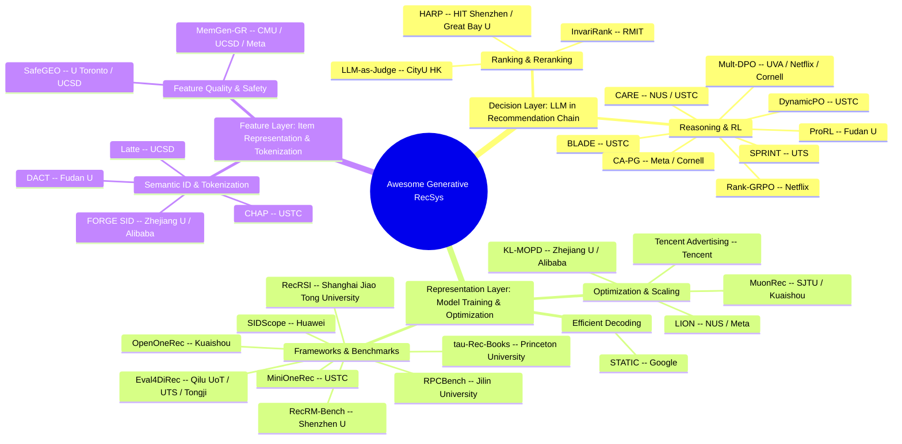

# Awesome Generative Recommendation System (RecSys)

```
 ██████╗                ██████╗                ███████╗                
██╔════╝  ███╗  ███╗    ██╔══██╗ ███╗   ███╗   ██╔════╝██╗ ██╗ ██████╗ 
██║      ██╔═██╗████╗   ██████╔╝██╔═██╗██╔═██╗ ███████╗╚██╗██║ ██╔═══╝ 
██║  ███╗██████║██╔██╗  ██╔══██╗██████║██║ ╚═╝ ╚════██║ ╚███╔╝ ██████╗ 
██║   ██║██║    ██║╚██╗ ██║  ██║██║    ██║ ██╗      ██║  ██╔╝      ██║
╚██████╔╝╚████╗ ██║ ╚██╗██║  ██║╚████╗ ╚███╔═╝ ███████║  ██║   ██████║
 ╚═════╝  ╚═══╝ ╚═╝  ╚═╝╚═╝  ╚═╝ ╚═══╝  ╚══╝   ╚══════╝  ╚═╝   ╚═════╝
```
---

[](https://github.com/sindresorhus/awesome)

RecSys is starting to adopt LLM for feature extraction, retrieval, and ranking/re-ranking! Although you can get some hands-on materials in either the [classics](#papers-classic-must-read) or some surveys, but since you're already interested in applying generative AI to industrial tasks, you probably wanna stay on the bleeding edge, right? That's exactly what this repo is for — automatically updated daily by agents with the latest generative RecSys papers fresh off arXiv, making sure that you never miss a beat.

> [!IMPORTANT]
> For those who are not familiar with GenRec, or not even the recommendation system, please checkout the kickstart posts [here](docs/kickstart.md).
> These posts are in Chinese, for English simply do your browser's internal translation or turn to __Ask Gemini__ :shipit:

## Quick Indexing
- [By Date](#by-date)
- [By Opensource](#by-opensource)
- [By Keyword](#by-keyword)
- [By Affiliation](#by-affiliation)
- [Papers Classic Must Read](#papers-classic-must-read)
- [Verl-GR: An Awesome RL Toolkit for GenRecSys](#verl-gr-an-awesome-rl-toolkit-for-genrecsys)



<div align="center">
  <i> Open-source Generative RecSys Map </i>
</div>

---
## `Verl-GR`: An Awesome RL Toolkit for GenRecSys
If you are interested in RFT your own GenRecSys, come check out our `verl`-based implementation called `verl-gr` here:
* [https://github.com/HaFred/verl-GR/tree/main/verl_gr/recipes/openonerec](https://github.com/HaFred/verl-GR/tree/main/verl_gr/recipes/openonerec)
* [https://github.com/HaFred/verl-GR/tree/main/verl_gr/recipes/rankgrpo](https://github.com/HaFred/verl-GR/tree/main/verl_gr/recipes/rankgrpo)

We manage to achieve 22% and 32% boosting for the end-to-end training efficiencies, compared with their respective vanilla implementations.

## By Date

We only keep the last 10 days summary below, for the past records before these, please see [the archive](docs/archive_by_month).

---

### Papers November 04

*Wednesday, November 4, 2026. The live arXiv cs.IR / cs.AI / cs.CL window for the last 24 hours (papers submitted Nov 3) carried 7 strictly on-topic generative-recommendation preprints, all verified absent from README, the docs indexes, and the monthly archive. 2 are open-source (HARP / Harbin Institute of Technology, Shenzhen, 7/10; tau-Rec-Books / Princeton University, 7/10). By Opensource count 236 -> 238. Mindmap updated (+HARP under Ranking & Reranking; +tau-Rec-Books under Frameworks & Benchmarks; dropped PFA and SODA to hold the 30-leaf cap; all 3 layers retained).*

1. **ZeroGR: Filtering-First Constrained Decoding for Generative Recommendation**
   * Affiliation: The University of Hong Kong, Hong Kong, China — *(Xiangrui Yang, Jiawei Yang, Liang Zeng, Daqian Ding, Ziqian Liu, Bing Tian, Cheng Peng, Yunfeng Zhao, Fangyu Zhang, Jiaqiang Liu, Xiao Liang, Yiming Qiu)* — with Peking University, Kuaishou Technology, Huazhong University of Science and Technology
   * Link: [arxiv.org/abs/2611.04715](https://arxiv.org/abs/2611.04715)
   * Venue: arXiv preprint, November 2026 (cs.DB; cs.IR; submitted 3 Nov 2026)
   * TL;DR: ZeroGR is a filtering-first constrained-decoding system for generative recommendation that applies validity filtering before relevance scoring, using a step-sliced filtering index, shared-slot execution, and hybrid projection to cut GPU memory and accelerate the filtering/scoring pipeline by up to 9.9x.
   * Key techniques:
     - Filtering-first ordering: validity filtering before relevance scoring in constrained decoding (most sequences are invalid, so scoring-first wastes compute)
     - Step-sliced filtering index: tailors data representations to each decoding step to reduce GPU memory
     - Shared-slot execution: accelerates data exchange across pipeline stages
     - Hybrid projection: adapts computation to workload patterns
     - Layout-guided streaming construction for fast index refresh with limited serving interference
   * Scores (Opensource? / Novelty / Fairness / Robustness / Impact):
     - **Opensource?: 0/10** — no public code available
     - **Novelty: 7/10** — system-level insight (filter-first) for genrec constrained decoding
     - **Fairness: 3/10** — not a focus
     - **Robustness: 7/10** — extensive system evaluation; strong engineering but a single-system study
     - **Impact: 7/10** — directly relevant to production genrec serving; from HKU / Kuaishou

2. **ReuseGR: Offline-Online Decoupled Generative Retrieval via Adaptive Prefix Reuse**
   * Affiliation: Xidian University, Xi'an, China — *(Xujing Wang, Yufeng Chen, Boxuan Zhang, Chao Wei, Cai Xu, Jie Zhao, Weiru Zhang, Wei Zhao, Ziyu Guan)* — with Alibaba International Digital Commerce Group; to appear WWW 2027
   * Link: [arxiv.org/abs/2611.04259](https://arxiv.org/abs/2611.04259)
   * Venue: arXiv preprint, November 2026 (cs.IR; submitted 3 Nov 2026); to appear WWW 2027
   * TL;DR: ReuseGR decouples generative retrieval into an offline 7B planner that shares SID prefix sets across requests with the same query and a 0.5B online model that personalizes completion, reusing large-model computation while keeping retrieval personalized; uses Path KD and GRPO-based BudgetCut.
   * Key techniques:
     - Offline-online decoupling: query-level candidate planning (offline 7B) vs request-level personalized completion (online 0.5B)
     - Adaptive prefix reuse: ReuseCut picks a cache depth per query by historical coverage
     - Path-level knowledge distillation (Path KD): transfers 7B suffix-scoring knowledge to 0.5B
     - BudgetCut: branch selection under a fixed budget, initialized by on-policy distillation and refined with GRPO
   * Scores (Opensource? / Novelty / Fairness / Robustness / Impact):
     - **Opensource?: 0/10** — no public code available
     - **Novelty: 8/10** — prefix reuse for genret serving is a fresh efficiency angle
     - **Fairness: 3/10** — not addressed
     - **Robustness: 7/10** — industrial dataset plus a 14-day online A/B test
     - **Impact: 8/10** — Alibaba International; online A/B gains (CTR +0.93%, revenue +1.05%)

3. **OneTrans-GSR: A Generative Slate Ranking Paradigm Unifying Reranking and Mix-Ranking with One Autoregressive Transformer**
   * Affiliation: ByteDance, China — *(Global E-Commerce Recommendation Foundation Team; Feng Cheng, Yu-Hsuan Huang, Fengyi Wang, Chaofan Zhou, Zhennan Zhu, Huan He, Bo Zhang, Ruoqi Zhang, Zhanfeng Mo, Ziwei Liu, Lanyi Li, Yifeng Pan, Junhua Long, Ziqiu Zhou, Yue Lin, Shaowei Liu)*
   * Link: [arxiv.org/abs/2611.04720](https://arxiv.org/abs/2611.04720)
   * Venue: arXiv preprint, November 2026 (cs.IR; submitted 3 Nov 2026)
   * TL;DR: OneTrans-GSR reformulates reranking and mix-ranking (combining product cards, short videos, livestreams, and ads) as a unified generative slate-ranking problem solved by a single autoregressive transformer that extends the deployed OneTrans backbone, trained with a reward model and RL toward slate-level and long-term objectives, and deployed at ByteDance.
   * Key techniques:
     - Unified reranking plus mix-ranking as one generative slate-generation problem
     - Single decoder-only policy extending the deployed OneTrans backbone
     - Reward model evaluates complete slates; RL optimizes slate-level and long-term objectives
     - Explicit business-constraint enforcement during decoding
   * Scores (Opensource? / Novelty / Fairness / Robustness / Impact):
     - **Opensource?: 0/10** — no public code available
     - **Novelty: 8/10** — unifies heterogeneous slate generation into one learned policy
     - **Fairness: 4/10** — not a focus (constraint enforcement is business-objective)
     - **Robustness: 7/10** — deployed, large-scale online A/B (GMV/u +2.63%, advertiser value +2.06%, repurchase +2.03%, latency -13%)
     - **Impact: 9/10** — ByteDance industrial deployment with strong online gains

4. **SourceFlow: Collaborative Source Coupling for Flow-Based Recommendation**
   * Affiliation: The Hong Kong University of Science and Technology (Guangzhou), Guangzhou, China — *(Chenghao Wu, Yongqi Zhou, Jin Chen, Yifeng Zhou, Jinchang Zhu, Junwei Pan, Chao Zhou, Zhixiang Feng, Chengguo Yin, Menglin Yang)* — with Tencent Inc., Shenzhen, China
   * Link: [arxiv.org/abs/2611.04455](https://arxiv.org/abs/2611.04455)
   * Venue: arXiv preprint, November 2026 (cs.IR; submitted 3 Nov 2026); under review
   * TL;DR: SourceFlow improves flow-based collaborative filtering by injecting collaborative structure directly into the source distribution (Neighborhood Coupling, Collaborative Consensus, Stretched Restoration) instead of conditioning the predictor, yielding a mean +15.7% relative Recall@10 gain over the strongest flow-based baseline.
   * Key techniques:
     - Flow-based collaborative filtering: learns a discrete path from a sampled source to observed interactions (few-step inference)
     - Neighborhood Coupling: constructs displaced binary sources replacing historical items with collaborative alternatives
     - Collaborative Consensus: refines replacement probabilities using evidence from users who share the observed item
     - Stretched Restoration: retains replacements at late flow times during training
   * Scores (Opensource? / Novelty / Fairness / Robustness / Impact):
     - **Opensource?: 0/10** — code will be released upon acceptance (not yet public)
     - **Novelty: 8/10** — reframes source sampling as collaborative-structure modeling for flow-based rec
     - **Fairness: 3/10** — not addressed
     - **Robustness: 7/10** — five datasets with controlled experiments; flow-based method
     - **Impact: 7/10** — Tencent; solid empirical gains in an emerging flow-based genrec direction

5. **HARP: Training-Free Dual-Profile Agentic Communication for LLM-Based Recommendation**
   * Affiliation: Harbin Institute of Technology, Shenzhen, China — *(Zhen Tao, Xun Zhou, Xuhui Chen, Ziyue Qiao, Qingqiang Sun)* — with Great Bay University; NeurIPS 2026
   * Link: [arxiv.org/abs/2611.05319](https://arxiv.org/abs/2611.05319)
   * Venue: NeurIPS 2026 (cs.IR; cs.AI; submitted 3 Nov 2026)
   * TL;DR: HARP recasts LLM-based recommendation as agentic communication between user and item agents and adds three training-free operators (symmetric item profile, retrieval-time profile-level homophily gate, reflective profile update) to a frozen LLM backbone, lifting Hit@1 by 6.9%-24.0% over the strongest baseline.
   * Key techniques:
     - Four-stage agentic communication: BUILD, TRANSMIT, UNDERSTAND, SYNC
     - Dual profiles: rule-extracted symmetric item profile (zero extra LLM calls) plus user profile
     - Channel-decomposable profile-level homophily H(phi_u, phi_i) consumed at retrieval time (not inside the reranker prompt)
     - Single-pass reflective profile update (in-context evolution, no gradient step)
   * Scores (Opensource? / Novelty / Fairness / Robustness / Impact):
     - **Opensource?: 7/10** — [github.com/Jove-Zhen/HARP](https://github.com/Jove-Zhen/HARP): clear module structure (profiles / homophily / memory / models), per-dataset configs, conversion + run scripts, and a README with setup/usage that matches the paper (Build/Transmit/Understand/Sync); deductions: very new with few stars, niche LLM-rec scope, and no explicit LICENSE file in the repo
     - **Novelty: 8/10** — agentic-communication framing plus training-free dual-profile homophily
     - **Fairness: 4/10** — not a focus
     - **Robustness: 7/10** — 4 public benchmarks with Holm-corrected p < 1e-9 and ablations
     - **Impact: 7/10** — NeurIPS 2026; training-free and easy to adopt on a frozen LLM backbone

6. **DualEvolve: Dual-Level Self-Evolution of Mechanism and Orchestration for Recommendation**
   * Affiliation: Meituan, China — *(Tianqi Gao [Independent Researcher], Chenxu Wang, Wenxuan Yang, Yueqi Mou, Biao Tang, Ming Liu, Peng Yan)*
   * Link: [arxiv.org/abs/2611.04439](https://arxiv.org/abs/2611.04439)
   * Venue: arXiv preprint, November 2026 (cs.IR; submitted 3 Nov 2026)
   * TL;DR: DualEvolve is a dual-level self-evolving LLM-agent framework for recommendation that co-evolves inner recommendation mechanisms (model / training code) and outer agent orchestration (harness / skill rules) using task feedback and execution traces, beating OpenEvolve and DeepEvolve in 64 of 64 setting-metric comparisons.
   * Key techniques:
     - Inner evolution: revises model and training code via task feedback to improve recommendation performance
     - Outer evolution: scores the inner-loop experimental process, updates harness and skill rules, and adjusts orchestration choices from next-round scores
     - Recursive self-improvement driven by both task performance and experimentation-quality signals
   * Scores (Opensource? / Novelty / Fairness / Robustness / Impact):
     - **Opensource?: 0/10** — the paper links github.com/ToAdventure/dualevolve, but the repository returns 404 / is not publicly accessible (no usable public code)
     - **Novelty: 8/10** — dual-level (mechanism + orchestration) co-evolution for rec agents
     - **Fairness: 3/10** — not addressed
     - **Robustness: 6/10** — four datasets across 16 settings, but a simulation-based agentic loop
     - **Impact: 7/10** — Meituan; extends the OpenEvolve / DeepEvolve lineage to recommendation

7. **tau-Rec-Books: A Disclosure-Controlled Benchmark for Requirement Elicitation in Agentic Recommender Systems**
   * Affiliation: Princeton University, USA — *(Bharath Sivaram Narasimhan, Karthik R. Narasimhan)*
   * Link: [arxiv.org/abs/2611.04459](https://arxiv.org/abs/2611.04459)
   * Venue: arXiv preprint, November 2026 (cs.IR; cs.AI; cs.CL; submitted 3 Nov 2026); submitted to ECIR 2027 (Resource Track)
   * TL;DR: tau-Rec-Books is a benchmark that evaluates how well agentic recommender agents elicit hidden user requirements (volunteer / mixed / hidden disclosure variants) over a 20k-book Wikidata catalog, with a rule-based simulated user and programmatic (non-LLM-judge) scoring.
   * Key techniques:
     - Disclosure-controlled tasks: requirements revealed volunteer / mixed / hidden
     - Hidden requirements discoverable only by proposing books and inferring from accept/reject verdicts
     - Rule-based deterministic simulated user plus programmatic verifiable scoring (no LLM judge)
     - 450 tasks over a 20k-book catalog; extends the tau-Rec harness (also a movies track, RecSys 2026)
   * Scores (Opensource? / Novelty / Fairness / Robustness / Impact):
     - **Opensource?: 7/10** — [github.com/nbharaths/tau-rec](https://github.com/nbharaths/tau-rec): comprehensive MIT-licensed benchmark release (catalog pipeline, task generator, simulated user, validators, reference agents, full traces, analysis code, HuggingFace datasets, leaderboard, v2.0.0); deductions: it is a benchmark / data release rather than a core-method implementation, and the books track depends on external Wikidata
     - **Novelty: 7/10** — controlled-disclosure benchmark for requirement elicitation in agentic CRS
     - **Fairness: 4/10** — not a focus
     - **Robustness: 7/10** — programmatically reproducible scoring across 4 agents and 2 interfaces, with mixed/hidden ablations
     - **Impact: 7/10** — Princeton; extends the RecSys 2026 tau-Rec evaluation resource for agentic rec


### Papers November 03

*Tuesday, November 3, 2026. The live arXiv cs.IR / cs.AI / cs.CL window for the last 24 hours (papers submitted Nov 2) carried 6 strictly on-topic generative-recommendation preprints, all verified absent from README, the docs indexes, and the monthly archive. 1 is open-source (RecRSI / Shanghai Jiao Tong University, 7/10). By Opensource count 235 -> 236. Mindmap updated (added RecRSI under Frameworks & Benchmarks; dropped LLM-Demographic to hold the 30-leaf cap; all 3 layers retained).*

1. **Diverse-Teacher On-Policy Distillation for Generative Recommendation**
   * Affiliation: University of Science and Technology of China (USTC), Hefei, China — *(Zhipeng Yi, Xinyu Lin, Minxuan Shan, Zipeng Chen, Yujiao Zhao, Chuanyu Xu, Wenjie Wang)*
   * Link: [arxiv.org/abs/2611.03272](https://arxiv.org/abs/2611.03272)
   * Venue: arXiv preprint, November 2026 (cs.IR; submitted 2 Nov 2026)
   * TL;DR: Proposes a diverse-teacher on-policy distillation method for generative recommendation that mitigates the popularity bias aggravated by standard on-policy distillation, covering unpopular SID paths rarely generated or supervised by a single teacher.
   * Key techniques:
     - On-policy distillation (OPD) for generative recommendation (semantic-ID generation) providing denser token-level supervision than target-token-only objectives
     - Identifies that OPD aggravates popularity bias: teacher feedback and student rollout both favor popular-item tokens, leaving unpopular SID paths rarely generated/supervised
     - Diverse-teacher ensembling with diversity-aware regularization to cover unpopular-item token paths
     - Popularity-debiased distillation loss balancing popular vs long-tail SID trajectories
   * Scores (Opensource? / Novelty / Fairness / Robustness / Impact):
     - **Opensource?: 0/10** — no public code available
     - **Novelty: 7/10** — reframes the popularity-bias problem of OPD in GR and proposes a diversity-aware mitigation
     - **Fairness: 7/10** — directly targets popularity / long-tail bias introduced by distillation
     - **Robustness: 6/10** — evaluated on SID-based GR benchmarks; limited extreme-long-tail ablations
     - **Impact: 7/10** — relevant to industrial GR training where OPD is increasingly used

2. **Preprocessing Choices in Fine-Tuning Data Matter: Utility and Demographic Sensitivity in LLM-Based Recommendation**
   * Affiliation: Istanbul Technical University, Turkiye — *(Furkan Yasir Goksu, Yaren Yilmaz, Sule Gunduz Oguducu)*
   * Link: [arxiv.org/abs/2611.03113](https://arxiv.org/abs/2611.03113)
   * Venue: arXiv preprint, November 2026 (cs.IR; cs.CL; cs.LG; submitted 2 Nov 2026)
   * TL;DR: Systematically studies how preprocessing choices in fine-tuning data (demographic-descriptor handling, output validity, prompt consistency) affect both utility and demographic fairness in a generative LLM-based recommender.
   * Key techniques:
     - Controlled generative LLM-based recommendation pipeline combining supervised fine-tuning, catalog, and generation
     - Systematic variation of preprocessing choices (e.g., inclusion/format of demographic descriptors, output-format validation)
     - Joint measurement of recommendation utility and demographic sensitivity (fairness)
   * Scores (Opensource? / Novelty / Fairness / Robustness / Impact):
     - **Opensource?: 0/10** — no public code available
     - **Novelty: 6/10** — an empirical study reframing data preprocessing as a utility/fairness lever
     - **Fairness: 8/10** — central contribution is the demographic-sensitivity analysis
     - **Robustness: 6/10** — controlled but single-pipeline; limited datasets
     - **Impact: 6/10** — practical guidance for fair LLM-rec fine-tuning

3. **PACERec: Progressive Adaptation of LLM Item Embeddings with Collaborative Evidence for Recommendation**
   * Affiliation: Northeastern University, China (Shenyang) — *(Junzhao Huang, Xi Wu, Zihan Wang, Zijing Wang, Ming Wang, Kang Liu, Xiaocui Yang, Shi Feng, Daling Wang, Yifei Zhang, Ting Yang, Xurui Li)*
   * Link: [arxiv.org/abs/2611.03068](https://arxiv.org/abs/2611.03068)
   * Venue: arXiv preprint, November 2026 (cs.IR; cs.AI; submitted 2 Nov 2026)
   * TL;DR: PACERec progressively adapts frozen LLM item embeddings to sequential recommendation by transferring preceding interaction contexts from frequent to long-tail items using collaborative evidence.
   * Key techniques:
     - LLM embeddings encode static item attributes for sequential recommendation (alleviating ID-embedding sparsity)
     - Progressive adaptation that transfers preceding interaction contexts from frequent to long-tail items
     - Collaborative-evidence-guided embedding adaptation under unevenly distributed behavioral evidence
     - Context-transfer objective for long-tail items
   * Scores (Opensource? / Novelty / Fairness / Robustness / Impact):
     - **Opensource?: 0/10** — no public code available
     - **Novelty: 7/10** — explicit frequent->long-tail context transfer for LLM embeddings
     - **Fairness: 6/10** — long-tail improvement implies fairness gain but not the explicit focus
     - **Robustness: 6/10** — evaluated on sequential-rec benchmarks; moderate ablations
     - **Impact: 7/10** — addresses the sparse-interaction limitation of LLM embeddings in rec

4. **E-GenRM: Generative Reward Modeling for Open-Ended E-Commerce Shopping Agents**
   * Affiliation: Alibaba (Taobao / Tmall Group), China — *(Ying Sun, Qiuyu Zhao, Xiao Wang, Xiyu Zhao, Gege Shi, Zenghui Sun, Jinsong Lan, Haihong Tang, Bo Zheng)*
   * Link: [arxiv.org/abs/2611.03008](https://arxiv.org/abs/2611.03008)
   * Venue: arXiv preprint, November 2026 (cs.IR; submitted 2 Nov 2026)
   * TL;DR: E-GenRM is a generative reward model for open-ended e-commerce shopping agents that leverages naturally occurring user behavior to provide fine-grained, capability-improving reward signals beyond current bounded agent usage.
   * Key techniques:
     - Generative (not scalar) reward modeling tailored to e-commerce shopping agents
     - Leverages naturally occurring user behavior across the shopping app as supervision
     - Integrated reward framework for open-ended shopping-agent tasks (beyond bounded trajectories / known failures)
   * Scores (Opensource? / Novelty / Fairness / Robustness / Impact):
     - **Opensource?: 0/10** — no public code available
     - **Novelty: 7/10** — generative reward model for shopping agents using natural user behavior
     - **Fairness: 4/10** — not a focus
     - **Robustness: 6/10** — industrial setting; evaluated on shopping-agent tasks
     - **Impact: 8/10** — Alibaba industrial; high relevance to agentic e-commerce rec / RL

5. **RecRSI: Mechanism-Guided Discovery of Recommendation Algorithms**
   * Affiliation: Shanghai Jiao Tong University, China — *(Tingran Gan, Zhouziyue Lu, Dian Jin, Tao Li, Yang Gao, Ming Liu, Weiwen Liu, Jianghao Lin, Weinan Zhang, Yong Yu)*
   * Link: [arxiv.org/abs/2611.02487](https://arxiv.org/abs/2611.02487)
   * Venue: arXiv preprint, November 2026 (cs.IR; cs.AI; submitted 2 Nov 2026)
   * TL;DR: RecRSI is an LLM-based research framework that organizes recommendation-algorithm discovery around mechanism hypotheses (MechSpace, Research Line, Mechanism Feedback) to automatically propose, implement, and evaluate candidate algorithms.
   * Key techniques:
     - MechSpace: derives implementable primitives and composition rules from the task source
     - Research Line: develops/tests mechanism hypotheses linking a proposed mechanism change to a reference design, rationale, and expected observation
     - Mechanism Feedback: carries outcomes and design context into subsequent proposals (recursive self-improvement)
     - Built on SASRec / Amazon CDs&Vinyl with RecBole and a GRPO-based candidate-training backend
   * Scores (Opensource? / Novelty / Fairness / Robustness / Impact):
     - **Opensource?: 7/10** — [github.com/DynamisG210/RecRSI](https://github.com/DynamisG210/RecRSI): MIT-licensed Python package (src/recrsi) with pyproject.toml, CI tests, docs (host-setup / task-format), and a reproducible CPU demo that runs without API key or GPU; code structure matches the paper (MechSpace / Research Line / Mechanism Feedback, GRPO backend). Deductions: very new (2 stars), niche research-framework scope, limited community adoption
     - **Novelty: 8/10** — frames recsys research as automated mechanism-hypothesis discovery with LLM agents + RL
     - **Fairness: 4/10** — not a focus
     - **Robustness: 6/10** — sandboxed execution (landlock / namespace); empirical breadth limited to the SASRec demo
     - **Impact: 7/10** — novel auto-discovery paradigm; from SJTU / Meituan; open-source

6. **Multi-Teacher Reasoning Distillation for LLM Recommendation with Self-Exploration**
   * Affiliation: The Hong Kong Polytechnic University, Hong Kong SAR, China — *(Liangbo Ning, Siyuan Liang, Yi Zhou, Yifeng Zhang, Qing Li, Wenqi Fan, Dacheng Tao)*
   * Link: [arxiv.org/abs/2611.02457](https://arxiv.org/abs/2611.02457)
   * Venue: arXiv preprint, November 2026 (cs.IR; cs.AI; submitted 2 Nov 2026)
   * TL;DR: Proposes multi-teacher reasoning distillation for LLM recommenders that distills reasoning trajectories from several complementary teachers and uses self-exploration to assess and select the most useful trajectories for downstream recommendation.
   * Key techniques:
     - Reasoning-augmented recommender that generates reasoning trajectories over historical interactions
     - Multi-teacher distillation from several fixed teachers (breaks the single-teacher knowledge ceiling)
     - Self-exploration: the student generates its own trajectories and assesses their utility before distilling (utility-aware selection)
   * Scores (Opensource? / Novelty / Fairness / Robustness / Impact):
     - **Opensource?: 0/10** — no public code available
     - **Novelty: 7/10** — multi-teacher + self-exploration utility-aware distillation for reasoning rec
     - **Fairness: 4/10** — not addressed
     - **Robustness: 6/10** — evaluated on rec benchmarks; ablations on teacher selection
     - **Impact: 7/10** — from PolyU / NTU; relevant to reasoning LLM recsys


### Papers November 02

*Monday, November 2, 2026. The live arXiv cs.IR listing for Nov 2 (a Monday announcement day) carried no strictly on-topic generative-recommendation preprints newer than the Oct 30 run already indexed, so per the fallback rule papers were drawn from the last-3-month keyword pool. 5 genuinely-new on-topic papers were verified absent from README, the docs indexes, AND the monthly archive. 1 is open-source (LLM Recommenders Produce Demographic Inequality / University of Zurich, 6/10). By Opensource count 234 -> 235. Mindmap updated (added LLM-Demographic under Feature Quality & Safety; dropped RecToolBench to hold the 30-leaf cap; all 3 layers retained).*

1. **LLM Recommenders Produce Demographic Inequality Through Content Preferences**
   * Affiliation: University of Zurich, Switzerland — *(Nicolò Pagan, Petter Törnberg, Christopher A. Bail, Christopher Barrie)*
   * Link: [arxiv.org/abs/2610.41854](https://arxiv.org/abs/2610.41854)
   * Venue: arXiv preprint, October 2026 (cs.CY; cs.SI; submitted 30 Oct 2026)
   * TL;DR: LLM-based content recommenders surface demographic inequality through the content they surface, not through explicit demographics: a controlled experiment on 10,000 Twitter/X posts from 1,000 survey respondents with nine verified self-reported attributes shows that recommendation objectives and contextual framing systematically shift whose voices get amplified across demographic groups.
   * Key techniques:
     - Controlled recommendation experiment across 3 LLM providers, 6 recommendation objectives, 5 levels of contextual framing
     - 10,000 Twitter/X posts linked to verified self-reported demographic characteristics (9 attributes)
     - Audits demographic inequality emerging from content-preference modeling rather than explicit group membership
   * Scores (Opensource? / Novelty / Fairness / Robustness / Impact):
     - **Opensource?: 6/10** — [github.com/paganick/llm-recsys-twitter-yougov-PNAS](https://github.com/paganick/llm-recsys-twitter-yougov-PNAS): Python repo with README, recommendation/features/analysis/utils dirs and env files (0 stars at indexing; PNAS-linked release)
     - **Novelty: 7/10** — reframes demographic bias in LLM recommenders as an emergent content-preference effect with a controlled multi-provider experimental design
     - **Fairness: 9/10** — the paper's central contribution is a direct, empirical measurement of demographic inequality in LLM recs
     - **Robustness: 7/10** — multi-provider (3), multi-objective (6), multi-framing (5) design with survey-linked ground truth
     - **Impact: 8/10** — high relevance for auditing deployed LLM recommenders; PNAS-venue visibility

2. **Category-Anchored Large Language Models for Next POI Recommendation**
   * Affiliation: Harbin Institute of Technology, Shenzhen, China / City University of Hong Kong — *(Lexi Bai, Xiaopeng Zeng, Xun Zhou, Yuanshao Zhu, James Jianqiao Yu)*
   * Link: [arxiv.org/abs/2610.39518](https://arxiv.org/abs/2610.39518)
   * Venue: arXiv preprint, October 2026 (cs.AI; submitted 29 Oct 2026)
   * TL;DR: ANCHOR addresses unreliable direct POI-identifier generation by LLMs (POIs are sparse, localized, long-tailed entities with weak NL semantics) via category-anchored prompting: it first anchors generation on venue categories, then grounds the final POI within the anchored category space for spatio-temporally consistent next-POI prediction.
   * Key techniques:
     - Category-anchored LLM prompting that decouples category reasoning from exact-POI decoding
     - Textualized user trajectory encoding for LLM semantic reasoning
     - Two-stage category-conditioned POI generation for sparse/long-tailed entities
   * Scores (Opensource? / Novelty / Fairness / Robustness / Impact):
     - **Opensource?: 0/10** — no public code (arXiv lists no repository)
     - **Novelty: 7/10** — clean fix to the POI-identifier generation unreliability via category anchoring
     - **Fairness: 3/10** — not addressed (standard POI benchmark fairness not studied)
     - **Robustness: 6/10** — evaluated on standard next-POI benchmarks; long-tail handling claimed but limited ablation detail
     - **Impact: 6/10** — from HIT Shenzhen / CityU HK; practical LLM-POI direction

3. **Federated Recommender Agents**
   * Affiliation: POSTECH (Pohang University of Science and Technology), Pohang, South Korea — *(Jaehyung Lim, Woojoo Kim, Junyoung Kim, Dongha Kim, Wonbin Kweon, Hwanjo Yu)*
   * Link: [arxiv.org/abs/2610.39289](https://arxiv.org/abs/2610.39289)
   * Venue: arXiv preprint, October 2026 (cs.IR; submitted 29 Oct 2026)
   * TL;DR: FedRecAgent formulates a federated setting where local LLM-powered recommender agents collaborate through natural-language knowledge while keeping interaction histories and personal memories local; it enables this collaboration without updating LLM parameters, tackling the central challenge of privacy-preserving cross-agent learning.
   * Key techniques:
     - Federated multi-agent recommendation with natural-language knowledge exchange
     - Local interaction histories and personal memories kept private (no parameter sharing)
     - Collaboration without fine-tuning the underlying LLM
   * Scores (Opensource? / Novelty / Fairness / Robustness / Impact):
     - **Opensource?: 0/10** — no public code (arXiv lists no repository)
     - **Novelty: 7/10** — federated formulation of LLM recommender agents with parameter-free collaboration
     - **Fairness: 5/10** — privacy-preserving design implicitly supports user-fair data governance, but group fairness not evaluated
     - **Robustness: 6/10** — method proposed with collaboration protocol; empirical depth on heterogeneous clients limited
     - **Impact: 7/10** — from POSTECH (strong recsys group); addresses a real privacy bottleneck for agentic recs

4. **Read More, Reason Deeper: Latent Workspaces for Long-Sequence Recommendation**
   * Affiliation: Meta Platforms — *(Renzhi Wu, Li Sheng, Zikun Cui, Junjie Yang, Tai Guo, Keke Zhai, et al.)*
   * Link: [arxiv.org/abs/2610.39188](https://arxiv.org/abs/2610.39188)
   * Venue: arXiv preprint, October 2026 (cs.IR; submitted 29 Oct 2026)
   * TL;DR: LWR (Latent Workspace Ranker) decouples evidence scaling from reasoning scaling for long-sequence recommendation: it keeps typed evidence in persistent banks and propagates a fixed-size candidate workspace through deeper reasoning layers, so later layers can revisit omitted evidence that one-shot selection would discard.
   * Key techniques:
     - Latent workspace: fixed-size persistent candidate/evidence banks across reasoning layers
     - Decoupled evidence scaling (longer histories) from reasoning scaling (deeper interpretation)
     - Revisit-able evidence avoiding one-shot selection's information loss
   * Scores (Opensource? / Novelty / Fairness / Robustness / Impact):
     - **Opensource?: 0/10** — no public code (Meta industrial)
     - **Novelty: 8/10** — clean decoupling of evidence vs reasoning scaling with a persistent latent workspace
     - **Fairness: 3/10** — not addressed
     - **Robustness: 7/10** — long-sequence benchmarks; principled motivation against coupled encoders
     - **Impact: 8/10** — from Meta; long-sequence rec is an industrial pain point

5. **Modeling Preference Dependencies with Directed Acyclic Graphs for Narrative-Driven Recommendation**
   * Affiliation: Institute of Information Engineering, Chinese Academy of Sciences, Beijing, China / School of Cyber Security, University of Chinese Academy of Sciences / University of Melbourne / Independent Researcher — *(Mingzhe Lu, Jian Qin, Ruize Qin, Jinhao Liu, Yunpeng Li, Hang Su)*
   * Link: [arxiv.org/abs/2610.37280](https://arxiv.org/abs/2610.37280)
   * Venue: arXiv preprint, October 2026 (cs.IR; cs.CL; submitted 27 Oct 2026)
   * TL;DR: PDG-F (Preference Dependency Graph Framework) treats narrative-driven recommendation as an explicit directed acyclic graph of preference dependencies, capturing how stated preferences hierarchically refine and condition one another — instead of flattening narratives into keyword bags or unconstrained generative queries.
   * Key techniques:
     - Directed acyclic graph (DAG) modeling of preference dependencies in free-form narratives
     - Hierarchical refinement / contextualization of preferences as graph edges
     - Narrative-driven recommendation framework centered on structured dependency graphs
   * Scores (Opensource? / Novelty / Fairness / Robustness / Impact):
     - **Opensource?: 0/10** — no public code (arXiv lists no repository)
     - **Novelty: 7/10** — structured DAG representation of narrative preference dependencies vs flat/generative baselines
     - **Fairness: 3/10** — not addressed
     - **Robustness: 6/10** — narrative benchmarks; structured-graph ablation limited
     - **Impact: 6/10** — from IIE CAS; advances narrative-driven rec structuring

### Papers November 01

*Sunday, November 1, 2026. The live arXiv cs.IR listing for Nov 1 (a Sunday — arXiv announces Mon–Fri) carried no new on-topic generative-recommendation preprints, so per the fallback rule papers were drawn from the last-3-month keyword pool. 5 genuinely-new on-topic papers were verified absent from README, the docs indexes, AND the monthly archive. 1 is open-source (SODA / USTC & Upwork, 7/10). By Opensource count 233 -> 234. Mindmap updated (added SODA; dropped Octen-WebGR to hold the 30-cap).*

1. **Unified Generative Ranking for Heterogeneous E-commerce Recommendation**
   * Affiliation: Alibaba Group, Hangzhou, China — *(Zonghe Shao, Huabin Chen, Sitong Lu, Fangmei Zhu, Yingcai Ma, Ge Fan, Jinguo Gao, Wei Shi, Yanfang Liu, Huiping Chu)*
   * Link: [arxiv.org/abs/2610.39426](https://arxiv.org/abs/2610.39426)
   * Venue: arXiv preprint, October 2026 (cs.IR; submitted 29 Oct 2026)
   * TL;DR: UGR performs list-wise generative ranking over the full request-level multi-business heterogeneous candidate set (~1000 candidates in production) and directly generates multi-business ranking lists via candidate-aware autoregressive decoding; beyond exposure-sequence imitation it adds weighted SFT + permutation preference optimization and a training-time ad-debiasing tower while preserving GSP pricing at serving.
   * Key techniques:
     - Candidate-aware autoregressive decoding over ~1000 heterogeneous multi-business candidates
     - Weighted supervised fine-tuning that leverages post-exposure feedback
     - Permutation preference optimization from feedback-derived permutation preferences
     - Training-time advertising debiasing tower + serving-time ad-value modeling (GSP-preserving)
   * Scores (Opensource? / Novelty / Fairness / Robustness / Impact):
     - **Opensource?: 0/10** — no public code (Alibaba industrial)
     - **Novelty: 7/10** — generative ranking over full heterogeneous multi-business candidate sets with permutation preference optimization; practical but builds on generative-ranking + preference-optimization lines
     - **Fairness: 2/10** — not addressed (ad-debiasing tower targets ad-exposure bias, not demographic fairness)
     - **Robustness: 7/10** — offline ranking-quality gains plus online A/B on Taobao Guess You Like (+1.76% IPV, +3.29% volume, +2.10% GMV)
     - **Impact: 9/10** — deployed A/B on Taobao at scale with real GMV lift; strong industrial relevance

2. **R2QRec: Learning Recommendation Queries from Retrieval Feedback**
   * Affiliation: Kuaishou Technology, Beijing, China / Hong Kong Baptist University — *(Weixin Chen, Shuchang Liu, Hailan Yang, Yuhan Zhao, Li Kang, Li Chen, et al.; 16 authors)*
   * Link: [arxiv.org/abs/2610.39984](https://arxiv.org/abs/2610.39984)
   * Venue: arXiv preprint, October 2026 (cs.IR; submitted 29 Oct 2026)
   * TL;DR: R2QRec learns to generate recommendation queries from item interactions without query annotations: retrieval verification selects generated expressions that recover observed items as SFT targets, then policy refinement scores query sets by the observed item's rank in their fused list (log-rank feedback, KL penalty); only the query generator is trained.
   * Key techniques:
     - Fixed retriever + item index; only the query generator is trained (no learned reward model, no query annotations)
     - Retrieval verification: keep generated expressions that recover observed items as SFT targets
     - Policy refinement: rank-based (log-rank) feedback beyond the cutoff + KL penalty vs the supervised reference
     - Reciprocal Rank Fusion (RRF) of query-set rankings; LoRA adapters
   * Scores (Opensource? / Novelty / Fairness / Robustness / Impact):
     - **Opensource?: 0/10** — no public code (Kuaishou industrial)
     - **Novelty: 8/10** — clean separation of query-expression learning from item location; retrieval verification + log-rank policy refinement with KL constraint, no annotations/reward model
     - **Fairness: 2/10** — not addressed
     - **Robustness: 7/10** — SOTA on three public datasets; generalization across generators and domains
     - **Impact: 7/10** — from Kuaishou; query-based recommendation is industrially relevant

3. **Try Before You Evolve: Ranking-Scored Trials for Recursive Self-Improvement of Recommender Systems**
   * Affiliation: University of Science and Technology of China (USTC), Hefei, China — *(Xu Huang, Jiawei Feng, Jiancan Wu)*
   * Link: [arxiv.org/abs/2610.39352](https://arxiv.org/abs/2610.39352)
   * Venue: arXiv preprint, October 2026 (cs.IR; submitted 29 Oct 2026)
   * TL;DR: RecRSI (Try-Before-You-Evolve) tackles delayed/unreliable ranking feedback in LLM-agent recursive self-improvement of recommenders: it generates diverse candidate edits and selects one for full retraining using early ranking feedback — each candidate gets a short trial (first steps of training) scored by full-ranking NDCG@10 on held-out probe users.
   * Key techniques:
     - LLM-agent proposes diverse candidate recipe edits from a diagnosis of the current model
     - Ranking-scored short trials: first training steps scored by full-ranking NDCG@10 on probe users
     - Selects the best candidate for full retraining; same retraining budget as baselines
     - Evaluated on SASRec & HSTU over three datasets (CDs, Office, LastFM)
   * Scores (Opensource? / Novelty / Fairness / Robustness / Impact):
     - **Opensource?: 0/10** — no public code found (arXiv lists no repository)
     - **Novelty: 8/10** — "try before you evolve" ranking-scored trials directly address the delayed/unreliable-feedback bottleneck in recommender RSI
     - **Fairness: 3/10** — not a focus; RSI loops could amplify bias, unaddressed
     - **Robustness: 7/10** — matches/exceeds baselines with the same retraining budget; on both Amazon datasets reaches in 1 round what baselines need 5
     - **Impact: 8/10** — novel RSI paradigm from USTC (strong recsys group); addresses a real bottleneck

4. **Distribution-Level Contrastive Supervision for Generative Recommendation**
   * Affiliation: University of Science and Technology of China, Hefei, China / Upwork, Seattle, USA — *(Ziqi Xue, Yimeng Bai, Shuai Zhu, Jialei Li, Dingxian Wang, Frank Yang, Andrew Rabinovich, Pablo N. Mendes, et al.)*
   * Link: [arxiv.org/abs/2603.00700](https://arxiv.org/abs/2603.00700)
   * Venue: ACM RecSys 2026 (short paper); arXiv v2 Sep 2026
   * TL;DR: SODA treats multi-level codebook probabilities as soft semantic targets and aligns recommender representations to them with a BPR-style contrastive objective (negative KL to positive, vs in-batch averaged negatives), enriching training with finer semantic cues while leaving decoding unchanged.
   * Key techniques:
     - Distribution-level (soft multi-level codebook) supervision instead of one-hot SID targets
     - BPR-style contrastive alignment via negative KL divergence
     - Plug-and-play auxiliary loss; decoding stage unchanged
     - Applicable across diverse generative-recommendation backbones
   * Scores (Opensource? / Novelty / Fairness / Robustness / Impact):
     - **Opensource?: 7/10** — [github.com/freyasa/SODA](https://github.com/freyasa/SODA): official RecSys'26 code release (complete implementation)
     - **Novelty: 8/10** — moves beyond code-level supervision to distribution-level contrastive alignment
     - **Fairness: 3/10** — not addressed
     - **Robustness: 7/10** — peer-reviewed RecSys'26; plug-and-play gains across backbones
     - **Impact: 7/10** — accepted at RecSys'26 with code; broadly applicable supervision scheme

5. **Unleash the Potential of Long Semantic IDs for Generative Recommendation**
   * Affiliation: Southern University of Science and Technology / Xi'an Jiaotong University / Nanjing University — *(Ming Xia, Guoxin Ma, Zhiqin Zhou, Dongmin Huang)*
   * Link: [arxiv.org/abs/2602.13573](https://arxiv.org/abs/2602.13573)
   * Venue: arXiv preprint, under review (cs.IR; v2 Aug 2026)
   * TL;DR: ACERec keeps the semantic richness of long Semantic IDs while staying efficient: an Attentive Token Merger compresses long SIDs into compact latent tokens, a dedicated Intent Token captures user intent, and a dual-granularity objective combines token-level generation with item-level intent-semantic alignment.
   * Key techniques:
     - Attentive Token Merger compresses long semantic IDs into compact latent tokens
     - Dedicated Intent Token for user intent
     - Dual-granularity objective: token-level generation + item-level intent-semantic alignment
     - Breaks the short-ID efficiency vs long-ID expressiveness dilemma
   * Scores (Opensource? / Novelty / Fairness / Robustness / Impact):
     - **Opensource?: 0/10** — no public code (under review; arXiv lists no repository)
     - **Novelty: 9/10** — directly attacks the long-SID granularity-efficiency dilemma with a token merger + intent token + dual-granularity objective
     - **Fairness: 2/10** — not addressed
     - **Robustness: 8/10** — 9 real-world benchmarks, +12.92% NDCG@10 and +7.49% Recall@10 over strongest baselines
     - **Impact: 8/10** — strong empirical gains on long semantic IDs; multi-institution

### Papers October 31

*Saturday, October 31, 2026. The live arXiv cs.IR window (papers dated Oct 30-31) carried no strictly on-topic generative-recommendation submissions newer than the Oct 30 run (the 5 newest cs.IR preprints, 2610.39470/39273/38378/37973/37962, were already indexed Oct 30). Per the fallback rule we drew 9 genuinely-new on-topic papers from the last-3-month keyword pool. All 9 were verified absent from README, the docs indexes, AND the monthly archive (5 of the initially scoped candidates were dropped because they had already been indexed and archived by a prior run). 0 are open-source (no public code). By Opensource count unchanged (233). Mindmap unchanged (it tracks only open-source papers).*

1. **LightCRS: Lightweight Multi-Domain Conversational Recommendation System**
   * Affiliation: University of Sydney, NSW, Australia / Nankai University, Tianjin, China — *(He Ma, Lan You, Qiyang Wu, Chen Liu)*
   * Link: [arxiv.org/abs/2610.26948](https://arxiv.org/abs/2610.26948)
   * Venue: arXiv preprint (cs.IR; cs.MM); under review
   * TL;DR: A lightweight query-conditioned framework for unified multi-domain multimodal conversational recommendation: offline-frozen multimodal product encoders plus a shared 5.3M-parameter query-conditioned cross-attention fusion module and an inter-candidate Transformer, evaluated on a new 25-domain MM-R2A-25 benchmark built from Reddit dialogues and Amazon listings (HR@1 +35.4% over the strongest baseline, 266x lower per-query latency).
   * Key techniques:
     - Precompute multimodal product representations offline with frozen encoders
     - A compact 5.3M-parameter query-conditioned cross-attention fusion shared across all domains
     - Inter-candidate Transformer for joint candidate comparison
     - MM-R2A-25: a 25-domain benchmark pairing Reddit recommendation dialogues with Amazon product listings
   * Scores (Opensource? / Novelty / Fairness / Robustness / Impact):
     - **Opensource?: 0/10** — no public code released.
     - **Novelty: 8/10** — clean multi-domain cost-accuracy solution via a tiny shared fusion module over frozen encoders.
     - **Fairness: 2/10** — not addressed.
     - **Robustness: 7/10** — 25-domain benchmark with HR@1/NDCG@5/MRR.
     - **Impact: 7/10** — from U Sydney / Nankai; tackles the per-domain VLM scaling problem in multimodal CRS.

2. **SimInter: Evidence-Grounded User Simulation with Interview-Based Profile Enrichment for Conversational Recommender Systems**
   * Affiliation: University of Tehran, Tehran, Iran — *(Erfan Shahabi, Amirhossein Roshandel, Mohammad Sadegh Sadeghi, Azadeh Shakery; Shakery also Institute for Research in Fundamental Sciences, IPM)*
   * Link: [arxiv.org/abs/2610.18308](https://arxiv.org/abs/2610.18308)
   * Venue: arXiv preprint (cs.CL; cs.IR); under review
   * TL;DR: A CRS user-simulation pipeline that enriches static profiles with implicit behavioral attributes (decision style, aspect-level preferences, domain expertise) via synthetic two-agent LLM interviews grounded in the user's statistical profile and history, with a turn-level audit agent flagging fabrication and stereotyping; on 300 simulated ReDial users it raises aspect entropy 0.859 to 1.619 and humans support 94.3% of enriched claims.
   * Key techniques:
     - Two-agent synthetic interview for profile enrichment
     - Grounding in the user's statistical profile and historical conversational evidence
     - Turn-level audit agent flagging potential fabrication and stereotyping
     - Evaluation against the KBRD and UniCRS recommenders
   * Scores (Opensource? / Novelty / Fairness / Robustness / Impact):
     - **Opensource?: 0/10** — no public code (cites Tencent Hy3 as a component, not the paper's own repo).
     - **Novelty: 8/10** — grounds profile enrichment in interviews with an explicit fabrication/stereotyping auditor.
     - **Fairness: 3/10** — the audit agent explicitly counters stereotyping.
     - **Robustness: 7/10** — 300 users, 100 matched subset, paired tests with Holm-adjusted p < 0.001, human evaluation.
     - **Impact: 7/10** — improves CRS evaluation reliability via richer, audited simulators.

3. **Multi-Modal Semantic Expansion with Constrained LLM Reranking for Conversational Music Recommendation**
   * Affiliation: NIT Kurukshetra, India / Queen Mary University of London, UK — *(Naman Garg, Sarika Jain, George Fazekas)*
   * Link: [arxiv.org/abs/2608.23484](https://arxiv.org/abs/2608.23484)
   * Venue: ACM RecSys 2026 TalkPlayData Challenge
   * TL;DR: Team Semiintelligencn's RecSys 2026 TalkPlayData solution: a three-stage conversational music recommender - multi-modal retrieval over seven dense spaces (CF-BPR, Qwen3, CLAP audio, SigLIP visual) plus BM25 fused by Reciprocal Rank Fusion with differential-evolution-tuned weights (+19.5% MRR), lightweight reranking, and persona-diversified GPT-4o-mini response generation; finds that unconstrained LLM artist injection causes -18.9% nDCG while conservative injection on 9 sessions is best.
   * Key techniques:
     - Seven-space multi-modal retrieval with decay-weighted centroids
     - Weighted Reciprocal Rank Fusion tuned by differential evolution
     - History filtering, popularity smoothing, and catalog diversity penalization
     - Persona-diversified response generation with GPT-4o-mini
   * Scores (Opensource? / Novelty / Fairness / Robustness / Impact):
     - **Opensource?: 0/10** — no public code released.
     - **Novelty: 6/10** — solid challenge engineering rather than a new method.
     - **Fairness: 3/10** — catalog diversity penalization.
     - **Robustness: 7/10** — Blind A/B, 500-session dev split, ablation of injection strategies.
     - **Impact: 7/10** — RecSys 2026 challenge; a practical warning about unconstrained LLM injection harming nDCG.

4. **LLM-as-a-Judge for Evaluating System Responses in Conversational Music Recommendation**
   * Affiliation: KAIST (Graduate School of Culture Technology), South Korea / Spotify — *(Seungheon Doh, Bruno Sguerra, Sergio Oramas, Elena V. Epure, Juhan Nam)*
   * Link: [arxiv.org/abs/2607.25640](https://arxiv.org/abs/2607.25640)
   * Venue: ACM RecSys 2026
   * TL;DR: The first user study to empirically assess LLM-as-a-judge for evaluating conversational recommender responses: 20 multi-turn music sessions, four instruction-tuned LLMs, 400 ratings from 20 domain experts on Personalization Quality and Explanation Quality; LLM judges show moderate alignment with humans and outperform reference-based baselines, with guidance on model scale and conditioning.
   * Key techniques:
     - User study with 20 expert annotators and 400 ratings
     - Two evaluation dimensions: Personalization Quality and Explanation Quality
     - Bootstrapped correlation analysis against human judgments
     - Analysis of judge performance by model scale and conditioning information
   * Scores (Opensource? / Novelty / Fairness / Robustness / Impact):
     - **Opensource?: 0/10** — no public code released.
     - **Novelty: 7/10** — first empirical reliability study of LLM-judges for CRS responses.
     - **Fairness: 4/10** — expert-anchored evaluation mitigates judge bias.
     - **Robustness: 8/10** — 20 annotators, bootstrapped correlation, multiple LLM judges.
     - **Impact: 8/10** — RecSys 2026; directly informs CRS evaluation practice.

5. **NEXT: Reasoning-Driven Video Recommendation via a Vision-Language Model**
   * Affiliation: Meta Platforms, Inc., USA — *(Yuming Liu, Hongye Yang, Harrison Zhao, Ellie Zhu, Bokai Cao, Lei Huang, Lizhu Zhang, Xiangjun Fan)*
   * Link: [arxiv.org/abs/2607.24789](https://arxiv.org/abs/2607.24789)
   * Venue: arXiv preprint (cs.IR; cs.CV; cs.LG); under review
   * TL;DR: NEXT (Next-interest EXploration Transformer), a reasoning-driven video recommender that infers a viewer's next intent from the just-watched video and retrieves follow-ups via an Item-to-Intent-to-Item formulation; trains NEXT-8B, a purpose-built 8B VLM with Perception-Enhanced RL, Distribution-Aligned SFT, and GRPO, deployed at Meta as an additional retrieval path with +0.53% watch time and +0.51% distinct video exposure.
   * Key techniques:
     - Item-to-Intent-to-Item reasoning formulation beyond co-engagement correlation
     - NEXT-8B three-stage recipe: Perception-Enhanced RL, Distribution-Aligned SFT, GRPO
     - Intent-query generation for implicit continuations
     - Production deployment as an additional retrieval path
   * Scores (Opensource? / Novelty / Fairness / Robustness / Impact):
     - **Opensource?: 0/10** — no public code released.
     - **Novelty: 8/10** — compact VLM as a production reasoning engine for next-interest exploration.
     - **Fairness: 3/10** — not a focus.
     - **Robustness: 8/10** — best single-model DocVQA, production A/B with significance tests, LLM-as-judge.
     - **Impact: 9/10** — Meta production deployment at social-media scale.

6. **Two Views, One Voice: Evidence-Grounded Conversational Music Recommendation**
   * Affiliation: Naver, South Korea / Samsung, South Korea — *(Sungwook Yoo, Sewook Yoo)*
   * Link: [arxiv.org/abs/2607.24846](https://arxiv.org/abs/2607.24846)
   * Venue: ACM RecSys Challenge 2026 (Proceedings of the Recommender Systems Challenge 2026)
   * TL;DR: Team swyoo's 3rd-place (Blind-B industry) RecSys 2026 TalkPlayData solution that decouples retrieval and response generation into separate pipelines linked only by ranked tracks and metadata; retrieval combines a hybrid lexical-dense pool with a Qwen-8B-adapted pool and LightGBM calibration, then an evidence-grounded propose-assign-select (PAS) framework structures responses (2nd on the explanation-quality leaderboard).
   * Key techniques:
     - Decoupled retrieval and response pipelines connected via ranked tracks and metadata
     - Hybrid lexical-dense pool plus a Qwen-8B-adapted retrieval pool
     - LightGBM candidate calibration
     - Evidence-grounded propose-assign-select (PAS) response structuring
   * Scores (Opensource? / Novelty / Fairness / Robustness / Impact):
     - **Opensource?: 0/10** — no public code released.
     - **Novelty: 7/10** — clean decoupling of retrieval and generation with evidence-grounded structuring.
     - **Fairness: 3/10** — evidence-grounded generation improves explanation credibility.
     - **Robustness: 7/10** — RecSys Challenge Blind-B and explanation-quality leaderboard.
     - **Impact: 7/10** — RecSys 2026 challenge; near-best explanation reliability.

7. **QueryAgent-R1: Bridging Query Generation and Product Retrieval for E-Commerce Query Recommendation**
   * Affiliation: Alibaba International Digital Commerce Group — *(Dike Sun, Zheng Zou, Jingtong Zang, Qi Sun, Huaipeng Zhao, Tao Luo, Xiaoyi Zeng)*
   * Link: [arxiv.org/abs/2606.05671](https://arxiv.org/abs/2606.05671)
   * Venue: arXiv preprint (cs.CL); under review
   * TL;DR: QueryAgent-R1, a memory-augmented agentic framework for e-commerce query recommendation that grounds query generation in real inventory retrieval (chain-of-retrieval) and adds a consistency reward in agentic RL to jointly optimize query relevance and downstream conversion; a memory-abstraction module enables efficient user profiling; +2.9% query CTR and +3.1% guided CVR in online A/B.
   * Key techniques:
     - Memory-augmented agentic query generation grounded in inventory retrieval
     - Chain-of-retrieval optimization
     - Consistency reward in agentic RL (query relevance + downstream engagement)
     - Memory-abstraction module for efficient user profiling
   * Scores (Opensource? / Novelty / Fairness / Robustness / Impact):
     - **Opensource?: 0/10** — no public code (uses verl / FAISS / vLLM internally).
     - **Novelty: 8/10** — chain-of-retrieval alignment between query generation and real products.
     - **Fairness: 2/10** — not addressed.
     - **Robustness: 8/10** — proprietary and public datasets plus online A/B.
     - **Impact: 8/10** — Alibaba production; aligns query rec with conversion.

8. **BEAR: Towards Beam-Search-Aware Optimization for Recommendation with Large Language Models**
   * Affiliation: Zhejiang University, Hangzhou, China / The Chinese University of Hong Kong, Shenzhen / Hangzhou City University — *(Weiqin Yang, Bohao Wang, Zhenxiang Xu, Jiawei Chen, Shengjia Zhang, Jingbang Chen, Canghong Jin, Can Wang)*
   * Link: [arxiv.org/abs/2601.22925](https://arxiv.org/abs/2601.22925)
   * Venue: arXiv preprint (cs.IR); under review
   * TL;DR: BEAR (Beam-SEarch-Aware Regularization) fixes the training-inference inconsistency in LLM recommenders that decode with beam search at inference: SFT optimizes overall positive probability, but greedy pruning can discard a positive item whose prefix probability is insufficient. BEAR enforces a relaxed necessary condition - each token of a positive item must rank within the top-B candidates at every decoding step - with negligible overhead; four datasets show clear gains. (Code to be released upon acceptance.)
   * Key techniques:
     - Identifies the beam-search training-inference inconsistency
     - Relaxed necessary condition: every positive token in the top-B candidates per step
     - Avoids simulating beam search per instance (computationally prohibitive)
     - Negligible overhead versus standard SFT
   * Scores (Opensource? / Novelty / Fairness / Robustness / Impact):
     - **Opensource?: 0/10** — code promised on acceptance, not yet public.
     - **Novelty: 9/10** — directly targets the SFT-vs-beam-search mismatch in GR/LLM rec.
     - **Fairness: 2/10** — not addressed.
     - **Robustness: 8/10** — four real-world datasets.
     - **Impact: 8/10** — Zhejiang U; directly applicable to GR/LLM-rec beam-search decoding.

9. **IB-GRPO: Aligning LLM-based Learning Path Recommendation with Educational Objectives via Indicator-Based Group Relative Policy Optimization**
   * Affiliation: East China Normal University, Shanghai, China — *(Shuai Wang, Yaoming Yang, Bingdong Li, Hao Hao, Aimin Zhou)*
   * Link: [arxiv.org/abs/2601.14686](https://arxiv.org/abs/2601.14686)
   * Venue: arXiv preprint (cs.AI); under review
   * TL;DR: IB-GRPO (Indicator-Based Group Relative Policy Optimization) aligns LLM-based learning-path recommendation with pedagogical objectives (Zone of Proximal Development) under sparse, delayed feedback; it builds hybrid expert demonstrations via Genetic Algorithm search and teacher RL, warm-starts with SFT, and uses an Iε + Iε+ dominance indicator for multi-objective group-relative advantages; it improves over RL/LLM baselines on ASSIST09 and Junyi with a Qwen2.5-7B backbone.
   * Key techniques:
     - Hybrid expert demonstrations via GA search and teacher RL agents
     - SFT warm-start of the LLM
     - Within-session ZPD alignment score for difficulty scheduling
     - Indicator-based (Iε + Iε+) dominance for multi-objective group-relative advantage
   * Scores (Opensource? / Novelty / Fairness / Robustness / Impact):
     - **Opensource?: 0/10** — no public code released.
     - **Novelty: 8/10** — indicator-based multi-objective GRPO for learning-path rec.
     - **Fairness: 3/10** — ZPD-aware difficulty scheduling addresses learner fairness.
     - **Robustness: 7/10** — ASSIST09, Junyi, KES simulator with Qwen2.5-7B.
     - **Impact: 6/10** — East China Normal U; niche learning-path domain but a clean multi-objective GRPO recipe.

---

### Papers October 30

*Friday, October 30, 2026. The live arXiv cs.IR window carried no strictly on-topic generative-recommendation submissions newer than the Oct 29 run (newest cs.IR preprints remain 2610.37584, announced Oct 27). The absolute-newest gen-rec preprints — 2610.37962 / 2610.37973 / 2610.38378 / 2610.39273 / 2610.39470 — were submitted Oct 27-29 but are cross-listed outside cs.IR and were missed by the Oct 29 pass. All 5 below are verified absent from README, the docs indexes, and the monthly archive. 1 is open-source (PFA / Zhejiang U + Alibaba, 7/10). By Opensource count 232 -> 233. Mindmap 30-cap held (+PFA to Efficient Decoding; -AutoRSE, the lowest-scoring leaf).*

1. **RoFiGR: Coarse Routing, Fine Refinement via Level-Adaptive Distillation in Multimodal Generative Recommendation**
   * Affiliation: Beijing University of Posts and Telecommunications / Kuaishou Technology, Beijing, China — *(Ji Dai, Zhipeng Wei, Zhuang Zhuang, Rongfeng Guo, Jie Chen, Quan Fang, Fei Pan)*
   * Link: [arxiv.org/abs/2610.39470](https://arxiv.org/abs/2610.39470)
   * Venue: arXiv preprint (cs.IR)
   * TL;DR: A two-tree multimodal generative recommender that injects collaborative structure into both SID construction and generation via level-adaptive distillation — fixed coarse-level weights preserve routing supervision while a bounded adaptive residual allocates extra weight by teacher-student demand.
   * Key techniques:
     - Two-tree design aligning cumulative L1-L2 SID code vectors with frozen collaborative item embeddings
     - Explicitly encodes item distance and source level into the serialized user history
     - A sequential teacher supervises only legal coarse branches during generation
     - Level-adaptive distillation: fixed coarse weights plus a bounded adaptive residual driven by teacher-student agreement
   * Scores (Opensource? / Novelty / Fairness / Robustness / Impact):
     - **Opensource?: 0/10** — no public code found.
     - **Novelty: 8/10** — clean collaborative-aware two-tree SID with level-adaptive distillation; fills the coarse-routing gap in multimodal GR.
     - **Fairness: 2/10** — not addressed.
     - **Robustness: 7/10** — three benchmarks (Instruments, Arts, Games), five ranking metrics, five-seed paired tests with Holm correction.
     - **Impact: 7/10** — from BUPT / Kuaishou; strengthens multimodal generative recommendation.

2. **PFA: Attention Can Be Progressively Focused in Long-Sequence Generative Recommendation**
   * Affiliation: Zhejiang University (Hangzhou, China) / Alibaba Group — *(Pengjie Zhou, Weiqin Yang, Haibo Xing, Hao Deng, Jinxin Hu)*
   * Link: [arxiv.org/abs/2610.39273](https://arxiv.org/abs/2610.39273)
   * Venue: arXiv preprint (cs.IR)
   * TL;DR: Progressively Focused Attention — an efficient sparse decoding framework for long-sequence GR that keeps full attention only at the first beam step, then reuses a shared cross-beam importance ranking and geometrically shrinks the token budget, cutting online latency while preserving semantics; validated with a 7-day online A/B on a large e-commerce ads platform.
   * Key techniques:
     - Empirical analysis of GR decoding attention -> progressive focusing and cross-step ranking consistency
     - Full attention at the first decoding step, then cross-beam weighted aggregation to build a shared importance ranking
     - Reorder the selected tokens' KV cache into a contiguous memory layout
     - Geometric token-budget reduction in later decoding steps
     - 7-day online A/B on a large-scale e-commerce advertising platform
   * Scores (Opensource? / Novelty / Fairness / Robustness / Impact):
     - **Opensource?: 7/10** — anonymous.4open.science/r/PFA-review-088D: code released for review (anonymous submission repo, structure not fully auditable, no LICENSE visible); comparable to other anonymous-submission repos.
     - **Novelty: 8/10** — turns an attention-pattern analysis into a practical contiguous-layout sparse decoding scheme for GR beam search.
     - **Fairness: 2/10** — not addressed.
     - **Robustness: 8/10** — two public benchmarks plus one large-scale industrial dataset plus a 7-day online A/B.
     - **Impact: 8/10** — from Zhejiang U / Alibaba; strong production evidence for long-sequence GR serving.

3. **Towards Reliable, Scalable, and Value-Aligned Generative Recommendation for Large-Scale Advertising (GR4AD-X)**
   * Affiliation: Kuaishou — *(Yatong Xiao, Yibo Sheng, Lixiang Wang, Mingjie Sun, Yunhao Sha, Pengfei Zhang, Shengyu Wang, Peng Wang, Wenjin Wu, Peng Jiang)*
   * Link: [arxiv.org/abs/2610.38378](https://arxiv.org/abs/2610.38378)
   * Venue: arXiv preprint (cs.IR; cs.LG); under review
   * TL;DR: GR4AD-X extends the deployed industrial GR4AD ad framework with reliable multi-path SID construction, serving-efficient multi-dimensional capacity scaling, and a unified value-aligned generation/discrimination stage (UniVGD: prefix-level reward optimization + value-guided beam pruning + discriminative reranking), lifting cumulative ad revenue +3.07% in online A/B on Kuaishou.
   * Key techniques:
     - Multi-Path SID assignment for deterministic-SID reliability against semantic-boundary sensitivity
     - Multi-dimensional capacity scaling (width/depth/stream) instead of monolithic backbone growth, for a better effectiveness-efficiency trade-off under strict serving constraints
     - UniVGD: prefix-level reward optimization, value-guided beam pruning, and discriminative reranking inside one model
   * Scores (Opensource? / Novelty / Fairness / Robustness / Impact):
     - **Opensource?: 0/10** — no public code (industrial; Kuaishou).
     - **Novelty: 7/10** — multi-path SID plus unified value-guided generation/discrimination reframes the value-credit-assignment problem in production GR.
     - **Fairness: 2/10** — not addressed.
     - **Robustness: 8/10** — large-scale online A/B on Kuaishou ads with strict latency/throughput constraints.
     - **Impact: 8/10** — from Kuaishou; real production ad revenue gain (+3.07% cumulative).

4. **Merge and Branch: Efficient Tree-Structured Supervised Fine-Tuning of LLMs for Recommendation**
   * Affiliation: Georgia Institute of Technology (Atlanta, USA) — *(Yunqin Zhu, Yao Xie)*
   * Link: [arxiv.org/abs/2610.37973](https://arxiv.org/abs/2610.37973)
   * Venue: arXiv preprint (cs.IR; cs.AI)
   * TL;DR: Merge and Branch (M&B) cuts LLM-based generative-rec SFT cost by merging each history item's SID+text into a few learned tokens and branching a shared compressed history to predict multiple target SIDs, with a tree FlashAttention that shares history compute and propagates every branch's gradient end-to-end and a tree KV cache for constrained decoding.
   * Key techniques:
     - Merge: compress each historical item's SID and text into a small number of learned tokens
     - Branch: predict multiple target SIDs from the shared compressed history
     - Shallow-wide tree layout plus tree FlashAttention (history computed once, gradients from all branches)
     - Tree-structured KV cache extending history sharing to constrained decoding
   * Scores (Opensource? / Novelty / Fairness / Robustness / Impact):
     - **Opensource?: 0/10** — no public code found.
     - **Novelty: 8/10** — tree-structured SFT that amortizes expensive history encoding across multiple targets is a neat efficiency idea.
     - **Fairness: 2/10** — not addressed.
     - **Robustness: 7/10** — public benchmarks show quality gains plus substantial training/decoding efficiency improvements.
     - **Impact: 7/10** — from Georgia Tech; tackles the input/output asymmetry of LLM-based rec SFT.

5. **Statistical Detection of Positional Bias in LLM-Based Recommender Systems: Methodologies and Empirical Evidence**
   * Affiliation: University of Granada (Spain) — *(Carlos Pelaez-Gonzalez, Francisco Herrera, Andres Herrera-Poyatos)*
   * Link: [arxiv.org/abs/2610.37962](https://arxiv.org/abs/2610.37962)
   * Venue: arXiv preprint (cs.IR; cs.AI)
   * TL;DR: Studies positional bias in top-1 / single-turn LLM-based RS (RAG) - the recommended item's dependence on candidate order in the prompt - and proposes POB-ICM (contingency-matrix + Chi-square) and POB-UNBP (uniformity null model, permutation evaluation, stochastic decoding with guarantees); both reject positional independence in SOTA models and motivate auditing controls (order randomization, standardized prompting).
   * Key techniques:
     - POB-ICM: contingency-matrix analysis plus Chi-square independence testing
     - POB-UNBP: uniformity null model under permutation, sample-efficient, stochastic decoding with formal statistical guarantees
     - Controlled RAG testbed: real product catalog, fixed template, 2000 queries x 20 permutations = 40,000 instances
     - Three metrics: permutation sensitivity, positional bias, strong positional bias
     - Robustness analysis across candidate-set size and decoding temperature
   * Scores (Opensource? / Novelty / Fairness / Robustness / Impact):
     - **Opensource?: 0/10** — abstract states source code is publicly released, but no verifiable public repository URL was located in this pass (treated as not-open until a repo is confirmed).
     - **Novelty: 8/10** — rigorous statistical detection of prompt-order positional bias in LLM-RS with formal guarantees.
     - **Fairness: 8/10** — directly measures and quantifies a positional (order) bias that undermines fairness/robustness of LLM recommenders.
     - **Robustness: 8/10** — 40k-instance controlled study with robustness across candidate-set size and temperature.
     - **Impact: 7/10** — from University of Granada; establishes positional bias as a measurable, reproducible property and motivates governance/auditing.

---
### Papers October 29

*Thursday, October 29, 2026. The live arXiv cs.IR window (announced Oct 27-29, the freshest available after the skipped Oct 28 run) surfaced 8 strictly on-topic generative-recommendation papers: REGER / 2610.37584, LESSRec / 2610.37286, AutoRSE / 2610.37228, KL-MOPD / 2610.36973, PailitaoMMSearch2.0 / 2610.36958, DARTS / 2610.36954, Refiner / 2610.36890, API / 2610.36763. 2 are open-source (AutoRSE / UESTC+NUS, 6/10; KL-MOPD / Zhejiang U + Alibaba, 7/10). By Opensource count 230 -> 232. Mindmap 30-cap held (+AutoRSE, +KL-MOPD; -MuSID-KD, -ReMaRk). A same-day follow-up pass adds 6 more on-topic papers (items 9-14): 2 from the live cs.IR window (LCM-Promo / 2610.37570, Compote / 2610.37005) and 4 from the 3-month keyword pool (JevRec / 2610.36937, PinGER / 2610.33435, RPSD / 2610.37281, Decision-Native / 2610.34124); all 6 are O0, so By Opensource count (232) and the mindmap are unchanged.*

1. **REGER: Modeling inter-item Relations with Semantic IDs for Generative Recommendation**
   * Affiliation: University of Electronic Science and Technology of China (Chengdu, China) — *(Yuxi Huang, Silin Zhou, Chenhao Wang, Zihan Li, Gangming Guo, Pei Ke, Shen Gao, Shuo Shang)*
   * Link: [arxiv.org/abs/2610.37584](https://arxiv.org/abs/2610.37584)
   * Venue: arXiv preprint (cs.IR)
   * TL;DR: A unified GR framework that explicitly injects inter-item semantic similarity and collaborative (directed-transition + ranking) relations into semantic pretraining, history encoding, and SID generation, with a theoretical hierarchical-preference decomposition over the SID prefix tree and teacher preference distillation.
   * Key techniques:
     - Pretrains the GR model via generative semantic retrieval so it inherits inter-item semantic similarity by learning to generate neighbors' SIDs
     - Combines global attention with local attention aligned to SID boundaries to capture history context and adjacent-item transitions
     - Theoretical factorization of collaborative preference over the SID prefix tree + weighted decomposition of item-level KL into prefix-conditional KLs
     - Distills a discriminative teacher's full conditional distributions over legal next tokens at ground-truth prefixes
   * Scores (Opensource? / Novelty / Fairness / Robustness / Impact):
     - **Opensource?: 0/10** — no public code found.
     - **Novelty: 8/10** — explicitly modeling inter-item semantic + collaborative relations inside the SID-generation pipeline, with a clean theoretical decomposition.
     - **Fairness: 2/10** — not addressed.
     - **Robustness: 7/10** — experiments on real-world datasets vs GR baselines; claims supported but confined to SID-based GR.
     - **Impact: 7/10** — from UESTC; strengthens the principled-modeling side of semantic-ID GR.

2. **LESSRec: Level-Specific History Modeling for Semantic ID-Based Recommendation**
   * Affiliation: Chongqing University — *(Shangxin Yang, Zongwei Wang, Jing Long, Min Gao)*; Griffith University — *(Junliang Yu)*
   * Link: [arxiv.org/abs/2610.37286](https://arxiv.org/abs/2610.37286)
   * Venue: arXiv preprint (cs.IR)
   * TL;DR: An inference-time analysis shows that historical SID tokens at the target token's own semantic level are more informative; LESSRec encodes each semantic level separately and restricts attention to the same-level history, via two cross-attention branches plus an item-level semantic sequence.
   * Key techniques:
     - Level-isolated history encoding (separate sequence per semantic level)
     - Level-specific attention mask restricting prediction to same-level historical tokens
     - Item-level semantic sequence (whole-item semantics in chronological order) via a second cross-attention branch
     - LESSRec+: separate encoders per level at equal parameter count to cut encoder compute
   * Scores (Opensource? / Novelty / Fairness / Robustness / Impact):
     - **Opensource?: 0/10** — no public code found.
     - **Novelty: 7/10** — motivated by a concrete inference-time analysis of level informativeness; clean token-level attention fix.
     - **Fairness: 2/10** — not addressed.
     - **Robustness: 7/10** — 3 datasets x 3 tokenizers; efficiency analysis of LESSRec+.
     - **Impact: 6/10** — academic (Chongqing U / Griffith); solid SID-architecture refinement.

3. **AutoRSE: Evaluating LLM Agents as Recommendation Engineers for Self-Evolving Recommender Systems**
   * Affiliation: University of Science and Technology of China (Hefei, China) — *(Rui Tian, Yi Fang, Yejin Hua, Du Wang, Yuzhe Wang, Minxuan Shan, Zirui Ren, Chongming Gao, Fuli Feng)*; National University of Singapore — *(Xinyu Lin, Wenjie Wang)*
   * Link: [arxiv.org/abs/2610.37228](https://arxiv.org/abs/2610.37228)
   * Venue: arXiv preprint (cs.IR)
   * TL;DR: An evaluation framework spanning six industrial-grade recommendation tasks that shows LLM-based RSE-Agents improve backbones on 5/6 tasks (+16.1% avg) but act mainly as engineering optimizers (tuning/ensembling) rather than algorithmic innovators; idea generation is the key bottleneck.
   * Key techniques:
     - Six industrial-grade recommendation tasks + three frontier LLMs + three agent harnesses
     - Trajectory-level analysis separating engineering gains from algorithmic gains
     - Idea-injection experiments (frontier-research / expert ideas) demonstrating larger improvements
   * Scores (Opensource? / Novelty / Fairness / Robustness / Impact):
     - **Opensource?: 6/10** — github.com/Ray-Tiann/AutoRSE: real repo with a README describing the benchmark (initial commit Oct 24, 2026), but at check time it contained only the README (implementation not yet released); completeness unverified, no license file visible.
     - **Novelty: 8/10** — first systematic benchmark + trajectory analysis of RSE-Agents, surfacing the "engineering vs algorithmic" limitation.
     - **Fairness: 3/10** — not a focus.
     - **Robustness: 7/10** — large-scale empirical study across LLMs/harnesses/tasks; conclusions are observational.
     - **Impact: 8/10** — defines an emerging subfield (agentic self-evolving recsys); high community relevance.

4. **KL-MOPD: Discrepancy-Aware Multi-Objective On-Policy Distillation for Generative Recommendation**
   * Affiliation: Zhejiang University (Hangzhou, China) — *(Weiqin Yang, Jing Cao, Jiawei Chen)*; Alibaba Group (Beijing, China) — *(Yandong Wang, Yuan Gao, Hao Deng, Jinxin Hu)*
   * Link: [arxiv.org/abs/2610.36973](https://arxiv.org/abs/2610.36973)
   * Venue: arXiv preprint (cs.IR)
   * TL;DR: A token-wise KL-weighted multi-objective on-policy distillation that allocates per-token teacher weights proportional to student-teacher KL, strengthening the harder-to-distill teacher at every decoding step; provably beats vanilla MOPD and is validated on public + billion-scale industrial data with online A/B.
   * Key techniques:
     - On-policy MOPD distilling two single-objective teachers into a student at each token
     - KL-MOPD: teacher weights proportional to initial student-teacher token-wise KL (handles token-level imbalance + cross-token inconsistency)
     - Theoretical proof of strict improvement over vanilla MOPD under mild conditions
     - One-time calibration, plug-and-play; online A/B on e-commerce advertising
   * Scores (Opensource? / Novelty / Fairness / Robustness / Impact):
     - **Opensource?: 7/10** — github.com/Yandorn/KL-MOPD: well-structured (src/klmopd, scripts, tests, configs, pyproject.toml, MIT LICENSE, frozen checkpoints + SHA256SUMS); but scope-limited (data prep / SID construction / teacher training out of scope, frozen checkpoints only) and an anonymous submission repo.
     - **Novelty: 8/10** — principled token-wise multi-objective distillation for GR decoding; clear theory + industrial validation.
     - **Fairness: 2/10** — not addressed.
     - **Robustness: 7/10** — 3 public benchmarks + billion-scale industrial + online A/B; plug-and-play but scope-limited repo.
     - **Impact: 8/10** — from Zhejiang U + Alibaba; directly targets the multi-objective GR serving problem at scale.

5. **PailitaoMMSearch2.0 Technical Report: Scaling Generative Retrieval to Unified End-to-End Multimodal Search**
   * Affiliation: Alibaba (Taobao Pailitao) — *(Xiaohan Ye, Zihan Gong, Jingqian Zhao, Lianyu Du, Yunmeng Shu, Xu Chen, Zesheng Zhou, Renchun You, Bocheng Chen, Jinsong Lan, Haihong Tang, Bo Zheng)*
   * Link: [arxiv.org/abs/2610.36958](https://arxiv.org/abs/2610.36958)
   * Venue: Technical Report (arXiv); industrial paper (Alibaba / Taobao)
   * TL;DR: A unified end-to-end multimodal generative-retrieval system that generates product Semantic IDs from raw query images + free-form instructions, scaling along data / intent / scenario dimensions via CPT + mixed-budget SFT + unified RL (intent-balanced + Sample-Beam rollouts), deployed on Taobao Pailitao with +8.94% GMV A/B.
   * Key techniques:
     - Generates product SIDs directly from a raw query image + instruction (multimodal generative retrieval)
     - Three scaling axes: data (composable toolset), intent (CPT + SFT + RL), scenario (quality-cost operating points)
     - Unified RL: intent-balanced optimization + Sample-Beam rollouts aligned with multi-candidate serving
     - Deployed on Taobao Pailitao; A/B: item page views +17.90%, transactions +27.04%, GMV +8.94%
   * Scores (Opensource? / Novelty / Fairness / Robustness / Impact):
     - **Opensource?: 0/10** — no public code (industrial; Alibaba).
     - **Novelty: 8/10** — unified end-to-end multimodal generative retrieval with three scaling axes + Sample-Beam RL serving.
     - **Fairness: 2/10** — not addressed.
     - **Robustness: 8/10** — deployed at Taobao scale with significant, statistically significant A/B lifts.
     - **Impact: 9/10** — from Alibaba/Taobao, real production multimodal generative retrieval; strong industrial impact.

6. **When Diffusion Recommenders Stop Sampling: Preserving Generative Diversity (DARTS)**
   * Affiliation: ISIR, MLIA (Sorbonne Université / CNRS, Paris, France) — *(Louis Castres Saint Martin, Alain Rakotomamonjy, Patrick Gallinari)*
   * Link: [arxiv.org/abs/2610.36954](https://arxiv.org/abs/2610.36954)
   * Venue: arXiv preprint (cs.IR)
   * TL;DR: Identifies severe sampling collapse in target-item diffusion recommenders and proposes DARTS, a three-stage latent diffusion framework that decouples representation learning, generative modeling, and discrete ranking; preserves substantially more sampling diversity while beating baselines by 7-12%.
   * Key techniques:
     - Diagnoses collapse causes: joint latent+denoiser learning, in-trajectory discrete supervision
     - DARTS: learn+freeze latent space, then diffusion, then postpone ranking supervision to final decoding
     - Characterizes diversity before/after decoding; posterior-predictive aggregation at inference
   * Scores (Opensource? / Novelty / Fairness / Robustness / Impact):
     - **Opensource?: 0/10** — no public code found.
     - **Novelty: 8/10** — clean diagnosis of diffusion-rec sampling collapse + a principled decoupling fix.
     - **Fairness: 2/10** — not addressed.
     - **Robustness: 7/10** — 3 Amazon Reviews 2023 categories; 7-12% gains over sequential/GR/diffusion baselines.
     - **Impact: 7/10** — from ISIR/Sorbonne; advances the diffusion-rec subfield.

7. **Latent Residual Reasoning for Ranking in Generative Recommendation (Refiner)**
   * Affiliation: University of Science and Technology of China (Hefei, China) — *(Haihan Shi, Wenjie Wang, Fuli Feng, Xiangnan He)*; Meituan (Beijing) — *(Ruidong Han, Shangyu Chen, Fei Jiang, Wei Lin)*; Renmin University of China — *(Sunhao Dai)*; The Hong Kong Polytechnic University — *(Yongqi Li)*
   * Link: [arxiv.org/abs/2610.36890](https://arxiv.org/abs/2610.36890)
   * Venue: Accepted at CIKM 2026
   * TL;DR: A latent residual reasoning framework with LoRA fine-tuning for generative ranking, where successive reasoning steps refine candidate scores via cumulative additive corrections and history queries provide condensed user representations; improves over direct prediction on public + industrial data with an online A/B.
   * Key techniques:
     - Residual reasoning: cumulative additive score corrections over reasoning steps
     - History queries: condensed user-behavior representations for candidate-specific reasoning
     - Parameter-efficient fine-tuning via LoRA to adapt pretrained models for latent reasoning
     - Validated on 2 public benchmarks + offline industrial + online A/B
   * Scores (Opensource? / Novelty / Fairness / Robustness / Impact):
     - **Opensource?: 0/10** — no public code found (CIKM 2026; industrial collaboration).
     - **Novelty: 7/10** — applies latent (not textual) residual reasoning to GR ranking with LoRA; incremental over latent-reasoning trend.
     - **Fairness: 2/10** — not addressed.
     - **Robustness: 7/10** — public + industrial + online A/B; solid but confined to ranking setting.
     - **Impact: 7/10** — accepted CIKM 2026; from USTC/Meituan; practical GR-ranking contribution.

8. **The Vocabulary Is Already Here: Adapting Pretrained Interpretable Features for Generative Recommendation (API)**
   * Affiliation: Central South University (Changsha, China) — *(Ziluowen Luo, Hao Yan, Senzhang Wang)*; The Hong Kong University of Science and Technology (Guangzhou) — *(Ruochen Liu)*; The Hong Kong Polytechnic University — *(Jun Yin, Chengqi Zhang)*; Queen Mary University of London — *(Zhengxuan Hu, Xinze Shi)*; Microsoft (China) — *(Chaozhuo Li)*
   * Link: [arxiv.org/abs/2610.36763](https://arxiv.org/abs/2610.36763)
   * Venue: arXiv preprint (cs.IR; cs.AI)
   * TL;DR: Observes that pretrained sparse autoencoders expose PLM features with human-interpretable annotations that can serve as a reusable SID vocabulary; API adapts this pretrained interpretable vocabulary (PIDs + Semantic Prediction Adapter) for explainable GR without extra vocabulary learning.
   * Key techniques:
     - Pretrained Interpretable IDs (PIDs): selected feature indices + relative activation strengths
     - Semantic Prediction Adapter (SPA): joint feature-index + strength prediction, item-level supervision (target outranks alternatives)
     - Explains score differences via feature contributions + pretrained semantic annotations
   * Scores (Opensource? / Novelty / Fairness / Robustness / Impact):
     - **Opensource?: 0/10** — no public code found.
     - **Novelty: 8/10** — reframes SID vocabulary as reusable pretrained interpretable features; novel, interpretable angle.
     - **Fairness: 2/10** — not addressed.
     - **Robustness: 7/10** — competitive across backbones + decoding schemes; ablations on token budget / explainability.
     - **Impact: 7/10** — from Central South U / PolyU / Microsoft; offers a training-free, explainable SID alternative.

9. **LCM-Promo: An LLM-Based Uplift Model for Promotion Allocation**
   * Affiliation: Prosus (Amsterdam, Netherlands) & iFood (São Paulo, Brazil) — *(Nesta Midavaine, Floris Fok, Paulo Mendes, João Silva, Önder Akaçık, Dimas Lima, Zülküf Genç)*
   * Link: [arxiv.org/abs/2610.37570](https://arxiv.org/abs/2610.37570)
   * Venue: ECML PKDD 2026 (Industrial Track) — arXiv preprint
   * TL;DR: An LLM-based uplift model for promotion allocation: a task-specific Large Commerce Model (LCM) finetuned on transactional data predicts monotonic promotion-response curves from single-token outputs, lifting conversion +1% and cutting promo cost −6% in a production churn-reactivation A/B.
   * Key techniques:
     - Task-specific Large Commerce Model (LCM): an LLM finetuned on transactional commerce data for user-intent + promotion-response prediction
     - Interprets single-token outputs as conversion-threshold probabilities to learn monotonic promotion-response curves from production logs
     - Conditions on session context (day, delivery shift) for allocation decisions
     - Production A/B on churn reactivation: +1% conversion, −6% promo cost vs the Segment-EMA baseline
   * Scores (Opensource? / Novelty / Fairness / Robustness / Impact):
     - **Opensource?: 0/10** — no public code found (industrial; Prosus/iFood).
     - **Novelty: 6/10** — applies LLM uplift modeling to promo allocation with a clean single-token response-curve trick; incremental over uplift-modeling literature.
     - **Fairness: 2/10** — not addressed.
     - **Robustness: 6/10** — one production A/B (churn reactivation) with clear lifts; narrow scope, single surface.
     - **Impact: 7/10** — from Prosus/iFood, real production uplift with measurable cost savings; strong industrial relevance.

10. **Compote: Collapse-Resistant Multiple Hypothesis Learning For Sequential Recommendation**
   * Affiliation: Criteo AI Lab (Paris, France) — *(Louis Castres Saint Martin, Clément Calauzènes, Alain Rakotomamonjy, Patrick Gallinari)*; Sorbonne Université, CNRS, ISIR (Paris, France) — *(Louis Castres Saint Martin, Alain Rakotomamonjy, Patrick Gallinari)*
   * Link: [arxiv.org/abs/2610.37005](https://arxiv.org/abs/2610.37005)
   * Venue: arXiv preprint (cs.IR / cs.LG)
   * TL;DR: A collapse-resistant multi-hypothesis transformer for sequential recommendation that anneals from uniform supervision to winner-takes-all, forcing hypotheses to specialize into distinct catalogue regions; matches ID/generative/multi-interest baselines using item IDs alone.
   * Key techniques:
     - Multi-hypothesis transformer with an annealed objective: uniform supervision → winner-takes-all assignment
     - Hypotheses specialize into distinct catalogue regions (max-entropy quantization partition in the population case; pooled scores preserve Bayes-optimal ranking)
     - Generalization bound scaling logarithmically with the number of hypotheses
     - Normalizer-free max-similarity inference; head-collapse prevented without extra capacity, ensembling, or routing
   * Scores (Opensource? / Novelty / Fairness / Robustness / Impact):
     - **Opensource?: 0/10** — no public code found.
     - **Novelty: 7/10** — principled multi-hypothesis training for seq rec with a clean annealing + theory; builds on multi-interest but adds collapse resistance.
     - **Fairness: 2/10** — not addressed.
     - **Robustness: 7/10** — 3 Amazon Reviews 2023 benchmarks; matched-capacity ablations isolate the annealed objective.
     - **Impact: 6/10** — from Criteo/ISIR; solid seq-rec contribution, item-ID-only setting limits breadth.

11. **JevRec: Linguistic Encoding with Jev-like Decision Modeling for LLM-based Generative Recommendation**
   * Affiliation: Zhejiang University (Hangzhou, China) — *(Qiyong Zhong, Jiajie Su, Ming Yang, Li Zhang)*
   * Link: [arxiv.org/abs/2610.36937](https://arxiv.org/abs/2610.36937)
   * Venue: arXiv preprint (cs.IR)
   * TL;DR: Variable-length linguistic semantic-ID encoding for generative recommendation: popular items get shorter SIDs, long-tail items get richer descriptions; a Jev-like decision model uses a dedicated length head plus a length-conditioned content head over a shared history representation.
   * Key techniques:
     - Linguistic encoding: variable-length SIDs from shared codebooks retaining frequency-dependent semantic prefixes (shorter for popular, richer for long-tail)
     - Jev-like decision modeling: a dedicated head predicts a length distribution; content is generated conditioned on length, sharing the interaction-history representation
     - Reduces gradient conflict between length and content prediction vs a shared output head
     - Lower training and inference time than TIGER on 3 public datasets
   * Scores (Opensource? / Novelty / Fairness / Robustness / Impact):
     - **Opensource?: 0/10** — no public code found.
     - **Novelty: 8/10** — variable-length linguistic SIDs + Jev-like length/content decoupling; a clean take on the uniform-SID problem.
     - **Fairness: 2/10** — not addressed.
     - **Robustness: 7/10** — 3 public datasets; efficiency + gradient-conflict analyses support the claim.
     - **Impact: 7/10** — from Zhejiang U; directly improves the SID design that underpins much of GR.

12. **PinGER: Token-Efficient Generative Retrieval with Semantic IDs**
   * Affiliation: Pinterest (San Francisco, CA, USA) — *(Xinyi Li, Sujan Reddy Ale, Yi-Ping Hsu, Zelun Wang, Yilin Chen, Hanyu Li, Hanlin Lu, Arkin Dharawat, Lulu Yao, Yaxin Li, Bella Huang, Xiangyi Chen, Jaewon Yang, Jiajing Xu, Charles Rosenberg)*
   * Link: [arxiv.org/abs/2610.33435](https://arxiv.org/abs/2610.33435)
   * Venue: arXiv preprint (cs.IR); deployed at Pinterest (Related Pins)
   * TL;DR: A deployed generative retriever that keeps SID outputs but makes input histories compact via an asymmetric attention mask (later items attend only to dense tokens), controllable generation (goal-conditioned + RL + prefix-diversity), and a wide-beam serving stack; lifts fresh-Pin saves +3.60% in production.
   * Key techniques:
     - Asymmetric attention mask over interleaved SID + dense tokens: supervised at every SID position but serves one token per item, computing the same function
     - Controllable generation via goal-conditioned outputs, reinforcement learning, and a prefix-diversity penalty steering toward surface-specific goals and diverse candidates
     - Serving stack for efficient wide-beam generation with decoding constrained to valid identifiers and host-local candidate resolution
     - Deployed in Related Pins: +3.60% fresh-Pin saves, +0.62% overall saves, −0.7% latency, removes the replaced nearest-neighbor search
   * Scores (Opensource? / Novelty / Fairness / Robustness / Impact):
     - **Opensource?: 0/10** — no public code (industrial; Pinterest).
     - **Novelty: 8/10** — token-efficient generative retrieval that decouples training supervision from serving compute via asymmetric attention; deployed at scale.
     - **Fairness: 2/10** — not addressed.
     - **Robustness: 8/10** — production deployment with significant, measured online lifts; strong evidence.
     - **Impact: 9/10** — from Pinterest, real production generative retrieval with latency reduction; high industrial impact.

13. **RPSD: Retrieval-Privileged On-Policy Self-Distillation with Optimal Transport**
   * Affiliation: Nagoya University — *(Dongyue Li, Zebang Cheng, Zhongyi Deng, Hongboxu, Yi Bin, Fei Ma)*; Shenzhen University; Sichuan Agricultural University; Guangdong Laboratory of AI and Digital Economy; Tongji University
   * Link: [arxiv.org/abs/2610.37281](https://arxiv.org/abs/2610.37281)
   * Venue: arXiv preprint (cs.IR)
   * TL;DR: Retrieval-Privileged on-policy Self-Distillation for GRPO-style generative sequential recommendation: on-policy self-distillation turns a shared sequence-level advantage into token-specific credit using a teacher with privileged knowledge, and temporally-aware optimal transport injects cross-user collaborative evidence.
   * Key techniques:
     - On-policy self-distillation (OPSD): a teacher with privileged knowledge re-evaluates the student's on-policy response; the token-level student–teacher confidence difference reshapes the sequence-level advantage into token-specific credit (fixes credit-blind optimization)
     - Collaborative grounding: temporally-aware optimal transport (OT) compares interaction trajectories across users via item similarity and temporal structure; diversity-aware selection retains complementary trajectories as privileged evidence (fixes collaborative-blind supervision)
     - First to bring on-policy self-distillation to sequential recommendation and to use cross-user behavior as the privileged signal
     - State-of-the-art across multiple real-world datasets
   * Scores (Opensource? / Novelty / Fairness / Robustness / Impact):
     - **Opensource?: 0/10** — no public code found.
     - **Novelty: 8/10** — combines on-policy self-distillation + OT cross-user grounding to fix both credit- and collaborative-blindness in GRPO-style gen-rec.
     - **Fairness: 2/10** — not addressed.
     - **Robustness: 7/10** — multiple real-world datasets, SOTA claims; no public code to verify.
     - **Impact: 7/10** — from a multi-institution group; targets the core GRPO credit-assignment weakness in gen-rec.

14. **Decision-Native Recommendation with Large Language Models (DICE)**
   * Affiliation: University of Science and Technology of China (Hefei, China) — *(Daoxuan Liu, Jiayi Liao, Jiancan Wu, An Zhang, Xiang Wang, Xiangnan He)*; Independent Researcher (Beijing, China) — *(An Zhang)*
   * Link: [arxiv.org/abs/2610.34124](https://arxiv.org/abs/2610.34124)
   * Venue: arXiv preprint (cs.IR)
   * TL;DR: A decision-native recommendation paradigm (inspired by Jev) that jointly models item choice and recommendation confidence with LLM representations; DICE learns a personalized next-item distribution over supplied candidates with tree-structured attention for order-consistent scoring; ~6× faster than generation-based methods.
   * Key techniques:
     - Decision-native recommendation: jointly models item choice and explicit confidence from LLM representations; requires valid selection, reordering consistency, and accuracy-reflecting confidence
     - DICE (Direct Item Choice Estimation): a personalized next-item distribution over supplied candidates; recommends the highest-scoring item with calibrated confidence
     - Tree-structured attention shares history computation across isolated candidate branches for order-consistent scoring in a single forward pass
     - Confidence supports selective recommendation (routing low-confidence examples to extra compute); up to ~6× speedup over generation-based methods
   * Scores (Opensource? / Novelty / Fairness / Robustness / Impact):
     - **Opensource?: 0/10** — no public code found.
     - **Novelty: 8/10** — reframes LLM-based rec as decision-native choice+confidence with order-consistency and calibration; clean paradigm shift.
     - **Fairness: 2/10** — not addressed.
     - **Robustness: 7/10** — 3 datasets, reordering-consistency + speedup evaluations; sound but LLM-representation dependent.
     - **Impact: 8/10** — from USTC (Xiangnan He group); addresses core failure modes (order dependence, no confidence) of generation-based recsys.

---


### Papers October 27

*Tuesday, October 27, 2026. The live arXiv cs.IR window (announced Oct 26, the freshest available) surfaced 4 strictly on-topic generative-recommendation papers (Octen-WebGR / 2610.35256, SLIDE / 2610.34764, DPE-Rec / 2610.34700, MuSID-KD / 2610.35218). The fifth paper (LoopGR / 2610.34157) is a strict gen-rec paper from the Oct 25 window that the Oct 25 daily run had missed (it used 3-month-pool re-hits as fallback) and is surfaced here via the missing-date fallback. 2 are open-source (Octen-WebGR / Octen, 7/10; MuSID-KD / ECNU, 6/10). By Opensource count 228 -> 230. Mindmap 30-cap held (+Octen-WebGR, +MuSID-KD; -LoopRec, -RouteRec).*

1. **Octen-WebGR: Scaling Generative Retrieval to 200 Million Web Pages**
   * Affiliation: Octen (Octen AI / Octen Team) — *(Guangwei Xu, Wenkai Zhang, Yawen Liu, Dongxu Zhang, Xijie Xu, Kuan Zou)*
   * Link: [arxiv.org/abs/2610.35256](https://arxiv.org/abs/2610.35256)
   * Venue: arXiv preprint (cs.IR)
   * TL;DR: A generative retrieval framework that encodes 201 million web pages into a language model's parameters, generating a two-token semantic identifier constrained to a table of real URLs; reaches 59.6% top-1 on real navigational traffic vs 46.5% for a dense retriever, on a single 10GB GPU.
   * Key techniques:
     - Stores web pages in LM parameters; generates a 2-token SID constrained to a URL table
     - Octen-WebGR-4B indexes 201M pages; evaluated on real post-training navigational traffic
     - Complementary to embedding retrieval: GR shines on new phrasings of familiar pages, embedding on rare pages
     - Scales sublinearly in model size vs index size; retrieval bounded by page exposure, not capacity
     - Releases Octen-WebGR-4B / 0.6B with identifier tables and inference code
   * Scores (Opensource? / Novelty / Fairness / Robustness / Impact):
     - **Opensource?: 7/10** — github.com/Octen-Team + huggingface.co/Octen; paper releases Octen-WebGR-4B/0.6B weights, identifier tables, and inference code; org actively maintained (search-API tooling), but a dedicated clean training/inference repo for WebGR not clearly found and reproducibility of the training pipeline unverified.
     - **Novelty: 8/10** — pushes generative retrieval to web scale (200M pages) with a 2-token SID and a clear analysis of GR vs embedding complementarity.
     - **Fairness: 2/10** — not addressed.
     - **Robustness: 7/10** — real navigational traffic evaluation, scaling experiments to 32M URLs; single (proprietary click) training signal.
     - **Impact: 9/10** — from a production search company, 59.6% top-1 at ~40x lower cost than frontier LLMs; strong industrial relevance for web-scale generative retrieval.

2. **SLIDE: Search-to-List Item Distillation for Single-Rollout Generative Retrieval**
   * Affiliation: Alibaba (Taobao & Tmall Group) — *(Tianyu Zhan (Zhejiang University, internship at Alibaba), Gui Ling, Ran Tao, Kunhai Lin, Tong Xiong, Wang Yang, Kaixuan Zhang, Zhihong Chen, Yuliang Yan, Dan Ou, Shengyu Zhang (Zhejiang University), Haihong Tang)*
   * Link: [arxiv.org/abs/2610.34764](https://arxiv.org/abs/2610.34764)
   * Venue: arXiv preprint (cs.IR)
   * TL;DR: Decouples offline beam-search teacher search from online list generation: concatenates teacher-retrieved SIDs in beam-score order as list-wise distillation targets so the student generates the Top-K list in a single greedy pass, surpassing beam search with a stronger teacher.
   * Key techniques:
     - Identifies two beam-search limitations for list generation: broader search space and positional bias of scarce positives
     - Teacher retrieves high-quality candidates via offline item-level beam search, providing conversion-relevant supervision
     - SIDs concatenated in beam-score order form list-wise distillation targets -> single-trajectory generation
     - Student generates Top-K in one greedy pass; decouples teacher scaling from deployment
     - Supplementary RL experiments support list-level generation
   * Scores (Opensource? / Novelty / Fairness / Robustness / Impact):
     - **Opensource?: 0/10** — no public code (Alibaba industrial).
     - **Novelty: 8/10** — clean search-to-list distillation turning beam-search retrieval into single-rollout list generation.
     - **Fairness: 2/10** — not addressed.
     - **Robustness: 7/10** — FORGE and Taobao Search experiments; surpasses beam-search reference with stronger teachers.
     - **Impact: 8/10** — from Alibaba/Taobao, directly targets the dominant beam-search serving cost in generative retrieval.

3. **DPE-Rec: Diversity-Preserving and Efficient Diffusion Language Model Recommendation for Bundle Construction**
   * Affiliation: Arizona State University — *(Pingchuan Ma, Bohan Jiang, Chengshuai Zhao, Dawei Li, Huan Liu)*; Stevens Institute of Technology — *(Zhen Tan)*
   * Link: [arxiv.org/abs/2610.34700](https://arxiv.org/abs/2610.34700)
   * Venue: arXiv preprint (cs.IR)
   * TL;DR: A diffusion-LLM framework for bundle completion that preserves diversity via semantic-fork-aware GRPO and improves efficiency via pseudo-trajectory distillation, reaching 63% better recommendation quality on average and 25.6x faster inference than prior generative-rec arts.
   * Key techniques:
     - Frames bundle construction as unordered generation; uses a diffusion LLM (bidirectional attention, multi-token reveal)
     - Semantic-fork-aware GRPO: prioritizes semantic-fork decisions via autoregressive rollouts to preserve diversity
     - Pseudo-trajectory distillation: concentrates learning on the trajectory-induced subspace for reliable multi-token decoding
     - Fewer denoise steps with minimal quality loss
   * Scores (Opensource? / Novelty / Fairness / Robustness / Impact):
     - **Opensource?: 0/10** — no public code found.
     - **Novelty: 8/10** — applies diffusion LLMs to bundle construction with diversity-preserving GRPO; fresh angle on generative recommendation.
     - **Fairness: 3/10** — not addressed.
     - **Robustness: 7/10** — multiple bundle-construction benchmarks; 63% avg gain, 25.6x speedup.
     - **Impact: 7/10** — diffusion-LLM recommendation is emerging; from ASU; solid empirical contribution.

4. **MuSID-KD: Multigranularity Knowledge Distillation for Generative Recommendation with Semantic IDs**
   * Affiliation: East China Normal University — *(Fengshi Zhang, Xiyan Ding, Wei Zhang)*; Fudan University — *(Shuxiao Xie)*
   * Link: [arxiv.org/abs/2610.35218](https://arxiv.org/abs/2610.35218)
   * Venue: arXiv preprint (cs.AI)
   * TL;DR: A knowledge-distillation framework (HCDA + RIGD) that transfers a powerful generative teacher's candidate-distribution hierarchy and ranking impact into a lightweight SID student without changing its inference architecture, improving accuracy and prefix-marginal / pairwise ranking alignment.
   * Key techniques:
     - Hierarchical Candidate Distribution Alignment (HCDA): aligns candidate distributions at successive granularity levels (groups -> items) via shared-SID-prefix aggregation
     - Ranking Impact Guided Levelwise Distillation (RIGD): allocates supervision by the reduction in pairwise ranking surrogate loss when a student score is replaced by the teacher's
     - Preserves the student's online inference architecture (no extra decode cost)
     - Evaluated on real-world rec datasets with three lightweight student architectures
   * Scores (Opensource? / Novelty / Fairness / Robustness / Impact):
     - **Opensource?: 6/10** — code at anonymous.4open.science/r/m7k2-review-83f9/ (anonymous review repo, under double-blind review); matches the paper's KD method, but temporary/anonymous, no permanent org, documentation maturity unverified.
     - **Novelty: 7/10** — multigranularity (hierarchical + ranking-impact) KD tailored to multi-token SID generation; addresses two concrete supervision gaps.
     - **Fairness: 2/10** — not addressed.
     - **Robustness: 6/10** — three student architectures on real datasets; gains shown but limited to the SID-KD setting.
     - **Impact: 6/10** — practical lightweight-serving angle for generative rec; academic (ECNU/Fudan).

5. **LoopGR: Parameter-Efficient Scaling for Generative Recommendation via Recurrent Depth**
   * Affiliation: Tencent (Platform and Content Group) — *(Huizhe Zhang (Sun Yat-sen University), Yudong Li, Liang Chen (Sun Yat-sen University), Chengxiang Zhuo, Zang Li)*
   * Link: [arxiv.org/abs/2610.34157](https://arxiv.org/abs/2610.34157)
   * Venue: arXiv preprint (cs.IR)
   * TL;DR: A parameter-efficient scaling framework that alternates a shared generative decoder with a lightweight context updater (recurrent depth), cutting model size by up to 52% vs an encoder-decoder baseline while improving generative-rec performance - establishing recurrent depth as a new scaling dimension.
   * Key techniques:
     - Hierarchical recurrent depth: shared generative decoder <-> lightweight context updater
     - Recurrent trajectory self-distillation: distills a low-budget student from a high-budget teacher by aligning predictive distributions and evolution directions
     - Reduces model size up to 52% while outperforming strong GR baselines
   * Scores (Opensource? / Novelty / Fairness / Robustness / Impact):
     - **Opensource?: 0/10** — no public code found.
     - **Novelty: 8/10** — recurrent depth as a resource-efficient scaling dimension for generative recommendation.
     - **Fairness: 2/10** — not addressed.
     - **Robustness: 7/10** — consistent outperformance over strong GR baselines; 52% size reduction.
     - **Impact: 8/10** — from Tencent, addresses the core scaling-vs-cost tension in deployed generative rec.

### Papers October 26

*Monday, October 26, 2026. The live arXiv cs.IR window (announced Oct 26) surfaced 3 strictly on-topic generative-recommendation papers (Deco / 2610.32980, Parallel KD / 2610.32943, TCBSA / 2610.32098). A broader cs.AI sweep added a 4th gen-rec paper (TGR-EvoDAG / 2610.32326, industrial Tencent). The entire last-3-month keyword pool is already catalogued, so the 5th paper is fairness-adjacent (FAIRGate / 2610.30359, UMass Boston) — disclosed as such. 0 are open-source. By Opensource count unchanged (228 — table is source of truth; prior "227" summary line was stale). Mindmap 30-cap held (no opensource papers).*

1. **Separating Thinking from Spelling for Efficient Generative Recommendation (Deco)**
   * Affiliation: Skolkovo Institute of Science and Technology / AIRI (Artificial Intelligence Research Institute) / HSE University, Moscow, Russia — *(Danil Gusak, Anna Volodkevich, Ivan Oseledets, Evgeny Frolov)*
   * Link: [arxiv.org/abs/2610.32980](https://arxiv.org/abs/2610.32980)
   * Venue: arXiv preprint (cs.IR)
   * TL;DR: Deco decouples "thinking" (reading history) from "spelling" (writing the SID): the backbone condenses history into a compact next-item concept once, then a light KV-cached decoder runs the entire trie-constrained beam search — 3.2–8.6× throughput at a 50 ms p95 budget.
   * Key techniques:
     - Backbone reads each history item as one fused token and condenses the history once into a compact next-item concept
     - A light KV-cached decoder conditioned on the concept and the generated prefix runs the entire beam search
     - SIDs, the trie, and the autoregressive factorization stay unchanged (drop-in serving improvement)
     - Cross-entropy alone approaches full-backbone accuracy; distillation improves it further
   * Scores (Opensource? / Novelty / Fairness / Robustness / Impact):
     - **Opensource?: 0/10** — no public code found.
     - **Novelty: 8/10** — clean decoupling of history encoding from SID writing/beam search, delegating beam search to a tiny decoder.
     - **Fairness: 2/10** — not addressed.
     - **Robustness: 7/10** — 7 datasets (e-commerce, movies, music), production-style serving pipeline under 50 ms p95; generates 1000 candidates faster than the teacher generates 100.
     - **Impact: 8/10** — targets the dominant cost in deployed trie-constrained beam search; large practical upside for industrial generative rec.

2. **Knowledge Distillation across Item and Code Spaces for Parallel Generative Recommendation**
   * Affiliation: The Hong Kong University of Science and Technology — *(Yixuan Xu, Hailin Liu, Can Yang)* / University of Science and Technology of China — *(Linxiang Peng)*
   * Link: [arxiv.org/abs/2610.32943](https://arxiv.org/abs/2610.32943)
   * Venue: arXiv preprint (cs.IR; cs.LG)
   * TL;DR: Two complementary knowledge-distillation objectives (IDM and CMM) transfer a sequential recommender's soft item-level distribution into parallel (non-autoregressive) semantic-ID generation, lifting Recall@10 +15.39% and NDCG@10 +8.28%.
   * Key techniques:
     - Parallel semantic-ID generation predicting all code positions simultaneously (no autoregressive prefix conditioning)
     - Item Distribution Matching (IDM): reconstructs a catalogue-level item distribution from parallel code predictions, aligns with the teacher's item distribution
     - Code Marginal Matching (CMM): projects the teacher's item probabilities onto each code position via fixed item-to-code assignments, matches the resulting code marginals
     - Both preserve the student's parallel prediction structure
   * Scores (Opensource? / Novelty / Fairness / Robustness / Impact):
     - **Opensource?: 0/10** — no public code found.
     - **Novelty: 7/10** — addresses the item-space vs code-space mismatch for parallel SID generation via two distinct distillation objectives.
     - **Fairness: 2/10** — not addressed.
     - **Robustness: 6/10** — benchmark datasets, consistent SOTA outperformance; limited robustness/ablation beyond accuracy.
     - **Impact: 7/10** — parallel SID generation is a key efficiency direction; +15% Recall@10 is substantial.

3. **TGR-EvoDAG: A DAG-based Multi-Agent Code Evolution Framework for Generative Recommendation on Tencent**
   * Affiliation: Tencent (Platform and Content Group, Shenzhen) / The Hong Kong Polytechnic University / McGill University / Independent Researcher — *(Junlin He, Junzhang Zhu, Yudong Li, Yihong Tang, Xuefeng Jiang, Wei Ma, Chengxiang Zhuo, Zang Li)*
   * Link: [arxiv.org/abs/2610.32326](https://arxiv.org/abs/2610.32326)
   * Venue: arXiv preprint (cs.AI)
   * TL;DR: A DAG-structured multi-agent code-evolution framework that automatically evolves generative-recommendation model code; deployed at Tencent with +37.4% offline and +0.40% online CTR gains.
   * Key techniques:
     - DAG-structured multi-agent evolution of generative-rec code (coordinated agent roles over a directed acyclic graph)
     - Targets Tencent's industrial generative recommendation pipeline
     - Offline +37.4% and online +0.40% CTR at Tencent scale
   * Scores (Opensource? / Novelty / Fairness / Robustness / Impact):
     - **Opensource?: 0/10** — no public code (industrial; Tencent).
     - **Novelty: 7/10** — applies multi-agent code evolution (DAG orchestration) to generative-rec model development.
     - **Fairness: 2/10** — not addressed.
     - **Robustness: 6/10** — offline + online gains at Tencent; industrial validation but limited external reproducibility.
     - **Impact: 8/10** — from Tencent, real online CTR lift; demonstrates agentic code-evolution for recsys production.

4. **From Item Scores to Semantic Tokens: Test-Time Collaborative Adaptation for Generative Recommendation (TCBSA)**
   * Affiliation: Tencent — *(Xing Tang, Xiuqiang He et al.)*
   * Link: [arxiv.org/abs/2610.32098](https://arxiv.org/abs/2610.32098)
   * Venue: arXiv preprint (cs.IR)
   * TL;DR: A training-free test-time method that adapts the beam search of a generative recommender by collaboratively aligning item-score signals with semantic-token generation, improving ranking without retraining.
   * Key techniques:
     - Training-free test-time adaptation at beam-search / inference time
     - Bridges item-level scores (from a conventional ranker) with semantic-token generation
     - Collaborative adaptation refines candidate generation toward better-aligned items
   * Scores (Opensource? / Novelty / Fairness / Robustness / Impact):
     - **Opensource?: 0/10** — no public code found.
     - **Novelty: 7/10** — "test-time collaborative adaptation" connecting item scores to SID beam search without retraining.
     - **Fairness: 2/10** — not addressed.
     - **Robustness: 6/10** — test-time method, no retraining needed; validation scope not fully detailed in the abstract.
     - **Impact: 7/10** — practical, deployment-friendly (no retrain) improvement for generative-rec serving.

5. **FAIRGate: Agentic Runtime Policy Selection and Verified Repair for Fairer Recommendation Delivery**
   * Affiliation: University of Massachusetts Boston (Department of Computer Science) — *(Navkar Jain, Enock Ayiku, Kenneth Fletcher)*
   * Link: [arxiv.org/abs/2610.30359](https://arxiv.org/abs/2610.30359)
   * Venue: Accepted at IRAI 2026
   * TL;DR: FAIRGate is an agentic runtime controller that selects fairness-aware delivery policies and performs verified repair to improve fairness of recommendation delivery at serving time. *(Fairness-adjacent; included because the last-3-month gen-rec pool is already fully catalogued.)*
   * Key techniques:
     - Agentic runtime policy selection for recommendation delivery
     - Verified repair loop to correct fairness violations
     - Operates at delivery/serving time (runtime), not training
   * Scores (Opensource? / Novelty / Fairness / Robustness / Impact):
     - **Opensource?: 0/10** — no public code found.
     - **Novelty: 7/10** — frames fairness as a runtime agentic policy-selection + verified-repair problem for delivery.
     - **Fairness: 9/10** — directly targets fairer recommendation delivery; core contribution.
     - **Robustness: 5/10** — accepted workshop; verification mechanism described but empirical robustness not extensively benchmarked.
     - **Impact: 6/10** — fairness-focused, workshop venue; relevant for responsible-delivery research.

---

### Papers October 25

*Sunday, October 25, 2026. Live arXiv cs.IR window empty (weekend gap; freshest entries dated Oct 22), so per the fallback rule all 5 papers were drawn from the last-3-month keyword pool. Disclosure: GRP v0.1, Eval4DiRec, OneTrans-V2, and RecToolBench were already covered in the Sep 29-30 daily sections (archived to docs/archive_by_month/2026_09.md) and re-surface here as fallback re-indexes; only RouteRec is a fresh index. 3 are open-source (Eval4DiRec, RecToolBench, RouteRec); of these, Eval4DiRec and RouteRec were already in the By Opensource index from September, so the index grows by +1 net (RecToolBench): 223 -> 224. Mindmap +3/-3 to hold the 30-node cap (gains RecToolBench / Eval4DiRec / RouteRec; drops ReRankID / Decision4Rec / UserArena).*

1. **GRP v0.1 Technical Report**
   * Affiliation: Snap Inc.
   * Link: [arxiv.org/abs/2609.36688](https://arxiv.org/abs/2609.36688)
   * Venue: Technical Report (arXiv); industrial paper (Snap Inc.)
   * TL;DR: A generative recommendation framework that unifies retrieval, ranking, and reward modeling in a single encoder-decoder, with mGRPO post-training; cuts end-to-end retrieval latency 69% and yields positive production A/B lifts at Snap.
   * Key techniques:
     - Single encoder-decoder that generates multimodal Semantic IDs and scores candidates with a jointly trained ranking module
     - Frozen ranking module supplies rewards for reinforcement-learning post-training
     - mGRPO: adds a reference-anchored margin to reward optimization to preserve logged-target likelihood
     - Progressive deployment path (retrieval source to early-ranking bypass to replacement of weaker sources) with serving optimizations
   * Scores (Opensource? / Novelty / Fairness / Robustness / Impact):
     - **Opensource?: 0/10** — no public code (technical report; deployed internally at Snap)
     - **Novelty: 7/10** — unifies retrieval+ranking+reward in one model with mGRPO; solid industrial framing on the generative-rec trend
     - **Fairness: 3/10** — not addressed
     - **Robustness: 6/10** — offline ablations + online A/B (view time +0.46%, shares +0.77% retrieval-only; +0.82% view / +2.56% shares combined); lifts modest
     - **Impact: 8/10** — from Snap, industrial scale, progressive-deployment story; high industry relevance

2. **Eval4DiRec: A Unified and Systematic Evaluation Framework for Diffusion-based Recommender Systems**
   * Affiliation: Qilu University of Technology (Shandong Academy of Sciences); University of Technology Sydney; Tongji University
   * Link: [arxiv.org/abs/2609.34404](https://arxiv.org/abs/2609.34404)
   * Venue: Accepted at ACM TKDD (arXiv preprint)
   * TL;DR: The first unified open-source evaluation framework for diffusion-based recommender systems, supporting 14 models across 5 scenarios under reproducible protocols.
   * Key techniques:
     - Diffusion-aware plug-in framework (core / data / scenario / models / diffusion / engine / evaluation registries)
     - Supports 14 diffusion-based RS (CF, sequential, multimodal, POI, cross-domain)
     - Grouped YAML configs for reproducible, comparable experiments
     - Extensive empirical benchmark exposing key factors affecting diffusion-rec performance
   * Scores (Opensource? / Novelty / Fairness / Robustness / Impact):
     - **Opensource?: 7/10** — github.com/wangcong2001/Eval4DiRec: well-structured (registries, 14 models, README/requirements/example.sh/configs); raw data withheld until anonymity lifts; recent (Sep 2026), modest maturity
     - **Novelty: 8/10** — first unified open-source evaluation benchmark for diffusion-based RS, closing the reproducibility gap
     - **Fairness: 3/10** — not addressed
     - **Robustness: 7/10** — unified protocols across 14 models; framework-level rigor
     - **Impact: 7/10** — ACM TKDD; community-beneficial benchmarking tool for the diffusion-rec subfield

3. **OneTrans-V2: Unifying Retrieval, Pre-rank, and Fine-rank with One Transformer in Industrial Recommender**
   * Affiliation: ByteDance (Global E-Commerce Recommendation Foundation Team)
   * Link: [arxiv.org/abs/2609.28589](https://arxiv.org/abs/2609.28589)
   * Venue: Preprint (arXiv); industrial paper (ByteDance)
   * TL;DR: One Transformer unifies retrieval, pre-rank, and fine-rank via shared sequence encoding, in-model distillation, Decision-Conditioned Generative Retrieval (DCGR), and Sequence-Native Training; +9.74% GMV and 3.2x throughput at ByteDance scale.
   * Key techniques:
     - Single Transformer encodes the user sequence once as shared context for all three stages
     - Joint training with in-model knowledge distillation (fine-rank to pre-rank)
     - Sparse MoE backbone + muP-style parameterization for stable scaling
     - DCGR: predicts a decision prefix and generates items conditioned on it, steering business objectives in one generative process
     - SNT: organizes training around each user's lifelong behavior sequence
   * Scores (Opensource? / Novelty / Fairness / Robustness / Impact):
     - **Opensource?: 0/10** — no public code
     - **Novelty: 8/10** — DCGR plus unified cascade is a neat, deployable industrial recipe for generative retrieval
     - **Fairness: 3/10** — not addressed
     - **Robustness: 7/10** — deployed at scale (+9.74% GMV, 3.2x throughput); joint-training attribution only partly separable (per third-party read)
     - **Impact: 9/10** — ByteDance production, large GMV lift; high industry impact

4. **RecToolBench: Benchmarking Recommendation-Specific Tool Orchestration under Fuzzy User Intent**
   * Affiliation: Jilin University; Squirrel AI Learning; The Hong Kong Polytechnic University; University of Virginia (corresponding)
   * Link: [arxiv.org/abs/2609.30717](https://arxiv.org/abs/2609.30717)
   * Venue: EMNLP Findings 2026
   * TL;DR: An MCP-based benchmark for evaluating tool-using recommender agents under fuzzy user intent, with 1,200+ tasks, 13 MCP servers, and 32 tools spanning single to hybrid orchestration.
   * Key techniques:
     - MCP-based benchmark across 3 recommendation domains, 13 servers, 32 tools
     - Synthesize-fuzzify-judge pipeline that generates executable fuzzy-intent tasks
     - Rule-based execution checks + rubric-based LLM evaluation of agent trajectories
     - Identifies tool orchestration under fuzzy intent as a major agentic-rec bottleneck
   * Scores (Opensource? / Novelty / Fairness / Robustness / Impact):
     - **Opensource?: 7/10** — github.com/ShawnChenn/RecToolBench: MCP servers, benchmark runner, L1-L4 eval scripts, MIT license; task-synthesis pipeline withheld until acceptance; recent (Aug 2026)
     - **Novelty: 8/10** — first MCP-based tool-orchestration benchmark for recommender agents under fuzzy intent
     - **Fairness: 4/10** — not a focus
     - **Robustness: 7/10** — rule-based + LLM-judge evaluation, 1,200+ tasks, 3 domains; sound benchmarking rigor
     - **Impact: 8/10** — EMNLP Findings 2026; fills a clear gap in agentic-recsys evaluation

5. **RouteRec: Behavior-Guided Sparse Routing for Sequential Recommendation**
   * Affiliation: Korea Advanced Institute of Science and Technology (KAIST); Seoul National University
   * Link: [arxiv.org/abs/2609.39007](https://arxiv.org/abs/2609.39007)
   * Venue: Accepted at CIKM 2026
   * TL;DR: A sequential recommender that uses observed session behavior (tempo, item-group focus, repetition/carryover, popularity tendency) as the routing criterion for sparse Mixture-of-Experts, ranking 1st in 12 of 18 dataset-metric settings.
   * Key techniques:
     - Four behavioral-evidence summaries from sessionized histories as routing cues
     - Macro/mid/micro scope routing: cue scores select expert groups, backbone state refines within group
     - Validated to go beyond added capacity; routing aligns with observed behavior
     - Evaluated on 6 public datasets (18 dataset-metric combinations)
   * Scores (Opensource? / Novelty / Fairness / Robustness / Impact):
     - **Opensource?: 7/10** — github.com/jy1559/RouteRec: very complete (src/routerec, 9 baselines, configs, docs/reproducibility.md, tests, CITATION.cff, Apache 2.0); datasets must be acquired externally; camera-ready release Aug 2026
     - **Novelty: 7/10** — behavior-guided MoE routing for sequential rec; clean and well-executed
     - **Fairness: 3/10** — not addressed
     - **Robustness: 7/10** — 6 datasets, ranks 1st in 12/18; consistent
     - **Impact: 6/10** — CIKM 2026; solid academic contribution, generalizable

## Papers Classic Must Read


The list's in no particular order.

1. **OneTrans: Unified Feature Interaction and Sequence Modeling with One Transformer in Industrial Recommender**
   * Affiliation: Alibaba Group (Taobao/Tmall) — (Zhaoqi Zhang, Haolei Pei, Jun Guo, Tianyu Wang, Yufei Feng, Hui Sun, Shaowei Liu, Aixin Sun — Alibaba Group)
   * Link: [arxiv.org/abs/2510.26104](https://arxiv.org/abs/2510.26104)
   * Venue: WWW 2026
   * TL;DR: Unified Transformer backbone replacing the traditional encode-then-interaction pipeline; one tokenizer converts both sequential (user behavior) and non-sequential (user/item attributes) features into a single token sequence with shared params for S-tokens and token-specific params for NS-tokens; cross-request KV caching enables efficient serving; +5.68% per-user GMV in online A/B.
   * Key techniques:
     - Unified Tokenizer: converts sequential S-tokens and non-sequential NS-tokens into a single token sequence for joint processing
     - Mixed Transformer Blocks: shared parameters across homogeneous sequential tokens + token-specific parameters for heterogeneous non-sequential tokens
     - Cross-Request KV Caching: precomputes and caches intermediate representations, reducing costs during both training and inference
     - Causal Attention + Pyramid Stacking: maintains temporal ordering with efficient autoregressive-style processing amenable to FlashAttention
   * Scores (Opensource? / Novelty / Fairness / Robustness / Impact):
     - **Opensource?: 0/10** — No public code available (Alibaba internal production)
     - **Novelty: 8/10** — First to unify feature interaction and sequence modeling under a single Transformer backbone; breaks the encode-then-interaction paradigm
     - **Fairness: 3/10** — Not addressing fairness
     - **Robustness: 8/10** — WWW 2026 peer-reviewed; deployed at Alibaba scale with +5.68% per-user GMV in online A/B tests
     - **Impact: 8/10** — WWW 2026; Alibaba; foundational architecture for unified recommendation Transformers; enables scaling and unified optimization

2. **OpenOneRec Technical Report**
   * Affiliation: Kuaishou (Guorui Zhou, Honghui Bao, Jiaming Huang, et al., 47 authors total)
   * Link: [arxiv.org/abs/2512.24762](https://arxiv.org/abs/2512.24762)
   * Venue: arXiv preprint, December 2025 (v2 revised February 2026)
   * TL;DR: Open-source end-to-end generative recommendation framework with RecIF-Bench benchmark and OneRec-Foundation model family (1.7B/8B parameters)
   * Key techniques:
     - RecIF-Bench: comprehensive benchmark covering 8 tasks from basic prediction to complex reasoning
     - Large-scale open dataset: 960K interactions, 160K users
     - Full training pipeline: data processing, collaborative pre-training, post-training
     - Model scaling with catastrophic forgetting mitigation
     - OneRec-Foundation models (1.7B/8B) achieving SOTA on RecIF-Bench
   * Scores (Opensource? / Novelty / Fairness / Robustness / Impact):
     - **Opensource?: 9/10** — GitHub: https://github.com/Kuaishou-OneRec/OpenOneRec; complete training pipeline with data processing, pre-training, and post-training code; well-documented; active maintenance
     - **Novelty: 8/10** — First open-source framework bridging recommendation systems and LLMs; RecIF-Bench fills evaluation gap
     - **Fairness: 5/10** — Not explicitly addressed; open data/pretrained models could help fairness research
     - **Robustness: 8/10** — Comprehensive evaluation on 8 diverse tasks; demonstrated scaling behavior
     - **Impact: 9/10** — From Kuaishou production team; 26.8% avg Recall@10 improvement on Amazon transfer learning; high open-source value for community

3. **OneMall: One Architecture, More Scenarios — End-to-End Generative Recommender Family at Kuaishou E-Commerce**
   * Affiliation: Kuaishou (Kun Zhang, Jingming Zhang, Wei Cheng, et al., 32 authors total)
   * Link: [arxiv.org/abs/2601.21770](https://arxiv.org/abs/2601.21770)
   * Venue: arXiv preprint, January 2026 (v2 revised February 2026)
   * TL;DR: End-to-end generative recommendation framework for Kuaishou e-commerce, unifying product cards, short videos, and live streaming via Transformer architecture + RL pipeline
   * Key techniques:
     - E-commerce Semantic Tokenizer: captures real-world semantics and cross-scenario business relationships
     - Transformer-based architecture: Query-Former (long-sequence compression), Cross-Attention (multi-behavior fusion), Sparse MoE (scalable autoregressive generation)
     - Reinforcement Learning Pipeline: connects retrieval and ranking models with end-to-end policy optimization
   * Scores (Opensource? / Novelty / Fairness / Robustness / Impact):
     - **Opensource?: 0/10** — No public code found
     - **Novelty: 8/10** — Systematically unifies multiple e-commerce scenarios into one generative framework; novel semantic tokenizer design
     - **Fairness: 5/10** — Not explicitly addressed; unified model may propagate biases across scenarios
     - **Robustness: 8/10** — Deployed on 400M+ DAU; consistent improvements across all e-commerce scenarios (GMV +13.01%, order volume +15.32%/+2.78%)
     - **Impact: 9/10** — Deployed at Kuaishou scale; significant business metrics improvements; high industrial relevance

4. **OneRec-Think: In-Text Reasoning for Generative Recommendation**
   * Affiliation: Kuaishou (Zhanyu Liu, Shiyao Wang, Xingmei Wang, et al., 26 authors total)
   * Link: [arxiv.org/abs/2510.11639](https://arxiv.org/abs/2510.11639)
   * Venue: arXiv preprint, October 2025 (v2 revised November 2025)
   * TL;DR: Unified framework integrating conversation, reasoning, and personalized recommendation with explicit text-based reasoning capabilities for generative recommendation
   * Key techniques:
     - Item-Textual Alignment: cross-modal alignment for semantic grounding
     - Reasoning Scaffolding: mechanism to activate LLM reasoning in recommendation context
     - Recommendation-specific Reward Function: considers multi-validity nature of user preferences
     - "Think-Ahead" architecture: enables effective industrial deployment
   * Scores (Opensource? / Novelty / Fairness / Robustness / Impact):
     - **Opensource?: 8/10** — GitHub: https://github.com/wangshy31/OneRec-Think; 255⭐; complete implementation (basemodel/data/train/test); Apache-2.0 license; from paper author Shiyao Wang
     - **Novelty: 9/10** — First to introduce explicit text-based reasoning into generative recommendation; "Think-Ahead" architecture is novel
     - **Fairness: 5/10** — Not explicitly addressed; reasoning may inherit LLM biases
     - **Robustness: 8/10** — Explicit reasoning improves interpretability; validated on Kuaishou with +0.159% App Stay Time
     - **Impact: 9/10** — From Kuaishou; SOTA on public benchmarks; successful industrial deployment

5. **OneRec-V2 Technical Report**
   * Affiliation: Kuaishou (Guorui Zhou, Hengrui Hu, Hongtao Cheng, et al., 75 authors total)
   * Link: [arxiv.org/abs/2508.20900](https://arxiv.org/abs/2508.20900)
   * Venue: arXiv preprint, August 2025 (v4 revised October 2025)
   * TL;DR: Lazy decoder-only architecture reducing 94% computation with real-user-interaction-based preference alignment for scalable generative recommendation
   * Key techniques:
     - Lazy Decoder-Only Architecture: eliminates encoder bottleneck, reduces 94% computation, 90% training resources
     - Duration-Aware Reward Shaping: aligns with real-world user feedback
     - Adaptive Ratio Clipping: improves RL training stability
     - Model scaling to 8B parameters
   * Scores (Opensource? / Novelty / Fairness / Robustness / Impact):
     - **Opensource?: 0/10** — No public code available (Meta paper style, industry team)
     - **Novelty: 8/10** — Lazy decoder-only architecture is novel for generative recommendation; addresses key scalability challenges
     - **Fairness: 5/10** — Not discussed; real-user-interaction-based alignment may have bias concerns
     - **Robustness: 8/10** — Extensive A/B testing on Kuaishou; +0.467%/+0.741% App Stay Time
     - **Impact: 9/10** — From Kuaishou; significant engineering contribution; deployed at scale

6. **MiniOneRec: An Open-Source Framework for Scaling Generative Recommendation**
   * Affiliation: USTC (Xiaoyu Kong, Leheng Sheng, Junfei Tan, Yuxin Chen, Jiancan Wu, An Zhang, Xiang Wang, Xiangnan He)
   * Link: [arxiv.org/abs/2510.24431](https://arxiv.org/abs/2510.24431)
   * Venue: arXiv preprint, October 2025
   * TL;DR: First fully open-source generative recommendation framework with end-to-end workflow (SID construction, SFT, RL) validating scaling laws on public benchmarks
   * Key techniques:
     - Semantic ID (SID) construction via Residual Quantized VAE
     - Autoregressive Transformer for generative recommendation
     - Supervised Fine-Tuning on public datasets (Amazon Review)
     - Recommendation-oriented RL with constrained decoding and hybrid rewards
     - Full-process SID alignment
     - Scaling experiments (0.5B to 7B parameters)
   * Scores (Opensource? / Novelty / Fairness / Robustness / Impact):
     - **Opensource?: 10/10** — GitHub: https://github.com/AkaliKong/MiniOneRec; first complete open-source framework; full end-to-end workflow; well-documented; active maintenance; 1.5K+ stars
     - **Novelty: 7/10** — First fully open-source implementation; validates scaling laws for generative recommendation on public benchmarks
     - **Fairness: 5/10** — Not explicitly addressed; open framework enables fairness research
     - **Robustness: 7/10** — Validated scaling behavior; hybrid rewards improve ranking accuracy and candidate diversity
     - **Impact: 8/10** — From USTC (Xiangnan He's team); high open-source value; enables reproducible research

7. **UniGRec: Unified Generative Recommendation with Soft Identifiers for End-to-End Optimization**
   * Affiliation: USTC (Jialei Li, Yang Zhang, Yimeng Bai, Shuai Zhu, Ziqi Xue, Xiaoyan Zhao, Dingxian Wang, Frank Yang, Andrew Rabinovich, Xiangnan He)
   * Link: [arxiv.org/abs/2601.17438](https://arxiv.org/abs/2601.17438)
   * Venue: arXiv preprint, January 2026
   * TL;DR: Unifies tokenizer and recommender via differentiable soft identifiers with end-to-end joint training, addressing training-inference mismatch and codeword collapse
   * Key techniques:
     - Differentiable Soft Identifiers: enables end-to-end joint training of tokenizer and recommender
     - Annealed Inference Alignment: smoothly bridges soft training and hard inference
     - Codeword Uniformity Regularization: prevents identifier collapse and encourages codebook diversity
     - Dual Collaborative Distillation: distills collaborative priors from lightweight teacher model
   * Scores (Opensource? / Novelty / Fairness / Robustness / Impact):
     - **Opensource?: 8/10** — GitHub: https://github.com/Jialei-03/UniGRec; code matches paper; good documentation; complete implementation
     - **Novelty: 8/10** — Soft identifiers for end-to-end unification is novel; effectively addresses training-inference mismatch
     - **Fairness: 5/10** — Not explicitly addressed
     - **Robustness: 7/10** — Codeword uniformity regularization prevents collapse; dual distillation improves stability
     - **Impact: 7/10** — From USTC (Xiangnan He's team); novel technical approach; strong empirical results

8. **Rec-R1: Bridging Generative Large Language Models and User-Centric Recommendation Systems via Reinforcement Learning**
   * Affiliation: UIUC Illinois (Jiacheng Lin, Tian Wang, Kun Qian)
   * Link: [arxiv.org/abs/2503.24289](https://arxiv.org/abs/2503.24289)
   * Venue: arXiv preprint, March 2025 (v4 revised January 2026)
   * TL;DR: General RL framework bridging LLMs and recommendation systems via closed-loop optimization using feedback from fixed black-box recommendation models
   * Key techniques:
     - Reinforcement Learning framework with closed-loop optimization
     - Black-box recommendation model feedback (no synthetic data needed)
     - Task-agnostic framework supporting different recommendation tasks
     - Preserves LLM general capabilities (avoids catastrophic forgetting)
   * Scores (Opensource? / Novelty / Fairness / Robustness / Impact):
     - **Opensource?: 7/10** — GitHub: https://github.com/linjc16/Rec-R1; code available but may need updates for latest paper version
     - **Novelty: 8/10** — Novel approach using black-box rec model feedback for RL; avoids expensive data distillation
     - **Fairness: 5/10** — Not explicitly addressed
     - **Robustness: 8/10** — Preserves LLM general capabilities; outperforms prompting and SFT baselines
     - **Impact: 8/10** — From UIUC; novel RL framework for LLM-recsys bridging; strong empirical results

9. **RelayGR: Scaling Long-Sequence Generative Recommendation via Cross-Stage Relay-Race Inference**
   * Affiliation: Huawei Cloud (Jiarui Wang, Huichao Chai, Yuanhang Zhang, et al., 41 authors total)
   * Link: [arxiv.org/abs/2601.01712](https://arxiv.org/abs/2601.01712)
   * Venue: arXiv preprint, January 2026
   * TL;DR: Production system for GR with HBM-based relay-race inference, enabling longer sequences within strict latency SLO via prefix KV cache reuse
   * Key techniques:
     - Sequence-aware trigger: selective prefix caching based on risk assessment
     - Affinity-aware router: co-locates pre-inference and ranking on same instance
     - Memory-aware expander: uses server local DRAM for cross-request reuse
     - HBM-based relay-race inference with prefix KV cache reuse
   * Scores (Opensource? / Novelty / Fairness / Robustness / Impact):
     - **Opensource?: 0/10** — No public code found (Huawei Cloud production system)
     - **Novelty: 8/10** — Creative system design for long-sequence GR in production; relay-race inference is novel
     - **Fairness: 4/10** — Not relevant to fairness; pure systems optimization
     - **Robustness: 9/10** — Deployed on Huawei Ascend NPUs; 1.5x sequence length increase, 3.6x SLO-compliant throughput improvement
     - **Impact: 8/10** — Huawei Cloud production system; significant engineering contribution for industrial GR deployment

10. **Reasoning over Semantic IDs Enhances Generative Recommendation (SIDReasoner)**
   * Affiliation: NUS (Yingzhi He, Yan Sun, Junfei Tan, Yuxin Chen, Xiaoyu Kong, Chunxu Shen, Xiang Wang, An Zhang, Tat-Seng Chua)
   * Link: [arxiv.org/abs/2603.23183](https://arxiv.org/abs/2603.23183)
   * Venue: arXiv preprint, March 2026
   * TL;DR: Two-stage framework (SIDReasoner) that elicits reasoning over SIDs by strengthening SID-language alignment and outcome-driven RL optimization
   * Key techniques:
     - Stage 1: Multi-task training with teacher-model-synthesized SID-centric corpus for SID-language alignment
     - Stage 2: Outcome-driven RL optimization for effective reasoning without explicit reasoning annotations
     - Transferable LLM reasoning capabilities for SID-based recommendation
   * Scores (Opensource? / Novelty / Fairness / Robustness / Impact):
     - **Opensource?: 0/10** — No public code found
     - **Novelty: 9/10** — First to address reasoning over SIDs; two-stage framework is novel and well-designed
     - **Fairness: 5/10** — Not explicitly addressed; SID-language alignment may have bias concerns
     - **Robustness: 8/10** — Outcome-driven RL avoids reliance on reasoning annotations; strong empirical results on 3 datasets
     - **Impact: 8/10** — From NUS (Tat-Seng Chua's team); addresses key challenge in SID-based generative recommendation

11. **MuonRec: Shifting the Optimizer Paradigm Beyond Adam in Scalable Generative Recommendation**
   * Affiliation: Shanghai JTU / Kuaishou (Rong Shan, Aofan Yu, Bo Chen, Kuo Cai, Qiang Luo, Ruiming Tang, Han Li, Weiwen Liu, Weinan Zhang, Jianghao Lin)
   * Link: [arxiv.org/abs/2603.00416](https://arxiv.org/abs/2603.00416)
   * Venue: arXiv preprint, February 2026
   * TL;DR: First framework bringing Muon optimizer to RecSys training, reducing 32.4% training steps while improving NDCG@10 by 12.6% on average
   * Key techniques:
     - Muon optimizer: orthogonal momentum updates via Newton-Schulz iteration
     - Open-source training solution for recommendation models
     - Evaluation on both traditional sequential recommenders and modern generative recommenders
   * Scores (Opensource? / Novelty / Fairness / Robustness / Impact):
     - **Opensource?: 8/10** — Code available (link in paper); matches paper description; good reproducibility
     - **Novelty: 8/10** — First to apply Muon optimizer to recommendation systems; significant training efficiency improvement
     - **Fairness: 4/10** — Not relevant to fairness; optimizer design
     - **Robustness: 8/10** — Consistent improvement over Adam/AdamW baselines; 32.4% training step reduction
     - **Impact: 8/10** — From Shanghai JTU/Kuaishou; practical optimization contribution with significant efficiency gains

12. **[STATIC] Vectorizing the Trie: Efficient Constrained Decoding for LLM-based Generative Retrieval on Accelerators**
   * Affiliation: Youtube / Google Research (Zhengyang Su, Isay Katsman, Yueqi Wang, Ruining He, et al., 13 authors total)
   * Link: [arxiv.org/abs/2602.22647](https://arxiv.org/abs/2602.22647)
   * Venue: arXiv preprint, February 2026
   * TL;DR: STATIC converts irregular Trie traversal to fully vectorized sparse matrix operations via CSR matrix representation, achieving 948x speedup over CPU Trie
   * Key techniques:
     - STATIC (Sparse Transition Matrix-Accelerated Trie Index for Constrained Decoding)
     - Flattens prefix tree (Trie) into static Compressed Sparse Row (CSR) matrix
     - Fully vectorized sparse matrix operations native to TPUs/GPUs
     - Branch-free decoding on hardware accelerators
   * Scores (Opensource? / Novelty / Fairness / Robustness / Impact):
     - **Opensource?: 9/10** — GitHub: https://github.com/youtube/static-constraint-decoding; 212⭐; complete implementation (JAX + PyTorch); well-documented; from Youtube/Google Research
     - **Novelty: 9/10** — Highly novel approach to constrained decoding; vectorization of Trie is clever and effective
     - **Fairness: 4/10** — Not relevant to fairness; systems optimization
     - **Robustness: 9/10** — Deployed on large-scale industrial video recommendation platform; 948x speedup over CPU Trie; 0.25% inference time overhead
     - **Impact: 9/10** — From Youtube/Google Research; first production-scale constrained generative retrieval deployment; significant engineering contribution

13. **Generative Large-Scale Pre-trained Models for Automated Ad Bidding Optimization (GRAD)**
   * Affiliation: Meituan (Yu Lei, Jiayang Zhao, Yilei Zhao, Zhaoqi Zhang, Linyou Cai, Qianlong Xie, Xingxing Wang)
   * Link: [arxiv.org/abs/2508.02002](https://arxiv.org/abs/2508.02002)
   * Venue: KDD 2026
   * TL;DR: GRAD is a scalable foundation model for automated bidding with Action-MoE and causal Transformer value estimator, deployed at Meituan with GMV +2.18% and ROI +10.68%
   * Key techniques:
     - GRAD (Generative Reward-driven Ad-bidding with Mixture-of-Experts)
     - Action-Mixture-of-Experts module for diverse bidding action exploration
     - Causal Transformer-based value estimator for constraint-aware optimization
     - Conditional generative model for bidding trajectory generation
   * Scores (Opensource? / Novelty / Fairness / Robustness / Impact):
     - **Opensource?: 0/10** — No public code found
     - **Novelty: 8/10** — Novel application of generative models to ad bidding; Action-MoE is creative design
     - **Fairness: 5/10** — Not explicitly addressed; ad bidding optimization may have fairness implications
     - **Robustness: 8/10** — Deployed at Meituan; GMV +2.18%, ROI +10.68%; handles CPM and ROI constraints
     - **Impact: 8/10** — KDD 2026; from Meituan; significant business impact; novel approach to ad bidding

14. **Rank-GRPO: Training LLM-based Conversational Recommender Systems with Reinforcement Learning (ConvRec-R1)**
   * Affiliation: Netflix (Yaochen Zhu, Harald Steck, Dawen Liang, et al.)
   * Link: [arxiv.org/abs/2510.20150](https://arxiv.org/abs/2510.20150)
   * Venue: ICLR 2026
   * TL;DR: ConvRec-R1 is a two-stage framework with Rank-GRPO, a principled extension of GRPO for rank-style outputs, achieving faster convergence and higher Recall/NDCG
   * Key techniques:
     - ConvRec-R1: two-stage end-to-end training framework
     - Remap-Reflect-Adjust pipeline for high-quality behavior cloning dataset construction
     - Rank-GRPO: treats each ranking as a unit, redefines rewards, introduces rank-level importance ratios
     - Two-stage training: behavior cloning warm-up + Rank-GRPO fine-tuning
   * Scores (Opensource? / Novelty / Fairness / Robustness / Impact):
     - **Opensource?: 9/10** — GitHub: https://github.com/yaochenzhu/Rank-GRPO; complete training/alignment/evaluation pipeline; well-documented; from Netflix
     - **Novelty: 9/10** — Rank-GRPO is a principled and novel extension of GRPO for ranking tasks; clever design
     - **Fairness: 5/10** — Not explicitly addressed
     - **Robustness: 8/10** — Faster convergence than GRPO baselines; rank-level importance ratios stabilize policy updates
     - **Impact: 9/10** — ICLR 2026; from Netflix; novel RL algorithm for conversational recommendation

## By Opensource

Papers whose daily entry lists **Opensource?** strictly above **0/10**. Sorted by score (highest first), then by title.

| Score | Paper |
| --- | --- |
| 10/10 | Expressiveness Limits of Autoregressive Semantic ID Generation in Generative Recommendation (Latte) |
| 10/10 | MiniOneRec: An Open-Source Framework for Scaling Generative Recommendation |
| 10/10 | RecRM-Bench: Benchmarking Multidimensional Reward Modeling for Agentic Recommender Systems |
| 9/10 | [STATIC] Vectorizing the Trie: Efficient Constrained Decoding for LLM-based Generative Retrieval on Accelerators |
| 9/10 | Beyond Static Best-of-N: Bayesian List-wise Alignment for LLM-based Recommendation (BLADE) |
| 9/10 | Bringing Reasoning to Generative Recommendation Through the Lens of Cascaded Ranking (CARE) |
| 9/10 | DynamicPO: Dynamic Preference Optimization for Recommendation (DASFAA 2026) |
| 9/10 | FORGE: Forming Semantic Identifiers for Generative Retrieval in Industrial Datasets |
| 9/10 | LLM-as-a-Judge for Reliable and Explainable Offline Evaluation in Top-K Recommendation (LLM Judge) |
| 9/10 | One Pass, Any Order: Position-Invariant Listwise Reranking for LLM-Based Recommendation (InvariRank) |
| 9/10 | OpenOneRec Technical Report |
| 9/10 | Rank-GRPO: Training LLM-based Conversational Recommender Systems with Reinforcement Learning (ConvRec-R1) |
| 9/10 | RPCBench: A Benchmark for Proactive Premise Critique in LLM-based Recommendation (RPCBench) |
| 9/10 | Tencent Advertising Algorithm Challenge 2025: All-Modality Generative Recommendation |
| 9/10 | The Pitfall of Scaling Up: Uncovering and Mitigating Popularity Bias Amplification in Scaling Transformer-based Recommenders (SPRINT) |
| 8.5/10 | Factorized Latent Reasoning for LLM-based Recommendation (FLR) |
| 8/10 | A Standardized Re-evaluation of Conversational Recommender Systems on the ReDial Dataset (APG4RecSim) |
| 8/10 | ACE: Anisotropy-Controllable Embedding for LLM-enhanced Sequential Recommendation |
| 8/10 | Adaptive Autoguidance for Item-Side Fairness in Diffusion Recommender Systems (A2G-DiffRec) |
| 8/10 | APAO: Bridging the Training-Inference Gap in Generative Recommendation via Adaptive Prefix-Aware Optimization (APAO) |
| 8/10 | Attention Calibration for Position-Fair Dense Information Retrieval |
| 8/10 | BRIDGE: Behavior-Guided Candidate Calibration for Multimodal Recommendation |
| 8/10 | Closing the Indexing-Decoding Gap in Multimodal Generative Retrieval via Prefix Retention Optimization (PRO) |
| 8/10 | Cold-Starts in Generative Recommendation: A Reproducibility Study (ColdGenRec) |
| 8/10 | COPF: An Online Framework for Deployment-Stable Counterfactual Fairness in Evolving Graphs |
| 8/10 | Credit-assigned Policy Gradient for Early Stage Retrieval in Two-stage Ranking (CA-PG) |
| 8/10 | Differentiable Semantic ID for Generative Recommendation (DIGER) |
| 8/10 | Do Generative Recommenders Deepen the Information Cocoon? A Closed-Loop Simulation with LLM-powered User Simulators (RecLoop) |
| 8/10 | Drift-Aware Continual Tokenization for Generative Recommendation (DACT) |
| 8/10 | Dynamic Spectral Denoising with Global-Context Attention for Multi-Behavior Recommendation (SpectraMB) |
| 8/10 | Expand More, Shrink Less: Shaping Effective-Rank Dynamics for Dense Scaling in Recommendation (RankElastor) |
| 8/10 | From Noise to Order: Learning to Rank via Denoising Diffusion (DiffusionRank) |
| 8/10 | GCIB: Graph Contrastive Information Bottleneck for Multi-Behavior Recommendation |
| 8/10 | Generative Late-Interaction Embeddings For Visual Document Retrieval (GLIE) |
| 8/10 | GPlan: Generative Spatiotemporal Intent Sequence Recommendation via Implicit Reasoning in Amap |
| 8/10 | Hierarchical Exponential-Gaussian Mixtures for Watch-Time Distribution Prediction (HEGM) |
| 8/10 | How Reliable Are Semantic-ID Tokenizer Comparisons in Generative Recommendation? |
| 8/10 | HRPO: Hierarchical Residual Policy Optimization for Generative Recommendations |
| 8/10 | Intuition-Guided Latent Reasoning for LLM-Based Recommendation (IntuRec) |
| 8/10 | LSREP: A Longitudinal State-Replay Protocol for Evaluating Conversational Memory, with ICE v2 as an Audited Local-First Architecture (LSREP) |
| 8/10 | ManCAR: Manifold-Constrained Latent Reasoning with Adaptive Test-Time Computation for Sequential Recommendation |
| 8/10 | Masked Diffusion for Generative Recommendation (MaskGR) |
| 8/10 | Mult-DPO: Multinomial Direct Preference Optimization for Recommender Systems |
| 8/10 | MuonRec: Shifting the Optimizer Paradigm Beyond Adam in Scalable Generative Recommendation |
| 8/10 | On the Memorization and Generalization of Generative Recommendation (MemGen-GR) |
| 8/10 | On the Memorization Behavior of LLMs in Generative Recommendation: Observations, Implications, and Training Strategies (IIRG) |
| 8/10 | One Polluted Page Is Enough: Evaluating Web Content Pollution in Generative Recommenders (FORGE) |
| 8/10 | OneRec-Think: In-Text Reasoning for Generative Recommendation |
| 8/10 | Preference Shapes Relevance: Cross-component Hierarchical Semantic Alignment for Personalized Generative Retrieval (CHAP) |
| 8/10 | ProRL: Effective Reinforcement Learning for Proactive Recommendation via Rectified Policy Gradient Estimation (ProRL) |
| 8/10 | RAGEAR: Retrieval-Augmented Graph-Enhanced Academic Recommender |
| 8/10 | Rethinking Convolutional Networks for Attribute-Aware Sequential Recommendation (ConvRec) |
| 8/10 | Retrieval, Scoring, and Decoding Shape Performance and Stability in LLM-based Conversational Recommendation (CRS-Performance) |
| 8/10 | SafeGEO: Understanding Generative Engine Optimization Risks in Recommendation Agents |
| 8/10 | Self-Evolving Memory for Generative Recommendation |
| 8/10 | SIDScope: A Diagnostic Resource for Semantic-ID Interfaces in Generative Recommendation |
| 8/10 | TCA4Rec: Token-level Collaborative Alignment for LLM-based Generative Recommendation |
| 8/10 | Time-Aware Diffusion based on Preference Disentanglement for Generative Recommendation (TDPM) |
| 8/10 | TRACE: A Conversational Framework for Sustainable Tourism Recommendation with Agentic Counterfactual Explanations |
| 8/10 | UniGRec: Unified Generative Recommendation with Soft Identifiers for End-to-End Optimization |
| 8/10 | UniRank: Benchmarking Ranking Models for Unified Sequential Modeling and Feature Interaction |
| 8/10 | Unleashing the Native Recommendation Potential: LLM-Based Generative Recommendation via Structured Term Identifiers (GRLM) |
| 8/10 | What Makes a Good Semantic ID for Generative Recommendation? A Reproducibility Study (SID-Repro) |
| 7/10 | Distribution-Level Contrastive Supervision for Generative Recommendation (SODA) — University of Science and Technology of China / Upwork, RecSys 2026 — [github.com/freyasa/SODA](https://github.com/freyasa/SODA) |
| 7/10 | A Redundancy Reduction Approach for Controllable Sequential Recommendations (BT-SR) |
| 7/10 | AdaM-Rec: Adaptive Modality Routing for Multimodal Recommendation (AdaM-Rec) |
| 7/10 | Addressing Cross-Stage Decoupling of Semantic and Collaborative Signals in Generative Recommendation (SCRec) |
| 7/10 | An Efficient and Effective Agentic Group Shilling Attack on Recommender Systems (AGAS) |
| 7/10 | Are We Really Making Progress in Group Recommendation? Unmasking the Tie-Breaking Illusion (Tie-Breaking) |
| 6/10 | AutoRSE: Evaluating LLM Agents as Recommendation Engineers for Self-Evolving Recommender Systems (AutoRSE) — University of Science and Technology of China / National University of Singapore, arXiv 2610.37228 |
| 7/10 | Beyond Modality Harmony: Orthogonal Purification and Topology-Guided MoE for Conflict-Aware Multimodal Recommendation (OrthoRec) |
| 7/10 | Beyond Noisy Signals: Dual-Level Denoising for Multi-modal Sequential Recommendation (DDMSR) |
| 7/10 | Beyond Successor Accuracy: State Retention for Recursive Self-Improvement in Recommendation (RecRSI) |
| 7/10 | Can We Steer the Black-Box? Towards Controllability-Centric Evaluation of Recommender Systems with Collaborative Agents (CtrlBench-Rec) |
| 7/10 | CARD: Counterfactual Attention Regulation Diffusion for Diffusion-based Sequential Recommendation (CARD) — Sun Yat-sen University / Peng Cheng Laboratory, ICASSP 2026 — [github.com/yanqilong3321/CARD](https://github.com/yanqilong3321/CARD) |
| 7/10 | Closing the Long-Short View Gap in Sequential Recommendation without Cached History |
| 7/10 | CoFiRec: Coarse-to-Fine Tokenization for Generative Recommendation (CoFiRec) |
| 7/10 | CRAMER: Control via Request-Aware Masking for Editing Recommenders (CRAMER) |
| 7/10 | CutBCE: A Fused Binary Cross-Entropy Loss for Large-Vocabulary Sequential Recommendation (CutBCE) |
| 7/10 | Decision4Rec: A Jev-Inspired Framework of Decision Models on Knowledge and Active Graphs for Multi-Agent Recommender Systems (Decision4Rec) |
| 7/10 | Diagnosing and Mitigating Retrieval Bottlenecks in LLM-Based Cold-Start Recommendation (LHF) |
| 7/10 | DiffGRM: Diffusion-based Generative Recommendation Model (DiffGRM) — Kuaishou, WWW 2026 — [github.com/liuzhao09/DiffGRM](https://github.com/liuzhao09/DiffGRM) |
| 7/10 | Difficulty-Aware Semantic-ID Optimization for Generative Recommendation (DASO) |
| 7/10 | DoPR: Reusable Compressed Document Prefixes for Efficient LLM Reranking (DoPR) |
| 7/10 | Dual-Diffusional Generative Fashion Recommendation (DualFashion) |
| 7/10 | Dual-Stream MLP is All You Need for CTR Prediction (DS-MLP) |
| 7/10 | Embedding Surgery: Localized Updates for Adaptive Ranking Correction in Dense Retrieval |
| 7/10 | Empowering Compact LLMs with Fusion of Layer-wise Exits for Recommendation (FLEXRec) |
| 7/10 | Enhancing Group Recommendation with Memory-Augmented Reasoning in LLM Agent (AGR) |
| 7/10 | Eval4DiRec: A Unified and Systematic Evaluation Framework for Diffusion-based Recommender Systems (Eval4DiRec) |
| 7/10 | Evo-Rec: Learning Better Reasoning for Generative Recommendation with Semantic IDs (Evo-Rec) |
| 7/10 | Fast and Feasible: Permutation-based Constrained Reranking for Revenue Maximization (PermR) |
| 7/10 | FatsMB: From Agnostic to Specific: Latent Preference Diffusion for Multi-Behavior Sequential Recommendation (FatsMB) |
| 7/10 | FAVE: Flow-based Average Velocity Establishment for Sequential Recommendation |
| 7/10 | FedHUR: Learning Hierarchical Utility-Guided Client Relations for Personalized Federated Recommendation |
| 7/10 | FINALLY: A Dataset Recommender System for Recommender-Systems Research |
| 7/10 | FLASH: Rethinking Semantic ID Construction for Generative Recommendation: SimHash with Parallel Decoding and Semantic Alignment (FLASH) |
| 7/10 | Generative Archetype-Grounded Item Representations for Sequential Recommendation (GenAIR) |
| 7/10 | Harmonizing Semantic and Collaborative in LLMs: Reasoning-based Embedding Generator for Sequential Recommendation (ReaEmb) |
| 7/10 | HyCoRec: Hypergraph-Enhanced Multi-Preference Learning for Alleviating Matthew Effect in Conversational Recommendation |
| 7/10 | IntBMoE: Integrating Block-Level Conditioning into Expert Composition for Full-Participation Mixture-of-Experts (IntBMoE) |
| 7/10 | ItemRAG: Item-Based Retrieval-Augmented Generation for LLM-Based Recommendation |
| 7/10 | Iterative Semantic Reasoning from Individual to Group Interests for Generative Recommendation with LLMs (ISRF) |
| 7/10 | JBM-Diff: Joint Behavior-guided and Modality-coherence Conditional Graph Diffusion Denoising for Multi-Modal Recommendation (JBM-Diff) |
| 7/10 | JobCCC: A Constraint-Aware Conversational Job Recommendation Benchmark and Method (JobCCC) |
| 7/10 | KL-MOPD: Discrepancy-Aware Multi-Objective On-Policy Distillation for Generative Recommendation (KL-MOPD) — Zhejiang University / Alibaba Group, arXiv 2610.36973 |
| 7/10 | Learning Decomposed Contextual Token Representations from Pretrained and Collaborative Signals for Generative Recommendation (DECOR) |
| 7/10 | Learning Multiresolution Relevance for Hierarchical Generative Retrieval (RARS) |
| 7/10 | Learning to Rotate: Temporal and Semantic Rotary Encoding for Sequential Modeling (SIREN-RoPE) |
| 7/10 | LIME-Rec: Auditing Semantic Gains in Sequential Recommendation — A Lightweight Recovery Test |
| 7/10 | MemRetriever: Learning to Search, Reflect, and Retrieve from Long-Term Memory |
| 7/10 | Mitigating Popularity Bias in Sequential Recommendations with Sparse Prior-Regularized Objective (PR-entmax) — Sber AI Lab / Lomonosov MSU, CIKM 2026 — [github.com/Antondfger/Sparse-Prior-Regularized](https://github.com/Antondfger/Sparse-Prior-Regularized) |
| 7/10 | Mixture-of-Experts Knowledge Graph Retrieval-Augmented Generation for Multi-Agent LLM-based Recommendation (MixRAGRec) |
| 7/10 | MLLMRec-R1: Incentivizing Reasoning Capability in LLMs for Multimodal Sequential Recommendation (MLLMRec-R1) — Hefei University of Technology — [github.com/wangyu0627/MLLMRec-R1](https://github.com/wangyu0627/MLLMRec-R1) |
| 7/10 | MLPs are Efficient Distilled Generative Recommenders (SID-MLP) |
| 7/10 | Octen-WebGR: Scaling Generative Retrieval to 200 Million Web Pages (Octen-WebGR) — Octen, arXiv 2610.35256 |
| 7/10 | OneSearch-V2: The Latent Reasoning Enhanced Self-distillation Generative Search Framework (OneSearch-V2) |
| 7/10 | Popcorn: A Configurable Benchmark for Visual Evidence in Multimodal Movie Recommendation (Popcorn) |
| 7/10 | Prompt Optimization for User Simulation in Conversational Recommender Systems (UserSimulator) |
| 7/10 | Quanta: A Self-Contained Python Library for Hybrid Retrieval over Quantised Embeddings, Lexical Indexes, and Knowledge Graphs (Quanta) |
| 7/10 | R3-VAE: Reference Vector-Guided Rating Residual Quantization VAE for Generative Recommendation |
| 7/10 | RAGR: Review-Augmented Generative Recommendation |
| 7/10 | RAMP: Robust Ad Recommendation Under Limited Personalized-Feature Availability via Masking and Alignment Pathways |
| 7/10 | RAR: Retrieval Augmented Conversational Recommendation with Reinforcement Learning (RAR) — UIUC / Google DeepMind / UC San Diego — [github.com/Yueeeeeeee/RAR](https://github.com/Yueeeeeeee/RAR) |
| 7/10 | Reasoning over Semantic IDs Enhances Generative Recommendation (SIDReasoner) |
| 7/10 | Reasoning Reranking with Semantic IDs as the Sole Item Representation (ReRankID) — Google / University of Toronto — [github.com/lilv98/ReRankID](https://github.com/lilv98/ReRankID) |
| 7/10 | Rec-R1: Bridging Generative Large Language Models and User-Centric Recommendation Systems via Reinforcement Learning |
| 7/10 | RecPFN: Prior-Fitted Networks for In-Context-Based Recommendations (RecPFN) |
| 7/10 | RecRSI: Mechanism-Guided Discovery of Recommendation Algorithms (RecRSI) — Shanghai Jiao Tong University, China — [github.com/DynamisG210/RecRSI](https://github.com/DynamisG210/RecRSI) |
| 7/10 | RecToolBench: Benchmarking Recommendation-Specific Tool Orchestration under Fuzzy User Intent |
| 7/10 | REDSI: Addressing the Reproducibility and Evaluation Consistency of Differentiable Search Indexing for Document Retrieval |
| 7/10 | ReMaRk: Many Right Answers, One Training Example: Removing Responder Noise from GRPO for LLM Recommenders (ReMaRk) — Nanyang Technological University — [github.com/LiXin97/ReMaRk](https://github.com/LiXin97/ReMaRk) |
| 7/10 | Repeated Queries Exhaust an LLM's Brand Recommendations but Not Its Sources |
| 7/10 | REPREC: Representation Driven Parameter-Efficient Recommendation System (REPREC) |
| 7/10 | Reproducing FACTER: Fairness via Conformal Thresholding and Prompt Repair |
| 7/10 | Rethinking Item Tokenization in Generative Recommenders: From Fixed Atoms to Semantic Subwords (SST) |
| 7/10 | RouteRec: Behavior-Guided Sparse Routing for Sequential Recommendation (RouteRec) |
| 7/10 | RSIR: Can Recommender Systems Teach Themselves? A Recursive Self-Improving Framework with Fidelity Control (RSIR) |
| 7/10 | SAERec: Constructing Fine-grained Interpretable Intents Priors via Sparse Autoencoders for Recommendation (SAERec) |
| 7/10 | SafeCRS: Personalized Safety Alignment for LLM-Based Conversational Recommender Systems (SafeCRS) — UIC / UIUC / Amazon, KDD 2026 — [github.com/xxyyffyeah/SafeCRS](https://github.com/xxyyffyeah/SafeCRS) |
| 7/10 | SIDInspector: A Mapping-First Diagnostic Resource for Semantic-ID Tokenizers |
| 7/10 | Skill Is Not Document: A Query-Conditional Benchmark and Two-Stage Retriever for LLM Agent Skill Routing (R3) |
| 7/10 | SPRIG: Semantic-ID-enhanced Paths for Knowledge Graph-based Generative Recommendation (SPRIG) |
| 7/10 | Stream-aware Side Adaptation for Large Pre-trained Multimodal Embedding Models in Sequential Recommendation (Stresa) |
| 7/10 | Structure-Aligned History Learning with Subspace-Structured Semantic IDs for Generative Recommendation (SAHL) |
| 7/10 | SURF: Subtractive Updates for Recommender Forgetting (SURF) |
| 7/10 | SynGR: Unleashing the Potential of Cross-Modal Synergy for Generative Recommendation (SynGR) |
| 7/10 | tau-Rec: A Verifiable Benchmark for Agentic Recommender Systems |
| 7/10 | Teach Multimodal Recommendation Model to See via Personalized Visual Extraction and Adaptive Learning (REVEAL) |
| 7/10 | The Best of Both Worlds: Harmonizing Semantic and Hash IDs for Sequential Recommendation (H²Rec) |
| 7/10 | Think Harder Where It Matters: Item-Level Adaptive Recursion for Sequential Recommendation (LoopRec) — Renmin University of China — [github.com/Elpmis117/LoopRec](https://github.com/Elpmis117/LoopRec) |
| 7/10 | Towards Effective Structured Context Modeling for Conversational Recommender Systems via Dual-node Monte Carlo Tree Search (DREAMS) |
| 7/10 | Two-Sided State-Space Models for Sequential Recommendation with Non-Random Multimodal Review Feedback (TS-SSM) |
| 7/10 | Uncertainty and Fairness Awareness in LLM-Based Recommendation Systems |
| 7/10 | Uncertainty-aware Generative Recommendation (UGR) |
| 7/10 | URecJPQ: Memory-efficient Multimodal Recommendation Models through RecJPQ in Large-Scale Scenarios (URecJPQ) |
| 7/10 | UserArena: Benchmarking Interactive User Simulation for Long-Horizon Shopping Agents (UserArena) — Leiden University / Renmin University of China / Alibaba Group / Institute of Computing Technology, CAS — [github.com/RecGPT-Team/UserArena](https://github.com/RecGPT-Team/UserArena) |
| 7/10 | Who Owns the AI Recommendation? A Multi-Industry Empirical Map of Brand Category Ownership Across Large Language Models (LLM Brand) |
| 7/10 | X-KGRank: A Knowledge Graph RAG Framework for Explainable Recommendations via Pattern Mining and LLM Re-Ranking (X-KGRank) |
| 7/10 | HARP: Training-Free Dual-Profile Agentic Communication for LLM-Based Recommendation (HARP) — Harbin Institute of Technology, Shenzhen / Great Bay University, NeurIPS 2026 — [github.com/Jove-Zhen/HARP](https://github.com/Jove-Zhen/HARP) |
| 7/10 | tau-Rec-Books: A Disclosure-Controlled Benchmark for Requirement Elicitation in Agentic Recommender Systems (tau-Rec-Books) — Princeton University, arXiv 2611.04459 — [github.com/nbharaths/tau-rec](https://github.com/nbharaths/tau-rec) |
| 6.5/10 | On Efficiency-Effectiveness Trade-off of Diffusion-based Recommenders (TA-Rec) |
| 6.5/10 | RES-MR: Risk-Aware Reasoning for Explainable and Safe Medication Recommendation (RES-MR) |
| 6/10 | A Behavioral Trait Leaks into Preferences: Diagnosing Trait Interference in LLM User Simulators (PQA) |
| 6/10 | Beyond Centralization: User-Controlled Federated Recommendations |
| 6/10 | Beyond Dense Connectivity: Explicit Sparsity for Scalable Recommendation (SSR) |
| 6/10 | Beyond Uniform Token Training: A Multi-Target Framework for Learning Token-Weighted Objectives in Generative Recommenders (Beyond Uniform Token Training) |
| 6/10 | CARD: Non-Uniform Quantization of Visual Semantic Unit for Generative Recommendation |
| 6/10 | CogRec: Structure-Cognitive Fast-and-Slow Reasoning for Generative Recommendation (CogRec) |
| 6/10 | Computed, not Memorized: Bit-Factorized Identifiers for Efficient Generative Retrieval (Bit-Factorized) — Leiden University / Radboud University — [anonymous.4open.science/r/bit_factorized_token-2C13](https://anonymous.4open.science/r/bit_factorized_token-2C13/) |
| 6/10 | Diffusion Language Model for Recommendation (DLMRec) |
| 6/10 | Empowering Cross-Domain Sequential Recommendation with Hybrid Tokenization and Serial-Parallel Decoding (GenCDSR) |
| 6/10 | Evaluating Brand Retrieval and Ranking in Large Language Model Recommendations |
| 6/10 | From Overlooked to Explored: Recovering Item Relations via Mixture of Perspectives for Sequential Recommendation (PRISM) |
| 6/10 | Generate What You Can Trust: Content Credibility in Generative Recommenders (CreGR) |
| 6/10 | GraphLoRA: Structure-Aware Low-Rank Adaptation for Large Language Model Recommendation |
| 6/10 | HEM-Med: A Hierarchical Agentic Memory Framework for Safe Multi-Center Medication Recommendation (HEM-Med) — Qilu University of Technology / University of Technology Sydney — [anonymous.4open.science/r/anonymous-HEM-Med-0935](https://anonymous.4open.science/r/anonymous-HEM-Med-0935/) |
| 6/10 | HyperTrace: Hypothesis-Based Preference Tracing for Online LLM Personalization |
| 6/10 | HypRQ-VAE: Hyperbolic Item Indexing for Long-Tail-Aware Generative Recommender Systems (HypRQ-VAE) |
| 6/10 | LLM Recommenders Produce Demographic Inequality Through Content Preferences — University of Zurich, arXiv 2610.41854 — [github.com/paganick/llm-recsys-twitter-yougov-PNAS](https://github.com/paganick/llm-recsys-twitter-yougov-PNAS) |
| 6/10 | MARS: Multi-rate Aggregation of Recency Signals for Sequential Recommendation across Sparse and Dense Regimes (MARS) |
| 6/10 | Mitigating Matthew Effect: Multi-Hypergraph Boosted Multi-Interest Self-Supervised Learning for Conversational Recommendation (HiCore) |
| 6/10 | MuSID-KD: Multigranularity Knowledge Distillation for Generative Recommendation with Semantic IDs (MuSID-KD) — East China Normal University, arXiv 2610.35218 |
| 6/10 | PAPA: Online Personalized Active Preference Alignment (PAPA) |
| 6/10 | Personalization Matters: Long-Horizon Conversation Agent with User-Centric Information in Online Shopping Interactions (Personalization Matters) |
| 7/10 | PFA: Attention Can Be Progressively Focused in Long-Sequence Generative Recommendation (PFA) — [anonymous.4open.science/r/PFA-review-088D](https://anonymous.4open.science/r/PFA-review-088D) |
| 6/10 | PsyBer-Agent: A Psychology-Driven User Agent for Recommender Systems (PsyBer-Agent) — Xi'an Jiaotong-Liverpool University / University of Liverpool / Alibaba Group — [anonymous.4open.science/r/CC66F](https://anonymous.4open.science/r/CC66F/) |
| 6/10 | QD-Rec: Open-Ended Evolution of Recommendations via Quality-Diversity (QD-Rec) — Sakana AI — [github.com/SakanaAI/QD-Rec](https://github.com/SakanaAI/QD-Rec) |
| 6/10 | Recommender System as Slow and Fast Thinkers (DS-Frame) |
| 6/10 | RecSoup: Efficient Model Merging Approach for Controllable Multi-Objective Recommendation (RecSoup) — Renmin University of China, CIKM 2026 — [github.com/35798642/RECSOUP](https://github.com/35798642/RECSOUP) |
| 6/10 | ReGen: Controllable Generative Recommendation via Guided Token Refinement (ReGen) — Xi'an Jiaotong-Liverpool University / University of Liverpool / The Hong Kong Polytechnic University — [github.com/zhang-haichao/ReGen](https://github.com/zhang-haichao/ReGen) |
| 6/10 | Residual Dominance as a Structural Account of Last-Item Reliance in Causal Self-Attention Recommenders (Residual Dominance) |
| 6/10 | Scaling Graph Neural Networks for Friend Recommendation: Multi-Hash User Embeddings and Temporal Neighbor Sampling |
| 6/10 | SemPOI-RL: Aligning LLM Semantic Reasoning for Interpretable Out-of-Town POI Sequential Generation (SemPOI-RL) — Beihang University — [github.com/Wind-Flipped/SemPOI-RL](https://github.com/Wind-Flipped/SemPOI-RL) |
| 6/10 | SG-UMP: Sequence-Guided Universal Multimodal Prioritization Calculation Framework (SG-UMP) |
| 6/10 | SharpRec: Sharpness-aware Model Merging with Salience Recovery for LLM-based Cross-Domain Sequential Recommendation (SharpRec) |
| 6/10 | Tackling the Modality Inhibitance Effect with Wavelet-based Modality Integration in Multi-modal Recommendation (MMWave) — Nanyang Technological University, IEEE TKDE 2026 — [github.com/kennethorq/MMWave](https://github.com/kennethorq/MMWave) |
| 6/10 | TATK: Triple-Aware Top-K Learning with Knowledge-Grounded Verification for LLM-based Sequential Recommendation |
| 6/10 | Tlow: Flow-based Item Tokenizer for Recommendation (Tlow) |
| 6/10 | Trading Engagement for Sustainability: Carbon-Aware Re-ranking for E-commerce Recommendations |
| 6/10 | Understanding and Debugging Failures in N-Gram-Based Generative Retrieval |
| 6/10 | UniLang: A Unified Generative Framework for Integrating Machine-Native Symbols into Pretrained LLMs (UniLang) |
| 6/10 | Vela: User Behavior as Supervision Sparks LLM Intelligence (Vela) — AllSpark at Xiaohongshu (RedNote) — [github.com/AllSpark-Research/Vela](https://github.com/AllSpark-Research/Vela) |
| 6/10 | VirtualMLE: A Virtual ML Engineer that Optimizes Sequential Recommenders (VirtualMLE) |
| 6/10 | When the Label Ignores the Request: Auditing Policy-Selected Targets in Synthetic Conversational Music Recommendation (When-the-Label) |
| 6/10 | Whole-Pool Setwise Reranking with Long-Context Language Models (WP-Setwise / DualEnd) |
| 5.5/10 | PRISM: Purified Representation and Integrated Semantic Modeling for Generative Sequential Recommendation |
| 5/10 | Adaptive Item-based Collaborative Structures via Noise Rescheduling in Diffusion for Generative Recommendation (ANR-DiffRec) |
| 5/10 | Conversational Recommendation over Live E-Commerce Catalogues with Self-Refreshing Retrieval |
| 5/10 | ExPerT: Personalizing LLM Responses to Users' Domain Expertise via Query-Wise Semantic and Keystroke Behavioral Cues (ExPerT) |
| 5/10 | From Feature Interaction to Feature Transport - A Unified Block for Scalable Recommendation Models (CRAFT) |
| 5/10 | Gwhere: Guess Where You Go — Generative Next Point-of-Interest Recommendation in Amap (Gwhere) |
| 5/10 | Hyperbolic RQ-VAE enhanced Generative Recommendation with Differential-Length Codebook Strategy (HG-Rec) |
| 5/10 | Information-Guided Selective Modality-Interest Alignment for Multimodal Recommendation (AMUR) |
| 5/10 | LBR: Towards Mitigating Length Bias in Large Language Models for Recommendation (LBR) |
| 5/10 | OneReason Technical Report |
| 5/10 | Progressive Alignment of Recommender Foundation Model through Multi-Phase Post-Training (Progressive FM Post-Training) |
| 5/10 | SelfDR: Self-Distillation from Reasoning for LLM-Based Recommendation (SelfDR) |
| 5/10 | SimGR: Escaping the Pitfalls of Generative Decoding in LLM-based Recommendation (SimGR) |
| 5/10 | Think2Go: Generative Next POI Recommendation with LLM Reasoning (Think2Go) |
| 4/10 | Cascading Relevance-driven Recommendation Network for CTR Prediction in Trigger-Introduced Recommendation (CRRN) |
| 4/10 | Give the Long-tail More SPACE: Promoting Provider Fairness in Next POI Recommendation (SPACE) |
| 4/10 | GLASS: Coarse-to-Fine Long-term Interest Modeling for Generative Recommendation |
| 4/10 | Multi-Decoder OneRec: Controllable Generative Retrieval for Multi-Objective Industrial Recommendation |
| 4/10 | RecRec: Recursive Refinement for Sequential Recommendation |
| 4/10 | Towards Efficient Reasoning in LLM-Based Recommender Systems via Model Merging (REAM) |
| 4/10 | TRACER: Balancing Stability-Plasticity-Cognitivity Trilemma for LLM Enhanced Continual Recommendation (TRACER) |
| 3/10 | Cheaper is Better: A Discount-Aware Network for Conversion Rate Prediction in E-commerce Recommendation System (DANet) |
| 3/10 | EPIC: Explicit Posterior Item Conditioning for Semantic ID Diffusion Recommendation (EPIC) |
| 3/10 | InforID: Adaptive Semantic Capacity Allocation for Parallel Generative Recommendation (InforID) |
| 3/10 | Mitigating Reward Hacking in LLM-based Recommendation: A Preference Optimization Approach (SIRIUS) |
| 3/10 | PVTG / Personalized Video Thumbnail Generation |
| 3/10 | SAGE: Semantic Attribute Graphs for Multi-Entity Visual Retrieval (SAGE) |
| 3/10 | STORM: Stepwise Token Optimization with Reward-Guided Beam Search |
| 3/10 | Tail-Aware Adaptive-k: Query-Adaptive Context Selection for Retrieval-Augmented Generation (TAA-k) |
| 3/10 | TimeRoute: Time-Aware Modality Routing and Diffusion for Multi-Modal Recommendation (TimeRoute) |
| 2/10 | Verifiable Reasoning for LLM-based Generative Recommendation (VRec) |
| 1/10 | TSPORec: Token Selection via Preference Optimization for LLM-Based Sequential Recommendation (TSPORec) |

**Count:** 238 papers as of November 04.

---
## By Keyword

### Beam Search Decoding
- FedCGR: Federated Cross-Domain Generative Recommendation (FedCGR) — CIKM 2026
- GenRec / LLM-Backed Ranker — Netflix
- Closing the Indexing-Decoding Gap in Multimodal Generative Retrieval via Prefix Retention Optimization (PRO)
- GCRS: Generative Conversational Recommender System
- Generative Recommendation for Large-Scale Advertising (GR4AD)
- ThinkGR: Integrating Chain-of-Thought into Generative Retrieval
- LLaDA-Rec: Discrete Diffusion for Parallel Semantic ID Generation in Generative Recommendation
- MiniOneRec: An Open-Source Framework for Scaling Generative Recommendation
- Unified Value Alignment for Generative Recommendation in Industrial Advertising (UniVA)
- Objective Shaping with Hard Negatives: Windowed Partial AUC Optimization for RL-based LLM Recommenders
- PROMISE: Process Reward Models Unlock Test-Time Scaling Laws in Generative Recommendations
- SCOReD: Student-Aware CoT Optimization for Recommendation Distillation (SCOReD)
- SmartGR: Hierarchy and Beam-Aware Knowledge Distillation for Generative Recommendation (SmartGR)
- [STATIC] Vectorizing the Trie: Efficient Constrained Decoding for LLM-based Generative Retrieval on Accelerators
- STORM: Stepwise Token Optimization with Reward-Guided Beam Search
- APAO: Bridging the Training-Inference Gap in Generative Recommendation via Adaptive Prefix-Aware Optimization (APAO)
- GR2 Technical Report (GR2)
- UniSGR: Unified Framework for Semantic ID Generation and Ranking (UniSGR)
- PauseRec: Implicit Reasoning for LLM-based Generative Recommendation (PauseRec)
- HoloRec: Holistic Encoding and Interleaved Reasoning for Generative Recommendation (HoloRec)
- AsymRec: Asymmetric Generative Recommendation via Multi-Expert Projection and Multi-Faceted Hierarchical Quantization (AsymRec)
- DeGRe: Dense-supervised Generative Reranking for Recommendation (DeGRe)
- DaV-Gen: End-to-End Generative Retrieval via Draft-and-Verify (DaV-Gen)
- OneReason Technical Report (OneReason)
- Learning Decomposed Contextual Token Representations from Pretrained and Collaborative Signals for Generative Recommendation (DECOR)
- GenRec: A Preference-Oriented Generative Framework for Large-Scale Recommendation (GenRec)
- LASAR: Latent Adaptive Semantic Aligned Reasoning for Generative Recommendation (LASAR)
- GateSID: Adaptive Gating for Balancing Semantic and Collaborative Signals in Recommendation (GateSID)
- NEO: A Unified Language Model for Large Scale Search, Recommendation, and Reasoning (NEO)
- FORGE: Forming Semantic Identifiers for Generative Retrieval in Industrial Datasets (FORGE)
- Conditional Memory Enhanced Item Representation for Generative Recommendation (ComeIR)
- The Best of Both Worlds: Harmonizing Semantic and Hash IDs for Sequential Recommendation (H²Rec)
- IBA / IG Budget Allocation -- Chongqing U / Griffith U
- RecRec / Recursive Reasoning -- U Glasgow / Amazon / CMU / NUS
- Gryphon / Item-Level Scoring -- Yandex
- PrefixMem / SID Encoder -- Pinterest
- BONSAI / Decoding Trie Optimization -- MSU / Snap

- GenRecEdit: Adapting Model Editing for Generative Recommendation with Cold-Start Items (GenRecEdit)
- GBLA: Gated Bidirectional Linear Attention for Generative Retrieval (GBLA)
- DRQ: Understanding SID Tokenizer Failures via Decoupled Residual Quantization (DRQ)
- HiSAC: Hierarchical Sparse Activation Compression for Recommenders (HiSAC)
- Beyond Item IDs: Scaling Short-Form-Video Recommendation via Semantic-Native Long Sequence Modeling
- RankGR: Rank-Enhanced Generative Retrieval with Listwise Direct Preference Optimization in Recommendation (RankGR)
- OneBar: An End-to-End Content-Grounded Generative Query Recommendation Framework for E-Commerce Video Feeds (OneBar)
- TokenMinds: Pretrained User Tokens and Embeddings for User Understanding in Large Recommender Systems (TokenMinds)
- RecGPT-V3 Technical Report (RecGPT-V3)
- Topology-Aware Tokenization for Generative Recommendation (TopoTok)
- TSGR: Taobao Search Generative Retrieval (TSGR)
- BARGE: Bridging the Structural Gap — Adapting Autoregressive Generation for Recommendation (BARGE)
- DLMRec: Diffusion Language Model for Recommendation (DLMRec)
- CapsID: Soft-Routed Variable-Length Semantic IDs for Generative Recommendation (CapsID)
- GLASS: Coarse-to-Fine Long-term Interest Modeling for Generative Recommendation (GLASS)
- DIG: Discrimination Is Generation — Unifying Ranking and Retrieval from a Tokenizer Perspective (DIG)
- CaLIR: Category-Guided Latent Intent Reasoning for Generative Retrieval in E-Commerce (CaLIR)
- SynGR: Cross-Modal Synergy for Generative Recommendation (SynGR)
- DREAM: Dynamic Refinement of Early Assignment Mappings (DREAM)
- SimGR: Escaping the Pitfalls of Generative Decoding in LLM-based Recommendation (SimGR)
- OneFeed: A Unified Generative Framework for Feed Content Enhancement and Query Generation (OneFeed)
- CogRec: Structure-Cognitive Fast-and-Slow Reasoning for Generative Recommendation (CogRec)
- LaRec: Unleashing LLM-based Latent Reasoning for Generative Recommendation (LaRec)
- OxygenREC-v2: Internalizing Discrimination into Generative Recommendation (OxygenREC-v2)
- EGR: Embedding-Native Generative Retrieval with a Shared LLM (EGR)
- Grevo: A Unified Generative Recommendation Framework with Evolutionary Item Indexing (Grevo)
- VaLiDRec: Variable-Length LLM-Aligned Semantic IDs for Generative Recommendation (VaLiDRec)
- TopoGR: Revealing and Preserving Latent Structure of Semantic ID in Generative Recommendation (TopoGR)
- The Case Against Generation for Retrieval: Discriminative Language Models as Effective Retrievers (Discriminative Retrieval)
- Multi-Decoder OneRec: Controllable Generative Retrieval for Multi-Objective Industrial Recommendation (Multi-Decoder OneRec)
- WhisperRec: Latent Reasoning for Efficient Foundation Recommendation Models (WhisperRec)
- PSG: Pair-Space Generation for Efficient Generative Reranking (PSG)
- DIRECTOR: Dynamic Index-based Recommendation with Transport-Optimized Retrieval (DIRECTOR)
- Feedback-Grounded Policy Discovery / Understanding-Action Gap -- Tianjin U / Kuaishou / HKUST(GZ)
- LoopMemGR / Closed-Loop Experience Memory -- Alibaba
- Restoring Collaborative Signals via Personalized NL -- JD.com / McGill
- HiLaR / Hierarchical Latent Reasoning -- XJTLU / Xiaohongshu / PKU / BJTU
- SPARC / Sequence-aware Progressive Attribute Routing -- Alibaba
- RGD / Reward Guided Decoding -- Kuaishou / CAS IIE
- LGRID / Generative Disentanglement for SID -- Kuaishou
- Intent-Driven SID Generation for News -- Tencent (ACL 2026)
- SID-MLP / Efficient Distilled GenRec -- UCSD / Snap
- TwiSTAR / Adaptive Reasoning -- Tsinghua
- IMFuse / Multi-Layer Fusion -- Zhejiang U
- Dual-purpose Semantic IDs / Dual-purpose SID -- YouTube / Google (RecSys 2026)
- UGR / Uncertainty-aware GenRec -- USTC (KDD 2026)
- RAGR / Review-Augmented GenRec -- Dalian / CityU / Huawei (TOIS 2026)
- PauseRec / Implicit Reasoning -- UVA / Snap
- Gryphon / Item-Level Scoring -- Yandex
- SnapLGR / LLM-Based GR -- Snap Inc.
- Think2Go / Generative POI Rec -- Dalian UT / KDD 2026 Oral
- EvoReason / Self-Evolving Latent Reasoning -- Kuaishou / Shenzhen U
- HRPO / Hierarchical Residual Policy Optimization -- CityU / Kuaishou / KDD 2026
- GRACE / Generative Recommender Acceleration Engine -- Meta
- OMEGA / Collaborative Memory Augmentation -- Renmin / ByteDance / KDD 2026
- LIME-Rec / Auditing Semantic Gains -- Hunan U
- SmartGR / Hierarchy-Aware KD for GR -- Zhejiang U
- UniR² / Unifying Genrec Recall + Ranking -- Kuaishou / CAS IIE
- DEGR / Dual Exploration Generative Re-Ranking -- JD.com / KDD 2026
- SIDReasoner / Reasoning over SIDs -- NUS / USTC / Tencent / KDD 2026
- CARD / Non-Uniform Quantization Visual SID -- UESTC / SWUFE / SIGIR 2026
- DIGER / Differentiable Semantic ID -- U Glasgow / Shandong / Amazon / SIGIR 2026
- S2GR / Stepwise Semantic-Guided Reasoning -- Kuaishou / KDD 2026
- Gryphon-v2 / Generate-and-Rank with Rollout Distillation -- Yandex
- UniGD / Unified Generative-Discriminative Framework -- Kuaishou
- PinRec / Unified Generative Retrieval for Pinterest -- Pinterest (KDD 2026)
- SA2CRQ / Adaptive Semantic Quantization -- JD.com / HIT / PKU / CAS IIE (SIGIR 2026)
- OneLive / Dynamically Unified Generative Live-Streaming -- Kuaishou
- DualGR / Long+Short Interest GR -- USTC / Kuaishou (WWW 2026)
- GRC / Generation-Reflection-Correction -- Alibaba / Wuhan U (KDD 2026)
- SID Staleness / Mitigating Collaborative SID Staleness -- ITMO / VK (SIGIR 2026)
- MDGR / Masked Diffusion GR -- Alibaba International
- MaskGR / Masked Diffusion GR -- Snap Inc.
- Progressive FM Post-Training -- Webtoon (RecSys 2026)
- HD-Rec / Generative Cross-Domain Rec -- CityU / Kuaishou
- SID Understanding / Item-Supported Decoding -- UIUC
- TM20K / 20K Sequence Modeling -- ByteDance
- Preserving Item Semantics for Free / Centroid SID Init -- Snap Inc. / UMich
- PushDualGen / LLM SID Push Rec -- Kuaishou
- Octen-WebGR: Scaling Generative Retrieval to 200 Million Web Pages (Octen-WebGR) — Octen, arXiv 2610.35256
- SLIDE: Search-to-List Item Distillation for Single-Rollout Generative Retrieval (SLIDE) — Alibaba (Taobao & Tmall Group), arXiv 2610.34764
- MetaStrategy / Generative LLM Ranking Strategy -- Alibaba (Taobao)
- TSPORec / Token Selection SeqRec -- ZJU / ByteDance
- IntHQ / Multi-Task Generative Rec -- Amap / Alibaba
- InforID / Adaptive SID Capacity Allocation -- UCAS / CASIA
- HCGRec / Hint-Conditioned GenRec -- SJTU / Huawei Noah's Ark Lab (CIKM 2026)
- Token-Level Credit Assignment / Generative Document Retrieval -- Shandong U
- DrIG / Dual-role Identifiers Multimodal Generative Retrieval -- U Tsukuba
- FlashTrie / GPU-Accelerated Constrained Beam Search -- Microsoft / Nvidia
- TGR / Tencent Generative Recommendation — Unified Generation and Reasoning (TGR)
- hLLM / Single Pass Decoding for Generative Reranking -- Meta
- WIDE / Wildcard Inference with Dynamic Expansion for Cross-Modal Generative Retrieval -- Jilin University
- TAAL / Mitigating Early Beam Pruning via Temporal Autoregressive Alignment -- Harbin Institute of Technology
- OneLA / Scaling Linear-Attention Decoding to Large Beams -- HKU / Kuaishou
- UniPolicy: Unified Objective-Specific Policies for Generative Search Advertising (UniPolicy) — Meituan

- MuSeR: Scalable Long-sequence Recommendation with Multi-interest Modeling (MuSeR) — Baidu / CityU HK / CUHK (hierarchical beam-search retrieval)

- Beyond the Beam: Constructive Repair and Candidate Completion for Generative Recommendation (Beyond the Beam) — Beijing Institute of Technology

- FLASH: Rethinking Semantic ID Construction for Generative Recommendation (FLASH) — U Illinois Chicago / NeurIPS 2026 (SimHash + parallel decoding)

- Beyond Semantic IDs: Finite-Beam Reachability and Continuous-Query Generation in Generative Recommendation (Beyond Semantic IDs) -- Yu Sun et al. (affiliation undisclosed on arXiv); arXiv 2610.12977 (continuous-query paradigms remove the SID finite-beam reachability constraint)

- Personalized LLM Recommendation with Semantic IDs: Autoregressive Beam Search vs. Multi-Token Prediction (Netflix SID Study) — Netflix, NeurIPS 2026 PALM Workshop
- Computed, not Memorized: Bit-Factorized Identifiers for Efficient Generative Retrieval (Bit-Factorized) — Leiden University / Radboud University
- Generative Recommenders Forget the Long Tail: Restoring Memorization in Retrieval and Ranking (CAPE) — University of Science and Technology of China & Ant Group, arXiv 2610.29298
- ReGen: Controllable Generative Recommendation via Guided Token Refinement (ReGen) — Xi'an Jiaotong-Liverpool University / University of Liverpool / The Hong Kong Polytechnic University, arXiv 2610.28642
- Separating Thinking from Spelling for Efficient Generative Recommendation (Deco) — Skolkovo Institute of Science and Technology / AIRI / HSE University, arXiv 2610.32980
- From Item Scores to Semantic Tokens: Test-Time Collaborative Adaptation for Generative Recommendation (TCBSA) — Tencent, arXiv 2610.32098

- PailitaoMMSearch2.0: Scaling Generative Retrieval to Unified End-to-End Multimodal Search (PailitaoMMSearch2.0) — Alibaba (Taobao), arXiv 2610.36958

- PFA: Attention Can Be Progressively Focused in Long-Sequence Generative Recommendation (PFA) — Zhejiang University / Alibaba Group, arXiv 2610.39273
- BEAR: Towards Beam-Search-Aware Optimization for Recommendation with Large Language Models (BEAR) — Zhejiang University / The Chinese University of Hong Kong, Shenzhen / Hangzhou City University, arXiv 2601.22925
- ZeroGR: Filtering-First Constrained Decoding for Generative Recommendation (ZeroGR) — The University of Hong Kong / Kuaishou / Peking University, arXiv 2611.04715
### RL / Reinforcement Learning
- VARG: Value-Aware and Ranking-Aligned Generative Retrieval for Dynamic E-commerce Search (VARG) — Taobao & Tmall / USTC (Prefix-GRPO)
- Generate to Explore, Select to Exploit: Aligning LLM-based Headline Generation with Personalized Recommendation (GESE) — Baidu (GSPO)
- Safety as a Constraint: Fine-Tuning a LLM Recommender to Explain Itself — Netflix / UPenn (constrained GRPO)
- TATK: Triple-Aware Top-K Learning with Knowledge-Grounded Verification for LLM-based Sequential Recommendation (TATK) — ECUST / SIAT CAS (EMNLP 2026)
- EAGER: Enrich-and-Align Generative Query Recommendation from Clicked Items in E-commerce Search (EAGER) — Alibaba International
- Ask to Be Sure / Entropy-Reduction Reward for Multi-Turn LLM Rec — Amazon (CIKM 2026)
- ConnectionMind / Social Graph LLM Rec — Meta / MSU
- Efficient and Robust Online Learning to Rank in Decentralized Systems (RankGuard)
- Beyond Static Best-of-N: Bayesian List-wise Alignment for LLM-based Recommendation (BLADE)
- Bridging Passive and Active: Enhancing Conversation Starter Recommendation via Active Expression Modeling (PA-Bridge)
- Bringing Reasoning to Generative Recommendation Through the Lens of Cascaded Ranking (CARE)
- Adaptive Loss Balancing for Noise-Robust GRPO in Generative Recommendation (AdaGRPO)
- Causal Direct Preference Optimization for Distributionally Robust Generative Recommendation (CausalDPO)
- Diffusion-GR2: Diffusion Generative Reasoning Re-ranker (Diffusion-GR2)
- Don't Let Bandit Feedback Pull Continual LLM-Recommender Updates Off Target (ABPO)
- DynamicPO: Dynamic Preference Optimization for Recommendation
- Factorized Latent Reasoning for LLM-based Recommendation (FLR)
- Fairness Attacks on Recommender Systems
- Federated Variational Preference Alignment with Gumbel-Softmax Prior for Personalized User Preferences (FedVPA-GP)
- Affective Music Recommendation: A Rollout-Based World Model for Offline Preference Optimization (AMRS)
- Effective Reinforcement Learning for Agentic Search by Recycling Zero-Variance Queries During Training
- Generative Large-Scale Pre-trained Models for Automated Ad Bidding Optimization (GRAD)
- Generative Reasoning Re-ranker (GR2)
- Graph-GRPO: Dependency-Aware Credit Assignment for Generative E-commerce Search Relevance
- Harmonizing Semantic and Collaborative in LLMs: Reasoning-based Embedding Generator for Sequential Recommendation (ReaEmb)
- Taiji: Pareto Optimal Policy Optimization with Semantics-IDs Trade-off for Industrial LLM-Enhanced Recommendation (Taiji)
- MiniOneRec
- Mixture-of-Experts Knowledge Graph Retrieval-Augmented Generation for Multi-Agent LLM-based Recommendation (MixRAGRec)
- MuChator: Enabling Active Music Discovery via Conversational Music LLMs in Douyin Music
- Mult-DPO: Multinomial Direct Preference Optimization for Recommender Systems
- Unified Value Alignment for Generative Recommendation in Industrial Advertising (UniVA)
- Self-Distilled Reinforcement Learning for Co-Evolving Agentic Recommender Systems (CoARS)
- UniNote: A Unified Embedding Model for Multimodal Representation and Ranking
- Objective Shaping with Hard Negatives
- Once Generated, Ranked / End-to-End Generative Slate Recommendation (OGR) — Kuaishou
- OneMall
- OneBar: An End-to-End Content-Grounded Generative Query Recommendation Framework for E-Commerce Video Feeds (OneBar)
- OneRec-Think
- OneRec-V2
- OpenOneRec
- ProMax: Exploring the Potential of LLM-derived Profiles
- Rank-GRPO
- Reasoning over Semantic IDs Enhances Generative Recommendation (SIDReasoner)
- Rec-R1
- ReCast
- ReRec: Reasoning-Augmented LLM-based Recommendation Assistant
- RPORec: Reinforced Preference Optimization for Reasoning-Augmented Recommendations
- RSIR: Can Recommender Systems Teach Themselves? A Recursive Self-Improving Framework with Fidelity Control (RSIR)
- SCOReD: Student-Aware CoT Optimization for Recommendation Distillation (SCOReD)
- SAGER: Self-Evolving User Policy Skills for Recommendation Agent
- SAPO: Step-Aligned Policy Optimization for Reasoning-Based Generative Recommendation
- Expressiveness Limits of Autoregressive Semantic ID Generation in Generative Recommendation (Latte)
- Planning over Matrix-Factorization MDPs for Candidate Generation (MF-MDP Planning)
- ProRL: Effective Reinforcement Learning for Proactive Recommendation via Rectified Policy Gradient Estimation (ProRL)
- Mitigating Reward Hacking in LLM-based Recommendation: A Preference Optimization Approach (SIRIUS)
- Long-Term Optimization for Large-Scale Generative Retrieval with Off-Policy REINFORCE
- LBR: Towards Mitigating Length Bias in Large Language Models for Recommendation (LBR)
- DeGRe: Dense-supervised Generative Reranking for Recommendation (DeGRe)
- PauseRec: Implicit Reasoning for LLM-based Generative Recommendation (PauseRec)
- OneReason Technical Report (OneReason)
- AgentX: Towards Agent-Driven Self-Iteration of Industrial Recommender Systems (AgentX)
- Recommendation as Generation: Unifying Personalized Video Generation and Recommendation at Industrial Scale (RaG)
- GenRec: A Preference-Oriented Generative Framework for Large-Scale Recommendation (GenRec)
- LASAR: Latent Adaptive Semantic Aligned Reasoning for Generative Recommendation (LASAR)
- ManCAR: Manifold-Constrained Latent Reasoning with Adaptive Test-Time Computation for Sequential Recommendation (ManCAR)
- RankGR: Rank-Enhanced Generative Retrieval with Listwise Direct Preference Optimization in Recommendation (RankGR)
- OneBar: An End-to-End Content-Grounded Generative Query Recommendation Framework for E-Commerce Video Feeds (OneBar)
- RECAP: Feedback-Driven Streaming Semantic User Profiles for Short-Video Recommendation (RECAP)
- Long-History User Transformers for Real-Time Ad Ranking
- DLMRec: Diffusion Language Model for Recommendation (DLMRec)
- DREAM: Dynamic Refinement of Early Assignment Mappings (DREAM)
- SimGR: Escaping the Pitfalls of Generative Decoding in LLM-based Recommendation (SimGR)
- SSR-GRPO / Supervised Retrieval-GRPO with Semantic IDs -- Alibaba
- Think-to-Personalize / Reasoning + GRPO Personalized Dense Retrieval -- USTC / Meituan (CIKM 2026)
- STEPS / Self-Triggered Agentic Push -- ByteDance / PKU
- LaRec: Unleashing LLM-based Latent Reasoning for Generative Recommendation (LaRec)
- OxygenREC-v2: Internalizing Discrimination into Generative Recommendation (OxygenREC-v2)
- RecoReward: Recommender-Guided Multimodal Description Generation for Recommendation (RecoReward)
- Multi-Decoder OneRec: Controllable Generative Retrieval for Multi-Objective Industrial Recommendation (Multi-Decoder OneRec)
- WhisperRec: Latent Reasoning for Efficient Foundation Recommendation Models (WhisperRec)
- PSG: Pair-Space Generation for Efficient Generative Reranking (PSG)
- DIRECTOR: Dynamic Index-based Recommendation with Transport-Optimized Retrieval (DIRECTOR)
- Feedback-Grounded Policy Discovery / Understanding-Action Gap -- Tianjin U / Kuaishou / HKUST(GZ)
- HiLaR / Hierarchical Latent Reasoning -- XJTLU / Xiaohongshu / PKU / BJTU
- RGD / Reward Guided Decoding -- Kuaishou / CAS IIE
- TwiSTAR / Adaptive Reasoning -- Tsinghua
- UGR / Uncertainty-aware GenRec -- USTC (KDD 2026)
- UniR² / Unifying Genrec Recall + Ranking -- Kuaishou / CAS IIE
- PauseRec / Implicit Reasoning -- UVA / Snap
- Think2Go / Generative POI Rec -- Dalian UT / KDD 2026 Oral
- EvoReason / Self-Evolving Latent Reasoning -- Kuaishou / Shenzhen U
- GALA / Generative Aligned Multimodal -- Alibaba (ICDE 2026)
- RecHarness / Bandit Agentic Harness -- Kuaishou
- HRPO / Hierarchical Residual Policy Optimization -- CityU / Kuaishou / KDD 2026
- Exp-RSFT / Exponential Reward-Weighted Fine-Tuning -- Netflix
- DEGR / Dual Exploration Generative Re-Ranking -- JD.com / KDD 2026
- SIDReasoner / Reasoning over SIDs -- NUS / USTC / Tencent / KDD 2026
- S2GR / Stepwise Semantic-Guided Reasoning -- Kuaishou / KDD 2026
- Gryphon-v2 / Rollout Distillation GenRec -- Yandex
- UniGD / CAGE Gradient Coordination -- Kuaishou
- PinRec / Outcome-Conditioned Generation -- Pinterest (KDD 2026)
- OneLive / Multi-Objective Policy Optimization -- Kuaishou
- DualGR / Long+Short Interest GR -- USTC / Kuaishou (WWW 2026)
- GRC / Generation-Reflection-Correction GRPO -- Alibaba / Wuhan U (KDD 2026)
- Progressive FM Post-Training / Three-Phase RL Alignment -- Webtoon (RecSys 2026)
- MetaStrategy / Generative LLM Ranking Strategy -- Alibaba (Taobao)
- TSPORec / Token Selection SeqRec -- ZJU / ByteDance
- PushDualGen / LLM SID Push Rec -- Kuaishou
- HCGRec / Hint-Conditioned GenRec -- SJTU / Huawei Noah's Ark Lab (CIKM 2026)
- Token-Level Credit Assignment / Generative Document Retrieval -- Shandong U
- Gwhere / Generative Next-POI with EAKTO RL -- Amap / Alibaba
- TAGR / Temporally Adaptive Generative Recommendation (IOPO) -- Kuaishou / Tsinghua
- RecGPT-Mobile-V2 / On-Device Query Prediction with Reasoning-Cost RL -- Alibaba (Taobao)
- DCEO / Direct Causal Effect Optimization (actor-critic) for Long-Term User Value -- Alibaba (Taobao & Tmall)
- Astar / Self-Evolving Industrial AI Evolution-Direction Proposal (mid-training + SFT + RL) -- Alibaba (Lazada) / Zhejiang University
- DASO / Difficulty-Aware Semantic-ID Optimization (GRPO rollout-allocation) -- Meta / Penn State — [Also published on 2026-09-23]
- CoGR / It Takes Two to Match: Co-Evolving Generative Retriever with Reinforcement Learning -- UNC Chapel Hill / Apple
- WMG-RL / World Model-Guided Reinforcement Learning via Counterfactual User Engagement Simulation -- CUHK / ByteDance / Zhejiang University
- DMRL / Document-Mediated Reinforcement Learning for Skill Optimization in Advertising Recommendation -- SJTU / Kuaishou
- MemRetriever / Learning to Search, Reflect, and Retrieve from Long-Term Memory (GRPO) -- MemTensor
- Evo-Rec / 3-stage SID-alignment to Best-of-N SFT to ranking-aware GRPO -- Emory U / Microsoft / Cornell
- UniPolicy / Objective-Specific Multi-Policy Alignment with Multi-Policy Beam Search -- Meituan
- Personalized and Trust-Aware Health Recommendation Policies for a Construction Workplace (Trust-Aware Health Rec) — University of Illinois Urbana-Champaign (model-free RL)

- GRP / Snap's Generative Recommendation Paradigm - mGRPO reward-guided post-training, progressive E2E deployment (GRP) - Snap Inc.
- ReMem / Multi-memory GRPO for Long-Context Recommendation Agents (ReMem) - Hong Kong Polytechnic University / NTU
- KUAISHOU Explorer LLM-Rec Challenge 2026: Reasoning Generative Recommendation (OneRec-V2 / OneReason) — Kuaishou (SIGIR 2026 challenge; OneReason uses advanced RL to make CoT reasoning beneficial) — [arxiv](https://arxiv.org/abs/2609.39828)
- SPRINT: Single-Step Generative Recommendation via Average Probability Velocity (SPRINT) — University of Technology Sydney (single-pass SID generation)
- ReliGRec: Reliability-Oriented LLM-Based Generative Recommendation via User-Risk-Aware Prompt Routing (ReliGRec) — Central South University / Beihang / South China Univ. of Tech.

- Reinforcement Learning with Conformal Action Sets: An Application to Sequential Recommendation (RLCP) — University of Pennsylvania, arXiv 2610.08743

- DiffuReason: Bridging Latent Reasoning and Generative Refinement for Sequential Recommendation (DiffuReason) — Tencent (Think-then-Diffuse + GRPO), arXiv 2602.09744

- Personal-Agent Mediated Recommendation with Cross-Platform User History (MediateRec) — UC San Diego / Meta (PAMO policy-optimization mediation) — arXiv 2610.07588

- From Valid to Useful: Post-Verification Acquisition for Recursive Self-Improving Recommendation (DA-RSIR) -- Meta; arXiv 2610.04302 (BALD / MC-dropout post-verification acquisition for recursive self-improving rec)


- MLLMRec-R1: Incentivizing Reasoning Capability in LLMs for Multimodal Sequential Recommendation (MLLMRec-R1) — Hefei University of Technology (GRPO)
- SafeCRS: Personalized Safety Alignment for LLM-Based Conversational Recommender Systems (SafeCRS) — UIC / UIUC / Amazon, Safe-GDPO, KDD 2026
- RAR: Retrieval Augmented Conversational Recommendation with Reinforcement Learning (RAR) — UIUC / Google DeepMind / UC San Diego
- WeGR: Unified Generative Retrieval for Industrial Search Systems in WeChat (WeGR) — Tencent (WeChat), DHPO
- Personalized LLM Recommendation with Semantic IDs: Autoregressive Beam Search vs. Multi-Token Prediction (Netflix SID Study) — Netflix (RL post-training)

See [Full keyword index](docs/by_keyword.md) for all other categories.

- Many Right Answers, One Training Example / Removing Responder Noise from GRPO for LLM Recommenders (ReMaRk) — Nanyang Technological University
- SemPOI-RL: Aligning LLM Semantic Reasoning for Interpretable Out-of-Town POI Sequential Generation (SemPOI-RL) — Beihang University
- Reasoning Reranking with Semantic IDs as the Sole Item Representation (ReRankID) — Google / University of Toronto, arXiv 2610.22797
- RPSD: Retrieval-Privileged On-Policy Self-Distillation with Optimal Transport (RPSD) — Nagoya University / Shenzhen University / Sichuan Agricultural University / Guangdong Laboratory of AI and Digital Economy / Tongji University, arXiv 2610.37281
- IB-GRPO: Aligning LLM-based Learning Path Recommendation with Educational Objectives via Indicator-Based Group Relative Policy Optimization (IB-GRPO) — East China Normal University, arXiv 2601.14686
- Unified Generative Ranking for Heterogeneous E-commerce Recommendation (UGR-Hetero) — Alibaba Group, arXiv 2610.39426 (permutation preference optimization + candidate-aware autoregressive decoding)
- R2QRec: Learning Recommendation Queries from Retrieval Feedback — Kuaishou Technology / Hong Kong Baptist University, arXiv 2610.39984 (GRPO + RRF + LoRA)

- ReuseGR: Offline-Online Decoupled Generative Retrieval via Adaptive Prefix Reuse (ReuseGR) — Xidian University / Alibaba International, WWW 2027
- OneTrans-GSR: A Generative Slate Ranking Paradigm Unifying Reranking and Mix-Ranking with One Autoregressive Transformer (OneTrans-GSR) — ByteDance, arXiv 2611.04720
## By Affiliation

See [Papers by Affiliation](docs/by_affiliation.md).

