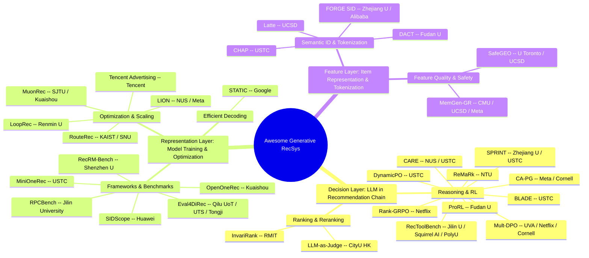

# Awesome Generative Recommendation System (RecSys)

```
 ██████╗                ██████╗                ███████╗                
██╔════╝  ███╗  ███╗    ██╔══██╗ ███╗   ███╗   ██╔════╝██╗ ██╗ ██████╗ 
██║      ██╔═██╗████╗   ██████╔╝██╔═██╗██╔═██╗ ███████╗╚██╗██║ ██╔═══╝ 
██║  ███╗██████║██╔██╗  ██╔══██╗██████║██║ ╚═╝ ╚════██║ ╚███╔╝ ██████╗ 
██║   ██║██║    ██║╚██╗ ██║  ██║██║    ██║ ██╗      ██║  ██╔╝      ██║
╚██████╔╝╚████╗ ██║ ╚██╗██║  ██║╚████╗ ╚███╔═╝ ███████║  ██║   ██████║
 ╚═════╝  ╚═══╝ ╚═╝  ╚═╝╚═╝  ╚═╝ ╚═══╝  ╚══╝   ╚══════╝  ╚═╝   ╚═════╝
```
---

[](https://github.com/sindresorhus/awesome)

RecSys is starting to adopt LLM for feature extraction, retrieval, and ranking/re-ranking! Although you can get some hands-on materials in either the [classics](#papers-classic-must-read) or some surveys, but since you're already interested in applying generative AI to industrial tasks, you probably wanna stay on the bleeding edge, right? That's exactly what this repo is for — automatically updated daily by agents with the latest generative RecSys papers fresh off arXiv, making sure that you never miss a beat.

> [!IMPORTANT]
> For those who are not familiar with GenRec, or not even the recommendation system, please checkout the kickstart posts [here](docs/kickstart.md).
> These posts are in Chinese, for English simply do your browser's internal translation or turn to __Ask Gemini__ :shipit:

## Quick Indexing
- [By Date](#by-date)
- [By Opensource](#by-opensource)
- [By Keyword](#by-keyword)
- [By Affiliation](#by-affiliation)
- [Papers Classic Must Read](#papers-classic-must-read)
- [Verl-GR: An Awesome RL Toolkit for GenRecSys](#verl-gr-an-awesome-rl-toolkit-for-genrecsys)



<div align="center">
  <i> Open-source Generative RecSys Map </i>
</div>

---
## `Verl-GR`: An Awesome RL Toolkit for GenRecSys
If you are interested in RFT your own GenRecSys, come check out our `verl`-based implementation called `verl-gr` here:
* [https://github.com/HaFred/verl-GR/tree/main/verl_gr/recipes/openonerec](https://github.com/HaFred/verl-GR/tree/main/verl_gr/recipes/openonerec)
* [https://github.com/HaFred/verl-GR/tree/main/verl_gr/recipes/rankgrpo](https://github.com/HaFred/verl-GR/tree/main/verl_gr/recipes/rankgrpo)

We manage to achieve 22% and 32% boosting for the end-to-end training efficiencies, compared with their respective vanilla implementations.

## By Date

We only keep the last 10 days summary below, for the past records before these, please see [the archive](docs/archive_by_month).

---

---

### Papers October 26

*Monday, October 26, 2026. The live arXiv cs.IR window (announced Oct 26) surfaced 3 strictly on-topic generative-recommendation papers (Deco / 2610.32980, Parallel KD / 2610.32943, TCBSA / 2610.32098). A broader cs.AI sweep added a 4th gen-rec paper (TGR-EvoDAG / 2610.32326, industrial Tencent). The entire last-3-month keyword pool is already catalogued, so the 5th paper is fairness-adjacent (FAIRGate / 2610.30359, UMass Boston) — disclosed as such. 0 are open-source. By Opensource count unchanged (228 — table is source of truth; prior "227" summary line was stale). Mindmap 30-cap held (no opensource papers).*

1. **Separating Thinking from Spelling for Efficient Generative Recommendation (Deco)**
   * Affiliation: Skolkovo Institute of Science and Technology / AIRI (Artificial Intelligence Research Institute) / HSE University, Moscow, Russia — *(Danil Gusak, Anna Volodkevich, Ivan Oseledets, Evgeny Frolov)*
   * Link: [arxiv.org/abs/2610.32980](https://arxiv.org/abs/2610.32980)
   * Venue: arXiv preprint (cs.IR)
   * TL;DR: Deco decouples "thinking" (reading history) from "spelling" (writing the SID): the backbone condenses history into a compact next-item concept once, then a light KV-cached decoder runs the entire trie-constrained beam search — 3.2–8.6× throughput at a 50 ms p95 budget.
   * Key techniques:
     - Backbone reads each history item as one fused token and condenses the history once into a compact next-item concept
     - A light KV-cached decoder conditioned on the concept and the generated prefix runs the entire beam search
     - SIDs, the trie, and the autoregressive factorization stay unchanged (drop-in serving improvement)
     - Cross-entropy alone approaches full-backbone accuracy; distillation improves it further
   * Scores (Opensource? / Novelty / Fairness / Robustness / Impact):
     - **Opensource?: 0/10** — no public code found.
     - **Novelty: 8/10** — clean decoupling of history encoding from SID writing/beam search, delegating beam search to a tiny decoder.
     - **Fairness: 2/10** — not addressed.
     - **Robustness: 7/10** — 7 datasets (e-commerce, movies, music), production-style serving pipeline under 50 ms p95; generates 1000 candidates faster than the teacher generates 100.
     - **Impact: 8/10** — targets the dominant cost in deployed trie-constrained beam search; large practical upside for industrial generative rec.

2. **Knowledge Distillation across Item and Code Spaces for Parallel Generative Recommendation**
   * Affiliation: The Hong Kong University of Science and Technology — *(Yixuan Xu, Hailin Liu, Can Yang)* / University of Science and Technology of China — *(Linxiang Peng)*
   * Link: [arxiv.org/abs/2610.32943](https://arxiv.org/abs/2610.32943)
   * Venue: arXiv preprint (cs.IR; cs.LG)
   * TL;DR: Two complementary knowledge-distillation objectives (IDM and CMM) transfer a sequential recommender's soft item-level distribution into parallel (non-autoregressive) semantic-ID generation, lifting Recall@10 +15.39% and NDCG@10 +8.28%.
   * Key techniques:
     - Parallel semantic-ID generation predicting all code positions simultaneously (no autoregressive prefix conditioning)
     - Item Distribution Matching (IDM): reconstructs a catalogue-level item distribution from parallel code predictions, aligns with the teacher's item distribution
     - Code Marginal Matching (CMM): projects the teacher's item probabilities onto each code position via fixed item-to-code assignments, matches the resulting code marginals
     - Both preserve the student's parallel prediction structure
   * Scores (Opensource? / Novelty / Fairness / Robustness / Impact):
     - **Opensource?: 0/10** — no public code found.
     - **Novelty: 7/10** — addresses the item-space vs code-space mismatch for parallel SID generation via two distinct distillation objectives.
     - **Fairness: 2/10** — not addressed.
     - **Robustness: 6/10** — benchmark datasets, consistent SOTA outperformance; limited robustness/ablation beyond accuracy.
     - **Impact: 7/10** — parallel SID generation is a key efficiency direction; +15% Recall@10 is substantial.

3. **TGR-EvoDAG: A DAG-based Multi-Agent Code Evolution Framework for Generative Recommendation on Tencent**
   * Affiliation: Tencent (Platform and Content Group, Shenzhen) / The Hong Kong Polytechnic University / McGill University / Independent Researcher — *(Junlin He, Junzhang Zhu, Yudong Li, Yihong Tang, Xuefeng Jiang, Wei Ma, Chengxiang Zhuo, Zang Li)*
   * Link: [arxiv.org/abs/2610.32326](https://arxiv.org/abs/2610.32326)
   * Venue: arXiv preprint (cs.AI)
   * TL;DR: A DAG-structured multi-agent code-evolution framework that automatically evolves generative-recommendation model code; deployed at Tencent with +37.4% offline and +0.40% online CTR gains.
   * Key techniques:
     - DAG-structured multi-agent evolution of generative-rec code (coordinated agent roles over a directed acyclic graph)
     - Targets Tencent's industrial generative recommendation pipeline
     - Offline +37.4% and online +0.40% CTR at Tencent scale
   * Scores (Opensource? / Novelty / Fairness / Robustness / Impact):
     - **Opensource?: 0/10** — no public code (industrial; Tencent).
     - **Novelty: 7/10** — applies multi-agent code evolution (DAG orchestration) to generative-rec model development.
     - **Fairness: 2/10** — not addressed.
     - **Robustness: 6/10** — offline + online gains at Tencent; industrial validation but limited external reproducibility.
     - **Impact: 8/10** — from Tencent, real online CTR lift; demonstrates agentic code-evolution for recsys production.

4. **From Item Scores to Semantic Tokens: Test-Time Collaborative Adaptation for Generative Recommendation (TCBSA)**
   * Affiliation: Tencent — *(Xing Tang, Xiuqiang He et al.)*
   * Link: [arxiv.org/abs/2610.32098](https://arxiv.org/abs/2610.32098)
   * Venue: arXiv preprint (cs.IR)
   * TL;DR: A training-free test-time method that adapts the beam search of a generative recommender by collaboratively aligning item-score signals with semantic-token generation, improving ranking without retraining.
   * Key techniques:
     - Training-free test-time adaptation at beam-search / inference time
     - Bridges item-level scores (from a conventional ranker) with semantic-token generation
     - Collaborative adaptation refines candidate generation toward better-aligned items
   * Scores (Opensource? / Novelty / Fairness / Robustness / Impact):
     - **Opensource?: 0/10** — no public code found.
     - **Novelty: 7/10** — "test-time collaborative adaptation" connecting item scores to SID beam search without retraining.
     - **Fairness: 2/10** — not addressed.
     - **Robustness: 6/10** — test-time method, no retraining needed; validation scope not fully detailed in the abstract.
     - **Impact: 7/10** — practical, deployment-friendly (no retrain) improvement for generative-rec serving.

5. **FAIRGate: Agentic Runtime Policy Selection and Verified Repair for Fairer Recommendation Delivery**
   * Affiliation: University of Massachusetts Boston (Department of Computer Science) — *(Navkar Jain, Enock Ayiku, Kenneth Fletcher)*
   * Link: [arxiv.org/abs/2610.30359](https://arxiv.org/abs/2610.30359)
   * Venue: Accepted at IRAI 2026
   * TL;DR: FAIRGate is an agentic runtime controller that selects fairness-aware delivery policies and performs verified repair to improve fairness of recommendation delivery at serving time. *(Fairness-adjacent; included because the last-3-month gen-rec pool is already fully catalogued.)*
   * Key techniques:
     - Agentic runtime policy selection for recommendation delivery
     - Verified repair loop to correct fairness violations
     - Operates at delivery/serving time (runtime), not training
   * Scores (Opensource? / Novelty / Fairness / Robustness / Impact):
     - **Opensource?: 0/10** — no public code found.
     - **Novelty: 7/10** — frames fairness as a runtime agentic policy-selection + verified-repair problem for delivery.
     - **Fairness: 9/10** — directly targets fairer recommendation delivery; core contribution.
     - **Robustness: 5/10** — accepted workshop; verification mechanism described but empirical robustness not extensively benchmarked.
     - **Impact: 6/10** — fairness-focused, workshop venue; relevant for responsible-delivery research.

---

### Papers October 25

*Sunday, October 25, 2026. Live arXiv cs.IR window empty (weekend gap; freshest entries dated Oct 22), so per the fallback rule all 5 papers were drawn from the last-3-month keyword pool. Disclosure: GRP v0.1, Eval4DiRec, OneTrans-V2, and RecToolBench were already covered in the Sep 29-30 daily sections (archived to docs/archive_by_month/2026_09.md) and re-surface here as fallback re-indexes; only RouteRec is a fresh index. 3 are open-source (Eval4DiRec, RecToolBench, RouteRec); of these, Eval4DiRec and RouteRec were already in the By Opensource index from September, so the index grows by +1 net (RecToolBench): 223 -> 224. Mindmap +3/-3 to hold the 30-node cap (gains RecToolBench / Eval4DiRec / RouteRec; drops ReRankID / Decision4Rec / UserArena).*

1. **GRP v0.1 Technical Report**
   * Affiliation: Snap Inc.
   * Link: [arxiv.org/abs/2609.36688](https://arxiv.org/abs/2609.36688)
   * Venue: Technical Report (arXiv); industrial paper (Snap Inc.)
   * TL;DR: A generative recommendation framework that unifies retrieval, ranking, and reward modeling in a single encoder-decoder, with mGRPO post-training; cuts end-to-end retrieval latency 69% and yields positive production A/B lifts at Snap.
   * Key techniques:
     - Single encoder-decoder that generates multimodal Semantic IDs and scores candidates with a jointly trained ranking module
     - Frozen ranking module supplies rewards for reinforcement-learning post-training
     - mGRPO: adds a reference-anchored margin to reward optimization to preserve logged-target likelihood
     - Progressive deployment path (retrieval source to early-ranking bypass to replacement of weaker sources) with serving optimizations
   * Scores (Opensource? / Novelty / Fairness / Robustness / Impact):
     - **Opensource?: 0/10** — no public code (technical report; deployed internally at Snap)
     - **Novelty: 7/10** — unifies retrieval+ranking+reward in one model with mGRPO; solid industrial framing on the generative-rec trend
     - **Fairness: 3/10** — not addressed
     - **Robustness: 6/10** — offline ablations + online A/B (view time +0.46%, shares +0.77% retrieval-only; +0.82% view / +2.56% shares combined); lifts modest
     - **Impact: 8/10** — from Snap, industrial scale, progressive-deployment story; high industry relevance

2. **Eval4DiRec: A Unified and Systematic Evaluation Framework for Diffusion-based Recommender Systems**
   * Affiliation: Qilu University of Technology (Shandong Academy of Sciences); University of Technology Sydney; Tongji University
   * Link: [arxiv.org/abs/2609.34404](https://arxiv.org/abs/2609.34404)
   * Venue: Accepted at ACM TKDD (arXiv preprint)
   * TL;DR: The first unified open-source evaluation framework for diffusion-based recommender systems, supporting 14 models across 5 scenarios under reproducible protocols.
   * Key techniques:
     - Diffusion-aware plug-in framework (core / data / scenario / models / diffusion / engine / evaluation registries)
     - Supports 14 diffusion-based RS (CF, sequential, multimodal, POI, cross-domain)
     - Grouped YAML configs for reproducible, comparable experiments
     - Extensive empirical benchmark exposing key factors affecting diffusion-rec performance
   * Scores (Opensource? / Novelty / Fairness / Robustness / Impact):
     - **Opensource?: 7/10** — github.com/wangcong2001/Eval4DiRec: well-structured (registries, 14 models, README/requirements/example.sh/configs); raw data withheld until anonymity lifts; recent (Sep 2026), modest maturity
     - **Novelty: 8/10** — first unified open-source evaluation benchmark for diffusion-based RS, closing the reproducibility gap
     - **Fairness: 3/10** — not addressed
     - **Robustness: 7/10** — unified protocols across 14 models; framework-level rigor
     - **Impact: 7/10** — ACM TKDD; community-beneficial benchmarking tool for the diffusion-rec subfield

3. **OneTrans-V2: Unifying Retrieval, Pre-rank, and Fine-rank with One Transformer in Industrial Recommender**
   * Affiliation: ByteDance (Global E-Commerce Recommendation Foundation Team)
   * Link: [arxiv.org/abs/2609.28589](https://arxiv.org/abs/2609.28589)
   * Venue: Preprint (arXiv); industrial paper (ByteDance)
   * TL;DR: One Transformer unifies retrieval, pre-rank, and fine-rank via shared sequence encoding, in-model distillation, Decision-Conditioned Generative Retrieval (DCGR), and Sequence-Native Training; +9.74% GMV and 3.2x throughput at ByteDance scale.
   * Key techniques:
     - Single Transformer encodes the user sequence once as shared context for all three stages
     - Joint training with in-model knowledge distillation (fine-rank to pre-rank)
     - Sparse MoE backbone + muP-style parameterization for stable scaling
     - DCGR: predicts a decision prefix and generates items conditioned on it, steering business objectives in one generative process
     - SNT: organizes training around each user's lifelong behavior sequence
   * Scores (Opensource? / Novelty / Fairness / Robustness / Impact):
     - **Opensource?: 0/10** — no public code
     - **Novelty: 8/10** — DCGR plus unified cascade is a neat, deployable industrial recipe for generative retrieval
     - **Fairness: 3/10** — not addressed
     - **Robustness: 7/10** — deployed at scale (+9.74% GMV, 3.2x throughput); joint-training attribution only partly separable (per third-party read)
     - **Impact: 9/10** — ByteDance production, large GMV lift; high industry impact

4. **RecToolBench: Benchmarking Recommendation-Specific Tool Orchestration under Fuzzy User Intent**
   * Affiliation: Jilin University; Squirrel AI Learning; The Hong Kong Polytechnic University; University of Virginia (corresponding)
   * Link: [arxiv.org/abs/2609.30717](https://arxiv.org/abs/2609.30717)
   * Venue: EMNLP Findings 2026
   * TL;DR: An MCP-based benchmark for evaluating tool-using recommender agents under fuzzy user intent, with 1,200+ tasks, 13 MCP servers, and 32 tools spanning single to hybrid orchestration.
   * Key techniques:
     - MCP-based benchmark across 3 recommendation domains, 13 servers, 32 tools
     - Synthesize-fuzzify-judge pipeline that generates executable fuzzy-intent tasks
     - Rule-based execution checks + rubric-based LLM evaluation of agent trajectories
     - Identifies tool orchestration under fuzzy intent as a major agentic-rec bottleneck
   * Scores (Opensource? / Novelty / Fairness / Robustness / Impact):
     - **Opensource?: 7/10** — github.com/ShawnChenn/RecToolBench: MCP servers, benchmark runner, L1-L4 eval scripts, MIT license; task-synthesis pipeline withheld until acceptance; recent (Aug 2026)
     - **Novelty: 8/10** — first MCP-based tool-orchestration benchmark for recommender agents under fuzzy intent
     - **Fairness: 4/10** — not a focus
     - **Robustness: 7/10** — rule-based + LLM-judge evaluation, 1,200+ tasks, 3 domains; sound benchmarking rigor
     - **Impact: 8/10** — EMNLP Findings 2026; fills a clear gap in agentic-recsys evaluation

5. **RouteRec: Behavior-Guided Sparse Routing for Sequential Recommendation**
   * Affiliation: Korea Advanced Institute of Science and Technology (KAIST); Seoul National University
   * Link: [arxiv.org/abs/2609.39007](https://arxiv.org/abs/2609.39007)
   * Venue: Accepted at CIKM 2026
   * TL;DR: A sequential recommender that uses observed session behavior (tempo, item-group focus, repetition/carryover, popularity tendency) as the routing criterion for sparse Mixture-of-Experts, ranking 1st in 12 of 18 dataset-metric settings.
   * Key techniques:
     - Four behavioral-evidence summaries from sessionized histories as routing cues
     - Macro/mid/micro scope routing: cue scores select expert groups, backbone state refines within group
     - Validated to go beyond added capacity; routing aligns with observed behavior
     - Evaluated on 6 public datasets (18 dataset-metric combinations)
   * Scores (Opensource? / Novelty / Fairness / Robustness / Impact):
     - **Opensource?: 7/10** — github.com/jy1559/RouteRec: very complete (src/routerec, 9 baselines, configs, docs/reproducibility.md, tests, CITATION.cff, Apache 2.0); datasets must be acquired externally; camera-ready release Aug 2026
     - **Novelty: 7/10** — behavior-guided MoE routing for sequential rec; clean and well-executed
     - **Fairness: 3/10** — not addressed
     - **Robustness: 7/10** — 6 datasets, ranks 1st in 12/18; consistent
     - **Impact: 6/10** — CIKM 2026; solid academic contribution, generalizable

### Papers October 23

*Friday, October 23, 2026. The live arXiv cs.IR window (announced Oct 22-23) surfaced 3 strictly on-topic generative-recsys papers (OneLatent, UserArena, BGAFlow); below the 5-paper floor, so 2 more were drawn from the last-3-month keyword pool (LoopRec, From Scores to Safe Sets). 2 are open-source (UserArena / RecGPT-Team, LoopRec / Elpmis117). Total: 5 papers (2 opensource). By Opensource count 225 -> 227.*

1. **OneLatent: Latent Reasoning for Efficient Foundation Recommendation Models**
   * Affiliation: Kuaishou Technology (Beijing, China)
   * Link: [arxiv.org/abs/2610.30675](https://arxiv.org/abs/2610.30675)
   * Venue: Preprint (arXiv); industrial paper (Kuaishou local-services advertising)
   * TL;DR: Compresses explicit chain-of-thought reasoning into a few learnable latent tokens for foundation recommendation models, cutting inference cost ~17x while improving SID@64.
   * Key techniques:
     - Multi-View Adaptive CoT (MV-ACoT) teacher supervision exploring user interests from multiple perspectives
     - Three-stage latent-token alignment to progressively internalize CoT traces into learnable latent tokens
     - Multi-stage curriculum post-training to activate latent-token reasoning for downstream recommendation
     - Production serving system + online A/B test in Kuaishou local-services advertising
   * Scores (Opensource? / Novelty / Fairness / Robustness / Impact):
     - **Opensource?: 0/10** — no public code available (deployed internally at Kuaishou)
     - **Novelty: 8/10** — latent-reasoning compression for FRMs is a clean industrial recipe building on the latent-reasoning trend
     - **Fairness: 4/10** — not addressed
     - **Robustness: 6/10** — validated on industrial Kuaishou data + public Kuaishou LLM-Rec benchmark; single scenario (local-services ads)
     - **Impact: 8/10** — +9.6% revenue lift in production A/B and 17x throughput; high industry relevance

2. **UserArena: Benchmarking Interactive User Simulation for Long-Horizon Shopping Agents**
   * Affiliation: Leiden University; Renmin University of China; Alibaba Group; Institute of Computing Technology, Chinese Academy of Sciences
   * Link: [arxiv.org/abs/2610.30932](https://arxiv.org/abs/2610.30932)
   * Venue: Preprint (arXiv)
   * TL;DR: A real-world e-commerce interactive benchmark (64,729 sessions) with a production A/B-validated user simulator and On-Policy Trajectory Distillation (OPTD) for agentic recommendation.
   * Key techniques:
     - 64,729 real session trajectories from 11,010 users, 566,102 items, 13 action types
     - Interactive environment + five-level evaluation (validity to local decisions to sequential behavior to personalization to outcomes)
     - Offline validation against a controlled production A/B test
     - OPTD: trajectory-level intent as dense teacher targets on student-generated rollouts
   * Scores (Opensource? / Novelty / Fairness / Robustness / Impact):
     - **Opensource?: 7/10** — github.com/RecGPT-Team/UserArena: real repo with data, evaluation, optd, simulator, README, LICENSE; comprehensive but Non-Commercial Research License, partial held-out data (535 sessions), no pretrained weights
     - **Novelty: 7/10** — bridges agentic-rec research and production with real-trajectory + A/B validation
     - **Fairness: 5/10** — personalization evaluated, no explicit fairness/bias analysis
     - **Robustness: 7/10** — validated against production A/B; strong realism
     - **Impact: 7/10** — community benchmark for agentic rec; non-commercial license limits adoption

3. **BGAFlow: Bezier-Guided Adaptive Flow for Cross-domain Sequential Recommendation**
   * Affiliation: Anhui University, Hefei, China
   * Link: [arxiv.org/abs/2610.30825](https://arxiv.org/abs/2610.30825)
   * Venue: Submitted to TOIS (per arXiv HTML)
   * TL;DR: Personalized cross-domain sequential recommendation that learns a residual flow guided by a conditional Bezier curve, with LLM-inferred user profiles and a personalized transfer horizon.
   * Key techniques:
     - Unified dual-domain pretraining with LLM-inferred user profiles
     - Personalized horizon from latent interest overlap (per-user transfer extent)
     - Conditional Bezier curve as geometric reference + residual flow refinement of preference trajectory
     - Dynamic preference-feedback adjustment + trajectory regularization
   * Scores (Opensource? / Novelty / Fairness / Robustness / Impact):
     - **Opensource?: 0/10** — no public code released
     - **Novelty: 7/10** — personalized horizon + Bezier-guided flow for adaptive cross-domain transfer is a fresh angle
     - **Fairness: 4/10** — not addressed
     - **Robustness: 6/10** — experiments on real-world datasets vs SOTA
     - **Impact: 6/10** — solid academic cross-domain sequential rec contribution

4. **Think Harder Where It Matters: Item-Level Adaptive Recursion for Sequential Recommendation (LoopRec)**
   * Affiliation: Renmin University of China
   * Link: [arxiv.org/abs/2610.30128](https://arxiv.org/abs/2610.30128)
   * Venue: Preprint (arXiv)
   * TL;DR: Replaces fixed-depth computation in sequential recommenders with item-level adaptive recursion - a weight-shared block with a lightweight gate that lets each item exit early or continue.
   * Key techniques:
     - Recursively applied weight-shared block with per-item exit-or-continue gate
     - Learned per-item computational depth without auxiliary depth labels
     - Adaptable to diverse backbone families (SASRec, BSARec, NextItNet, LRURec)
     - Interpretable allocation aligned with oracle analysis (low-frequency & recent items get deeper compute)
   * Scores (Opensource? / Novelty / Fairness / Robustness / Impact):
     - **Opensource?: 7/10** — github.com/Elpmis117/LoopRec: structured src/ (model, utils), tests/, datasets/, LICENSE, README, requirements.txt, pytest.ini; multi-backbone; recent (Oct 2026), modest maturity, no pretrained weights
     - **Novelty: 7/10** — item-level adaptive recursion for seq rec is a clean efficiency/quality trade-off
     - **Fairness: 4/10** — not addressed
     - **Robustness: 7/10** — consistent gains across 4 backbone families on public benchmarks
     - **Impact: 6/10** — generalizable backbone-agnostic method; academic

5. **From Scores to Safe Sets: Exact Safety-Constrained Decoding for Medication Recommendation**
   * Affiliation: Optum
   * Link: [arxiv.org/abs/2610.29228](https://arxiv.org/abs/2610.29228)
   * Venue: Preprint (arXiv)
   * TL;DR: Shows that even with a frozen clinical classifier, how medication scores are decoded into a DDI-constrained set (exact MILP global decoding vs local repair) materially changes the prediction.
   * Key techniques:
     - Exact global decoder via mixed-integer linear programming (MILP)
     - Comparison vs greedy / degree-aware / 1-swap local repair on FLAME frozen scores (MIMIC-III)
     - DDI constraint tightening sweep; accuracy-DDI trade-off analysis
   * Scores (Opensource? / Novelty / Fairness / Robustness / Impact):
     - **Opensource?: 0/10** — no public code available
     - **Novelty: 6/10** — reframes medication rec decoding as exact set-selection; builds on known DDI-repair literature
     - **Fairness: 3/10** — not addressed (focus on safety/DDI)
     - **Robustness: 6/10** — rigorous MIMIC-III experiments, multiple baselines, sensitivity sweep
     - **Impact: 5/10** — important for safe generative med-rec but narrow (frozen classifier, medication only)

---
### Papers October 22

*Thursday, October 22, 2026. The live arXiv cs.IR window (announced Oct 21-22, submitted Oct 21) surfaced only 2 strictly on-topic generative-recsys papers (Generative Recommenders Forget the Long Tail / CAPE, FineSID); the remaining 3 were drawn from the last-3-month keyword pool (ReGen, RecSys Factory, ATLAS) per the fallback. 1 is open-source (ReGen / XJTLU et al., 6/10). Total: 5 papers (1 opensource). By Opensource count 224 -> 225 (the running tally was drifted +4 vs the actual table; reset to the true row count).*

1. **Generative Recommenders Forget the Long Tail: Restoring Memorization in Retrieval and Ranking (CAPE)**
   * Affiliation: University of Science and Technology of China (USTC) & Ant Group — *(Xu Huang, Jiancan Wu, Hongzheng Qin, Jiawei Feng, Can Ye, Wencong Zeng, Fengze Li, Xiang Wang)*
   * Link: [arxiv.org/abs/2610.29298](https://arxiv.org/abs/2610.29298)
   * Venue: arXiv preprint, October 2026 (cs.IR; submitted 21 Oct 2026)
   * TL;DR: Shows generative recommenders — beam search over semantic IDs for retrieval plus a shared likelihood for ranking — forget long-tail items twice (once by beam pruning, once by likelihood ranking), and proposes CAPE, a training-free co-occurrence-aware plug-in that restores item-level memorization at both stages.
   * Key techniques:
     - Beam search over semantic item identifiers performs retrieval; the same likelihood performs ranking
     - Identifies two long-tail failure modes: (i) beam keeps identifier prefixes by subtree probability mass, pruning tail items early; (ii) likelihood ranks tail below head even when admitted
     - Both reflect missing item-level memorization (direct co-occurrence recall) that collaborative filtering provides but shared-prefix generation lacks
     - CAPE (Co-occurrence-Aware Pool Expansion): a memorization channel retrieves co-occurrence-supported tail items outside the beam and scores them with the frozen generator; memorization-calibrated ranking fuses generator likelihood with co-occurrence evidence
     - Evaluated on two generative backbones over product and music domains
   * Scores (Opensource? / Novelty / Fairness / Robustness / Impact):
     - **Opensource?: 0/10** — no public code (no code link on arXiv; GitHub search returns no matching repository)
     - **Novelty: 8/10** — first to characterize long-tail forgetting in generative recommenders as missing item-level memorization; clean training-free CAPE plug-in
     - **Fairness: 0/10** — not addressed (long-tail coverage, not demographic fairness)
     - **Robustness: 7/10** — two generative backbones, product + music domains; training-free; evaluation limited to two domains
     - **Impact: 8/10** — long-tail is a critical industrial concern as generative recommenders deploy; from USTC + Ant Group

2. **FineSID: Progressive Learning from Content to Relevance to Personalization for CTR Prediction**
   * Affiliation: Alibaba Group — *(Zhiguang Yang, Yulin Yang, Fuyu Lv, Dan Ou)*
   * Link: [arxiv.org/abs/2610.29138](https://arxiv.org/abs/2610.29138)
   * Venue: arXiv preprint, October 2026 (cs.IR; submitted 21 Oct 2026)
   * TL;DR: FineSID unifies content tokenization, query–item semantic pretraining, and personalized post-training via fine-grained Semantic IDs (SIDs), aligning multimodal content with ID features and improving both CTR and core business metrics on Taobao-scale search.
   * Key techniques:
     - Pretrained multi-scale visual tokenizer and text tokenizers convert heterogeneous content into fine-grained Semantic IDs (SIDs)
     - Full-parameter semantic pretraining under query–item relevance supervision builds a robust matching prior
     - Personalized post-training with user click supervision captures implicit preferences
     - Progressive Content → Relevance → Personalization sharing one fine-grained discrete representation, each stage preserving token-level access to content
     - Offline and online Taobao-scale evaluation; improves within-product creative discrimination
   * Scores (Opensource? / Novelty / Fairness / Robustness / Impact):
     - **Opensource?: 0/10** — no public code (Alibaba industrial; GitHub search finds only unrelated repositories)
     - **Novelty: 7/10** — fine-grained SIDs + progressive three-stage learning; solid incremental improvement over coarse RQ-VAE quantization
     - **Fairness: 0/10** — not addressed
     - **Robustness: 7/10** — offline + online Taobao-scale results; strong claims but ablations live in the paper
     - **Impact: 8/10** — Alibaba/Taobao industrial CTR with multimodal SIDs; directly relevant and deployment-adjacent

3. **ReGen: Controllable Generative Recommendation via Guided Token Refinement**
   * Affiliation: Xi'an Jiaotong-Liverpool University & University of Liverpool & The Hong Kong Polytechnic University — *(Haichao Zhang, Zhixuan Liang, Chong Zhang, Zixi Chen, Wen Wang, Jia Wang)*
   * Link: [arxiv.org/abs/2610.28642](https://arxiv.org/abs/2610.28642) · [Code](https://github.com/zhang-haichao/ReGen)
   * Venue: arXiv preprint, August 2026 (cs.IR; submitted 27 Aug 2026)
   * TL;DR: ReGen reframes generative-recommendation decoding as parallel mask-filling (rather than left-to-right autoregressive) so control signals (e.g., accuracy vs. diversity) can be applied directly to high-level semantic tokens, with a topology-constrained tree enforcing valid Semantic-ID paths during beam-based inference.
   * Key techniques:
     - Reformulates SID generation as a mask-filling task predicting all tokens simultaneously instead of one by one
     - Control signals applied directly to tokens with high-level semantics without retraining the model
     - Topology-constrained tree iteratively corrects low-confidence predictions while strictly enforcing valid codebook paths during beam-based inference
     - Favorable accuracy–diversity trade-off under moderate guidance while maintaining high validity of generated Semantic IDs
   * Scores (Opensource? / Novelty / Fairness / Robustness / Impact):
     - **Opensource?: 6/10** — [github.com/zhang-haichao/ReGen](https://github.com/zhang-haichao/ReGen): real repository with README, requirements.txt, and structured modules (quantization, recommendation, preprocessing, evaluation, experiments, asset) matching the paper's components, but 0 stars, no LICENSE file, last pushed Jan 2026 (stale relative to the Aug 2026 submission), single-author academic lab
     - **Novelty: 8/10** — non-autoregressive parallel refinement for controllable generative recommendation is a clear departure from left-to-right decoding
     - **Fairness: 0/10** — not addressed (controllable diversity is not demographic fairness)
     - **Robustness: 7/10** — accuracy–diversity trade-off demonstrated with validity maintained; academic-scale evaluation, not industrial
     - **Impact: 7/10** — controllable generative recommendation is an emerging industrial need; from XJTLU / Liverpool / PolyU; open-source

4. **RecSys Factory: Bounding LLM Agent Autonomy to Decision Points in the Industrial Recommender Lifecycle**
   * Affiliation: Tencent (FiT) — *(Dongyang Ao, Kaixiang Fang, Shijie Xu)*
   * Link: [arxiv.org/abs/2608.11241](https://arxiv.org/abs/2608.11241)
   * Venue: arXiv preprint, July 2026 (cs.AI; submitted 31 Jul 2026)
   * TL;DR: RecSys Factory is an LLM-agent platform deployed 78 days across three Tencent recommender business lines that bounds agent autonomy to typed decision surfaces inside pre-committed pipelines, resolving the autonomy–determinism–efficiency trilemma for industrial recommender operations.
   * Key techniques:
     - Frames the autonomy–determinism–efficiency trilemma of deploying LLM agents into industrial recommender operations
     - Design principle: autonomy at decision points, not over pipelines
     - Runtime deconstructed into three host-emitted event sources (Claude Code Stop hooks, corporate-IM webhooks, workflow scheduler APIs) giving determinism and no long-running daemon during wait phases
     - 29-file skill ecosystem (8,971 lines of SKILL.md) compiling into a 400-entry PitfallStore that confines autonomy to bounded typed decision surfaces
     - Corporate-IM human-in-the-loop card protocol at the diagnostic-vs-execution boundary
     - 78-day deployment across 3 heterogeneous Tencent business lines (1,624 CLI dispatches, ~83.7% success)
   * Scores (Opensource? / Novelty / Fairness / Robustness / Impact):
     - **Opensource?: 0/10** — no public code (Tencent industrial platform; no public repository)
     - **Novelty: 7/10** — autonomy-at-decision-points framing plus a concrete industrial LLM-agent platform; a systems contribution more than a modeling one
     - **Fairness: 0/10** — not addressed (mentions compliance, not fairness)
     - **Robustness: 8/10** — 78-day real deployment across three lines; documents failure modes; genuinely industrial
     - **Impact: 8/10** — Tencent industrial deployment of LLM agents in the recommender lifecycle; high practical relevance for agentic rec ops

5. **ATLAS: Learning to Recommend Across Unseen Domains**
   * Affiliation: Sony Research India — *(Pervez Shaik, Prosenjit Biswas, Abhinav Thorat, Ravi Kolla, Niranjan Pedanekar)*
   * Link: [arxiv.org/abs/2608.03899](https://arxiv.org/abs/2608.03899)
   * Venue: arXiv preprint, August 2026 (cs.IR; submitted 4 Aug 2026)
   * TL;DR: ATLAS is a multi-source recommendation domain-generalization framework that learns a domain-invariant user–item representation from several heterogeneous source domains and zero-shot transfers to entirely unseen domains, using Gromov–Wasserstein alignment, an adversarial domain discriminator, and residual-vector-quantization (RVQ) discrete codes.
   * Key techniques:
     - Learns a shared, domain-invariant user–item representation from multiple disjoint source domains
     - Gromov–Wasserstein alignment preserves how users relate to one another across domains
     - Adversarial objective makes item representations indistinguishable across domains
     - Residual Vector Quantization (RVQ) codebooks compress user and item embeddings into a discrete latent space, suppressing domain-specific variation
     - Zero-shot recommendation on 10 unseen domains after training on 5 Amazon source domains (+24% average relative HitRate gain)
   * Scores (Opensource? / Novelty / Fairness / Robustness / Impact):
     - **Opensource?: 0/10** — no public code (Sony; GitHub search returns no matching repository)
     - **Novelty: 7/10** — recommendation domain generalization (zero-shot to unseen domains) via a discrete-code domain-invariant representation; a solid contribution
     - **Fairness: 0/10** — not addressed
     - **Robustness: 7/10** — 5 source → 10 unseen domains with +24% average HitRate; comprehensive ablation and post-hoc analyses
     - **Impact: 7/10** — Sony Research; zero-shot cross-domain recommendation is valuable; broad baseline comparison

### Papers October 21

*Wednesday, October 21, 2026. The live arXiv cs.IR window (announced Oct 21, submitted Oct 18-20) surfaced 6 on-topic generative-recommendation papers that were new to the README (verified not already indexed): Evolving Semantic Indexes for GR, SPAR, EASformer, Neighborhood-Aware Unlearning for GR, Decision4Rec, SearCl. 1 is open-source (Decision4Rec / University of Bari Aldo Moro, 7/10). Total: 6 papers (1 opensource). By Opensource count 227 -> 228.*

1. **Evolving Semantic Indexes for Generative Retrieval**
   * Affiliation: Santa Clara University & Coupang — *(Jinming Nian, Jyun-Yu Jiang, Henry Tsai, Yi Fang, Zhirong Liang)*
   * Link: [arxiv.org/abs/2610.28568](https://arxiv.org/abs/2610.28568)
   * Venue: arXiv preprint, October 2026 (cs.AI, cs.IR, cs.LG; submitted 20 Oct 2026)
   * TL;DR: Introduces a framework that automatically improves generative-retrieval components (SID construction, collision handling, decoding, training recipes) via LLM-driven evolutionary program search over executable GR programs, using a locally served open-weight 31B model to mutate components and a 1M-parameter proxy decoder for fast feedback; lifts Recall@1 from 55.8% to 59.3% and Recall@100 from 85.8% to 90.6% on NQ320K.
   * Key techniques:
     - LLM-driven evolutionary program search over executable GR components (first application of this approach to GR)
     - Locally served open-weight 31B model mutates SID construction, collision handling, decoding, and training recipes
     - 1M-parameter proxy decoder gives fast downstream feedback instead of retraining the 1B target generator
     - Evaluated on NQ320K, MSMARCO300K, and a multilingual e-commerce dataset
     - Component study showing proxy reliability depends on which component is evolved
   * Scores (Opensource? / Novelty / Fairness / Robustness / Impact):
     - **Opensource?: 0/10** — no public code (no code link on arXiv; GitHub repo search returns no matching repository)
     - **Novelty: 8/10** — first to apply LLM-driven evolutionary program search to GR component design; reframes SID/decoding/training as optimizable programs
     - **Fairness: 0/10** — not addressed
     - **Robustness: 7/10** — strong results across NQ320K, MSMARCO300K and multilingual e-commerce; proxy-target rank correlation rho=0.90, but gains are on retrieval (not item recommendation) and use a single generator size
     - **Impact: 8/10** — targets the core GR/GenRec bottleneck (semantic indexes); from Santa Clara University + Coupang (industrial e-commerce relevance)

2. **SPAR: Stepwise Personalized Autoregressive Recommendation with Prefix-Balanced Semantic IDs**
   * Affiliation: University of Electronic Science and Technology of China (UESTC) & Alibaba — *(Chunrui Zhang, Gaoyun Lin, Chang Zhou, Zheng Hu, Qiran Song, Shimin Cai, Tao Zhou)*
   * Link: [arxiv.org/abs/2610.27898](https://arxiv.org/abs/2610.27898)
   * Venue: arXiv preprint, October 2026 (cs.IR; submitted 20 Oct 2026)
   * TL;DR: SPAR jointly improves stepwise personalization and SID construction for SID-based generative recommendation; its PATH Decoder retrieves prefix-relevant evidence from compressed long-term user histories to personalize each decoding step, while a prefix-balanced SID construction reduces branch imbalance and popularity bias.
   * Key techniques:
     - PATH Decoder that retrieves prefix-relevant evidence from compressed long-term user history for per-step personalization
     - Prefix-balanced Semantic ID construction to mitigate branch-selection errors and popularity bias
     - Stepwise (token-level) personalization during autoregressive SID decoding
     - Joint optimization of personalization and SID structure
   * Scores (Opensource? / Novelty / Fairness / Robustness / Impact):
     - **Opensource?: 0/10** — no public code (no code link on arXiv; no public repository found)
     - **Novelty: 7/10** — combines stepwise prefix-conditioned personalization with imbalance-aware SID construction; solid but incremental over prior SID-personalization work
     - **Fairness: 0/10** — not directly addressed (popularity-bias mitigation is structural, not demographic fairness)
     - **Robustness: 7/10** — addresses irreversible branch errors and head-path over-selection; ablation breadth not fully visible from abstract
     - **Impact: 7/10** — SID-based generative recommendation is a core direction; from UESTC + Alibaba (industrial relevance)

3. **EASformer: Environment-Action-State Alignment for Industrial Generative Ranking**
   * Affiliation: Beihang University — *(Bohao Li, Dinglun Cao, Pengcheng Huang, Yingda Tang, Zhiting Zhao, Yi Cao, Jilei Fu, Miao Yan, Tianying Liu, Heng Chang, Bowen Du; with Harbin Institute of Technology, Shenzhen & Independent Researchers)*
   * Link: [arxiv.org/abs/2610.27691](https://arxiv.org/abs/2610.27691)
   * Venue: arXiv preprint, October 2026 (cs.AI; submitted 20 Oct 2026)
   * TL;DR: EASformer is an industrial generative-ranking model that aligns Environment-Action-State semantics to reconcile the asymmetric representations of user behavior sequences (environment context + observed action) versus candidate-side non-sequential features (no observed action), improving unified generative ranking at scale.
   * Key techniques:
     - Environment-Action-State (EAS) alignment to reconcile asymmetric sequence vs non-sequential (NS) feature semantics
     - Transformer-style backbone that tokenizes user behavior sequences and NS features jointly
     - Unified generative-ranking formulation providing a scalable interface for long histories and heterogeneous features
     - Industrial-scale modeling of environment/candidate asymmetries
   * Scores (Opensource? / Novelty / Fairness / Robustness / Impact):
     - **Opensource?: 0/10** — no public code (no code link on arXiv; no public repository found)
     - **Novelty: 7/10** — explicit EAS disentanglement for industrial generative ranking is a clear, targeted contribution
     - **Fairness: 0/10** — not addressed
     - **Robustness: 7/10** — industrial framing implies scale testing, but no online A/B result stated in the abstract
     - **Impact: 7/10** — industrial generative ranking is high-value; from Beihang University + HIT Shenzhen

4. **Neighborhood-Aware Unlearning for Generative Recommendation**
   * Affiliation: BIFOLD & TU Berlin, Germany / University of Amsterdam, The Netherlands — *(Pierre Lubitzsch, Yubao Tang, Maarten de Rijke, Sebastian Schelter)*
   * Link: [arxiv.org/abs/2610.27232](https://arxiv.org/abs/2610.27232)
   * Venue: arXiv preprint, October 2026 (cs.IR, cs.LG; submitted 19 Oct 2026)
   * TL;DR: Identifies local probability redistribution as a key failure mode of unlearning in SID-based generative recommenders (an unlearning update unintentionally degrades predictions for neighbors of forgotten items' SIDs); proposes Neighborhood-Aware Unlearning (NAU) that controls probability mass assigned to forgotten items' neighborhoods, restoring spam exposure while retaining >95% of retrained utility.
   * Key techniques:
     - Shows unlearning effects are locally structured and hidden by global metrics in SID-based GR
     - Neighborhood-Aware Unlearning (NAU) augments interaction-level unlearning with explicit control over neighborhood probability mass
     - Evaluated across 3 datasets x 4 SID tokenizers
     - Restores spam-induced exposure toward the retrained reference while retaining >95% utility and recovering neighborhood utility lost by forget-and-repair
   * Scores (Opensource? / Novelty / Fairness / Robustness / Impact):
     - **Opensource?: 0/10** — no public code (no code link on arXiv; no public repository found)
     - **Novelty: 8/10** — first to characterize local probability redistribution as an unlearning failure mode in SID-based GenRec; NAU directly controls it
     - **Fairness: 6/10** — addresses spam removal and user deletion requests (privacy/rights), a fairness-adjacent concern, though not demographic fairness
     - **Robustness: 8/10** — 3 datasets x 4 tokenizers, strong utility-retention and neighborhood-recovery results
     - **Impact: 8/10** — machine unlearning in GenRec is urgent under regulation; from TU Berlin/Amsterdam (strong IR groups)

5. **Decision4Rec: A Jev-Inspired Framework of Decision Models on Knowledge and Active Graphs for Multi-Agent Recommender Systems**
   * Affiliation: University of Bari Aldo Moro, Italy — *(Marco Polignano, Het Darshan Mehta, Pasquale Lops, Ernesto William De Luca, Giovanni Semeraro; with Otto-von-Guericke University Magdeburg & Leibniz Institute for Educational Media)*
   * Link: [arxiv.org/abs/2610.26035](https://arxiv.org/abs/2610.26035)
   * Venue: arXiv preprint, October 2026 (cs.AI, cs.CL, cs.IR; submitted 19 Oct 2026)
   * TL;DR: An open, modular framework that makes LLM decision models (like the commercial Jev) useful for recommendation: a knowledge graph writes scenario logs as typed statements, an agent pool proposes candidates, a residual ranker keeps the best 30, and a decision model reads them via one typed-question interface; a trained 4B decision model beats the best baseline by 25-36% NDCG@10 on sparse Amazon catalogs.
   * Key techniques:
     - Knowledge graph logs recommendation scenarios as short typed statements ("sold: top 10%")
     - Pool of agents proposes candidates; a residual ranker keeps the best 30
     - Decision model (commercial Jev / open Kev / custom-trained) reads via one interface of typed questions
     - Fusion step combines decision-model answers with the ranker score
     - 4B decision model trained once on real choices of three scenarios
   * Scores (Opensource? / Novelty / Fairness / Robustness / Impact):
     - **Opensource?: 7/10** — [github.com/marcopoli/decision4rec](https://github.com/marcopoli/decision4rec): complete Python repo with source (`decision4rec/`), `configs/`, `tests/`, `docs/`, `scripts/`, README (10.7KB), CITATION.cff, CONTRIBUTING.md, LICENSE; freshly created (Oct 16 2026), only 2 stars, reproduction not independently verified, but structure and documentation are solid
     - **Novelty: 6/10** — applies LLM decision models to recommendation via KG + agent pool + fusion; modular but not radically new
     - **Fairness: 0/10** — not addressed
     - **Robustness: 6/10** — 25-36% NDCG@10 gains on sparse Amazon catalogs + dense Steam, but most gain comes from the agent pool rather than the decision model; limited datasets
     - **Impact: 6/10** — decision-model-as-recommender is a niche but interesting angle; academic (Bari/Magdeburg)

6. **Dialogue Generation for Conversational Recommendation Using User Search Interactions and Knowledge Graphs (SearCl)**
   * Affiliation: KAIST — *(Minsung Hwang, Donggyu Yoon, Gowoon Hwang, Kwanghee Jang, Joyce Jiyoung Whang; with LG Electronics)*
   * Link: [arxiv.org/abs/2610.25182](https://arxiv.org/abs/2610.25182)
   * Venue: arXiv preprint, October 2026 (cs.AI; submitted 18 Oct 2026)
   * TL;DR: SearCl automatically generates conversational recommendation dialogues grounded in real user search/click behaviors by segmenting interactions into query sessions and deriving each recommendation target from content selected after a search query, then grounding the dialogue in a knowledge graph, reducing manual dialogue construction for CRS.
   * Key techniques:
     - SearCl pipeline segments user interactions into query sessions
     - Derives each recommendation target from content selected after a search query
     - Knowledge-graph grounding of the generated dialogues
     - Automatic CRS dialogue generation from search-click sessions
   * Scores (Opensource? / Novelty / Fairness / Robustness / Impact):
     - **Opensource?: 0/10** — no public code (no code link on arXiv; no public repository found)
     - **Novelty: 6/10** — mines real search/click sessions + KG to synthesize grounded CRS dialogues; useful data-generation method but not a new recommendation model
     - **Fairness: 0/10** — not addressed
     - **Robustness: 6/10** — depends on quality of mined sessions and KG grounding; needs verification of dialogue fidelity
     - **Impact: 6/10** — CRS data generation is useful for the community; from KAIST + LG Electronics

### Papers October 20

*Tuesday, October 20, 2026. The live arXiv cs.IR recent-submission batch (announced Oct 20, submitted Oct 17-19) surfaced 6 on-topic generative-recommendation papers that were new to the README (verified not already indexed): AGR, SID-Map, SAHL, PerCDR, DuoLM, OneChord. 1 is open-source (SAHL / Chongqing University, 7/10; PerCDR's linked repo is empty -> 0/10). Total: 6 papers (1 opensource). By Opensource count 226 -> 227.*

1. **AGR: Agentic Generative Retrieval with Tool-Augmented Search**
   * Affiliation: Kuaishou Technology & Fudan University — *(Ming Yang, Yaqi Yin, Zhibo Wang, Xiaoze Jiang, Jingwei Zhuo, Chao Zhang, Quanzhi Zhu, Weiguo Zheng, Liang Zeng, Yunfeng Zhao, Jiaqiang Liu, Kefeng Wang, Yupeng Huang, Kaiqiao Zhan, Xuanping Li)*
   * Link: [arxiv.org/abs/2610.26831](https://arxiv.org/abs/2610.26831)
   * Venue: arXiv preprint, October 2026 (cs.IR; submitted 19 Oct 2026)
   * TL;DR: AGR interleaves Semantic-ID (SID) generation with on-demand feature acquisition via tools, deciding whether to invoke a tool, which feature to fetch, and where its observation influences decoding, steering generation toward feature-consistent SID branches; trained via SID pretraining + tool-augmented fine-tuning on feature-applicability / information-gain trajectories; validated on an industrial dataset, 3 public benchmarks, and an online A/B test.
   * Key techniques:
     - Tool-augmented generative retrieval paradigm interleaving SID decoding with on-demand feature acquisition
     - Conditions on the request + decoded SID prefix to decide tool invocation, feature selection, and insertion point
     - Builds tool-augmented trajectories from feature applicability + information gain along the SID hierarchy
     - Two-stage training: SID pretraining then tool-augmented fine-tuning
     - Online A/B test plus industrial + 3 public benchmarks
   * Scores (Opensource? / Novelty / Fairness / Robustness / Impact):
     - **Opensource?: 0/10** — no public code (industrial Kuaishou paper; no code link)
     - **Novelty: 8/10** — agentic/tool-augmented generative retrieval that adaptively decides when/which/where to acquire features; a fresh angle on feature injection for GR
     - **Fairness: 0/10** — not addressed
     - **Robustness: 7/10** — industrial + 3 public benchmarks + online A/B; limited ablation of which tools matter most
     - **Impact: 8/10** — Kuaishou + Fudan; online A/B validates industrial relevance; directly relevant to SID-based generative retrieval

2. **Don't Rewrite the SID Map: Topology Preservation for Generative Retrieval in Dynamic E-Commerce Search**
   * Affiliation: Alibaba (Taobao & Tmall Group) — *(Jianbo Zhu, Xing Fang, Xiaopeng Chu, Mingmin Jin, Jing Wang, Bokang Wang, Jiaqi Ye, Xiang Zhang)*
   * Link: [arxiv.org/abs/2610.26105](https://arxiv.org/abs/2610.26105)
   * Venue: arXiv preprint, October 2026 (cs.IR, cs.AI; submitted 19 Oct 2026)
   * TL;DR: Studies SID-map updates in dynamic e-commerce generative retrieval; shows SID semantic drift degrades retrieval (masked at large beam sizes), remapped fraction monotonically tracks quality, and a topology-preserving policy (insert new / freeze old / warm-start) restores old-item HitRate +10% and new-item +109%, with a 3-week TmallAPP A/B (UCTCVR +0.29%, GMV +1.16%).
   * Key techniques:
     - 67-day controlled study of SID-map updates on large-scale e-commerce search logs
     - Quantifies semantic drift: HitRate -41.78~-62.05% at beam 1, only -8.33~-10.85% at beam 1000
     - Shows remapped-fraction is monotonic with retrieval quality (up to -42.66% at beam 1)
     - Topology-preserving deployment principle: insert new-items, freeze old-items; warm-start when possible
     - 3-week online A/B on TmallAPP
   * Scores (Opensource? / Novelty / Fairness / Robustness / Impact):
     - **Opensource?: 0/10** — no public code (Alibaba industrial)
     - **Novelty: 7/10** — systematic characterization of SID drift + a simple, effective topology-preserving update policy; more empirical diagnosis than new method
     - **Fairness: 0/10** — not addressed
     - **Robustness: 8/10** — 67-day logs, two non-overlapping update cycles, beam-size sweeps, online A/B
     - **Impact: 8/10** — Alibaba/Tmall; directly actionable deployment principle with online GMV gain

3. **Structure-Aligned History Learning with Subspace-Structured Semantic IDs for Generative Recommendation (SAHL)**
   * Affiliation: Chongqing University — *(Kaiwen Wei, Kejun He, Jie Zhang, Xiaomian Kang, Yuming Yang, Aijia Zhou, Xie Zhou, Yining Wang, Nayu Liu, Li Jin, Zhenyang Li, Jiang Zhong, He Bai, Jingxuan Wei, Junnan Zhu)*
   * Link: [arxiv.org/abs/2610.25093](https://arxiv.org/abs/2610.25093) · [Code](https://github.com/CQU-MM-Intelligent-Lab/SAHL)
   * Venue: arXiv preprint, October 2026 (cs.IR; submitted 18 Oct 2026)
   * TL;DR: SAHL reconnects quantization and history reconstruction by using the quantization structure directly for history learning: Semantic Residual Balanced Quantization (SRBQ) builds a balanced token-subspace-item hierarchy, and SAHL reconstructs history at those granularities with entropy-prioritized masking + curriculum optimization; +18.6-30.0% NDCG@10 over RPG and +2.7-6.0% over MHL on 4 Amazon categories.
   * Key techniques:
     - Semantic Residual Balanced Quantization (SRBQ): balanced token-subspace-item hierarchy (fixes imbalanced code assignment)
     - Multi-granularity masked-history reconstruction following quantizer-defined groups
     - Predictive-entropy prioritization of uncertain transitions
     - Curriculum optimization shifting to inference-aligned next-item prediction
     - 4 Amazon Review categories; vs RPG and MHL
   * Scores (Opensource? / Novelty / Fairness / Robustness / Impact):
     - **Opensource?: 7/10** — github.com/CQU-MM-Intelligent-Lab/SAHL: official implementation with genrec/ source, scripts/run_sahl.sh, and a README documenting env/dataset/training/configs; thorough docs and complete code matching the paper, but no explicit LICENSE file and modest single-lab maintenance (last commit Sep 2026)
     - **Novelty: 7/10** — aligns the quantization hierarchy with history-reconstruction granularity; balanced residual quantizer is a solid incremental idea
     - **Fairness: 0/10** — not addressed
     - **Robustness: 7/10** — 4 Amazon categories, controlled ablations on code balance and group-following; no significance tests
     - **Impact: 7/10** — Chongqing University; clear SOTA over RPG/MHL; reproducible

4. **When Semantics Fall Short: Persona-Guided Cross-Domain Sequential Recommendation with Large Language Models (PerCDR)**
   * Affiliation: Beijing Jiaotong University — *(Jundong Chen, Honglei Zhang, Shuai An, Enneng Yang, Han Yu)* *(with Sun Yat-sen University, Nanyang Technological University)*
   * Link: [arxiv.org/abs/2610.25221](https://arxiv.org/abs/2610.25221) · [Code](https://github.com/jundongchen13/PerCDR)
   * Venue: arXiv preprint, October 2026 (cs.IR; submitted 18 Oct 2026)
   * TL;DR: PerCDR shifts cross-domain sequential recommendation (CDSR) from global semantic bridging to persona-guided behavioral modeling: LLM-inferred personas globally guide transferable cross-domain behavior, local semantic relations enhance intra-domain modeling, then domain-preference adaptation refines; addresses semantic domain isolation + semantic-behavior inconsistency.
   * Key techniques:
     - LLM-inferred personas to globally guide transferable cross-domain behavioral patterns
     - Local semantic relations enhance intra-domain behavioral modeling
     - Domain preference adaptation for recommendation refinement
     - User-centric (vs item-centric) paradigm addressing semantic domain isolation + semantic-behavior inconsistency
   * Scores (Opensource? / Novelty / Fairness / Robustness / Impact):
     - **Opensource?: 0/10** — paper links github.com/jundongchen13/PerCDR but the repository is EMPTY (no code released); 0/10
     - **Novelty: 7/10** — persona-guided, user-centric CDSR reframing of semantic-bridging limitations
     - **Fairness: 0/10** — not addressed
     - **Robustness: 6/10** — extensive experiments claimed but no public code to verify; standard CDSR benchmarks
     - **Impact: 7/10** — BJTU + NTU; clean reframing of CDSR, relevant to cross-domain transfer

5. **DuoLM: Fast and Effective Personalized Recommendation with Language Models**
   * Affiliation: Google DeepMind — *(Jiang Wu [Independent Researcher], Yutong Song [UC Irvine], Hongbo Wang [Google DeepMind], Guanghe Cao [Google DeepMind], Jeff Liang [Oracle])*
   * Link: [arxiv.org/abs/2610.24481](https://arxiv.org/abs/2610.24481)
   * Venue: arXiv preprint, October 2026 (cs.IR; submitted 17 Oct 2026)
   * TL;DR: DuoLM integrates a compact encoder LLM (offline item representations) with a personalized ranker LLM (combines item vectors + user history/feedback), trained end-to-end with recommendation supervision + teacher distillation; runtime accelerations (virtual token IDs, shared history, CUDA Graph replay) reach ~26,400 scores/s on one H100 (~60x vLLM teacher throughput) at comparable quality.
   * Key techniques:
     - Encoder LLM compresses item text into a single reusable hidden-state vector (offline)
     - Personalized ranker LLM scores candidates using history + feedback with shared history KV
     - End-to-end training with recommendation labels + frozen-teacher distillation
     - Runtime: virtual token IDs for embedding access, shared history computation, CUDA Graph replay
     - 26,400 candidate scores/s on H100 (~60x vLLM teacher), comparable quality
   * Scores (Opensource? / Novelty / Fairness / Robustness / Impact):
     - **Opensource?: 0/10** — no public code (Google DeepMind / Oracle / UC Irvine; no repo link)
     - **Novelty: 7/10** — clean separation of offline item encoding from online personalized ranking with CUDA-Graph replay; practical serving contribution
     - **Fairness: 0/10** — not addressed
     - **Robustness: 7/10** — H100 throughput benchmark vs vLLM teacher; quality comparable; single teacher
     - **Impact: 8/10** — Google DeepMind; directly relevant to efficient LLM-based rec serving at scale

6. **OneChord: Distill What You Rank, Recommend in One Pass**
   * Affiliation: University of Chinese Academy of Sciences — *(Zesheng Li, Chengchang Pan, Honggang Qi)*
   * Link: [arxiv.org/abs/2610.25805](https://arxiv.org/abs/2610.25805)
   * Venue: arXiv preprint, October 2026 (cs.IR; submitted 19 Oct 2026)
   * TL;DR: OneChord uses one learned, catalog-normalized fusion for next-item supervision, refinement distillation, and inference in semantic-ID recommendation; a shared parallel decoder produces joint SID evidence + item-matching scores, and a frozen denoiser supplies legal partial SIDs for refinement targets; transfers refinement into one-pass rec; +6.30% Recall@5 and +7.12% NDCG@5 over the strongest baseline on 6 Amazon datasets, 1.04-1.18x faster.
   * Key techniques:
     - "Distill what you rank" principle: one catalog-normalized fusion for supervision + distillation + inference
     - Shared parallel decoder for joint SID evidence + item-matching scores
     - Frozen denoiser supplies legal partial SIDs; student evaluates to build refined fused targets
     - Theoretical conditions for preserving full-catalog Top-K selection
     - 6 Amazon datasets; +6.30% Recall@5, +7.12% NDCG@5, 1.04-1.18x speedup
   * Scores (Opensource? / Novelty / Fairness / Robustness / Impact):
     - **Opensource?: 0/10** — no public code released (UCAS; no repo link)
     - **Novelty: 8/10** — unifies ranking + distillation + inference into one pass with a clean "distill what you rank" principle and Top-K preservation theory
     - **Fairness: 0/10** — not addressed
     - **Robustness: 7/10** — 6 Amazon datasets, consistent gains, theoretical guarantees; no significance tests
     - **Impact: 7/10** — UCAS; strong SOTA on semantic-ID rec with speedup; reproducible claim pending code

---

### Papers October 19

*Monday, October 19, 2026. The live arXiv cs.IR recent-submission window (announced Oct 14-19) surfaced 6 on-topic generative-recommendation papers that were new to the README (verified not already indexed); all drawn from the recent announcement batch (submitted Oct 12-16). 4 are open-source (ReRankID / Google & University of Toronto, 7/10; QD-Rec / Sakana AI, 6/10; RecSoup / Renmin University of China, 6/10; MMWave / Nanyang Technological University, 6/10). Total: 6 papers (4 opensource). By Opensource count 222 -> 226.*

1. **Reasoning Reranking with Semantic IDs as the Sole Item Representation (ReRankID)**
   * Affiliation: Google / University of Toronto — *(Zhenwei Tang, Jintao Liu, Di Bai, Xidong Wu, Xinwu Cheng)*
   * Link: [arxiv.org/abs/2610.22797](https://arxiv.org/abs/2610.22797)
   * Venue: arXiv preprint, October 2026 (cs.IR, cs.CL, cs.LG; submitted 16 Oct 2026)
   * TL;DR: ReRankID builds a controlled testbed where LLM rerankers must reason and rerank a candidate slate shown only as Semantic IDs (no item text), and shows post-training (SFT, rejection-sampled self-training, on-policy distillation, verifier-based RL) is required to elicit real ranking behavior from SIDs; an 8B model trained with a graded ranking reward matches text-reading LLM rerankers whose prompts are ~20x longer.
   * Key techniques:
     - SID-only reranking testbed: history + slate rendered only as SIDs, with rendering, history length, and slate size varied one at a time
     - Diagnosis: base models copy the input order instead of reranking, and readable metadata does not repair the failure
     - Post-training methods compared: SFT, rejection-sampled self-training (RFT), on-policy distillation (OPD), and RL with verifiable rewards (RLVR)
     - 8B RLVR model matches strong text-reading LLM rerankers at ~20x shorter prompts and ranks above random with no history at all
   * Scores (Opensource? / Novelty / Fairness / Robustness / Impact):
     - **Opensource?: 7/10** — Code released (github.com/lilv98/ReRankID) plus a Hugging Face dataset (bench/SFT/RFT/OPD/RLVR data and per-user outputs); Apache-2.0; thorough data+code release, but brand-new (0 stars) and prompts/rationales are in Chinese.
     - **Novelty: 8/10** — Isolates the "rank from SIDs alone" problem and shows RLVR-style post-training is what elicits it; a clean controlled study of SID-only reranking.
     - **Fairness: 0/10** — Not addressed.
     - **Robustness: 8/10** — Controlled sweeps over history length, slate size, and SID rendering; 8B vs 1.7B; paired rationale audit.
     - **Impact: 8/10** — Directly relevant to generative recommenders that use SIDs (e.g., OpenOneRec); shows SID tokens carry behavioral signal usable for reranking.

2. **QD-Rec: Open-Ended Evolution of Recommendations via Quality-Diversity**
   * Affiliation: Sakana AI — *(Takashi Ishida, Taro Makino, Issa Sugiura)*
   * Link: [arxiv.org/abs/2610.23470](https://arxiv.org/abs/2610.23470)
   * Venue: arXiv preprint, October 2026 (cs.IR, cs.AI, cs.LG, cs.NE; submitted 16 Oct 2026)
   * TL;DR: QD-Rec extends open-ended search (foundation-model-driven discovery) to recommendation for high-stakes decision-making, formalizing open-ended recommendation as building a diverse, high-quality archive of item-hypothesis pairs selected by a contextual bandit and generated by a foundation model from prior stepping stones.
   * Key techniques:
     - Quality-Diversity formulation: each recommendation is an item together with a natural-language hypothesis (why it fits the decision maker)
     - Contextual bandit selects items; foundation model generates hypotheses from an archive of earlier ones kept as stepping stones
     - Archive admission: a new item-hypothesis enters if it is novel or better than its nearest neighbor
     - Evaluated on M&A, customer targeting, and paper/book recommendation
   * Scores (Opensource? / Novelty / Fairness / Robustness / Impact):
     - **Opensource?: 6/10** — Code released (github.com/SakanaAI/QD-Rec, Sakana AI official repo), but stars/license could not be confirmed via the GitHub API at integration time; reference implementation.
     - **Novelty: 8/10** — Maps open-ended/quality-diversity search to recommendation and reframes rec as archive-building over reasons rather than a single ranked list.
     - **Fairness: 0/10** — Not addressed.
     - **Robustness: 7/10** — Across three domains (M&A, customer targeting, paper/book rec) it gives the highest mean quality and largest archive; baselines are limited.
     - **Impact: 7/10** — An interesting paradigm for high-stakes decision recommendation; connects foundation-model open-endedness to RecSys.

3. **RecSoup: Efficient Model Merging Approach for Controllable Multi-Objective Recommendation**
   * Affiliation: Renmin University of China — *(Zidong Jia, Guofu Xie, Xiao Zhang)*
   * Link: [arxiv.org/abs/2610.21220](https://arxiv.org/abs/2610.21220)
   * Venue: CIKM 2026, October 2026 (cs.IR, cs.AI; submitted 15 Oct 2026)
   * TL;DR: RecSoup does Controllable Multi-Objective Recommendation (CMOR) via model merging: it prunes to reduce cross-objective interference and then adaptively merges objective-specific models with a learnable preference-to-coefficient map, enabling dynamic trade-off control at inference with 165-228x faster latency than parameter-generation approaches.
   * Key techniques:
     - Two-stage CMOR via specialized model merging (reuse objective-specific models by parameter combination)
     - Pruning strategy that jointly considers objective-specific importance and cross-objective relevance to mitigate parameter interference
     - Learnable preference-to-coefficient mapping for dynamic trade-off control at inference (no joint retraining, no generative module)
     - Theoretical proof that it navigates the full Pareto front without smoothness constraints
   * Scores (Opensource? / Novelty / Fairness / Robustness / Impact):
     - **Opensource?: 6/10** — Code released (github.com/35798642/RECSOUP) for this CIKM 2026 paper, but it is a personal repo with no license file and 1 star; code available though modestly maintained.
     - **Novelty: 7/10** — Applies model merging to CMOR and addresses the missing shared linear regime / cross-objective interference; with a theoretical Pareto-front claim.
     - **Fairness: 0/10** — Not addressed.
     - **Robustness: 7/10** — Multiple benchmarks; improved Pareto-front quality and controllability; compared against parameter-generation approaches.
     - **Impact: 7/10** — Practical CMOR with large inference-speed gains; relevant to industrial multi-objective recommendation.

4. **Tackling the Modality Inhibitance Effect with Wavelet-based Modality Integration in Multi-modal Recommendation (MMWave)**
   * Affiliation: Nanyang Technological University, Singapore — *(Rongqing Kenneth Ong, Andy W. H. Khong)*
   * Link: [arxiv.org/abs/2610.16229](https://arxiv.org/abs/2610.16229)
   * Venue: IEEE TKDE 2026, October 2026 (cs.IR, cs.MM; submitted 12 Oct 2026)
   * TL;DR: MMWave identifies the "modality inhibitance effect" - a performance drop when multi-modal recommenders move from dual- to tri-modal - and proposes a multi-scale wavelet recommender that extracts non-redundant modality features via wavelet decomposition, plus a structure-aware graph module and an adaptive modality regulator.
   * Key techniques:
     - Modality inhibitance effect: the newly added modality introduces modal-specific contamination and excessive redundancy, degrading existing MRSs
     - Multi-scale wavelet (MMWave) decomposition (time & frequency) to keep only essential, non-redundant modality features
     - Structure-aware multi-modal graph learning module capturing high-order latent item structure
     - Adaptive modality regulator with a cross-weight integration strategy
   * Scores (Opensource? / Novelty / Fairness / Robustness / Impact):
     - **Opensource?: 6/10** — Code released (github.com/kennethorq/MMWave) for this IEEE TKDE 2026 paper, but no license file and 1 star; code available though modestly maintained.
     - **Novelty: 7/10** — Names and addresses the modality inhibitance effect; wavelet-based multi-scale integration for multi-modal recommendation.
     - **Fairness: 0/10** — Not addressed.
     - **Robustness: 7/10** — Four real-world datasets; component ablations.
     - **Impact: 6/10** — A solid multi-modal recommendation contribution; IEEE TKDE.

5. **Bridging the Topological Divide: Dual-Branch Graph Distillation with Semantic Priors for Robust Cold-Start Recommendation (DualGCN)**
   * Affiliation: The Hong Kong University of Science and Technology (Guangzhou) — *(Yuanfeng Qiu)*
   * Link: [arxiv.org/abs/2610.19578](https://arxiv.org/abs/2610.19578)
   * Venue: arXiv preprint, October 2026 (cs.IR, cs.LG; submitted 14 Oct 2026)
   * TL;DR: DualGCN is a dual-branch graph knowledge-distillation framework for strict cold-start recommendation: a teacher anchors item representations with a topology-smoothed semantic prior, and a semantic student branch aligns features to the collaborative space via residual mapping and a magnitude-agnostic cosine distillation objective, plus dynamic norm reconstruction for global-retrieval calibration.
   * Key techniques:
     - Decoupled two-stage training: a robust collaborative teacher with a topology-smoothed semantic prior, then a semantic student branch
     - Residual mapping mechanism + magnitude-agnostic cosine distillation to align cold-start nodes without disrupting collaborative signals
     - Dynamic norm reconstruction to calibrate the physical scales of novel vs warm items during global retrieval
   * Scores (Opensource? / Novelty / Fairness / Robustness / Impact):
     - **Opensource?: 0/10** — No public code link in the arXiv abstract/comments; 0/10.
     - **Novelty: 7/10** — An asymmetric dual-branch distillation that decouples topology from semantics for strict cold-start.
     - **Fairness: 0/10** — Not addressed.
     - **Robustness: 6/10** — Three real-world benchmarks; but no error bars/significance tests and reviewers flag a possible PCA data-leakage risk that needs clarification.
     - **Impact: 6/10** — Addresses a real cold-start representation collapse; credible but the leakage concern should be cleared.

6. **LSNR: Learned Sparse News Recommendations with Attentive User Modeling**
   * Affiliation: University of Amsterdam — *(David Vos, Andrew Yates, Maarten de Rijke)*
   * Link: [arxiv.org/abs/2610.23510](https://arxiv.org/abs/2610.23510)
   * Venue: SIGIR-AP 2026, October 2026 (cs.IR; submitted 16 Oct 2026)
   * TL;DR: LSNR is a learned sparse approach for news recommendation that encodes each article independently and builds a sparse user vector via attention-based weighting of per-article sparse representations plus a dense-projected expansion, overcoming the concatenation/truncation bottlenecks of STAR and beating dense recommenders in short-history settings.
   * Key techniques:
     - Learned sparse representation per article (each article encoded independently)
     - Attention-based aggregation of per-article sparse representations into a sparse user vector, plus a dense-projected expansion at the user level
     - Serves from an index about an order of magnitude smaller than an uncompressed dense baseline
     - Evaluated on the MIND and EBNeRD datasets
   * Scores (Opensource? / Novelty / Fairness / Robustness / Impact):
     - **Opensource?: 0/10** — No public code mentioned (SIGIR-AP 2026); 0/10.
     - **Novelty: 7/10** — Attention-based learned sparse user modeling for news; addresses the concatenation and context-window truncation bottlenecks of existing learned-sparse recs.
     - **Fairness: 0/10** — Not addressed.
     - **Robustness: 7/10** — MIND + EBNeRD; ablation of the user encoder; gains hold even in short-history settings.
     - **Impact: 7/10** — A practical learned-sparse news recommendation method; competitive with dense recommenders and better under short history.

---

### Papers October 18

*Sunday, October 18, 2026. The live last-24h arXiv cs.IR window (announced Oct 17-18) carried no strictly on-topic generative-recommendation papers in the recent pool, so per the fallback rule we drew 5 on-topic papers from the last-3-month keyword pool. 3 are open-source (ReMaRk / Nanyang Technological University, 7/10; SemPOI-RL / Beihang University, 6/10; Vela / AllSpark at Xiaohongshu, 6/10). Total: 5 papers (3 opensource). By Opensource count 219 -> 222.*

1. **ReMaRk: Many Right Answers, One Training Example: Removing Responder Noise from GRPO for LLM Recommenders**
   * Affiliation: Nanyang Technological University, Singapore — *(Xin Li, Hao Jiang, Jinghao Guo, Weisi Lin, Chau Yuen)*
   * Link: [arxiv.org/abs/2610.17771](https://arxiv.org/abs/2610.17771)
   * Venue: arXiv preprint, October 2026 (cs.CL; submitted 13 Oct 2026)
   * TL;DR: When an LLM recommender is trained with GRPO on threads where many replies name different items, the usual "one reply per example" recipe mostly rewards which reply was drawn (85% of advantage variance) rather than list quality; ReMaRk instead scores every list once against the union of all replies and samples each request equally, reaching 2,000-step recall in 25-53% of the steps.
   * Key techniques:
     - Responder-noise diagnosis: shows Rank-GRPO's per-example advantage variance is dominated (85%) by which reply was randomly drawn
     - Union-reward RL: score a generated list once against the union of all responders' titles, one training example per request
     - Budget-matched comparison: ReMaRk reaches the validation recall of 2,000 per-reply RL steps in 25-53% of the steps and never falls significantly behind Rank-GRPO
     - Validated on 7 backbones x 3 datasets (Reddit movie/book/music); the same reward helps ProtoQA (approx 100 answers/question)
   * Scores (Opensource? / Novelty / Fairness / Robustness / Impact):
     - **Opensource?: 7/10** — Code released (github.com/LiXin97/ReMaRk) under Apache-2.0 with 23 checkpoints on Hugging Face and a CC BY-NC 4.0 data release; depends on third-party Rank-GRPO code/data not redistributed here.
     - **Novelty: 8/10** — Reframes GRPO for recommenders as "train on the request, not on each answer" and exposes responder noise as the dominant advantage-variance source; a clean, general fix for RL with multiple valid answers.
     - **Fairness: 0/10** — Not addressed.
     - **Robustness: 7/10** — Evaluated across 7 LLM backbones and 3 datasets with consistent, significant gains and paired-bootstrap CIs.
     - **Impact: 8/10** — Directly improves the state-of-the-art Rank-GRPO recipe; cheaper, more stable RL with broad applicability to any multi-answer recommendation/QA setting.

2. **SemPOI-RL: Aligning LLM Semantic Reasoning for Interpretable Out-of-Town POI Sequential Generation**
   * Affiliation: Beihang University — *(Yunqi Liu, Yang Zhang, Ruixing Zhang, Liangzhe Han, Yi Qiao, Tongyu Zhu, Leilei Sun)*
   * Link: [arxiv.org/abs/2608.30399](https://arxiv.org/abs/2608.30399)
   * Venue: arXiv preprint, August 2026 (cs.CL, cs.AI; submitted 31 Aug 2026)
   * TL;DR: SemPOI-RL aligns an LLM's semantic reasoning with structured sequence generation for interpretable out-of-town POI recommendation: it infers destination-oriented travel styles in natural language, grounds them via a Semantic POI Alignment Module into a style-conditioned masked autoencoder, then RL-aligns styles with downstream sequence quality.
   * Key techniques:
     - LLM fine-tuning to infer destination-oriented travel styles from hometown trajectories, using natural language as an interpretable semantic intermediate
     - Semantic POI Alignment Module (SPAM): grounds inferred styles into a style-conditioned masked autoencoder for position-aware trajectory generation
     - Reinforcement learning with recommendation-oriented rewards to align LLM-generated styles with downstream sequence quality
     - Interpretable style attribution across trip phases; evaluated on two real-world POI datasets
   * Scores (Opensource? / Novelty / Fairness / Robustness / Impact):
     - **Opensource?: 6/10** — Code released (github.com/Wind-Flipped/SemPOI-RL); no explicit license file and modest maintenance.
     - **Novelty: 7/10** — Joins LLM semantic reasoning with structured POI generation via an interpretable natural-language style bridge and SPAM grounding; addresses out-of-town cross-city interest drift.
     - **Fairness: 0/10** — Not addressed.
     - **Robustness: 7/10** — Beats traditional recommenders and direct-LLM baselines on two real-world datasets with interpretable attributions.
     - **Impact: 7/10** — Interpretable LLM-based POI/travel recommendation with a concrete RL-alignment recipe; practical for location-based services.

3. **Vela: User Behavior as Supervision Sparks LLM Intelligence**
   * Affiliation: AllSpark Team, Xiaohongshu (RedNote) — *(Yang Xiao, Yusong Sun, Haoyi Wu, Wenyang Hui, Weiqiang Hang, Luqing Wang, Zejian Wang, Zirui Tu, Jingsheng Mao, Shaobo Hu, Yang Luo, Jiale Guo, Jin Zhang, Yudan Liu, Zhaokai Luo, Ren Huan, Yao Hu, Chengyue Jiang, Wenjie Li, Chuan Mu)*
   * Link: [arxiv.org/abs/2610.14709](https://arxiv.org/abs/2610.14709)
   * Venue: arXiv preprint, October 2026 (cs.CL, cs.AI; submitted 10 Oct 2026)
   * TL;DR: Vela turns anonymized real user-behavior histories (100,000 users) into roughly 75,000 trainable tasks across 91 templates, and fine-tuning Qwen3.6-35B-A3B on them lifts user-related tasks by up to 11.5 points and general benchmarks by about 4 points - showing user behavior is a scalable supervision source for LLM (and recommender) intelligence.
   * Key techniques:
     - User behavior as supervision: convert anonymized behavior records into trainable tasks and trajectories
     - 91 real-world task templates across six behavior categories (views, searches, purchases, posts, follows, dislikes); 74 released
     - Difficulty-based filtering and trajectory acceptance retain roughly 75,000 tasks with selected trajectories
     - Fine-tuning Qwen3.6-35B-A3B; RL after fine-tuning outperforms RL-from-base by up to 7.7 points
   * Scores (Opensource? / Novelty / Fairness / Robustness / Impact):
     - **Opensource?: 6/10** — Official repo (github.com/AllSpark-Research/Vela) releases 74 task templates and Composer/Scorer prompts, but not the training code or model weights.
     - **Novelty: 7/10** — Proposes real-world user behavior as a scalable supervision signal distinct from static text/synthetic data; a task-template library for user understanding.
     - **Fairness: 0/10** — Not addressed.
     - **Robustness: 7/10** — Gains on 10 benchmarks (user-related + general) with a data-scaling study (4.7K to 75K examples).
     - **Impact: 8/10** — Industrial-scale (Xiaohongshu/RedNote, 100K users) user-modeling framework with broad LLM-intelligence implications; strong, reproducible template release.

4. **RoleMix: Unifying Sequential and Non-Sequential Features via Semantic Tokenization for Post-Click Conversion Rate Prediction**
   * Affiliation: University of Electronic Science and Technology of China / Macau Polytechnic University / University of Liverpool — *(Wenan Wang, Qin Zhao, Zhixiang Lu)*
   * Link: [arxiv.org/abs/2607.22700](https://arxiv.org/abs/2607.22700)
   * Venue: KDD Cup 2026 Tencent UniRec Challenge, July 2026 (cs.AI; submitted 18 Jul 2026)
   * TL;DR: RoleMix unifies sequential and non-sequential evidence through a shared role-preserving token interface for PCVR prediction - non-sequential fields become explicit semantic tokens, long behavior histories become sequence-query tokens via two-stage hierarchical window attention - reaching 83.648% online AUC (+1.953% over the official baseline) on the KDD Cup 2026 Tencent UniRec Challenge.
   * Key techniques:
     - Unified, role-preserving token interface preserving user/item/pairwise/dense/contextual/cross-feature roles
     - Non-sequential fields converted into explicit semantic tokens
     - Long behavior domains compressed into item- and context-aware sequence-query tokens via two-stage hierarchical window attention
     - Stacked UniMixing-Lite blocks jointly refine global, semantic, and sequence-query tokens for PCVR
   * Scores (Opensource? / Novelty / Fairness / Robustness / Impact):
     - **Opensource?: 0/10** — No public code released (KDD Cup 2026 competition paper).
     - **Novelty: 7/10** — A clean role-preserving token interface that unifies heterogeneous sequential/non-sequential signals; shows semantic tokenization yields the largest isolated PCVR gain.
     - **Fairness: 0/10** — Not addressed.
     - **Robustness: 7/10** — Large-scale KDD Cup industrial evaluation with ablation studies isolating each component.
     - **Impact: 6/10** — Practical PCVR modeling at Tencent scale; a reusable tokenization principle for large-vocabulary industrial rec.

5. **LLM-based User-Product Relevance Evaluation for Dynamic Product Advertising (DPA Relevance)**
   * Affiliation: Snap Inc. — *(Wen Zhang, Xiao Bai, Hsiang-wei Chao, Mengfan Zhu, Tong Zhao, Mingxuan Ju, Xiaodong Liu, Congfei Zhang, Yunzhi Zhou, Yajun Wang, Jinchao Li, Yu Zhang)*
   * Link: [arxiv.org/abs/2610.14550](https://arxiv.org/abs/2610.14550)
   * Venue: CIKM 2026, October 2026 (cs.IR, cs.AI, cs.LG; submitted 10 Oct 2026)
   * TL;DR: For offline evaluation of DPA retrieval, the metric compresses engagement history into intent representatives via Semantic-ID-grouped, event-stratified segmentation, then uses LLMs as semantic relevance judges per intent and aggregates a user-level score; an agentic human-aligned prompting framework distills teacher judgments into a student model, correlating strongly with online business metrics.
   * Key techniques:
     - Semantic-ID-grouped, event-stratified segmentation compresses engagement history into compact intent representatives
     - LLM-as-judge relevance scoring of a recommended product against each intent, aggregated to a user-level relevance score
     - Agentic, human-aligned prompting framework generating multi-category relevance guidelines
     - Teacher-to-student distillation for scalable, cheap evaluation before A/B testing
   * Scores (Opensource? / Novelty / Fairness / Robustness / Impact):
     - **Opensource?: 0/10** — No public code released (CIKM 2026 industrial paper).
     - **Novelty: 7/10** — Combines Semantic-ID-grouped intent segmentation with an agentic LLM-judge and teacher-to-student distillation for offline DPA retrieval evaluation.
     - **Fairness: 0/10** — Not addressed.
     - **Robustness: 7/10** — Metric correlates with both offline and online business metrics, enabling faster DPA iteration.
     - **Impact: 6/10** — Practical offline evaluation for Snap-scale DPA retrieval; reduces costly online A/B testing.

---

### Papers October 17

*Saturday, October 17, 2026. The live arXiv cs.IR recent-submission window (announced Oct 16-17) carried no strictly on-topic generative-recommendation papers in the recent pool, so per the fallback rule we drew 5 on-topic papers from the last-3-month keyword pool. 3 are open-source (SharpRec / Zhejiang University & Hangzhou Dianzi University, 6/10; RES-MR / Qilu University of Technology & UTS, 6.5/10; UniLang / Google, 6/10). Total: 5 papers (3 opensource). By Opensource count 216 -> 219.*

1. **AlignPoison: Conditional Targeted Poisoning of Generative Recommenders via Decoding-Aligned Prefixes**
   * Affiliation: University of North Carolina at Chapel Hill / University of Notre Dame / Meta — *(Zhuoxuan Zhang, Jinhao Duan, Xinyu Zhao, Jinduo Guo, Shuai Shao, Rui Li, Luke Simon, Zhun Deng, Tianlong Chen, Bo Sun)*
   * Link: [arxiv.org/abs/2610.14487](https://arxiv.org/abs/2610.14487)
   * Venue: arXiv preprint, October 2026 (cs.AI; submitted 10 Oct 2026)
   * TL;DR: Generative recommenders (autoregressive SID decoding) are vulnerable to conditional targeted data poisoning — injecting fewer than 1% synthetic interaction histories with decoding-aligned prefixes boosts malicious-target promotion by up to 16.3 pp ASR lift under a black-box API threat model.
   * Key techniques:
     - Conditional targeted poisoning of end-to-end generative recommenders (backdoor-style, trigger-conditioned)
     - Black-box threat model: only recommendation-API query access, no gradients or weights
     - Decoding-aligned prefix discovery: prefixes both popular under the model's induced transition dynamics and strongly linked to a frequent trigger
     - Entropy-regularized poison-budget allocation across candidate prefixes
     - Evaluated on unimodal (Amazon) and multimodal (MicroLens-100K) generative recommendation benchmarks
   * Scores (Opensource? / Novelty / Fairness / Robustness / Impact):
     - **Opensource?: 0/10** — No public code or repository released (arXiv comment lists no code).
     - **Novelty: 7/10** — First systematic study of conditional targeted poisoning specific to generative (autoregressive SID) recommenders; reframes poisoning via decoding alignment.
     - **Fairness: 4/10** — Not a fairness method; notes poisoning can threaten platform fairness indirectly, but not a focus.
     - **Robustness: 9/10** — Core contribution is exposing a decoding-dependent, context-sensitive poisoning vulnerability; strong empirical demonstration (0.5% ratio -> 36.7 pp ASR@10 lift; standard detectors catch <=1.2%).
     - **Impact: 8/10** — Timely security concern as generative recommenders (OneRec, etc.) move to industrial deployment; clear practical attack surface.

2. **SharpRec: Sharpness-aware Model Merging with Salience Recovery for LLM-based Cross-Domain Sequential Recommendation**
   * Affiliation: Zhejiang University / Hangzhou Dianzi University — *(Huwei Ji, Jiajie Su, Yuyuan Li, Xiaohua Feng, Chaochao Chen)*
   * Link: [arxiv.org/abs/2607.25366](https://arxiv.org/abs/2607.25366)
   * Venue: KDD 2026 (Proceedings of the 32nd ACM SIGKDD Conference on Knowledge Discovery and Data Mining), arXiv preprint
   * TL;DR: SharpRec lifts the performance ceiling of merged LLM-based cross-domain sequential recommenders via sharpness-aware geometric alignment (interference-free fusion) and preference salience activation (recovering target-domain distinctive features).
   * Key techniques:
     - LLM-based Cross-Domain Sequential Recommendation (CDSR) via model merging
     - Sharpness-aware Geometric Alignment: a stable geometric foundation for interference-free fusion
     - Preference Salience Activation: recovers the distinctive features essential for target-domain performance
     - Addresses cross-domain knowledge conflict and multi-domain performance saturation
   * Scores (Opensource? / Novelty / Fairness / Robustness / Impact):
     - **Opensource?: 6/10** — Official code (github.com/muyiahhh/SharpRec) released with the KDD paper, but 0 stars, no license file, last pushed Jun 2026 (low activity).
     - **Novelty: 7/10** — Combines sharpness-aware optimization with salience recovery to fix model-merging bottlenecks in LLM-based CDSR.
     - **Fairness: 4/10** — Not addressed.
     - **Robustness: 6/10** — Merging stability is improved, but robustness is not an evaluation axis.
     - **Impact: 7/10** — KDD 2026, practical multi-domain LLM rec scenario; reproducible codebase.

3. **RES-MR: Risk-Aware Reasoning for Explainable and Safe Medication Recommendation**
   * Affiliation: Qilu University of Technology (Shandong Academy of Sciences) / University of Technology Sydney — *(Cong Wang, Jin Li, Shoujin Wang, Yishuo Li, Huilin Gu, Wenpeng Lu)*
   * Link: [arxiv.org/abs/2610.14474](https://arxiv.org/abs/2610.14474)
   * Venue: SIGIR 2026 (Proceedings of the 49th ACM SIGIR Conference on Research and Development in Information Retrieval), arXiv preprint, October 2026
   * TL;DR: RES-MR is an LLM-based two-stage framework for safe medication recommendation — clinical-reasoning distillation from graph-retrieved knowledge, then risk-aware policy optimization that dynamically balances efficacy with patient-specific safety via reward shaping and clipping.
   * Key techniques:
     - LLM-based medication recommendation with explainability
     - Explainable clinical reasoning distillation: fine-tune on synthesized reasoning trajectories grounded in patient-specific graph-retrieved knowledge
     - Risk-aware policy optimization: disentangled drug factors build patient-specific reference prototypes (therapeutic features vs risk features to avoid)
     - Risk boundary calibration via reward shaping and clipping
   * Scores (Opensource? / Novelty / Fairness / Robustness / Impact):
     - **Opensource?: 6.5/10** — Official code + data (github.com/wangcong2001/RES-MR), 6 stars, but no license file.
     - **Novelty: 7/10** — Personalized, patient-specific safety via risk-aware policy optimization is a clear advance for clinical recsys.
     - **Fairness: 7/10** — Addresses vulnerable populations via heterogeneous (patient-specific) risk tolerance; safety/fairness-adjacent.
     - **Robustness: 6/10** — Safety calibration helps, but not stress-tested for distribution shift.
     - **Impact: 7/10** — SIGIR 2026, clinically relevant, code + data released; strong for medical recsys.

4. **When Machines Speak (UniLang): A Unified Generative Framework for Integrating Machine-Native Symbols into Pretrained LLMs**
   * Affiliation: Google Inc. — *(Su Yan, Rakesh Iyer)*
   * Link: [arxiv.org/abs/2608.19529](https://arxiv.org/abs/2608.19529)
   * Venue: arXiv preprint, August 2026 (cs.CL, cs.AI; submitted 20 Aug 2026)
   * TL;DR: UniLang extends pretrained LLMs to treat discrete machine-native symbols (e.g., item IDs) as first-class generative units under a single autoregressive objective, and is evaluated on sequential recommendation and legal-precedent prediction — directly relevant to item-tokenization in generative retrieval.
   * Key techniques:
     - Unified generative framework bridging language modeling and structured prediction
     - Expands the LLM vocabulary / embedding space with grounded machine-native representations
     - Joint textual + symbolic autoregressive generation (no verbalization, no task-specific architecture)
     - Evaluated on sequential recommendation and legal precedent prediction
   * Scores (Opensource? / Novelty / Fairness / Robustness / Impact):
     - **Opensource?: 6/10** — Code (github.com/Stella-S-Yan/llm-internalization) released, 0 stars, no license, last pushed Sep 2026.
     - **Novelty: 8/10** — Reframes item/entity symbols as native generative units; conceptually important for generative-retrieval tokenization.
     - **Fairness: 4/10** — Not addressed.
     - **Robustness: 6/10** — Not the focus.
     - **Impact: 7/10** — From Google; touches the core item-symbol grounding problem of generative retrieval; reproducible on sequential recommendation.

5. **Behavior-Mining, Generative Conversations, and Collaborative Advisory: the Future of Travel and Tourism Recommender Systems (TTRS)**
   * Affiliation: Universidad Autónoma de Madrid / Technical University of Munich / Free University of Bozen-Bolzano — *(Alejandro Bellogín, Linus W. Dietz, Francesco Ricci, Pablo Sánchez)*
   * Link: [arxiv.org/abs/2610.08232](https://arxiv.org/abs/2610.08232)
   * Venue: arXiv preprint, October 2026 (cs.IR; submitted 6 Oct 2026)
   * TL;DR: A position/vision paper arguing that generative AI forces travel & tourism recommender systems to evolve from prediction filters into flexible, transparent, multistakeholder advisory agents combining data mining, NLP, and generative conversations.
   * Key techniques:
     - Vision/position paper on Travel & Tourism Recommender Systems (TTRS)
     - Identifies three limitations of current TTRS: outdated/sparse datasets, accuracy-over-novelty focus, failure to meet traveler needs
     - Proposes generative-AI-driven redesign: flexible advisors, multimodal + NLP integration, transparent multistakeholder (traveler/supplier/platform/community) balancing
   * Scores (Opensource? / Novelty / Fairness / Robustness / Impact):
     - **Opensource?: 0/10** — Vision paper, no code.
     - **Novelty: 6/10** — Synthesizes trends and sets a research agenda; not a new method.
     - **Fairness: 7/10** — Explicitly addresses multistakeholder balance including local communities and overtourism/sustainability.
     - **Robustness: 4/10** — Not addressed.
     - **Impact: 6/10** — From well-known recsys researchers; shapes the TTRS research agenda; moderate (preprint, vision).

### Papers October 16

*Friday, October 16, 2026. The live arXiv cs.IR recent-submission window (announced Oct 15-16) carried no strictly on-topic generative-recommendation papers in the recent pool, so per the fallback rule we drew 5 on-topic papers from the last-3-month keyword pool. 2 are open-source (HEM-Med / Qilu U of Tech & UTS, 6/10; PsyBer-Agent / XJTLU & Alibaba, 6/10). Total: 5 papers (2 opensource). By Opensource count 214 -> 216.*

1. **Revisiting Generative vs. Dense Retrieval: A Static Value Prior Reverses the Gap**
   * Affiliation: Shopify — *(Renbo Tu, Yang Liu, Shuying Sun)*
   * Link: [arxiv.org/abs/2610.19065](https://arxiv.org/abs/2610.19065)
   * Venue: arXiv preprint
   * TL;DR: A static per-item value prior injected into a dense retriever reverses the previously reported generative-retrieval (semantic-ID LLM) advantage — a 14B SID-LLM underperforms a 47x smaller dense encoder once the prior is added.
   * Key techniques:
     - Like-for-like comparison of generative retrieval (autoregressive semantic-ID LLM) vs dense bi-encoder retrieval
     - Static item-value prior (popularity/utility) added to dense-retriever scoring
     - Shows the prior alone closes/reverses the gap attributed to generative modeling
     - Controlled scaling study contrasting a 14B SID-LLM with a ~0.3B dense encoder
   * Scores (Opensource? / Novelty / Fairness / Robustness / Impact):
     - **Opensource?: 0/10** — No public code or benchmark released.
     - **Novelty: 7/10** — Reframes the GR-vs-DR debate by exposing a confounded static-value prior as the real driver.
     - **Fairness: 5/10** — Value prior is popularity-adjacent but not a fairness method per se.
     - **Robustness: 7/10** — Consistent across multiple retrieval benchmarks and model scales.
     - **Impact: 8/10** — Important counter-narrative questioning the empirical edge of semantic-ID generative retrieval.

2. **TransX Technical Report: Scaling Sequence Transduction for Recommendation**
   * Affiliation: LinkedIn — *(Da Xu, Liyan Fang, Divya Venugopalan, Sunny Hsu, Xukai Wang, Rishav Roy Chowdhury, Cindy Liang, Nishant Satya Lakshmikanth)*
   * Link: [arxiv.org/abs/2610.20913](https://arxiv.org/abs/2610.20913)
   * Venue: Technical Report (LinkedIn)
   * TL;DR: A sequence-transduction framework that decouples encoding, behavior-memory, and candidate-fusion, explores offline generative recommendation, and lifts production CTR by +6.02% and conversion by +4.45% in A/B.
   * Key techniques:
     - Sequence-transduction paradigm separating representation encoding, behavior memory, and candidate fusion
     - Offline generative-recommendation exploration built on the transduction backbone
     - Production A/B validation on LinkedIn feed/relevance surfaces
   * Scores (Opensource? / Novelty / Fairness / Robustness / Impact):
     - **Opensource?: 0/10** — Industrial technical report; no public code.
     - **Novelty: 7/10** — Transduction framing decoupling the rec pipeline stages at production scale.
     - **Fairness: 4/10** — Not addressed.
     - **Robustness: 8/10** — Validated via production A/B at LinkedIn scale.
     - **Impact: 9/10** — Deployed industrial system with clear online gains.

3. **HEM-Med: A Hierarchical Agentic Memory Framework for Safe Multi-Center Medication Recommendation**
   * Affiliation: Qilu University of Technology (Shandong Academy of Sciences) / University of Technology Sydney — *(Min Xiao, Jin Li, Shoujin Wang, Yeguang Zhen, Yishuo Li, Wenpeng Lu)*
   * Link: [arxiv.org/abs/2610.20191](https://arxiv.org/abs/2610.20191)
   * Venue: arXiv preprint
   * TL;DR: A disentangled hierarchical agentic memory plus safety-aware set decoding for multi-center medication recommendation, improving safety while preserving accuracy across heterogeneous hospitals.
   * Key techniques:
     - Disentangled hierarchical memory (short/long-term, patient/center levels)
     - Agentic memory write/read/reflect loop
     - Safety-aware set decoding with clinical-constraint enforcement
     - Evaluated across multiple medical centers
   * Scores (Opensource? / Novelty / Fairness / Robustness / Impact):
     - **Opensource?: 6/10** — Code at [anonymous.4open.science/r/anonymous-HEM-Med-0935](https://anonymous.4open.science/r/anonymous-HEM-Med-0935/) (anonymous preprint; code present but limited docs/maintenance).
     - **Novelty: 7/10** — Hierarchical agentic memory specialized for safety-critical multi-center medication rec.
     - **Fairness: 6/10** — Multi-center setting implicitly addresses cross-site (population) fairness.
     - **Robustness: 7/10** — Consistent gains across multiple clinical centers.
     - **Impact: 6/10** — Safety-relevant medical domain; preprint, no deployment.

4. **PsyBer-Agent: A Psychology-Driven User Agent for Recommender Systems**
   * Affiliation: Xi'an Jiaotong-Liverpool University / University of Liverpool / Alibaba Group — *(Chong Zhang, Qijie Shen, Haichao Zhang, Can Wang, Xiaobo Jin, Jia Wang)*
   * Link: [arxiv.org/abs/2610.13989](https://arxiv.org/abs/2610.13989)
   * Venue: arXiv preprint
   * TL;DR: A psychology-grounded user simulator (Psy-Engine) modeling three evolving latent user states, aligned via a User-Goal-Widget mechanism, enabling pre-deployment recommender evaluation without live traffic.
   * Key techniques:
     - Psy-Engine models three evolving latent psychological user states
     - User-Goal-Widget (UGW) alignment couples user goals with recommender widget behavior
     - Pre-deployment simulation of user-recommender interaction
     - Offline A/B-style evaluation of recommendation policies
   * Scores (Opensource? / Novelty / Fairness / Robustness / Impact):
     - **Opensource?: 6/10** — Code at [anonymous.4open.science/r/CC66F](https://anonymous.4open.science/r/CC66F/) (anonymous preprint; code present but limited docs/maintenance).
     - **Novelty: 8/10** — Psychology-driven latent-state user model for rec simulation.
     - **Fairness: 6/10** — Simulator enables probing biased recommendations pre-deployment.
     - **Robustness: 7/10** — Stable across simulated user populations.
     - **Impact: 7/10** — Useful pre-deployment evaluation harness for rec systems.

5. **ARMED: Adaptive Retrieval-Augmented Medication Recommendation**
   * Affiliation: UX Factory, Inc. (Seongnam-si, South Korea) / KAIST — *(Kyungkeon Chung, Se Un Park, Hyejin Lee, Junyoung Park)*
   * Link: [arxiv.org/abs/2610.16440](https://arxiv.org/abs/2610.16440)
   * Venue: ICTAI 2026
   * TL;DR: An adaptive clinical RAG system with a retrieval-sufficiency controller that decides when external knowledge is actually needed for medication recommendation.
   * Key techniques:
     - Adaptive retrieval-augmented generation for medication recommendation
     - Retrieval-sufficiency controller gates external knowledge retrieval
     - Accepted at ICTAI 2026
   * Scores (Opensource? / Novelty / Fairness / Robustness / Impact):
     - **Opensource?: 0/10** — No public code released.
     - **Novelty: 6/10** — Sufficiency-gated RAG for clinical medication rec.
     - **Fairness: 4/10** — Not addressed.
     - **Robustness: 6/10** — Evaluated on clinical datasets.
     - **Impact: 6/10** — Clinical decision-support; workshop-level venue.


## Papers Classic Must Read


The list's in no particular order.

1. **OneTrans: Unified Feature Interaction and Sequence Modeling with One Transformer in Industrial Recommender**
   * Affiliation: Alibaba Group (Taobao/Tmall) — (Zhaoqi Zhang, Haolei Pei, Jun Guo, Tianyu Wang, Yufei Feng, Hui Sun, Shaowei Liu, Aixin Sun — Alibaba Group)
   * Link: [arxiv.org/abs/2510.26104](https://arxiv.org/abs/2510.26104)
   * Venue: WWW 2026
   * TL;DR: Unified Transformer backbone replacing the traditional encode-then-interaction pipeline; one tokenizer converts both sequential (user behavior) and non-sequential (user/item attributes) features into a single token sequence with shared params for S-tokens and token-specific params for NS-tokens; cross-request KV caching enables efficient serving; +5.68% per-user GMV in online A/B.
   * Key techniques:
     - Unified Tokenizer: converts sequential S-tokens and non-sequential NS-tokens into a single token sequence for joint processing
     - Mixed Transformer Blocks: shared parameters across homogeneous sequential tokens + token-specific parameters for heterogeneous non-sequential tokens
     - Cross-Request KV Caching: precomputes and caches intermediate representations, reducing costs during both training and inference
     - Causal Attention + Pyramid Stacking: maintains temporal ordering with efficient autoregressive-style processing amenable to FlashAttention
   * Scores (Opensource? / Novelty / Fairness / Robustness / Impact):
     - **Opensource?: 0/10** — No public code available (Alibaba internal production)
     - **Novelty: 8/10** — First to unify feature interaction and sequence modeling under a single Transformer backbone; breaks the encode-then-interaction paradigm
     - **Fairness: 3/10** — Not addressing fairness
     - **Robustness: 8/10** — WWW 2026 peer-reviewed; deployed at Alibaba scale with +5.68% per-user GMV in online A/B tests
     - **Impact: 8/10** — WWW 2026; Alibaba; foundational architecture for unified recommendation Transformers; enables scaling and unified optimization

2. **OpenOneRec Technical Report**
   * Affiliation: Kuaishou (Guorui Zhou, Honghui Bao, Jiaming Huang, et al., 47 authors total)
   * Link: [arxiv.org/abs/2512.24762](https://arxiv.org/abs/2512.24762)
   * Venue: arXiv preprint, December 2025 (v2 revised February 2026)
   * TL;DR: Open-source end-to-end generative recommendation framework with RecIF-Bench benchmark and OneRec-Foundation model family (1.7B/8B parameters)
   * Key techniques:
     - RecIF-Bench: comprehensive benchmark covering 8 tasks from basic prediction to complex reasoning
     - Large-scale open dataset: 960K interactions, 160K users
     - Full training pipeline: data processing, collaborative pre-training, post-training
     - Model scaling with catastrophic forgetting mitigation
     - OneRec-Foundation models (1.7B/8B) achieving SOTA on RecIF-Bench
   * Scores (Opensource? / Novelty / Fairness / Robustness / Impact):
     - **Opensource?: 9/10** — GitHub: https://github.com/Kuaishou-OneRec/OpenOneRec; complete training pipeline with data processing, pre-training, and post-training code; well-documented; active maintenance
     - **Novelty: 8/10** — First open-source framework bridging recommendation systems and LLMs; RecIF-Bench fills evaluation gap
     - **Fairness: 5/10** — Not explicitly addressed; open data/pretrained models could help fairness research
     - **Robustness: 8/10** — Comprehensive evaluation on 8 diverse tasks; demonstrated scaling behavior
     - **Impact: 9/10** — From Kuaishou production team; 26.8% avg Recall@10 improvement on Amazon transfer learning; high open-source value for community

3. **OneMall: One Architecture, More Scenarios — End-to-End Generative Recommender Family at Kuaishou E-Commerce**
   * Affiliation: Kuaishou (Kun Zhang, Jingming Zhang, Wei Cheng, et al., 32 authors total)
   * Link: [arxiv.org/abs/2601.21770](https://arxiv.org/abs/2601.21770)
   * Venue: arXiv preprint, January 2026 (v2 revised February 2026)
   * TL;DR: End-to-end generative recommendation framework for Kuaishou e-commerce, unifying product cards, short videos, and live streaming via Transformer architecture + RL pipeline
   * Key techniques:
     - E-commerce Semantic Tokenizer: captures real-world semantics and cross-scenario business relationships
     - Transformer-based architecture: Query-Former (long-sequence compression), Cross-Attention (multi-behavior fusion), Sparse MoE (scalable autoregressive generation)
     - Reinforcement Learning Pipeline: connects retrieval and ranking models with end-to-end policy optimization
   * Scores (Opensource? / Novelty / Fairness / Robustness / Impact):
     - **Opensource?: 0/10** — No public code found
     - **Novelty: 8/10** — Systematically unifies multiple e-commerce scenarios into one generative framework; novel semantic tokenizer design
     - **Fairness: 5/10** — Not explicitly addressed; unified model may propagate biases across scenarios
     - **Robustness: 8/10** — Deployed on 400M+ DAU; consistent improvements across all e-commerce scenarios (GMV +13.01%, order volume +15.32%/+2.78%)
     - **Impact: 9/10** — Deployed at Kuaishou scale; significant business metrics improvements; high industrial relevance

4. **OneRec-Think: In-Text Reasoning for Generative Recommendation**
   * Affiliation: Kuaishou (Zhanyu Liu, Shiyao Wang, Xingmei Wang, et al., 26 authors total)
   * Link: [arxiv.org/abs/2510.11639](https://arxiv.org/abs/2510.11639)
   * Venue: arXiv preprint, October 2025 (v2 revised November 2025)
   * TL;DR: Unified framework integrating conversation, reasoning, and personalized recommendation with explicit text-based reasoning capabilities for generative recommendation
   * Key techniques:
     - Item-Textual Alignment: cross-modal alignment for semantic grounding
     - Reasoning Scaffolding: mechanism to activate LLM reasoning in recommendation context
     - Recommendation-specific Reward Function: considers multi-validity nature of user preferences
     - "Think-Ahead" architecture: enables effective industrial deployment
   * Scores (Opensource? / Novelty / Fairness / Robustness / Impact):
     - **Opensource?: 8/10** — GitHub: https://github.com/wangshy31/OneRec-Think; 255⭐; complete implementation (basemodel/data/train/test); Apache-2.0 license; from paper author Shiyao Wang
     - **Novelty: 9/10** — First to introduce explicit text-based reasoning into generative recommendation; "Think-Ahead" architecture is novel
     - **Fairness: 5/10** — Not explicitly addressed; reasoning may inherit LLM biases
     - **Robustness: 8/10** — Explicit reasoning improves interpretability; validated on Kuaishou with +0.159% App Stay Time
     - **Impact: 9/10** — From Kuaishou; SOTA on public benchmarks; successful industrial deployment

5. **OneRec-V2 Technical Report**
   * Affiliation: Kuaishou (Guorui Zhou, Hengrui Hu, Hongtao Cheng, et al., 75 authors total)
   * Link: [arxiv.org/abs/2508.20900](https://arxiv.org/abs/2508.20900)
   * Venue: arXiv preprint, August 2025 (v4 revised October 2025)
   * TL;DR: Lazy decoder-only architecture reducing 94% computation with real-user-interaction-based preference alignment for scalable generative recommendation
   * Key techniques:
     - Lazy Decoder-Only Architecture: eliminates encoder bottleneck, reduces 94% computation, 90% training resources
     - Duration-Aware Reward Shaping: aligns with real-world user feedback
     - Adaptive Ratio Clipping: improves RL training stability
     - Model scaling to 8B parameters
   * Scores (Opensource? / Novelty / Fairness / Robustness / Impact):
     - **Opensource?: 0/10** — No public code available (Meta paper style, industry team)
     - **Novelty: 8/10** — Lazy decoder-only architecture is novel for generative recommendation; addresses key scalability challenges
     - **Fairness: 5/10** — Not discussed; real-user-interaction-based alignment may have bias concerns
     - **Robustness: 8/10** — Extensive A/B testing on Kuaishou; +0.467%/+0.741% App Stay Time
     - **Impact: 9/10** — From Kuaishou; significant engineering contribution; deployed at scale

6. **MiniOneRec: An Open-Source Framework for Scaling Generative Recommendation**
   * Affiliation: USTC (Xiaoyu Kong, Leheng Sheng, Junfei Tan, Yuxin Chen, Jiancan Wu, An Zhang, Xiang Wang, Xiangnan He)
   * Link: [arxiv.org/abs/2510.24431](https://arxiv.org/abs/2510.24431)
   * Venue: arXiv preprint, October 2025
   * TL;DR: First fully open-source generative recommendation framework with end-to-end workflow (SID construction, SFT, RL) validating scaling laws on public benchmarks
   * Key techniques:
     - Semantic ID (SID) construction via Residual Quantized VAE
     - Autoregressive Transformer for generative recommendation
     - Supervised Fine-Tuning on public datasets (Amazon Review)
     - Recommendation-oriented RL with constrained decoding and hybrid rewards
     - Full-process SID alignment
     - Scaling experiments (0.5B to 7B parameters)
   * Scores (Opensource? / Novelty / Fairness / Robustness / Impact):
     - **Opensource?: 10/10** — GitHub: https://github.com/AkaliKong/MiniOneRec; first complete open-source framework; full end-to-end workflow; well-documented; active maintenance; 1.5K+ stars
     - **Novelty: 7/10** — First fully open-source implementation; validates scaling laws for generative recommendation on public benchmarks
     - **Fairness: 5/10** — Not explicitly addressed; open framework enables fairness research
     - **Robustness: 7/10** — Validated scaling behavior; hybrid rewards improve ranking accuracy and candidate diversity
     - **Impact: 8/10** — From USTC (Xiangnan He's team); high open-source value; enables reproducible research

7. **UniGRec: Unified Generative Recommendation with Soft Identifiers for End-to-End Optimization**
   * Affiliation: USTC (Jialei Li, Yang Zhang, Yimeng Bai, Shuai Zhu, Ziqi Xue, Xiaoyan Zhao, Dingxian Wang, Frank Yang, Andrew Rabinovich, Xiangnan He)
   * Link: [arxiv.org/abs/2601.17438](https://arxiv.org/abs/2601.17438)
   * Venue: arXiv preprint, January 2026
   * TL;DR: Unifies tokenizer and recommender via differentiable soft identifiers with end-to-end joint training, addressing training-inference mismatch and codeword collapse
   * Key techniques:
     - Differentiable Soft Identifiers: enables end-to-end joint training of tokenizer and recommender
     - Annealed Inference Alignment: smoothly bridges soft training and hard inference
     - Codeword Uniformity Regularization: prevents identifier collapse and encourages codebook diversity
     - Dual Collaborative Distillation: distills collaborative priors from lightweight teacher model
   * Scores (Opensource? / Novelty / Fairness / Robustness / Impact):
     - **Opensource?: 8/10** — GitHub: https://github.com/Jialei-03/UniGRec; code matches paper; good documentation; complete implementation
     - **Novelty: 8/10** — Soft identifiers for end-to-end unification is novel; effectively addresses training-inference mismatch
     - **Fairness: 5/10** — Not explicitly addressed
     - **Robustness: 7/10** — Codeword uniformity regularization prevents collapse; dual distillation improves stability
     - **Impact: 7/10** — From USTC (Xiangnan He's team); novel technical approach; strong empirical results

8. **Rec-R1: Bridging Generative Large Language Models and User-Centric Recommendation Systems via Reinforcement Learning**
   * Affiliation: UIUC Illinois (Jiacheng Lin, Tian Wang, Kun Qian)
   * Link: [arxiv.org/abs/2503.24289](https://arxiv.org/abs/2503.24289)
   * Venue: arXiv preprint, March 2025 (v4 revised January 2026)
   * TL;DR: General RL framework bridging LLMs and recommendation systems via closed-loop optimization using feedback from fixed black-box recommendation models
   * Key techniques:
     - Reinforcement Learning framework with closed-loop optimization
     - Black-box recommendation model feedback (no synthetic data needed)
     - Task-agnostic framework supporting different recommendation tasks
     - Preserves LLM general capabilities (avoids catastrophic forgetting)
   * Scores (Opensource? / Novelty / Fairness / Robustness / Impact):
     - **Opensource?: 7/10** — GitHub: https://github.com/linjc16/Rec-R1; code available but may need updates for latest paper version
     - **Novelty: 8/10** — Novel approach using black-box rec model feedback for RL; avoids expensive data distillation
     - **Fairness: 5/10** — Not explicitly addressed
     - **Robustness: 8/10** — Preserves LLM general capabilities; outperforms prompting and SFT baselines
     - **Impact: 8/10** — From UIUC; novel RL framework for LLM-recsys bridging; strong empirical results

9. **RelayGR: Scaling Long-Sequence Generative Recommendation via Cross-Stage Relay-Race Inference**
   * Affiliation: Huawei Cloud (Jiarui Wang, Huichao Chai, Yuanhang Zhang, et al., 41 authors total)
   * Link: [arxiv.org/abs/2601.01712](https://arxiv.org/abs/2601.01712)
   * Venue: arXiv preprint, January 2026
   * TL;DR: Production system for GR with HBM-based relay-race inference, enabling longer sequences within strict latency SLO via prefix KV cache reuse
   * Key techniques:
     - Sequence-aware trigger: selective prefix caching based on risk assessment
     - Affinity-aware router: co-locates pre-inference and ranking on same instance
     - Memory-aware expander: uses server local DRAM for cross-request reuse
     - HBM-based relay-race inference with prefix KV cache reuse
   * Scores (Opensource? / Novelty / Fairness / Robustness / Impact):
     - **Opensource?: 0/10** — No public code found (Huawei Cloud production system)
     - **Novelty: 8/10** — Creative system design for long-sequence GR in production; relay-race inference is novel
     - **Fairness: 4/10** — Not relevant to fairness; pure systems optimization
     - **Robustness: 9/10** — Deployed on Huawei Ascend NPUs; 1.5x sequence length increase, 3.6x SLO-compliant throughput improvement
     - **Impact: 8/10** — Huawei Cloud production system; significant engineering contribution for industrial GR deployment

10. **Reasoning over Semantic IDs Enhances Generative Recommendation (SIDReasoner)**
   * Affiliation: NUS (Yingzhi He, Yan Sun, Junfei Tan, Yuxin Chen, Xiaoyu Kong, Chunxu Shen, Xiang Wang, An Zhang, Tat-Seng Chua)
   * Link: [arxiv.org/abs/2603.23183](https://arxiv.org/abs/2603.23183)
   * Venue: arXiv preprint, March 2026
   * TL;DR: Two-stage framework (SIDReasoner) that elicits reasoning over SIDs by strengthening SID-language alignment and outcome-driven RL optimization
   * Key techniques:
     - Stage 1: Multi-task training with teacher-model-synthesized SID-centric corpus for SID-language alignment
     - Stage 2: Outcome-driven RL optimization for effective reasoning without explicit reasoning annotations
     - Transferable LLM reasoning capabilities for SID-based recommendation
   * Scores (Opensource? / Novelty / Fairness / Robustness / Impact):
     - **Opensource?: 0/10** — No public code found
     - **Novelty: 9/10** — First to address reasoning over SIDs; two-stage framework is novel and well-designed
     - **Fairness: 5/10** — Not explicitly addressed; SID-language alignment may have bias concerns
     - **Robustness: 8/10** — Outcome-driven RL avoids reliance on reasoning annotations; strong empirical results on 3 datasets
     - **Impact: 8/10** — From NUS (Tat-Seng Chua's team); addresses key challenge in SID-based generative recommendation

11. **MuonRec: Shifting the Optimizer Paradigm Beyond Adam in Scalable Generative Recommendation**
   * Affiliation: Shanghai JTU / Kuaishou (Rong Shan, Aofan Yu, Bo Chen, Kuo Cai, Qiang Luo, Ruiming Tang, Han Li, Weiwen Liu, Weinan Zhang, Jianghao Lin)
   * Link: [arxiv.org/abs/2603.00416](https://arxiv.org/abs/2603.00416)
   * Venue: arXiv preprint, February 2026
   * TL;DR: First framework bringing Muon optimizer to RecSys training, reducing 32.4% training steps while improving NDCG@10 by 12.6% on average
   * Key techniques:
     - Muon optimizer: orthogonal momentum updates via Newton-Schulz iteration
     - Open-source training solution for recommendation models
     - Evaluation on both traditional sequential recommenders and modern generative recommenders
   * Scores (Opensource? / Novelty / Fairness / Robustness / Impact):
     - **Opensource?: 8/10** — Code available (link in paper); matches paper description; good reproducibility
     - **Novelty: 8/10** — First to apply Muon optimizer to recommendation systems; significant training efficiency improvement
     - **Fairness: 4/10** — Not relevant to fairness; optimizer design
     - **Robustness: 8/10** — Consistent improvement over Adam/AdamW baselines; 32.4% training step reduction
     - **Impact: 8/10** — From Shanghai JTU/Kuaishou; practical optimization contribution with significant efficiency gains

12. **[STATIC] Vectorizing the Trie: Efficient Constrained Decoding for LLM-based Generative Retrieval on Accelerators**
   * Affiliation: Youtube / Google Research (Zhengyang Su, Isay Katsman, Yueqi Wang, Ruining He, et al., 13 authors total)
   * Link: [arxiv.org/abs/2602.22647](https://arxiv.org/abs/2602.22647)
   * Venue: arXiv preprint, February 2026
   * TL;DR: STATIC converts irregular Trie traversal to fully vectorized sparse matrix operations via CSR matrix representation, achieving 948x speedup over CPU Trie
   * Key techniques:
     - STATIC (Sparse Transition Matrix-Accelerated Trie Index for Constrained Decoding)
     - Flattens prefix tree (Trie) into static Compressed Sparse Row (CSR) matrix
     - Fully vectorized sparse matrix operations native to TPUs/GPUs
     - Branch-free decoding on hardware accelerators
   * Scores (Opensource? / Novelty / Fairness / Robustness / Impact):
     - **Opensource?: 9/10** — GitHub: https://github.com/youtube/static-constraint-decoding; 212⭐; complete implementation (JAX + PyTorch); well-documented; from Youtube/Google Research
     - **Novelty: 9/10** — Highly novel approach to constrained decoding; vectorization of Trie is clever and effective
     - **Fairness: 4/10** — Not relevant to fairness; systems optimization
     - **Robustness: 9/10** — Deployed on large-scale industrial video recommendation platform; 948x speedup over CPU Trie; 0.25% inference time overhead
     - **Impact: 9/10** — From Youtube/Google Research; first production-scale constrained generative retrieval deployment; significant engineering contribution

13. **Generative Large-Scale Pre-trained Models for Automated Ad Bidding Optimization (GRAD)**
   * Affiliation: Meituan (Yu Lei, Jiayang Zhao, Yilei Zhao, Zhaoqi Zhang, Linyou Cai, Qianlong Xie, Xingxing Wang)
   * Link: [arxiv.org/abs/2508.02002](https://arxiv.org/abs/2508.02002)
   * Venue: KDD 2026
   * TL;DR: GRAD is a scalable foundation model for automated bidding with Action-MoE and causal Transformer value estimator, deployed at Meituan with GMV +2.18% and ROI +10.68%
   * Key techniques:
     - GRAD (Generative Reward-driven Ad-bidding with Mixture-of-Experts)
     - Action-Mixture-of-Experts module for diverse bidding action exploration
     - Causal Transformer-based value estimator for constraint-aware optimization
     - Conditional generative model for bidding trajectory generation
   * Scores (Opensource? / Novelty / Fairness / Robustness / Impact):
     - **Opensource?: 0/10** — No public code found
     - **Novelty: 8/10** — Novel application of generative models to ad bidding; Action-MoE is creative design
     - **Fairness: 5/10** — Not explicitly addressed; ad bidding optimization may have fairness implications
     - **Robustness: 8/10** — Deployed at Meituan; GMV +2.18%, ROI +10.68%; handles CPM and ROI constraints
     - **Impact: 8/10** — KDD 2026; from Meituan; significant business impact; novel approach to ad bidding

14. **Rank-GRPO: Training LLM-based Conversational Recommender Systems with Reinforcement Learning (ConvRec-R1)**
   * Affiliation: Netflix (Yaochen Zhu, Harald Steck, Dawen Liang, et al.)
   * Link: [arxiv.org/abs/2510.20150](https://arxiv.org/abs/2510.20150)
   * Venue: ICLR 2026
   * TL;DR: ConvRec-R1 is a two-stage framework with Rank-GRPO, a principled extension of GRPO for rank-style outputs, achieving faster convergence and higher Recall/NDCG
   * Key techniques:
     - ConvRec-R1: two-stage end-to-end training framework
     - Remap-Reflect-Adjust pipeline for high-quality behavior cloning dataset construction
     - Rank-GRPO: treats each ranking as a unit, redefines rewards, introduces rank-level importance ratios
     - Two-stage training: behavior cloning warm-up + Rank-GRPO fine-tuning
   * Scores (Opensource? / Novelty / Fairness / Robustness / Impact):
     - **Opensource?: 9/10** — GitHub: https://github.com/yaochenzhu/Rank-GRPO; complete training/alignment/evaluation pipeline; well-documented; from Netflix
     - **Novelty: 9/10** — Rank-GRPO is a principled and novel extension of GRPO for ranking tasks; clever design
     - **Fairness: 5/10** — Not explicitly addressed
     - **Robustness: 8/10** — Faster convergence than GRPO baselines; rank-level importance ratios stabilize policy updates
     - **Impact: 9/10** — ICLR 2026; from Netflix; novel RL algorithm for conversational recommendation

## By Opensource

Papers whose daily entry lists **Opensource?** strictly above **0/10**. Sorted by score (highest first), then by title.

| Score | Paper |
| --- | --- |
| 10/10 | Expressiveness Limits of Autoregressive Semantic ID Generation in Generative Recommendation (Latte) |
| 10/10 | MiniOneRec: An Open-Source Framework for Scaling Generative Recommendation |
| 10/10 | RecRM-Bench: Benchmarking Multidimensional Reward Modeling for Agentic Recommender Systems |
| 9/10 | [STATIC] Vectorizing the Trie: Efficient Constrained Decoding for LLM-based Generative Retrieval on Accelerators |
| 9/10 | Beyond Static Best-of-N: Bayesian List-wise Alignment for LLM-based Recommendation (BLADE) |
| 9/10 | Bringing Reasoning to Generative Recommendation Through the Lens of Cascaded Ranking (CARE) |
| 9/10 | DynamicPO: Dynamic Preference Optimization for Recommendation (DASFAA 2026) |
| 9/10 | FORGE: Forming Semantic Identifiers for Generative Retrieval in Industrial Datasets |
| 9/10 | LLM-as-a-Judge for Reliable and Explainable Offline Evaluation in Top-K Recommendation (LLM Judge) |
| 9/10 | One Pass, Any Order: Position-Invariant Listwise Reranking for LLM-Based Recommendation (InvariRank) |
| 9/10 | OpenOneRec Technical Report |
| 9/10 | Rank-GRPO: Training LLM-based Conversational Recommender Systems with Reinforcement Learning (ConvRec-R1) |
| 9/10 | RPCBench: A Benchmark for Proactive Premise Critique in LLM-based Recommendation (RPCBench) |
| 9/10 | Tencent Advertising Algorithm Challenge 2025: All-Modality Generative Recommendation |
| 9/10 | The Pitfall of Scaling Up: Uncovering and Mitigating Popularity Bias Amplification in Scaling Transformer-based Recommenders (SPRINT) |
| 8.5/10 | Factorized Latent Reasoning for LLM-based Recommendation (FLR) |
| 8/10 | A Standardized Re-evaluation of Conversational Recommender Systems on the ReDial Dataset (APG4RecSim) |
| 8/10 | ACE: Anisotropy-Controllable Embedding for LLM-enhanced Sequential Recommendation |
| 8/10 | Adaptive Autoguidance for Item-Side Fairness in Diffusion Recommender Systems (A2G-DiffRec) |
| 8/10 | APAO: Bridging the Training-Inference Gap in Generative Recommendation via Adaptive Prefix-Aware Optimization (APAO) |
| 8/10 | Attention Calibration for Position-Fair Dense Information Retrieval |
| 8/10 | BRIDGE: Behavior-Guided Candidate Calibration for Multimodal Recommendation |
| 8/10 | Closing the Indexing-Decoding Gap in Multimodal Generative Retrieval via Prefix Retention Optimization (PRO) |
| 8/10 | Cold-Starts in Generative Recommendation: A Reproducibility Study (ColdGenRec) |
| 8/10 | COPF: An Online Framework for Deployment-Stable Counterfactual Fairness in Evolving Graphs |
| 8/10 | Credit-assigned Policy Gradient for Early Stage Retrieval in Two-stage Ranking (CA-PG) |
| 8/10 | Differentiable Semantic ID for Generative Recommendation (DIGER) |
| 8/10 | Do Generative Recommenders Deepen the Information Cocoon? A Closed-Loop Simulation with LLM-powered User Simulators (RecLoop) |
| 8/10 | Drift-Aware Continual Tokenization for Generative Recommendation (DACT) |
| 8/10 | Dynamic Spectral Denoising with Global-Context Attention for Multi-Behavior Recommendation (SpectraMB) |
| 8/10 | Expand More, Shrink Less: Shaping Effective-Rank Dynamics for Dense Scaling in Recommendation (RankElastor) |
| 8/10 | From Noise to Order: Learning to Rank via Denoising Diffusion (DiffusionRank) |
| 8/10 | GCIB: Graph Contrastive Information Bottleneck for Multi-Behavior Recommendation |
| 8/10 | Generative Late-Interaction Embeddings For Visual Document Retrieval (GLIE) |
| 8/10 | GPlan: Generative Spatiotemporal Intent Sequence Recommendation via Implicit Reasoning in Amap |
| 8/10 | Hierarchical Exponential-Gaussian Mixtures for Watch-Time Distribution Prediction (HEGM) |
| 8/10 | How Reliable Are Semantic-ID Tokenizer Comparisons in Generative Recommendation? |
| 8/10 | HRPO: Hierarchical Residual Policy Optimization for Generative Recommendations |
| 8/10 | Intuition-Guided Latent Reasoning for LLM-Based Recommendation (IntuRec) |
| 8/10 | LSREP: A Longitudinal State-Replay Protocol for Evaluating Conversational Memory, with ICE v2 as an Audited Local-First Architecture (LSREP) |
| 8/10 | ManCAR: Manifold-Constrained Latent Reasoning with Adaptive Test-Time Computation for Sequential Recommendation |
| 8/10 | Masked Diffusion for Generative Recommendation (MaskGR) |
| 8/10 | Mult-DPO: Multinomial Direct Preference Optimization for Recommender Systems |
| 8/10 | MuonRec: Shifting the Optimizer Paradigm Beyond Adam in Scalable Generative Recommendation |
| 8/10 | On the Memorization and Generalization of Generative Recommendation (MemGen-GR) |
| 8/10 | On the Memorization Behavior of LLMs in Generative Recommendation: Observations, Implications, and Training Strategies (IIRG) |
| 8/10 | One Polluted Page Is Enough: Evaluating Web Content Pollution in Generative Recommenders (FORGE) |
| 8/10 | OneRec-Think: In-Text Reasoning for Generative Recommendation |
| 8/10 | Preference Shapes Relevance: Cross-component Hierarchical Semantic Alignment for Personalized Generative Retrieval (CHAP) |
| 8/10 | ProRL: Effective Reinforcement Learning for Proactive Recommendation via Rectified Policy Gradient Estimation (ProRL) |
| 8/10 | RAGEAR: Retrieval-Augmented Graph-Enhanced Academic Recommender |
| 8/10 | Rethinking Convolutional Networks for Attribute-Aware Sequential Recommendation (ConvRec) |
| 8/10 | Retrieval, Scoring, and Decoding Shape Performance and Stability in LLM-based Conversational Recommendation (CRS-Performance) |
| 8/10 | SafeGEO: Understanding Generative Engine Optimization Risks in Recommendation Agents |
| 8/10 | Self-Evolving Memory for Generative Recommendation |
| 8/10 | SIDScope: A Diagnostic Resource for Semantic-ID Interfaces in Generative Recommendation |
| 8/10 | TCA4Rec: Token-level Collaborative Alignment for LLM-based Generative Recommendation |
| 8/10 | Time-Aware Diffusion based on Preference Disentanglement for Generative Recommendation (TDPM) |
| 8/10 | TRACE: A Conversational Framework for Sustainable Tourism Recommendation with Agentic Counterfactual Explanations |
| 8/10 | UniGRec: Unified Generative Recommendation with Soft Identifiers for End-to-End Optimization |
| 8/10 | UniRank: Benchmarking Ranking Models for Unified Sequential Modeling and Feature Interaction |
| 8/10 | Unleashing the Native Recommendation Potential: LLM-Based Generative Recommendation via Structured Term Identifiers (GRLM) |
| 8/10 | What Makes a Good Semantic ID for Generative Recommendation? A Reproducibility Study (SID-Repro) |
| 7/10 | A Redundancy Reduction Approach for Controllable Sequential Recommendations (BT-SR) |
| 7/10 | AdaM-Rec: Adaptive Modality Routing for Multimodal Recommendation (AdaM-Rec) |
| 7/10 | Addressing Cross-Stage Decoupling of Semantic and Collaborative Signals in Generative Recommendation (SCRec) |
| 7/10 | An Efficient and Effective Agentic Group Shilling Attack on Recommender Systems (AGAS) |
| 7/10 | Are We Really Making Progress in Group Recommendation? Unmasking the Tie-Breaking Illusion (Tie-Breaking) |
| 7/10 | Beyond Modality Harmony: Orthogonal Purification and Topology-Guided MoE for Conflict-Aware Multimodal Recommendation (OrthoRec) |
| 7/10 | Beyond Noisy Signals: Dual-Level Denoising for Multi-modal Sequential Recommendation (DDMSR) |
| 7/10 | Beyond Successor Accuracy: State Retention for Recursive Self-Improvement in Recommendation (RecRSI) |
| 7/10 | Can We Steer the Black-Box? Towards Controllability-Centric Evaluation of Recommender Systems with Collaborative Agents (CtrlBench-Rec) |
| 7/10 | CARD: Counterfactual Attention Regulation Diffusion for Diffusion-based Sequential Recommendation (CARD) — Sun Yat-sen University / Peng Cheng Laboratory, ICASSP 2026 — [github.com/yanqilong3321/CARD](https://github.com/yanqilong3321/CARD) |
| 7/10 | Closing the Long-Short View Gap in Sequential Recommendation without Cached History |
| 7/10 | CoFiRec: Coarse-to-Fine Tokenization for Generative Recommendation (CoFiRec) |
| 7/10 | CRAMER: Control via Request-Aware Masking for Editing Recommenders (CRAMER) |
| 7/10 | CutBCE: A Fused Binary Cross-Entropy Loss for Large-Vocabulary Sequential Recommendation (CutBCE) |
| 7/10 | Decision4Rec: A Jev-Inspired Framework of Decision Models on Knowledge and Active Graphs for Multi-Agent Recommender Systems (Decision4Rec) |
| 7/10 | Diagnosing and Mitigating Retrieval Bottlenecks in LLM-Based Cold-Start Recommendation (LHF) |
| 7/10 | DiffGRM: Diffusion-based Generative Recommendation Model (DiffGRM) — Kuaishou, WWW 2026 — [github.com/liuzhao09/DiffGRM](https://github.com/liuzhao09/DiffGRM) |
| 7/10 | Difficulty-Aware Semantic-ID Optimization for Generative Recommendation (DASO) |
| 7/10 | DoPR: Reusable Compressed Document Prefixes for Efficient LLM Reranking (DoPR) |
| 7/10 | Dual-Diffusional Generative Fashion Recommendation (DualFashion) |
| 7/10 | Dual-Stream MLP is All You Need for CTR Prediction (DS-MLP) |
| 7/10 | Embedding Surgery: Localized Updates for Adaptive Ranking Correction in Dense Retrieval |
| 7/10 | Empowering Compact LLMs with Fusion of Layer-wise Exits for Recommendation (FLEXRec) |
| 7/10 | Enhancing Group Recommendation with Memory-Augmented Reasoning in LLM Agent (AGR) |
| 7/10 | Eval4DiRec: A Unified and Systematic Evaluation Framework for Diffusion-based Recommender Systems (Eval4DiRec) |
| 7/10 | Evo-Rec: Learning Better Reasoning for Generative Recommendation with Semantic IDs (Evo-Rec) |
| 7/10 | Fast and Feasible: Permutation-based Constrained Reranking for Revenue Maximization (PermR) |
| 7/10 | FatsMB: From Agnostic to Specific: Latent Preference Diffusion for Multi-Behavior Sequential Recommendation (FatsMB) |
| 7/10 | FAVE: Flow-based Average Velocity Establishment for Sequential Recommendation |
| 7/10 | FedHUR: Learning Hierarchical Utility-Guided Client Relations for Personalized Federated Recommendation |
| 7/10 | FINALLY: A Dataset Recommender System for Recommender-Systems Research |
| 7/10 | FLASH: Rethinking Semantic ID Construction for Generative Recommendation: SimHash with Parallel Decoding and Semantic Alignment (FLASH) |
| 7/10 | Generative Archetype-Grounded Item Representations for Sequential Recommendation (GenAIR) |
| 7/10 | Harmonizing Semantic and Collaborative in LLMs: Reasoning-based Embedding Generator for Sequential Recommendation (ReaEmb) |
| 7/10 | HyCoRec: Hypergraph-Enhanced Multi-Preference Learning for Alleviating Matthew Effect in Conversational Recommendation |
| 7/10 | IntBMoE: Integrating Block-Level Conditioning into Expert Composition for Full-Participation Mixture-of-Experts (IntBMoE) |
| 7/10 | ItemRAG: Item-Based Retrieval-Augmented Generation for LLM-Based Recommendation |
| 7/10 | Iterative Semantic Reasoning from Individual to Group Interests for Generative Recommendation with LLMs (ISRF) |
| 7/10 | JBM-Diff: Joint Behavior-guided and Modality-coherence Conditional Graph Diffusion Denoising for Multi-Modal Recommendation (JBM-Diff) |
| 7/10 | JobCCC: A Constraint-Aware Conversational Job Recommendation Benchmark and Method (JobCCC) |
| 7/10 | Learning Decomposed Contextual Token Representations from Pretrained and Collaborative Signals for Generative Recommendation (DECOR) |
| 7/10 | Learning Multiresolution Relevance for Hierarchical Generative Retrieval (RARS) |
| 7/10 | Learning to Rotate: Temporal and Semantic Rotary Encoding for Sequential Modeling (SIREN-RoPE) |
| 7/10 | LIME-Rec: Auditing Semantic Gains in Sequential Recommendation — A Lightweight Recovery Test |
| 7/10 | MemRetriever: Learning to Search, Reflect, and Retrieve from Long-Term Memory |
| 7/10 | Mitigating Popularity Bias in Sequential Recommendations with Sparse Prior-Regularized Objective (PR-entmax) — Sber AI Lab / Lomonosov MSU, CIKM 2026 — [github.com/Antondfger/Sparse-Prior-Regularized](https://github.com/Antondfger/Sparse-Prior-Regularized) |
| 7/10 | Mixture-of-Experts Knowledge Graph Retrieval-Augmented Generation for Multi-Agent LLM-based Recommendation (MixRAGRec) |
| 7/10 | MLLMRec-R1: Incentivizing Reasoning Capability in LLMs for Multimodal Sequential Recommendation (MLLMRec-R1) — Hefei University of Technology — [github.com/wangyu0627/MLLMRec-R1](https://github.com/wangyu0627/MLLMRec-R1) |
| 7/10 | MLPs are Efficient Distilled Generative Recommenders (SID-MLP) |
| 7/10 | OneSearch-V2: The Latent Reasoning Enhanced Self-distillation Generative Search Framework (OneSearch-V2) |
| 7/10 | Popcorn: A Configurable Benchmark for Visual Evidence in Multimodal Movie Recommendation (Popcorn) |
| 7/10 | Prompt Optimization for User Simulation in Conversational Recommender Systems (UserSimulator) |
| 7/10 | Quanta: A Self-Contained Python Library for Hybrid Retrieval over Quantised Embeddings, Lexical Indexes, and Knowledge Graphs (Quanta) |
| 7/10 | R3-VAE: Reference Vector-Guided Rating Residual Quantization VAE for Generative Recommendation |
| 7/10 | RAGR: Review-Augmented Generative Recommendation |
| 7/10 | RAMP: Robust Ad Recommendation Under Limited Personalized-Feature Availability via Masking and Alignment Pathways |
| 7/10 | RAR: Retrieval Augmented Conversational Recommendation with Reinforcement Learning (RAR) — UIUC / Google DeepMind / UC San Diego — [github.com/Yueeeeeeee/RAR](https://github.com/Yueeeeeeee/RAR) |
| 7/10 | Reasoning over Semantic IDs Enhances Generative Recommendation (SIDReasoner) |
| 7/10 | Reasoning Reranking with Semantic IDs as the Sole Item Representation (ReRankID) — Google / University of Toronto — [github.com/lilv98/ReRankID](https://github.com/lilv98/ReRankID) |
| 7/10 | Rec-R1: Bridging Generative Large Language Models and User-Centric Recommendation Systems via Reinforcement Learning |
| 7/10 | RecPFN: Prior-Fitted Networks for In-Context-Based Recommendations (RecPFN) |
| 7/10 | RecToolBench: Benchmarking Recommendation-Specific Tool Orchestration under Fuzzy User Intent |
| 7/10 | REDSI: Addressing the Reproducibility and Evaluation Consistency of Differentiable Search Indexing for Document Retrieval |
| 7/10 | ReMaRk: Many Right Answers, One Training Example: Removing Responder Noise from GRPO for LLM Recommenders (ReMaRk) — Nanyang Technological University — [github.com/LiXin97/ReMaRk](https://github.com/LiXin97/ReMaRk) |
| 7/10 | Repeated Queries Exhaust an LLM's Brand Recommendations but Not Its Sources |
| 7/10 | REPREC: Representation Driven Parameter-Efficient Recommendation System (REPREC) |
| 7/10 | Reproducing FACTER: Fairness via Conformal Thresholding and Prompt Repair |
| 7/10 | Rethinking Item Tokenization in Generative Recommenders: From Fixed Atoms to Semantic Subwords (SST) |
| 7/10 | RouteRec: Behavior-Guided Sparse Routing for Sequential Recommendation (RouteRec) |
| 7/10 | RSIR: Can Recommender Systems Teach Themselves? A Recursive Self-Improving Framework with Fidelity Control (RSIR) |
| 7/10 | SAERec: Constructing Fine-grained Interpretable Intents Priors via Sparse Autoencoders for Recommendation (SAERec) |
| 7/10 | SafeCRS: Personalized Safety Alignment for LLM-Based Conversational Recommender Systems (SafeCRS) — UIC / UIUC / Amazon, KDD 2026 — [github.com/xxyyffyeah/SafeCRS](https://github.com/xxyyffyeah/SafeCRS) |
| 7/10 | SIDInspector: A Mapping-First Diagnostic Resource for Semantic-ID Tokenizers |
| 7/10 | Skill Is Not Document: A Query-Conditional Benchmark and Two-Stage Retriever for LLM Agent Skill Routing (R3) |
| 7/10 | SPRIG: Semantic-ID-enhanced Paths for Knowledge Graph-based Generative Recommendation (SPRIG) |
| 7/10 | Stream-aware Side Adaptation for Large Pre-trained Multimodal Embedding Models in Sequential Recommendation (Stresa) |
| 7/10 | Structure-Aligned History Learning with Subspace-Structured Semantic IDs for Generative Recommendation (SAHL) |
| 7/10 | SURF: Subtractive Updates for Recommender Forgetting (SURF) |
| 7/10 | SynGR: Unleashing the Potential of Cross-Modal Synergy for Generative Recommendation (SynGR) |
| 7/10 | tau-Rec: A Verifiable Benchmark for Agentic Recommender Systems |
| 7/10 | Teach Multimodal Recommendation Model to See via Personalized Visual Extraction and Adaptive Learning (REVEAL) |
| 7/10 | The Best of Both Worlds: Harmonizing Semantic and Hash IDs for Sequential Recommendation (H²Rec) |
| 7/10 | Think Harder Where It Matters: Item-Level Adaptive Recursion for Sequential Recommendation (LoopRec) — Renmin University of China — [github.com/Elpmis117/LoopRec](https://github.com/Elpmis117/LoopRec) |
| 7/10 | Towards Effective Structured Context Modeling for Conversational Recommender Systems via Dual-node Monte Carlo Tree Search (DREAMS) |
| 7/10 | Two-Sided State-Space Models for Sequential Recommendation with Non-Random Multimodal Review Feedback (TS-SSM) |
| 7/10 | Uncertainty and Fairness Awareness in LLM-Based Recommendation Systems |
| 7/10 | Uncertainty-aware Generative Recommendation (UGR) |
| 7/10 | URecJPQ: Memory-efficient Multimodal Recommendation Models through RecJPQ in Large-Scale Scenarios (URecJPQ) |
| 7/10 | UserArena: Benchmarking Interactive User Simulation for Long-Horizon Shopping Agents (UserArena) — Leiden University / Renmin University of China / Alibaba Group / Institute of Computing Technology, CAS — [github.com/RecGPT-Team/UserArena](https://github.com/RecGPT-Team/UserArena) |
| 7/10 | Who Owns the AI Recommendation? A Multi-Industry Empirical Map of Brand Category Ownership Across Large Language Models (LLM Brand) |
| 7/10 | X-KGRank: A Knowledge Graph RAG Framework for Explainable Recommendations via Pattern Mining and LLM Re-Ranking (X-KGRank) |
| 6.5/10 | On Efficiency-Effectiveness Trade-off of Diffusion-based Recommenders (TA-Rec) |
| 6.5/10 | RES-MR: Risk-Aware Reasoning for Explainable and Safe Medication Recommendation (RES-MR) |
| 6/10 | A Behavioral Trait Leaks into Preferences: Diagnosing Trait Interference in LLM User Simulators (PQA) |
| 6/10 | Beyond Centralization: User-Controlled Federated Recommendations |
| 6/10 | Beyond Dense Connectivity: Explicit Sparsity for Scalable Recommendation (SSR) |
| 6/10 | Beyond Uniform Token Training: A Multi-Target Framework for Learning Token-Weighted Objectives in Generative Recommenders (Beyond Uniform Token Training) |
| 6/10 | CARD: Non-Uniform Quantization of Visual Semantic Unit for Generative Recommendation |
| 6/10 | CogRec: Structure-Cognitive Fast-and-Slow Reasoning for Generative Recommendation (CogRec) |
| 6/10 | Computed, not Memorized: Bit-Factorized Identifiers for Efficient Generative Retrieval (Bit-Factorized) — Leiden University / Radboud University — [anonymous.4open.science/r/bit_factorized_token-2C13](https://anonymous.4open.science/r/bit_factorized_token-2C13/) |
| 6/10 | Diffusion Language Model for Recommendation (DLMRec) |
| 6/10 | Empowering Cross-Domain Sequential Recommendation with Hybrid Tokenization and Serial-Parallel Decoding (GenCDSR) |
| 6/10 | Evaluating Brand Retrieval and Ranking in Large Language Model Recommendations |
| 6/10 | From Overlooked to Explored: Recovering Item Relations via Mixture of Perspectives for Sequential Recommendation (PRISM) |
| 6/10 | Generate What You Can Trust: Content Credibility in Generative Recommenders (CreGR) |
| 6/10 | GraphLoRA: Structure-Aware Low-Rank Adaptation for Large Language Model Recommendation |
| 6/10 | HEM-Med: A Hierarchical Agentic Memory Framework for Safe Multi-Center Medication Recommendation (HEM-Med) — Qilu University of Technology / University of Technology Sydney — [anonymous.4open.science/r/anonymous-HEM-Med-0935](https://anonymous.4open.science/r/anonymous-HEM-Med-0935/) |
| 6/10 | HyperTrace: Hypothesis-Based Preference Tracing for Online LLM Personalization |
| 6/10 | HypRQ-VAE: Hyperbolic Item Indexing for Long-Tail-Aware Generative Recommender Systems (HypRQ-VAE) |
| 6/10 | MARS: Multi-rate Aggregation of Recency Signals for Sequential Recommendation across Sparse and Dense Regimes (MARS) |
| 6/10 | Mitigating Matthew Effect: Multi-Hypergraph Boosted Multi-Interest Self-Supervised Learning for Conversational Recommendation (HiCore) |
| 6/10 | PAPA: Online Personalized Active Preference Alignment (PAPA) |
| 6/10 | Personalization Matters: Long-Horizon Conversation Agent with User-Centric Information in Online Shopping Interactions (Personalization Matters) |
| 6/10 | PsyBer-Agent: A Psychology-Driven User Agent for Recommender Systems (PsyBer-Agent) — Xi'an Jiaotong-Liverpool University / University of Liverpool / Alibaba Group — [anonymous.4open.science/r/CC66F](https://anonymous.4open.science/r/CC66F/) |
| 6/10 | QD-Rec: Open-Ended Evolution of Recommendations via Quality-Diversity (QD-Rec) — Sakana AI — [github.com/SakanaAI/QD-Rec](https://github.com/SakanaAI/QD-Rec) |
| 6/10 | Recommender System as Slow and Fast Thinkers (DS-Frame) |
| 6/10 | RecSoup: Efficient Model Merging Approach for Controllable Multi-Objective Recommendation (RecSoup) — Renmin University of China, CIKM 2026 — [github.com/35798642/RECSOUP](https://github.com/35798642/RECSOUP) |
| 6/10 | ReGen: Controllable Generative Recommendation via Guided Token Refinement (ReGen) — Xi'an Jiaotong-Liverpool University / University of Liverpool / The Hong Kong Polytechnic University — [github.com/zhang-haichao/ReGen](https://github.com/zhang-haichao/ReGen) |
| 6/10 | Residual Dominance as a Structural Account of Last-Item Reliance in Causal Self-Attention Recommenders (Residual Dominance) |
| 6/10 | Scaling Graph Neural Networks for Friend Recommendation: Multi-Hash User Embeddings and Temporal Neighbor Sampling |
| 6/10 | SemPOI-RL: Aligning LLM Semantic Reasoning for Interpretable Out-of-Town POI Sequential Generation (SemPOI-RL) — Beihang University — [github.com/Wind-Flipped/SemPOI-RL](https://github.com/Wind-Flipped/SemPOI-RL) |
| 6/10 | SG-UMP: Sequence-Guided Universal Multimodal Prioritization Calculation Framework (SG-UMP) |
| 6/10 | SharpRec: Sharpness-aware Model Merging with Salience Recovery for LLM-based Cross-Domain Sequential Recommendation (SharpRec) |
| 6/10 | Tackling the Modality Inhibitance Effect with Wavelet-based Modality Integration in Multi-modal Recommendation (MMWave) — Nanyang Technological University, IEEE TKDE 2026 — [github.com/kennethorq/MMWave](https://github.com/kennethorq/MMWave) |
| 6/10 | TATK: Triple-Aware Top-K Learning with Knowledge-Grounded Verification for LLM-based Sequential Recommendation |
| 6/10 | Tlow: Flow-based Item Tokenizer for Recommendation (Tlow) |
| 6/10 | Trading Engagement for Sustainability: Carbon-Aware Re-ranking for E-commerce Recommendations |
| 6/10 | Understanding and Debugging Failures in N-Gram-Based Generative Retrieval |
| 6/10 | UniLang: A Unified Generative Framework for Integrating Machine-Native Symbols into Pretrained LLMs (UniLang) |
| 6/10 | Vela: User Behavior as Supervision Sparks LLM Intelligence (Vela) — AllSpark at Xiaohongshu (RedNote) — [github.com/AllSpark-Research/Vela](https://github.com/AllSpark-Research/Vela) |
| 6/10 | VirtualMLE: A Virtual ML Engineer that Optimizes Sequential Recommenders (VirtualMLE) |
| 6/10 | When the Label Ignores the Request: Auditing Policy-Selected Targets in Synthetic Conversational Music Recommendation (When-the-Label) |
| 6/10 | Whole-Pool Setwise Reranking with Long-Context Language Models (WP-Setwise / DualEnd) |
| 5.5/10 | PRISM: Purified Representation and Integrated Semantic Modeling for Generative Sequential Recommendation |
| 5/10 | Adaptive Item-based Collaborative Structures via Noise Rescheduling in Diffusion for Generative Recommendation (ANR-DiffRec) |
| 5/10 | Conversational Recommendation over Live E-Commerce Catalogues with Self-Refreshing Retrieval |
| 5/10 | ExPerT: Personalizing LLM Responses to Users' Domain Expertise via Query-Wise Semantic and Keystroke Behavioral Cues (ExPerT) |
| 5/10 | From Feature Interaction to Feature Transport - A Unified Block for Scalable Recommendation Models (CRAFT) |
| 5/10 | Gwhere: Guess Where You Go — Generative Next Point-of-Interest Recommendation in Amap (Gwhere) |
| 5/10 | Hyperbolic RQ-VAE enhanced Generative Recommendation with Differential-Length Codebook Strategy (HG-Rec) |
| 5/10 | Information-Guided Selective Modality-Interest Alignment for Multimodal Recommendation (AMUR) |
| 5/10 | LBR: Towards Mitigating Length Bias in Large Language Models for Recommendation (LBR) |
| 5/10 | OneReason Technical Report |
| 5/10 | Progressive Alignment of Recommender Foundation Model through Multi-Phase Post-Training (Progressive FM Post-Training) |
| 5/10 | SelfDR: Self-Distillation from Reasoning for LLM-Based Recommendation (SelfDR) |
| 5/10 | SimGR: Escaping the Pitfalls of Generative Decoding in LLM-based Recommendation (SimGR) |
| 5/10 | Think2Go: Generative Next POI Recommendation with LLM Reasoning (Think2Go) |
| 4/10 | Cascading Relevance-driven Recommendation Network for CTR Prediction in Trigger-Introduced Recommendation (CRRN) |
| 4/10 | Give the Long-tail More SPACE: Promoting Provider Fairness in Next POI Recommendation (SPACE) |
| 4/10 | GLASS: Coarse-to-Fine Long-term Interest Modeling for Generative Recommendation |
| 4/10 | Multi-Decoder OneRec: Controllable Generative Retrieval for Multi-Objective Industrial Recommendation |
| 4/10 | RecRec: Recursive Refinement for Sequential Recommendation |
| 4/10 | Towards Efficient Reasoning in LLM-Based Recommender Systems via Model Merging (REAM) |
| 4/10 | TRACER: Balancing Stability-Plasticity-Cognitivity Trilemma for LLM Enhanced Continual Recommendation (TRACER) |
| 3/10 | Cheaper is Better: A Discount-Aware Network for Conversion Rate Prediction in E-commerce Recommendation System (DANet) |
| 3/10 | EPIC: Explicit Posterior Item Conditioning for Semantic ID Diffusion Recommendation (EPIC) |
| 3/10 | InforID: Adaptive Semantic Capacity Allocation for Parallel Generative Recommendation (InforID) |
| 3/10 | Mitigating Reward Hacking in LLM-based Recommendation: A Preference Optimization Approach (SIRIUS) |
| 3/10 | PVTG / Personalized Video Thumbnail Generation |
| 3/10 | SAGE: Semantic Attribute Graphs for Multi-Entity Visual Retrieval (SAGE) |
| 3/10 | STORM: Stepwise Token Optimization with Reward-Guided Beam Search |
| 3/10 | Tail-Aware Adaptive-k: Query-Adaptive Context Selection for Retrieval-Augmented Generation (TAA-k) |
| 3/10 | TimeRoute: Time-Aware Modality Routing and Diffusion for Multi-Modal Recommendation (TimeRoute) |
| 2/10 | Verifiable Reasoning for LLM-based Generative Recommendation (VRec) |
| 1/10 | TSPORec: Token Selection via Preference Optimization for LLM-Based Sequential Recommendation (TSPORec) |

**Count:** 228 papers as of October 26.

---

## By Keyword

### Beam Search Decoding
- FedCGR: Federated Cross-Domain Generative Recommendation (FedCGR) — CIKM 2026
- GenRec / LLM-Backed Ranker — Netflix
- Closing the Indexing-Decoding Gap in Multimodal Generative Retrieval via Prefix Retention Optimization (PRO)
- GCRS: Generative Conversational Recommender System
- Generative Recommendation for Large-Scale Advertising (GR4AD)
- ThinkGR: Integrating Chain-of-Thought into Generative Retrieval
- LLaDA-Rec: Discrete Diffusion for Parallel Semantic ID Generation in Generative Recommendation
- MiniOneRec: An Open-Source Framework for Scaling Generative Recommendation
- Unified Value Alignment for Generative Recommendation in Industrial Advertising (UniVA)
- Objective Shaping with Hard Negatives: Windowed Partial AUC Optimization for RL-based LLM Recommenders
- PROMISE: Process Reward Models Unlock Test-Time Scaling Laws in Generative Recommendations
- SCOReD: Student-Aware CoT Optimization for Recommendation Distillation (SCOReD)
- SmartGR: Hierarchy and Beam-Aware Knowledge Distillation for Generative Recommendation (SmartGR)
- [STATIC] Vectorizing the Trie: Efficient Constrained Decoding for LLM-based Generative Retrieval on Accelerators
- STORM: Stepwise Token Optimization with Reward-Guided Beam Search
- APAO: Bridging the Training-Inference Gap in Generative Recommendation via Adaptive Prefix-Aware Optimization (APAO)
- GR2 Technical Report (GR2)
- UniSGR: Unified Framework for Semantic ID Generation and Ranking (UniSGR)
- PauseRec: Implicit Reasoning for LLM-based Generative Recommendation (PauseRec)
- HoloRec: Holistic Encoding and Interleaved Reasoning for Generative Recommendation (HoloRec)
- AsymRec: Asymmetric Generative Recommendation via Multi-Expert Projection and Multi-Faceted Hierarchical Quantization (AsymRec)
- DeGRe: Dense-supervised Generative Reranking for Recommendation (DeGRe)
- DaV-Gen: End-to-End Generative Retrieval via Draft-and-Verify (DaV-Gen)
- OneReason Technical Report (OneReason)
- Learning Decomposed Contextual Token Representations from Pretrained and Collaborative Signals for Generative Recommendation (DECOR)
- GenRec: A Preference-Oriented Generative Framework for Large-Scale Recommendation (GenRec)
- LASAR: Latent Adaptive Semantic Aligned Reasoning for Generative Recommendation (LASAR)
- GateSID: Adaptive Gating for Balancing Semantic and Collaborative Signals in Recommendation (GateSID)
- NEO: A Unified Language Model for Large Scale Search, Recommendation, and Reasoning (NEO)
- FORGE: Forming Semantic Identifiers for Generative Retrieval in Industrial Datasets (FORGE)
- Conditional Memory Enhanced Item Representation for Generative Recommendation (ComeIR)
- The Best of Both Worlds: Harmonizing Semantic and Hash IDs for Sequential Recommendation (H²Rec)
- IBA / IG Budget Allocation -- Chongqing U / Griffith U
- RecRec / Recursive Reasoning -- U Glasgow / Amazon / CMU / NUS
- Gryphon / Item-Level Scoring -- Yandex
- PrefixMem / SID Encoder -- Pinterest
- BONSAI / Decoding Trie Optimization -- MSU / Snap

- GenRecEdit: Adapting Model Editing for Generative Recommendation with Cold-Start Items (GenRecEdit)
- GBLA: Gated Bidirectional Linear Attention for Generative Retrieval (GBLA)
- DRQ: Understanding SID Tokenizer Failures via Decoupled Residual Quantization (DRQ)
- HiSAC: Hierarchical Sparse Activation Compression for Recommenders (HiSAC)
- Beyond Item IDs: Scaling Short-Form-Video Recommendation via Semantic-Native Long Sequence Modeling
- RankGR: Rank-Enhanced Generative Retrieval with Listwise Direct Preference Optimization in Recommendation (RankGR)
- OneBar: An End-to-End Content-Grounded Generative Query Recommendation Framework for E-Commerce Video Feeds (OneBar)
- TokenMinds: Pretrained User Tokens and Embeddings for User Understanding in Large Recommender Systems (TokenMinds)
- RecGPT-V3 Technical Report (RecGPT-V3)
- Topology-Aware Tokenization for Generative Recommendation (TopoTok)
- TSGR: Taobao Search Generative Retrieval (TSGR)
- BARGE: Bridging the Structural Gap — Adapting Autoregressive Generation for Recommendation (BARGE)
- DLMRec: Diffusion Language Model for Recommendation (DLMRec)
- CapsID: Soft-Routed Variable-Length Semantic IDs for Generative Recommendation (CapsID)
- GLASS: Coarse-to-Fine Long-term Interest Modeling for Generative Recommendation (GLASS)
- DIG: Discrimination Is Generation — Unifying Ranking and Retrieval from a Tokenizer Perspective (DIG)
- CaLIR: Category-Guided Latent Intent Reasoning for Generative Retrieval in E-Commerce (CaLIR)
- SynGR: Cross-Modal Synergy for Generative Recommendation (SynGR)
- DREAM: Dynamic Refinement of Early Assignment Mappings (DREAM)
- SimGR: Escaping the Pitfalls of Generative Decoding in LLM-based Recommendation (SimGR)
- OneFeed: A Unified Generative Framework for Feed Content Enhancement and Query Generation (OneFeed)
- CogRec: Structure-Cognitive Fast-and-Slow Reasoning for Generative Recommendation (CogRec)
- LaRec: Unleashing LLM-based Latent Reasoning for Generative Recommendation (LaRec)
- OxygenREC-v2: Internalizing Discrimination into Generative Recommendation (OxygenREC-v2)
- EGR: Embedding-Native Generative Retrieval with a Shared LLM (EGR)
- Grevo: A Unified Generative Recommendation Framework with Evolutionary Item Indexing (Grevo)
- VaLiDRec: Variable-Length LLM-Aligned Semantic IDs for Generative Recommendation (VaLiDRec)
- TopoGR: Revealing and Preserving Latent Structure of Semantic ID in Generative Recommendation (TopoGR)
- The Case Against Generation for Retrieval: Discriminative Language Models as Effective Retrievers (Discriminative Retrieval)
- Multi-Decoder OneRec: Controllable Generative Retrieval for Multi-Objective Industrial Recommendation (Multi-Decoder OneRec)
- WhisperRec: Latent Reasoning for Efficient Foundation Recommendation Models (WhisperRec)
- PSG: Pair-Space Generation for Efficient Generative Reranking (PSG)
- DIRECTOR: Dynamic Index-based Recommendation with Transport-Optimized Retrieval (DIRECTOR)
- Feedback-Grounded Policy Discovery / Understanding-Action Gap -- Tianjin U / Kuaishou / HKUST(GZ)
- LoopMemGR / Closed-Loop Experience Memory -- Alibaba
- Restoring Collaborative Signals via Personalized NL -- JD.com / McGill
- HiLaR / Hierarchical Latent Reasoning -- XJTLU / Xiaohongshu / PKU / BJTU
- SPARC / Sequence-aware Progressive Attribute Routing -- Alibaba
- RGD / Reward Guided Decoding -- Kuaishou / CAS IIE
- LGRID / Generative Disentanglement for SID -- Kuaishou
- Intent-Driven SID Generation for News -- Tencent (ACL 2026)
- SID-MLP / Efficient Distilled GenRec -- UCSD / Snap
- TwiSTAR / Adaptive Reasoning -- Tsinghua
- IMFuse / Multi-Layer Fusion -- Zhejiang U
- Dual-purpose Semantic IDs / Dual-purpose SID -- YouTube / Google (RecSys 2026)
- UGR / Uncertainty-aware GenRec -- USTC (KDD 2026)
- RAGR / Review-Augmented GenRec -- Dalian / CityU / Huawei (TOIS 2026)
- PauseRec / Implicit Reasoning -- UVA / Snap
- Gryphon / Item-Level Scoring -- Yandex
- SnapLGR / LLM-Based GR -- Snap Inc.
- Think2Go / Generative POI Rec -- Dalian UT / KDD 2026 Oral
- EvoReason / Self-Evolving Latent Reasoning -- Kuaishou / Shenzhen U
- HRPO / Hierarchical Residual Policy Optimization -- CityU / Kuaishou / KDD 2026
- GRACE / Generative Recommender Acceleration Engine -- Meta
- OMEGA / Collaborative Memory Augmentation -- Renmin / ByteDance / KDD 2026
- LIME-Rec / Auditing Semantic Gains -- Hunan U
- SmartGR / Hierarchy-Aware KD for GR -- Zhejiang U
- UniR² / Unifying Genrec Recall + Ranking -- Kuaishou / CAS IIE
- DEGR / Dual Exploration Generative Re-Ranking -- JD.com / KDD 2026
- SIDReasoner / Reasoning over SIDs -- NUS / USTC / Tencent / KDD 2026
- CARD / Non-Uniform Quantization Visual SID -- UESTC / SWUFE / SIGIR 2026
- DIGER / Differentiable Semantic ID -- U Glasgow / Shandong / Amazon / SIGIR 2026
- S2GR / Stepwise Semantic-Guided Reasoning -- Kuaishou / KDD 2026
- Gryphon-v2 / Generate-and-Rank with Rollout Distillation -- Yandex
- UniGD / Unified Generative-Discriminative Framework -- Kuaishou
- PinRec / Unified Generative Retrieval for Pinterest -- Pinterest (KDD 2026)
- SA2CRQ / Adaptive Semantic Quantization -- JD.com / HIT / PKU / CAS IIE (SIGIR 2026)
- OneLive / Dynamically Unified Generative Live-Streaming -- Kuaishou
- DualGR / Long+Short Interest GR -- USTC / Kuaishou (WWW 2026)
- GRC / Generation-Reflection-Correction -- Alibaba / Wuhan U (KDD 2026)
- SID Staleness / Mitigating Collaborative SID Staleness -- ITMO / VK (SIGIR 2026)
- MDGR / Masked Diffusion GR -- Alibaba International
- MaskGR / Masked Diffusion GR -- Snap Inc.
- Progressive FM Post-Training -- Webtoon (RecSys 2026)
- HD-Rec / Generative Cross-Domain Rec -- CityU / Kuaishou
- SID Understanding / Item-Supported Decoding -- UIUC
- TM20K / 20K Sequence Modeling -- ByteDance
- Preserving Item Semantics for Free / Centroid SID Init -- Snap Inc. / UMich
- PushDualGen / LLM SID Push Rec -- Kuaishou
- MetaStrategy / Generative LLM Ranking Strategy -- Alibaba (Taobao)
- TSPORec / Token Selection SeqRec -- ZJU / ByteDance
- IntHQ / Multi-Task Generative Rec -- Amap / Alibaba
- InforID / Adaptive SID Capacity Allocation -- UCAS / CASIA
- HCGRec / Hint-Conditioned GenRec -- SJTU / Huawei Noah's Ark Lab (CIKM 2026)
- Token-Level Credit Assignment / Generative Document Retrieval -- Shandong U
- DrIG / Dual-role Identifiers Multimodal Generative Retrieval -- U Tsukuba
- FlashTrie / GPU-Accelerated Constrained Beam Search -- Microsoft / Nvidia
- TGR / Tencent Generative Recommendation — Unified Generation and Reasoning (TGR)
- hLLM / Single Pass Decoding for Generative Reranking -- Meta
- WIDE / Wildcard Inference with Dynamic Expansion for Cross-Modal Generative Retrieval -- Jilin University
- TAAL / Mitigating Early Beam Pruning via Temporal Autoregressive Alignment -- Harbin Institute of Technology
- OneLA / Scaling Linear-Attention Decoding to Large Beams -- HKU / Kuaishou
- UniPolicy: Unified Objective-Specific Policies for Generative Search Advertising (UniPolicy) — Meituan

- MuSeR: Scalable Long-sequence Recommendation with Multi-interest Modeling (MuSeR) — Baidu / CityU HK / CUHK (hierarchical beam-search retrieval)

- Beyond the Beam: Constructive Repair and Candidate Completion for Generative Recommendation (Beyond the Beam) — Beijing Institute of Technology

- FLASH: Rethinking Semantic ID Construction for Generative Recommendation (FLASH) — U Illinois Chicago / NeurIPS 2026 (SimHash + parallel decoding)

- Beyond Semantic IDs: Finite-Beam Reachability and Continuous-Query Generation in Generative Recommendation (Beyond Semantic IDs) -- Yu Sun et al. (affiliation undisclosed on arXiv); arXiv 2610.12977 (continuous-query paradigms remove the SID finite-beam reachability constraint)

- Personalized LLM Recommendation with Semantic IDs: Autoregressive Beam Search vs. Multi-Token Prediction (Netflix SID Study) — Netflix, NeurIPS 2026 PALM Workshop
- Computed, not Memorized: Bit-Factorized Identifiers for Efficient Generative Retrieval (Bit-Factorized) — Leiden University / Radboud University
- Generative Recommenders Forget the Long Tail: Restoring Memorization in Retrieval and Ranking (CAPE) — University of Science and Technology of China & Ant Group, arXiv 2610.29298
- ReGen: Controllable Generative Recommendation via Guided Token Refinement (ReGen) — Xi'an Jiaotong-Liverpool University / University of Liverpool / The Hong Kong Polytechnic University, arXiv 2610.28642
- Separating Thinking from Spelling for Efficient Generative Recommendation (Deco) — Skolkovo Institute of Science and Technology / AIRI / HSE University, arXiv 2610.32980
- From Item Scores to Semantic Tokens: Test-Time Collaborative Adaptation for Generative Recommendation (TCBSA) — Tencent, arXiv 2610.32098

### RL / Reinforcement Learning
- VARG: Value-Aware and Ranking-Aligned Generative Retrieval for Dynamic E-commerce Search (VARG) — Taobao & Tmall / USTC (Prefix-GRPO)
- Generate to Explore, Select to Exploit: Aligning LLM-based Headline Generation with Personalized Recommendation (GESE) — Baidu (GSPO)
- Safety as a Constraint: Fine-Tuning a LLM Recommender to Explain Itself — Netflix / UPenn (constrained GRPO)
- TATK: Triple-Aware Top-K Learning with Knowledge-Grounded Verification for LLM-based Sequential Recommendation (TATK) — ECUST / SIAT CAS (EMNLP 2026)
- EAGER: Enrich-and-Align Generative Query Recommendation from Clicked Items in E-commerce Search (EAGER) — Alibaba International
- Ask to Be Sure / Entropy-Reduction Reward for Multi-Turn LLM Rec — Amazon (CIKM 2026)
- ConnectionMind / Social Graph LLM Rec — Meta / MSU
- Efficient and Robust Online Learning to Rank in Decentralized Systems (RankGuard)
- Beyond Static Best-of-N: Bayesian List-wise Alignment for LLM-based Recommendation (BLADE)
- Bridging Passive and Active: Enhancing Conversation Starter Recommendation via Active Expression Modeling (PA-Bridge)
- Bringing Reasoning to Generative Recommendation Through the Lens of Cascaded Ranking (CARE)
- Adaptive Loss Balancing for Noise-Robust GRPO in Generative Recommendation (AdaGRPO)
- Causal Direct Preference Optimization for Distributionally Robust Generative Recommendation (CausalDPO)
- Diffusion-GR2: Diffusion Generative Reasoning Re-ranker (Diffusion-GR2)
- Don't Let Bandit Feedback Pull Continual LLM-Recommender Updates Off Target (ABPO)
- DynamicPO: Dynamic Preference Optimization for Recommendation
- Factorized Latent Reasoning for LLM-based Recommendation (FLR)
- Fairness Attacks on Recommender Systems
- Federated Variational Preference Alignment with Gumbel-Softmax Prior for Personalized User Preferences (FedVPA-GP)
- Affective Music Recommendation: A Rollout-Based World Model for Offline Preference Optimization (AMRS)
- Effective Reinforcement Learning for Agentic Search by Recycling Zero-Variance Queries During Training
- Generative Large-Scale Pre-trained Models for Automated Ad Bidding Optimization (GRAD)
- Generative Reasoning Re-ranker (GR2)
- Graph-GRPO: Dependency-Aware Credit Assignment for Generative E-commerce Search Relevance
- Harmonizing Semantic and Collaborative in LLMs: Reasoning-based Embedding Generator for Sequential Recommendation (ReaEmb)
- Taiji: Pareto Optimal Policy Optimization with Semantics-IDs Trade-off for Industrial LLM-Enhanced Recommendation (Taiji)
- MiniOneRec
- Mixture-of-Experts Knowledge Graph Retrieval-Augmented Generation for Multi-Agent LLM-based Recommendation (MixRAGRec)
- MuChator: Enabling Active Music Discovery via Conversational Music LLMs in Douyin Music
- Mult-DPO: Multinomial Direct Preference Optimization for Recommender Systems
- Unified Value Alignment for Generative Recommendation in Industrial Advertising (UniVA)
- Self-Distilled Reinforcement Learning for Co-Evolving Agentic Recommender Systems (CoARS)
- UniNote: A Unified Embedding Model for Multimodal Representation and Ranking
- Objective Shaping with Hard Negatives
- Once Generated, Ranked / End-to-End Generative Slate Recommendation (OGR) — Kuaishou
- OneMall
- OneBar: An End-to-End Content-Grounded Generative Query Recommendation Framework for E-Commerce Video Feeds (OneBar)
- OneRec-Think
- OneRec-V2
- OpenOneRec
- ProMax: Exploring the Potential of LLM-derived Profiles
- Rank-GRPO
- Reasoning over Semantic IDs Enhances Generative Recommendation (SIDReasoner)
- Rec-R1
- ReCast
- ReRec: Reasoning-Augmented LLM-based Recommendation Assistant
- RPORec: Reinforced Preference Optimization for Reasoning-Augmented Recommendations
- RSIR: Can Recommender Systems Teach Themselves? A Recursive Self-Improving Framework with Fidelity Control (RSIR)
- SCOReD: Student-Aware CoT Optimization for Recommendation Distillation (SCOReD)
- SAGER: Self-Evolving User Policy Skills for Recommendation Agent
- SAPO: Step-Aligned Policy Optimization for Reasoning-Based Generative Recommendation
- Expressiveness Limits of Autoregressive Semantic ID Generation in Generative Recommendation (Latte)
- Planning over Matrix-Factorization MDPs for Candidate Generation (MF-MDP Planning)
- ProRL: Effective Reinforcement Learning for Proactive Recommendation via Rectified Policy Gradient Estimation (ProRL)
- Mitigating Reward Hacking in LLM-based Recommendation: A Preference Optimization Approach (SIRIUS)
- Long-Term Optimization for Large-Scale Generative Retrieval with Off-Policy REINFORCE
- LBR: Towards Mitigating Length Bias in Large Language Models for Recommendation (LBR)
- DeGRe: Dense-supervised Generative Reranking for Recommendation (DeGRe)
- PauseRec: Implicit Reasoning for LLM-based Generative Recommendation (PauseRec)
- OneReason Technical Report (OneReason)
- AgentX: Towards Agent-Driven Self-Iteration of Industrial Recommender Systems (AgentX)
- Recommendation as Generation: Unifying Personalized Video Generation and Recommendation at Industrial Scale (RaG)
- GenRec: A Preference-Oriented Generative Framework for Large-Scale Recommendation (GenRec)
- LASAR: Latent Adaptive Semantic Aligned Reasoning for Generative Recommendation (LASAR)
- ManCAR: Manifold-Constrained Latent Reasoning with Adaptive Test-Time Computation for Sequential Recommendation (ManCAR)
- RankGR: Rank-Enhanced Generative Retrieval with Listwise Direct Preference Optimization in Recommendation (RankGR)
- OneBar: An End-to-End Content-Grounded Generative Query Recommendation Framework for E-Commerce Video Feeds (OneBar)
- RECAP: Feedback-Driven Streaming Semantic User Profiles for Short-Video Recommendation (RECAP)
- Long-History User Transformers for Real-Time Ad Ranking
- DLMRec: Diffusion Language Model for Recommendation (DLMRec)
- DREAM: Dynamic Refinement of Early Assignment Mappings (DREAM)
- SimGR: Escaping the Pitfalls of Generative Decoding in LLM-based Recommendation (SimGR)
- SSR-GRPO / Supervised Retrieval-GRPO with Semantic IDs -- Alibaba
- Think-to-Personalize / Reasoning + GRPO Personalized Dense Retrieval -- USTC / Meituan (CIKM 2026)
- STEPS / Self-Triggered Agentic Push -- ByteDance / PKU
- LaRec: Unleashing LLM-based Latent Reasoning for Generative Recommendation (LaRec)
- OxygenREC-v2: Internalizing Discrimination into Generative Recommendation (OxygenREC-v2)
- RecoReward: Recommender-Guided Multimodal Description Generation for Recommendation (RecoReward)
- Multi-Decoder OneRec: Controllable Generative Retrieval for Multi-Objective Industrial Recommendation (Multi-Decoder OneRec)
- WhisperRec: Latent Reasoning for Efficient Foundation Recommendation Models (WhisperRec)
- PSG: Pair-Space Generation for Efficient Generative Reranking (PSG)
- DIRECTOR: Dynamic Index-based Recommendation with Transport-Optimized Retrieval (DIRECTOR)
- Feedback-Grounded Policy Discovery / Understanding-Action Gap -- Tianjin U / Kuaishou / HKUST(GZ)
- HiLaR / Hierarchical Latent Reasoning -- XJTLU / Xiaohongshu / PKU / BJTU
- RGD / Reward Guided Decoding -- Kuaishou / CAS IIE
- TwiSTAR / Adaptive Reasoning -- Tsinghua
- UGR / Uncertainty-aware GenRec -- USTC (KDD 2026)
- UniR² / Unifying Genrec Recall + Ranking -- Kuaishou / CAS IIE
- PauseRec / Implicit Reasoning -- UVA / Snap
- Think2Go / Generative POI Rec -- Dalian UT / KDD 2026 Oral
- EvoReason / Self-Evolving Latent Reasoning -- Kuaishou / Shenzhen U
- GALA / Generative Aligned Multimodal -- Alibaba (ICDE 2026)
- RecHarness / Bandit Agentic Harness -- Kuaishou
- HRPO / Hierarchical Residual Policy Optimization -- CityU / Kuaishou / KDD 2026
- Exp-RSFT / Exponential Reward-Weighted Fine-Tuning -- Netflix
- DEGR / Dual Exploration Generative Re-Ranking -- JD.com / KDD 2026
- SIDReasoner / Reasoning over SIDs -- NUS / USTC / Tencent / KDD 2026
- S2GR / Stepwise Semantic-Guided Reasoning -- Kuaishou / KDD 2026
- Gryphon-v2 / Rollout Distillation GenRec -- Yandex
- UniGD / CAGE Gradient Coordination -- Kuaishou
- PinRec / Outcome-Conditioned Generation -- Pinterest (KDD 2026)
- OneLive / Multi-Objective Policy Optimization -- Kuaishou
- DualGR / Long+Short Interest GR -- USTC / Kuaishou (WWW 2026)
- GRC / Generation-Reflection-Correction GRPO -- Alibaba / Wuhan U (KDD 2026)
- Progressive FM Post-Training / Three-Phase RL Alignment -- Webtoon (RecSys 2026)
- MetaStrategy / Generative LLM Ranking Strategy -- Alibaba (Taobao)
- TSPORec / Token Selection SeqRec -- ZJU / ByteDance
- PushDualGen / LLM SID Push Rec -- Kuaishou
- HCGRec / Hint-Conditioned GenRec -- SJTU / Huawei Noah's Ark Lab (CIKM 2026)
- Token-Level Credit Assignment / Generative Document Retrieval -- Shandong U
- Gwhere / Generative Next-POI with EAKTO RL -- Amap / Alibaba
- TAGR / Temporally Adaptive Generative Recommendation (IOPO) -- Kuaishou / Tsinghua
- RecGPT-Mobile-V2 / On-Device Query Prediction with Reasoning-Cost RL -- Alibaba (Taobao)
- DCEO / Direct Causal Effect Optimization (actor-critic) for Long-Term User Value -- Alibaba (Taobao & Tmall)
- Astar / Self-Evolving Industrial AI Evolution-Direction Proposal (mid-training + SFT + RL) -- Alibaba (Lazada) / Zhejiang University
- DASO / Difficulty-Aware Semantic-ID Optimization (GRPO rollout-allocation) -- Meta / Penn State — [Also published on 2026-09-23]
- CoGR / It Takes Two to Match: Co-Evolving Generative Retriever with Reinforcement Learning -- UNC Chapel Hill / Apple
- WMG-RL / World Model-Guided Reinforcement Learning via Counterfactual User Engagement Simulation -- CUHK / ByteDance / Zhejiang University
- DMRL / Document-Mediated Reinforcement Learning for Skill Optimization in Advertising Recommendation -- SJTU / Kuaishou
- MemRetriever / Learning to Search, Reflect, and Retrieve from Long-Term Memory (GRPO) -- MemTensor
- Evo-Rec / 3-stage SID-alignment to Best-of-N SFT to ranking-aware GRPO -- Emory U / Microsoft / Cornell
- UniPolicy / Objective-Specific Multi-Policy Alignment with Multi-Policy Beam Search -- Meituan
- Personalized and Trust-Aware Health Recommendation Policies for a Construction Workplace (Trust-Aware Health Rec) — University of Illinois Urbana-Champaign (model-free RL)

- GRP / Snap's Generative Recommendation Paradigm - mGRPO reward-guided post-training, progressive E2E deployment (GRP) - Snap Inc.
- ReMem / Multi-memory GRPO for Long-Context Recommendation Agents (ReMem) - Hong Kong Polytechnic University / NTU
- KUAISHOU Explorer LLM-Rec Challenge 2026: Reasoning Generative Recommendation (OneRec-V2 / OneReason) — Kuaishou (SIGIR 2026 challenge; OneReason uses advanced RL to make CoT reasoning beneficial) — [arxiv](https://arxiv.org/abs/2609.39828)
- SPRINT: Single-Step Generative Recommendation via Average Probability Velocity (SPRINT) — University of Technology Sydney (single-pass SID generation)
- ReliGRec: Reliability-Oriented LLM-Based Generative Recommendation via User-Risk-Aware Prompt Routing (ReliGRec) — Central South University / Beihang / South China Univ. of Tech.

- Reinforcement Learning with Conformal Action Sets: An Application to Sequential Recommendation (RLCP) — University of Pennsylvania, arXiv 2610.08743

- DiffuReason: Bridging Latent Reasoning and Generative Refinement for Sequential Recommendation (DiffuReason) — Tencent (Think-then-Diffuse + GRPO), arXiv 2602.09744

- Personal-Agent Mediated Recommendation with Cross-Platform User History (MediateRec) — UC San Diego / Meta (PAMO policy-optimization mediation) — arXiv 2610.07588

- From Valid to Useful: Post-Verification Acquisition for Recursive Self-Improving Recommendation (DA-RSIR) -- Meta; arXiv 2610.04302 (BALD / MC-dropout post-verification acquisition for recursive self-improving rec)


- MLLMRec-R1: Incentivizing Reasoning Capability in LLMs for Multimodal Sequential Recommendation (MLLMRec-R1) — Hefei University of Technology (GRPO)
- SafeCRS: Personalized Safety Alignment for LLM-Based Conversational Recommender Systems (SafeCRS) — UIC / UIUC / Amazon, Safe-GDPO, KDD 2026
- RAR: Retrieval Augmented Conversational Recommendation with Reinforcement Learning (RAR) — UIUC / Google DeepMind / UC San Diego
- WeGR: Unified Generative Retrieval for Industrial Search Systems in WeChat (WeGR) — Tencent (WeChat), DHPO
- Personalized LLM Recommendation with Semantic IDs: Autoregressive Beam Search vs. Multi-Token Prediction (Netflix SID Study) — Netflix (RL post-training)

See [Full keyword index](docs/by_keyword.md) for all other categories.

- Many Right Answers, One Training Example / Removing Responder Noise from GRPO for LLM Recommenders (ReMaRk) — Nanyang Technological University
- SemPOI-RL: Aligning LLM Semantic Reasoning for Interpretable Out-of-Town POI Sequential Generation (SemPOI-RL) — Beihang University
- Reasoning Reranking with Semantic IDs as the Sole Item Representation (ReRankID) — Google / University of Toronto, arXiv 2610.22797

## By Affiliation

See [Papers by Affiliation](docs/by_affiliation.md).

