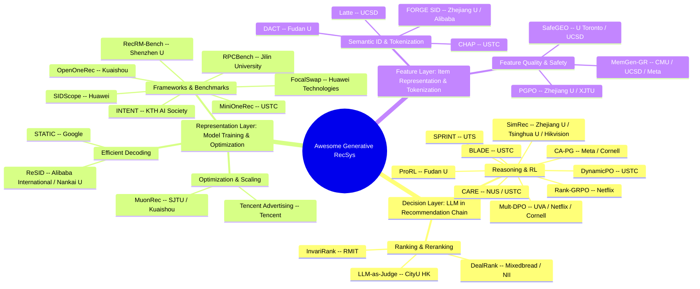

# Awesome Generative Recommendation System (RecSys)

```
 ██████╗                ██████╗                ███████╗                
██╔════╝  ███╗  ███╗    ██╔══██╗ ███╗   ███╗   ██╔════╝██╗ ██╗ ██████╗ 
██║      ██╔═██╗████╗   ██████╔╝██╔═██╗██╔═██╗ ███████╗╚██╗██║ ██╔═══╝ 
██║  ███╗██████║██╔██╗  ██╔══██╗██████║██║ ╚═╝ ╚════██║ ╚███╔╝ ██████╗ 
██║   ██║██║    ██║╚██╗ ██║  ██║██║    ██║ ██╗      ██║  ██╔╝      ██║
╚██████╔╝╚████╗ ██║ ╚██╗██║  ██║╚████╗ ╚███╔═╝ ███████║  ██║   ██████║
 ╚═════╝  ╚═══╝ ╚═╝  ╚═╝╚═╝  ╚═╝ ╚═══╝  ╚══╝   ╚══════╝  ╚═╝   ╚═════╝
```
---

[](https://github.com/sindresorhus/awesome)

RecSys is starting to adopt LLM for feature extraction, retrieval, and ranking/re-ranking! Although you can get some hands-on materials in either the [classics](#papers-classic-must-read) or some surveys, but since you're already interested in applying generative AI to industrial tasks, you probably wanna stay on the bleeding edge, right? That's exactly what this repo is for — automatically updated daily by agents with the latest generative RecSys papers fresh off arXiv, making sure that you never miss a beat.

> [!IMPORTANT]
> For those who are not familiar with GenRec, or not even the recommendation system, please checkout the kickstart posts [here](docs/kickstart.md).
> These posts are in Chinese, for English simply do your browser's internal translation or turn to __Ask Gemini__ :shipit:

## Quick Indexing
- [By Date](#by-date)
- [By Opensource](#by-opensource)
- [By Keyword](#by-keyword)
- [By Affiliation](#by-affiliation)
- [Papers Classic Must Read](#papers-classic-must-read)
- [Verl-GR: An Awesome RL Toolkit for GenRecSys](#verl-gr-an-awesome-rl-toolkit-for-genrecsys)



<div align="center">
  <i> Open-source Generative RecSys Map </i>
</div>

---
## `Verl-GR`: An Awesome RL Toolkit for GenRecSys
If you are interested in RFT your own GenRecSys, come check out our `verl`-based implementation called `verl-gr` here:
* [https://github.com/HaFred/verl-GR/tree/main/verl_gr/recipes/openonerec](https://github.com/HaFred/verl-GR/tree/main/verl_gr/recipes/openonerec)
* [https://github.com/HaFred/verl-GR/tree/main/verl_gr/recipes/rankgrpo](https://github.com/HaFred/verl-GR/tree/main/verl_gr/recipes/rankgrpo)

We manage to achieve 22% and 32% boosting for the end-to-end training efficiencies, compared with their respective vanilla implementations.

## By Date

We only keep the last 10 days summary below, for the past records before these, please see [the archive](docs/archive_by_month).

---

### Papers November 20

*Friday, November 20, 2026. This run fired at 01:05 HKT, before arXiv's 09:00 HKT announcement, so the live `/list/<cat>/new` window is the still-current "Showing new listings for Thursday, 19 November 2026" across all five categories (cs.IR 21 entries plus cs.AI / cs.LG / cs.CL / cs.MM cross-lists) — the unindexed November 19 announcement covering submissions dated 17-18 Nov. 7 strictly on-topic, genuinely new generative-recommendation / generative-retrieval / LLM-recommendation / industrial rec-systems preprints surfaced, **above the 5-paper floor, so no fallback chain and no `date_list` were needed**. All 7 were verified absent from README.md, both docs indexes and every monthly archive (1048-ID master dedup set). **1 is open-source** (PGPO / Zhejiang University, 8/10), so By Opensource count 257 -> 258; the mindmap's 30-leaf cap was held by dropping the lowest-scoring leaf GainReason (7/10), with all three layers retained (Decision 12 / Representation 11 / Feature 7). No re-hits: none of the 7 arXiv IDs appear in README.md, and the legacy cross-lists that also surfaced in today's listing (2603.20422, 2606.00740, 2606.02883, 2606.29959, 2607.19987, 2608.21274, 2610.25096, 2611.18179) are docs-/archive-only, so no `[Also published on ...]` side notes were added. Name collision handled: today's Taobao paper is indexed as `MARS-TR` to distinguish it from the already-indexed `MARS` (Multi-rate Aggregation of Recency Signals, Fudan University) and `Agentic Recommender System with Hierarchical Belief-State Memory (MARS)`. PGPO's arXiv v1 line reads 26 Aug 2026 (its EMNLP 2026 acceptance timeline), but it appears as a primary cs.IR new listing on 19 Nov with its MIT code pushed 19 Nov, so it is counted in today's window. Excluded as off-topic: 2611.23626 (binary rating-scale design), 2611.24849 (executable program judges for relevance labeling), 2611.23606 (VIBRA cross-modal retrieval), 2611.23296 / 2611.23858 (ranking for requirements review / robotic grasping), and the agent-harness / speculative-decoding / diffusion-fundamentals cluster; 2611.22838 (Better Rankers, Worse Retrievers) reappeared in same-day web digests but is already indexed on Nov 18 and was not re-added.*

1. **CONCORD-Rec: Catalog-Conditioned Modality Utility for Semantic-ID Diffusion Recommendation**
   * Affiliation: Tencent — *(Haopeng Jin, Bingkang Shi, Tao Yu, Yifei Ma, Hao Liu, Hongzhu Yi, Jinwen Luo)* — with University of Chinese Academy of Sciences and Beijing University of Posts and Telecommunications
   * Link: [arxiv.org/abs/2611.23710](https://arxiv.org/abs/2611.23710)
   * Venue: arXiv preprint, cs.IR (submitted 18 Nov 2026)
   * TL;DR: A reliability-conditioned discrete diffusion recommender that supervises an availability-masked tokenwise modality gate with counterfactual catalog-partition utility instead of distilling raw token probabilities, staying robust when input modalities are missing, degraded or conflicting.
   * Key techniques:
     - Out-of-fold teacher coalitions evaluated over the exact feasible catalog support for a partially masked SID state
     - Item posteriors aggregated across the target code partition at each unresolved SID position; counterfactual loss differences (not raw token probabilities) supervise the gate
     - Availability-masked tokenwise gate allocates bounded modality residuals around a behavioral denoiser while retaining an exact behavioral fallback slot
     - Theoretical fixed-support ranking stability bounds under gate perturbations
     - 20 source-compatible protocol-dataset rows under controlled missingness / signal degradation / semantic conflict: +4% NDCG, +14.63% NDCG at matched 30% conflict, and up to 86.89% lower p95 latency in the full-vs-uniform-T=16 sweep
   * Scores (Opensource? / Novelty / Fairness / Robustness / Impact):
     - **Opensource?: 0/10** — no public code available; no repository or artifact link in the paper
     - **Novelty: 8/10** — using counterfactual catalog-partition utility as supervision for a diffusion SID gate (rather than probability distillation) is a genuinely fresh reliability-aware formulation
     - **Fairness: 4/10** — no exposure, popularity or cohort analysis; missing/degraded modality handling is coverage robustness rather than fairness
     - **Robustness: 9/10** — explicitly built for and measured under missingness, degradation and semantic conflict, with theoretical stability bounds and 20 protocol-dataset rows
     - **Impact: 7/10** — Tencent / UCAS / BUPT; multimodal diffusion gen-rec is an active direction, but no venue or deployment

2. **Optimize the Cob, Then the Kernel: Optimizing Beam Search for Generative Recommendation Inference**
   * Affiliation: Huawei Technologies Co., Ltd. — *(Shing Wai Pun, Kai Wu, Pengfei Xia, Hui Zang, Wei Guo, Yong Liu)*
   * Link: [arxiv.org/abs/2611.23339](https://arxiv.org/abs/2611.23339)
   * Venue: arXiv preprint, cs.LG / cs.AI (submitted 17 Nov 2026; 8 pages, 4 figures)
   * TL;DR: Optimizing the whole wide-beam GR serving pipeline — Tree Attention beam concatenation, static KV, graph compilation and vocabulary-constrained decoding — cuts end-to-end latency by up to 25x vs vLLM on Ascend NPUs without custom kernels.
   * Key techniques:
     - Tree Attention concatenates beams along the sequence dimension to eliminate redundant KV cache reads over the shared prompt prefix
     - Pre-generated partial-attention masks, static KV cache allocation and loop-unrolled generation dispatch remove per-step host beam processing and PagedAttention block management
     - TorchAir graph compilation, automatic operator fusion and vocabulary-constrained decoding, with no custom kernels
     - Generation latency comparable to a SOTA custom-kernel solution
     - Targets GR inference's distinctive shape: long inputs, wide beams, only a few fixed output tokens
   * Scores (Opensource? / Novelty / Fairness / Robustness / Impact):
     - **Opensource?: 0/10** — no public code available; the paper only states "Code will be made publicly available"
     - **Novelty: 7/10** — a systems co-design rather than a new algorithm, but adapting Tree Attention to beam-shared prompt KV for GR serving is a clean, non-obvious win
     - **Fairness: 2/10** — pure serving-latency work, no fairness or exposure analysis
     - **Robustness: 8/10** — end-to-end latency measured against vLLM and a custom-kernel SOTA on Ascend NPUs; 8-page report, single hardware family, no quality-parity detail
     - **Impact: 8/10** — Huawei; a 25x serving win on wide-beam GR inference, the exact bottleneck for SID/beam-based generative recommenders

3. **ReflectRec: Cycle-Consistency Preference Verification for LLM-based Recommendation**
   * Affiliation: Sungkyunkwan University / NAVER Corp. — *(Dae Kyoo Kim, Heejung Cho, Sungmoo Hong, Eunil Park)* — with KIAT, KT Corp. and Jaume I University
   * Link: [arxiv.org/abs/2611.23969](https://arxiv.org/abs/2611.23969)
   * Venue: EMNLP 2026 Main Conference (Proceedings, pages 36183-36197, Budapest, Hungary)
   * TL;DR: A preference-to-history round-trip verifier scores whether a generated CoT preference note can recover the user's real history, and that single score gates regeneration, selects the best attempt and triggers collaborative forward-look hints.
   * Key techniques:
     - Cycle-consistency verifier: feed the preference note back with 50 candidates (true history + random negatives) and measure recall of true history items
     - One ValScore reused for measurement, regeneration gating, attempt selection and downstream-module diagnosis
     - Semantic Stage-1 preference elicitation over genre / mood / theme / era / narrative style without quoting titles
     - Conditional PV-guided regeneration for low-recoverability preferences; Forward-Look retrieval injects future watches of behaviorally similar users
     - +16.25 / +4.46 pp Hit@10 over CoT4Rec-ICL on MovieLens-100K / 1M, positive across ValScore buckets and three backbones (Qwen3-30B, Qwen2.5-72B, Llama-3.3-70B); Amazon Electronics corroboration
   * Scores (Opensource? / Novelty / Fairness / Robustness / Impact):
     - **Opensource?: 0/10** — no public code available
     - **Novelty: 8/10** — turning cycle-consistency verification into an operational control signal for LLM-rec preference notes is a fresh, verifier-centric framing
     - **Fairness: 4/10** — per-user ValScore buckets are robustness stratification, not demographic fairness; the paper explicitly lists bias amplification / filter bubbles as unaddressed
     - **Robustness: 7/10** — three backbones, three datasets, bucketed analysis and a timestamp-safe study; the authors concede the ML-1M Forward-Look gain loses significance and axes are hand-designed
     - **Impact: 7/10** — EMNLP 2026 main conference; LLM-based rec reasoning is active, but no code release

4. **MARS Technical Report**
   * Affiliation: Taobao & Tmall Group / Alibaba — *(MARS Team: Tong Liu, Chaoqun Hou, Longxiang Xiong, Junhong Lou, Jiaqi Zheng, Qixin Li, Zixin Zhao, Yong Duan, Xiannian Hu, Fengze Jiang, Yu Zhu, Cheng Guo, Xinyuan Qi, Zi Zhuang, Ping Liu, Lv Shao, Zongwei Wang)*
   * Link: [arxiv.org/abs/2611.24006](https://arxiv.org/abs/2611.24006)
   * Venue: arXiv preprint, cs.IR (submitted 18 Nov 2026; 46 pages, 5 figures)
   * TL;DR: A near-line Qwen3-0.6B agent emits per-user seven-dimensional pipeline configurations for the full rec cascade (quotas, model selection, fusion weights, reranker settings), trained with SFT + FAPO + GRPO and validated in a two-week A/B across five Taobao scenarios (+5.22% V2P, +7.34% GMV).
   * Key techniques:
     - Constrained seven-dimensional per-user action space covering pipeline mode, retrieval quotas, model selection, fusion weights and reranker settings
     - Confidence-aware SFT distills schema-valid generation from a Qwen3.6-Max teacher; Format-Anchored Preference Optimization (FAPO) learns action preferences via ActionMask with posterior weighting
     - GRPO refinement through Sandbox replay with a frozen reward model — exploratory actions never hit live traffic
     - Configs validated, atomically cached in iGraph and consumed asynchronously; the online cascade never waits for LLM inference
     - Schema checks, incumbent fallbacks, master kill switch; Minimal mode for ~20% of requests; 12 ms lower mean serving latency; >10M daily users
   * Scores (Opensource? / Novelty / Fairness / Robustness / Impact):
     - **Opensource?: 0/10** — no public code available; an industrial technical report
     - **Novelty: 8/10** — moves personalization from per-stage predictions to whole-pipeline orchestration, with a bespoke FAPO + GRPO post-training recipe
     - **Fairness: 4/10** — per-user configs are personalization, not fairness; no exposure or provider-parity audit
     - **Robustness: 9/10** — two-week A/B over five scenarios with >10M daily users, plus schema validation, fallbacks, kill switch, async decoupling and measured latency
     - **Impact: 9/10** — Alibaba/Taobao production deployment with reported GMV/V2P gains; one of the strongest industrial agentic-rec validations to date

5. **PGPO: Prototype-Guided Progressive Obfuscation for Privacy-Preserving LLM-Enhanced Recommendation**
   * Affiliation: Zhejiang University — *(Shengxiang Lin, Jiajie Su, Pengyang Zhou, Xiang Chen, Xiaolin Zheng, Feng Tian, Chaochao Chen)* — with Xi'an Jiaotong University
   * Link: [arxiv.org/abs/2611.23236](https://arxiv.org/abs/2611.23236)
   * Venue: EMNLP 2026 Main Conference (ACL Anthology 2026.emnlp-main.480), cs.IR / cs.CL / cs.CR
   * TL;DR: Prototype-guided progressive obfuscation defends LLM-enhanced recommenders against embedding inversion attacks while preserving the inter-item semantic topology that ranking needs, optimized with GRPO.
   * Key techniques:
     - Relational fidelity objective: semantic shift for privacy while preserving relative item relations for utility
     - Topology-aware obfuscation anchors learned for high-influence prototype words, propagated through a static vocabulary-level semantic graph
     - GRPO with three rewards: individual dissimilarity, structural consistency and semantic constraints
     - Progressive propagation of obfuscation from prototypes to the remaining vocabulary
     - Two benchmarks (MovieLens-1M, Amazon-Book): strong inversion defense with near-upper-bound recommendation performance
   * Scores (Opensource? / Novelty / Fairness / Robustness / Impact):
     - **Opensource?: 8/10** — [github.com/Shengxiang-Lin/PGPO](https://github.com/Shengxiang-Lin/PGPO) — MIT, 203 files (94 Python, 27 YAML configs), complete pipeline (data prep → semantic-graph construction → prototype extraction → GRPO training → variant generation → evaluation), documented README with architecture figure / setup badges / ACL Anthology link, requirements.txt, docs/ and evaluate/ modules, pushed 19 Nov 2026. Held below 9/10 because no released checkpoints/datasets (download scripts only) and no CI/test suite.
     - **Novelty: 7/10** — topology-aware prototype obfuscation with multi-reward GRPO is a solid, moderately novel privacy defense for LLM-enhanced rec
     - **Fairness: 6/10** — protecting sensitive textual attributes is privacy-adjacent to fairness, but there is no group-parity or exposure audit
     - **Robustness: 8/10** — two benchmarks, inversion-attack defense and near-upper-bound utility; no adaptive-attack or cross-domain stress test
     - **Impact: 7/10** — EMNLP 2026 main conference plus a full, freshly pushed code release; privacy in LLM-enhanced rec is a growing concern

6. **MLE Agents: Autonomous ML Engineering in Large-scale Recommendation Systems**
   * Affiliation: Meta Platforms — *(Matthew Li, Albert Jiongqian Liang, Dilip Raj)*
   * Link: [arxiv.org/abs/2611.23910](https://arxiv.org/abs/2611.23910)
   * Venue: NeurIPS 2026 AutoMLR Workshop (oral), cs.AI (submitted 18 Nov 2026)
   * TL;DR: Human-on-the-loop LLM MLE agents autonomously propose, implement, train and evaluate changes to large-scale search rankers — 1,097 completed experiments with a 29.6% acceptance rate and a +0.23% search-volume lift from the best model in a production A/B.
   * Key techniques:
     - Human-on-the-loop agent loop: hypothesis → code change → training → offline/online evaluation; engineers retain objective design, search direction and final-model review
     - Parallel training runs to amortize hours-long experiment feedback; objective calibrated to match online impact
     - Context engineering to counter the saturation of early wins
     - 1,097 completed candidate experiments, 325 accepted (29.6% vs 15.6% in an earlier campaign under a different objective/search constraint)
     - Best model increases search volume by 0.23% in a large-scale A/B
   * Scores (Opensource? / Novelty / Fairness / Robustness / Impact):
     - **Opensource?: 0/10** — no public code available; the agent harness is internal
     - **Novelty: 7/10** — an empirical study of autonomous LLM MLE agents on industry-scale ranking models (not benchmark proxies), with an online-calibrated objective, is a fresh data point
     - **Fairness: 3/10** — no fairness analysis; engineer review is the only safeguard on agent-proposed changes
     - **Robustness: 8/10** — 1,097 experiments across two campaigns plus an online A/B, with explicit treatment of offline→online metric mismatch and improvement saturation; workshop-length paper
     - **Impact: 8/10** — Meta Platforms, NeurIPS 2026 AutoMLR oral, production search rankers; directly relevant to harness-level / agentic RL for rec systems

7. **X-split Argus: Learning Reusable History Tokens for Efficient CTR Prediction**
   * Affiliation: Yandex — *(Alexander Ploshkin, Nikita Stepanov, Alexey Pismenny, Viacheslav Ovchinnikov, Nikolay Savushkin)*
   * Link: [arxiv.org/abs/2611.24283](https://arxiv.org/abs/2611.24283)
   * Venue: arXiv preprint, cs.IR (submitted 18 Nov 2026)
   * TL;DR: A jointly trained offline history compressor and online ranker turn long behaviour histories into candidate-independent reusable tokens, retaining most of a full-history teacher's gain and lifting online ad-conversion value by 4.65% in a production RTB A/B.
   * Key techniques:
     - Candidate-independent compact history tokens computed offline and reused across ads; online ranker cross-attends to tokens plus recent events
     - Autoregressive click-feedback loss combined with distillation of candidate-specific click logits from a larger teacher scored on the uncompressed history
     - Token count and recent-history length are tunable serving compute/latency budget knobs
     - Deployed in a real-time bidding system at ~100k requests/s; -0.81% normalized entropy offline, +4.65% ACV and +2.96% clicks online, at +15% inference cost
   * Scores (Opensource? / Novelty / Fairness / Robustness / Impact):
     - **Opensource?: 0/10** — no public code available
     - **Novelty: 6/10** — a clean decoupling of offline history compression from candidate-aware online scoring, but incremental over TransAct / LLaTTE / VISTA / TM20K and the team's own ARGUS
     - **Fairness: 3/10** — no fairness analysis
     - **Robustness: 9/10** — production deployment at ~100k RPS, online A/B, compute/latency budget sweep, offline NE and online business metrics, with the +15% inference cost disclosed
     - **Impact: 8/10** — Yandex production ad ranking; reusable history tokens sit close to generative sequential-recommendation scaling, though no venue

---

### Papers November 18

*Wednesday, November 18, 2026. The live arXiv 24-hour window is NON-EMPTY and rich: every `/list/<cat>/new` page reads "Showing new listings for Wednesday, 18 November 2026" (34 cs.IR entries plus the cs.AI / cs.LG / cs.CL / cs.MM cross-lists, submissions dated 16-17 Nov), and 8 strictly on-topic, genuinely new generative-recommendation / generative-retrieval / LLM-recommendation preprints surfaced — **above the 5-paper floor, so no fallback chain and no `date_list` were needed**. All 8 were verified absent from README.md, both docs indexes and every monthly archive (1039-ID master dedup set). **1 is open-source** (DealRank / mixedbread-ai, 9/10), so By Opensource count 256 -> 257; the mindmap's 30-leaf cap was held by dropping one tied-lowest 7/10 leaf (BRAVE), with all three layers retained. Two name collisions are handled: the new verbalized-feedback RL paper is labelled `VerRec` to distinguish it from the already-indexed `VRec` (Verifiable Reasoning for LLM-based Generative Recommendation), and the new `GuardAgent` (WSDM 2027, UNSW / CSIRO) is distinct from the unrelated ICML 2025 guardrail agent of the same name; the `github.com/CRIPAC-DIG/RecTextAttack` link in its PDF is the third-party ACL 2024 attack baseline, not this paper's code. Legacy v2 replacements surfacing in today's listing were excluded rather than re-added: NewsReX / 2508.21572 (Aug 2025 v1), PEARL / 2605.21752 (May 2026 v1), EE-Motion / 2611.21032 (off-topic EEG music rec, already excluded 17 Nov), alongside 4 already-indexed cross-lists (2605.14434, 2606.04547, 2607.29241, 2610.37584). Re-hits handled rather than duplicated: LEGIT / 2611.10357 and RACE / 2611.18244 resurfaced as v2 cross-lists in today's cs.IR listing, so their existing entries got `[Also published on 2026-11-18]` side notes with `re-hit` counters (LEGIT 1 -> 2, RACE 0 -> 1). Excluded as off-topic: COTTI / 2611.22597 (non-generative industrial CTR / promotional-drift ranking), SimAI / 2611.21808 (psychological-network user simulation), 2611.22210 (LLM alignment personalization), and the RAG / dense-retrieval / agent-harness cluster.*

1. **KVUse: Reusable-KV User Memory for Efficient LLM Recommenders**
   * Affiliation: Meta Recommendation Systems (MRS) — *(Xin Guo, Qiang Zhang, Xiang Zhou, Arushi Rai, Siyu Lin, Yifan Wu, Xiang Shen, Lei Huang, Qunshu Zhang, Xiangjun Fan, Lizhu Zhang)*
   * Link: [arxiv.org/abs/2611.21920](https://arxiv.org/abs/2611.21920)
   * Venue: arXiv preprint, cs.LG (submitted 16 Nov 2026)
   * TL;DR: Stores each user's natural-language profile as a reusable KV cache instead of prompt text, so prefill-heavy ranking calls skip recomputing it — 4.0-4.5x higher downstream scoring throughput at statistically unchanged ranking quality.
   * Key techniques:
     - Reusable-KV user memory: lightweight LoRA "writers" trained by self-distillation emit the profile's KV cache during the profile-update decoding pass
     - Position- and context-agnostic reading: the same stored KV is consumed at new positions and behind new context without recomputation, where prefix caching fails because profiles are preceded by different text per call
     - Custom KV scheduler uploads the next batch's reusable KV from host memory while the current batch computes, hiding transfer behind GPU work
     - Evaluated on four InstructRec domains with Llama-3.1-8B-Instruct over continuous memory-update rounds
   * Scores (Opensource? / Novelty / Fairness / Robustness / Impact):
     - **Opensource?: 0/10** — no public code available; a Meta industrial systems paper with no repository or artifact link
     - **Novelty: 8/10** — turning the user profile itself into a reusable KV cache (rather than a shared prefix) with learned LoRA writers is a genuinely new systems angle on memory-augmented LLM recommenders
     - **Fairness: 3/10** — no exposure, popularity or cohort analysis; quality is measured only as aggregate NDCG@10 parity
     - **Robustness: 8/10** — four public datasets, significance testing against full prefill over successive update rounds, and saturated-load throughput measurements; single 8B backbone, no online A/B
     - **Impact: 8/10** — Meta MRS; a 4x serving win on a bottleneck (repeated profile prefill) that any profile-based LLM recommender shares

2. **Cluster-Guided Decoding with Trust-Region Constraints for Personalized Recommendation**
   * Affiliation: Amazon, USA — *(Gezheng Wen, Chao Shen, Raviteja Anantha, Tan Shen Cliff Chung, Layne C. Price)*
   * Link: [arxiv.org/abs/2611.22163](https://arxiv.org/abs/2611.22163)
   * Venue: arXiv preprint, cs.IR (submitted 17 Nov 2026; 5 pages, 2 tables)
   * TL;DR: Learns a hierarchy of semantic clusters and injects a cluster-level prior directly into the item scoring rule (not just candidate pre-selection), steering ranking toward the right semantic region while serving in milliseconds.
   * Key techniques:
     - Cluster-Guided Generative Reconstruction (CG2R): a learned semantic-cluster hierarchy whose centroids define a cluster prior added to the item score
     - Trust-region constraints keep the prior's influence bounded during decoding
     - Centroid-based prior needs no per-item statistics, so it remains defined for cold-start users with no history
     - Beats classical, neural and LLM-based baselines in Recall / nDCG on three benchmarks, with gains widening as the catalog grows sparser; millisecond-scale first-stage retrieval
   * Scores (Opensource? / Novelty / Fairness / Robustness / Impact):
     - **Opensource?: 0/10** — no public code available
     - **Novelty: 7/10** — adding a cluster prior directly to the scoring rule (rather than using clusters for candidate pruning) is a clean, modest reframing
     - **Fairness: 5/10** — the centroid prior is explicitly defined for cold-start / no-history users, a form of coverage robustness, but no exposure or group-parity audit
     - **Robustness: 7/10** — three benchmarks plus a sparsity sweep and latency measurement; short 5-page paper with no industrial deployment
     - **Impact: 6/10** — Amazon, no venue; low-latency first-stage retrieval is practically relevant but the paper is brief

3. **GuardAgent: A Memory-Augmented Agentic Framework for Adaptive Detection of Adversarial Promotions in LLM-Based Recommendation**
   * Affiliation: The University of New South Wales / CSIRO — *(Shiyi Yang, Xinshu Li, Chen Wang, Xiwei Xu, Liming Zhu, Lina Yao)* — with Monash University and Macquarie University
   * Link: [arxiv.org/abs/2611.22274](https://arxiv.org/abs/2611.22274)
   * Venue: WSDM 2027 (20th ACM International Conference on Web Search and Data Mining, 15-19 Feb 2027, Hong Kong), cs.IR / cs.CR
   * TL;DR: First systematic study of detecting promotion-driven attacks against LLM-based recommenders, using a self-evolving Perception-Action-Reflection-Memory agent loop that adapts to unseen threat patterns and emits explainable reasoning traces.
   * Key techniques:
     - Cognitive agentic loop: Perception, Action, Reflection and Memory, with short- and long-term memory of past detection failures
     - Memory-encoded decision policies distilled from self-reflection on erroneous reasoning traces, enabling continual adaptation to unseen benign and attack patterns
     - Explainable outputs: explicit policies and reasoning traces for security-team audit and failure diagnosis
     - Attacks are inference-time prompt perturbations in open-ended language space (item metadata / promotional text), not train-time data poisoning
     - Evaluated on real-world datasets against conventional static LLM detectors and open-source attack baselines
   * Scores (Opensource? / Novelty / Fairness / Robustness / Impact):
     - **Opensource?: 0/10** — no public code available; the `github.com/CRIPAC-DIG/RecTextAttack` link cited in the paper is the third-party ACL 2024 "Stealthy Attack on LLM-based Recommendation" baseline, and the name collides with an unrelated ICML 2025 guardrail agent
     - **Novelty: 8/10** — recasting promotion-attack detection as a self-evolving memory-augmented agent (rather than a one-off classifier) is a fresh framing of the LLM-rec attack surface
     - **Fairness: 7/10** — explicitly targets unfair competition among item providers and exposure manipulation, but measures detection performance rather than provider-level parity
     - **Robustness: 8/10** — generalization to unseen attack patterns, real-world datasets, and explainability-oriented evaluation; no online deployment or latency study
     - **Impact: 7/10** — WSDM 2027 with CSIRO / UNSW; a security topic that will matter as LLM-based recommenders ship, but no released code

4. **Efficient Wide-Beam Generative Retrieval with Model-Native Trie Decoding and Shared-Context Attention**
   * Affiliation: LinkedIn — *(Vedant Jhaveri, Arashpreet Singh Mor, Satyam Kumar, Alex Tsun, Qing Lan, Shaunak Mishra, Sriram Vasudevan)*
   * Link: [arxiv.org/abs/2611.22309](https://arxiv.org/abs/2611.22309)
   * Venue: arXiv preprint, cs.AI (submitted 17 Nov 2026)
   * TL;DR: A model-native output head that stores the SID trie as validated GPU tensors plus shared-context attention across beams, giving up to 5.57x closed-loop throughput over a Python logit-processor baseline at beam width 200.
   * Key techniques:
     - Trie-Head output interface: identifier trie held as validated GPU tensors, scoring compact codebook candidates and streaming a full-vocabulary normalizer — preserves exact valid-token scores in real arithmetic without retraining
     - Removes Python custom-logit-processor (CLP) callbacks and vocabulary-wide score buffers, cutting CPU-GPU coordination and memory traffic
     - Shared-context attention reuses prompt KV blocks across beams while keeping each beam's private decode tail
     - Implemented in SGLang; evaluated on LinkedIn Hiring Assistant candidate sourcing and the Qualification Retrieval Platform
     - Up to 5.57x throughput vs CLP and 2.63x vs BF16 FlashRec at beam width 200
   * Scores (Opensource? / Novelty / Fairness / Robustness / Impact):
     - **Opensource?: 0/10** — no public code available; built on SGLang but the Trie-Head / shared-context mechanisms are not released
     - **Novelty: 8/10** — moving trie-constrained decoding inside the model's output interface (lossless, no retraining) is a substantive serving-side contribution to wide-beam GR
     - **Fairness: 3/10** — no exposure, popularity or group-level analysis; throughput and score-preservation only
     - **Robustness: 9/10** — real-arithmetic losslessness, two production LinkedIn workloads, an SGLang implementation, and comparisons at beam width 200
     - **Impact: 9/10** — LinkedIn production systems, 5.57x throughput; wide-beam cost is a central blocker for deployed generative retrieval

5. **Deal With It: On Better Schedules for Listwise Reranking**
   * Affiliation: Mixedbread — *(Benjamin Clavié, Herumb Shandilya, Hanna Lichtenberg, Aamir Shakir, Makoto P. Kato)* — with National Institute of Informatics (NII)
   * Link: [arxiv.org/abs/2611.22392](https://arxiv.org/abs/2611.22392)
   * Venue: arXiv preprint, cs.IR / cs.AI (submitted 17 Nov 2026)
   * TL;DR: Proves that round-robin "dealing" of candidates by retriever rank minimizes expected top-10 cuts under equal quotas, and ships DealRank — a two-round schedule within 0.1 nDCG@10 of the best schedules and 1.1-1.4x faster than BlitzRank.
   * Key techniques:
     - Theoretical analysis: under a simple retriever model, no equal-quota split cuts fewer of the true top ten on average than round-robin dealing; contiguous chunks cut more as the retriever improves
     - DealRank: deal all hands in parallel, advance a fixed quota per hand, then rank finalists in one call — fixed round count independent of the data
     - Dealing as a drop-in for existing schedules (BlitzRank): cuts repair calls from 59% of queries to 14% at unchanged quality
     - Random partitioning is equivalent only at quota four, but ties results to the seed; six LLMs across TREC / BEIR benchmarks, up to a thousand candidates
   * Scores (Opensource? / Novelty / Fairness / Robustness / Impact):
     - **Opensource?: 9/10** — [github.com/mixedbread-ai/dealrank](https://github.com/mixedbread-ai/dealrank): Apache-2.0 official release pushed 18 Nov 2026, 132 files (80 Python modules), packaged `src/`, `pyproject.toml`, 10 test files, GitHub Actions CI, pre-commit config, CHANGELOG / CONTRIBUTING, `experiments/configs` YAML for every figure and table and a reproducible `experiments/repro` analysis suite, plus a documented README with a companion blog post; 0 stars and no bundled corpora or checkpoints (uses public TREC / BEIR pools), but the code matches the paper closely and is unusually complete for a day-one release
     - **Novelty: 7/10** — dealing is admittedly not conceptually new, but the proof that it is optimal under equal quotas and the quota-vs-seed analysis are genuine contributions
     - **Fairness: 3/10** — no exposure, popularity or group-parity analysis; quality is nDCG@10 only
     - **Robustness: 8/10** — proof plus six LLMs, ten benchmarks, quota sweeps, seed-stability and latency analysis, and drop-in validation inside BlitzRank
     - **Impact: 7/10** — Mixedbread / NII, no venue; a near-zero-cost schedule change with an immediate latency payoff and full reproducibility

6. **More Than a Score: Reinforcement Learning with Verbalized Feedback for Generative Recommendation**
   * Affiliation: Tencent Inc. — *(Zipeng Chen, Xinyu Lin, Yuliang Sun, Sheng Zhang, Zeyu Wang, Xiaowen Shi, Junwei Pan, Chengguo Yin)* — with National University of Singapore and The Chinese University of Hong Kong
   * Link: [arxiv.org/abs/2611.22410](https://arxiv.org/abs/2611.22410)
   * Venue: arXiv preprint, cs.IR (submitted 17 Nov 2026; manuscript typeset for The Web Conference 2027)
   * TL;DR: Replaces scalar RL rewards with personalized natural-language feedback from a training-only user simulator, so the policy knows *why* a candidate misses the user's preference and can revise it — jointly optimized with GRPO.
   * Key techniques:
     - VerRec: a user simulator generates verbalized feedback from the user's history and the candidate item profile, explaining which aspects conflict with preferences and how the next candidate should differ
     - Original and feedback-refined candidates form an expanded group optimized jointly with group relative policy optimization (GRPO)
     - The simulator is used only during training and removed at inference, so serving cost is unchanged
     - Verbalized guidance encourages exploration of more diverse candidates and higher-reward discoveries during training
     - Three Amazon review datasets, two generative-recommendation backbones; accuracy and ranking-quality gains
   * Scores (Opensource? / Novelty / Fairness / Robustness / Impact):
     - **Opensource?: 0/10** — no public code available; the similarly named `VRec` (Verifiable Reasoning, github.com/Linxyhaha/Verifiable-Rec) is a different, already-indexed paper
     - **Novelty: 8/10** — swapping scalar rewards for structured, preference-grounded verbal feedback inside a GRPO group is a genuinely new exploration signal for GR
     - **Fairness: 4/10** — no exposure, popularity or group-level analysis; diversity of explored candidates is discussed only as a training benefit
     - **Robustness: 7/10** — three datasets x two backbones plus exploration analyses, but no industrial logs or online A/B
     - **Impact: 8/10** — Tencent with NUS / CUHK; RL alignment is central to production GR and the training-only simulator keeps inference free

7. **IntentGR: Enhancing Intent for End-to-End Personalized Generative Retrieval in Search**
   * Affiliation: Zhejiang University / Alibaba International Digital Commercial Group — *(Gefan Ye, Yanjing Wu, Yinfu Feng, Zhiqiang Wang, Liang Li, Jun Xiao, Rong Xiao, Xiaoyi Zeng)*
   * Link: [arxiv.org/abs/2611.22788](https://arxiv.org/abs/2611.22788)
   * Venue: WSDM 2027 Findings (cs.IR; submitted 17 Nov 2026; 11 pages, 3 figures)
   * TL;DR: Strengthens query intent at four stages of end-to-end personalized generative retrieval, preventing generated SIDs from drifting toward high-frequency token patterns instead of the current search intent.
   * Key techniques:
     - Finding: end-to-end GR pipelines imported from recommendation treat the query as a plain input feature, leaving intent guidance weak in both tokenization and generation
     - Query-Aware Semantic Behavior Representation (QBR): query-level behavioral evidence as a new input signal
     - Query-Semantic Alignment (QSA), Long-Tail Query Enrichment (LQE), Query-conditioned Attention Modulation (QAM): intent integration at the optimization, training-distribution and decoding stages respectively
     - Jointly satisfies immediate search intent and long-term preference in one SID-generation model
   * Scores (Opensource? / Novelty / Fairness / Robustness / Impact):
     - **Opensource?: 0/10** — no public code available
     - **Novelty: 8/10** — a four-stage, intent-conditioned treatment of the whole SID pipeline (rather than a single query feature) is a fresh answer to intent drift in generative search retrieval
     - **Fairness: 5/10** — Long-Tail Query Enrichment explicitly targets under-represented queries, a coverage / fairness angle, but no group-level parity metric
     - **Robustness: 8/10** — four complementary mechanisms, WSDM 2027 Findings acceptance, and a search-retrieval setting with both intent and preference objectives
     - **Impact: 8/10** — Zhejiang University + Alibaba International; personalized generative retrieval in search is a live industrial direction

8. **Better Rankers, Worse Retrievers: The Hidden Cost of RL Post-Training in Generative Recommendation**
   * Affiliation: The Hong Kong University of Science and Technology — *(Yuheng Chen, Fan Zhang, Yixuan Xu, Chao Yang, Yang Xiang, Can Yang)* — with Trip.com Group
   * Link: [arxiv.org/abs/2611.22838](https://arxiv.org/abs/2611.22838)
   * Venue: arXiv preprint, cs.IR (submitted 17 Nov 2026)
   * TL;DR: Shows that RL post-training improves GR hit@K for small K but lowers candidate-list recall at K in the hundreds on all five datasets, traces it to negative advantages on rollout alternatives, and fixes it with a single out-of-rollout anchoring loss.
   * Key techniques:
     - Diagnosis: RL improves the top of the list while the model becomes "a better ranker and a worse retriever" — a failure invisible to the usual top-10 reporting
     - Root cause: only one next item is logged per user, so RL treats every other rollout candidate as wrong, penalising exactly the plausible alternatives that similar users choose next
     - Out-of-rollout anchoring: one extra loss term preserving the SFT model's ordering of items outside the rollout, restoring recall to SFT level on all five datasets while keeping the top-K gain
     - Controlled experiments isolate the effect of negative advantages on sampled candidates
   * Scores (Opensource? / Novelty / Fairness / Robustness / Impact):
     - **Opensource?: 0/10** — no public code available; builds on public MiniOneRec datasets and TRL / DAPO baselines only
     - **Novelty: 8/10** — naming and mechanistically explaining the ranker-vs-retriever trade-off of RL post-training, with a one-line remedy, is a substantive diagnostic contribution
     - **Fairness: 4/10** — no exposure, popularity or group-level analysis; recall is measured at catalog scale, not per subgroup
     - **Robustness: 9/10** — five datasets, controlled causal experiments, and a remedy that restores recall to the SFT baseline everywhere
     - **Impact: 8/10** — HKUST / Trip.com; directly changes how GR RL should be evaluated and trained in any retrieve-then-rank deployment

---

### Papers November 17

*Tuesday, November 17, 2026. The live arXiv 24-hour window is NON-EMPTY and rich: every `/list/<cat>/new` page reads "Showing new listings for Tuesday, 17 November 2026" (36 cs.IR entries plus the cs.AI / cs.LG / cs.CL / cs.MM cross-lists), and 8 strictly on-topic, genuinely new generative-recommendation / generative-retrieval / LLM-recommendation preprints surfaced — **above the 5-paper floor, so no fallback chain and no `date_list` were needed**. All 8 were verified absent from README.md, both docs indexes and every monthly archive (1052-ID master dedup set). **2 are open-source** (GainReason 7/10, BRAVE 7/10), so By Opensource count 254 -> 256; the mindmap's 30-leaf cap was held by dropping the lowest-scored leaf ShopMind (7/10) and one tied-lowest 8/10 leaf (CFX-Narratives), with all three layers retained. Two advertised code leads were dead or unrelated: the verbosity-bias paper's `github.com/GoComputing/Verbose-Bias` returns 404 (the org does not exist), and `github.com/wwqq/R3-VAE` cited by CARE-SID is a third-party baseline (Wan et al., 2026), not this paper's code. Name collisions handled: the new Tencent CARE (2611.20721) is labelled `CARE-SID` to distinguish it from the already-indexed CARE (NUS / USTC, WWW'26, 2602.03692), and the "Keep it Simple" GitHub repos found belong to unrelated ACL2021 text-simplification / video-memory projects. Re-hits handled rather than duplicated: FocalSwap / 2611.06044 and SID-LLM / 2611.08804 resurfaced as replacement submissions in today's cs.IR listing, so their existing entries got `[Also published on 2026-11-17] — re-hit: 1` side notes instead of new entries. Excluded as off-topic: the EEG music recommender / 2611.21032, the raw-feature GCN multimodal recommender / 2611.19974, the explicitly non-generative retrieval method / 2611.18617, graph-evidence LLM ranking / 2611.20837, and the RAG / agent-harness / speculative-decoding cluster.*

1. **Learning to Reason with Predictive Gains for Generative Recommendation**
   * Affiliation: Renmin University of China — *(Zhuoyang Li, Teng Shi, Jiakai Tang, Weijie Yu, Guofu Xie, Xiao Zhang, Lei Kou, Yang Yu, Lei Shen, Xin Chen, Bing Wang, Xiaoyi Zeng, Jun Xu)* — with University of International Business and Economics & Alibaba International Digital Commercial Group
   * Link: [arxiv.org/abs/2611.21441](https://arxiv.org/abs/2611.21441)
   * Venue: arXiv preprint, cs.AI (submitted 16 Nov 2026)
   * TL;DR: Replaces flat GRPO final-performance rewards with sentence-level Predictive Gain rewards — the change in target SID log-likelihood induced by each reasoning sentence — giving contribution-aware, discriminative optimization of reasoning in generative recommenders.
   * Key techniques:
     - Predictive Gain (PG): measures the change in target Semantic ID (SID) log-likelihood induced by individual reasoning sentences
     - Theoretical alignment between expected PG and the recommendation ranking objective
     - PG-based Reasoning Optimization (PGRO) with sentence-level rewards, supported by a custom causal attention mechanism for efficient PG computation
     - Auxiliary PG-based Reasoning Utilization (PGRU) task adaptively strengthens reasoning-conditioned prediction
     - Qwen3-1.7B backbone with extended SID token vocabulary; itemic alignment + reasoning activation stages; evaluated on three public benchmarks
   * Scores (Opensource? / Novelty / Fairness / Robustness / Impact):
     - **Opensource?: 7/10** — [github.com/easonzyli/GainReason](https://github.com/easonzyli/GainReason): Apache-2.0 official implementation with README quick start, requirements.txt, staged shell scripts, datasets/ (index + train/valid/test CSVs) and 5 substantial Python modules (data_Qwen3.py, itemic_align.py, prompts.py, two reasoning-construction scripts), pushed 17 Nov 2026; **partial release** — the README states the core PGRO/PGRU training code "is being organized and will be released as soon as possible"; no tests, CI or pyproject
     - **Novelty: 8/10** — a provable, sentence-level predictive-contribution reward is a genuinely new alternative to trajectory-level GRPO rewards for GR reasoning
     - **Fairness: 3/10** — no exposure, popularity or group-level analysis; SID-log-likelihood gains could favour popular item paths
     - **Robustness: 8/10** — theory plus three public benchmarks with PGRO/PGRU ablations, but a single 1.7B backbone and no industrial online A/B
     - **Impact: 8/10** — Renmin University + Alibaba International; reasoning-enhanced GR is a hot direction and the open-source release (even partial) lowers the adoption barrier

2. **CARE: Contrastive-Anchored Residual Encoding with Listwise Reconstruction for Retrieval-Oriented Semantic IDs**
   * Affiliation: Tencent — *(Yuan Xu, Dawei Chen, Xiaoguang Lin, Xin Chen, Yulong Ou, Haijun Wu)*
   * Link: [arxiv.org/abs/2611.20721](https://arxiv.org/abs/2611.20721)
   * Venue: arXiv preprint, cs.IR (submitted 16 Nov 2026; 18 pages, 8 figures, 5 tables)
   * TL;DR: Two SID tokenizers that align quantization with query-document retrieval relevance rather than only embedding fit — contrastive residual alignment plus listwise reconstruction distillation — with CARE-SID deployed in the generative retrieval stage of an industrial video search system.
   * Key techniques:
     - CARE-SID: a zero-initialized residual alignment network trained with a query-document contrastive loss BEFORE quantization; an anchor loss and a reconstruction target fixed to the original embedding prevent drift and collapse
     - Reference-vector rating residual quantization (R3-VAE style) assigns the codes; document-only encoding interface preserved
     - CARE-LR: distills, for each training query, the similarity distribution the original embeddings induce over a candidate list into the SID reconstructions via a function-preserving layer-resolved head
     - Generator-free evaluation by row-budget recall in a bucketing (partition) view and a reconstruction view
     - Finding: the document embedding affects SID recall far more than the quantizer; contrastive alignment helps most when the embedding has not been trained on search data
   * Scores (Opensource? / Novelty / Fairness / Robustness / Impact):
     - **Opensource?: 0/10** — no public code available; the `github.com/wwqq/R3-VAE` link in the paper is a third-party baseline (Wan et al., 2026), not this paper's implementation
     - **Novelty: 8/10** — making SID tokenization explicitly retrieval/query-aware (contrastive alignment + listwise distillation into SID reconstructions) rather than embedding-fit-only is a fresh framing of the SID recall bottleneck
     - **Fairness: 4/10** — no exposure, popularity or group-level analysis; bucketing recall is a relevance-coverage proxy, not a fairness audit
     - **Robustness: 8/10** — two tokenizer variants, two document embeddings, generator-free dual-view recall evaluation, and a production deployment in industrial video search
     - **Impact: 9/10** — Tencent, already deployed in a production generative-retrieval stage; reframes the tokenizer itself as the recall bottleneck for GR

3. **Reflection Is Not Always Worth It: Budgeted Reflection Allocation for Recommendation Agents**
   * Affiliation: The University of British Columbia — *(Jinfeng Xu, Zheyu Chen, Ziyue Peng, Jianheng Tang, Zheng Lin, Wenhao Yuan, Jian Chen, Shujie Li, Victor Leung)* — with The Hong Kong Polytechnic University, HKUST and others
   * Link: [arxiv.org/abs/2611.19847](https://arxiv.org/abs/2611.19847)
   * Venue: WSDM 2027 (20th ACM International Conference on Web Search and Data Mining, 15-19 Feb 2027, Hong Kong), cs.IR
   * TL;DR: Treats recommendation-agent training as selective reflection under a budget, estimating user-level reflection value from cheap recommender-side uncertainty before calling the LLM, so it matches or beats a uniform-reflection agent with fewer LLM calls while preserving full-catalog ranking and inference reranking.
   * Key techniques:
     - BRAVE (Budgeted Reflection Allocation via Value Estimation): user-level reflection value from recommender-side uncertainty, with no LLM call required
     - Gated allocator: ranking fragility determines whether reflection has room to change the top list; cross-tool disagreement is used only as a secondary signal under this gate
     - Rank-flip analysis explains why low-margin users benefit from memory updates and why ungated disagreement measures conflict rather than value
     - Keeps recommender tools, reflection prompts and inference reranking unchanged; full-catalog ranking preserved
     - Controlled calibration study showing the score tracks realized user-level reflection gain; closed- and open-source LLM controllers compared (GPT-4o, GPT-5.6 Luna/Terra, Phi-4-mini, Qwen3-8B, GPT-OSS-20B)
   * Scores (Opensource? / Novelty / Fairness / Robustness / Impact):
     - **Opensource?: 7/10** — [github.com/Jinfeng-Xu/BRAVE](https://github.com/Jinfeng-Xu/BRAVE): 20 files including main.py, brave_allocator.py, utils.py, prompt_bank.py, dataloader.py, data_process.py, experiments/selective_reflection_probe.py, README, requirements.txt, .env.example and OPEN_SOURCE_RELEASE.md, with clear dataset/embedding/run instructions; no LICENSE, no tests/CI, checkpoints and embeddings intentionally excluded, created 5 Aug 2026 and never updated since
     - **Novelty: 8/10** — reframing agent reflection as a budgeted allocation problem with a value estimator (rather than a stronger reflection module) is a fresh cost-aware angle on agentic recommendation
     - **Fairness: 6/10** — explicitly discusses the risk of under-allocating reflection to sparse/niche users and recommends subgroup auditing plus fairness-aware fallback coverage, but does not measure it
     - **Robustness: 8/10** — full-ranking benchmarks, a calibration study, controller-variation tests across closed/open LLMs, and no new user-data requirements
     - **Impact: 8/10** — WSDM 2027 with released code; directly targets LLM inference cost, a practical blocker for deployed agentic RecSys

4. **Exploration of Reinforcement Learning in Generative Recommendation Models**
   * Affiliation: University of Science and Technology of China — *(Pengfei Zheng, Wuchao Li, Shiyao Wang, Honghui Bao, Hongyi Xie, Jiaxin Deng, Xingmei Wang, Jinghao Zhang, Yufei Ye, Ruiming Tang, Guorui Zhou, Han Li, Kun Gai, Defu Lian)* — with Kuaishou
   * Link: [arxiv.org/abs/2611.19742](https://arxiv.org/abs/2611.19742)
   * Venue: arXiv preprint, cs.LG / cs.AI (submitted 15 Nov 2026)
   * TL;DR: Diagnoses three failure modes of ratio-based RL objectives (GRPO) in generative recommendation and proposes Gradient-Bounded Policy Optimization (GBPO), a stop-gradient-normalized objective that is fully gradient-active, sign-symmetrically bounded and explicitly confidence-weighted.
   * Key techniques:
     - Unified logit-gradient view of GRPO and other ratio-based objectives for end-to-end GR generation
     - Three diagnosed issues: clipped surrogates create dead-gradient regions; negative-advantage updates become effectively unbounded as importance ratios grow; ratio-based control lacks sensitivity to absolute policy confidence
     - GBPO: stop-gradient normalization yields (a) full gradient activity, (b) sign-symmetric bounds for positive and negative updates, (c) confidence weighting under current policy probabilities, so updates vanish for pi->1 positives and pi->0 negatives
     - Autoregressive GR unifies the cascaded stages into one RL interface; competitive recommendation performance with more stable training than competing RL methods
     - Ethics statement on public benchmark datasets and non-sensitive training signals
   * Scores (Opensource? / Novelty / Fairness / Robustness / Impact):
     - **Opensource?: 0/10** — no public code available; only open-source benchmark datasets and third-party frameworks (MiniOneRec, DAPO) are referenced
     - **Novelty: 8/10** — a clean gradient-level diagnosis plus a simple bounded/confidence-weighted objective tailored to GR's RL instability is a substantive algorithmic contribution
     - **Fairness: 3/10** — no exposure, popularity or group-level analysis; the ethics statement covers data privacy only
     - **Robustness: 8/10** — theoretical diagnosis plus competitive performance with more stable training across the evaluated settings; no industrial deployment or online A/B
     - **Impact: 8/10** — USTC + Kuaishou (Guorui Zhou, Kun Gai, Defu Lian); RL stability is a central blocker for production generative recommenders

5. **Keep it Simple! A Multiple-Choice Task can Benefit Generative Recommendation**
   * Affiliation: National Taiwan University — *(Wei-Hsiang Huang, Jyun-Yu Jiang, Pu-Jen Cheng)* — with Coupang
   * Link: [arxiv.org/abs/2611.19320](https://arxiv.org/abs/2611.19320)
   * Venue: arXiv preprint, cs.IR (submitted 14 Nov 2026)
   * TL;DR: Adding a simple multiple-choice auxiliary task to the generative-recommendation learning objective injects negative compositions and relative ranking signals, improving TIGER by 4.9% to 79% in NDCG@10 across four public benchmarks.
   * Key techniques:
     - Diagnosis: conventional GR next-token prediction learns neither negative compositions nor relative ranking signals, conflicting with Bayesian personalized ranking (BPR) philosophy
     - Task Identifiers and Candidate Constructions synthesize training data for the multiple-choice auxiliary task with minimal adaptation
     - Theoretical analysis of the auxiliary task's benefits from information theory and compositional generalization perspectives
     - Applied to TIGER-style autoregressive SID generation; RecBole-based baselines; four publicly available benchmark datasets
   * Scores (Opensource? / Novelty / Fairness / Robustness / Impact):
     - **Opensource?: 0/10** — no public code available; the "Keep it Simple" repositories on GitHub belong to unrelated ACL2021 text-simplification and video-memory papers
     - **Novelty: 7/10** — recasting BPR-style relative ranking as a cheap multiple-choice auxiliary task for SID generation is simple but genuinely new
     - **Fairness: 4/10** — no explicit fairness analysis; hard-negative candidate construction could interact with popularity bias, which is not measured
     - **Robustness: 8/10** — theoretical analysis plus four public datasets, large reported gains and compositional-generalization discussion
     - **Impact: 7/10** — National Taiwan University / Coupang, no venue yet; a near-zero-cost objective change that any SID-based GR can adopt

6. **CLEAR: Legible and Steerable Recommendation via Grounded Natural-Language Interests**
   * Affiliation: Meta — *(Qi Guo, Reza Mirghaderi, Iordanis Fostiropoulos, David Fan, Yuchen Liu, Shiliang Tang, Lukasz Korycki, Golnaz Ghasemiesfeh, Xinzhu Bei, Sasha Vorontsov, Hanchao Yu, Brendan Quinlivan, Khoi Pham, Jigar Gada, Hao Yu, Felix Li, Hang Gao, Boyu Fang, Yang Gao, Yale Thomas, Xiaomeng Jin, Avishek Dutta, Hong Hong, Janet Xia, Ethan Zhu, Ellie Pan, Xiang Shen, Jawwad Zakaria, Jinfeng Lin, Jonathan Rush, Ruixue Lian, Noah Kennedy, Brian Vanover, Jas Pyneni, Daniel Thiyagu, Apoorv Saxena, Sanyogeeta Lawande, Huayu Ding, Hima Cherukuru, Yang Liu, Chen Kovacs, Qunshu Zhang, Lizhu Zhang, Benyu Zhang, Kate Chen, Ashish Singal, Danny Kanoff, Zhiyu Liu, Jiayi Liu, Jianyu Wang, Fei Liu, Xiangjun Fan, Abhishek Kumar, Hong Yan)*
   * Link: [arxiv.org/abs/2611.19110](https://arxiv.org/abs/2611.19110)
   * Venue: arXiv preprint, cs.AI / cs.IR (submitted 14 Nov 2026; 18 pages, 6 figures)
   * TL;DR: An end-to-end system deployed at Meta built around an editable natural-language interest layer, where inferred interests are readable and correctable by users and double as a serving address driving lexical, behavioral and embedding retrieval plus ranking, attribution and exposure control.
   * Key techniques:
     - Editable NL interest layer: a ranked subset of inferred interests is readable; accepted additions and suppressions become authoritative preference state
     - Behavioral grounding maps each inferred interest back to supporting events in the user's own history
     - The interest object is also a serving address: label + profile-conditioned rewrites drive lexical retrieval, supporting events seed behavioral retrieval, its projection queries an embedding index, and its stable identity supports ranking, attribution and exposure control
     - Delivery controller observes attributable exposure and replenishes underexposed interests; fresh user declarations enter through the same serving identity via topical retrieval
     - Specialized 3B generator reaches 0.3967 mean-user F1@10 (vs 0.3633 Gemini 2.5 Pro / 0.1911 prior generator); 88.5% of displayed interests rated accurate; user-randomized cumulative ablation (8.7 / 11.1 / 13.7 pp); in production >1 year across four Instagram/Facebook surfaces
   * Scores (Opensource? / Novelty / Fairness / Robustness / Impact):
     - **Opensource?: 0/10** — no public code available; a Meta production system described in an 18-page system paper
     - **Novelty: 8/10** — turning user-editable natural-language interests into a first-class serving address (retrieval + ranking + attribution + exposure control) is a new architecture for controllable LLM-era recommendation
     - **Fairness: 7/10** — explicit attributable-exposure tracking, replenishment of underexposed interests and user-correctable preferences; no group-level parity metrics though
     - **Robustness: 8/10** — over a year in production on four surfaces, direct user review, an offline shared-protocol benchmark and a user-randomized cumulative ablation
     - **Impact: 9/10** — Meta, deployed on Instagram and Facebook; production-scale steerability and exposure control carry high industry relevance

7. **TokenFormer V2: Breaking the Resolution-Complexity Dilemma in Unified Recommendation**
   * Affiliation: Tencent — *(Kaihui Wu, Guoming Li, Liang Guo, Yifeng Zhou, Yuehong Hu, Junwei Pan, Zhixiang Feng, Chengguo Yin, Wenqi Fan, Haijie Gu, Jie Jiang)* — TAAC 2026 / WeChat Channels advertising (no explicit affiliation block in the HTML)
   * Link: [arxiv.org/abs/2611.19074](https://arxiv.org/abs/2611.19074)
   * Venue: Technical Preprint, cs.IR / cs.LG (submitted 14 Nov 2026; 12 pages, 5 figures)
   * TL;DR: A unified recommendation backbone that decouples representation resolution from interaction density, preserving an individual token for every retained behavior while using 5.1x fewer FLOPs than leading baselines and delivering +2.33% GMV in live A/B.
   * Key techniques:
     - Group-wise token layout: contiguous behavior segments plus non-sequential (NS) tokens and learned group relay tokens
     - Local Group Attention updates within groups; Hierarchical Group Merging widens interaction scope without ever pooling or discarding individual behaviors
     - Two compact communication paths at every layer: NS Fusion redistributes field context, Global Sync exchanges information among relay and readout tokens
     - Full-Resolution Readout uses readout tokens as queries for candidate-aware cross-attention over the complete encoded token set
     - TAAC 2026 (47.1M impressions): highest AUC / lowest log loss among eight backbones at 19.5% of MixFormer's forward FLOPs; billion-parameter WeChat Channels ads evaluation; statistically significant +2.33% GMV in live online A/B
   * Scores (Opensource? / Novelty / Fairness / Robustness / Impact):
     - **Opensource?: 0/10** — no public code available; the TokenFormer repos on GitHub belong to the ICLR 2025 TokenFormer and TAAC 2026 competition entries, not this paper
     - **Novelty: 8/10** — full-resolution local-global decomposition that keeps per-event tokens under strict serving budgets is a fresh architectural point in the resolution-complexity trade-off
     - **Fairness: 3/10** — no exposure, popularity or cohort analysis; imbalanced behaviour domains are tested only for accuracy
     - **Robustness: 9/10** — benchmark plus billion-parameter production logs plus live A/B, with history-doubling and imbalanced-domain ablations
     - **Impact: 9/10** — Tencent WeChat Channels, statistically significant +2.33% GMV in live A/B; a battle-tested serving blueprint

8. **Label-Free Detection of Structural Bias in LLM-Based Recommender Systems via Randomized Paraphrasing: The Case of Verbosity**
   * Affiliation: University of Granada (DECSAI / DaSCI), Spain — *(Carlos Peláez-González, David Herrera-Poyatos, Francisco Herrera, Andrés Herrera-Poyatos)*
   * Link: [arxiv.org/abs/2611.18878](https://arxiv.org/abs/2611.18878)
   * Venue: arXiv preprint, cs.IR / cs.AI (submitted 13 Nov 2026; 24 pages, 5 figures)
   * TL;DR: A label-free statistical audit that randomly paraphrases candidate descriptions and tests whether an LLM recommender's choices are invariant to the rewritings, revealing verbosity bias that raises selection odds by up to 38% per standard deviation of length across nine recommender LLMs.
   * Key techniques:
     - Randomized paraphrasing models plus random presentation order; proof that invariance implies every paraphraser is selected with equal probability, yielding a statistical test needing no relevance labels
     - Four-step statistical pipeline quantifying each description feature's contribution while controlling for query-product relevance
     - 20,000 product queries, nine recommender LLMs from five model families
     - Relevance remains the primary driver; description length acts as a consistent secondary signal (up to +38% odds per SD), with strength varying by model family
     - Black-box access only, no annotations; an auditing protocol with cost and sample-size guidance
   * Scores (Opensource? / Novelty / Fairness / Robustness / Impact):
     - **Opensource?: 0/10** — the paper advertises `github.com/GoComputing/Verbose-Bias.git`, but both the org and the repo return HTTP 404; no public code available
     - **Novelty: 8/10** — a provable label-free invariance test for structural bias in LLM recommenders is a genuinely new auditing instrument
     - **Fairness: 9/10** — the entire paper is a bias/fairness audit of a surface-level structural bias (verbosity), with a reusable protocol for deployed systems
     - **Robustness: 8/10** — 20k queries x 9 LLMs x 5 model families with a relevance-controlled statistical pipeline and cost/sample-size guidance; only one bias dimension (verbosity) is measured
     - **Impact: 8/10** — a routine black-box audit for deployed shopping assistants; no venue or industry deployment, but high practical relevance

---

### Papers November 16

*Monday, November 16, 2026. The live arXiv 24-hour window is NON-EMPTY: every `/list/<cat>/new` page reads "Showing new listings for Monday, 16 November 2026" (15 cs.IR entries plus the cs.AI / cs.LG / cs.CL / cs.MM cross-listings, submissions dated 13 Nov), yet only 3 strictly on-topic, genuinely new generative-recommendation preprints appeared (RecMem, RACE, G-CAST) — **below the 5-paper floor, so the fallback chain was applied and is disclosed here**. (1) Missing dates inside the README's 10-day window were checked: `date_list = [2026-11-05, 2026-11-15]`; 15 Nov is a Sunday with no arXiv announcement, and the 05 Nov sweep returned exactly one unindexed recommender paper (2611.08785), while that day's gen-rec cluster (SteerGR / 2611.08790, CascadeRec / 2611.08566, BRIDGE / 2611.07425, OptST / 2611.07523, LatentRec / 2611.07866) is already indexed. (2) Papers published from the last summary date (the second date-section title, November 13) through today were searched; only the same Monday-announcement trio surfaced. (3) The last-3-month keyword pool was therefore used, giving 4 more strictly on-topic new papers (ShopMind / 2611.11897, INTENT / 2611.13069, UNIQUE / 2609.23718, PACF / 2610.15506). All 8 were verified absent from README.md, both docs indexes and every monthly archive (1037-ID master dedup set). **2 are open-source** (INTENT 8/10, ShopMind 7/10), so By Opensource count 252 -> 254; the mindmap's 30-leaf cap was held by dropping the two tied-lowest 7/10 leaves (DPFR, LUMIR), with all three layers retained. Re-hit handled rather than duplicated: LEGIT / 2611.10357 reappeared in Monday's cs.IR listing as a v2 cross-list, so its existing November 10 entry got a side note plus `re-hit: 1`. GR4AD-X / 2610.38378 surfaced in the web sweep but is already in the docs indexes, so it was not re-added. Excluded as off-topic: CPGRec+ / 2604.14586 (v5 TOIS GNN game-rec), the federated LLM-rec cross-list / 2604.14833 (already archived in 2026_05), and the RAG / screenshot-retrieval / e-commerce-cache-ranking cluster in Monday's cs.IR listing.*

1. **RecMem: Recurrent Memory Compression for Long-Sequence Generative Recommendation**
   * Affiliation: Shanghai Jiao Tong University — *(Haoyi Hu, Gaoyang Guo, Yunjia Xi, Wen Chen, Weiwen Liu, Jian Wu, Yuning Jiang, Weinan Zhang)* — with Taobao & Tmall Group of Alibaba
   * Link: [arxiv.org/abs/2611.17921](https://arxiv.org/abs/2611.17921)
   * Venue: NeurIPS 2026 (arXiv preprint, cs.IR; submitted 13 Nov 2026)
   * TL;DR: Compresses a user's entire interaction history into a fixed set of recurrent memory slots, so a generative recommender decodes from a 216-token context instead of 1,200 tokens while retaining ~88% of long-sequence Recall@10.
   * Key techniques:
     - Three design desiderata: space invariance, semantic fidelity and lifelong evolvability of the compressed user state
     - Bifurcated encoder-decoder with shared lower layers and slot-wise forget-gated memory updates over historical segments
     - Recommendation supervision plus stream-consistency training aligning predictions from sequential and packed processing orders
     - Horizon-independent bound on state discrepancy derived from contraction and approximate semigroup consistency
     - MerRec: 16 memory slots / 216-token decoder context vs 1,200 tokens for HSTU-1200, retaining 87.9% of Recall@10 and 97.0% of Recall@200, beating PHSTU and recent-only / retrieval baselines
   * Scores (Opensource? / Novelty / Fairness / Robustness / Impact):
     - **Opensource?: 0/10** — no public code available; the paper links only the public MerRec Hugging Face dataset (huggingface.co/datasets/mercari-us/merrec), not an implementation
     - **Novelty: 8/10** — recurrent memory compression with a formal horizon-independent discrepancy bound is a new way to make long-history generative decoding length-invariant
     - **Fairness: 3/10** — no exposure, popularity or group-level analysis; a fixed 16-slot bottleneck could disproportionately discard tail-user history
     - **Robustness: 8/10** — theory plus MerRec comparisons against HSTU-1200, PHSTU, recent-only and retrieval baselines, with distant-history ablations showing archived interactions still carry signal
     - **Impact: 9/10** — NeurIPS 2026 with Alibaba Taobao & Tmall co-authors; a 5.5x decoder-context reduction at ~88% recall directly targets the dominant long-sequence GR serving cost

2. **RACE: Ranking-Uncertainty Aware Capacity-Adaptive Customization for Efficient Sequential Recommendation**
   * [Also published on 2026-11-18] — re-hit: 1
   * Affiliation: Zhejiang University — *(Tianqi Liu, Kaipu Sun, Kairui Fu, Wenkai Wang, Sihao Liu, Hui Zang, Ran Chen, Tao Wang, Shengyu Zhang)* — with Huawei Technologies Co., Ltd.
   * Link: [arxiv.org/abs/2611.18244](https://arxiv.org/abs/2611.18244)
   * Venue: WSDM 2027 Main Conference (arXiv preprint, cs.IR; submitted 13 Nov 2026)
   * TL;DR: Turns the model's own list-wise ranking uncertainty into a per-instance compute budget, slimming both channels and input sequence on the fly instead of applying one uniform compression ratio to every user.
   * Key techniques:
     - Capacity-Complexity Mismatch diagnosis: uniform compression wastes compute on simple instances and starves complex ones
     - List-wise ranking-uncertainty metric derived from the distributional stability of top-K predictions, used as a measurable proxy for instance complexity
     - Lightweight early-layer uncertainty predictor trained by self-supervision so the budget is known before the full forward pass
     - Hypernetwork-style channel sensitivity extractor identifies parameter redundancy for instance-specific slimming
     - Importance-aware progressive sequence filtering removes data redundancy; evaluated on four public datasets for accuracy, efficiency and adaptability
   * Scores (Opensource? / Novelty / Fairness / Robustness / Impact):
     - **Opensource?: 0/10** — no public code available (WSDM 2027 submission; no repository link in the paper or abstract)
     - **Novelty: 8/10** — using ranking uncertainty as a proactive resource allocator, and adapting both parameters and input length per instance, is a fresh angle on efficient sequential recommendation
     - **Fairness: 3/10** — no fairness analysis; per-user adaptive compute budgets could systematically give simpler or lower-activity users lower model capacity
     - **Robustness: 8/10** — four datasets, a self-supervised uncertainty predictor, ablations, and joint accuracy / efficiency / adaptability reporting rather than a single metric
     - **Impact: 8/10** — WSDM 2027 main-conference acceptance with Huawei collaboration; directly deployable for resource-constrained real-time serving

3. **G-CAST: Governed Continual Self-Training for E-Commerce Agents under Evolving Demands**
   * Affiliation: Alibaba Group — *(Yuechun Yu, Wenzheng Kong, Xiaofeng Mao, Jin Zhang)* — 1688 Yuancai B2B procurement agent
   * Link: [arxiv.org/abs/2611.17814](https://arxiv.org/abs/2611.17814)
   * Venue: arXiv preprint, November 2026 (cs.AI / cs.IR; submitted 13 Nov 2026)
   * TL;DR: Converts daily production traffic into governed, reward-routed self-training data so a deployed LLM shopping agent keeps up with demand drift and harness evolution without losing already-accepted behaviours.
   * Key techniques:
     - Two drift problems addressed jointly: demand drift (new categories / intents / complexity) and harness evolution (new tools, skills and operating procedures)
     - Reward-routed, entropy-prioritized data orchestration turns production evidence into training batches
     - Governed reward evolution requires each proposed reward change to name the scoring error it fixes and pass validation before training
     - Governed checkpoint transition under cumulative evaluation gates every model update so new capabilities do not regress previously accepted behaviour
     - Deployed in Yuancai (cai.1688.com), Alibaba 1688's B2B procurement agent; ablations isolate the data-orchestration and reward-evolution contributions
   * Scores (Opensource? / Novelty / Fairness / Robustness / Impact):
     - **Opensource?: 0/10** — no public code available (industrial Alibaba deployment; no repository link)
     - **Novelty: 7/10** — governed, contract-aware reward evolution and cumulative-evaluation checkpoint gating are a distinctive twist on continual self-training for agentic recommenders
     - **Fairness: 3/10** — no bias, exposure or seller-side equity analysis; reward routing could concentrate on high-volume demand segments
     - **Robustness: 8/10** — production experiments plus ablations, with explicit regression preservation checks under drifting demand and an evolving tool harness
     - **Impact: 8/10** — already deployed on Alibaba 1688; a concrete harness-level RL / self-training recipe for production recommendation agents

4. **ShopMind: A Mental World Model for Personalized and Realistic E-commerce User Simulation**
   * Affiliation: Peking University, State Key Laboratory of General Artificial Intelligence — *(Peixuan Hou, Bin Chen, Li He, Jian Xu, Xiuli Ma, Guojie Song)* — with Alibaba Group
   * Link: [arxiv.org/abs/2611.11897](https://arxiv.org/abs/2611.11897)
   * Venue: arXiv preprint, November 2026 (cs.AI / cs.IR; submitted 9 Nov 2026)
   * TL;DR: Models a shopper's evolving mental state (beliefs, uncertainties, intentions) and selects actions through short-horizon rollouts scored by a pretrained Behavior Critic, instead of predicting the next action directly from history.
   * Key techniques:
     - Theory-of-Mind-inspired mental world model that continuously updates latent beliefs, uncertainties and intentions across the shopping session
     - Candidate action generation plus short-horizon rollouts over behavioural and mental-state trajectories
     - Action selection jointly optimizing individual consistency and behavioural realism
     - Pretrained Behavior Critic learned from real shopping trajectories; optional LlamaFactory LoRA reward-model checkpoint at inference
     - Anonymous code release: shopmind_simulate.py CLI, shopmind/ cognition + planning + policy + world modules, behavior_critic / behavior_selection packages, setup and dependency-check scripts
   * Scores (Opensource? / Novelty / Fairness / Robustness / Impact):
     - **Opensource?: 7/10** — [anonymous.4open.science/r/ShopMind-0E94](https://anonymous.4open.science/r/ShopMind-0E94): README documents the full repo layout, conda/venv install, data and model prep and simulation CLI; 8+ source files verified live (shopmind_simulate.py ~26 KB, shopmind_visualize.py, scripts/, behavior_critic/, behavior_selection/, environment.yml, requirements-server.txt). Held below 8/10: no LICENSE, no datasets or checkpoints shipped, requires an external OpenAI-compatible endpoint plus a separately obtained critic LoRA, and the anonymous host has no maintenance history
     - **Novelty: 8/10** — explicit belief / uncertainty / intention state with rollout-based selection and a learned realism critic is a substantive step beyond next-action imitation user simulators
     - **Fairness: 3/10** — no demographic or exposure fairness evaluation; persona realism is measured but not audited for subgroup skew
     - **Robustness: 7/10** — personalized-consistency and behavioural-realism checks plus a dependency-check script, but reproducibility depends on an undocumented external LLM endpoint and an unshipped critic checkpoint
     - **Impact: 7/10** — PKU + Alibaba LLM user simulator with runnable code; useful for agentic recommender evaluation, though no benchmark adoption yet

5. **INTENT: Out-of-Sample, Out-of-Time, and Cold-Start Evaluation on User Event Sequences**
   * Affiliation: KTH AI Society — *(Mattias Kvist, Erik Lidman Hillbom, Edoardo de Cal, Davis Siemens, Adam Fredriksson, Rickard Brüel-Gabrielsson)* — with Unbox AI and MIT
   * Link: [arxiv.org/abs/2611.13069](https://arxiv.org/abs/2611.13069)
   * Venue: MFMB workshop at ICAIF '26 (arXiv preprint, cs.LG; submitted 9 Nov 2026)
   * TL;DR: A public benchmark that scores next-action prediction in seven cells defined by whether the user, the time period and the target item appeared in training, exposing how differently models rank once any of the three is new.
   * Key techniques:
     - Seven evaluation cells crossing seen / unseen users, in-sample / out-of-time periods and seen / new target items
     - Audit of 59 public dataset families retains five; the most common disqualifying defect is a missing calendar timestamp
     - One pre-registered per-dataset cutoff rule fixed before any model is evaluated, since no date lies inside all five datasets
     - Parameter-free "repeat last item" control shows that on three datasets most post-cutoff score loss reflects changed behaviour rather than the model
     - Reference results: transformer leads on seen items after the cutoff but scores zero on new items; every cell holds at least 111,769 users summed over datasets
     - Public pipeline, split definitions and per-cell user counts released under Apache-2.0
   * Scores (Opensource? / Novelty / Fairness / Robustness / Impact):
     - **Opensource?: 8/10** — [github.com/kthaisociety/intent](https://github.com/kthaisociety/intent): Apache-2.0 with LICENSE + NOTICE, 487 files, pyproject.toml, uv.lock, CI workflow, tests/, docs/, packages/, .pre-commit config and AGENTS.md; pushed 9 Nov 2026, matching the paper. Kept below 9/10: 1 star, no release tag or frozen leaderboard, and dataset access depends on external sources
     - **Novelty: 8/10** — a pre-registered seven-cell protocol that separates novelty in users, time and items is a genuinely stricter evaluation than the usual last-event holdout
     - **Fairness: 6/10** — cold-start / new-user / new-item cells explicitly report group-level performance gaps, so unequal service quality is measurable; no demographic fairness analysis
     - **Robustness: 9/10** — out-of-sample, out-of-time and cold-start splits, a parameter-free control, pre-registered cutoffs, five retained datasets with ≥111,769 users per cell, and a fully public pipeline
     - **Impact: 8/10** — a reusable public benchmark for foundation models on user event sequences (MFMB / ICAIF '26), relevant well beyond banking data

6. **Learning from How Users Interpret: Personalizing Recommendation Explanation Order**
   * Affiliation: Paris-Dauphine University, PSL Research University, UMR CNRS 7243 LAMSADE — *(Deo Munduku, Elsa Negre)*
   * Link: [arxiv.org/abs/2611.08785](https://arxiv.org/abs/2611.08785)
   * Venue: arXiv preprint, November 2026 (cs.IR; submitted 5 Nov 2026)
   * TL;DR: Shows that ordering identical explanation sentences according to a user's own historical interpretation profile lifts objective comprehension to 86.5% vs 63.9-73.0% for donor, population and LLM-generated profiles, even though recommendation acceptance does not move.
   * Key techniques:
     - Historical profiles built from prior textual interpretations along three dimensions: information selection, relative salience and relational organization (partially via co-mobilization)
     - Four organization procedures compared: OWN historical profile, DONOR profile, population profile (POP) and a PROFILE LLM procedure using the historical profile
     - Explanatory content and wording held fixed so only organization varies — isolates the effect of ordering
     - Controlled within-participant study with 122 participants; post-exposure objective comprehension as primary outcome, mixed-effects analyses
     - OWN 86.5% correct vs DONOR 66.0%, POP 63.9%, PROFILE LLM 73.0%; no reliable overall condition effect on recommendation acceptance
   * Scores (Opensource? / Novelty / Fairness / Robustness / Impact):
     - **Opensource?: 0/10** — no public code or dataset available (controlled human-subject study; individual responses deliberately not published for privacy)
     - **Novelty: 6/10** — personalizing explanation *order* rather than content is a small but genuinely under-explored lever, though the method is a profile-matching procedure rather than a generative model
     - **Fairness: 5/10** — the 20-point comprehension gap between OWN and population profiles quantifies who is disadvantaged by one-size-fits-all ordering, but no demographic subgroup analysis is reported
     - **Robustness: 7/10** — within-participant design, four conditions, mixed-effects statistics; limited to one study, no replication on a live recommender and no acceptance effect
     - **Impact: 5/10** — niche HCI result with no reported venue; actionable for explanation UIs but unlikely to shift generative-recommendation modelling

7. **UNIQUE: A Unified Retrieval and Ranking System for Large-Scale Feed Recommendation**
   * Affiliation: Beihang University — *(Zhuang Liu, Yongkang Fu, Zuodong Yang, Guangxing Chen, Zonggang Wu, Yuqi Lu, Shouke Qin, Shantao Li, Maolin Wang)* — work done during an internship at Baidu Inc.
   * Link: [arxiv.org/abs/2609.23718](https://arxiv.org/abs/2609.23718)
   * Venue: arXiv preprint, September 2026 (cs.IR; submitted 20 Sep 2026); deployed at Mobile Baidu
   * TL;DR: Replaces the split retrieval-ranking pipeline with one early-fusion architecture that does generative code-based retrieval and target-aware ranking over a single-layer flat quantization, deployed across three Mobile Baidu feed surfaces.
   * Key techniques:
     - Single-layer flat quantization avoids the instability of hierarchical quantization in candidate generation
     - Generative code-based retrieval and target-aware ranking unified in one early-fusion model with a shared representation and end-to-end training
     - Balanced quantization mechanism mitigates codebook imbalance and improves long-tail representation
     - Offline retrieval and ranking evaluations plus codebook-balance analysis against hierarchical quantization
     - Online A/B on Mobile Baidu homepage feed, discovery page and short-video scenarios: +0.96% total watch duration, +1.08% total distribution volume, with notable gains for new and highly active users
     - Production serving measurements: 89 ms P99 latency and 44.23% online inference MFU
   * Scores (Opensource? / Novelty / Fairness / Robustness / Impact):
     - **Opensource?: 0/10** — no public code available (production Baidu system; no repository link)
     - **Novelty: 7/10** — collapsing retrieval and ranking into one early-fusion model over flat codes is a clean architectural departure from the two-stage generative-retrieval stack
     - **Fairness: 5/10** — balanced codebook allocation and explicit long-tail / new-user improvements partly address exposure concentration, but no group-level fairness metric is reported
     - **Robustness: 9/10** — offline retrieval + ranking evaluation, codebook analysis, multi-surface online A/B tests, and P99 latency / MFU serving measurements at Baidu scale
     - **Impact: 9/10** — production deployment across three Mobile Baidu feeds with measured watch-time and distribution gains; a credible unified generative retrieval + ranking reference point

8. **Pathwise Alignment for Collaborative Filtering: Bilateral Conditional Flow Regularization**
   * Affiliation: University of Technology Sydney, Australian Artificial Intelligence Institute — *(Zhiwei Li, Guodong Long, Chengqi Zhang, Jing Jiang)* — with The Hong Kong Polytechnic University
   * Link: [arxiv.org/abs/2610.15506](https://arxiv.org/abs/2610.15506)
   * Venue: arXiv preprint, October 2026 (cs.IR / cs.LG; submitted 11 Oct 2026)
   * TL;DR: Regularizes matrix factorization with a shared conditional flow network that connects user and item embeddings along a path, supplying the cross-user constraints that sparse BPR feedback is missing — then discards the network so inference stays as cheap as plain MF.
   * Key techniques:
     - Bilateral conditional flow: one network shared by all training pairs predicts the user-to-item step at interpolated points, reversed and scaled for sampled negatives
     - Trajectory consistency term pulls each user's predicted path to end at the observed item
     - Both flow-matching and trajectory-consistency terms also update the embeddings, so the network is thrown away after training and MF inference cost is unchanged
     - Theoretical result: a network with bounded input sensitivity can accurately fit users who share an item only if their embeddings are close, so those users constrain one another
     - Highest performance across seven datasets against eleven discriminative and generative baselines, with the largest gains over MF where feedback is sparsest
   * Scores (Opensource? / Novelty / Fairness / Robustness / Impact):
     - **Opensource?: 0/10** — no public PACF implementation; the paper's only GitHub link (github.com/westlake-repl/NineRec) is a third-party dataset / baseline repository
     - **Novelty: 8/10** — flow-matching regularization along user-to-item paths plus a supporting identifiability-style bound is an elegant bridge between generative flow models and classical MF
     - **Fairness: 4/10** — largest gains occur for the sparsest users, which implicitly helps cold / low-activity users, but there is no explicit fairness or popularity-bias evaluation
     - **Robustness: 8/10** — seven datasets, eleven baselines, theory, and an inference-cost argument; no industrial deployment or drift analysis
     - **Impact: 7/10** — strong generative / flow-based CF results with a proof, but no venue, deployment or released code yet

---

### Papers November 14

*Saturday, November 14, 2026. The live arXiv 24-hour window is EMPTY: every `/list/<cat>/new` page still reads "Showing new listings for Friday, 13 November 2026" (arXiv announces Mon-Fri), the Atom feed returns 0 entries for `submittedDate:[202611130000 TO 202611142359]` across all categories, and the Friday announcement was already fully indexed by the November 13 run. Per the fallback chain: `date_list = [2026-11-05]` (the only missing date inside the 10-day window; that day's cs.IR submissions are all RAG / dense-retrieval / agent-safety work with no on-topic generative-recommendation preprint), the second date-section title (November 12) through today yielded nothing new, so step 3 drew 8 strictly on-topic papers from the last-3-month pool. All 8 were verified absent from README.md, both docs indexes and every monthly archive (1026-ID master dedup set). **1 is open-source** (DPFR / University of Copenhagen, 7/10), so By Opensource count 251 -> 252 and the 30-leaf mindmap cap was held by dropping the lowest-scored leaf MitiHarm (6/10); all three layers retained. Two advertised code leads were dead or unrelated: MIDA's `github.com/downw/MIDA_Rec` returns 404, and the "PACT" repositories surfaced on GitHub belong to unrelated robotics / agent-protocol projects. Re-hit avoided: PrismRec 2608.26579 surfaced in the diffusion-recommendation sweep but is already archived (2026_08 / 2026_09), so it was not re-added. Excluded as off-topic: the Nov 05 RAG / dense-retrieval cluster, vector-index and LLM-as-a-Judge papers, and medical Semantic-ID coding papers 2610.19301 / 2610.18672.*

1. **WeSearch: A Unified Model-Centric Retrieval Framework for WeChat Search**
   * Affiliation: WeChat Search Group, Tencent Inc., China — *(Kepu Zhang, Yuzhe Cai, Yue Shu, Dawei Chen, Jinhai Zhu, Yuan Xu, Zehua Dai, Tongke Ni, Ziyao Chen, Chen Fu, Jie Shao, Chao Wang, Xiangmin Wang, Ruifeng Zhao, Rongchun Yao, Jie Yin, Weixin Qiu, Nan Song, Junyang Li, Fan Li, Quanchao Hui, Yulong Ou, Qiang Chen, Hao Cao, Sen Yang)*
   * Link: [arxiv.org/abs/2611.00530](https://arxiv.org/abs/2611.00530)
   * Venue: arXiv preprint, October 2026 (cs.IR / cs.CL; submitted 31 Oct 2026)
   * TL;DR: Replaces fixed hierarchical Semantic IDs with query-specific cluster retrieval followed by in-cluster document ranking, giving a billion-scale production semantic retrieval path that refreshes weekly or daily without rebuilding a global identifier tree.
   * Key techniques:
     - Argument that fixed hierarchical SIDs assume one coherent semantic path per document, which breaks for multi-topic documents; candidate pruning is decoupled from fine-grained relevance modelling
     - Retrieve query-relevant clusters first, then rank atomic documents only inside the resulting query-specific candidate space
     - Relevance-aware training plus compact document representations and incremental index updates enable weekly (or daily) model refreshes on a continuously evolving corpus
     - Deployed as the primary semantic retrieval path in WeChat Search alongside a lexical syntax tree, on corpora from hundreds of millions to billions of documents
     - One-month full-traffic A/B: +0.68% CTR, +2.27% per-user article clicks, 41% lower retrieval resource cost and 19 ms lower graphic-text retrieval latency; now serving 100% of production traffic
   * Scores (Opensource? / Novelty / Fairness / Robustness / Impact):
     - **Opensource?: 0/10** — no public code (industrial Tencent deployment; arXiv lists no repository)
     - **Novelty: 7/10** — a direct challenge to the fixed-SID assumption behind generative retrieval, replacing the global identifier tree with a per-query candidate space
     - **Fairness: 3/10** — no exposure, popularity or group-level analysis; query-conditioned cluster pruning could systematically favour head content
     - **Robustness: 8/10** — billion-scale corpora, incremental index refreshes, one-week A/B sweeps and a one-month full-traffic A/B with stable gains; no failure-mode or drift analysis
     - **Impact: 9/10** — fully deployed at 100% of WeChat Search production traffic with measured CTR, cost and latency wins at Tencent scale

2. **PACT: Defending Recommendation against Promotional News Rewriting via Attack-Diverse Score Consistency**
   * Affiliation: Waseda University, Tokyo, Japan — *(Chongxian Chen, Fan Mo, Xin Fan, Hayato Yamana)* — with ZOZO NEXT, Inc.
   * Link: [arxiv.org/abs/2611.00972](https://arxiv.org/abs/2611.00972)
   * Venue: arXiv preprint, October 2026 (cs.IR; 11 pages; submitted 31 Oct 2026)
   * TL;DR: A model-agnostic training defense that makes a news recommender's relevance score invariant to LLM-rewritten promotional headlines, without any architecture change or test-time filtering.
   * Key techniques:
     - Pooled Attack Consistency Training: pools offline, fact-checked rewrites from multiple LLM generators and multiple attack strategies (stylistic prompting through reinforcement feedback)
     - Samples a constant number of variants per training visit to give an unbiased estimator of the pool-wide consistency objective under a fixed compute budget
     - Aligns original and rewritten ranking scores inside the same user context, jointly with click supervision; decouples relevance estimation from superficial rhetorical variation
     - Zero extra latency at serving time, since no test-time filtering or architectural modification is required
     - Nine experimental settings across three recommendation backbones and three unseen-generator attacks; up to 3.0 points lower promotion rate than the strongest defense, with clean utility essentially intact
   * Scores (Opensource? / Novelty / Fairness / Robustness / Impact):
     - **Opensource?: 0/10** — no public code; the similarly named GitHub "PACT" repositories are unrelated robotics / agent-protocol projects
     - **Novelty: 7/10** — attack-diverse pooling with an unbiased constant-budget estimator is a cleaner formulation than single-generator adversarial training
     - **Fairness: 5/10** — suppresses manipulation-driven exposure inflation, which is an exposure-fairness concern, but there is no demographic or provider-group parity analysis
     - **Robustness: 9/10** — nine settings, three backbones, unseen-generator and unseen-strategy holdouts, adaptive white-box retraining, plus a clean-utility check
     - **Impact: 7/10** — Waseda / ZOZO NEXT study with a deployable zero-latency recipe, but no production A/B evidence

3. **BrowseFlow: Sparse Event Flow Matching for Generative User Simulation**
   * Affiliation: Department of Automation, Tsinghua University, Beijing, China — *(Yitian Pang, Jiayi Zhang, Zhenjia Ma, Xiaowei Yue, Dagui Chen, Jian Xu)* — with Taobao & Tmall Group of Alibaba
   * Link: [arxiv.org/abs/2610.41374](https://arxiv.org/abs/2610.41374)
   * Venue: arXiv preprint, October 2026 (cs.IR; submitted 30 Oct 2026)
   * TL;DR: A conditional discrete flow-matching simulator that generates whole browsing responses as a browsing extent plus a sparse ordered set of key events, modelling the stochastic and long-tailed structure that stepwise next-action simulators miss.
   * Key techniques:
     - Represents each response by its browsing extent and an ordered sequence of sparse key events (clicks / likes), directly modelling their counts and locations under exposure constraints
     - Probabilistic extent prediction combined with discrete flow matching over key events; random event retention defines probability paths over partial sequences and transition-rate matching learns stochastic insertion dynamics
     - Uses the energy score, a proper scoring rule, to evaluate both response fidelity and generated variability, plus Wasserstein distance between key-event count distributions
     - Introduces TaobaoBrowse, a benchmark pairing real recommendation contexts with fine-grained browsing trajectories
     - Best distributional performance across three datasets, addressing both stochastic responses to the same feed and sparse key-event supervision
   * Scores (Opensource? / Novelty / Fairness / Robustness / Impact):
     - **Opensource?: 0/10** — no public code; neither the arXiv abstract nor the HTML links a repository or dataset release
     - **Novelty: 8/10** — discrete flow matching over sparse key events with extent-conditioned probability paths is a genuinely new generative formulation of user simulation for recommender evaluation
     - **Fairness: 3/10** — no exposure, popularity or demographic fairness analysis; generative fidelity is the only objective
     - **Robustness: 8/10** — three datasets, a purpose-built industrial benchmark, proper scoring rules and count-distribution distances rather than single-trajectory accuracy
     - **Impact: 8/10** — Tsinghua / Alibaba Taobao collaboration with a realistic simulator that could underpin closed-loop generative-recommender evaluation

4. **MIDA: Multi-Interest Decoding with Adaptive Aggregation for Session-based Recommendation**
   * Affiliation: University of Technology Sydney, Sydney, Australia — *(Linjiang Guo, Nitin Bisht, Shiqing Wu, Guandong Xu)* — with City University of Macao, Macao, China and The Education University of Hong Kong, Hong Kong, China
   * Link: [arxiv.org/abs/2610.34192](https://arxiv.org/abs/2610.34192)
   * Venue: IEEE Transactions on Knowledge and Data Engineering (TKDE), 2026 — DOI 10.1109/TKDE.2026.3740693; arXiv preprint, October 2026 (cs.IR; submitted 25 Oct 2026)
   * TL;DR: An encoder-agnostic decoder that fixes the long-session accuracy collapse of session-based recommenders by clustering raw item embeddings into multiple interests and gating persistent versus evolving intent.
   * Key techniques:
     - Two-space decoupling: differentiable multi-interest clustering runs on raw item embeddings so semantic groupings are not distorted by encoder relational bias; encoder outputs are reserved for attention-based aggregation
     - Dynamic clustering with a learnable differentiable similarity threshold, requiring no preset number of interests; dimension subsampling keeps the pairwise estimate cheap
     - Stability branch over earlier cluster-enhanced items versus plasticity branch anchored on the last item, fused by a gate conditioned on both branch representations and average cluster size
     - Plug-in decoder replaces only the final aggregation step of any GRU / GNN / Transformer backbone, with a controlled protocol that holds each encoder fixed
     - Four benchmarks; gains grow on long sessions (16+ items), with up to 2.65x faster inference than AttenMixer-style decoders
   * Scores (Opensource? / Novelty / Fairness / Robustness / Impact):
     - **Opensource?: 0/10** — the paper's `github.com/downw/MIDA_Rec` returns 404, so no public code is available despite the code claim
     - **Novelty: 7/10** — relocating multi-interest modelling from the encoder to the decoder, with a raw-embedding clustering space, is a clean reframing of the long-session problem
     - **Fairness: 3/10** — no bias, exposure or popularity analysis; the stability/plasticity split optimizes accuracy only
     - **Robustness: 8/10** — controlled encoder-held-fixed evaluation across three architecture families, four datasets, explicit session-length bins and an efficiency study
     - **Impact: 8/10** — published in IEEE TKDE; an encoder-agnostic decoder is unusually easy to adopt in existing session recommenders

5. **Beyond Temporal Proximity: Explanatory World Models for Credit Assignment in Reinforcement Learning**
   * Affiliation: Spotify — *(Oriol Corcoll, Qiyao Wei, Ciarán Mark Gilligan-Lee)* — with University of Cambridge
   * Link: [arxiv.org/abs/2610.13504](https://arxiv.org/abs/2610.13504)
   * Venue: arXiv preprint, October 2026 (cs.LG / cs.AI / cs.IR; submitted 9 Oct 2026)
   * TL;DR: Replaces time-discounted credit assignment in long-horizon generative recommenders with explanation-based attribution, redistributing reward to the earlier actions that plausibly caused a delayed outcome while preserving the undiscounted episode return.
   * Key techniques:
     - Explanatory World Models (EWM): a frontier language model produces explanations identifying which earlier events plausibly contributed to a realized outcome
     - Conservative hierarchical operator recursively redistributes reward from those explanations while keeping the undiscounted episode return unchanged
     - Three explanation variants operationalized from Halpern's actual causation, Lombrozo's explanatory simplicity and Deutsch's hard-to-vary explanations
     - Evaluation on Crafter and WordCraft (long-horizon control), the public KuaiRand sequential-recommendation benchmark, and an industry-scale generative recommender
     - Beats PPO and LaRe on delayed-reward control, SFT / LaRe offline and A2C online on KuaiRand, and improves Recall plus behavioural proxies in an industrial GR offline evaluation
   * Scores (Opensource? / Novelty / Fairness / Robustness / Impact):
     - **Opensource?: 0/10** — no public code; the only GitHub links in the HTML point to the third-party EasyRL4Rec utilities used for baselines
     - **Novelty: 8/10** — using LLM explanations as a structured, reusable credit-assignment signal for generative recommenders is a fresh alternative to temporal discounting
     - **Fairness: 3/10** — no fairness or exposure analysis; reward redistribution targets sample efficiency only
     - **Robustness: 8/10** — two controlled RL benchmarks, a public rec benchmark with offline and online protocols, an industry-scale GR, and multiple strong RL baselines
     - **Impact: 8/10** — Spotify-backed work aimed squarely at long-horizon RL for generative recommendation, with an industry-scale evaluation

6. **Agent Memory as Recommendation: Recommender-System Design for Long-Term Memory of LLM Agents (AgentMemRec)**
   * Affiliation: Fudan University, Shanghai, China — *(Xinyu Zhang, Weiwei Sun)*
   * Link: [arxiv.org/abs/2610.34673](https://arxiv.org/abs/2610.34673)
   * Venue: arXiv preprint, October 2026 (cs.IR / cs.AI / cs.CL; 12 pages, 3 figures, 8 tables; submitted 26 Oct 2026)
   * TL;DR: Formalizes LLM-agent long-term memory selection as budgeted slate recommendation — request as user, stored memories as items, context window as slate — and ports the recommender cascade to it without any LLM call at selection time.
   * Key techniques:
     - Recasts memory retrieval into a recommender-cascade design space and factorizes accuracy into the completeness controlled by each stage
     - Candidate generation, learning-to-rank and slate construction adapted from recommender systems; no per-history note/graph construction with hundreds to thousands of LLM calls
     - Explicit per-request cost budget and multi-session questions requiring all of their evidence
     - On LongMemEval multi-session questions, beats A-Mem, HippoRAG 2, DynamicRAG and T-Mem by 10-31 accuracy points; matches a 64-call LLM reranker at 3.2x lower serving cost
     - On LoCoMo outperforms Mem0 and Zep with no LLM call at write time; the factorization attributes gains to slates that more often hold all required evidence
   * Scores (Opensource? / Novelty / Fairness / Robustness / Impact):
     - **Opensource?: 0/10** — no public code (arXiv lists no repository)
     - **Novelty: 8/10** — the budgeted-slate formalization is a genuinely cross-pollinating move from recommender-system design into LLM agent memory
     - **Fairness: 3/10** — no bias or exposure analysis; slate completeness is the only objective
     - **Robustness: 8/10** — two benchmarks, six strong memory baselines, an explicit cost-accuracy comparison and a stage-wise attribution of the gains
     - **Impact: 7/10** — a Fudan study with a 3.2x serving-cost result, but limited to academic memory benchmarks

7. **Learning Complementary Agent Groups via Task Hypergraphs for Next-POI Recommendation with Missing Modalities (CATH)**
   * Affiliation: Swinburne University of Technology, Melbourne, VIC, Australia — *(Jinze Wang, Yuze Liu, Liang Yuan, Gaoyuan Du, Xiaohang Xu, Yong Xiang, Jiong Jin)* — with Australian Catholic University, University of Tennessee, University of Tokyo, Deakin University
   * Link: [arxiv.org/abs/2610.25801](https://arxiv.org/abs/2610.25801)
   * Venue: arXiv preprint, October 2026 (cs.IR; submitted 19 Oct 2026)
   * TL;DR: Learns to select complementary LLM-agent groups for next-POI requests with missing text or images, using a task hypergraph to share candidate-linked findings and a cost-aware policy optimization over a fixed base ranking.
   * Key techniques:
     - Task hypergraph whose nodes are agents with distinct processing roles; each hyperedge records the selected group, its analysis goal and the target POIs
     - Request-, task- and already-selected-member-conditioned group selection policy, with candidate-linked result sharing during execution
     - Completed tasks update candidate states and agent memories within the request; a shared ranking head turns states into corrections to a fixed base ranking
     - Supervised ranking trains the executor, then policy optimization accounts explicitly for computation cost
     - Natural-missingness experiments on Gowalla-CA, Foursquare-NYC and Foursquare-TKY give 8.4-9.1% relative NDCG@20 gains over HyperAgent4POI, plus extra-masking and quality-cost analyses
   * Scores (Opensource? / Novelty / Fairness / Robustness / Impact):
     - **Opensource?: 0/10** — no public code (arXiv lists no repository)
     - **Novelty: 8/10** — learning which agents to compose per request through a task hypergraph, rather than a fixed agent ensemble, is a distinctive agentic-rec design
     - **Fairness: 4/10** — handling missing modalities helps under-documented POIs, but no demographic or exposure-parity analysis is reported
     - **Robustness: 8/10** — three datasets under natural missingness, additional masking stress tests, group-selection / execution ablations and explicit quality-cost tradeoffs
     - **Impact: 7/10** — consistent 8-9% NDCG@20 gains over a strong agentic baseline, but academic POI benchmarks only

8. **Robustness Analysis of Pareto-based Joint Evaluation of Fairness and Relevance in Recommender Systems (DPFR)**
   * Affiliation: University of Copenhagen, Copenhagen, Denmark — *(Theresia Veronika Rampisela, Maria Maistro, Tuukka Ruotsalo, Christina Lioma)* — with LUT University, Lahti, Finland
   * Link: [arxiv.org/abs/2610.27850](https://arxiv.org/abs/2610.27850)
   * Venue: ACM Transactions on Recommender Systems (TORS), accepted; arXiv preprint, October 2026 (cs.IR; submitted 20 Oct 2026); extension of the WWW 2025 paper arXiv:2502.11921
   * TL;DR: Audits the robustness of Distance-to-Pareto-Frontier, a joint fairness-and-relevance evaluator, showing existing single-measure proxies are unreliable and giving guidelines for evaluating both objectives simultaneously.
   * Key techniques:
     - DPFR scores a system by its distance from a Pareto frontier built from relevance and fairness measures over user-item interaction data
     - Frontier generation via the Oracle2Fair algorithm, checked against true frontiers from exhaustive brute-force enumeration using Generational Distance
     - Modular design: works with existing relevance and fairness measures rather than requiring a bespoke metric
     - Robustness suite with artificial recommendations, varying fairness-relevance tradeoffs, and agreement analysis against simple measures
     - Experiments over 4 recommenders, 3 fairness-aware re-rankers and 6 real-world datasets, revealing inconsistent associations between existing measures and DPFR
   * Scores (Opensource? / Novelty / Fairness / Robustness / Impact):
     - **Opensource?: 7/10** — [github.com/theresiavr/robustness-DPFR-recsys-evaluation](https://github.com/theresiavr/robustness-DPFR-recsys-evaluation): MIT, 19 files (7 Python scripts, 9 notebooks, README, LICENSE) with a script-by-script README mapping every analysis in the paper, plus a companion [WWW'25 repo](https://github.com/theresiavr/DPFR-recsys-evaluation) covering data, preprocessing, training, hyperparameter tuning and reranking. Deductions: 0 stars, notebook-driven with no packaged module, pinned requirements, tests or CI, datasets not bundled, last push Jun 2026
     - **Novelty: 6/10** — a robustness extension of an already published WWW 2025 measure rather than a new evaluation paradigm
     - **Fairness: 9/10** — joint fairness-relevance evaluation and the unreliability of fairness proxies are the paper's central concern
     - **Robustness: 9/10** — 4 recommenders x 3 fairness-aware re-rankers x 6 datasets, brute-force frontier validation, artificial recommendations and tradeoff sweeps
     - **Impact: 7/10** — ACM TORS acceptance plus reproducible code makes this a usable reference methodology, though it is evaluation-only

---

### Papers November 13

*Friday, November 13, 2026. The live arXiv 24-hour window is non-empty: the Friday 13 November announcement is already published (41 cs.IR entries plus the cs.AI / cs.CL / cs.LG / cs.MM cross-listings, submissions dated 11-12 Nov), so 8 strictly on-topic, genuinely new generative-recommendation / LLM-recommendation preprints were found — **the 5-paper floor is met, no fallback chain and no `date_list` were needed**. All 8 were verified absent from README.md, both docs indexes and every monthly archive (1014-ID master dedup set). 3 are open-source (ReSID 9/10, SimRec 8/10, MitiHarm 6/10), so By Opensource count 248 -> 251 and the mindmap's 30-leaf cap was held by dropping three tied-lowest 7/10 leaves (CascadeRec, KST-Benchmark, Semantic-ID-Tutorial); all three layers retained. Two more papers advertise code URLs that are dead: TraGR's `github.com/CalmaQi/GR4UBT` and KuaiRecV2's `github.com/cxli2333/KuaiRecV2` both return 404 (KuaiRecV2's Hugging Face leaderboard is live but carries no code), so they score 0/10. Excluded as off-topic: the curiosity-in-recommendation field study / 2611.14938, the sheaf-LightGCN CF paper / 2611.17226, EST CTR scaling / 2602.10811, the Oracle-and-Prism explanation paper / 2511.16543 and the RAG / vector-index papers of the same window.*

1. **KuaiRecV2: Benchmarking Large-Scale Continual Learning for Diversified and Multi-task Recommendation**
   * Affiliation: University of Science and Technology of China, Hefei, China — *(Chenxu Li, Shuchang Liu, Hantao Shu, Wei Yuan, Zhe Xu, Guoqing Hu, Yan Wang, Biao Yang, Xiang Li, Cheng Ling, Fan Yang, Yongqi Liu, Lantao Hu, Han Li, Kaiqiao Zhan, Kun Gai, An Zhang, Xiang Wang)* — with Kuaishou Technology
   * Link: [arxiv.org/abs/2611.16795](https://arxiv.org/abs/2611.16795)
   * Venue: NeurIPS 2026 (accepted); arXiv preprint, November 2026 (cs.IR; submitted 12 Nov 2026)
   * TL;DR: An industrial-scale benchmark from Kuaishou that forces generative recommenders to be judged simultaneously on continual learning under a drifting item pool, token- and item-level diversity, and multi-task reward balancing instead of single-metric offline accuracy.
   * Key techniques:
     - Million-scale multimodal item corpus plus 30 days of long-term interaction logs with a dynamically changing video candidate pool
     - A "large-scale continual learning" protocol that measures long-term model effectiveness under item-pool churn and distribution shift
     - Combinatorial diversity rubric spanning the finer token level and the holistic item level of generated lists
     - Multi-task reward-balancing challenge targeted at generative models that fit the sequence distribution but are hard to control
     - A single rubric where a method counts as an advance only if it improves retrieval accuracy, diversity and multi-task metrics together
   * Scores (Opensource? / Novelty / Fairness / Robustness / Impact):
     - **Opensource?: 0/10** — the paper's `github.com/cxli2333/KuaiRecV2` returns 404; only the [Hugging Face leaderboard](https://huggingface.co/spaces/cxcx2333/KuaiRecV2Leaderboard) is live, with no released code
     - **Novelty: 7/10** — first benchmark to couple continual learning, token/item-level diversity and multi-task reward control in one industrial generative-rec rubric
     - **Fairness: 5/10** — diversity is an explicit scoring axis and dynamic pools expose coverage gaps, but there is no protected-group or exposure-parity analysis
     - **Robustness: 8/10** — 30-day logs, million-scale multimodal items, drifting candidate pool and an all-metrics-must-improve rule resist single-metric overfitting
     - **Impact: 9/10** — NeurIPS 2026 acceptance plus Kuaishou industrial data make this a likely standard evaluation surface for generative recommenders

2. **ReSID: Rethinking Long-Tail Retrieval in Generative Recommendation through Item Reachability**
   * Affiliation: Alibaba International Digital Commerce Group, China — *(Muyu Zou, Shunye Tang, Yi Xu, Haibo Xing, Yandong Wang, Lingyu Mu, Jinxin Hu)* — with Nankai University
   * Link: [arxiv.org/abs/2611.16404](https://arxiv.org/abs/2611.16404)
   * Venue: arXiv preprint, November 2026 (cs.IR; submitted 12 Nov 2026)
   * TL;DR: The first end-to-end study of long-tail item reachability across SID construction, beam decoding and matching, fixing the bottleneck with long parallel SIDs, popularity-debiased beam search and partial SID recovery — deployed on main traffic with released code and checkpoints.
   * Key techniques:
     - Reachability audit: tail targets lose their exact SID prefix far earlier than head targets (62.5% by decoding step 2), so beam pruning — not the ranker — is the binding constraint
     - Long parallel SIDs (PQ-style 6x16 / 8x300) that beat sequential SIDs on tail items at equal code length
     - Popularity-debiased, user-semantic-aware beam re-scoring (logit minus lambda x log prefix prior plus a user semantic potential) to keep completable prefixes alive
     - Partial SID matching with a bounded Hamming mismatch tolerance recovers tail items from locally consistent decoded tokens even when full generation fails
     - Frozen-backbone inference-side changes only; narrow beams give lower latency and higher throughput; online A/B reports ad revenue +1.3% and tail-exposure share +4.0%
   * Scores (Opensource? / Novelty / Fairness / Robustness / Impact):
     - **Opensource?: 9/10** — [github.com/Gabriel-reina/ReSID](https://github.com/Gabriel-reina/ReSID): Apache-2.0, 330 files, packaged `sid_retrieval` module (25 Python files), `pyproject.toml` + pinned requirements, configs, tests, `verification/`, a seven-chapter `docs/paper-report.md`, `MANIFEST.sha256.json`, and frozen Industrial/Office inputs, embeddings and model checkpoints; a deterministic seed42 one-command `evaluate --verify` reproduces the main tables. Deductions: 0 stars, single push (28 Oct 2026), anonymous release and a stray `.idea/` directory
     - **Novelty: 8/10** — reframes long-tail GR as a decoding-reachability problem and treats partial SID evidence as recoverable signal rather than a failed generation
     - **Fairness: 8/10** — popularity debiasing and explicit tail-exposure measurement are central, with a reported +4.0% tail-exposure share online
     - **Robustness: 8/10** — two datasets, six comparison methods, efficiency under narrow beams and a production deployment; overall accuracy trades off against tail gains on one public set
     - **Impact: 9/10** — full production deployment on main traffic with measured business gains, plus one of the most complete GR code releases to date

3. **TriGen: A Generative Paradigm for Trigger-Induced Recommendation**
   * Affiliation: Alibaba International Digital Commerce Group, China — *(Muyu Zou, Haibo Xing, Shunye Tang, Liyan Tie, Lingyu Mu, Yandong Wang, Jinxin Hu)* — with Nankai University
   * Link: [arxiv.org/abs/2611.16395](https://arxiv.org/abs/2611.16395)
   * Venue: arXiv preprint, November 2026 (cs.IR; submitted 12 Nov 2026)
   * TL;DR: Extends semantic-ID generative recommendation from passive history continuation to the click-triggered follow-up feed, steering every SID decoding level with the trigger while preserving long-term preference continuity — fully deployed across six country markets.
   * Key techniques:
     - Formalizes Trigger-Induced Recommendation (TIR) as `P(c_target | history, c_trigger)` and identifies the tension between instant intent and historical taste
     - Calibrated Tail Injection: repeats the clicked item's SID at the encoder history tail (N=3) with RoPE relative positions, displacing the oldest behaviours
     - Adaptive Dual-Path Fusion: trigger-conditioned and history-preserving attention branches combined by an input-dependent sigmoid gating router
     - Position-Specific Trigger-PFFN: per-SID-level feed-forward projections inject coarse-to-fine trigger guidance at each autoregressive decoding step
     - Offline gains over an honest "GR + trigger append" production baseline plus six-market online A/B tests (revenue +3.27%, GMV +0.90%, ~10.5 ms latency) leading to full rollout
   * Scores (Opensource? / Novelty / Fairness / Robustness / Impact):
     - **Opensource?: 0/10** — no public code (industrial Lazada deployment; arXiv lists no repository)
     - **Novelty: 8/10** — first generative formulation of trigger-induced recommendation, with decoding-level rather than feature-level trigger conditioning
     - **Fairness: 3/10** — no exposure, popularity or group-level analysis; gating optimizes relevance/revenue only
     - **Robustness: 8/10** — offline evaluation, a production-matched baseline, six-country A/B tests and a latency budget; public simulated-trigger results are roughly flat
     - **Impact: 9/10** — full production deployment at Alibaba International with reported revenue and GMV lifts across six markets

4. **From Tokens to Behaviors: Rethinking Generative Recommendation for User Trajectory Prediction (TraGR)**
   * Affiliation: Tongji University, Shanghai, China — *(Jiaqi Wang, Hanchen Yang, Hengyu Zhang, Hongxu Ma, Wenqi Rao, Hongyang Wang, Zhongbo Sun, Renliang Qian, Weixin Chen, Wengen Li, Jihong Guan, Shuigeng Zhou, Qingpeng Cai, Peng Jiang, Hong Cheng)* — with The Chinese University of Hong Kong, Kuaishou Technology, Fudan University
   * Link: [arxiv.org/abs/2611.16159](https://arxiv.org/abs/2611.16159)
   * Venue: arXiv preprint, November 2026 (cs.IR; submitted 12 Nov 2026)
   * TL;DR: Replaces serial SID-token decoding for user behaviour trajectory prediction with a behaviour-level generative architecture that predicts SID tokens in parallel per interaction, models transitions through recurrent states and closes the training-inference gap with probability feedback and relation-aware trajectory learning.
   * Key techniques:
     - Behaviour-level architecture: parallel SID token prediction within each interaction plus recurrent state updates across successive behaviours
     - Joint SID-level and item-level supervision so token generation and behaviour state transitions are no longer coupled
     - Probability feedback that mixes the selected behaviour with a probability-weighted summary of alternatives, retaining predictive uncertainty instead of a hard discrete item
     - Relation-aware trajectory learning with collaborative transition signals and later credit assignment on model-generated trajectories (antidote to teacher forcing)
     - Evaluated on four public datasets across multiple prediction horizons
   * Scores (Opensource? / Novelty / Fairness / Robustness / Impact):
     - **Opensource?: 0/10** — the abstract's `github.com/CalmaQi/GR4UBT` returns 404, so no public code is available yet
     - **Novelty: 8/10** — behaviour-level parallel SID generation with uncertainty-bearing feedback is a clean departure from token-by-token trajectory decoding
     - **Fairness: 3/10** — no bias or exposure analysis; uncertainty is used for prediction quality, not fairness
     - **Robustness: 7/10** — four public datasets and multiple horizons, with explicit mitigation of the teacher-forcing train-inference gap
     - **Impact: 8/10** — Kuaishou/Tongji/CUHK collaboration with consistent SOTA gains on a task that is gaining industrial attention

5. **ReAlign: Reward-Guided Preference Alignment for Generative Re-Ranking**
   * Affiliation: Intuit Credit Karma, USA — *(YaChen Yan, Liubo Li)*
   * Link: [arxiv.org/abs/2611.15445](https://arxiv.org/abs/2611.15445)
   * Venue: arXiv preprint, November 2026 (cs.IR; 9 pages, ACM conference format; submitted 11 Nov 2026)
   * TL;DR: Couples a listwise reward model to a candidate-aware autoregressive re-ranking generator, so the generator is optimized directly against listwise utility rather than being scored by a detached evaluator.
   * Key techniques:
     - Listwise reward decomposed into position-wise contributions, with a survival-based exposure module and per-objective heads for heterogeneous engagement signals
     - Candidate-aware autoregressive generator trained in two stages: supervised pre-training on logged exposure lists, then reward-guided post-training
     - Complementary distribution alignment and ranking alignment over within-pool standardized rewards
     - Explicit search of the permutation space instead of scoring items under a fixed upstream permutation context
   * Scores (Opensource? / Novelty / Fairness / Robustness / Impact):
     - **Opensource?: 0/10** — no public code (arXiv lists no repository)
     - **Novelty: 8/10** — unifies the generator-evaluator split by pushing the listwise reward signal back into autoregressive generation
     - **Fairness: 4/10** — exposure modelling and per-objective balancing address some position and objective bias, but no group fairness analysis
     - **Robustness: 7/10** — reward normalization within pools and a two-stage curriculum stabilize training; evidence is offline only
     - **Impact: 7/10** — a compact ACM-format study with broad applicability to generative re-ranking, but no deployment evidence

6. **SurvEval: Listwise Re-Ranking Evaluator via Survival-Based Exposure and Multi-Objective Value Modeling**
   * Affiliation: Intuit Credit Karma, USA — *(YaChen Yan, Liubo Li)*
   * Link: [arxiv.org/abs/2611.15434](https://arxiv.org/abs/2611.15434)
   * Venue: arXiv preprint, November 2026 (cs.IR; 5 pages, ACM conference format; submitted 11 Nov 2026)
   * TL;DR: A listwise re-ranking evaluator that replaces oversimplified browsing assumptions with a discrete-time survival model of user exposure and a multi-objective value estimator, producing position-weighted list utility.
   * Key techniques:
     - Sequential browsing formalized as a discrete-time survival model yielding monotonically decreasing reaching probabilities
     - Multi-objective value estimation with dedicated per-objective prediction heads and uncertainty-based loss weighting across scales and noise levels
     - Both components jointly optimized through one unified transformer backbone
     - Listwise utility as the sum of position-wise products of reaching probability and conditional item value, validated on KuaiRand and Avito
   * Scores (Opensource? / Novelty / Fairness / Robustness / Impact):
     - **Opensource?: 0/10** — no public code (arXiv lists no repository)
     - **Novelty: 7/10** — survival-analysis treatment of cascading exposure with uncertainty-weighted multi-objective heads is a fresh evaluator design
     - **Fairness: 5/10** — explicit position-exposure modelling and objective balancing mitigate some structural bias; no demographic analysis
     - **Robustness: 7/10** — two public datasets (KuaiRand, Avito) and uncertainty-based weighting handle noisy objectives
     - **Impact: 6/10** — a 5-page evaluation-only paper; useful as a measurement tool but with limited standalone reach

7. **SimRec: Learning to Search, Ask, and Recommend from Simulated Interaction**
   * Affiliation: Zhejiang University, Hangzhou, China — *(Yaxin Zhang, Xingyu Wu, Yuchen Yan, Yuqin Dai, Hong Zhao, Lixing Shen, Zhan Chen, Jian Shao, Yongliang Shen)* — with Tsinghua University, Hikvision Research Institute
   * Link: [arxiv.org/abs/2611.15426](https://arxiv.org/abs/2611.15426)
   * Venue: arXiv preprint, November 2026 (cs.CL / cs.AI / cs.IR; 19 pages, 5 figures, 16 tables; submitted 11 Nov 2026)
   * TL;DR: Trains the full tool-integrated interaction policy of an LLM recommendation agent with GRPO — searching, inspecting, asking and recovering from rejections — instead of hand-designed workflows or isolated component optimization.
   * Key techniques:
     - Task-anchored user simulator conditioned on the current task need rather than a static user profile, instantiated as an external LLM or the recommender itself under self-play
     - Task-aligned GRPO reward over the whole trajectory crediting natural retrieval quality and valid tool use alongside the final hit
     - Training-only target injection to handle sparse hits over large catalogs
     - Tool runtime with search, item-detail and preference tools; Qwen3-4B NDCG@100 improves 32.23% -> 35.42% on ESCI and 22.94% -> 24.72% on Amazon C4
     - Behavioural analysis showing the trained agent verifies candidates, consults preferences and recovers from rejected recommendations more often
   * Scores (Opensource? / Novelty / Fairness / Robustness / Impact):
     - **Opensource?: 8/10** — [github.com/ZJU-REAL/SimRec](https://github.com/ZJU-REAL/SimRec): Apache-2.0, 101 files / 25 Python files, packaged `SimRec` module, `pyproject.toml` + `requirements.txt`, `configs/` for tools and user simulators, `docs/TRAINING.md`, `scripts/train_simrec.sh`, `tests/`, a GitHub Pages CI workflow and a project page; actively pushed 13 Nov 2026. Deductions: 2 stars, datasets not bundled (data/README only) and no released checkpoint
     - **Novelty: 8/10** — optimizes the entire multi-turn tool-use policy with a task-anchored simulator rather than tuning query rewriting or list ranking in isolation
     - **Fairness: 3/10** — no exposure, popularity or demographic fairness analysis
     - **Robustness: 8/10** — two benchmarks, self-play and external-simulator variants, target-injection for sparse rewards and agent-behaviour ablations
     - **Impact: 8/10** — a well-documented, actively maintained release on the agentic-recommendation line that beats training-free agents on much larger backbones

8. **Measuring, Revealing and Mitigating Harmful Content Propagation in Recommender Systems (MitiHarm)**
   * Affiliation: City University of Hong Kong, Hong Kong, China — *(Xiaokun Zhang, Youlin Wu, Junyu Lu, Jiamin Chen, Zhaochun Ren, Hongfei Lin, Fenglong Ma, Xue Liu, Chen Ma)* — with Dalian University of Technology, Leiden University, Pennsylvania State University, MBZUAI, McGill University
   * Link: [arxiv.org/abs/2611.15160](https://arxiv.org/abs/2611.15160)
   * Venue: IEEE TPAMI (accepted); arXiv preprint, November 2026 (cs.IR; submitted 11 Nov 2026)
   * TL;DR: A three-part study of harmful content in recommender systems — harmfulness-annotated datasets and metrics, evidence that users engage with and rankers amplify such content, and a generic mitigation framework that injects harmfulness signals into item and user representations.
   * Key techniques:
     - New harmfulness-annotated datasets and quantitative metrics for the harmfulness of recommendation results
     - Empirical audit showing user engagement with violent, hateful and pornographic content and the amplification effect of prevailing recommenders
     - MitiHarm integrates harmfulness-related signals into both item-side and user-side representation learning
     - Mitigation evaluated jointly on harmful-content suppression and user-satisfaction preservation
     - Released benchmark archives (EB_NeRD, QB, TN), a harmfulness-metrics notebook and BERT4Rec / GRU4Rec / NARM code archives
   * Scores (Opensource? / Novelty / Fairness / Robustness / Impact):
     - **Opensource?: 6/10** — [github.com/Zhang-xiaokun/MitiHarm](https://github.com/Zhang-xiaokun/MitiHarm): datasets, three benchmark zips, a `harmfulnessMetric.ipynb` and per-module readmes, plus model code shipped as `MitiHarm_code/{BERT4Rec,GRU4Rec,NARM}.zip`. Usable but thin: no LICENSE, no pinned requirements or installable package, no tests/CI and the implementation is only available inside zipped archives
     - **Novelty: 7/10** — first systematic measuring / revealing / mitigating treatment of harmful-content propagation rather than generic accuracy or popularity bias
     - **Fairness: 9/10** — harmful-content exposure, its amplification and the satisfaction trade-off are the paper's central concern, backed by purpose-built metrics
     - **Robustness: 7/10** — three benchmark suites, new metrics, multiple backbone families and an explicit accuracy-safety trade-off check
     - **Impact: 8/10** — IEEE TPAMI acceptance plus released datasets positions this as a reference safety benchmark for recommendation research

---

### Papers November 12

*Thursday, November 12, 2026. The live arXiv 24-hour window was empty: arXiv's newest announcement is still the Wednesday 11 November listing (29 cs.IR entries plus the cs.AI / cs.LG / cs.CL / cs.MM cross-listings), all of which were covered by yesterday's run, and the Thursday announcement had not been published by 23:05 HKT. **Below the 5-paper floor, so the fallback chain was applied and is disclosed here.** (1) Missing dates inside the README's 10-day window were checked: `date_list = [2026-11-05]` (there is still no `### Papers November 05` section); that date was re-searched and yielded no strictly on-topic unindexed preprint — SID-LLM / 2611.08804, SteerGR / 2611.08790, CascadeRec / 2611.08566, RedMall / 2611.08519, BRIDGE / 2611.07425, OptST / 2611.07523, LatentRec / 2611.07866, ICE / 2611.07591, the CF-bias fix / 2611.07588, the brand-bias audit / 2611.07614 and Tasteply / 2611.07851 are all already indexed or were explicitly excluded. (2) Papers published from the last summary date (the second date-section title, November 10) through today were searched; no new on-topic preprint appeared — the remaining Nov 9-10 items are table retrieval, sentence embeddings, A/B scaling laws, review-informativeness distillation and RAG. (3) The last-3-month keyword pool was therefore used, giving 8 strictly on-topic, genuinely new papers submitted 26 Oct - 4 Nov. All 8 were verified absent from README.md, both docs indexes and every monthly archive (1008-ID master dedup set). 1 is open-source (FocalSwap 8/10), so By Opensource count 247 -> 248 and the mindmap 30-leaf cap was held by dropping the lowest-scored leaf (MV-Thinker, 7/10); all three layers retained. Excluded as off-topic: SlimFM / 2611.11013 (LLM-enhanced CTR), the LLM pseudo-label review audit / 2611.13797, Tasteply / 2611.07851 and the RAG / reranking-only papers of the same window.*

1. **PMRecBench: A Benchmark for Personalization in Recommendation Agents under Multimodal Queries**
   * Affiliation: University College London, London, United Kingdom — *(Xiaoyu Zhang, Yougang Lyu, Bin Wu, Sahan Bulathwela, Emine Yilmaz)* — with University of Amsterdam
   * Link: [arxiv.org/abs/2611.06349](https://arxiv.org/abs/2611.06349)
   * Venue: arXiv preprint, November 2026 (cs.IR; submitted 4 Nov 2026)
   * TL;DR: The first benchmark that pairs quality-controlled image-text queries with the same users' real interaction histories, exposing a "personalization imbalance" in multimodal recommendation agents.
   * Key techniques:
     - 510 image-text queries across clothing and movies derived from consistent behavioral patterns in real user records, with reference images and targets tied to actual interactions
     - Diagnostic candidate pools: items the user rated highly but that violate the query, and items satisfying the query but never rated highly
     - Separates requirement understanding from preference following instead of scoring only top-k ranking quality
     - Controlled contrast of personalization signals alone vs. personalization plus a multimodal query; stronger commercial backbones do not fix the imbalance
     - Image-interpretation analysis showing agents can over-weight visual resemblance to the reference image over evidence from user history
   * Scores (Opensource? / Novelty / Fairness / Robustness / Impact):
     - **Opensource?: 0/10** — the paper points to `github.com/zxd-octopus/PMRecBench-Public` for data and evaluation code, but that repository returns 404 (no public release yet)
     - **Novelty: 8/10** — first benchmark to jointly test multimodal requirement satisfaction and history-grounded personalization
     - **Fairness: 6/10** — explicitly diagnoses the degradation of preference following and builds diagnostic pools that expose systematically neglected user evidence; no protected-group analysis
     - **Robustness: 8/10** — diagnostic pools over two domains, several agents and backbones, plus an image-interpretation analysis
     - **Impact: 7/10** — reframes how multimodal recommendation agents are evaluated, but the benchmark data is not actually public yet

2. **Do Search-Augmented Recommenders Use the Latest Search Episode?**
   * [Also published on 2026-11-17] — re-hit: 1
   * Affiliation: Huawei Technologies Co., Ltd. — *(Jiandong Ding)*
   * Link: [arxiv.org/abs/2611.06044](https://arxiv.org/abs/2611.06044)
   * Venue: arXiv preprint, November 2026 (cs.IR / cs.LG; submitted 4 Nov 2026)
   * TL;DR: A controlled swap audit showing that estimates of how much search-augmented recommenders rely on the latest search episode depend heavily on which control is used to mask search inputs.
   * Key techniques:
     - FocalSwap alters only the latest search slot or all search inputs while holding target, candidates, pre-search history and the scorer fixed
     - Neutral masks are contrasted with category/profile-matched observed-search replacements, recording rank changes, RR gains and preference for the true focal search
     - A planted signal and GenSAR's current-query task act as positive controls proving the audit detects known input dependence
     - Evaluated on KuaiSAR and Qilin plus three independently trained UniSAR checkpoints and SESRec checkpoints from the released implementations
     - Five alternative donor assignments per checkpoint on a 66,139-row common surface; paired RR gaps +2.770e-3 to +6.604e-3; neutral masks change 59.7-61.7% of target ranks vs. 44.1-44.8% for matched replacements
   * Scores (Opensource? / Novelty / Fairness / Robustness / Impact):
     - **Opensource?: 8/10** — [github.com/jdding/focalswap](https://github.com/jdding/focalswap): MIT licensed, `pyproject.toml` + `requirements.txt`, packaged `focalswap` source, 53 Python files, unit tests, examples, 160+ evidence artifacts and scripts that regenerate the paper's tables/figures, CITATION.cff and a reproducibility quickstart; 0 stars, no CI, and checkpoint reruns need the original proprietary datasets
     - **Novelty: 7/10** — reframes an attribution question as a control-design problem rather than proposing another recommender
     - **Fairness: 3/10** — no exposure, popularity or group-level analysis; a diagnostic of input dependence only
     - **Robustness: 9/10** — three independent checkpoints, five donor assignments per checkpoint, planted-signal positive control, two datasets and several control families
     - **Impact: 6/10** — a rigorous, fully reusable audit toolkit, but a single-author study with no deployment evidence

3. **Learning to Adjudicate: Verifier-Guided Multi-Agent Reasoning for E-Commerce Relevance**
   * Affiliation: Tsinghua Shenzhen International Graduate School, Tsinghua University, Shenzhen, China — *(Shi Shu, Hao Chen, Baopu Qiu, Chao Wei, Weiru Zhang, Xiu Li, Xiaoyi Zeng)* — with Alibaba International Digital Commerce Group
   * Link: [arxiv.org/abs/2611.02758](https://arxiv.org/abs/2611.02758)
   * Venue: arXiv preprint, November 2026 (cs.IR; submitted 2 Nov 2026)
   * TL;DR: A verifier-guided multi-agent debate framework that adjudicates conflicting evidence in LLM-based e-commerce relevance judgment, then distills its decisions into a lightweight online student.
   * Key techniques:
     - Three expert agents sharing a frozen backbone analyze product attributes, user intent and business rules in separate contexts
     - A trainable Verifier scores the supporting evidence against the applicable matching criteria and triggers targeted clarification when experts disagree
     - Multi-turn group relative policy optimization with successful-experience replay mixes trajectories with correct terminal labels into later updates
     - CADRE serves as an offline teacher whose relevance judgments are distilled into a lightweight student for efficient online serving
     - Offline evaluation plus online A/B tests on an e-commerce search advertising platform
   * Scores (Opensource? / Novelty / Fairness / Robustness / Impact):
     - **Opensource?: 0/10** — no public code (verl and LLaMA-Factory are cited only as the training infrastructure, not a release of CADRE)
     - **Novelty: 8/10** — casts LLM relevance labeling as an adjudication problem with a learned verifier and evidence-driven debate
     - **Fairness: 3/10** — no bias or exposure analysis; business-rule matching criteria only
     - **Robustness: 8/10** — explicit disagreement handling, replay-GRPO, offline and online A/B evidence
     - **Impact: 8/10** — evaluated on a live e-commerce search advertising platform with reported business and relevance gains

4. **EvoRec: A Unified Self-Evolving Agentic Recommender with Dynamic Reflection Trees**
   * Affiliation: Kuaishou, Beijing, China — *(Mengting Li, Long Zhang, Hao Jiang, Sheng Yu, Fei Pan, Peng Jiang)*
   * Link: [arxiv.org/abs/2611.01977](https://arxiv.org/abs/2611.01977)
   * Venue: arXiv preprint, November 2026 (cs.IR; submitted 1 Nov 2026)
   * TL;DR: Kuaishou's self-evolving agentic recommender replaces the fixed cascade with need inference, adaptive planning, execution and a dynamic reflection tree that repairs failures without parameter updates.
   * Key techniques:
     - Need Agent infers user needs from long-term, short-term and working memory; Planning Agent allocates retrieval budget between Behavior Continuation and Need Satisfaction and chooses tools plus ranking-fusion weights
     - Acting Executor executes the plan and records decision traces for later reflection
     - Dynamic Reflection Tree localizes failures in need inference, planning or previous repairs, proposes personalized corrections and validates them by replay
     - Verified repairs update working memory and are distilled into reusable cross-user strategies, so the system improves without parameter updates
     - Kuaishou local-services ads: +15.7% Hit@50 over the strongest baseline, +13.1% Hit@50 from hierarchical reflection among previously repaired users; seven-day online A/B +4.6% ad revenue and +3.5% CTCVR
   * Scores (Opensource? / Novelty / Fairness / Robustness / Impact):
     - **Opensource?: 0/10** — the project page has a disabled "Code" button; no repository or artifact released
     - **Novelty: 9/10** — end-to-end decision control plus replay-validated self-repair is a genuinely new agentic recommendation loop
     - **Fairness: 4/10** — corrections are personalized at the user level, but no protected-group or exposure audit
     - **Robustness: 8/10** — offline gains, a hierarchical-reflection ablation and a seven-day online A/B with a high-intent-user breakdown
     - **Impact: 9/10** — industrial deployment on Kuaishou local-services advertising with measured revenue and CTCVR lifts

5. **MILES-Rec: Uncovering Implicit Intents from Mobility Behaviors for Cross-Domain POI Recommendation**
   * Affiliation: AMAP, Alibaba Group — *(Yi Zou, Wei Luo, Xuewen Zhang, Zhuang Yan, Pengjie Wang)*
   * Link: [arxiv.org/abs/2610.41319](https://arxiv.org/abs/2610.41319)
   * Venue: arXiv preprint, October 2026 (cs.IR; submitted 30 Oct 2026)
   * TL;DR: Turns heterogeneous map-behavior logs into prioritized natural-language service queries for cross-domain POI recommendation, optimized with intent-aligned GRPO.
   * Key techniques:
     - Progressive reasoning demonstrations synthesize user profiles and map histories for situation understanding, intent expansion and query prioritization
     - Intent-aligned GRPO rewards query relevance and ranked service coverage from subsequent user interactions while penalizing redundancy and excessive response length
     - Two-level credit assignment combines shared list-level advantages with query-specific advantages so individual query quality and list-level complementarity are optimized together
     - MILES-Bench constructed from real interaction logs of a large-scale mapping platform, covering both rich and sparse behavioral histories
     - Consistent POI retrieval and semantic-alignment gains across four backbone sizes against general-purpose LLMs and specialized recommendation baselines
   * Scores (Opensource? / Novelty / Fairness / Robustness / Impact):
     - **Opensource?: 0/10** — no public code; MILES-Bench is built from proprietary AMAP logs and is not released
     - **Novelty: 8/10** — reframes POI recommendation as generating and optimizing a prioritized natural-language query list
     - **Fairness: 4/10** — sparse vs. rich behavioral history is evaluated, but no demographic or provider-exposure analysis
     - **Robustness: 8/10** — four backbone scales, rich/sparse history splits, a new industrial benchmark and multiple baselines
     - **Impact: 8/10** — AMAP / Alibaba cross-domain POI surface with a new benchmark and measurable industrial relevance

6. **PRISM: Personalized Item Representations in User History**
   * Affiliation: Meta MRS — *(Renzhi Wu, Zikun Cui, Junjie Yang, Li Sheng, Yongjun Xie, Jerry Fu, Nipun Mathur, Sri Reddy, Hong Li)*
   * Link: [arxiv.org/abs/2610.39175](https://arxiv.org/abs/2610.39175)
   * Venue: arXiv preprint, October 2026 (cs.IR / cs.AI; submitted 29 Oct 2026)
   * TL;DR: Makes each history item's embedding user-specific by compressing the upstream ranking model's tower states, giving sequential recommenders a new sequence-length scaling dimension.
   * Key techniques:
     - Reuses upstream ranking computation so an item's history embedding expresses its relationship to the user instead of a shared ID/content embedding
     - Autoencoder jointly compresses all layer states of a user tower, a user-item tower and same-request candidate mixing into one embedding per scored pair
     - Personalized item representations are replayed as history inputs to downstream sequential models
     - On Surface 1, a billion-scale recommendation surface, average downstream normalized entropy improves by -0.15% vs. -0.07% for VISTA at similar history lengths
     - Empirical sequence-length scaling law over 26-240 events: NE gain follows a fitted power law with exponent 0.468, rising from 0.06% to 0.17%
   * Scores (Opensource? / Novelty / Fairness / Robustness / Impact):
     - **Opensource?: 0/10** — no public code (industrial Meta system on proprietary data)
     - **Novelty: 7/10** — moving personalization into the history inputs themselves is a clean reframing of sequential recommendation representations
     - **Fairness: 3/10** — no bias, exposure or cold-start subgroup analysis
     - **Robustness: 8/10** — billion-scale surface, a VISTA comparison at matched history lengths and a fitted sequence-length scaling law
     - **Impact: 8/10** — a Meta production surface with a new scaling axis that generalizes to long user histories

7. **MAREval: A Multi-Agent Framework for Evaluating Natural Language Recommendation Explanations**
   * Affiliation: Walmart Global Tech, Sunnyvale, CA, USA — *(Reza Yousefi Maragheh, Jayesh Uddhav Kudase, Aysenur Inan, Ramin Giahi, Kai Zhao, Parth Parikh, Jianpeng Xu, Jason Cho, Evren Korpeoglu, Sushant Kumar)*
   * Link: [arxiv.org/abs/2610.36389](https://arxiv.org/abs/2610.36389)
   * Venue: arXiv preprint, October 2026 (cs.AI / cs.IR; submitted 26 Oct 2026)
   * TL;DR: A structured multi-agent LLM evaluator for natural-language recommendation explanations that clears a large production human-annotation gate where single-agent judges fall short.
   * Key techniques:
     - Planner agent uses a Chain-of-Debate prompting strategy to coordinate evaluation roles and enforce logically consistent evaluation plans
     - Moderator agent mitigates prompt drift across discussion rounds; arbitrator agent aggregates outputs over multiple evaluation rounds
     - Monte Carlo sampling over evaluation rounds reduces variance and improves alignment with human judgment
     - Evaluated on public TopicalChat and a proprietary e-commerce recommendation dataset with repeated-trial stability analysis
     - Large human-annotation gate plus online A/B tests showing statistically significant engagement and revenue improvements
   * Scores (Opensource? / Novelty / Fairness / Robustness / Impact):
     - **Opensource?: 0/10** — no public code and no released proprietary dataset
     - **Novelty: 7/10** — role-structured debate plus Monte Carlo arbitration is a solid engineering advance over single-agent LLM judges
     - **Fairness: 5/10** — trust and transparency are user-facing and human-calibrated, but there is no protected-group or exposure study
     - **Robustness: 8/10** — public and proprietary datasets, repeated-trial stability, a human-annotation gate and online A/B tests
     - **Impact: 8/10** — production-quality evaluator at Walmart with measured online engagement gains

8. **CRIM: Composable and Reusable Item Memory for Efficient Personalized Retrieval**
   * Affiliation: Tsinghua University, Beijing, China / Alibaba International Digital Commerce Group — *(Haolin Li, Haipeng Zhang, Mang Li, Zhaohui Xia, Xun Zhu, Miao Li, Yu Zhang, Ji Wu)*
   * Link: [arxiv.org/abs/2610.35323](https://arxiv.org/abs/2610.35323)
   * Venue: arXiv preprint, October 2026 (cs.IR / cs.CL; submitted 26 Oct 2026)
   * TL;DR: Caches each item once as reusable continuous memory tokens so LLM personalized retrieval stops re-encoding the same item text on every request.
   * Key techniques:
     - Separates item-level semantic encoding from request-level history modeling
     - Learnable summary tokens compress each item into compact continuous memories; segment-level REC readout tokens add predictive supervision inside the interaction history
     - User- and query-independent memories are composed in interaction order at inference, with an optional query, into a personalized retrieval representation
     - Joint training mixes cached memories with a few sampled live re-encodings, with periodic cache refreshes to keep item and request encoders aligned
     - New LazSeq dataset; MovieLens-1M, Qilin and LazSeq evaluation with a cost analysis showing state-of-the-art retrieval at substantially lower inference cost
   * Scores (Opensource? / Novelty / Fairness / Robustness / Impact):
     - **Opensource?: 0/10** — the paper only promises "we will publicly release our code and dataset"; no repository exists yet
     - **Novelty: 8/10** — factoring item semantics out of request encoding is a clean, systems-aware redesign of LLM personalized retrieval
     - **Fairness: 3/10** — no bias or exposure analysis
     - **Robustness: 8/10** — three datasets including a new benchmark, re-encoding-rate ablations and an explicit inference-cost analysis
     - **Impact: 8/10** — directly targets the inference cost of long-history LLM recommenders in an industrial setting

---

### Papers November 11

*Wednesday, November 11, 2026. The live arXiv 24-hour window (the Wednesday cs.IR announcement; submissions dated 10 Nov) surfaced only 4 strictly on-topic generative / LLM-recommendation preprints — SHARP / 2611.14220, LUMIR / 2611.14004, SeqFold / 2611.13704 and CFX-Narratives / 2611.13914 — **below the 5-paper floor, so the fallback chain was applied and is disclosed here**. (1) Missing dates inside the README's 10-day window were checked: `date_list = [2026-11-05]` (there is still no `### Papers November 05` section); that date supplies CascadeRec / 2611.08566 and RedMall / 2611.08519. (2) Papers published from the last summary date (November 10) through today were searched, yielding FAIDER / 2611.10285 (v2 posted 10 Nov) and the KST next-step-recommendation benchmark / 2611.13667. (3) The last-3-month keyword pool was checked for further gaps. 8 papers total, all verified absent from README.md, both docs indexes and every monthly archive (991-ID dedup set). 4 are open-source (CFX-Narratives 8/10; LUMIR, KST-Benchmark and CascadeRec 7/10), so By Opensource count 243 -> 247. Mindmap 30-leaf cap held (+4 leaves; dropped four tied-lowest 7/10 leaves — LION, KL-MOPD, tau-Rec-Books, OptST; all three layers retained). Excluded from the live window as off-topic: the taxonomy-induction agent TIGA / 2611.13966, feature-invariant A/B scaling laws / 2611.13539, the information-seeking post-training survey / 2611.14149 and the tourism data-quality position paper / 2611.13972.*

1. **SHARP: Semantic Hierarchical Agentic Reasoning for Next POI Prediction with Dynamic Memory**
   * Affiliation: University of Electronic Science and Technology of China, Chengdu, China — *(Yuhang Zhan, Silin Zhou, Zhuo Chen, Haoxiang Lei, Yunren Feng, Lisi Chen, Shuo Shang)*
   * Link: [arxiv.org/abs/2611.14220](https://arxiv.org/abs/2611.14220)
   * Venue: arXiv preprint, November 2026 (cs.IR; submitted 10 Nov 2026)
   * TL;DR: An agentic hierarchical next-POI recommender that predicts the next category first with dynamic trajectory memory, then generates the POI from RQ-VAE semantic IDs conditioned on that category.
   * Key techniques:
     - Trajectory memory agent keeps a dynamic mobility-pattern bank that tracks behavioural drift without unbounded LLM context growth
     - Multi-granularity time-aware category transition graphs with global and time-conditioned views preserve temporal regularities lost to global aggregation
     - Category predict agent fuses graph evidence with trajectory memory to propose likely next categories
     - RQ-VAE semantic IDs (SIDs) give POIs discrete generative representations, jointly optimized end-to-end with a category-guided POI predictor
     - Average gains of +5.29 pts Acc@5 and +4.52 pts Acc@10 over the strongest baseline on three real-world datasets
   * Scores (Opensource? / Novelty / Fairness / Robustness / Impact):
     - **Opensource?: 0/10** — no public code available (no repository or artifact link in the paper or on arXiv)
     - **Novelty: 8/10** — couples LLM agentic category reasoning, dynamic memory and RQ-VAE SIDs in one generative POI pipeline rather than bolting an LLM onto a graph model
     - **Fairness: 3/10** — no exposure, popularity, cold-start or demographic analysis; POI datasets only
     - **Robustness: 8/10** — three real-world datasets, two accuracy metrics and an explicit memory/graph ablation story
     - **Impact: 7/10** — strong academic result on next-POI generation; no industrial deployment or released artifact yet

2. **LUMIR: Decoupled Multimodal Representation Learning from Heterogeneous Data for Next-POI Recommendation**
   * Affiliation: University of Klagenfurt, Klagenfurt am Wörthersee, Austria — *(Zehui Wang, Wolfram Höpken, Dietmar Jannach)*
   * Link: [arxiv.org/abs/2611.14004](https://arxiv.org/abs/2611.14004)
   * Venue: DaQuaMRec Workshop co-located with ACM RecSys 2026; arXiv preprint, November 2026 (cs.IR / cs.LG / cs.MM)
   * TL;DR: Learns reusable POI representations once with LLM-based semantic unification plus contrastive interaction-aware fusion, then plugs them into several sequential recommendation backbones.
   * Key techniques:
     - Heterogeneous modalities (metadata, reviews, photos) are semantically unified into one textual representation space using LLMs
     - Interaction-aware cross-modal fusion trained with contrastive objectives, decoupled from any downstream model architecture or loss
     - Sequential interaction signals enter as a structural constraint on representation learning rather than as a task-specific head
     - Evaluated across multiple next-POI sequential backbones (GRU4Rec, SASRec, BERT4Rec) on accuracy and beyond-accuracy metrics
     - Public code plus a Hugging Face Yelp multimodal recommendation dataset release
   * Scores (Opensource? / Novelty / Fairness / Robustness / Impact):
     - **Opensource?: 7/10** — [github.com/wzehui/LUMIR](https://github.com/wzehui/LUMIR) + HF dataset: 118 files with full backbones, evaluation metrics (coverage, Gini, novelty, serendipity, NDCG) and a readable README matching the paper; no LICENSE, no pinned environment/requirements file, 0 stars, last push Aug 2026 and no CI or issue activity
     - **Novelty: 7/10** — decoupling representation learning from downstream optimization is a clean reframing, though LLM-unified multimodal fusion itself is well trodden
     - **Fairness: 5/10** — reports beyond-accuracy metrics including coverage and Gini, but no demographic or exposure-fairness audit
     - **Robustness: 8/10** — multiple sequential backbones, several datasets/modalities, both accuracy and beyond-accuracy evaluation
     - **Impact: 6/10** — workshop paper with reusable code and data; useful building block rather than a paradigm shift

3. **SeqFold: Timestamp-Addressable Compressed States for User Action Sequence Backbones**
   * Affiliation: Coupang, Mountain View, United States — *(Mianwei Zhou, Duo Zhang, Henry Tsai, Yuqi Zheng, Jian Li et al.)*
   * Link: [arxiv.org/abs/2611.13704](https://arxiv.org/abs/2611.13704)
   * Venue: arXiv preprint, November 2026 (cs.AI / cs.SI; submitted 10 Nov 2026)
   * TL;DR: Exports a frozen long-history user-sequence backbone as timestamp-addressable discrete codes, so downstream generative/ranking models can reuse the state at any past timestamp at 3,400x less storage.
   * Key techniques:
     - Multi-layer hidden states of a frozen long-history backbone are compressed with Lookup-Free Quantization into compact discrete codes
     - Task-specific decoders map the shared codes into flexible embedding spaces for many downstream objectives instead of retraining one representation per task
     - Timestamp-addressable export: the state at time t summarizes only actions before t, avoiding label leakage in training backfill
     - Fused streaming implementation updates the fusion recurrence after every action but materializes states only at target timestamps
     - Large-scale proprietary evaluation: 3,400x per-state storage reduction while preserving most downstream ranking quality
   * Scores (Opensource? / Novelty / Fairness / Robustness / Impact):
     - **Opensource?: 0/10** — no public code available (industrial system; proprietary datasets and no repository link)
     - **Novelty: 8/10** — reframes sequence-backbone reuse as quantized, timestamp-addressable state export rather than another encoder or objective
     - **Fairness: 2/10** — no bias, exposure or group-level analysis; purely an infrastructure contribution
     - **Robustness: 8/10** — large-scale proprietary evaluation with an explicit storage-vs-ranking-quality trade-off and a streaming implementation
     - **Impact: 8/10** — directly addresses the cost of long user histories in industrial generative/ranking stacks; Coupang deployment relevance

4. **From Counterfactual Edits to Human Narratives: LLM-Driven Interpretations for Recommender System Explanations**
   * Affiliation: Faculty of Information Technology, Czech Technical University in Prague, Prague, Czechia — *(Vojtech Cahlik)* — with the Department of Computer Science, University of Innsbruck, Austria
   * Link: [arxiv.org/abs/2611.13914](https://arxiv.org/abs/2611.13914)
   * Venue: CIKM 2026 (ACM, Rome, Italy); arXiv preprint, November 2026 (cs.AI / cs.IR)
   * TL;DR: Uses preference-optimized LLMs to turn long counterfactual edit lists for recommender outputs into short, human-readable narratives about higher-level preference patterns.
   * Key techniques:
     - LLM mediators summarize raw counterfactual explanation (CFX) interaction edits into concise natural-language preference narratives
     - Correctness, informativeness and linguistic quality are optimized with preference optimization rather than generic prompting
     - Human-calibrated metrics derived from separately human-labeled datasets replace the usual edit-count-only evaluation
     - Tested across multiple counterfactual generators (LXR, SPINRec) and backbone language models on MovieLens-1M
     - Packaged pipeline with dataset export, evaluation scripts and human-feedback model calculation
   * Scores (Opensource? / Novelty / Fairness / Robustness / Impact):
     - **Opensource?: 8/10** — [github.com/vcahlik/from-counterfactual-edits-to-human-narratives](https://github.com/vcahlik/from-counterfactual-edits-to-human-narratives): MIT licensed, pyproject.toml, packaged `recsys_nle` source, human-labeled datasets, reproduction/shell scripts and CIKM'26 DOI badges; actively pushed 11 Nov 2026; 0 stars and no CI badge keep it below a perfect score
     - **Novelty: 7/10** — shifts CFX evaluation from edit minimality to user-centred narrative quality, a genuine gap in explainable RecSys
     - **Fairness: 4/10** — transparency/actionability is user-facing, but protected groups and exposure disparity are not studied
     - **Robustness: 8/10** — multiple CFX generators, multiple LLMs, human-calibrated metrics and released data
     - **Impact: 7/10** — CIKM'26 with full reproducibility; likely to become a reference evaluation for generative explanations

5. **Benchmarking LLM Next-Step Recommendations with Knowledge Space Theory**
   * Affiliation: Institute of Educational Psychology, St.Gallen University of Teacher Education (PHSG), St. Gallen, Switzerland — *(Peter Steiner, Jan Hochweber)*
   * Link: [arxiv.org/abs/2611.13667](https://arxiv.org/abs/2611.13667)
   * Venue: arXiv preprint, November 2026 (cs.AI; submitted 10 Nov 2026)
   * TL;DR: Uses Knowledge Space Theory to derive admissible knowledge states as a formal reference set for scoring LLM-generated next-step recommendations.
   * Key techniques:
     - Derives all admissible knowledge states and their complete immediate next-step sets from a task catalogue plus a prerequisite relation
     - Scores generated recommendation sets by exact-set agreement against that formal reference instead of human preference labels
     - 2,400 responses from six models across four mathematics domains, four prompt conditions and two catalogue orders
     - Exact-set accuracy 61.3% (descriptions) -> 62.8% (reconstruct prerequisites) -> 96.3% (supplied relations) -> 98.2% (full knowledge space), with 85.25% cross-order agreement
     - Released companion notebook, ground-truth domain files and reproduced result tables with a reproducibility script
   * Scores (Opensource? / Novelty / Fairness / Robustness / Impact):
     - **Opensource?: 7/10** — [github.com/pstnr/Benchmarking-LLM-Next-Step-Recommendations-with-Knowledge-Space-Theory](https://github.com/pstnr/Benchmarking-LLM-Next-Step-Recommendations-with-Knowledge-Space-Theory): 26 files, Jupyter companion, reproduce.py, domain ground truth, verification/result CSVs, LICENSE/CITATION.cff; raw LLM responses are not shipped and the README still says no arXiv ID exists, so documentation lags the preprint
     - **Novelty: 6/10** - KST as a formal reference for LLM recommendation sets is a neat idea, but the benchmark is narrow and mostly an evaluation methodology
     - **Fairness: 4/10** — reports model/domain variance and order-consistency, but no learner or demographic fairness analysis
     - **Robustness: 7/10** — 2,400 controlled responses, four prompt conditions, two catalogue orders, reproducible companion; single educational domain family
     - **Impact: 5/10** — useful for educational recommenders; limited relevance to industrial generative RecSys

6. **CascadeRec: Deployed Adaptive LLM Compute Allocation for Multi-Tenant Content Recommendation**
   * Affiliation: Workday AI Research, United States — *(Kai Zhao, Guilin Zhang, Xiang Cheng, Xiquan Cui, Henry Heng, Xu Chu, Alet Blanken)*
   * Link: [arxiv.org/abs/2611.08566](https://arxiv.org/abs/2611.08566)
   * Venue: IAAI-27 (Oral); arXiv preprint, November 2026 (cs.IR / cs.AI / cs.LG; submitted 5 Nov 2026)
   * TL;DR: A production two-tier LLM reranking cascade that escalates only the requests likely to benefit from expensive inference, cutting cost ~10% while documenting where LLM reranking actually hurts cold users.
   * Key techniques:
     - Lightweight Tier-1 model reranks every request; a router escalates selected requests to a Tier-2 procedure (self-consistency sampling, multi-path reasoning or a larger model)
     - Segment-gated rollout instead of blanket escalation, motivated by domain-dependent segment benefit
     - Public-benchmark evaluation on MovieLens-1M and Amazon-Electronics with paired-bootstrap confidence intervals, since tenant data cannot be released
     - Reports that uniform LLM reranking drops NDCG@10 by up to 30% for sparse-history users and that escalating cold users can amplify the loss
     - Production A/B over a month on AWS EKS / GKE: ~10% inference-cost reduction with no observed quality regression and minimal latency impact, plus serving-layer parsing-failure handling
   * Scores (Opensource? / Novelty / Fairness / Robustness / Impact):
     - **Opensource?: 7/10** — [github.com/GuilinDev/llm-cascade-reranking](https://github.com/GuilinDev/llm-cascade-reranking): complete offline pipeline (src routers/llm/metrics, scripts, requirements.txt, cached Tier-1 outputs, all IAAI experiment JSONs and figure scripts) matching the paper; no LICENSE, 0 stars, no CI, and proprietary tenant data is necessarily withheld
     - **Novelty: 7/10** — adaptive compute routing for LLM reranking is not new in general, but the segment-gated deployment and negative cold-user finding are concrete
     - **Fairness: 7/10** — explicitly quantifies harm to sparse-history users (-30% NDCG@10) and refuses to escalate them, a real user-group fairness analysis
     - **Robustness: 9/10** — month-long production A/B plus public benchmarks, significance testing, latency accounting and explicit failure-mode discussion
     - **Impact: 8/10** — IAAI-27 Oral with a deployed system and an actionable caution against blanket LLM reranking

7. **RedMall: Generative Recommendation for Large-Scale E-commerce**
   * Affiliation: Xiaohongshu Inc., Shanghai, China — *(Kunyang Zhou)* — with Tongji University
   * Link: [arxiv.org/abs/2611.08519](https://arxiv.org/abs/2611.08519)
   * Venue: arXiv preprint (cs.IR), work in progress, October/November 2026
   * TL;DR: An industrial generative recommender that treats Semantic IDs as hierarchical objects, adds session-wise multi-target prediction, and combines GRPO with a LambdaRank loss for list-wise alignment.
   * Key techniques:
     - Lightweight SID encoder explicitly models layer-wise dependencies, fixing the usual flattening of SIDs into one-dimensional token sequences
     - Sparse mixture-of-experts, dual gated attention and multi-target prediction scale the model and optimize session-wise rather than next-token-only recommendation
     - Exposure-aware loss treats exposed-but-unclicked items as explicit negative feedback
     - Group Relative Policy Optimization augmented with an auxiliary LambdaRank loss aligns generated lists with both real user feedback and ranking objectives
     - Four public datasets (Amazon Beauty/Toys/Food, MovieLens-1M) plus online A/B: +2.24% ADVV and +0.59% CTR in e-commerce advertising
   * Scores (Opensource? / Novelty / Fairness / Robustness / Impact):
     - **Opensource?: 0/10** — no public code available (industrial work-in-progress system; no repository link)
     - **Novelty: 8/10** — combining SID layer-wise encoding, session-wise multi-target prediction and ranking-aware GRPO in one deployed GR stack is a substantive integration
     - **Fairness: 4/10** - exposure-aware negatives acknowledge presentation bias, but no item-exposure or group fairness analysis
     - **Robustness: 9/10** — four public datasets, all reported Recall/NDCG metrics and online A/B tests with business KPIs
     - **Impact: 9/10** — rare end-to-end industrial GR design with measured advertising revenue/CTR lifts at large e-commerce scale

8. **FAIDER: Fairness-Aware Item-Level Decoding for Large Language Model Recommenders**
   * Affiliation: University of Illinois Urbana-Champaign, Urbana, United States — *(Ziwei Wu, Jingrui He)*
   * Link: [arxiv.org/abs/2611.10285](https://arxiv.org/abs/2611.10285)
   * Venue: arXiv preprint (cs.AI; v1 6 Nov 2026, v2 10 Nov 2026)
   * TL;DR: Controls counterfactual demographic disparity in LLM recommenders at decoding time by selecting complete item candidates, without access to model weights or full-vocabulary logits.
   * Key techniques:
     - Separates the definition of a fairness violation from how strongly generation is constrained
     - Conformal-inspired empirical calibration fixes a cross-group semantic-disparity threshold from sampled item continuations
     - Online decoding applies either hard filtering or a soft penalty with dual-inspired feedback to hit a prescribed violation rate
     - Pathwise guarantee: under uniform enforceability, the soft decoder's empirical violation rate exceeds the target by at most O(1/T)
     - Soft variant improves both measured semantic fairness and ranking quality over prompt-repair baselines, with a better fairness–utility trade-off than the hard variant
   * Scores (Opensource? / Novelty / Fairness / Robustness / Impact):
     - **Opensource?: 0/10** — no public code available (no repository or artifact link in the v2 paper or on arXiv)
     - **Novelty: 8/10** — item-level constrained decoding with conformal calibration is a genuinely different access model from tuning-based fairness fixes
     - **Fairness: 10/10** — the entire contribution is a measurable, theoretically bounded counterfactual demographic-disparity control with fairness–utility evaluation
     - **Robustness: 8/10** — formal guarantee plus multiple recommendation benchmarks, LLM backbones and hard/soft ablation
     - **Impact: 7/10** — strong fairness methodology for black-box LLM recommenders; academic rather than deployed

---

### Papers November 10

*Tuesday, November 10, 2026. The live arXiv 24-hour window (the Tuesday cs.IR announcement, 35 entries; submissions dated Nov 7-9 after the weekend cutoff) surfaced 8 strictly on-topic generative-recommendation / generative-retrieval / LLM-recommendation preprints, all verified absent from README.md, both docs indexes and the monthly archive (983-ID dedup set) — above the 5-paper floor, so the fallback chain was not needed. The batch is unusually systems-heavy: two production serving stacks (RecoGEM, SepLRM), two trie / constrained-decoding papers (RoutingTrie, LEGIT), two SID pipelines (TS-GEAR, AST) and two LLM/VLM recommendation benchmarks (IntentLens, SituRecBench). 0 are open-source: seven have no code link at all, RoutingTrie only promises a future release, and SituRecBench's linked GitHub repository is an empty placeholder with a project page and dataset link. By Opensource count unchanged (243). Mindmap unchanged (no new open-source papers; 30-leaf cap retained, all three layers kept).*

1. **RecoGEM: A Serving System for Production-Scale Generative Recommendation**
   * Affiliation: The University of Hong Kong, Hong Kong, China — *(Xiangrui Yang)* — with Kuaishou Technology, Peking University and Renmin University of China
   * Link: [arxiv.org/abs/2611.12296](https://arxiv.org/abs/2611.12296)
   * Venue: arXiv preprint, November 2026 (cs.DC / cs.AI / cs.IR; submitted 9 Nov 2026)
   * TL;DR: A production serving system that decouples GR-specific runtime duties from the execution engine and re-optimizes attention, candidate selection and execution planning for short-token, large-candidate autoregressive SID decoding.
   * Key techniques:
     - Runtime-engine decoupling moves candidate-state transitions and live artifact updates into a dedicated runtime, leaving the engine free for tensor execution
     - Engine exploits GR's short token sequences, large candidate populations and predictable step shapes to specialize self-attention and candidate selection
     - Execution planning co-schedules the dependent decode steps of a request under interactive latency budgets instead of reusing LLM request scheduling assumptions
     - Deployed for over nine months across production lines serving hundreds of millions of users and more than ten GR model families
     - On OneModel workloads: over 1,000 QPS per serving instance, P99 latency below 35 ms and 2.88x throughput over representative baselines
   * Scores (Opensource? / Novelty / Fairness / Robustness / Impact):
     - **Opensource?: 0/10** — no public code available (industrial production serving stack; no repository or artifact link in the paper)
     - **Novelty: 8/10** — first serving architecture built around GR's decode topology rather than adapted from an LLM serving stack; the runtime/engine split is the distinctive idea
     - **Fairness: 2/10** — no exposure, popularity, cold-start or demographic analysis; a pure systems contribution
     - **Robustness: 9/10** — nine months of production traffic, 10+ model families, explicit P99/QPS measurements and comparison against representative baselines
     - **Impact: 9/10** — directly addresses the main blocker for industrial GR adoption; likely to become a reference point for GR inference infrastructure

2. **TS-GEAR: Taobao Shangou GEnerative Ad Retrieval**
   * Affiliation: Alibaba Group, Shanghai, China — *(Guofeng Tong, Xu Zhang, Guangliang Yu, Haiqiang Wang et al.)*
   * Link: [arxiv.org/abs/2611.12180](https://arxiv.org/abs/2611.12180)
   * Venue: arXiv preprint, November 2026 (cs.IR / cs.AI / cs.CL; submitted 9 Nov 2026)
   * TL;DR: Generative ad retrieval for on-demand delivery that makes geographic reachability part of the semantic ID itself, conditions history on query and location, and optimizes the whole retrieved set with a deduplicated marginal-advantage GRPO variant.
   * Key techniques:
     - Geo-Semantic ID splits merchant identifiers into geographic prefixes and semantic suffixes, turning delivery reachability into a prediction target instead of a non-differentiable post-generation truncation
     - Query-Geo Target Attention aggregates history with the real-time query and location as dual targets, encoding each behavior's own location in its attention key
     - GMPO (Group Marginal Policy Optimization) rewrites GRPO advantages with a deduplicated group reward and marginal advantage, removing redundant near-duplicates without an auxiliary diversity loss
     - Set-level supervision replaces independent per-sequence scoring, matching how the candidate set is actually evaluated
     - Deployed online with a lightweight 0.1B backbone over 150 million queries/day: +3.8% ad impressions and +4.2% ad revenue, with gains on HitRate and geographic validity
   * Scores (Opensource? / Novelty / Fairness / Robustness / Impact):
     - **Opensource?: 0/10** — no public code available (production advertising system; catalog and behavioral data proprietary)
     - **Novelty: 8/10** - geo-prefixed SIDs plus set-level marginal-advantage policy optimization is a genuinely new combination for constrained generative retrieval
     - **Fairness: 5/10** — explicitly corrects region/query-conditioned interest bias and hard-invalid-candidate handling, but reports no item-exposure or merchant-fairness analysis
     - **Robustness: 9/10** — offline HitRate plus geographic-validity evaluation and a large-scale online A/B with revenue and impression lifts
     - **Impact: 9/10** — rare evidence that generative retrieval respects hard business constraints at 150M-query/day scale with measurable revenue gain

3. **Not All Branches Are Equal: Adaptive Semantic ID Construction for Generative Recommendation**
   * Affiliation: Ben-Gurion University of the Negev, Beer Sheva, Israel — *(Guy Hadad, Haggai Roitman, Bracha Shapira)*
   * Link: [arxiv.org/abs/2611.11549](https://arxiv.org/abs/2611.11549)
   * Venue: RecSys '26 (20th ACM Conference on Recommender Systems); arXiv preprint, November 2026 (cs.IR / cs.LG; submitted 8 Nov 2026)
   * TL;DR: Replaces fixed-codebook residual quantization with a silhouette-driven divisive clustering tree whose branch factor adapts at every node, producing semantic IDs that are genuine hierarchical paths.
   * Key techniques:
     - Reformulates SIDs as prefix-conditioned hierarchical paths, exposing a mismatch with RQ-VAE / hierarchical VQ's assumption of level-wise independent token semantics
     - Adaptive Silhouette Tree (AST): top-down divisive clustering that chooses the number of branches per node by maximizing the silhouette coefficient
     - Adaptive branching yields fine partitions in dense embedding regions and compact groupings in homogeneous ones, unlike fixed branching factors
     - Constrained variants enforce a minimum probability mass during splitting to improve supervision for long-tail items
     - Evaluated on five Amazon Review datasets of varying size and domain against strong baselines
   * Scores (Opensource? / Novelty / Fairness / Robustness / Impact):
     - **Opensource?: 0/10** — no public code available (no GitHub, Zenodo or artifact link in the paper or on arXiv)
     - **Novelty: 8/10** — a clean conceptual critique of fixed-codebook quantization plus a simple, geometrically motivated tree tokenizer in its place
     - **Fairness: 6/10** — explicitly designs minimum-mass splits to improve long-tail item supervision, though no exposure/calibration audit is reported
     - **Robustness: 8/10** — five datasets across domains and sizes, constrained-vs-unconstrained ablations and comparisons with strong quantization baselines
     - **Impact: 7/10** — RecSys '26 publication on a bottleneck almost every SID-based recommender shares; academic rather than deployed impact so far

4. **RoutingTrie: Metadata Routing for Constrained Generative Retrieval**
   * Affiliation: Shopify — *(Darshan Fofadiya, Yang Liu, Shuying Sun, Kyumin Park, Juhana Kangaspunta)*
   * Link: [arxiv.org/abs/2611.11016](https://arxiv.org/abs/2611.11016)
   * Venue: arXiv preprint, November 2026 (cs.IR / cs.LG; submitted 7 Nov 2026)
   * TL;DR: Pushes metadata constraints ahead of beam selection by indexing each metadata field over a shared SID trie, so constrained generative retrieval stops wasting decode budget on ineligible candidates.
   * Key techniques:
     - One shared catalog SID trie plus compact per-field metadata indexes in either Dense Bitset or Sparse List representation
     - A derived storage-cost formula selects the cheaper index representation for a given field value distribution
     - Field probes test whether requested values occur below each candidate trie edge; the combined mask guides beam selection during decoding
     - ShopTrie, a configurable synthetic benchmark, measures storage and CPU/GPU probe cost across metadata distributions
     - Production replay lifts Hit@100 from 67.5% to 96.1% (+28.6 points) with only 1.1 ms added latency
   * Scores (Opensource? / Novelty / Fairness / Robustness / Impact):
     - **Opensource?: 0/10** — no public code available yet: the paper only promises ("will release") the ShopTrie generator, benchmark scripts and CPU/Triton GPU kernels; no repository URL is given
     - **Novelty: 8/10** — moving constraint checking from post-generation filtering into the trie/beam interface is a crisp systems insight with an analytic storage model
     - **Fairness: 3/10** — no bias, exposure or eligibility-disparity analysis; constraints are treated purely as business rules
     - **Robustness: 8/10** — synthetic benchmark across field distributions, CPU and GPU probing microbenchmarks, and a production replay with latency accounting
     - **Impact: 8/10** — metadata-constrained SID generation is a common industrial failure mode; the +28.6-point Hit@100 result is likely to be replicated

5. **LEGIT: Live Eligibility Gating over Identifier Tries for Constrained Decoding of Heterogeneous Pages**
   * [Also published on 2026-11-16, 2026-11-18] — re-hit: 2
   * Affiliation: Uber Technologies, Inc. — *(Felix Fang, Zheng Liu, Robert Saliba)*
   * Link: [arxiv.org/abs/2611.10357](https://arxiv.org/abs/2611.10357)
   * Venue: arXiv preprint, under review, November 2026 (cs.IR / cs.LG / cs.PF; submitted 7 Nov 2026)
   * TL;DR: Enforces per-request, per-token eligibility and no-duplicate rules while a generative recommender decodes an entire results page, using CPU trie walks that overlap GPU model execution.
   * Key techniques:
     - Whole-page decoding: a single pass writes stores and their menu items, so every generated SID must name a real, deliverable, non-repeated item belonging to the store above it
     - Depth-first numbering of trie leaves turns live eligibility, repetition and parent-child rules into range lookups over one store trie and one item trie
     - Every generated page passes an independent catalog check for exact constraint satisfaction
     - Direct GPU trie walking makes each token about 5x slower than unconstrained decoding; 36 implementations and hardware counters attribute this to kernel launches and CPU-GPU waits
     - Fastest design walks the trie on the CPU while the GPU runs the model, needs no custom kernel, and cuts time per output token by 65.9% (to ~1.7x unconstrained cost) on one NVIDIA B200
   * Scores (Opensource? / Novelty / Fairness / Robustness / Impact):
     - **Opensource?: 0/10** — no public code available (industrial system under review; no repository link in the paper)
     - **Novelty: 8/10** — formalizes live eligibility gating for page-level generative decoding and replaces grammar-constrained decoding with range lookups
     - **Fairness: 3/10** — eligibility is a business constraint; no fairness, exposure or merchant-side equity evaluation
     - **Robustness: 9/10** — 36 implementations, hardware-counter attribution, ablation study and an independent correctness check on every generated page
     - **Impact: 8/10** - a practical recipe (CPU trie + GPU model overlap, no custom kernel) for anyone shipping constrained GR decoding

6. **SepLRM: A Foundation Model Paradigm for Recommendation**
   * Affiliation: ByteDance — *(Di Chen, Xijun Xiao, Qin Ren et al.)* — with Institute of Software, Chinese Academy of Sciences
   * Link: [arxiv.org/abs/2611.10356](https://arxiv.org/abs/2611.10356)
   * Venue: arXiv preprint, November 2026 (cs.IR; submitted 7 Nov 2026)
   * TL;DR: Splits one large recommendation model into a shared encoder-decoder foundation model that exports candidate-independent KV caches and many lightweight vertical models, avoiding repeated long-sequence encoding across stages and scenarios.
   * Key techniques:
     - Identifies reusable sequence encoding as the scaling bottleneck when distinct E2E LRMs recompute long behaviors for every stage and business scenario
     - RFM exports its final-layer encoder state as a shared KV cache that is independent of downstream candidate offers, preserving fine-grained behavioral information better than user embeddings or candidate-specific logits
     - Each vertical model builds candidate-conditioned queries over the same KV cache, retaining the query-KV interaction of its E2E counterpart for high-fidelity capability transfer
     - Co-designed cache compression, training/serving workflows and LG-Store, a distributed storage system for KV caches
     - Three large-scale datasets show state-of-the-art offline performance with an approximately 100% transfer rate and transferability across model iterations
   * Scores (Opensource? / Novelty / Fairness / Robustness / Impact):
     - **Opensource?: 0/10** — no public code available (industrial foundation-model stack; no repository link in the paper)
     - **Novelty: 9/10** — separating a recomodel at the native KV-cache interface, rather than at embeddings or logits, is an original architectural move with a clean systems formulation
     - **Fairness: 3/10** — no bias, exposure or long-tail fairness analysis; the contribution is efficiency and transfer
     - **Robustness: 8/10** — three large-scale datasets, ~100% transfer measurement, cross-iteration transfer tests and a purpose-built storage layer
     - **Impact: 9/10** — KV-cache reuse as a shared foundation-model interface could reshape how multi-stage industrial recommenders are trained and served

7. **IntentLens: Grounding Underspecified Multimodal Queries for Recommendation via Tool-Augmented Reasoning**
   * Affiliation: The Hong Kong Polytechnic University — *(Xiao Chen)* — with LightSpeed
   * Link: [arxiv.org/abs/2611.11346](https://arxiv.org/abs/2611.11346)
   * Venue: NeurIPS 2026; arXiv preprint, November 2026 (cs.IR; submitted 8 Nov 2026)
   * TL;DR: A ground-then-rank framework that resolves vague image-plus-text recommendation requests by having a multimodal LLM use visual tools, user memory and item-attribute retrieval before a lightweight ranker scores candidates.
   * Key techniques:
     - Targets underspecified multimodal queries where key visual attributes, personalized preferences and item-side constraints stay implicit
     - Shared MLLM infers latent user intent from image-text input while augmenting each candidate item with fine-grained, query-conditioned evidence
     - Tool set combines visual tools, a user memory module and item attribute retrieval; grounding happens before user-item matching
     - Lightweight ranker scores the grounded representations, keeping the expensive MLLM off the per-candidate scoring path
     - Two new benchmarks, GoogleReview-MMTool and Yelp-MMTool, with strong generalization to unseen categories and datasets
   * Scores (Opensource? / Novelty / Fairness / Robustness / Impact):
     - **Opensource?: 0/10** — no public code available (no GitHub or benchmark release link in the paper or on arXiv)
     - **Novelty: 8/10** — formalizes underspecified multimodal recommendation and makes query-conditioned evidence generation a first-class grounding step
     - **Fairness: 4/10** — user memory personalizes intent but there is no bias, popularity or demographic fairness evaluation
     - **Robustness: 8/10** — two purpose-built benchmarks, comparisons with MLLM and retrieval baselines, and explicit cross-category/cross-dataset generalization tests
     - **Impact: 8/10** — NeurIPS 2026 venue plus two reusable benchmarks for an increasingly common assistant-style recommendation setting

8. **SituRecBench: Evaluating Frontier Models as Situated Recommendation Assistants in 3D Environments**
   * Affiliation: The Hong Kong Polytechnic University, Department of Computing — *(Jingtong Yang)* — with Sichuan University
   * Link: [arxiv.org/abs/2611.10349](https://arxiv.org/abs/2611.10349)
   * Venue: arXiv preprint, November 2026 (cs.AI / cs.CL / cs.CV / cs.IR / cs.LG; submitted 7 Nov 2026)
   * TL;DR: An interactive benchmark that evaluates vision-language models as recommendation assistants sharing a user's egocentric 3D view, jointly testing preference elicitation, visual grounding and navigation.
   * Key techniques:
     - Recasts recommendation as situated assistance: the assistant elicits preferences, grounds suggestions in the shared scene and guides the user to items through dialogue
     - High-fidelity 3D shopping environments (supermarkets, home furnishing stores) with role-specific observations and actions for user simulation
     - Unified interactive protocol scores dialogue quality, recommendation utility and navigation effectiveness together
     - Public artifact set: project page with leaderboards, Hugging Face dataset link and docs; 2 environments, 479 catalog products and 200 hidden shopping goals
     - Experiments expose persistent spatial-grounding and preference-elicitation failures in frontier VLMs
   * Scores (Opensource? / Novelty / Fairness / Robustness / Impact):
     - **Opensource?: 0/10** — no public code available: the linked github.com/SituRec/SituRecBench repository is an empty placeholder (0 files, no README, no LICENSE, no commits); only the project page, leaderboard and dataset link are live, and the main demo is still "coming soon"
     - **Novelty: 8/10** — first benchmark to combine spatial navigation, visual grounding and multi-turn social interaction for recommendation assistants
     - **Fairness: 4/10** — unified protocol covers diverse simulated goals, but no demographic or exposure fairness analysis
     - **Robustness: 7/10** — multiple environments and metrics with frontier-model baselines, yet hidden goals, a pending demo and no released code limit independent verification
     - **Impact: 7/10** — useful new evaluation surface for embodied / assistant recommenders, contingent on the promised artifact release

---

## Papers Classic Must Read

The list's in no particular order.

1. **OneTrans: Unified Feature Interaction and Sequence Modeling with One Transformer in Industrial Recommender**
   * Affiliation: Alibaba Group (Taobao/Tmall) — (Zhaoqi Zhang, Haolei Pei, Jun Guo, Tianyu Wang, Yufei Feng, Hui Sun, Shaowei Liu, Aixin Sun — Alibaba Group)
   * Link: [arxiv.org/abs/2510.26104](https://arxiv.org/abs/2510.26104)
   * Venue: WWW 2026
   * TL;DR: Unified Transformer backbone replacing the traditional encode-then-interaction pipeline; one tokenizer converts both sequential (user behavior) and non-sequential (user/item attributes) features into a single token sequence with shared params for S-tokens and token-specific params for NS-tokens; cross-request KV caching enables efficient serving; +5.68% per-user GMV in online A/B.
   * Key techniques:
     - Unified Tokenizer: converts sequential S-tokens and non-sequential NS-tokens into a single token sequence for joint processing
     - Mixed Transformer Blocks: shared parameters across homogeneous sequential tokens + token-specific parameters for heterogeneous non-sequential tokens
     - Cross-Request KV Caching: precomputes and caches intermediate representations, reducing costs during both training and inference
     - Causal Attention + Pyramid Stacking: maintains temporal ordering with efficient autoregressive-style processing amenable to FlashAttention
   * Scores (Opensource? / Novelty / Fairness / Robustness / Impact):
     - **Opensource?: 0/10** — No public code available (Alibaba internal production)
     - **Novelty: 8/10** — First to unify feature interaction and sequence modeling under a single Transformer backbone; breaks the encode-then-interaction paradigm
     - **Fairness: 3/10** — Not addressing fairness
     - **Robustness: 8/10** — WWW 2026 peer-reviewed; deployed at Alibaba scale with +5.68% per-user GMV in online A/B tests
     - **Impact: 8/10** — WWW 2026; Alibaba; foundational architecture for unified recommendation Transformers; enables scaling and unified optimization

2. **OpenOneRec Technical Report**
   * Affiliation: Kuaishou (Guorui Zhou, Honghui Bao, Jiaming Huang, et al., 47 authors total)
   * Link: [arxiv.org/abs/2512.24762](https://arxiv.org/abs/2512.24762)
   * Venue: arXiv preprint, December 2025 (v2 revised February 2026)
   * TL;DR: Open-source end-to-end generative recommendation framework with RecIF-Bench benchmark and OneRec-Foundation model family (1.7B/8B parameters)
   * Key techniques:
     - RecIF-Bench: comprehensive benchmark covering 8 tasks from basic prediction to complex reasoning
     - Large-scale open dataset: 960K interactions, 160K users
     - Full training pipeline: data processing, collaborative pre-training, post-training
     - Model scaling with catastrophic forgetting mitigation
     - OneRec-Foundation models (1.7B/8B) achieving SOTA on RecIF-Bench
   * Scores (Opensource? / Novelty / Fairness / Robustness / Impact):
     - **Opensource?: 9/10** — GitHub: https://github.com/Kuaishou-OneRec/OpenOneRec; complete training pipeline with data processing, pre-training, and post-training code; well-documented; active maintenance
     - **Novelty: 8/10** — First open-source framework bridging recommendation systems and LLMs; RecIF-Bench fills evaluation gap
     - **Fairness: 5/10** — Not explicitly addressed; open data/pretrained models could help fairness research
     - **Robustness: 8/10** — Comprehensive evaluation on 8 diverse tasks; demonstrated scaling behavior
     - **Impact: 9/10** — From Kuaishou production team; 26.8% avg Recall@10 improvement on Amazon transfer learning; high open-source value for community

3. **OneMall: One Architecture, More Scenarios — End-to-End Generative Recommender Family at Kuaishou E-Commerce**
   * Affiliation: Kuaishou (Kun Zhang, Jingming Zhang, Wei Cheng, et al., 32 authors total)
   * Link: [arxiv.org/abs/2601.21770](https://arxiv.org/abs/2601.21770)
   * Venue: arXiv preprint, January 2026 (v2 revised February 2026)
   * TL;DR: End-to-end generative recommendation framework for Kuaishou e-commerce, unifying product cards, short videos, and live streaming via Transformer architecture + RL pipeline
   * Key techniques:
     - E-commerce Semantic Tokenizer: captures real-world semantics and cross-scenario business relationships
     - Transformer-based architecture: Query-Former (long-sequence compression), Cross-Attention (multi-behavior fusion), Sparse MoE (scalable autoregressive generation)
     - Reinforcement Learning Pipeline: connects retrieval and ranking models with end-to-end policy optimization
   * Scores (Opensource? / Novelty / Fairness / Robustness / Impact):
     - **Opensource?: 0/10** — No public code found
     - **Novelty: 8/10** — Systematically unifies multiple e-commerce scenarios into one generative framework; novel semantic tokenizer design
     - **Fairness: 5/10** — Not explicitly addressed; unified model may propagate biases across scenarios
     - **Robustness: 8/10** — Deployed on 400M+ DAU; consistent improvements across all e-commerce scenarios (GMV +13.01%, order volume +15.32%/+2.78%)
     - **Impact: 9/10** — Deployed at Kuaishou scale; significant business metrics improvements; high industrial relevance

4. **OneRec-Think: In-Text Reasoning for Generative Recommendation**
   * Affiliation: Kuaishou (Zhanyu Liu, Shiyao Wang, Xingmei Wang, et al., 26 authors total)
   * Link: [arxiv.org/abs/2510.11639](https://arxiv.org/abs/2510.11639)
   * Venue: arXiv preprint, October 2025 (v2 revised November 2025)
   * TL;DR: Unified framework integrating conversation, reasoning, and personalized recommendation with explicit text-based reasoning capabilities for generative recommendation
   * Key techniques:
     - Item-Textual Alignment: cross-modal alignment for semantic grounding
     - Reasoning Scaffolding: mechanism to activate LLM reasoning in recommendation context
     - Recommendation-specific Reward Function: considers multi-validity nature of user preferences
     - "Think-Ahead" architecture: enables effective industrial deployment
   * Scores (Opensource? / Novelty / Fairness / Robustness / Impact):
     - **Opensource?: 8/10** — GitHub: https://github.com/wangshy31/OneRec-Think; 255⭐; complete implementation (basemodel/data/train/test); Apache-2.0 license; from paper author Shiyao Wang
     - **Novelty: 9/10** — First to introduce explicit text-based reasoning into generative recommendation; "Think-Ahead" architecture is novel
     - **Fairness: 5/10** — Not explicitly addressed; reasoning may inherit LLM biases
     - **Robustness: 8/10** — Explicit reasoning improves interpretability; validated on Kuaishou with +0.159% App Stay Time
     - **Impact: 9/10** — From Kuaishou; SOTA on public benchmarks; successful industrial deployment

5. **OneRec-V2 Technical Report**
   * Affiliation: Kuaishou (Guorui Zhou, Hengrui Hu, Hongtao Cheng, et al., 75 authors total)
   * Link: [arxiv.org/abs/2508.20900](https://arxiv.org/abs/2508.20900)
   * Venue: arXiv preprint, August 2025 (v4 revised October 2025)
   * TL;DR: Lazy decoder-only architecture reducing 94% computation with real-user-interaction-based preference alignment for scalable generative recommendation
   * Key techniques:
     - Lazy Decoder-Only Architecture: eliminates encoder bottleneck, reduces 94% computation, 90% training resources
     - Duration-Aware Reward Shaping: aligns with real-world user feedback
     - Adaptive Ratio Clipping: improves RL training stability
     - Model scaling to 8B parameters
   * Scores (Opensource? / Novelty / Fairness / Robustness / Impact):
     - **Opensource?: 0/10** — No public code available (Meta paper style, industry team)
     - **Novelty: 8/10** — Lazy decoder-only architecture is novel for generative recommendation; addresses key scalability challenges
     - **Fairness: 5/10** — Not discussed; real-user-interaction-based alignment may have bias concerns
     - **Robustness: 8/10** — Extensive A/B testing on Kuaishou; +0.467%/+0.741% App Stay Time
     - **Impact: 9/10** — From Kuaishou; significant engineering contribution; deployed at scale

6. **MiniOneRec: An Open-Source Framework for Scaling Generative Recommendation**
   * Affiliation: USTC (Xiaoyu Kong, Leheng Sheng, Junfei Tan, Yuxin Chen, Jiancan Wu, An Zhang, Xiang Wang, Xiangnan He)
   * Link: [arxiv.org/abs/2510.24431](https://arxiv.org/abs/2510.24431)
   * Venue: arXiv preprint, October 2025
   * TL;DR: First fully open-source generative recommendation framework with end-to-end workflow (SID construction, SFT, RL) validating scaling laws on public benchmarks
   * Key techniques:
     - Semantic ID (SID) construction via Residual Quantized VAE
     - Autoregressive Transformer for generative recommendation
     - Supervised Fine-Tuning on public datasets (Amazon Review)
     - Recommendation-oriented RL with constrained decoding and hybrid rewards
     - Full-process SID alignment
     - Scaling experiments (0.5B to 7B parameters)
   * Scores (Opensource? / Novelty / Fairness / Robustness / Impact):
     - **Opensource?: 10/10** — GitHub: https://github.com/AkaliKong/MiniOneRec; first complete open-source framework; full end-to-end workflow; well-documented; active maintenance; 1.5K+ stars
     - **Novelty: 7/10** — First fully open-source implementation; validates scaling laws for generative recommendation on public benchmarks
     - **Fairness: 5/10** — Not explicitly addressed; open framework enables fairness research
     - **Robustness: 7/10** — Validated scaling behavior; hybrid rewards improve ranking accuracy and candidate diversity
     - **Impact: 8/10** — From USTC (Xiangnan He's team); high open-source value; enables reproducible research

7. **UniGRec: Unified Generative Recommendation with Soft Identifiers for End-to-End Optimization**
   * Affiliation: USTC (Jialei Li, Yang Zhang, Yimeng Bai, Shuai Zhu, Ziqi Xue, Xiaoyan Zhao, Dingxian Wang, Frank Yang, Andrew Rabinovich, Xiangnan He)
   * Link: [arxiv.org/abs/2601.17438](https://arxiv.org/abs/2601.17438)
   * Venue: arXiv preprint, January 2026
   * TL;DR: Unifies tokenizer and recommender via differentiable soft identifiers with end-to-end joint training, addressing training-inference mismatch and codeword collapse
   * Key techniques:
     - Differentiable Soft Identifiers: enables end-to-end joint training of tokenizer and recommender
     - Annealed Inference Alignment: smoothly bridges soft training and hard inference
     - Codeword Uniformity Regularization: prevents identifier collapse and encourages codebook diversity
     - Dual Collaborative Distillation: distills collaborative priors from lightweight teacher model
   * Scores (Opensource? / Novelty / Fairness / Robustness / Impact):
     - **Opensource?: 8/10** — GitHub: https://github.com/Jialei-03/UniGRec; code matches paper; good documentation; complete implementation
     - **Novelty: 8/10** — Soft identifiers for end-to-end unification is novel; effectively addresses training-inference mismatch
     - **Fairness: 5/10** — Not explicitly addressed
     - **Robustness: 7/10** — Codeword uniformity regularization prevents collapse; dual distillation improves stability
     - **Impact: 7/10** — From USTC (Xiangnan He's team); novel technical approach; strong empirical results

8. **Rec-R1: Bridging Generative Large Language Models and User-Centric Recommendation Systems via Reinforcement Learning**
   * Affiliation: UIUC Illinois (Jiacheng Lin, Tian Wang, Kun Qian)
   * Link: [arxiv.org/abs/2503.24289](https://arxiv.org/abs/2503.24289)
   * Venue: arXiv preprint, March 2025 (v4 revised January 2026)
   * TL;DR: General RL framework bridging LLMs and recommendation systems via closed-loop optimization using feedback from fixed black-box recommendation models
   * Key techniques:
     - Reinforcement Learning framework with closed-loop optimization
     - Black-box recommendation model feedback (no synthetic data needed)
     - Task-agnostic framework supporting different recommendation tasks
     - Preserves LLM general capabilities (avoids catastrophic forgetting)
   * Scores (Opensource? / Novelty / Fairness / Robustness / Impact):
     - **Opensource?: 7/10** — GitHub: https://github.com/linjc16/Rec-R1; code available but may need updates for latest paper version
     - **Novelty: 8/10** — Novel approach using black-box rec model feedback for RL; avoids expensive data distillation
     - **Fairness: 5/10** — Not explicitly addressed
     - **Robustness: 8/10** — Preserves LLM general capabilities; outperforms prompting and SFT baselines
     - **Impact: 8/10** — From UIUC; novel RL framework for LLM-recsys bridging; strong empirical results

9. **RelayGR: Scaling Long-Sequence Generative Recommendation via Cross-Stage Relay-Race Inference**
   * Affiliation: Huawei Cloud (Jiarui Wang, Huichao Chai, Yuanhang Zhang, et al., 41 authors total)
   * Link: [arxiv.org/abs/2601.01712](https://arxiv.org/abs/2601.01712)
   * Venue: arXiv preprint, January 2026
   * TL;DR: Production system for GR with HBM-based relay-race inference, enabling longer sequences within strict latency SLO via prefix KV cache reuse
   * Key techniques:
     - Sequence-aware trigger: selective prefix caching based on risk assessment
     - Affinity-aware router: co-locates pre-inference and ranking on same instance
     - Memory-aware expander: uses server local DRAM for cross-request reuse
     - HBM-based relay-race inference with prefix KV cache reuse
   * Scores (Opensource? / Novelty / Fairness / Robustness / Impact):
     - **Opensource?: 0/10** — No public code found (Huawei Cloud production system)
     - **Novelty: 8/10** — Creative system design for long-sequence GR in production; relay-race inference is novel
     - **Fairness: 4/10** — Not relevant to fairness; pure systems optimization
     - **Robustness: 9/10** — Deployed on Huawei Ascend NPUs; 1.5x sequence length increase, 3.6x SLO-compliant throughput improvement
     - **Impact: 8/10** — Huawei Cloud production system; significant engineering contribution for industrial GR deployment

10. **Reasoning over Semantic IDs Enhances Generative Recommendation (SIDReasoner)**
   * Affiliation: NUS (Yingzhi He, Yan Sun, Junfei Tan, Yuxin Chen, Xiaoyu Kong, Chunxu Shen, Xiang Wang, An Zhang, Tat-Seng Chua)
   * Link: [arxiv.org/abs/2603.23183](https://arxiv.org/abs/2603.23183)
   * Venue: arXiv preprint, March 2026
   * TL;DR: Two-stage framework (SIDReasoner) that elicits reasoning over SIDs by strengthening SID-language alignment and outcome-driven RL optimization
   * Key techniques:
     - Stage 1: Multi-task training with teacher-model-synthesized SID-centric corpus for SID-language alignment
     - Stage 2: Outcome-driven RL optimization for effective reasoning without explicit reasoning annotations
     - Transferable LLM reasoning capabilities for SID-based recommendation
   * Scores (Opensource? / Novelty / Fairness / Robustness / Impact):
     - **Opensource?: 0/10** — No public code found
     - **Novelty: 9/10** — First to address reasoning over SIDs; two-stage framework is novel and well-designed
     - **Fairness: 5/10** — Not explicitly addressed; SID-language alignment may have bias concerns
     - **Robustness: 8/10** — Outcome-driven RL avoids reliance on reasoning annotations; strong empirical results on 3 datasets
     - **Impact: 8/10** — From NUS (Tat-Seng Chua's team); addresses key challenge in SID-based generative recommendation

11. **MuonRec: Shifting the Optimizer Paradigm Beyond Adam in Scalable Generative Recommendation**
   * Affiliation: Shanghai JTU / Kuaishou (Rong Shan, Aofan Yu, Bo Chen, Kuo Cai, Qiang Luo, Ruiming Tang, Han Li, Weiwen Liu, Weinan Zhang, Jianghao Lin)
   * Link: [arxiv.org/abs/2603.00416](https://arxiv.org/abs/2603.00416)
   * Venue: arXiv preprint, February 2026
   * TL;DR: First framework bringing Muon optimizer to RecSys training, reducing 32.4% training steps while improving NDCG@10 by 12.6% on average
   * Key techniques:
     - Muon optimizer: orthogonal momentum updates via Newton-Schulz iteration
     - Open-source training solution for recommendation models
     - Evaluation on both traditional sequential recommenders and modern generative recommenders
   * Scores (Opensource? / Novelty / Fairness / Robustness / Impact):
     - **Opensource?: 8/10** — Code available (link in paper); matches paper description; good reproducibility
     - **Novelty: 8/10** — First to apply Muon optimizer to recommendation systems; significant training efficiency improvement
     - **Fairness: 4/10** — Not relevant to fairness; optimizer design
     - **Robustness: 8/10** — Consistent improvement over Adam/AdamW baselines; 32.4% training step reduction
     - **Impact: 8/10** — From Shanghai JTU/Kuaishou; practical optimization contribution with significant efficiency gains

12. **[STATIC] Vectorizing the Trie: Efficient Constrained Decoding for LLM-based Generative Retrieval on Accelerators**
   * Affiliation: Youtube / Google Research (Zhengyang Su, Isay Katsman, Yueqi Wang, Ruining He, et al., 13 authors total)
   * Link: [arxiv.org/abs/2602.22647](https://arxiv.org/abs/2602.22647)
   * Venue: arXiv preprint, February 2026
   * TL;DR: STATIC converts irregular Trie traversal to fully vectorized sparse matrix operations via CSR matrix representation, achieving 948x speedup over CPU Trie
   * Key techniques:
     - STATIC (Sparse Transition Matrix-Accelerated Trie Index for Constrained Decoding)
     - Flattens prefix tree (Trie) into static Compressed Sparse Row (CSR) matrix
     - Fully vectorized sparse matrix operations native to TPUs/GPUs
     - Branch-free decoding on hardware accelerators
   * Scores (Opensource? / Novelty / Fairness / Robustness / Impact):
     - **Opensource?: 9/10** — GitHub: https://github.com/youtube/static-constraint-decoding; 212⭐; complete implementation (JAX + PyTorch); well-documented; from Youtube/Google Research
     - **Novelty: 9/10** — Highly novel approach to constrained decoding; vectorization of Trie is clever and effective
     - **Fairness: 4/10** — Not relevant to fairness; systems optimization
     - **Robustness: 9/10** — Deployed on large-scale industrial video recommendation platform; 948x speedup over CPU Trie; 0.25% inference time overhead
     - **Impact: 9/10** — From Youtube/Google Research; first production-scale constrained generative retrieval deployment; significant engineering contribution

13. **Generative Large-Scale Pre-trained Models for Automated Ad Bidding Optimization (GRAD)**
   * Affiliation: Meituan (Yu Lei, Jiayang Zhao, Yilei Zhao, Zhaoqi Zhang, Linyou Cai, Qianlong Xie, Xingxing Wang)
   * Link: [arxiv.org/abs/2508.02002](https://arxiv.org/abs/2508.02002)
   * Venue: KDD 2026
   * TL;DR: GRAD is a scalable foundation model for automated bidding with Action-MoE and causal Transformer value estimator, deployed at Meituan with GMV +2.18% and ROI +10.68%
   * Key techniques:
     - GRAD (Generative Reward-driven Ad-bidding with Mixture-of-Experts)
     - Action-Mixture-of-Experts module for diverse bidding action exploration
     - Causal Transformer-based value estimator for constraint-aware optimization
     - Conditional generative model for bidding trajectory generation
   * Scores (Opensource? / Novelty / Fairness / Robustness / Impact):
     - **Opensource?: 0/10** — No public code found
     - **Novelty: 8/10** — Novel application of generative models to ad bidding; Action-MoE is creative design
     - **Fairness: 5/10** — Not explicitly addressed; ad bidding optimization may have fairness implications
     - **Robustness: 8/10** — Deployed at Meituan; GMV +2.18%, ROI +10.68%; handles CPM and ROI constraints
     - **Impact: 8/10** — KDD 2026; from Meituan; significant business impact; novel approach to ad bidding

14. **Rank-GRPO: Training LLM-based Conversational Recommender Systems with Reinforcement Learning (ConvRec-R1)**
   * Affiliation: Netflix (Yaochen Zhu, Harald Steck, Dawen Liang, et al.)
   * Link: [arxiv.org/abs/2510.20150](https://arxiv.org/abs/2510.20150)
   * Venue: ICLR 2026
   * TL;DR: ConvRec-R1 is a two-stage framework with Rank-GRPO, a principled extension of GRPO for rank-style outputs, achieving faster convergence and higher Recall/NDCG
   * Key techniques:
     - ConvRec-R1: two-stage end-to-end training framework
     - Remap-Reflect-Adjust pipeline for high-quality behavior cloning dataset construction
     - Rank-GRPO: treats each ranking as a unit, redefines rewards, introduces rank-level importance ratios
     - Two-stage training: behavior cloning warm-up + Rank-GRPO fine-tuning
   * Scores (Opensource? / Novelty / Fairness / Robustness / Impact):
     - **Opensource?: 9/10** — GitHub: https://github.com/yaochenzhu/Rank-GRPO; complete training/alignment/evaluation pipeline; well-documented; from Netflix
     - **Novelty: 9/10** — Rank-GRPO is a principled and novel extension of GRPO for ranking tasks; clever design
     - **Fairness: 5/10** — Not explicitly addressed
     - **Robustness: 8/10** — Faster convergence than GRPO baselines; rank-level importance ratios stabilize policy updates
     - **Impact: 9/10** — ICLR 2026; from Netflix; novel RL algorithm for conversational recommendation

## By Opensource

Papers whose daily entry lists **Opensource?** strictly above **0/10**. Sorted by score (highest first), then by title.

| Score | Paper |
| --- | --- |
| 10/10 | Expressiveness Limits of Autoregressive Semantic ID Generation in Generative Recommendation (Latte) |
| 10/10 | MiniOneRec: An Open-Source Framework for Scaling Generative Recommendation |
| 10/10 | RecRM-Bench: Benchmarking Multidimensional Reward Modeling for Agentic Recommender Systems |
| 9/10 | [STATIC] Vectorizing the Trie: Efficient Constrained Decoding for LLM-based Generative Retrieval on Accelerators |
| 9/10 | Beyond Static Best-of-N: Bayesian List-wise Alignment for LLM-based Recommendation (BLADE) |
| 9/10 | Bringing Reasoning to Generative Recommendation Through the Lens of Cascaded Ranking (CARE) |
| 9/10 | DynamicPO: Dynamic Preference Optimization for Recommendation (DASFAA 2026) |
| 9/10 | FORGE: Forming Semantic Identifiers for Generative Retrieval in Industrial Datasets |
| 9/10 | LLM-as-a-Judge for Reliable and Explainable Offline Evaluation in Top-K Recommendation (LLM Judge) |
| 9/10 | One Pass, Any Order: Position-Invariant Listwise Reranking for LLM-Based Recommendation (InvariRank) |
| 9/10 | OpenOneRec Technical Report |
| 9/10 | Rank-GRPO: Training LLM-based Conversational Recommender Systems with Reinforcement Learning (ConvRec-R1) |
| 9/10 | RPCBench: A Benchmark for Proactive Premise Critique in LLM-based Recommendation (RPCBench) |
| 9/10 | Tencent Advertising Algorithm Challenge 2025: All-Modality Generative Recommendation |
| 9/10 | The Pitfall of Scaling Up: Uncovering and Mitigating Popularity Bias Amplification in Scaling Transformer-based Recommenders (SPRINT) |
| 9/10 | ReSID: Rethinking Long-Tail Retrieval in Generative Recommendation through Item Reachability (ReSID) — Alibaba International Digital Commerce Group / Nankai University, arXiv 2611.16404 — [github.com/Gabriel-reina/ReSID](https://github.com/Gabriel-reina/ReSID) |
| 9/10 | Deal With It: On Better Schedules for Listwise Reranking (DealRank) — Mixedbread / National Institute of Informatics, arXiv 2611.22392 — [github.com/mixedbread-ai/dealrank](https://github.com/mixedbread-ai/dealrank) |
| 8.5/10 | Factorized Latent Reasoning for LLM-based Recommendation (FLR) |
| 8/10 | PGPO: Prototype-Guided Progressive Obfuscation for Privacy-Preserving LLM-Enhanced Recommendation (PGPO) — Zhejiang University / Xi'an Jiaotong University, EMNLP 2026, arXiv 2611.23236 — [github.com/Shengxiang-Lin/PGPO](https://github.com/Shengxiang-Lin/PGPO) |
| 8/10 | INTENT: Out-of-Sample, Out-of-Time, and Cold-Start Evaluation on User Event Sequences (INTENT) — KTH AI Society, arXiv 2611.13069 — [github.com/kthaisociety/intent](https://github.com/kthaisociety/intent) |
| 8/10 | A Standardized Re-evaluation of Conversational Recommender Systems on the ReDial Dataset (APG4RecSim) |
| 8/10 | ACE: Anisotropy-Controllable Embedding for LLM-enhanced Sequential Recommendation |
| 8/10 | Adaptive Autoguidance for Item-Side Fairness in Diffusion Recommender Systems (A2G-DiffRec) |
| 8/10 | APAO: Bridging the Training-Inference Gap in Generative Recommendation via Adaptive Prefix-Aware Optimization (APAO) |
| 8/10 | Attention Calibration for Position-Fair Dense Information Retrieval |
| 8/10 | BRIDGE: Behavior-Guided Candidate Calibration for Multimodal Recommendation |
| 8/10 | Closing the Indexing-Decoding Gap in Multimodal Generative Retrieval via Prefix Retention Optimization (PRO) |
| 8/10 | Cold-Starts in Generative Recommendation: A Reproducibility Study (ColdGenRec) |
| 8/10 | COPF: An Online Framework for Deployment-Stable Counterfactual Fairness in Evolving Graphs |
| 8/10 | Credit-assigned Policy Gradient for Early Stage Retrieval in Two-stage Ranking (CA-PG) |
| 8/10 | Differentiable Semantic ID for Generative Recommendation (DIGER) |
| 8/10 | Do Generative Recommenders Deepen the Information Cocoon? A Closed-Loop Simulation with LLM-powered User Simulators (RecLoop) |
| 8/10 | Do Search-Augmented Recommenders Use the Latest Search Episode? (FocalSwap) — Huawei Technologies Co., Ltd., arXiv 2611.06044 — [github.com/jdding/focalswap](https://github.com/jdding/focalswap) |
| 8/10 | Drift-Aware Continual Tokenization for Generative Recommendation (DACT) |
| 8/10 | Dynamic Spectral Denoising with Global-Context Attention for Multi-Behavior Recommendation (SpectraMB) |
| 8/10 | Expand More, Shrink Less: Shaping Effective-Rank Dynamics for Dense Scaling in Recommendation (RankElastor) |
| 8/10 | From Noise to Order: Learning to Rank via Denoising Diffusion (DiffusionRank) |
| 8/10 | GCIB: Graph Contrastive Information Bottleneck for Multi-Behavior Recommendation |
| 8/10 | Generative Late-Interaction Embeddings For Visual Document Retrieval (GLIE) |
| 8/10 | GPlan: Generative Spatiotemporal Intent Sequence Recommendation via Implicit Reasoning in Amap |
| 8/10 | Hierarchical Exponential-Gaussian Mixtures for Watch-Time Distribution Prediction (HEGM) |
| 8/10 | How Reliable Are Semantic-ID Tokenizer Comparisons in Generative Recommendation? |
| 8/10 | HRPO: Hierarchical Residual Policy Optimization for Generative Recommendations |
| 8/10 | Intuition-Guided Latent Reasoning for LLM-Based Recommendation (IntuRec) |
| 8/10 | LSREP: A Longitudinal State-Replay Protocol for Evaluating Conversational Memory, with ICE v2 as an Audited Local-First Architecture (LSREP) |
| 8/10 | ManCAR: Manifold-Constrained Latent Reasoning with Adaptive Test-Time Computation for Sequential Recommendation |
| 8/10 | Masked Diffusion for Generative Recommendation (MaskGR) |
| 8/10 | Mult-DPO: Multinomial Direct Preference Optimization for Recommender Systems |
| 8/10 | MuonRec: Shifting the Optimizer Paradigm Beyond Adam in Scalable Generative Recommendation |
| 8/10 | On the Memorization and Generalization of Generative Recommendation (MemGen-GR) |
| 8/10 | On the Memorization Behavior of LLMs in Generative Recommendation: Observations, Implications, and Training Strategies (IIRG) |
| 8/10 | One Polluted Page Is Enough: Evaluating Web Content Pollution in Generative Recommenders (FORGE) |
| 8/10 | OneRec-Think: In-Text Reasoning for Generative Recommendation |
| 8/10 | Preference Shapes Relevance: Cross-component Hierarchical Semantic Alignment for Personalized Generative Retrieval (CHAP) |
| 8/10 | ProRL: Effective Reinforcement Learning for Proactive Recommendation via Rectified Policy Gradient Estimation (ProRL) |
| 8/10 | RAGEAR: Retrieval-Augmented Graph-Enhanced Academic Recommender |
| 8/10 | Rethinking Convolutional Networks for Attribute-Aware Sequential Recommendation (ConvRec) |
| 8/10 | Retrieval, Scoring, and Decoding Shape Performance and Stability in LLM-based Conversational Recommendation (CRS-Performance) |
| 8/10 | SafeGEO: Understanding Generative Engine Optimization Risks in Recommendation Agents |
| 8/10 | Self-Evolving Memory for Generative Recommendation |
| 8/10 | SIDScope: A Diagnostic Resource for Semantic-ID Interfaces in Generative Recommendation |
| 8/10 | TCA4Rec: Token-level Collaborative Alignment for LLM-based Generative Recommendation |
| 8/10 | Time-Aware Diffusion based on Preference Disentanglement for Generative Recommendation (TDPM) |
| 8/10 | TRACE: A Conversational Framework for Sustainable Tourism Recommendation with Agentic Counterfactual Explanations |
| 8/10 | UniGRec: Unified Generative Recommendation with Soft Identifiers for End-to-End Optimization |
| 8/10 | UniRank: Benchmarking Ranking Models for Unified Sequential Modeling and Feature Interaction |
| 8/10 | Unleashing the Native Recommendation Potential: LLM-Based Generative Recommendation via Structured Term Identifiers (GRLM) |
| 8/10 | What Makes a Good Semantic ID for Generative Recommendation? A Reproducibility Study (SID-Repro) |
| 8/10 | From Counterfactual Edits to Human Narratives: LLM-Driven Interpretations for Recommender System Explanations (CFX-Narratives) — Czech Technical University in Prague / University of Innsbruck, CIKM 2026, arXiv 2611.13914 — [github.com/vcahlik/from-counterfactual-edits-to-human-narratives](https://github.com/vcahlik/from-counterfactual-edits-to-human-narratives) |
| 8/10 | SimRec: Learning to Search, Ask, and Recommend from Simulated Interaction (SimRec) — Zhejiang University / Tsinghua University / Hikvision Research Institute, arXiv 2611.15426 — [github.com/ZJU-REAL/SimRec](https://github.com/ZJU-REAL/SimRec) |
| 7/10 | Learning to Reason with Predictive Gains for Generative Recommendation (GainReason) — Renmin University of China / Alibaba International Digital Commerce Group, arXiv 2611.21441 — [github.com/easonzyli/GainReason](https://github.com/easonzyli/GainReason) |
| 7/10 | Reflection Is Not Always Worth It: Budgeted Reflection Allocation for Recommendation Agents (BRAVE) — The University of British Columbia / The Hong Kong Polytechnic University, WSDM 2027, arXiv 2611.19847 — [github.com/Jinfeng-Xu/BRAVE](https://github.com/Jinfeng-Xu/BRAVE) |
| 7/10 | ShopMind: A Mental World Model for Personalized and Realistic E-commerce User Simulation (ShopMind) — Peking University / Alibaba Group, arXiv 2611.11897 — [anonymous.4open.science/r/ShopMind-0E94](https://anonymous.4open.science/r/ShopMind-0E94) |
| 7/10 | Robustness Analysis of Pareto-based Joint Evaluation of Fairness and Relevance in Recommender Systems (DPFR) — University of Copenhagen, arXiv 2610.27850 — [github.com/theresiavr/robustness-DPFR-recsys-evaluation](https://github.com/theresiavr/robustness-DPFR-recsys-evaluation) |
| 7/10 | Distribution-Level Contrastive Supervision for Generative Recommendation (SODA) — University of Science and Technology of China / Upwork, RecSys 2026 — [github.com/freyasa/SODA](https://github.com/freyasa/SODA) |
| 7/10 | A Redundancy Reduction Approach for Controllable Sequential Recommendations (BT-SR) |
| 7/10 | AdaM-Rec: Adaptive Modality Routing for Multimodal Recommendation (AdaM-Rec) |
| 7/10 | Addressing Cross-Stage Decoupling of Semantic and Collaborative Signals in Generative Recommendation (SCRec) |
| 7/10 | An Efficient and Effective Agentic Group Shilling Attack on Recommender Systems (AGAS) |
| 7/10 | Are We Really Making Progress in Group Recommendation? Unmasking the Tie-Breaking Illusion (Tie-Breaking) |
| 7/10 | Beyond Modality Harmony: Orthogonal Purification and Topology-Guided MoE for Conflict-Aware Multimodal Recommendation (OrthoRec) |
| 7/10 | Beyond Noisy Signals: Dual-Level Denoising for Multi-modal Sequential Recommendation (DDMSR) |
| 7/10 | Beyond Successor Accuracy: State Retention for Recursive Self-Improvement in Recommendation (RecRSI) |
| 7/10 | Can We Steer the Black-Box? Towards Controllability-Centric Evaluation of Recommender Systems with Collaborative Agents (CtrlBench-Rec) |
| 7/10 | CARD: Counterfactual Attention Regulation Diffusion for Diffusion-based Sequential Recommendation (CARD) — Sun Yat-sen University / Peng Cheng Laboratory, ICASSP 2026 — [github.com/yanqilong3321/CARD](https://github.com/yanqilong3321/CARD) |
| 7/10 | Closing the Long-Short View Gap in Sequential Recommendation without Cached History |
| 7/10 | CoFiRec: Coarse-to-Fine Tokenization for Generative Recommendation (CoFiRec) |
| 7/10 | CRAMER: Control via Request-Aware Masking for Editing Recommenders (CRAMER) |
| 7/10 | CutBCE: A Fused Binary Cross-Entropy Loss for Large-Vocabulary Sequential Recommendation (CutBCE) |
| 7/10 | Decision4Rec: A Jev-Inspired Framework of Decision Models on Knowledge and Active Graphs for Multi-Agent Recommender Systems (Decision4Rec) |
| 7/10 | Diagnosing and Mitigating Retrieval Bottlenecks in LLM-Based Cold-Start Recommendation (LHF) |
| 7/10 | DiffGRM: Diffusion-based Generative Recommendation Model (DiffGRM) — Kuaishou, WWW 2026 — [github.com/liuzhao09/DiffGRM](https://github.com/liuzhao09/DiffGRM) |
| 7/10 | Difficulty-Aware Semantic-ID Optimization for Generative Recommendation (DASO) |
| 7/10 | DoPR: Reusable Compressed Document Prefixes for Efficient LLM Reranking (DoPR) |
| 7/10 | Dual-Diffusional Generative Fashion Recommendation (DualFashion) |
| 7/10 | Dual-Stream MLP is All You Need for CTR Prediction (DS-MLP) |
| 7/10 | Embedding Surgery: Localized Updates for Adaptive Ranking Correction in Dense Retrieval |
| 7/10 | Empowering Compact LLMs with Fusion of Layer-wise Exits for Recommendation (FLEXRec) |
| 7/10 | Enhancing Group Recommendation with Memory-Augmented Reasoning in LLM Agent (AGR) |
| 7/10 | Eval4DiRec: A Unified and Systematic Evaluation Framework for Diffusion-based Recommender Systems (Eval4DiRec) |
| 7/10 | Evo-Rec: Learning Better Reasoning for Generative Recommendation with Semantic IDs (Evo-Rec) |
| 7/10 | Fast and Feasible: Permutation-based Constrained Reranking for Revenue Maximization (PermR) |
| 7/10 | FatsMB: From Agnostic to Specific: Latent Preference Diffusion for Multi-Behavior Sequential Recommendation (FatsMB) |
| 7/10 | FAVE: Flow-based Average Velocity Establishment for Sequential Recommendation |
| 7/10 | FedHUR: Learning Hierarchical Utility-Guided Client Relations for Personalized Federated Recommendation |
| 7/10 | FINALLY: A Dataset Recommender System for Recommender-Systems Research |
| 7/10 | FLASH: Rethinking Semantic ID Construction for Generative Recommendation: SimHash with Parallel Decoding and Semantic Alignment (FLASH) |
| 7/10 | Generative Archetype-Grounded Item Representations for Sequential Recommendation (GenAIR) |
| 7/10 | Harmonizing Semantic and Collaborative in LLMs: Reasoning-based Embedding Generator for Sequential Recommendation (ReaEmb) |
| 7/10 | HyCoRec: Hypergraph-Enhanced Multi-Preference Learning for Alleviating Matthew Effect in Conversational Recommendation |
| 7/10 | IDs That Mean Something: A Hands-On Tutorial on Semantic IDs for Recommender Systems (Semantic-ID-Tutorial) — Huawei Ireland Research Center / University College Dublin, CIKM 2026 — [github.com/saghiles/semantic-id-tutorial](https://github.com/saghiles/semantic-id-tutorial) |
| 7/10 | IntBMoE: Integrating Block-Level Conditioning into Expert Composition for Full-Participation Mixture-of-Experts (IntBMoE) |
| 7/10 | ItemRAG: Item-Based Retrieval-Augmented Generation for LLM-Based Recommendation |
| 7/10 | Iterative Semantic Reasoning from Individual to Group Interests for Generative Recommendation with LLMs (ISRF) |
| 7/10 | JBM-Diff: Joint Behavior-guided and Modality-coherence Conditional Graph Diffusion Denoising for Multi-Modal Recommendation (JBM-Diff) |
| 7/10 | JobCCC: A Constraint-Aware Conversational Job Recommendation Benchmark and Method (JobCCC) |
| 7/10 | KL-MOPD: Discrepancy-Aware Multi-Objective On-Policy Distillation for Generative Recommendation (KL-MOPD) — Zhejiang University / Alibaba Group, arXiv 2610.36973 |
| 7/10 | Learning Decomposed Contextual Token Representations from Pretrained and Collaborative Signals for Generative Recommendation (DECOR) |
| 7/10 | Learning Multiresolution Relevance for Hierarchical Generative Retrieval (RARS) |
| 7/10 | Learning to Rotate: Temporal and Semantic Rotary Encoding for Sequential Modeling (SIREN-RoPE) |
| 7/10 | LIME-Rec: Auditing Semantic Gains in Sequential Recommendation — A Lightweight Recovery Test |
| 7/10 | LMStaR: Language Models for Statement Ranking (LMStaR) — Sorbonne University, Paris, France / AgroParisTech, UMR MIA Paris-Saclay, arXiv 2611.04775 — [github.com/BenKabongo25/language-models-statement-ranking](https://github.com/BenKabongo25/language-models-statement-ranking) |
| 7/10 | MemRetriever: Learning to Search, Reflect, and Retrieve from Long-Term Memory |
| 7/10 | Mitigating Popularity Bias in Sequential Recommendations with Sparse Prior-Regularized Objective (PR-entmax) — Sber AI Lab / Lomonosov MSU, CIKM 2026 — [github.com/Antondfger/Sparse-Prior-Regularized](https://github.com/Antondfger/Sparse-Prior-Regularized) |
| 7/10 | Mixture-of-Experts Knowledge Graph Retrieval-Augmented Generation for Multi-Agent LLM-based Recommendation (MixRAGRec) |
| 7/10 | MLLMRec-R1: Incentivizing Reasoning Capability in LLMs for Multimodal Sequential Recommendation (MLLMRec-R1) — Hefei University of Technology — [github.com/wangyu0627/MLLMRec-R1](https://github.com/wangyu0627/MLLMRec-R1) |
| 7/10 | MLPs are Efficient Distilled Generative Recommenders (SID-MLP) |
| 7/10 | MV-Thinker: Think Globally, Generate Personally: Multi-View Thinking with Adaptive Generation for Generative Recommendation (MV-Thinker) — City University of Hong Kong / Tencent Platform and Content Group, arXiv 2611.02463 — [anonymous.4open.science/r/MV-Thinker](https://anonymous.4open.science/r/MV-Thinker) |
| 7/10 | Octen-WebGR: Scaling Generative Retrieval to 200 Million Web Pages (Octen-WebGR) — Octen, arXiv 2610.35256 |
| 7/10 | OptST: Optimizing Semantic Tokenization for LLM-Enhanced Recommendation (OptST) — Shenzhen Technology University / Shenzhen University / The Hong Kong Polytechnic University / McGill University, Findings of WSDM 2027 — [github.com/chchchchc1023/wsdm27-optst](https://github.com/chchchchc1023/wsdm27-optst) |
| 7/10 | OneSearch-V2: The Latent Reasoning Enhanced Self-distillation Generative Search Framework (OneSearch-V2) |
| 7/10 | Popcorn: A Configurable Benchmark for Visual Evidence in Multimodal Movie Recommendation (Popcorn) |
| 7/10 | Prompt Optimization for User Simulation in Conversational Recommender Systems (UserSimulator) |
| 7/10 | Quanta: A Self-Contained Python Library for Hybrid Retrieval over Quantised Embeddings, Lexical Indexes, and Knowledge Graphs (Quanta) |
| 7/10 | R3-VAE: Reference Vector-Guided Rating Residual Quantization VAE for Generative Recommendation |
| 7/10 | RAGR: Review-Augmented Generative Recommendation |
| 7/10 | RAMP: Robust Ad Recommendation Under Limited Personalized-Feature Availability via Masking and Alignment Pathways |
| 7/10 | RAR: Retrieval Augmented Conversational Recommendation with Reinforcement Learning (RAR) — UIUC / Google DeepMind / UC San Diego — [github.com/Yueeeeeeee/RAR](https://github.com/Yueeeeeeee/RAR) |
| 7/10 | Reasoning over Semantic IDs Enhances Generative Recommendation (SIDReasoner) |
| 7/10 | Reasoning Reranking with Semantic IDs as the Sole Item Representation (ReRankID) — Google / University of Toronto — [github.com/lilv98/ReRankID](https://github.com/lilv98/ReRankID) |
| 7/10 | Rec-R1: Bridging Generative Large Language Models and User-Centric Recommendation Systems via Reinforcement Learning |
| 7/10 | RecPFN: Prior-Fitted Networks for In-Context-Based Recommendations (RecPFN) |
| 7/10 | RecRSI: Mechanism-Guided Discovery of Recommendation Algorithms (RecRSI) — Shanghai Jiao Tong University, China — [github.com/DynamisG210/RecRSI](https://github.com/DynamisG210/RecRSI) |
| 7/10 | RecToolBench: Benchmarking Recommendation-Specific Tool Orchestration under Fuzzy User Intent |
| 7/10 | REDSI: Addressing the Reproducibility and Evaluation Consistency of Differentiable Search Indexing for Document Retrieval |
| 7/10 | ReMaRk: Many Right Answers, One Training Example: Removing Responder Noise from GRPO for LLM Recommenders (ReMaRk) — Nanyang Technological University — [github.com/LiXin97/ReMaRk](https://github.com/LiXin97/ReMaRk) |
| 7/10 | Repeated Queries Exhaust an LLM's Brand Recommendations but Not Its Sources |
| 7/10 | REPREC: Representation Driven Parameter-Efficient Recommendation System (REPREC) |
| 7/10 | Reproducing FACTER: Fairness via Conformal Thresholding and Prompt Repair |
| 7/10 | Rethinking Item Tokenization in Generative Recommenders: From Fixed Atoms to Semantic Subwords (SST) |
| 7/10 | RouteRec: Behavior-Guided Sparse Routing for Sequential Recommendation (RouteRec) |
| 7/10 | RSIR: Can Recommender Systems Teach Themselves? A Recursive Self-Improving Framework with Fidelity Control (RSIR) |
| 7/10 | SAERec: Constructing Fine-grained Interpretable Intents Priors via Sparse Autoencoders for Recommendation (SAERec) |
| 7/10 | SafeCRS: Personalized Safety Alignment for LLM-Based Conversational Recommender Systems (SafeCRS) — UIC / UIUC / Amazon, KDD 2026 — [github.com/xxyyffyeah/SafeCRS](https://github.com/xxyyffyeah/SafeCRS) |
| 7/10 | SIDInspector: A Mapping-First Diagnostic Resource for Semantic-ID Tokenizers |
| 7/10 | Skill Is Not Document: A Query-Conditional Benchmark and Two-Stage Retriever for LLM Agent Skill Routing (R3) |
| 7/10 | SPRIG: Semantic-ID-enhanced Paths for Knowledge Graph-based Generative Recommendation (SPRIG) |
| 7/10 | Stream-aware Side Adaptation for Large Pre-trained Multimodal Embedding Models in Sequential Recommendation (Stresa) |
| 7/10 | Structure-Aligned History Learning with Subspace-Structured Semantic IDs for Generative Recommendation (SAHL) |
| 7/10 | SURF: Subtractive Updates for Recommender Forgetting (SURF) |
| 7/10 | SynGR: Unleashing the Potential of Cross-Modal Synergy for Generative Recommendation (SynGR) |
| 7/10 | tau-Rec: A Verifiable Benchmark for Agentic Recommender Systems |
| 7/10 | Teach Multimodal Recommendation Model to See via Personalized Visual Extraction and Adaptive Learning (REVEAL) |
| 7/10 | The Best of Both Worlds: Harmonizing Semantic and Hash IDs for Sequential Recommendation (H²Rec) |
| 7/10 | Think Harder Where It Matters: Item-Level Adaptive Recursion for Sequential Recommendation (LoopRec) — Renmin University of China — [github.com/Elpmis117/LoopRec](https://github.com/Elpmis117/LoopRec) |
| 7/10 | Towards Effective Structured Context Modeling for Conversational Recommender Systems via Dual-node Monte Carlo Tree Search (DREAMS) |
| 7/10 | Two-Sided State-Space Models for Sequential Recommendation with Non-Random Multimodal Review Feedback (TS-SSM) |
| 7/10 | Uncertainty and Fairness Awareness in LLM-Based Recommendation Systems |
| 7/10 | Uncertainty-aware Generative Recommendation (UGR) |
| 7/10 | URecJPQ: Memory-efficient Multimodal Recommendation Models through RecJPQ in Large-Scale Scenarios (URecJPQ) |
| 7/10 | UserArena: Benchmarking Interactive User Simulation for Long-Horizon Shopping Agents (UserArena) — Leiden University / Renmin University of China / Alibaba Group / Institute of Computing Technology, CAS — [github.com/RecGPT-Team/UserArena](https://github.com/RecGPT-Team/UserArena) |
| 7/10 | Who Owns the AI Recommendation? A Multi-Industry Empirical Map of Brand Category Ownership Across Large Language Models (LLM Brand) |
| 7/10 | X-KGRank: A Knowledge Graph RAG Framework for Explainable Recommendations via Pattern Mining and LLM Re-Ranking (X-KGRank) |
| 7/10 | HARP: Training-Free Dual-Profile Agentic Communication for LLM-Based Recommendation (HARP) — Harbin Institute of Technology, Shenzhen / Great Bay University, NeurIPS 2026 — [github.com/Jove-Zhen/HARP](https://github.com/Jove-Zhen/HARP) |
| 7/10 | tau-Rec-Books: A Disclosure-Controlled Benchmark for Requirement Elicitation in Agentic Recommender Systems (tau-Rec-Books) — Princeton University, arXiv 2611.04459 — [github.com/nbharaths/tau-rec](https://github.com/nbharaths/tau-rec) |
| 7/10 | PFA: Attention Can Be Progressively Focused in Long-Sequence Generative Recommendation (PFA) — [anonymous.4open.science/r/PFA-review-088D](https://anonymous.4open.science/r/PFA-review-088D) |
| 7/10 | LUMIR: Decoupled Multimodal Representation Learning from Heterogeneous Data for Next-POI Recommendation (LUMIR) — University of Klagenfurt, arXiv 2611.14004 — [github.com/wzehui/LUMIR](https://github.com/wzehui/LUMIR) |
| 7/10 | Benchmarking LLM Next-Step Recommendations with Knowledge Space Theory (KST-Benchmark) — St.Gallen University of Teacher Education, arXiv 2611.13667 — [github.com/pstnr/Benchmarking-LLM-Next-Step-Recommendations-with-Knowledge-Space-Theory](https://github.com/pstnr/Benchmarking-LLM-Next-Step-Recommendations-with-Knowledge-Space-Theory) |
| 7/10 | CascadeRec: Deployed Adaptive LLM Compute Allocation for Multi-Tenant Content Recommendation (CascadeRec) — Workday AI Research, IAAI-27, arXiv 2611.08566 — [github.com/GuilinDev/llm-cascade-reranking](https://github.com/GuilinDev/llm-cascade-reranking) |
| 6.5/10 | On Efficiency-Effectiveness Trade-off of Diffusion-based Recommenders (TA-Rec) |
| 6.5/10 | RES-MR: Risk-Aware Reasoning for Explainable and Safe Medication Recommendation (RES-MR) |
| 6/10 | AutoRSE: Evaluating LLM Agents as Recommendation Engineers for Self-Evolving Recommender Systems (AutoRSE) — University of Science and Technology of China / National University of Singapore, arXiv 2610.37228 |
| 6/10 | A Behavioral Trait Leaks into Preferences: Diagnosing Trait Interference in LLM User Simulators (PQA) |
| 6/10 | Beyond Centralization: User-Controlled Federated Recommendations |
| 6/10 | Beyond Dense Connectivity: Explicit Sparsity for Scalable Recommendation (SSR) |
| 6/10 | Beyond Uniform Token Training: A Multi-Target Framework for Learning Token-Weighted Objectives in Generative Recommenders (Beyond Uniform Token Training) |
| 6/10 | CARD: Non-Uniform Quantization of Visual Semantic Unit for Generative Recommendation |
| 6/10 | CogRec: Structure-Cognitive Fast-and-Slow Reasoning for Generative Recommendation (CogRec) |
| 6/10 | Computed, not Memorized: Bit-Factorized Identifiers for Efficient Generative Retrieval (Bit-Factorized) — Leiden University / Radboud University — [anonymous.4open.science/r/bit_factorized_token-2C13](https://anonymous.4open.science/r/bit_factorized_token-2C13/) |
| 6/10 | Diffusion Language Model for Recommendation (DLMRec) |
| 6/10 | Empowering Cross-Domain Sequential Recommendation with Hybrid Tokenization and Serial-Parallel Decoding (GenCDSR) |
| 6/10 | Evaluating Brand Retrieval and Ranking in Large Language Model Recommendations |
| 6/10 | From Overlooked to Explored: Recovering Item Relations via Mixture of Perspectives for Sequential Recommendation (PRISM) |
| 6/10 | Generate What You Can Trust: Content Credibility in Generative Recommenders (CreGR) |
| 6/10 | GraphLoRA: Structure-Aware Low-Rank Adaptation for Large Language Model Recommendation |
| 6/10 | HEM-Med: A Hierarchical Agentic Memory Framework for Safe Multi-Center Medication Recommendation (HEM-Med) — Qilu University of Technology / University of Technology Sydney — [anonymous.4open.science/r/anonymous-HEM-Med-0935](https://anonymous.4open.science/r/anonymous-HEM-Med-0935/) |
| 6/10 | HyperTrace: Hypothesis-Based Preference Tracing for Online LLM Personalization |
| 6/10 | HypRQ-VAE: Hyperbolic Item Indexing for Long-Tail-Aware Generative Recommender Systems (HypRQ-VAE) |
| 6/10 | LLM Recommenders Produce Demographic Inequality Through Content Preferences — University of Zurich, arXiv 2610.41854 — [github.com/paganick/llm-recsys-twitter-yougov-PNAS](https://github.com/paganick/llm-recsys-twitter-yougov-PNAS) |
| 6/10 | What Gets Hacked in a Collaborative Reward for LLM Recommenders: The Part That Does Not Depend on the User (LLM4Rec-CF-Bias) — University of California, San Diego, USA, arXiv 2611.07588 — [anonymous.4open.science/r/LLM4Rec-CF-Bias-27EF](https://anonymous.4open.science/r/LLM4Rec-CF-Bias-27EF/) |
| 6/10 | MARS: Multi-rate Aggregation of Recency Signals for Sequential Recommendation across Sparse and Dense Regimes (MARS) |
| 6/10 | Mitigating Matthew Effect: Multi-Hypergraph Boosted Multi-Interest Self-Supervised Learning for Conversational Recommendation (HiCore) |
| 6/10 | MuSID-KD: Multigranularity Knowledge Distillation for Generative Recommendation with Semantic IDs (MuSID-KD) — East China Normal University, arXiv 2610.35218 |
| 6/10 | PAPA: Online Personalized Active Preference Alignment (PAPA) |
| 6/10 | Personalization Matters: Long-Horizon Conversation Agent with User-Centric Information in Online Shopping Interactions (Personalization Matters) |
| 6/10 | PsyBer-Agent: A Psychology-Driven User Agent for Recommender Systems (PsyBer-Agent) — Xi'an Jiaotong-Liverpool University / University of Liverpool / Alibaba Group — [anonymous.4open.science/r/CC66F](https://anonymous.4open.science/r/CC66F/) |
| 6/10 | QD-Rec: Open-Ended Evolution of Recommendations via Quality-Diversity (QD-Rec) — Sakana AI — [github.com/SakanaAI/QD-Rec](https://github.com/SakanaAI/QD-Rec) |
| 6/10 | Recommender System as Slow and Fast Thinkers (DS-Frame) |
| 6/10 | RecSoup: Efficient Model Merging Approach for Controllable Multi-Objective Recommendation (RecSoup) — Renmin University of China, CIKM 2026 — [github.com/35798642/RECSOUP](https://github.com/35798642/RECSOUP) |
| 6/10 | ReGen: Controllable Generative Recommendation via Guided Token Refinement (ReGen) — Xi'an Jiaotong-Liverpool University / University of Liverpool / The Hong Kong Polytechnic University — [github.com/zhang-haichao/ReGen](https://github.com/zhang-haichao/ReGen) |
| 6/10 | Residual Dominance as a Structural Account of Last-Item Reliance in Causal Self-Attention Recommenders (Residual Dominance) |
| 6/10 | Scaling Graph Neural Networks for Friend Recommendation: Multi-Hash User Embeddings and Temporal Neighbor Sampling |
| 6/10 | SemPOI-RL: Aligning LLM Semantic Reasoning for Interpretable Out-of-Town POI Sequential Generation (SemPOI-RL) — Beihang University — [github.com/Wind-Flipped/SemPOI-RL](https://github.com/Wind-Flipped/SemPOI-RL) |
| 6/10 | SG-UMP: Sequence-Guided Universal Multimodal Prioritization Calculation Framework (SG-UMP) |
| 6/10 | SharpRec: Sharpness-aware Model Merging with Salience Recovery for LLM-based Cross-Domain Sequential Recommendation (SharpRec) |
| 6/10 | Tackling the Modality Inhibitance Effect with Wavelet-based Modality Integration in Multi-modal Recommendation (MMWave) — Nanyang Technological University, IEEE TKDE 2026 — [github.com/kennethorq/MMWave](https://github.com/kennethorq/MMWave) |
| 6/10 | TATK: Triple-Aware Top-K Learning with Knowledge-Grounded Verification for LLM-based Sequential Recommendation |
| 6/10 | Tlow: Flow-based Item Tokenizer for Recommendation (Tlow) |
| 6/10 | Trading Engagement for Sustainability: Carbon-Aware Re-ranking for E-commerce Recommendations |
| 6/10 | Understanding and Debugging Failures in N-Gram-Based Generative Retrieval |
| 6/10 | UniLang: A Unified Generative Framework for Integrating Machine-Native Symbols into Pretrained LLMs (UniLang) |
| 6/10 | Vela: User Behavior as Supervision Sparks LLM Intelligence (Vela) — AllSpark at Xiaohongshu (RedNote) — [github.com/AllSpark-Research/Vela](https://github.com/AllSpark-Research/Vela) |
| 6/10 | VirtualMLE: A Virtual ML Engineer that Optimizes Sequential Recommenders (VirtualMLE) |
| 6/10 | When the Label Ignores the Request: Auditing Policy-Selected Targets in Synthetic Conversational Music Recommendation (When-the-Label) |
| 6/10 | Whole-Pool Setwise Reranking with Long-Context Language Models (WP-Setwise / DualEnd) |
| 6/10 | Measuring, Revealing and Mitigating Harmful Content Propagation in Recommender Systems (MitiHarm) — City University of Hong Kong, IEEE TPAMI, arXiv 2611.15160 — [github.com/Zhang-xiaokun/MitiHarm](https://github.com/Zhang-xiaokun/MitiHarm) |
| 5.5/10 | PRISM: Purified Representation and Integrated Semantic Modeling for Generative Sequential Recommendation |
| 5/10 | Adaptive Item-based Collaborative Structures via Noise Rescheduling in Diffusion for Generative Recommendation (ANR-DiffRec) |
| 5/10 | Conversational Recommendation over Live E-Commerce Catalogues with Self-Refreshing Retrieval |
| 5/10 | ExPerT: Personalizing LLM Responses to Users' Domain Expertise via Query-Wise Semantic and Keystroke Behavioral Cues (ExPerT) |
| 5/10 | From Feature Interaction to Feature Transport - A Unified Block for Scalable Recommendation Models (CRAFT) |
| 5/10 | Gwhere: Guess Where You Go — Generative Next Point-of-Interest Recommendation in Amap (Gwhere) |
| 5/10 | Hyperbolic RQ-VAE enhanced Generative Recommendation with Differential-Length Codebook Strategy (HG-Rec) |
| 5/10 | Information-Guided Selective Modality-Interest Alignment for Multimodal Recommendation (AMUR) |
| 5/10 | LBR: Towards Mitigating Length Bias in Large Language Models for Recommendation (LBR) |
| 5/10 | OneReason Technical Report |
| 5/10 | Progressive Alignment of Recommender Foundation Model through Multi-Phase Post-Training (Progressive FM Post-Training) |
| 5/10 | SelfDR: Self-Distillation from Reasoning for LLM-Based Recommendation (SelfDR) |
| 5/10 | SimGR: Escaping the Pitfalls of Generative Decoding in LLM-based Recommendation (SimGR) |
| 5/10 | Think2Go: Generative Next POI Recommendation with LLM Reasoning (Think2Go) |
| 4/10 | Cascading Relevance-driven Recommendation Network for CTR Prediction in Trigger-Introduced Recommendation (CRRN) |
| 4/10 | Give the Long-tail More SPACE: Promoting Provider Fairness in Next POI Recommendation (SPACE) |
| 4/10 | GLASS: Coarse-to-Fine Long-term Interest Modeling for Generative Recommendation |
| 4/10 | Multi-Decoder OneRec: Controllable Generative Retrieval for Multi-Objective Industrial Recommendation |
| 4/10 | RecRec: Recursive Refinement for Sequential Recommendation |
| 4/10 | Towards Efficient Reasoning in LLM-Based Recommender Systems via Model Merging (REAM) |
| 4/10 | TRACER: Balancing Stability-Plasticity-Cognitivity Trilemma for LLM Enhanced Continual Recommendation (TRACER) |
| 3/10 | Cheaper is Better: A Discount-Aware Network for Conversion Rate Prediction in E-commerce Recommendation System (DANet) |
| 3/10 | EPIC: Explicit Posterior Item Conditioning for Semantic ID Diffusion Recommendation (EPIC) |
| 3/10 | InforID: Adaptive Semantic Capacity Allocation for Parallel Generative Recommendation (InforID) |
| 3/10 | Mitigating Reward Hacking in LLM-based Recommendation: A Preference Optimization Approach (SIRIUS) |
| 3/10 | PVTG / Personalized Video Thumbnail Generation |
| 3/10 | SAGE: Semantic Attribute Graphs for Multi-Entity Visual Retrieval (SAGE) |
| 3/10 | STORM: Stepwise Token Optimization with Reward-Guided Beam Search |
| 3/10 | Tail-Aware Adaptive-k: Query-Adaptive Context Selection for Retrieval-Augmented Generation (TAA-k) |
| 3/10 | TimeRoute: Time-Aware Modality Routing and Diffusion for Multi-Modal Recommendation (TimeRoute) |
| 2/10 | Verifiable Reasoning for LLM-based Generative Recommendation (VRec) |
| 1/10 | TSPORec: Token Selection via Preference Optimization for LLM-Based Sequential Recommendation (TSPORec) |

**Count:** 258 papers as of November 20.

---

## By Keyword

### Beam Search Decoding
- FedCGR: Federated Cross-Domain Generative Recommendation (FedCGR) — CIKM 2026
- GenRec / LLM-Backed Ranker — Netflix
- Closing the Indexing-Decoding Gap in Multimodal Generative Retrieval via Prefix Retention Optimization (PRO)
- GCRS: Generative Conversational Recommender System
- Generative Recommendation for Large-Scale Advertising (GR4AD)
- ThinkGR: Integrating Chain-of-Thought into Generative Retrieval
- LLaDA-Rec: Discrete Diffusion for Parallel Semantic ID Generation in Generative Recommendation
- MiniOneRec: An Open-Source Framework for Scaling Generative Recommendation
- Unified Value Alignment for Generative Recommendation in Industrial Advertising (UniVA)
- Objective Shaping with Hard Negatives: Windowed Partial AUC Optimization for RL-based LLM Recommenders
- PROMISE: Process Reward Models Unlock Test-Time Scaling Laws in Generative Recommendations
- SCOReD: Student-Aware CoT Optimization for Recommendation Distillation (SCOReD)
- SmartGR: Hierarchy and Beam-Aware Knowledge Distillation for Generative Recommendation (SmartGR)
- [STATIC] Vectorizing the Trie: Efficient Constrained Decoding for LLM-based Generative Retrieval on Accelerators
- STORM: Stepwise Token Optimization with Reward-Guided Beam Search
- APAO: Bridging the Training-Inference Gap in Generative Recommendation via Adaptive Prefix-Aware Optimization (APAO)
- GR2 Technical Report (GR2)
- UniSGR: Unified Framework for Semantic ID Generation and Ranking (UniSGR)
- PauseRec: Implicit Reasoning for LLM-based Generative Recommendation (PauseRec)
- HoloRec: Holistic Encoding and Interleaved Reasoning for Generative Recommendation (HoloRec)
- AsymRec: Asymmetric Generative Recommendation via Multi-Expert Projection and Multi-Faceted Hierarchical Quantization (AsymRec)
- DeGRe: Dense-supervised Generative Reranking for Recommendation (DeGRe)
- DaV-Gen: End-to-End Generative Retrieval via Draft-and-Verify (DaV-Gen)
- OneReason Technical Report (OneReason)
- Learning Decomposed Contextual Token Representations from Pretrained and Collaborative Signals for Generative Recommendation (DECOR)
- GenRec: A Preference-Oriented Generative Framework for Large-Scale Recommendation (GenRec)
- LASAR: Latent Adaptive Semantic Aligned Reasoning for Generative Recommendation (LASAR)
- GateSID: Adaptive Gating for Balancing Semantic and Collaborative Signals in Recommendation (GateSID)
- NEO: A Unified Language Model for Large Scale Search, Recommendation, and Reasoning (NEO)
- FORGE: Forming Semantic Identifiers for Generative Retrieval in Industrial Datasets (FORGE)
- Conditional Memory Enhanced Item Representation for Generative Recommendation (ComeIR)
- The Best of Both Worlds: Harmonizing Semantic and Hash IDs for Sequential Recommendation (H²Rec)
- IBA / IG Budget Allocation -- Chongqing U / Griffith U
- RecRec / Recursive Reasoning -- U Glasgow / Amazon / CMU / NUS
- Gryphon / Item-Level Scoring -- Yandex
- PrefixMem / SID Encoder -- Pinterest
- BONSAI / Decoding Trie Optimization -- MSU / Snap
- GenRecEdit: Adapting Model Editing for Generative Recommendation with Cold-Start Items (GenRecEdit)
- GBLA: Gated Bidirectional Linear Attention for Generative Retrieval (GBLA)
- DRQ: Understanding SID Tokenizer Failures via Decoupled Residual Quantization (DRQ)
- HiSAC: Hierarchical Sparse Activation Compression for Recommenders (HiSAC)
- Beyond Item IDs: Scaling Short-Form-Video Recommendation via Semantic-Native Long Sequence Modeling
- RankGR: Rank-Enhanced Generative Retrieval with Listwise Direct Preference Optimization in Recommendation (RankGR)
- OneBar: An End-to-End Content-Grounded Generative Query Recommendation Framework for E-Commerce Video Feeds (OneBar)
- TokenMinds: Pretrained User Tokens and Embeddings for User Understanding in Large Recommender Systems (TokenMinds)
- RecGPT-V3 Technical Report (RecGPT-V3)
- Topology-Aware Tokenization for Generative Recommendation (TopoTok)
- TSGR: Taobao Search Generative Retrieval (TSGR)
- BARGE: Bridging the Structural Gap — Adapting Autoregressive Generation for Recommendation (BARGE)
- DLMRec: Diffusion Language Model for Recommendation (DLMRec)
- CapsID: Soft-Routed Variable-Length Semantic IDs for Generative Recommendation (CapsID)
- GLASS: Coarse-to-Fine Long-term Interest Modeling for Generative Recommendation (GLASS)
- DIG: Discrimination Is Generation — Unifying Ranking and Retrieval from a Tokenizer Perspective (DIG)
- CaLIR: Category-Guided Latent Intent Reasoning for Generative Retrieval in E-Commerce (CaLIR)
- SynGR: Cross-Modal Synergy for Generative Recommendation (SynGR)
- DREAM: Dynamic Refinement of Early Assignment Mappings (DREAM)
- SimGR: Escaping the Pitfalls of Generative Decoding in LLM-based Recommendation (SimGR)
- OneFeed: A Unified Generative Framework for Feed Content Enhancement and Query Generation (OneFeed)
- CogRec: Structure-Cognitive Fast-and-Slow Reasoning for Generative Recommendation (CogRec)
- LaRec: Unleashing LLM-based Latent Reasoning for Generative Recommendation (LaRec)
- OxygenREC-v2: Internalizing Discrimination into Generative Recommendation (OxygenREC-v2)
- EGR: Embedding-Native Generative Retrieval with a Shared LLM (EGR)
- Grevo: A Unified Generative Recommendation Framework with Evolutionary Item Indexing (Grevo)
- VaLiDRec: Variable-Length LLM-Aligned Semantic IDs for Generative Recommendation (VaLiDRec)
- TopoGR: Revealing and Preserving Latent Structure of Semantic ID in Generative Recommendation (TopoGR)
- The Case Against Generation for Retrieval: Discriminative Language Models as Effective Retrievers (Discriminative Retrieval)
- Multi-Decoder OneRec: Controllable Generative Retrieval for Multi-Objective Industrial Recommendation (Multi-Decoder OneRec)
- WhisperRec: Latent Reasoning for Efficient Foundation Recommendation Models (WhisperRec)
- PSG: Pair-Space Generation for Efficient Generative Reranking (PSG)
- DIRECTOR: Dynamic Index-based Recommendation with Transport-Optimized Retrieval (DIRECTOR)
- Feedback-Grounded Policy Discovery / Understanding-Action Gap -- Tianjin U / Kuaishou / HKUST(GZ)
- LoopMemGR / Closed-Loop Experience Memory -- Alibaba
- Restoring Collaborative Signals via Personalized NL -- JD.com / McGill
- HiLaR / Hierarchical Latent Reasoning -- XJTLU / Xiaohongshu / PKU / BJTU
- SPARC / Sequence-aware Progressive Attribute Routing -- Alibaba
- RGD / Reward Guided Decoding -- Kuaishou / CAS IIE
- LGRID / Generative Disentanglement for SID -- Kuaishou
- Intent-Driven SID Generation for News -- Tencent (ACL 2026)
- SID-MLP / Efficient Distilled GenRec -- UCSD / Snap
- TwiSTAR / Adaptive Reasoning -- Tsinghua
- IMFuse / Multi-Layer Fusion -- Zhejiang U
- Dual-purpose Semantic IDs / Dual-purpose SID -- YouTube / Google (RecSys 2026)
- UGR / Uncertainty-aware GenRec -- USTC (KDD 2026)
- RAGR / Review-Augmented GenRec -- Dalian / CityU / Huawei (TOIS 2026)
- PauseRec / Implicit Reasoning -- UVA / Snap
- Gryphon / Item-Level Scoring -- Yandex
- SnapLGR / LLM-Based GR -- Snap Inc.
- Think2Go / Generative POI Rec -- Dalian UT / KDD 2026 Oral
- EvoReason / Self-Evolving Latent Reasoning -- Kuaishou / Shenzhen U
- HRPO / Hierarchical Residual Policy Optimization -- CityU / Kuaishou / KDD 2026
- GRACE / Generative Recommender Acceleration Engine -- Meta
- OMEGA / Collaborative Memory Augmentation -- Renmin / ByteDance / KDD 2026
- LIME-Rec / Auditing Semantic Gains -- Hunan U
- SmartGR / Hierarchy-Aware KD for GR -- Zhejiang U
- UniR² / Unifying Genrec Recall + Ranking -- Kuaishou / CAS IIE
- DEGR / Dual Exploration Generative Re-Ranking -- JD.com / KDD 2026
- SIDReasoner / Reasoning over SIDs -- NUS / USTC / Tencent / KDD 2026
- CARD / Non-Uniform Quantization Visual SID -- UESTC / SWUFE / SIGIR 2026
- DIGER / Differentiable Semantic ID -- U Glasgow / Shandong / Amazon / SIGIR 2026
- S2GR / Stepwise Semantic-Guided Reasoning -- Kuaishou / KDD 2026
- Gryphon-v2 / Generate-and-Rank with Rollout Distillation -- Yandex
- UniGD / Unified Generative-Discriminative Framework -- Kuaishou
- PinRec / Unified Generative Retrieval for Pinterest -- Pinterest (KDD 2026)
- SA2CRQ / Adaptive Semantic Quantization -- JD.com / HIT / PKU / CAS IIE (SIGIR 2026)
- OneLive / Dynamically Unified Generative Live-Streaming -- Kuaishou
- DualGR / Long+Short Interest GR -- USTC / Kuaishou (WWW 2026)
- GRC / Generation-Reflection-Correction -- Alibaba / Wuhan U (KDD 2026)
- SID Staleness / Mitigating Collaborative SID Staleness -- ITMO / VK (SIGIR 2026)
- MDGR / Masked Diffusion GR -- Alibaba International
- MaskGR / Masked Diffusion GR -- Snap Inc.
- Progressive FM Post-Training -- Webtoon (RecSys 2026)
- HD-Rec / Generative Cross-Domain Rec -- CityU / Kuaishou
- SID Understanding / Item-Supported Decoding -- UIUC
- TM20K / 20K Sequence Modeling -- ByteDance
- Preserving Item Semantics for Free / Centroid SID Init -- Snap Inc. / UMich
- PushDualGen / LLM SID Push Rec -- Kuaishou
- Octen-WebGR: Scaling Generative Retrieval to 200 Million Web Pages (Octen-WebGR) — Octen, arXiv 2610.35256
- SLIDE: Search-to-List Item Distillation for Single-Rollout Generative Retrieval (SLIDE) — Alibaba (Taobao & Tmall Group), arXiv 2610.34764
- MetaStrategy / Generative LLM Ranking Strategy -- Alibaba (Taobao)
- TSPORec / Token Selection SeqRec -- ZJU / ByteDance
- IntHQ / Multi-Task Generative Rec -- Amap / Alibaba
- InforID / Adaptive SID Capacity Allocation -- UCAS / CASIA
- HCGRec / Hint-Conditioned GenRec -- SJTU / Huawei Noah's Ark Lab (CIKM 2026)
- Token-Level Credit Assignment / Generative Document Retrieval -- Shandong U
- DrIG / Dual-role Identifiers Multimodal Generative Retrieval -- U Tsukuba
- FlashTrie / GPU-Accelerated Constrained Beam Search -- Microsoft / Nvidia
- TGR / Tencent Generative Recommendation — Unified Generation and Reasoning (TGR)
- hLLM / Single Pass Decoding for Generative Reranking -- Meta
- WIDE / Wildcard Inference with Dynamic Expansion for Cross-Modal Generative Retrieval -- Jilin University
- TAAL / Mitigating Early Beam Pruning via Temporal Autoregressive Alignment -- Harbin Institute of Technology
- OneLA / Scaling Linear-Attention Decoding to Large Beams -- HKU / Kuaishou
- UniPolicy: Unified Objective-Specific Policies for Generative Search Advertising (UniPolicy) — Meituan

- MuSeR: Scalable Long-sequence Recommendation with Multi-interest Modeling (MuSeR) — Baidu / CityU HK / CUHK (hierarchical beam-search retrieval)

- Beyond the Beam: Constructive Repair and Candidate Completion for Generative Recommendation (Beyond the Beam) — Beijing Institute of Technology

- FLASH: Rethinking Semantic ID Construction for Generative Recommendation (FLASH) — U Illinois Chicago / NeurIPS 2026 (SimHash + parallel decoding)

- Beyond Semantic IDs: Finite-Beam Reachability and Continuous-Query Generation in Generative Recommendation (Beyond Semantic IDs) -- Yu Sun et al. (affiliation undisclosed on arXiv); arXiv 2610.12977 (continuous-query paradigms remove the SID finite-beam reachability constraint)

- Personalized LLM Recommendation with Semantic IDs: Autoregressive Beam Search vs. Multi-Token Prediction (Netflix SID Study) — Netflix, NeurIPS 2026 PALM Workshop
- Computed, not Memorized: Bit-Factorized Identifiers for Efficient Generative Retrieval (Bit-Factorized) — Leiden University / Radboud University
- Generative Recommenders Forget the Long Tail: Restoring Memorization in Retrieval and Ranking (CAPE) — University of Science and Technology of China & Ant Group, arXiv 2610.29298
- ReGen: Controllable Generative Recommendation via Guided Token Refinement (ReGen) — Xi'an Jiaotong-Liverpool University / University of Liverpool / The Hong Kong Polytechnic University, arXiv 2610.28642
- Separating Thinking from Spelling for Efficient Generative Recommendation (Deco) — Skolkovo Institute of Science and Technology / AIRI / HSE University, arXiv 2610.32980
- From Item Scores to Semantic Tokens: Test-Time Collaborative Adaptation for Generative Recommendation (TCBSA) — Tencent, arXiv 2610.32098

- PailitaoMMSearch2.0: Scaling Generative Retrieval to Unified End-to-End Multimodal Search (PailitaoMMSearch2.0) — Alibaba (Taobao), arXiv 2610.36958

- PFA: Attention Can Be Progressively Focused in Long-Sequence Generative Recommendation (PFA) — Zhejiang University / Alibaba Group, arXiv 2610.39273
- BEAR: Towards Beam-Search-Aware Optimization for Recommendation with Large Language Models (BEAR) — Zhejiang University / The Chinese University of Hong Kong, Shenzhen / Hangzhou City University, arXiv 2601.22925
- ZeroGR: Filtering-First Constrained Decoding for Generative Recommendation (ZeroGR) — The University of Hong Kong / Kuaishou / Peking University, arXiv 2611.04715
- Where Beam Search Loses Top-Ranked Items: First-Step Coverage in Generative Recommendation — Ant Group, arXiv 2611.01072
- Search-Aware On-Policy Self-Distillation with Sibling Alignment for Generative Recommendation (SA-OPSD) — Kuaishou Technology / University of Amsterdam / HUST, arXiv 2611.01568
- RoutingTrie: Metadata Routing for Constrained Generative Retrieval (RoutingTrie) — Shopify, arXiv 2611.11016
- LEGIT: Live Eligibility Gating over Identifier Tries for Constrained Decoding of Heterogeneous Pages (LEGIT) — Uber Technologies, Inc., arXiv 2611.10357
- FAIDER: Fairness-Aware Item-Level Decoding for Large Language Model Recommenders (FAIDER) — UIUC, arXiv 2611.10285 — item-level constrained decoding with conformal fairness calibration
- ReSID: Rethinking Long-Tail Retrieval in Generative Recommendation through Item Reachability (ReSID) — Alibaba International / Nankai University, arXiv 2611.16404 [opensource; popularity-debiased beam search + partial SID matching]
- From Tokens to Behaviors: Rethinking Generative Recommendation for User Trajectory Prediction (TraGR) — Tongji University / CUHK / Kuaishou, arXiv 2611.16159 (parallel behaviour-level SID decoding replaces serial token decoding)
- TriGen: A Generative Paradigm for Trigger-Induced Recommendation (TriGen) — Alibaba International, arXiv 2611.16395 (position-specific trigger guidance at every SID decoding level)
- MIDA: Multi-Interest Decoding with Adaptive Aggregation for Session-based Recommendation (MIDA) — University of Technology Sydney, arXiv 2610.34192 (encoder-agnostic decoder-side interest clustering replaces recency-biased last-item decoding)
- RecMem: Recurrent Memory Compression for Long-Sequence Generative Recommendation (RecMem) — Shanghai Jiao Tong University / Taobao & Tmall Group of Alibaba, arXiv 2611.17921 (16 fixed memory slots + 216-token decoder context replace long-history decoding)
- Keep it Simple! A Multiple-Choice Task can Benefit Generative Recommendation (KiS) — National Taiwan University / Coupang, arXiv 2611.19320 (multiple-choice auxiliary task injects BPR-style negative/relative-ranking signals into SID generation)
- CARE: Contrastive-Anchored Residual Encoding with Listwise Reconstruction for Retrieval-Oriented Semantic IDs (CARE-SID) — Tencent, arXiv 2611.20721 (query-document contrastive alignment + listwise reconstruction distillation make SID tokenizers retrieval-aware)
- TokenFormer V2: Breaking the Resolution-Complexity Dilemma in Unified Recommendation (TokenFormer V2) — Tencent, arXiv 2611.19074 (full-resolution local-global token layout preserves every behaviour token under strict serving budgets)
- Cluster-Guided Decoding with Trust-Region Constraints for Personalized Recommendation (CG2R) — Amazon, arXiv 2611.22163
- Efficient Wide-Beam Generative Retrieval with Model-Native Trie Decoding and Shared-Context Attention (Trie-Head) — LinkedIn, arXiv 2611.22309
- IntentGR: Enhancing Intent for End-to-End Personalized Generative Retrieval in Search (IntentGR) — Zhejiang University / Alibaba International, WSDM 2027 Findings, arXiv 2611.22788
- Optimize the Cob, Then the Kernel: Optimizing Beam Search for Generative Recommendation Inference (Cob/Kernel) — Huawei Technologies Co., Ltd., arXiv 2611.23339 (Tree Attention beam concatenation + vocabulary-constrained decoding on Ascend NPUs)
- CONCORD-Rec: Catalog-Conditioned Modality Utility for Semantic-ID Diffusion Recommendation (CONCORD-Rec) — Tencent / UCAS / BUPT, arXiv 2611.23710 (reliability-gated discrete SID diffusion over exact feasible catalog support)

### RL / Reinforcement Learning
- G-CAST: Governed Continual Self-Training for E-Commerce Agents under Evolving Demands (G-CAST) — Alibaba Group, arXiv 2611.17814 (reward-routed self-training + governed reward evolution, deployed on 1688 Yuancai)
- ShopMind: A Mental World Model for Personalized and Realistic E-commerce User Simulation (ShopMind) — Peking University / Alibaba Group, arXiv 2611.11897 [opensource; Behavior Critic reward model + short-horizon rollouts]
- VARG: Value-Aware and Ranking-Aligned Generative Retrieval for Dynamic E-commerce Search (VARG) — Taobao & Tmall / USTC (Prefix-GRPO)
- Generate to Explore, Select to Exploit: Aligning LLM-based Headline Generation with Personalized Recommendation (GESE) — Baidu (GSPO)
- Safety as a Constraint: Fine-Tuning a LLM Recommender to Explain Itself — Netflix / UPenn (constrained GRPO)
- TATK: Triple-Aware Top-K Learning with Knowledge-Grounded Verification for LLM-based Sequential Recommendation (TATK) — ECUST / SIAT CAS (EMNLP 2026)
- EAGER: Enrich-and-Align Generative Query Recommendation from Clicked Items in E-commerce Search (EAGER) — Alibaba International
- Ask to Be Sure / Entropy-Reduction Reward for Multi-Turn LLM Rec — Amazon (CIKM 2026)
- ConnectionMind / Social Graph LLM Rec — Meta / MSU
- Efficient and Robust Online Learning to Rank in Decentralized Systems (RankGuard)
- Beyond Static Best-of-N: Bayesian List-wise Alignment for LLM-based Recommendation (BLADE)
- Bridging Passive and Active: Enhancing Conversation Starter Recommendation via Active Expression Modeling (PA-Bridge)
- Bringing Reasoning to Generative Recommendation Through the Lens of Cascaded Ranking (CARE)
- Adaptive Loss Balancing for Noise-Robust GRPO in Generative Recommendation (AdaGRPO)
- Causal Direct Preference Optimization for Distributionally Robust Generative Recommendation (CausalDPO)
- Diffusion-GR2: Diffusion Generative Reasoning Re-ranker (Diffusion-GR2)
- Don't Let Bandit Feedback Pull Continual LLM-Recommender Updates Off Target (ABPO)
- DynamicPO: Dynamic Preference Optimization for Recommendation
- Factorized Latent Reasoning for LLM-based Recommendation (FLR)
- Fairness Attacks on Recommender Systems
- Federated Variational Preference Alignment with Gumbel-Softmax Prior for Personalized User Preferences (FedVPA-GP)
- Affective Music Recommendation: A Rollout-Based World Model for Offline Preference Optimization (AMRS)
- Effective Reinforcement Learning for Agentic Search by Recycling Zero-Variance Queries During Training
- Generative Large-Scale Pre-trained Models for Automated Ad Bidding Optimization (GRAD)
- Generative Reasoning Re-ranker (GR2)
- Graph-GRPO: Dependency-Aware Credit Assignment for Generative E-commerce Search Relevance
- Harmonizing Semantic and Collaborative in LLMs: Reasoning-based Embedding Generator for Sequential Recommendation (ReaEmb)
- Taiji: Pareto Optimal Policy Optimization with Semantics-IDs Trade-off for Industrial LLM-Enhanced Recommendation (Taiji)
- MiniOneRec
- Mixture-of-Experts Knowledge Graph Retrieval-Augmented Generation for Multi-Agent LLM-based Recommendation (MixRAGRec)
- MuChator: Enabling Active Music Discovery via Conversational Music LLMs in Douyin Music
- Mult-DPO: Multinomial Direct Preference Optimization for Recommender Systems
- Unified Value Alignment for Generative Recommendation in Industrial Advertising (UniVA)
- Self-Distilled Reinforcement Learning for Co-Evolving Agentic Recommender Systems (CoARS)
- UniNote: A Unified Embedding Model for Multimodal Representation and Ranking
- Objective Shaping with Hard Negatives
- Once Generated, Ranked / End-to-End Generative Slate Recommendation (OGR) — Kuaishou
- OneMall
- OneBar: An End-to-End Content-Grounded Generative Query Recommendation Framework for E-Commerce Video Feeds (OneBar)
- OneRec-Think
- OneRec-V2
- OpenOneRec
- ProMax: Exploring the Potential of LLM-derived Profiles
- Rank-GRPO
- Reasoning over Semantic IDs Enhances Generative Recommendation (SIDReasoner)
- Rec-R1
- ReCast
- ReRec: Reasoning-Augmented LLM-based Recommendation Assistant
- RPORec: Reinforced Preference Optimization for Reasoning-Augmented Recommendations
- RSIR: Can Recommender Systems Teach Themselves? A Recursive Self-Improving Framework with Fidelity Control (RSIR)
- SCOReD: Student-Aware CoT Optimization for Recommendation Distillation (SCOReD)
- SAGER: Self-Evolving User Policy Skills for Recommendation Agent
- SAPO: Step-Aligned Policy Optimization for Reasoning-Based Generative Recommendation
- Expressiveness Limits of Autoregressive Semantic ID Generation in Generative Recommendation (Latte)
- Planning over Matrix-Factorization MDPs for Candidate Generation (MF-MDP Planning)
- ProRL: Effective Reinforcement Learning for Proactive Recommendation via Rectified Policy Gradient Estimation (ProRL)
- Mitigating Reward Hacking in LLM-based Recommendation: A Preference Optimization Approach (SIRIUS)
- Long-Term Optimization for Large-Scale Generative Retrieval with Off-Policy REINFORCE
- LBR: Towards Mitigating Length Bias in Large Language Models for Recommendation (LBR)
- DeGRe: Dense-supervised Generative Reranking for Recommendation (DeGRe)
- PauseRec: Implicit Reasoning for LLM-based Generative Recommendation (PauseRec)
- OneReason Technical Report (OneReason)
- AgentX: Towards Agent-Driven Self-Iteration of Industrial Recommender Systems (AgentX)
- Recommendation as Generation: Unifying Personalized Video Generation and Recommendation at Industrial Scale (RaG)
- GenRec: A Preference-Oriented Generative Framework for Large-Scale Recommendation (GenRec)
- LASAR: Latent Adaptive Semantic Aligned Reasoning for Generative Recommendation (LASAR)
- ManCAR: Manifold-Constrained Latent Reasoning with Adaptive Test-Time Computation for Sequential Recommendation (ManCAR)
- RankGR: Rank-Enhanced Generative Retrieval with Listwise Direct Preference Optimization in Recommendation (RankGR)
- OneBar: An End-to-End Content-Grounded Generative Query Recommendation Framework for E-Commerce Video Feeds (OneBar)
- RECAP: Feedback-Driven Streaming Semantic User Profiles for Short-Video Recommendation (RECAP)
- Long-History User Transformers for Real-Time Ad Ranking
- DLMRec: Diffusion Language Model for Recommendation (DLMRec)
- DREAM: Dynamic Refinement of Early Assignment Mappings (DREAM)
- SimGR: Escaping the Pitfalls of Generative Decoding in LLM-based Recommendation (SimGR)
- SSR-GRPO / Supervised Retrieval-GRPO with Semantic IDs -- Alibaba
- Think-to-Personalize / Reasoning + GRPO Personalized Dense Retrieval -- USTC / Meituan (CIKM 2026)
- STEPS / Self-Triggered Agentic Push -- ByteDance / PKU
- LaRec: Unleashing LLM-based Latent Reasoning for Generative Recommendation (LaRec)
- OxygenREC-v2: Internalizing Discrimination into Generative Recommendation (OxygenREC-v2)
- RecoReward: Recommender-Guided Multimodal Description Generation for Recommendation (RecoReward)
- Multi-Decoder OneRec: Controllable Generative Retrieval for Multi-Objective Industrial Recommendation (Multi-Decoder OneRec)
- WhisperRec: Latent Reasoning for Efficient Foundation Recommendation Models (WhisperRec)
- PSG: Pair-Space Generation for Efficient Generative Reranking (PSG)
- DIRECTOR: Dynamic Index-based Recommendation with Transport-Optimized Retrieval (DIRECTOR)
- Feedback-Grounded Policy Discovery / Understanding-Action Gap -- Tianjin U / Kuaishou / HKUST(GZ)
- HiLaR / Hierarchical Latent Reasoning -- XJTLU / Xiaohongshu / PKU / BJTU
- RGD / Reward Guided Decoding -- Kuaishou / CAS IIE
- TwiSTAR / Adaptive Reasoning -- Tsinghua
- UGR / Uncertainty-aware GenRec -- USTC (KDD 2026)
- UniR² / Unifying Genrec Recall + Ranking -- Kuaishou / CAS IIE
- PauseRec / Implicit Reasoning -- UVA / Snap
- Think2Go / Generative POI Rec -- Dalian UT / KDD 2026 Oral
- EvoReason / Self-Evolving Latent Reasoning -- Kuaishou / Shenzhen U
- GALA / Generative Aligned Multimodal -- Alibaba (ICDE 2026)
- RecHarness / Bandit Agentic Harness -- Kuaishou
- HRPO / Hierarchical Residual Policy Optimization -- CityU / Kuaishou / KDD 2026
- Exp-RSFT / Exponential Reward-Weighted Fine-Tuning -- Netflix
- DEGR / Dual Exploration Generative Re-Ranking -- JD.com / KDD 2026
- SIDReasoner / Reasoning over SIDs -- NUS / USTC / Tencent / KDD 2026
- S2GR / Stepwise Semantic-Guided Reasoning -- Kuaishou / KDD 2026
- Gryphon-v2 / Rollout Distillation GenRec -- Yandex
- UniGD / CAGE Gradient Coordination -- Kuaishou
- PinRec / Outcome-Conditioned Generation -- Pinterest (KDD 2026)
- OneLive / Multi-Objective Policy Optimization -- Kuaishou
- DualGR / Long+Short Interest GR -- USTC / Kuaishou (WWW 2026)
- GRC / Generation-Reflection-Correction GRPO -- Alibaba / Wuhan U (KDD 2026)
- Progressive FM Post-Training / Three-Phase RL Alignment -- Webtoon (RecSys 2026)
- MetaStrategy / Generative LLM Ranking Strategy -- Alibaba (Taobao)
- TSPORec / Token Selection SeqRec -- ZJU / ByteDance
- PushDualGen / LLM SID Push Rec -- Kuaishou
- HCGRec / Hint-Conditioned GenRec -- SJTU / Huawei Noah's Ark Lab (CIKM 2026)
- Token-Level Credit Assignment / Generative Document Retrieval -- Shandong U
- Gwhere / Generative Next-POI with EAKTO RL -- Amap / Alibaba
- TAGR / Temporally Adaptive Generative Recommendation (IOPO) -- Kuaishou / Tsinghua
- RecGPT-Mobile-V2 / On-Device Query Prediction with Reasoning-Cost RL -- Alibaba (Taobao)
- DCEO / Direct Causal Effect Optimization (actor-critic) for Long-Term User Value -- Alibaba (Taobao & Tmall)
- Astar / Self-Evolving Industrial AI Evolution-Direction Proposal (mid-training + SFT + RL) -- Alibaba (Lazada) / Zhejiang University
- DASO / Difficulty-Aware Semantic-ID Optimization (GRPO rollout-allocation) -- Meta / Penn State — [Also published on 2026-09-23]
- CoGR / It Takes Two to Match: Co-Evolving Generative Retriever with Reinforcement Learning -- UNC Chapel Hill / Apple
- WMG-RL / World Model-Guided Reinforcement Learning via Counterfactual User Engagement Simulation -- CUHK / ByteDance / Zhejiang University
- DMRL / Document-Mediated Reinforcement Learning for Skill Optimization in Advertising Recommendation -- SJTU / Kuaishou
- MemRetriever / Learning to Search, Reflect, and Retrieve from Long-Term Memory (GRPO) -- MemTensor
- Evo-Rec / 3-stage SID-alignment to Best-of-N SFT to ranking-aware GRPO -- Emory U / Microsoft / Cornell
- UniPolicy / Objective-Specific Multi-Policy Alignment with Multi-Policy Beam Search -- Meituan
- Personalized and Trust-Aware Health Recommendation Policies for a Construction Workplace (Trust-Aware Health Rec) — University of Illinois Urbana-Champaign (model-free RL)

- GRP / Snap's Generative Recommendation Paradigm - mGRPO reward-guided post-training, progressive E2E deployment (GRP) - Snap Inc.
- ReMem / Multi-memory GRPO for Long-Context Recommendation Agents (ReMem) - Hong Kong Polytechnic University / NTU
- KUAISHOU Explorer LLM-Rec Challenge 2026: Reasoning Generative Recommendation (OneRec-V2 / OneReason) — Kuaishou (SIGIR 2026 challenge; OneReason uses advanced RL to make CoT reasoning beneficial) — [arxiv](https://arxiv.org/abs/2609.39828)
- SPRINT: Single-Step Generative Recommendation via Average Probability Velocity (SPRINT) — University of Technology Sydney (single-pass SID generation)
- ReliGRec: Reliability-Oriented LLM-Based Generative Recommendation via User-Risk-Aware Prompt Routing (ReliGRec) — Central South University / Beihang / South China Univ. of Tech.

- Reinforcement Learning with Conformal Action Sets: An Application to Sequential Recommendation (RLCP) — University of Pennsylvania, arXiv 2610.08743

- DiffuReason: Bridging Latent Reasoning and Generative Refinement for Sequential Recommendation (DiffuReason) — Tencent (Think-then-Diffuse + GRPO), arXiv 2602.09744

- Personal-Agent Mediated Recommendation with Cross-Platform User History (MediateRec) — UC San Diego / Meta (PAMO policy-optimization mediation) — arXiv 2610.07588

- From Valid to Useful: Post-Verification Acquisition for Recursive Self-Improving Recommendation (DA-RSIR) -- Meta; arXiv 2610.04302 (BALD / MC-dropout post-verification acquisition for recursive self-improving rec)

- MLLMRec-R1: Incentivizing Reasoning Capability in LLMs for Multimodal Sequential Recommendation (MLLMRec-R1) — Hefei University of Technology (GRPO)
- SafeCRS: Personalized Safety Alignment for LLM-Based Conversational Recommender Systems (SafeCRS) — UIC / UIUC / Amazon, Safe-GDPO, KDD 2026
- RAR: Retrieval Augmented Conversational Recommendation with Reinforcement Learning (RAR) — UIUC / Google DeepMind / UC San Diego
- WeGR: Unified Generative Retrieval for Industrial Search Systems in WeChat (WeGR) — Tencent (WeChat), DHPO
- Personalized LLM Recommendation with Semantic IDs: Autoregressive Beam Search vs. Multi-Token Prediction (Netflix SID Study) — Netflix (RL post-training)

- Many Right Answers, One Training Example / Removing Responder Noise from GRPO for LLM Recommenders (ReMaRk) — Nanyang Technological University
- SemPOI-RL: Aligning LLM Semantic Reasoning for Interpretable Out-of-Town POI Sequential Generation (SemPOI-RL) — Beihang University
- Reasoning Reranking with Semantic IDs as the Sole Item Representation (ReRankID) — Google / University of Toronto, arXiv 2610.22797
- RPSD: Retrieval-Privileged On-Policy Self-Distillation with Optimal Transport (RPSD) — Nagoya University / Shenzhen University / Sichuan Agricultural University / Guangdong Laboratory of AI and Digital Economy / Tongji University, arXiv 2610.37281
- IB-GRPO: Aligning LLM-based Learning Path Recommendation with Educational Objectives via Indicator-Based Group Relative Policy Optimization (IB-GRPO) — East China Normal University, arXiv 2601.14686
- Unified Generative Ranking for Heterogeneous E-commerce Recommendation (UGR-Hetero) — Alibaba Group, arXiv 2610.39426 (permutation preference optimization + candidate-aware autoregressive decoding)
- R2QRec: Learning Recommendation Queries from Retrieval Feedback — Kuaishou Technology / Hong Kong Baptist University, arXiv 2610.39984 (GRPO + RRF + LoRA)

- ReuseGR: Offline-Online Decoupled Generative Retrieval via Adaptive Prefix Reuse (ReuseGR) — Xidian University / Alibaba International, WWW 2027
- OneTrans-GSR: A Generative Slate Ranking Paradigm Unifying Reranking and Mix-Ranking with One Autoregressive Transformer (OneTrans-GSR) — ByteDance, arXiv 2611.04720

- What Gets Hacked in a Collaborative Reward for LLM Recommenders: The Part That Does Not Depend on the User (LLM4Rec-CF-Bias) — UC San Diego, arXiv 2611.07588 [opensource]
- Generative Search and Recommendation at Shopify (SID-LLM) — Shopify, arXiv 2611.08804 [RL improves judged search relevance]
- TS-GEAR: Taobao Shangou GEnerative Ad Retrieval (TS-GEAR) — Alibaba Group, arXiv 2611.12180 [GMPO / GRPO]
- RedMall: Generative Recommendation for Large-Scale E-commerce (RedMall) — Xiaohongshu / Tongji University, arXiv 2611.08519 (GRPO + auxiliary LambdaRank for list-wise generative ranking)
- CascadeRec: Deployed Adaptive LLM Compute Allocation for Multi-Tenant Content Recommendation (CascadeRec) — Workday AI Research, arXiv 2611.08566 [opensource; segment-gated inference routing]
- Learning to Adjudicate: Verifier-Guided Multi-Agent Reasoning for E-Commerce Relevance (CADRE) — Tsinghua University / Alibaba International, arXiv 2611.02758 (multi-turn GRPO + successful-experience replay)
- MILES-Rec: Uncovering Implicit Intents from Mobility Behaviors for Cross-Domain POI Recommendation (MILES-Rec) — AMAP / Alibaba Group, arXiv 2610.41319 (intent-aligned GRPO + two-level credit assignment)
- SimRec: Learning to Search, Ask, and Recommend from Simulated Interaction (SimRec) — Zhejiang University / Tsinghua University / Hikvision, arXiv 2611.15426 [opensource; GRPO over the full tool-use trajectory]
- ReAlign: Reward-Guided Preference Alignment for Generative Re-Ranking (ReAlign) — Intuit Credit Karma, arXiv 2611.15445 (reward-guided post-training of a candidate-aware autoregressive generator)
- KuaiRecV2: Benchmarking Large-Scale Continual Learning for Diversified and Multi-task Recommendation (KuaiRecV2) — USTC / Kuaishou, NeurIPS 2026, arXiv 2611.16795 (multi-task reward balancing rubric)
- Beyond Temporal Proximity: Explanatory World Models for Credit Assignment in Reinforcement Learning (EWM) — Spotify / University of Cambridge, arXiv 2610.13504 (explanation-based reward redistribution for long-horizon generative recommenders)
- Learning Complementary Agent Groups via Task Hypergraphs for Next-POI Recommendation with Missing Modalities (CATH) — Swinburne University of Technology, arXiv 2610.25801 (cost-aware policy optimization over LLM agent-group selection)
- Learning to Reason with Predictive Gains for Generative Recommendation (GainReason) — Renmin University of China / Alibaba International, arXiv 2611.21441 [opensource; sentence-level Predictive Gain rewards replace flat GRPO final-performance rewards]
- Exploration of Reinforcement Learning in Generative Recommendation Models (GBPO) — USTC / Kuaishou, arXiv 2611.19742 (gradient-bounded, sign-symmetric, confidence-weighted policy optimization for GR)
- Reflection Is Not Always Worth It: Budgeted Reflection Allocation for Recommendation Agents (BRAVE) — UBC / HK PolyU, WSDM 2027, arXiv 2611.19847 [opensource; budgeted LLM reflection allocation from recommender-side uncertainty]
- More Than a Score: Reinforcement Learning with Verbalized Feedback for Generative Recommendation (VerRec) — Tencent Inc. / NUS / CUHK, arXiv 2611.22410
- Better Rankers, Worse Retrievers: The Hidden Cost of RL Post-Training in Generative Recommendation — HKUST / Trip.com Group, arXiv 2611.22838
- PGPO: Prototype-Guided Progressive Obfuscation for Privacy-Preserving LLM-Enhanced Recommendation (PGPO) — Zhejiang University, EMNLP 2026, arXiv 2611.23236 [opensource; GRPO with dissimilarity / structural-consistency / semantic-constraint rewards]
- MARS Technical Report (MARS-TR) — Taobao & Tmall Group / Alibaba, arXiv 2611.24006 (Confidence-aware SFT + FAPO + GRPO with Sandbox replay for per-user pipeline orchestration)

See [Full keyword index](docs/by_keyword.md) for all other categories.

---

## By Affiliation

See [Papers by Affiliation](docs/by_affiliation.md).

